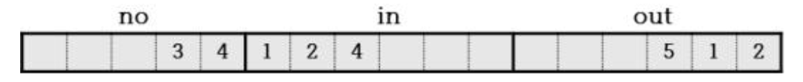

# HW1 과제 해설 — 데이터 타입과 변수

[레포지토리 안내](../../README.ko.md) | [English](Assignment-Explanation.md) | [한국어](Assignment-Explanation.ko.md)

> **최종 수정일:** 2026-10-19
>
> 문제풀이 중심의 C언어 연습, 김용일 외, Ch 2, 3

> **학습 목표:**
> 1. 소스 코드가 실행 파일이 되기까지의 단계와 변수, ASCII 코드의 개념을 설명할 수 있다
> 2. 정수형 변수를 선언하고 값을 대입하거나 초기화하여 출력할 수 있다
> 3. 같은 정수 값을 `%d`와 `%c`로 출력하여 ASCII 코드와 문자의 관계를 설명할 수 있다
> 4. 문자 폭, 정렬, 0 채움을 지정하는 형식 지정자로 출력 형식을 맞출 수 있다
> 5. 변수에 저장된 값으로 사칙연산과 나머지 연산을 하고 정수 나눗셈의 결과를 설명할 수 있다

**문항 출처:** 이종욱 교수, 컴퓨터언어실습Ⅰ (DCCS103-03)

---

## 목차

- [1. 과제 구성과 실행 방법](#1-과제-구성과-실행-방법)
- [2. 서술 문항](#2-서술-문항)
  - [2.1 실행 파일이 만들어지는 단계](#21-실행-파일이-만들어지는-단계)
  - [2.2 변수](#22-변수)
  - [2.3 ASCII 코드](#23-ascii-코드)
- [3. 코드 작성 문항](#3-코드-작성-문항)
  - [3.1 Q1. 변수 연습 (1)](#31-q1-변수-연습-1)
  - [3.2 Q2. 변수 연습 (2)](#32-q2-변수-연습-2)
  - [3.3 Q3. 변수 연습 (3)](#33-q3-변수-연습-3)
  - [3.4 Q4. 변수 연습 (4)](#34-q4-변수-연습-4)
- [요약](#요약)
- [점검 문제](#점검-문제)

---

<br>

## 1. 과제 구성과 실행 방법

이 과제는 2장과 3장에서 다루는 변수의 선언, 초기화, 대입과 `printf`의 형식 지정자를 연습한다. 과제는 서술 문항 세 개와 코드 작성 문항 네 개(Q1~Q4)로 이루어지며, 코드 작성 문항은 코드와 함께 코드 분석과 실행 결과 화면을 제출하도록 요구한다. Q2는 교재 문제 2-6, Q3은 교재 문제 3-4이다.

```text
Coursework/HW01_Data-Types-and-Variables/
├── Assignment-Explanation.ko.md
├── Assignment-Explanation.md
└── Solution/
    ├── Q1.c    # 변수의 선언, 대입, 출력
    ├── Q2.c    # 정수와 그에 대응하는 ASCII 문자의 출력
    ├── Q3.c    # 문자 폭, 정렬, 0 채움
    └── Q4.c    # 사칙연산과 나머지 연산
```

*그림 1. 과제 1의 디렉토리 구성*

각 풀이는 다음과 같이 컴파일하고 실행한다. 네 파일 모두 macOS의 Apple clang 21에서 `gcc -std=c99 -Wall`로 경고 없이 컴파일된다.

```bash
cd Coursework/HW01_Data-Types-and-Variables/Solution
gcc -std=c99 -Wall -o q1 Q1.c
./q1
```

문제의 실행 예시 마지막 줄 `Program ended with exit code: 0`은 프로그램이 출력한 것이 아니라 Xcode가 프로그램이 끝난 뒤 콘솔에 표시하는 문구이다. 네 풀이의 `main`에는 `return` 문이 없지만, C99부터는 `main`의 끝에 도달하면 0이 반환되므로 종료 코드는 모두 0이다([2장 1.4절](../../Lecture-Notes/Ch02_C-Program-Basics/Concepts_Lecture.ko.md#14-종료-코드)). 또 네 풀이는 `int main()`처럼 빈 괄호로 `main`을 정의하는데, 이는 유효한 정의이며 `-Wextra -pedantic`을 더하면 clang이 `-Wstrict-prototypes` 경고를 낼 뿐 동작에는 영향이 없다.

---

<br>

## 2. 서술 문항

### 2.1 실행 파일이 만들어지는 단계

**문제:** 소스코드가 실행파일이 되기까지의 각각의 단계를 설명하시오.

**해설:** 소스 코드는 전처리, 컴파일, 어셈블, 링크의 네 단계를 거쳐 실행 파일이 된다.

| 단계 | 하는 일 | 결과 |
|:-----|:-----|:-----|
| 전처리 | 전처리기가 `#include`로 지정한 헤더 파일의 내용을 포함하고, `#define` 매크로를 대치하며, 주석을 제거한다 | 전처리된 소스 (`.i`) |
| 컴파일 | 컴파일러가 문법과 타입을 검사하고 C 코드를 어셈블리 코드로 번역한다 | 어셈블리 소스 (`.s`) |
| 어셈블 | 어셈블러가 어셈블리 코드를 기계어로 바꾼다 | 오브젝트 파일 (`.o`, Visual Studio는 `.obj`) |
| 링크 | 링커가 오브젝트 파일과 `printf` 같은 라이브러리 함수의 코드를 결합하고 외부 참조를 해결한다 | 실행 파일 (`.exe`) |

*표 1. 소스 코드가 실행 파일이 되는 단계*

Visual Studio에서는 빌드 명령 하나로 네 단계가 모두 진행된다. 컴파일 단계까지 오류가 없어야 오브젝트 파일이 만들어지고, 링크 단계까지 오류가 없어야 실행 파일이 만들어진다. 자세한 과정은 [1장 3.2절](../../Lecture-Notes/Ch01_Programming-and-C-Language/Concepts_Lecture.ko.md#32-빌드-과정)에 정리되어 있다.

### 2.2 변수

**문제:** 변수란 무엇인가?

**해설:** **변수(variable)** 는 값을 저장하기 위해 메모리 공간에 이름을 붙여 둔 것으로, 프로그램 실행 중에 그 값을 바꿀 수 있다. 컴퓨터는 메모리의 각 바이트를 주소로 구분하여 접근하지만, 프로그래머는 코드를 작성할 때 주소 대신 변수 이름으로 그 공간에 접근한다. 변수는 사용하기 전에 데이터 타입과 이름을 선언해야 하며, 데이터 타입은 변수가 차지하는 메모리의 크기(`int`는 대개 4바이트)와 저장된 비트의 해석 방식을 결정한다. 선언과 동시에 값을 지정하는 것을 **초기화**, 이미 만든 변수에 `=`로 값을 저장하는 것을 **대입**이라고 한다. 자세한 내용은 [2장 2.4절](../../Lecture-Notes/Ch02_C-Program-Basics/Concepts_Lecture.ko.md#24-입출력에서의-변수-활용)과 [3장 3절](../../Lecture-Notes/Ch03_Data-Types-and-Variables/Concepts_Lecture.ko.md#3-변수)에 있다.

### 2.3 ASCII 코드

**문제:** 아스키 코드란 무엇인가?

**해설:** **ASCII(American Standard Code for Information Interchange)** 는 문자마다 정수 코드를 정해 둔 7비트 문자 코드이다. 0\~127의 128개 코드가 33개의 제어 문자(0\~31, 127)와 95개의 출력 가능한 문자(32\~126)로 이루어진다. 예를 들어 `'A'`는 65, `'a'`는 97, `'0'`은 48이다. C의 `char`형 변수에 문자를 저장하면 실제로는 그 문자의 ASCII 코드가 저장되므로, 같은 값을 `%d`로 출력하면 코드가, `%c`로 출력하면 문자가 나온다. 자세한 내용은 [3장 1.3절](../../Lecture-Notes/Ch03_Data-Types-and-Variables/Concepts_Lecture.ko.md#13-문자형)에 있다.

---

<br>

## 3. 코드 작성 문항

### 3.1 Q1. 변수 연습 (1)

**문제:** 실행 예시를 참고하여 다음 과정에 맞는 코드를 작성하시오.

- (a) 정수를 보관할 수 있는 변수 선언
- (b) 변수에 정수 데이터 `2020` 할당
- (c) 변수에 할당된 정보를 출력

**실행 예시:**

```text
data: 2020

Program ended with exit code: 0
```

**접근 방법:** 문제가 선언, 할당, 출력을 별도의 과정으로 제시하므로 초기화(`int data = 2020;`) 대신 선언문과 대입문을 따로 쓴다.

- (a) `int data;`로 정수형 변수를 선언하면 정수를 저장할 메모리 공간(대개 4바이트)이 확보되고 `data`라는 이름이 붙는다. 이 시점의 값은 정해지지 않은 쓰레기 값이다.
- (b) 대입 연산자 `=`는 오른쪽의 값 2020을 왼쪽 변수 `data`의 메모리 공간에 저장한다.
- (c) `printf`의 형식 문자열 `"data: %d"`에서 `%d`가 `data`에 저장된 값으로 대치되어 `data: 2020`이 출력된다.

**코드:** [Solution/Q1.c](Solution/Q1.c)

```c
/**
 * @file    A10303-1_C03Q1.c
 * @brief   Q1. 변수 연습 (1)
 * @author  박철원 (Cheolwon Park)
 * @date    2024-03-13
 */

#include <stdio.h>

int main()
{
	int data;
	data = 2020;
	printf("data: %d", data);
}
```

**실행 결과:**

```text
data: 2020
```

출력은 실행 예시의 첫 줄과 같다. 형식 문자열 끝에 `\n`이 없으므로 출력 뒤에서 줄이 바뀌지 않으며, 터미널에서 실행하면 셸 프롬프트가 `data: 2020` 바로 뒤에 이어서 나타난다.

**경계 조건:** (b)의 대입문보다 먼저 `printf`를 호출하면 초기화되지 않은 지역 변수를 읽게 되어 쓰레기 값이 출력되는 정의되지 않은 동작이 된다. 2020은 `int`의 범위(-2,147,483,648 ~ 2,147,483,647) 안에 있으므로 오버플로우는 생기지 않는다.

### 3.2 Q2. 변수 연습 (2)

**문제:** 변수 `val`을 0~255 사이의 임의의 정수값으로 초기화하고, 해당 변수에 저장된 값 및 대응하는 ASCII 문자를 출력하는 프로그램을 작성하시오.

**실행 예시:**

```text
val 98의 ASCII에 해당하는 문자: b

Program ended with exit code: 0
```

**참조:** 위 예시의 `val`은 `98`로 초기화된 상태이며, 출력된 `98`과 문자 `b`는 `val`에 저장된 정보를 출력한 것이다.

**접근 방법:** `int val = 65;`로 선언과 동시에 값을 지정(초기화)한다. 같은 변수를 `printf`에 두 번 넘기되 형식 지정자를 다르게 쓴다. `%d`는 값을 10진 정수로 출력하고, `%c`는 `int` 인자를 `unsigned char`로 바꾼 뒤 그 코드에 해당하는 문자 하나를 출력한다. 따라서 저장된 값은 하나이지만 정수 65와 문자 `A`가 함께 출력된다.

**코드:** [Solution/Q2.c](Solution/Q2.c)

```c
/**
 * @file    A10303-1_C03Q2.c
 * @brief   Q2. 변수 연습 (2)
 * @author  박철원 (Cheolwon Park)
 * @date    2024-03-13
 */

#include <stdio.h>

int main()
{
	int val = 65;
	printf("val %d의 ASCII에 해당하는 문자: %c", val, val);
}
```

**실행 결과:**

```text
val 65의 ASCII에 해당하는 문자: A
```

실행 예시는 `val`을 98로 초기화했고 풀이는 65로 초기화했으므로 숫자와 문자가 다르다. 문제가 0~255 사이의 임의의 값을 허용하므로 둘 다 요구사항을 만족하며, 풀이의 초기값을 98로 바꾸면 `val 98의 ASCII에 해당하는 문자: b`로 실행 예시와 똑같이 출력된다.

**경계 조건:**

- ASCII가 정의하는 코드는 0\~127이다. 그중 32\~126만 눈에 보이는 문자이고, 0\~31과 127은 제어 문자이므로 `%c`로 출력하면 줄바꿈(10)이나 탭(9)처럼 동작하거나 아무것도 보이지 않는다.
- 128\~255는 ASCII에 없는 값이므로 출력 결과가 터미널의 문자 인코딩에 따라 달라진다. UTF-8 터미널에서는 이 1바이트가 올바른 문자가 아니어서 깨진 문자로 보인다.
- 소스 파일이 UTF-8로 저장되어 있으므로 macOS와 Linux의 UTF-8 터미널에서는 형식 문자열의 한글이 그대로 출력되지만, 코드 페이지가 CP949인 Windows 콘솔에서는 한글이 깨질 수 있다.

### 3.3 Q3. 변수 연습 (3)

**문제:** 실행 예시와 그림을 참고하여 정수형 변수 `no`, `in`, `out`을 초기화한 뒤 출력하시오.



*그림 2. 변수 no, in, out의 출력 칸과 정렬*

각 변수 `no`, `in`, `out`을 출력할 때 순서대로 5칸, 6칸, 6칸을 차지하도록 하되, 각각 우측, 좌측, 우측으로 정렬하고, 변수 `out`은 실행 예시처럼 빈칸을 0으로 채워 출력한다.

**실행 예시:**

```text
   34124   000512

Program ended with exit code: 0
```

**접근 방법:** 그림의 칸에 들어 있는 숫자에서 초기값 `no` = 34, `in` = 124, `out` = 512를 읽고, 형식 지정자 하나에 문자 폭과 정렬, 0 채움을 함께 지정한다([3장 5.2절](../../Lecture-Notes/Ch03_Data-Types-and-Variables/Concepts_Lecture.ko.md#52-출력-폭과-정렬)).

| 변수 | 형식 지정자 | 의미 | 출력 |
|:-----|:-----|:-----|:-----|
| `no` | `%5d` | 폭 5, 우측 정렬 (기본) | `␣␣␣34` |
| `in` | `%-6d` | 폭 6, 좌측 정렬 | `124␣␣␣` |
| `out` | `%06d` | 폭 6, 우측 정렬, 빈칸을 0으로 채움 | `000512` |

*표 2. Q3의 형식 지정자와 출력 (␣는 빈칸)*

세 형식 지정자를 하나의 형식 문자열 `"%5d%-6d%06d"`에 사이 공백 없이 이어 쓰므로 5 + 6 + 6 = 17글자가 한 줄에 출력된다. `in`의 뒤쪽 빈칸 3개 때문에 `124`와 `000512` 사이에 공백이 생긴다.

**코드:** [Solution/Q3.c](Solution/Q3.c)

```c
/**
 * @file    A10303-1_C03Q3.c
 * @brief   Q3. 변수 연습 (3)
 * @author  박철원 (Cheolwon Park)
 * @date    2024-03-13
 */

#include <stdio.h>

int main()
{
	int no = 34;
	int in = 124;
	int out = 512;

	printf("%5d%-6d%06d", no, in, out);
}
```

**실행 결과:**

```text
   34124   000512
```

출력은 앞의 빈칸 3개를 포함하여 실행 예시의 첫 줄과 글자 단위까지 같다.

**경계 조건:**

- 문자 폭은 최소 폭이다. 값의 자릿수가 폭보다 많으면 잘리지 않고 모두 출력되므로, `no`가 123456이면 `%5d`는 `123456`을 출력하여 정렬이 어긋난다.
- `-`와 `0`을 함께 쓰면 `0`은 무시된다. `%-06d`는 `%-6d`와 같으며 gcc와 clang은 이 조합에 경고를 낸다.
- 음수를 0으로 채우면 부호가 맨 앞에 온다. `out`이 -512이면 `%06d`는 `-00512`를 출력한다.

### 3.4 Q4. 변수 연습 (4)

**문제:** 두 변수 `vOne`, `vTwo`를 선언한 뒤 각각 `13`, `3`으로 초기화하고 실행 예시를 참고하여 사칙연산을 수행해 출력하는 코드를 작성하시오. 이때, `printf` 문 내부에 정수값을 직접 삽입하여 출력하지 않도록 작성한다.

**실행 예시:**

```text
13 + 3 = 16
13 - 3 = 10
13 * 3 = 39
13 / 3 = 4
13 % 3 = 1

Program ended with exit code: 0
```

**접근 방법:** 식에 쓰이는 두 수와 결과를 모두 변수와 식으로 출력하여 `printf` 안에 정수 리터럴을 쓰지 않는다. 한 줄마다 형식 지정자 세 개를 쓰고 `vOne`, `vTwo`, 연산 결과를 순서대로 넘기며, 연산 결과는 `vOne + vTwo`처럼 인자 자리에서 바로 계산한다.

- 두 피연산자가 모두 `int`이므로 `/`는 정수 나눗셈이다. 13 / 3의 몫 4.33...에서 소수 부분이 버려져 4가 된다.
- `%`는 나머지 연산자이며 13 % 3은 1이다. 두 결과는 (13 / 3) × 3 + 13 % 3 = 4 × 3 + 1 = 13의 관계를 만족한다.
- 형식 문자열에서 `%`는 형식 지정자의 시작을 뜻하므로, 문자 `%` 자체를 출력하려면 `%%`로 쓴다.

**코드:** [Solution/Q4.c](Solution/Q4.c)

```c
/**
 * @file    A10303-1_C03Q4.c
 * @brief   Q4. 변수 연습 (4)
 * @author  박철원 (Cheolwon Park)
 * @date    2024-03-13
 */

#include <stdio.h>

int main()
{
	int vOne = 13;
	int vTwo = 3;

	printf("%d + %d = %d\n", vOne, vTwo, vOne + vTwo);
	printf("%d - %d = %d\n", vOne, vTwo, vOne - vTwo);
	printf("%d * %d = %d\n", vOne, vTwo, vOne * vTwo);
	printf("%d / %d = %d\n", vOne, vTwo, vOne / vTwo);
	printf("%d %% %d = %d\n", vOne, vTwo, vOne % vTwo);
}
```

**실행 결과:**

```text
13 + 3 = 16
13 - 3 = 10
13 * 3 = 39
13 / 3 = 4
13 % 3 = 1
```

다섯 줄 모두 실행 예시와 같다. Q1~Q3과 달리 형식 문자열마다 `\n`이 있으므로 각 결과가 한 줄씩 출력된다.

**경계 조건:**

- `vTwo`가 0이면 `/`와 `%`가 0으로 나누기가 되어 정의되지 않은 동작이 발생한다. 0이 될 수 있는 값으로 나누려면 먼저 검사해야 한다.
- C99부터 정수 나눗셈은 0 쪽으로 버림하므로 `vOne`이 -13이면 -13 / 3은 -4, -13 % 3은 -1이다. 나머지의 부호는 왼쪽 피연산자를 따른다.
- `%`는 정수형에만 쓸 수 있다. 실수 나눗셈의 결과가 필요하면 `(double)vOne / vTwo`처럼 캐스팅한다([3장 6.2절](../../Lecture-Notes/Ch03_Data-Types-and-Variables/Concepts_Lecture.ko.md#62-명시적-형-변환-캐스팅)).

---

<br>

## 요약

| 개념 | 핵심 요약 |
|:-----|:-----|
| 빌드 단계 | 소스 코드는 전처리, 컴파일, 어셈블, 링크를 거쳐 실행 파일이 된다. |
| 변수 | 값을 저장하기 위해 이름을 붙인 메모리 공간이며, 사용 전에 데이터 타입과 이름을 선언한다. |
| 선언, 대입, 초기화 | Q1은 선언 뒤에 `=`로 대입하고, Q2~Q4는 선언과 동시에 초기화한다. |
| ASCII 코드 | 문자마다 0\~127의 정수 코드를 정한 7비트 코드이며, 32\~126이 출력 가능한 문자이다. |
| `%d`와 `%c` | 같은 정수 값을 `%d`는 10진수로, `%c`는 그 코드의 문자로 출력한다. |
| 문자 폭과 정렬 | `%5d`는 우측 정렬, `%-6d`는 좌측 정렬, `%06d`는 0 채움이며 폭은 최소 폭이다. |
| 정수 나눗셈과 나머지 | `int`끼리의 `/`는 소수 부분을 버리고, `%`는 나머지를 구하며, `%%`는 문자 `%`를 출력한다. |
| 종료 코드 | C99부터 `main`의 끝에 도달하면 0이 반환되므로 네 풀이의 종료 코드는 모두 0이다. |

---

<br>

## 점검 문제

1. **`%d`와 `%c`:** Q2의 초기값을 48로 바꾸면 출력은 어떻게 되는가?

   <details>
   <summary>정답</summary>

   `val 48의 ASCII에 해당하는 문자: 0`이 출력된다. `%d`는 48을 10진수로 출력하고, `%c`는 ASCII 코드 48에 해당하는 숫자 문자 `'0'`을 출력한다.

   </details>

2. **문자 폭과 정렬:** `printf("[%4d][%-4d][%04d]", 7, 7, 7);`의 출력을 쓰라.

   <details>
   <summary>정답</summary>

   `[   7][7   ][0007]`이다. `%4d`는 4칸에 우측 정렬하여 앞에 빈칸 3개, `%-4d`는 좌측 정렬하여 뒤에 빈칸 3개를 두고, `%04d`는 앞의 빈칸 3개를 0으로 채운다.

   </details>

3. **정수 나눗셈과 나머지:** Q4에서 `vOne`을 17, `vTwo`를 5로 바꾸면 `/`와 `%` 줄의 결과는 각각 얼마인가?

   <details>
   <summary>정답</summary>

   `17 / 5 = 3`, `17 % 5 = 2`이다. 정수 나눗셈은 3.4의 소수 부분을 버려 3이 되고, 나머지는 17 - 3 × 5 = 2이다.

   </details>

4. **`%%`:** Q4의 마지막 `printf`에서 `%%` 대신 `%`를 하나만 쓰면 어떤 문제가 생기는가?

   <details>
   <summary>정답</summary>

   `printf`는 `%`를 형식 지정자의 시작으로 해석하므로 `"%d % %d = %d\n"`의 `% %`를 형식 지정자로 읽으려 한다. 이는 올바른 형식 지정자가 아니므로 C 표준에서 결과가 정의되지 않는다. macOS에서 실행하면 `% %`가 `%` 하나로 출력되고 뒤의 `d`는 일반 문자로 남아 `13 %d = 3`이 출력되며, 형식 지정자와 인자의 대응이 어긋나 마지막 인자가 쓰이지 않는다. clang은 쓰이지 않는 인자에 대해 경고한다. 문자 `%`를 출력하려면 `%%`로 써야 한다.

   </details>

5. **초기화되지 않은 변수:** Q1에서 `data = 2020;` 줄을 지우면 출력은 어떻게 되는가?

   <details>
   <summary>정답</summary>

   `data`는 초기화되지 않은 지역 변수이므로 쓰레기 값을 읽게 되어 출력값을 예측할 수 없다. 이는 정의되지 않은 동작이며, 컴파일러는 초기화되지 않은 변수를 사용한다는 경고를 낼 수 있다(Visual Studio는 컴파일 에러로 처리하기도 한다).

   </details>
