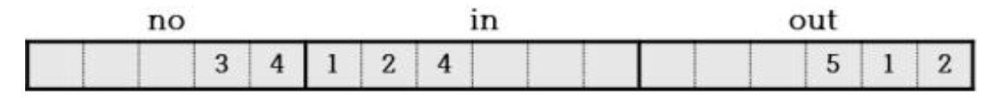

# HW1 과제 안내문 — 데이터 타입과 변수

[레포지토리 안내](../../../README.ko.md) | [English](Assignment.md) | [한국어](Assignment.ko.md)

> **최종 수정일:** 2026-11-16

컴퓨터언어실습Ⅰ 3분반의 1차 과제이다. 개념을 묻는 서술 문항 세 개와 코드 작성 문제 네 개로 이루어진다.

- **제출 기한:** 2024-03-18 (월) 14:00, 수업 시작 전까지이다.
- **제출 방법:** 과목이 배포한 과제 제출 양식(.hwp)에 작성하여 블랙보드의 과제 제출란에만 제출한다.
- **작성 내용:** 코드 작성 문제는 코드, 코드 분석, 실행 결과 화면 캡처를 반드시 포함해야 한다.
- **실행 예시:** 실행 예시 끝의 `Program ended with exit code: 0`은 프로그램의 출력이 아니라 Xcode 콘솔이 덧붙이는 종료 메시지이다.

---

<br>

## 서술 문항 1. 실행 파일이 만들어지는 단계

소스코드가 실행파일이 되기까지의 각각의 단계를 설명하라.

---

<br>

## 서술 문항 2. 변수

변수란 무엇인가?

---

<br>

## 서술 문항 3. ASCII 코드

아스키 코드란 무엇인가?

---

<br>

## 문제 1. 변수 연습 (1)

실행 예시를 참고하여 다음 과정에 맞는 코드를 작성하라.

- (a) 정수를 보관할 수 있는 변수 선언
- (b) 변수에 정수 데이터 `2020` 할당
- (c) 변수에 할당된 정보를 출력

**실행 예시:**

```text
data: 2020

Program ended with exit code: 0
```

---

<br>

## 문제 2. 변수 연습 (2)

**교재 문항:** 2장 연습 문제 6번

변수 `val`을 0~255 사이의 임의의 정수값으로 초기화하고, 해당 변수에 저장된 값 및 대응하는 ASCII 문자를 출력하는 프로그램을 작성하라.

**실행 예시:**

```text
val 98의 ASCII에 해당하는 문자: b

Program ended with exit code: 0
```

**참조:** 위 예시의 `val`은 `98`로 초기화된 상태이며, 출력된 `98`과 문자 `b`는 `val`에 저장된 정보를 출력한 것이다.

---

<br>

## 문제 3. 변수 연습 (3)

**교재 문항:** 3장 연습 문제 4번

실행 예시와 그림을 참고하여 정수형 변수 `no`, `in`, `out`을 초기화한 뒤 출력하라.



*그림 1. 변수 no, in, out의 출력 칸과 정렬*

각 변수 `no`, `in`, `out`을 출력할 때 순서대로 5칸, 6칸, 6칸을 차지하도록 하되, 각각 우측, 좌측, 우측으로 정렬하고, 변수 `out`은 실행 예시처럼 빈칸을 0으로 채워 출력한다.

**실행 예시:**

```text
   34124   000512

Program ended with exit code: 0
```

---

<br>

## 문제 4. 변수 연습 (4)

두 변수 `vOne`, `vTwo`를 선언한 뒤 각각 `13`, `3`으로 초기화하고 실행 예시를 참고하여 사칙연산을 수행해 출력하는 코드를 작성하라. 이때, `printf` 문 내부에 정수값을 직접 삽입하여 출력하지 않도록 작성한다.

**실행 예시:**

```text
13 + 3 = 16
13 - 3 = 10
13 * 3 = 39
13 / 3 = 4
13 % 3 = 1

Program ended with exit code: 0
```

---

<br>

문제를 풀어 본 뒤 [과제 해설](../Assignment-Explanation.ko.md)에서 정답과 풀이를 볼 수 있다.
