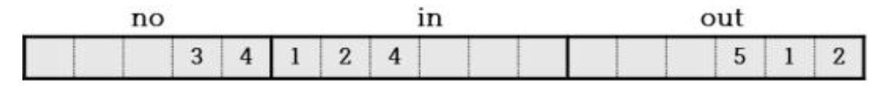

# HW1 Assignment Handout — Data Types and Variables

[Repository Guide](../../../README.md) | [English](Assignment.md) | [한국어](Assignment.ko.md)

> **Last Updated:** 2026-11-24

This is the first assignment of section 3 of Computer Language and Training Ⅰ. It consists of three written questions on concepts and four coding problems.

- **Contents:** A coding problem must include the code, an analysis of the code, and a screenshot of the output.
- **Sample Runs:** The line `Program ended with exit code: 0` at the end of a sample run is not output of the program but a termination message that the Xcode console appends.

---

<br>

## Written Question 1. Stages of Building an Executable

Explain each stage that source code goes through to become an executable.

---

<br>

## Written Question 2. Variables

What is a variable?

---

<br>

## Written Question 3. ASCII Code

What is ASCII code?

---

<br>

## Problem 1. Variable Practice (1)

Referring to the sample run, write code that performs the following steps.

- (a) Declare a variable that can hold an integer
- (b) Assign the integer data `2020` to the variable
- (c) Print the information assigned to the variable

**Sample Run:**

```text
data: 2020

Program ended with exit code: 0
```

---

<br>

## Problem 2. Variable Practice (2)

**Textbook Problem:** Chapter 2 exercise 6

Write a program that initializes the variable `val` to an arbitrary integer between 0 and 255 and prints the value stored in the variable and the corresponding ASCII character.

**Sample Run:**

```text
val 98의 ASCII에 해당하는 문자: b

Program ended with exit code: 0
```

**Reference:** In the sample above, `val` is initialized to `98`, and the printed `98` and the character `b` are the information stored in `val`. (The output text means "The character corresponding to ASCII of val 98: b".)

---

<br>

## Problem 3. Variable Practice (3)

**Textbook Problem:** Chapter 3 exercise 4

Referring to the sample run and the figure, initialize the integer variables `no`, `in`, and `out` and print them.



*Figure 1. Output columns and alignment of variables no, in, and out*

Print the variables `no`, `in`, and `out` so that they occupy 5, 6, and 6 columns in that order, aligned right, left, and right, respectively, and fill the empty columns of `out` with 0 as in the sample run.

**Sample Run:**

```text
   34124   000512

Program ended with exit code: 0
```

---

<br>

## Problem 4. Variable Practice (4)

Declare two variables `vOne` and `vTwo`, initialize them to `13` and `3`, and, referring to the sample run, write code that performs and prints the four arithmetic operations. Do not print by inserting integer values directly inside the `printf` statements.

**Sample Run:**

```text
13 + 3 = 16
13 - 3 = 10
13 * 3 = 39
13 / 3 = 4
13 % 3 = 1

Program ended with exit code: 0
```

---

<br>

After solving the problems, see the [assignment explanation](../Assignment-Explanation.md) for the answers and solutions.
