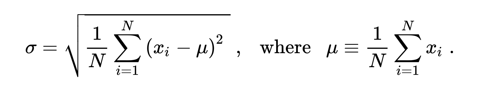

# HW7 과제 해설 — 배열

[레포지토리 안내](../../README.ko.md) | [English](Assignment-Explanation.md) | [한국어](Assignment-Explanation.ko.md)

> **최종 수정일:** 2026-10-27

> **학습 목표:**
> 1. 입력받은 실수를 배열에 저장하여 평균과 표준편차를 계산할 수 있다
> 2. 첫 원소로 초기화한 최댓값과 최솟값을 나머지 원소와 비교하여 갱신할 수 있다
> 3. 인덱스 `i`와 `n - 1 - i`의 대응을 이용하여 배열의 원소 순서를 뒤집을 수 있다
> 4. 모표준편차와 표본표준편차의 차이를 설명할 수 있다
> 5. 순차 탐색으로 배열에서 찾는 값의 위치를 모두 구하고 일치한 개수로 값의 유무를 판별할 수 있다

**문항 출처:** 이종욱 교수, 컴퓨터언어실습Ⅰ (DCCS103-03) / 박철원

---

## 목차

- [1. 과제 구성과 실행 방법](#1-과제-구성과-실행-방법)
- [2. 문제 1: 평균과 표준편차 구하기](#2-문제-1-평균과-표준편차-구하기)
  - [2.1 요구사항](#21-요구사항)
  - [2.2 해결 방법](#22-해결-방법)
  - [2.3 코드와 실행 결과](#23-코드와-실행-결과)
  - [2.4 경계 경우](#24-경계-경우)
- [3. 문제 2: 배열에서 대소 비교](#3-문제-2-배열에서-대소-비교)
  - [3.1 요구사항](#31-요구사항)
  - [3.2 해결 방법](#32-해결-방법)
  - [3.3 코드와 실행 결과](#33-코드와-실행-결과)
  - [3.4 경계 경우](#34-경계-경우)
- [4. 문제 3: 배열 원소 뒤집기](#4-문제-3-배열-원소-뒤집기)
  - [4.1 요구사항](#41-요구사항)
  - [4.2 해결 방법](#42-해결-방법)
  - [4.3 코드와 실행 결과](#43-코드와-실행-결과)
  - [4.4 경계 경우](#44-경계-경우)
- [5. 문제 4: 배열에서 값 찾기](#5-문제-4-배열에서-값-찾기)
  - [5.1 요구사항](#51-요구사항)
  - [5.2 해결 방법](#52-해결-방법)
  - [5.3 코드와 실행 결과](#53-코드와-실행-결과)
  - [5.4 경계 경우](#54-경계-경우)
- [요약](#요약)
- [점검 문제](#점검-문제)

---

<br>

## 1. 과제 구성과 실행 방법

1차원 배열에 값을 저장하고 반복문으로 처리하는 네 문제로 이루어진 과제이다([7장](../../Lecture-Notes/Ch07_Arrays/Concepts_Lecture.ko.md)). 과제는 배열을 이해하기 위한 문제 두 개를 수강생이 직접 내고 풀게 하는 자유 문항을 두었으며, 문제 3과 문제 4가 이 자유 문항이다.

```text
Coursework/HW07_Arrays/
└── Solution/
    ├── Q1.c    # 문제 1: 실수 10개의 평균과 표준편차
    ├── Q2.c    # 문제 2: 정수 7개 중 최댓값과 최솟값
    ├── Q3.c    # 문제 3: 실수 배열의 원소를 역순으로 복사
    └── Q4.c    # 문제 4: 정수 배열에서 입력한 값의 위치와 개수
```

*그림 1. HW7 과제의 디렉토리 구성*

```bash
cd Coursework/HW07_Arrays/Solution
gcc -std=c99 -Wall -o Q1 Q1.c -lm && ./Q1
gcc -std=c99 -Wall -o Q2 Q2.c && ./Q2
gcc -std=c99 -Wall -o Q3 Q3.c && ./Q3
gcc -std=c99 -Wall -o Q4 Q4.c && ./Q4
```

`Q1.c`는 `<math.h>`의 `sqrt()`를 쓰므로 리눅스의 gcc에서는 수학 라이브러리를 링크하는 `-lm`이 필요하고, macOS에서는 생략해도 된다. 실행 예시의 마지막 줄 `Program ended with exit code: 0`은 프로그램의 출력이 아니라 Xcode 콘솔이 덧붙이는 종료 메시지이다.

---

<br>

## 2. 문제 1: 평균과 표준편차 구하기

### 2.1 요구사항

사용자로부터 임의의 실수 데이터 10개를 입력받고, 배열 크기가 10인 1차원 실수 배열에 저장한다. 배열에 저장된 데이터의 평균과 표준편차를 구해 출력하라.

표준편차($\sigma$)는 다음과 같이 구할 수 있다. 첫 번째 표본에서 평균을 뺀 값을 제곱하고, 두 번째와 세 번째 표본, ..., 마지막 표본까지 같은 방식으로 연산하여 합한다. 이를 표본 개수로 나눈 값의 양의 제곱근이 표준편차가 된다.



*그림 2. 표준편차와 평균의 공식*

$$\sigma = \sqrt{\frac{1}{N}\sum_{i=1}^{N}(x_i - \mu)^2}, \quad \mu = \frac{1}{N}\sum_{i=1}^{N} x_i$$

연산값에 제곱근을 취하기 위해 `<math.h>` 헤더를 추가하고, `sqrt()` 함수를 이용하라. 실수는 `double` 타입을 사용하며, `scanf()`의 서식 지정자는 `%lf`, `printf()`의 서식 지정자는 `%f`를 쓴다.

**실행 예시:**

```text
>> Input data (1): 1.4
>> Input data (2): 2.3
>> Input data (3): 4.5
>> Input data (4): 0.4
>> Input data (5): -23.4
>> Input data (6): 14.5
>> Input data (7): 45.2
>> Input data (8): 10.0
>> Input data (9): 9.3
>> Input data (10): 3.4

배열의 내용: 1.4  2.3  4.5  0.4  -23.4  14.5  45.2  10.0  9.3  3.4
-> 평균: 6.76
-> 표준편차: 16.03

Program ended with exit code: 0
```

### 2.2 해결 방법

평균을 알아야 각 값의 편차를 구할 수 있으므로, 배열을 두 번 순회한다.

1. **입력과 합계:** 첫 번째 반복문에서 `>> Input data (i + 1): ` 프롬프트를 출력하고 `%lf`로 읽은 값을 `arr_num[i]`에 저장하면서 동시에 `sum`에 더한다.
2. **배열 출력과 평균:** 저장한 값을 `%.1f`로 출력한 뒤 `ave = sum / 10`으로 평균을 구한다. `sum`이 `double`이므로 실수 나눗셈이 된다.
3. **표준편차:** 두 번째 반복문에서 `(arr_num[i] - ave)`의 제곱을 `Dev`에 더하고, `sqrt(Dev / 10)`으로 표준편차를 구한다. `Dev / 10`은 분산이다.

실행 예시의 값을 대입하면 합은 67.6이므로 평균은 6.76이고, 편차 제곱의 합은 2569.584이므로 분산은 256.9584, 표준편차는 $\sqrt{256.9584} \approx 16.03$이다([7장 5.2절](../../Lecture-Notes/Ch07_Arrays/Concepts_Lecture.ko.md#52-평균과-표준편차)).

### 2.3 코드와 실행 결과

**코드:** [Solution/Q1.c](Solution/Q1.c)

```c
/**
 * @file    A10303-1_C07Q1.c
 * @brief   Q1. 평균과 표준편차 구하기
 * @author  박철원 (Cheolwon Park)
 * @date    2024-05-10
 */

#include <stdio.h>
#include <math.h>

int main()
{
	double arr_num[10], sum = 0, ave, Dev = 0, stdDev;

	for (int i = 0; i < 10; i++) {
		printf(">> Input data (%d): ", i + 1);
		scanf(" %lf", &arr_num[i]);
		sum += arr_num[i];
	}
	printf("배열의 내용: ");

	for (int i = 0; i < 10; i++) {
		printf("%.1f ", arr_num[i]);
	}
	ave = sum / 10;
	printf("\n-> 평균: %.2f", ave);

	for (int i = 0; i < 10; i++) {
		Dev += (arr_num[i] - ave)*(arr_num[i] - ave);
	}
	stdDev = sqrt(Dev / 10);
	printf("\n-> 표준편차: %.2f", stdDev);
}
```

**실행 결과:** 실행 예시의 값을 입력하면 평균 6.76, 표준편차 16.03이 나온다. 실행 예시와 달리 입력과 `배열의 내용:` 사이에 빈 줄이 없고, 값 사이를 공백 한 칸으로 구분하므로 줄 끝에 공백이 하나 남는다. 마지막 줄 뒤에는 줄바꿈이 없다.

```text
>> Input data (1): 1.4
>> Input data (2): 2.3
>> Input data (3): 4.5
>> Input data (4): 0.4
>> Input data (5): -23.4
>> Input data (6): 14.5
>> Input data (7): 45.2
>> Input data (8): 10.0
>> Input data (9): 9.3
>> Input data (10): 3.4
배열의 내용: 1.4 2.3 4.5 0.4 -23.4 14.5 45.2 10.0 9.3 3.4 
-> 평균: 6.76
-> 표준편차: 16.03
```

### 2.4 경계 경우

- **모든 값이 같을 때:** 편차가 모두 0이므로 `Dev`는 0이고 표준편차는 0.00이 된다.
- **모표준편차와 표본표준편차:** 과제의 공식은 편차 제곱의 합을 $N$으로 나누는 모표준편차이다. 표본으로 모집단을 추정할 때 쓰는 표본표준편차는 $N - 1$로 나누며, 실행 예시의 값에서는 $\sqrt{2569.584 / 9} \approx 16.90$이 된다.
- **출력의 반올림:** 배열 출력은 `%.1f`이므로 소수 둘째 자리 이하가 있는 입력(예: 1.25)은 반올림되어 표시되지만, 계산에는 입력한 값 그대로 쓰인다.

---

<br>

## 3. 문제 2: 배열에서 대소 비교

### 3.1 요구사항

사용자로부터 7개의 임의의 정수를 순차적으로 입력받아 크기가 7인 배열에 저장한 뒤, 대소 비교를 통해 배열에서 가장 큰 값과 가장 작은 값을 찾아 출력하는 프로그램을 작성하라.

**실행 예시:**

```text
>> Input data (1): 97
>> Input data (2): 40
>> Input data (3): -35
>> Input data (4): 0
>> Input data (5): 14
>> Input data (6): -49
>> Input data (7): 100

배열에서 가장 큰 값: 100
배열에서 가장 작은 값: -49

Program ended with exit code: 0
```

### 3.2 해결 방법

`min`과 `max`를 모두 첫 원소 `arr_num[0]`으로 초기화한 뒤, 인덱스 1부터 6까지 각 원소와 비교하여 갱신한다([7장 5.1절](../../Lecture-Notes/Ch07_Arrays/Concepts_Lecture.ko.md#51-최댓값--최솟값-찾기)). 갱신은 조건 연산자로 쓴다. `min = (arr_num[i] < min) ? arr_num[i] : min;`은 현재 원소가 더 작으면 그 원소를, 아니면 기존 `min`을 다시 대입한다.

첫 원소로 초기화하므로 입력이 모두 음수이거나 모두 매우 큰 수여도 올바른 결과를 얻는다. 0이나 임의의 큰 수로 초기화하면, 예를 들어 모든 입력이 음수일 때 `max`가 0으로 남는 오류가 생길 수 있다.

### 3.3 코드와 실행 결과

**코드:** [Solution/Q2.c](Solution/Q2.c)

```c
/**
 * @file    A10303-1_C07Q2.c
 * @brief   Q2. 배열에서 대소 비교
 * @author  박철원 (Cheolwon Park)
 * @date    2024-05-10
 */

#include <stdio.h>

int main()
{
	int arr_num[7], min, max;

	for (int i = 0; i < 7; i++) {
		printf(">> Input data (%d): ", i + 1);
		scanf(" %d", &arr_num[i]);
	}
	min = arr_num[0];
	max = arr_num[0];

	for (int i = 1; i < 7; i++) {
		min = (arr_num[i] < min) ? arr_num[i] : min;
		max = (arr_num[i] > max) ? arr_num[i] : max;
	}

	printf("\n배열에서 가장 큰 값: %d\n", max);
	printf("배열에서 가장 작은 값 : %d\n", min);
}
```

**실행 결과:** 실행 예시의 값을 입력하면 가장 큰 값 100과 가장 작은 값 -49가 출력된다. 다만 둘째 결과 줄은 코드의 문자열대로 `가장 작은 값 : -49`처럼 콜론 앞에 공백이 있어 실행 예시와 한 칸 다르다.

```text
>> Input data (1): 97
>> Input data (2): 40
>> Input data (3): -35
>> Input data (4): 0
>> Input data (5): 14
>> Input data (6): -49
>> Input data (7): 100

배열에서 가장 큰 값: 100
배열에서 가장 작은 값 : -49
```

### 3.4 경계 경우

- **같은 값이 여러 개일 때:** 최댓값이나 최솟값이 여러 번 나와도 값만 출력하므로 결과에 영향이 없다. 위치를 함께 출력하려면 비교 연산자가 `<`인지 `<=`인지에 따라 처음 위치와 마지막 위치 중 어느 쪽이 남는지가 달라진다.
- **모든 값이 같을 때:** 갱신이 한 번도 일어나지 않으므로 `max`와 `min`이 모두 그 값이다.
- **비교 횟수:** 원소 7개에 대해 최댓값과 최솟값을 각각 6번씩, 모두 12번 비교한다.

---

<br>

## 4. 문제 3: 배열 원소 뒤집기

### 4.1 요구사항

실수형 데이터가 저장된 배열의 원소 순서를 역순으로 바꾸는 프로그램을 작성하라.

**프로그램 요구사항:**

1. 배열의 크기는 10으로 설정한다.
2. 순서대로 아래 값으로 초기화하여 사용한다.
    - 1.2, 3.1, 4.3, 4.5, 6.7, 2.3, 8.7, 9.5, 2.3, 5.8

**실행 예시:**

```text
배열(원본): 1.2  3.1  4.3  4.5  6.7  2.3  8.7  9.5  2.3  5.8
배열(역순): 5.8  2.3  9.5  8.7  2.3  6.7  4.5  4.3  3.1  1.2

Program ended with exit code: 0
```

### 4.2 해결 방법

크기가 같은 두 번째 배열 `arrRev`를 두고, `arrRev[i] = arr[9 - i]`로 원본의 뒤에서부터 복사한다. 크기가 $n$인 배열에서 인덱스 `i`의 원소는 역순으로 `n - 1 - i` 자리에 가므로, $n = 10$이면 `i` = 0은 9, `i` = 1은 8, ..., `i` = 9는 0과 대응한다. 그다음 두 배열을 차례로 출력한다.

이 방법은 원본을 그대로 두고 역순 배열을 따로 만든다. 원본 배열 자체를 뒤집어야 하면 [7장 5.3절](../../Lecture-Notes/Ch07_Arrays/Concepts_Lecture.ko.md#53-배열-뒤집기)처럼 양 끝에서 가운데로 오면서 `arr[i]`와 `arr[9 - i]`를 `10 / 2` = 5번 교환하면 되고, 추가 배열이 필요 없다.

### 4.3 코드와 실행 결과

**코드:** [Solution/Q3.c](Solution/Q3.c)

```c
/**
 * @file    A10303-1_C07Q3.c
 * @brief   Q3. 배열 원소 뒤집기
 * @author  박철원 (Cheolwon Park)
 * @date    2024-05-10
 */

#include <stdio.h>

int main()
{
	double arr[10] = { 1.2, 3.1, 4.3, 4.5, 6.7, 2.3, 8.7, 9.5, 2.3, 5.8 };
	double arrRev[10];

	for (int i = 0; i < 10; i++) {
		arrRev[i] = arr[9 - i];
	}

	printf("\n배열(원본): ");
	for (int i = 0; i < 10; i++) {
		printf("%.1f  ", arr[i]);
	}
	printf("\n배열(역순): ");
	for (int i = 0; i < 10; i++) {
		printf("%.1f  ", arrRev[i]);
	}
}
```

**실행 결과:** 원본 배열과 역순 배열이 출력된다. 첫 `printf`가 `\n`으로 시작하므로 출력 맨 앞에 빈 줄이 하나 있고, 값마다 뒤에 공백 두 칸을 출력하므로 줄 끝에 공백 두 칸이 남는다.

```text

배열(원본): 1.2  3.1  4.3  4.5  6.7  2.3  8.7  9.5  2.3  5.8  
배열(역순): 5.8  2.3  9.5  8.7  2.3  6.7  4.5  4.3  3.1  1.2  
```

### 4.4 경계 경우

- **크기의 하드코딩:** 크기 10과 마지막 인덱스 9가 코드 여러 곳에 흩어져 있다. `#define SIZE 10`을 두고 `arr[SIZE - 1 - i]`로 쓰면 크기를 바꿀 때 한 곳만 고치면 된다.
- **제자리 뒤집기의 반복 횟수:** 교환 방식으로 바꿀 때 반복을 `SIZE`번 하면 각 쌍이 두 번 교환되어 원래 순서로 돌아가므로, 반복은 `SIZE / 2`번이어야 한다. 크기가 홀수이면 가운데 원소는 교환하지 않는다.

---

<br>

## 5. 문제 4: 배열에서 값 찾기

### 5.1 요구사항

정수형 데이터가 저장된 배열에서 사용자가 입력한 값을 찾아, 그 값이 저장된 위치와 개수를 출력하는 프로그램을 작성하라.

**프로그램 요구사항:**

1. 배열의 크기는 10으로 설정한다.
2. 순서대로 아래 값으로 초기화하여 사용한다.
    - 7, 3, 9, 3, 12, 5, 3, 8, 1, 9
3. 찾을 값이 배열에 있으면 그 값이 저장된 인덱스를 모두 출력한 뒤 개수를 출력하고, 없으면 없다는 안내를 출력한다.

**실행 예시:**

```text
배열의 내용: 7 3 9 3 12 5 3 8 1 9
>> 찾을 값: 3
-> 인덱스: 1 3 6
-> 개수: 3

Program ended with exit code: 0
```

```text
배열의 내용: 7 3 9 3 12 5 3 8 1 9
>> 찾을 값: 4
-> 찾는 값이 배열에 없습니다.

Program ended with exit code: 0
```

### 5.2 해결 방법

배열의 처음부터 끝까지 각 원소를 찾는 값 `key`와 차례로 비교하는 순차 탐색을 쓴다([7장 5.5절](../../Lecture-Notes/Ch07_Arrays/Concepts_Lecture.ko.md#55-순차-탐색)). 같은 값이 여러 번 저장되어 있을 수 있으므로, 처음 일치한 위치에서 멈추지 않고 반복을 끝까지 진행한다.

1. **배열 출력과 입력:** 크기를 `#define SIZE 10`으로 정해 두고 배열의 내용을 출력한 뒤, `>> 찾을 값: ` 프롬프트를 출력하고 `%d`로 `key`를 읽는다.
2. **탐색:** `arr[i] == key`인 원소를 만날 때마다 인덱스 `i`를 출력하고 `count`를 1 늘린다. `count`가 0일 때가 처음 일치한 때이므로, 그때만 `-> 인덱스:`를 먼저 출력한다.
3. **결과 판별:** 반복이 끝난 뒤 `count`가 0보다 크면 개수를 출력하고, 0이면 한 번도 일치하지 않은 것이므로 없다는 안내를 출력한다. `count`는 개수를 세는 동시에 값이 있는지를 나타내는 역할도 한다.

값마다 앞에 공백을 붙여 `" %d"`로 출력하므로 줄 끝에 공백이 남지 않는다. 인덱스는 0부터 시작하므로, 실행 예시의 인덱스 1은 배열의 두 번째 원소이다.

### 5.3 코드와 실행 결과

**코드:** [Solution/Q4.c](Solution/Q4.c)

```c
/**
 * @file    Q4.c
 * @brief   Q4. 배열에서 값 찾기
 * @author  박철원 (Cheolwon Park)
 * @date    2026-10-19
 */

#include <stdio.h>
#define SIZE 10

int main()
{
	int arr[SIZE] = { 7, 3, 9, 3, 12, 5, 3, 8, 1, 9 };
	int key, count = 0;

	printf("배열의 내용:");
	for (int i = 0; i < SIZE; i++) {
		printf(" %d", arr[i]);
	}

	printf("\n>> 찾을 값: ");
	scanf(" %d", &key);

	for (int i = 0; i < SIZE; i++) {
		if (arr[i] == key) {
			if (count == 0)
				printf("-> 인덱스:");
			printf(" %d", i);
			count++;
		}
	}

	if (count > 0)
		printf("\n-> 개수: %d\n", count);
	else
		printf("-> 찾는 값이 배열에 없습니다.\n");
}
```

**실행 결과:** 3은 인덱스 1, 3, 6에 있으므로 개수는 3이고, 4는 배열에 없다.

```text
배열의 내용: 7 3 9 3 12 5 3 8 1 9
>> 찾을 값: 3
-> 인덱스: 1 3 6
-> 개수: 3
```

```text
배열의 내용: 7 3 9 3 12 5 3 8 1 9
>> 찾을 값: 4
-> 찾는 값이 배열에 없습니다.
```

### 5.4 경계 경우

- **첫 원소와 마지막 원소:** 9를 입력하면 `-> 인덱스: 2 9`와 `-> 개수: 2`가 출력되어 마지막 인덱스 9까지 빠짐없이 비교함을 알 수 있다. 7을 입력하면 첫 원소의 인덱스 0 하나만 출력된다.
- **비교 횟수:** 같은 값을 모두 찾아야 하므로 값이 있든 없든 항상 `SIZE`번, 즉 10번 비교한다. 처음 나오는 위치만 필요하면 일치한 순간 `break`로 반복을 끝내어, 첫 원소에서 찾으면 1번, 없으면 10번 비교하게 할 수 있다.
- **정수가 아닌 입력:** `abc`처럼 정수가 아닌 값을 입력하면 `scanf`가 값을 읽지 못해 초기화되지 않은 `key`가 비교에 쓰인다. `scanf`의 반환값이 1인지 확인하면 이런 입력을 걸러 낼 수 있다.

---

<br>

## 요약

| 개념 | 핵심 요약 |
|:-----|:-----|
| 평균과 표준편차 | 첫 반복문에서 합을 구해 평균을 계산한 뒤, 두 번째 반복문에서 편차 제곱의 합을 구해 $N$으로 나누고 `sqrt()`를 적용한다. |
| 모표준편차와 표본표준편차 | 과제의 공식은 $N$으로 나누는 모표준편차이며, 표본표준편차는 $N - 1$로 나눈다. |
| 최댓값과 최솟값 | `max`와 `min`을 첫 원소로 초기화한 뒤 나머지 원소와 조건 연산자로 비교하여 갱신한다. |
| 역순 복사 | 크기가 $n$인 배열에서 `arrRev[i] = arr[n - 1 - i]`로 원본을 보존한 채 역순 배열을 만든다. |
| 제자리 뒤집기 | 추가 배열 없이 양 끝의 원소를 `n / 2`번 교환하면 원본 배열이 뒤집힌다. |
| 순차 탐색 | 배열의 원소를 처음부터 끝까지 찾는 값과 비교하며, 일치한 개수를 세어 두면 반복이 끝난 뒤 그 개수가 0인지로 값의 유무를 판별할 수 있다. |
| 출력 형식 | 풀이의 출력은 실행 예시와 값은 같지만 빈 줄과 공백의 개수가 일부 다르다. |

---

<br>

## 점검 문제

1. **표준편차 계산:** 값 2, 4, 4, 4, 5, 5, 7, 9에 대해 문제 1의 프로그램과 같은 방식으로 평균과 표준편차를 구하라.

   <details>
   <summary>정답</summary>

   합은 40이므로 평균은 5이다. 편차는 -3, -1, -1, -1, 0, 0, 2, 4이고 그 제곱의 합은 9 + 1 + 1 + 1 + 0 + 0 + 4 + 16 = 32이다. 분산은 32 / 8 = 4이므로 표준편차는 2이다.

   </details>

2. **최댓값의 초기화:** 문제 2에서 `max`를 0으로 초기화하고 인덱스 0부터 비교하도록 바꾸면, 입력이 -5, -3, -8, -1, -9, -2, -7일 때 무엇이 출력되는가?

   <details>
   <summary>정답</summary>

   모든 입력이 0보다 작으므로 `max`가 한 번도 갱신되지 않아 가장 큰 값으로 0이 출력된다. 실제 최댓값은 -1이다. 첫 원소로 초기화하면 이런 오류가 생기지 않는다.

   </details>

3. **역순 인덱스:** 크기가 10인 배열에서 `arrRev[3]`에는 원본의 몇 번 인덱스 값이 들어가는가? 문제 3의 값으로는 얼마인가?

   <details>
   <summary>정답</summary>

   `arrRev[3] = arr[9 - 3] = arr[6]`이므로 원본의 인덱스 6 값이 들어간다. 원본 `arr[6]`은 8.7이므로 `arrRev[3]`은 8.7이며, 실행 결과의 역순 배열에서 네 번째 값과 같다.

   </details>

4. **제자리 뒤집기:** 문제 3을 추가 배열 없이 `for (int i = 0; i < 10; i++)` 안에서 `arr[i]`와 `arr[9 - i]`를 교환하도록 바꾸면 결과는 어떻게 되는가?

   <details>
   <summary>정답</summary>

   `i`가 0\~4일 때 다섯 쌍이 교환되어 배열이 뒤집히지만, `i`가 5\~9일 때 같은 다섯 쌍이 다시 교환되어 원래 순서로 돌아간다. 따라서 배열은 바뀌지 않는다. 반복 조건을 `i < 10 / 2`로 해야 한다.

   </details>

5. **표본표준편차:** 문제 1의 실행 예시 값으로 $N - 1$로 나누는 표본표준편차를 구하면 얼마인가?

   <details>
   <summary>정답</summary>

   편차 제곱의 합은 2569.584이므로 $\sqrt{2569.584 / 9} = \sqrt{285.509\ldots} \approx 16.90$이다. $N$으로 나눈 모표준편차 16.03보다 크다.

   </details>

6. **처음 위치만 찾기:** 문제 4에서 찾는 값이 처음 나오는 인덱스 하나만 출력하도록 바꾸려면 두 번째 반복문을 어떻게 고쳐야 하는가? 찾을 값이 3이면 몇 번 비교한 뒤 반복이 끝나는가?

   <details>
   <summary>정답</summary>

   일치하는 원소를 찾아 인덱스를 출력하고 `count`를 늘린 직후 `break;`로 반복을 끝낸다. 3은 인덱스 1에 처음 나오므로 `arr[0]`과 `arr[1]`을 비교한 2번 만에 반복이 끝나고 `-> 인덱스: 1`이 출력된다.

   </details>
