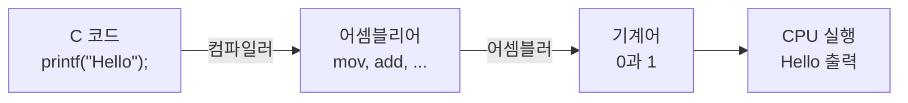
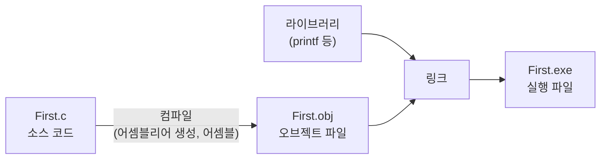

# 1장 실습 — 컴퓨터 언어와 C 프로그램의 실행 단계

[레포지토리 안내](../../README.ko.md) | [English](Concepts_Lab.md) | [한국어](Concepts_Lab.ko.md)

> **최종 수정일:** 2026-10-27
>
> 문제풀이 중심의 C언어 연습, 김용일과 강문설, Ch 1

> **학습 목표:**
> 1. 언어와 컴퓨터 언어의 관계를 규칙의 관점에서 설명할 수 있다
> 2. 기계어, 어셈블리어, C 언어의 차이와 각 언어를 기계어로 바꾸는 번역기를 구분할 수 있다
> 3. C 소스 파일이 오브젝트 파일과 링크를 거쳐 실행 파일이 되는 과정을 설명할 수 있다
> 4. Visual Studio의 솔루션 빌드가 수행하는 단계를 컴파일러 명령과 대응시킬 수 있다

---

## 목차

- [1. 컴퓨터 언어](#1-컴퓨터-언어)
  - [1.1 언어와 컴퓨터 언어](#11-언어와-컴퓨터-언어)
  - [1.2 기계어](#12-기계어)
  - [1.3 어셈블리어와 어셈블러](#13-어셈블리어와-어셈블러)
  - [1.4 C 언어와 컴파일러](#14-c-언어와-컴파일러)
- [2. C 프로그램의 작성과 실행 단계](#2-c-프로그램의-작성과-실행-단계)
  - [2.1 소스 코드 작성](#21-소스-코드-작성)
  - [2.2 컴파일과 오브젝트 파일](#22-컴파일과-오브젝트-파일)
  - [2.3 링크와 실행 파일](#23-링크와-실행-파일)
  - [2.4 Visual Studio의 솔루션 빌드](#24-visual-studio의-솔루션-빌드)
- [요약](#요약)
- [점검 문제](#점검-문제)

---

<br>

## 1. 컴퓨터 언어

### 1.1 언어와 컴퓨터 언어

**언어(language)** 는 서로 소통이 되도록 정한 규칙이다. 같은 언어를 쓰는 두 사람은 "안녕하세요?"라는 인사에 같은 말로 답할 수 있지만, 규칙을 공유하지 않는 상대와는 같은 문장으로 뜻을 주고받을 수 없다. 사람과 컴퓨터 사이도 마찬가지이다. 사람이 "화면에 Hello라고 출력해"라고 말해도 컴퓨터는 사람의 언어를 이해하지 못하므로, 컴퓨터가 이해하는 규칙으로 명령을 전달해야 한다.

> **용어 정의:** **컴퓨터 언어(computer language)** 는 사람이 컴퓨터에게 특정한 작업을 수행하도록 알려 주는 규칙이다. 프로그램을 작성하는 데 쓰는 컴퓨터 언어를 프로그래밍 언어라고 한다([1장 1.2절](Concepts_Lecture.ko.md#12-프로그래밍-언어)).

### 1.2 기계어

컴퓨터의 하드웨어는 전기 신호가 켜졌는지(on) 꺼졌는지(off)만 구분하므로, CPU가 직접 이해하는 언어는 0과 1로 이루어진 **기계어(machine language)** 뿐이다. 기계어 명령어 하나는 `0010100101110110100`처럼 0과 1이 늘어선 2진 코드이며, CPU는 이 코드를 읽어 정해진 연산을 수행한다.

기계어는 컴퓨터가 바로 실행할 수 있다는 장점이 있지만, 사람이 0과 1로 된 명령을 기억하고 작성하기는 매우 어렵다. 또 기계어 명령어의 형식은 CPU의 종류마다 다르므로, 한 CPU를 위해 작성한 기계어 프로그램은 다른 CPU에서 실행할 수 없다([1장 1.3절](Concepts_Lecture.ko.md#13-기계-종속-vs-기계-독립)).

### 1.3 어셈블리어와 어셈블러

기계어를 사람이 다루기 쉽게 하려고 만든 언어가 **어셈블리어(assembly language)** 이다. 어셈블리어는 기계어 명령어 하나하나를 `mov`, `add` 같은 짧은 영어 약어(니모닉)로 바꾸어 쓴 저급 언어(low-level language)이다. 다음은 x86 CPU의 어셈블리어로 화면에 문자 `H`를 출력하기 위해 준비하는 명령의 일부이다.

```text
mov ax, DATASEG
mov ds, ax
mov dl, 'H'
```

어셈블리어로 작성한 프로그램은 CPU가 바로 이해하지 못하므로, **어셈블러(assembler)** 라는 번역기가 기계어로 바꾼다. 어셈블리어는 기계어보다 읽기 쉽지만, 여전히 CPU의 레지스터와 명령어를 하나하나 다루어야 하므로 사람이 큰 프로그램을 작성하기에는 어렵다.

### 1.4 C 언어와 컴파일러

사람이 더 쉽게 프로그램을 작성할 수 있도록 만든 언어가 C 같은 **고급 언어(high-level language)** 이다. C에서는 문자열 `Hello`를 출력하는 일을 다음 한 문장으로 쓴다.

```c
printf("Hello");
```

C로 작성한 코드는 두 단계의 번역을 거쳐 기계어가 된다. **컴파일러(compiler)** 가 C 코드를 어셈블리어로 번역하고, 어셈블러가 그 어셈블리어를 기계어로 번역한다.



*그림 1. C 코드가 어셈블리어를 거쳐 기계어로 번역되는 과정*

> **핵심:** 기계어와 어셈블리어는 CPU에 가까운 저급 언어이고 C는 사람의 언어에 가까운 고급 언어이다. 고급 언어일수록 사람이 작성하기 쉬워지는 대신, 컴퓨터가 실행하기 전에 더 많은 번역 단계를 거친다.

---

<br>

## 2. C 프로그램의 작성과 실행 단계

C 프로그램은 소스 코드 작성, 컴파일, 링크의 세 단계를 거쳐 실행 파일이 된다([1장 3.2절](Concepts_Lecture.ko.md#32-빌드-과정)).



*그림 2. 소스 코드가 오브젝트 파일과 링크를 거쳐 실행 파일이 되는 단계*

### 2.1 소스 코드 작성

먼저 C 언어의 문법에 맞게 소스 코드를 작성하고 `First.c`처럼 확장자가 `.c`인 파일로 저장한다.

```c
#include <stdio.h>
int main()
{
    printf("Hello");
}
```

`#include <stdio.h>`는 `printf` 함수의 선언을 포함하고, `main`은 프로그램이 시작될 때 호출되는 함수이며, `printf("Hello");`는 큰따옴표 안의 문자열을 화면에 출력한다([2장 1.1절](../Ch02_C-Program-Basics/Concepts_Lecture.ko.md#11-프로그램-구조)).

### 2.2 컴파일과 오브젝트 파일

**컴파일(compile)** 단계에서 컴파일러는 소스 코드를 어셈블리어로 번역하고, 이어서 어셈블러가 기계어로 된 **오브젝트 파일(object file)** 을 만든다. Visual Studio에서 `First.c`의 오브젝트 파일은 `First.obj`이고, gcc와 clang에서는 `First.o`이다.

다음은 같은 소스 코드를 macOS의 clang으로 `cc -std=c99 -Wall -S First.c`처럼 어셈블리어까지만 번역한 결과에서 `main` 함수의 핵심 명령을 뽑은 것이다. 이 결과는 ARM64 CPU용 어셈블리어이므로 1.3절의 x86 명령과 형식이 다르다.

```text
_main:
	stp	x29, x30, [sp, #-16]!
	mov	x29, sp
	adrp	x0, l_.str@PAGE
	add	x0, x0, l_.str@PAGEOFF
	bl	_printf
	mov	w0, #0
	ldp	x29, x30, [sp], #16
	ret
```

`adrp`와 `add`는 문자열 `"Hello"`가 저장된 주소를 레지스터 `x0`에 넣고, `bl _printf`는 `printf` 함수를 호출하며, `mov w0, #0`은 `main`의 반환값 0을 준비한다. 오브젝트 파일은 이 명령들을 기계어로 담고 있지만, `printf`의 실제 코드는 들어 있지 않다.

> **[컴퓨터구조]** CPU가 실행할 수 있는 명령어의 종류와 형식, 레지스터의 구성을 정한 규약을 명령어 집합 구조(instruction set architecture, ISA)라고 하며, x86과 ARM64는 서로 다른 명령어 집합 구조이다. 같은 C 코드가 CPU마다 다른 어셈블리어로 번역되는 것은 이 때문이며, 명령어 집합 구조는 컴퓨터구조에서 다룬다.

### 2.3 링크와 실행 파일

**링크(link)** 단계에서 링커는 오브젝트 파일과 `printf` 같은 함수의 코드가 들어 있는 **라이브러리(library)** 를 결합하여 최종 기계어로 된 **실행 파일(executable file)** 을 만든다. Visual Studio에서는 `First.exe`가 만들어진다. 오브젝트 파일이 하나뿐이어도 라이브러리 함수에 대한 참조를 해결해야 하므로 링크는 항상 필요하다.

gcc나 clang에서는 각 단계를 명령으로 나누어 실행할 수 있다.

```bash
cc -std=c99 -Wall -c First.c -o First.o   # compile and assemble: object file
cc First.o -o First                       # link with the library: executable file
./First                                   # run
```

실행하면 다음이 출력된다. `printf`의 문자열 끝에 `\n`이 없으므로 출력 뒤에 줄이 바뀌지 않는다.

```text
Hello
```

### 2.4 Visual Studio의 솔루션 빌드

Visual Studio(2012 이후)에서는 [빌드] → [솔루션 빌드] 명령 하나가 컴파일, 어셈블, 링크를 모두 수행하여 실행 파일을 만든다([1장 3.5절](Concepts_Lecture.ko.md#35-통합-개발-환경)). 빌드가 끝나면 [디버그] → [디버그하지 않고 시작]으로 실행 파일을 실행한다.

| 단계 | 입력 | 출력 (Visual Studio) | 출력 (gcc, clang) | 하는 일 |
|:-----|:-----|:-----|:-----|:-----|
| 컴파일과 어셈블 | `First.c` | `First.obj` | `First.o` | C 코드를 어셈블리어를 거쳐 기계어로 번역 |
| 링크 | 오브젝트 파일, 라이브러리 | `First.exe` | `First` (Windows에서는 `First.exe`) | 오브젝트 파일과 라이브러리를 결합 |

*표 1. C 프로그램의 실행 단계와 도구별 산출물*

> **참고:** 컴파일 단계에서 문법 오류가 있으면 오브젝트 파일이 만들어지지 않고, 링크 단계에서 함수의 정의를 찾지 못하면 실행 파일이 만들어지지 않는다. 오류의 종류와 감지 시점은 [1장 3.3절](Concepts_Lecture.ko.md#33-오류의-종류)에 정리되어 있다.

---

<br>

## 요약

| 개념 | 핵심 요약 |
|:-----|:-----|
| 컴퓨터 언어 | 사람이 컴퓨터에게 특정한 작업을 수행하도록 알려 주는 규칙이다. |
| 기계어 | CPU가 직접 이해하는 0과 1의 2진 코드이며, 사람이 작성하기 어렵고 CPU마다 다르다. |
| 어셈블리어 | 기계어 명령을 니모닉으로 바꾸어 쓴 저급 언어이며, 어셈블러가 기계어로 번역한다. |
| C 언어 | 사람의 언어에 가까운 고급 언어이며, 컴파일러와 어셈블러를 거쳐 기계어가 된다. |
| 컴파일 | 소스 코드를 기계어로 된 오브젝트 파일(`.obj`, `.o`)로 번역하는 단계이다. |
| 링크 | 오브젝트 파일과 라이브러리를 결합하여 실행 파일을 만드는 단계이다. |
| 솔루션 빌드 | Visual Studio에서 컴파일, 어셈블, 링크를 한 번에 수행하는 명령이다. |

---

<br>

## 점검 문제

1. **번역기:** 기계어, 어셈블리어, C 언어로 작성한 프로그램이 CPU에서 실행되려면 각각 어떤 번역기를 거쳐야 하는가?

   <details>
   <summary>정답</summary>

   기계어는 CPU가 직접 실행하므로 번역이 필요 없다. 어셈블리어는 어셈블러가 기계어로 번역한다. C 언어는 컴파일러가 어셈블리어로 번역한 뒤 어셈블러가 기계어로 번역하며, 이어서 링커가 라이브러리와 결합하여 실행 파일을 만든다.

   </details>

2. **오브젝트 파일:** `First.c`를 컴파일하여 만든 오브젝트 파일을 바로 실행할 수 없는 이유는 무엇인가?

   <details>
   <summary>정답</summary>

   오브젝트 파일에는 `bl _printf`처럼 `printf`를 호출하는 명령만 있고 `printf`의 실제 코드는 들어 있지 않다. 링커가 오브젝트 파일을 `printf`의 코드가 들어 있는 라이브러리와 결합하여 참조를 해결해야 실행 파일이 만들어진다.

   </details>

3. **기계 종속성:** 1.3절의 x86 어셈블리어와 2.2절의 ARM64 어셈블리어는 모두 화면 출력을 위한 명령인데도 형식이 다르다. 이 차이가 C 소스 코드 `First.c`에는 나타나지 않는 이유를 설명하라.

   <details>
   <summary>정답</summary>

   어셈블리어는 기계어와 일대일로 대응하므로 CPU마다 명령의 종류와 형식이 다르다. C는 기계 독립적인 고급 언어이므로 같은 소스 코드를 각 CPU용 컴파일러가 그 CPU의 어셈블리어로 번역한다. 따라서 CPU에 따른 차이는 컴파일러가 만든 결과에만 나타난다.

   </details>

4. **솔루션 빌드:** Visual Studio의 솔루션 빌드 명령 하나에 해당하는 일을 gcc에서 두 명령으로 나누어 수행하면 각 명령은 어떤 파일을 만드는가?

   <details>
   <summary>정답</summary>

   `cc -c First.c -o First.o`는 컴파일과 어셈블을 수행하여 오브젝트 파일 `First.o`를 만들고, `cc First.o -o First`는 오브젝트 파일을 라이브러리와 링크하여 실행 파일 `First`를 만든다.

   </details>
