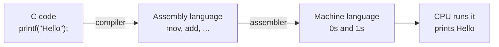
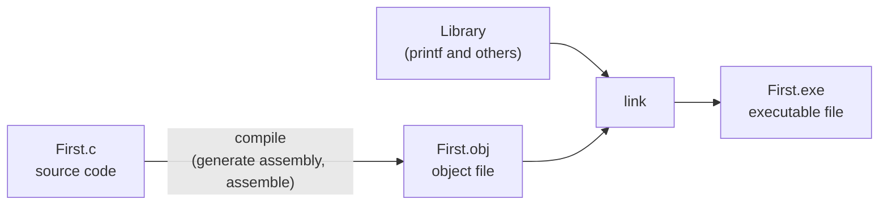

# Chapter 1 Lab — Computer Languages and the Steps of Running a C Program

[Repository Guide](../../README.md) | [English](Concepts_Lab.md) | [한국어](Concepts_Lab.ko.md)

> **Last Updated:** 2026-10-27
>
> 문제풀이 중심의 C언어 연습, 김용일 외, Ch 1

> **Learning Objectives:**
> 1. Explain the relationship between languages and computer languages in terms of rules
> 2. Distinguish machine language, assembly language, and C, and the translators that turn each into machine language
> 3. Explain how a C source file becomes an executable file through an object file and linking
> 4. Relate the steps performed by Visual Studio's Build Solution to compiler commands

---

## Table of Contents

- [1. Computer Languages](#1-computer-languages)
  - [1.1 Languages and Computer Languages](#11-languages-and-computer-languages)
  - [1.2 Machine Language](#12-machine-language)
  - [1.3 Assembly Language and the Assembler](#13-assembly-language-and-the-assembler)
  - [1.4 The C Language and the Compiler](#14-the-c-language-and-the-compiler)
- [2. Writing and Running a C Program](#2-writing-and-running-a-c-program)
  - [2.1 Writing the Source Code](#21-writing-the-source-code)
  - [2.2 Compilation and the Object File](#22-compilation-and-the-object-file)
  - [2.3 Linking and the Executable File](#23-linking-and-the-executable-file)
  - [2.4 Build Solution in Visual Studio](#24-build-solution-in-visual-studio)
- [Summary](#summary)
- [Self-Check Questions](#self-check-questions)

---

<br>

## 1. Computer Languages

### 1.1 Languages and Computer Languages

A **language** is a set of rules agreed on so that parties can communicate. Two people who speak the same language can answer the greeting "안녕하세요?" in kind, but with a partner who does not share the rules, the same sentence carries no meaning. The same holds between people and computers. Even if a person says "print Hello on the screen", the computer does not understand human language, so the command must be given in rules the computer understands.

> **Definition:** A **computer language** is a set of rules by which a person tells a computer to perform a specific task. A computer language used to write programs is called a programming language ([Chapter 1, Section 1.2](Concepts_Lecture.md#12-programming-languages)).

### 1.2 Machine Language

Computer hardware distinguishes only whether an electric signal is on or off, so the only language the CPU understands directly is **machine language**, made of 0s and 1s. One machine instruction is a binary code of 0s and 1s, such as `0010100101110110100`, and the CPU reads this code and performs the corresponding operation.

Machine language has the advantage that the computer can execute it directly, but it is very hard for people to remember and write instructions of 0s and 1s. Also, the format of machine instructions differs between kinds of CPU, so a machine language program written for one CPU cannot run on another ([Chapter 1, Section 1.3](Concepts_Lecture.md#13-machine-dependent-vs-machine-independent)).

### 1.3 Assembly Language and the Assembler

**Assembly language** was created to make machine language easier for people to handle. It is a low-level language that writes each machine instruction as a short English abbreviation (a mnemonic) such as `mov` or `add`. The following is part of the x86 assembly code that prepares to print the character `H` on the screen.

```text
mov ax, DATASEG
mov ds, ax
mov dl, 'H'
```

The CPU cannot understand a program written in assembly language directly, so a translator called the **assembler** converts it into machine language. Assembly language is easier to read than machine language, but it still requires handling the CPU's registers and instructions one by one, which makes it hard for people to write large programs.

### 1.4 The C Language and the Compiler

**High-level languages** such as C were created so that people could write programs more easily. In C, printing the string `Hello` is written as the following single statement.

```c
printf("Hello");
```

Code written in C becomes machine language through two translations. The **compiler** translates the C code into assembly language, and the assembler translates that assembly language into machine language.



*Figure 1. How C code is translated into machine language through assembly language*

> **Key Point:** Machine language and assembly language are low-level languages close to the CPU, and C is a high-level language close to human language. The higher the level of a language, the easier it is for people to write, but the more translation steps it goes through before the computer runs it.

---

<br>

## 2. Writing and Running a C Program

A C program becomes an executable file through three steps: writing the source code, compiling, and linking ([Chapter 1, Section 3.2](Concepts_Lecture.md#32-build-process)).



*Figure 2. The steps by which source code becomes an executable file through an object file and linking*

### 2.1 Writing the Source Code

First, write the source code following the grammar of C and save it in a file with the `.c` extension, such as `First.c`.

```c
#include <stdio.h>
int main()
{
    printf("Hello");
}
```

`#include <stdio.h>` includes the declaration of the `printf` function, `main` is the function called when the program starts, and `printf("Hello");` prints the string inside the double quotes on the screen ([Chapter 2, Section 1.1](../Ch02_C-Program-Basics/Concepts_Lecture.md#11-program-structure)).

### 2.2 Compilation and the Object File

In the **compile** step, the compiler translates the source code into assembly language, and the assembler then produces an **object file** in machine language. In Visual Studio the object file of `First.c` is `First.obj`, and with gcc and clang it is `First.o`.

The following is the core of the `main` function taken from the result of translating the same source code only as far as assembly language with clang on macOS, as in `cc -std=c99 -Wall -S First.c`. This computer's CPU is ARM64, so the format differs from the x86 instructions of Section 1.3.

```text
_main:
	stp	x29, x30, [sp, #-16]!
	mov	x29, sp
	adrp	x0, l_.str@PAGE
	add	x0, x0, l_.str@PAGEOFF
	bl	_printf
	mov	w0, #0
	ldp	x29, x30, [sp], #16
	ret
```

`adrp` and `add` put the address where the string `"Hello"` is stored into the register `x0`, `bl _printf` calls the `printf` function, and `mov w0, #0` prepares the return value 0 of `main`. The object file holds these instructions in machine language, but it does not contain the actual code of `printf`.

### 2.3 Linking and the Executable File

In the **link** step, the linker combines the object file with the **library** that holds the code of functions such as `printf` and produces the final **executable file** in machine language. Visual Studio produces `First.exe`. Even with only one object file, the references to library functions must be resolved, so linking is always needed.

With gcc or clang, each step can be run as a separate command.

```bash
cc -std=c99 -Wall -c First.c -o First.o   # compile and assemble: object file
cc First.o -o First                       # link with the library: executable file
./First                                   # run
```

Running it prints the following. There is no `\n` at the end of the `printf` string, so the line does not end after the output.

```text
Hello
```

### 2.4 Build Solution in Visual Studio

In Visual Studio (2012 and later), the single command [Build] → [Build Solution] performs compiling, assembling, and linking to produce the executable file ([Chapter 1, Section 3.5](Concepts_Lecture.md#35-integrated-development-environments)). After the build, [Debug] → [Start Without Debugging] runs the executable file.

| Step | Input | Output (Visual Studio) | Output (gcc, clang) | What it does |
|:-----|:-----|:-----|:-----|:-----|
| Compile and assemble | `First.c` | `First.obj` | `First.o` | Translates C code into machine language through assembly language |
| Link | Object files, libraries | `First.exe` | `First` (`First.exe` on Windows) | Combines the object files and the libraries |

*Table 1. The steps of running a C program and the products of each tool*

> **Note:** If there is a syntax error in the compile step, no object file is produced, and if the linker cannot find a function's definition, no executable file is produced. The kinds of errors and when they are detected are summarized in [Chapter 1, Section 3.3](Concepts_Lecture.md#33-errors).

---

<br>

## Summary

| Concept | Key Summary |
|:-----|:-----|
| Computer language | A set of rules by which a person tells a computer to perform a specific task. |
| Machine language | Binary code of 0s and 1s that the CPU understands directly; it is hard for people to write and differs between CPUs. |
| Assembly language | A low-level language that writes machine instructions as mnemonics; the assembler translates it into machine language. |
| C language | A high-level language close to human language; it becomes machine language through the compiler and the assembler. |
| Compilation | The step that translates source code into an object file (`.obj`, `.o`) in machine language. |
| Linking | The step that combines object files and libraries into an executable file. |
| Build Solution | The Visual Studio command that performs compiling, assembling, and linking at once. |

---

<br>

## Self-Check Questions

1. **Translators:** Through which translators must programs written in machine language, assembly language, and C each pass to run on the CPU?

   <details>
   <summary>Answer</summary>

   Machine language is executed directly by the CPU, so no translation is needed. Assembly language is translated into machine language by the assembler. C is translated into assembly language by the compiler and then into machine language by the assembler, after which the linker combines it with the libraries into an executable file.

   </details>

2. **Object files:** Why can the object file produced by compiling `First.c` not be run directly?

   <details>
   <summary>Answer</summary>

   The object file contains only the instruction that calls `printf`, such as `bl _printf`, and not the actual code of `printf`. The linker must combine the object file with the library containing the code of `printf` and resolve the reference before an executable file is produced.

   </details>

3. **Machine dependence:** The x86 assembly code of Section 1.3 and the ARM64 assembly code of Section 2.2 differ in format even when they do the same job. Explain why this difference does not appear in the C source code `First.c`.

   <details>
   <summary>Answer</summary>

   Assembly language corresponds one to one to machine language, so the kinds and formats of instructions differ between CPUs. C is a machine-independent high-level language, so the compiler for each CPU translates the same source code into that CPU's assembly language. The difference between CPUs therefore appears only in the output of the compiler.

   </details>

4. **Build Solution:** If the work of Visual Studio's single Build Solution command is split into two gcc commands, what file does each command produce?

   <details>
   <summary>Answer</summary>

   `cc -c First.c -o First.o` compiles and assembles to produce the object file `First.o`, and `cc First.o -o First` links the object file with the libraries to produce the executable file `First`.

   </details>
