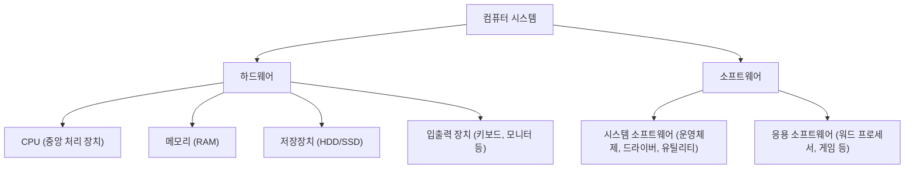
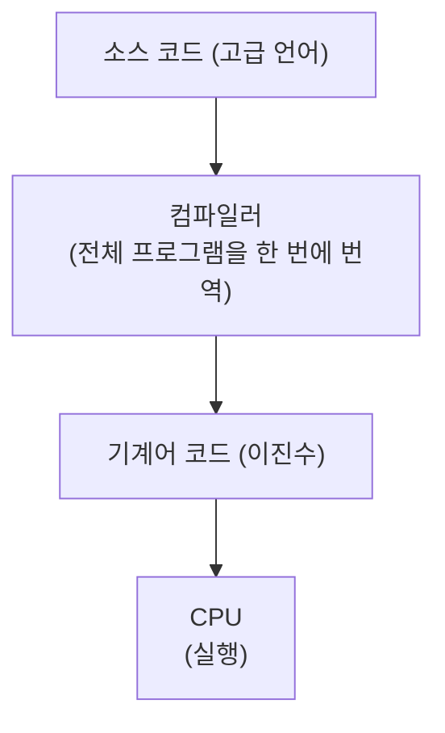
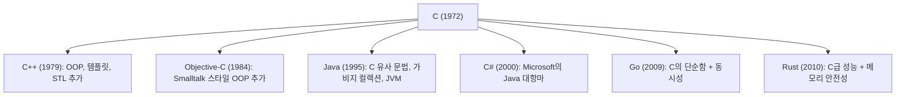
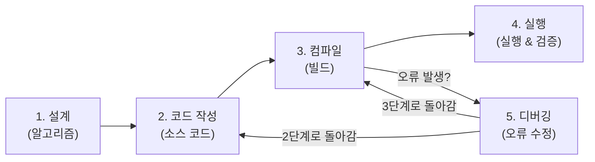
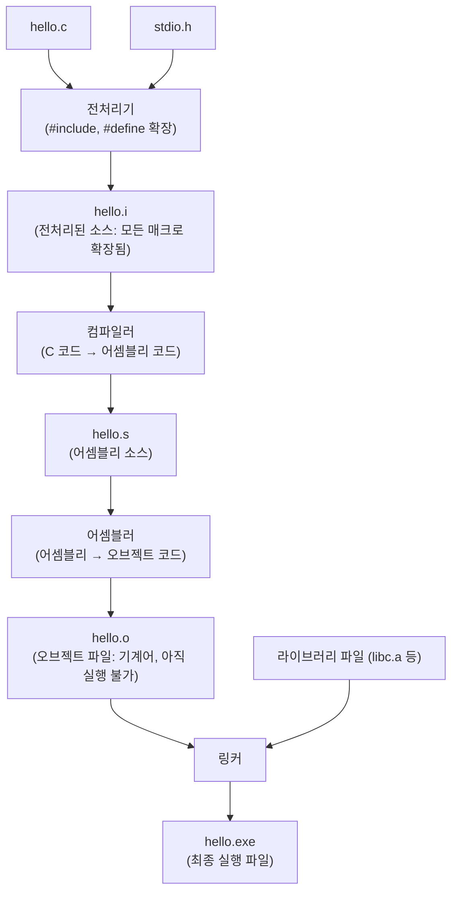
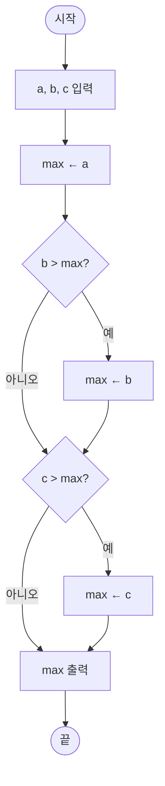

# 1장 — 프로그래밍과 C 언어

[레포지토리 안내](../../README.ko.md) | [English](Concepts_Lecture.md) | [한국어](Concepts_Lecture.ko.md)

> **최종 수정일:** 2026-11-19
>
> Warming-Up C Programming, 천정아, Ch 1

> **학습 목표:**
> 1. 소프트웨어, 프로그램, 명령어, 프로그래밍의 개념을 설명할 수 있다
> 2. 저급 언어와 고급 언어, 기계 종속적인 언어와 기계 독립적인 언어를 구분할 수 있다
> 3. C 언어의 역사, 특징, 활용 분야와 C를 배우는 이유를 설명할 수 있다
> 4. 전처리, 컴파일, 어셈블, 링크로 이어지는 빌드 과정과 각 단계의 산출물을 설명할 수 있다
> 5. 컴파일 오류, 링크 오류, 런타임 오류를 구분하고 기본적인 디버깅 방법을 적용할 수 있다

---

## 목차

- [1. 프로그래밍 개념](#1-프로그래밍-개념)
  - [1.1 소프트웨어와 프로그램](#11-소프트웨어와-프로그램)
  - [1.2 프로그래밍 언어](#12-프로그래밍-언어)
  - [1.3 기계 종속 vs 기계 독립](#13-기계-종속-vs-기계-독립)
- [2. C 언어](#2-c-언어)
  - [2.1 역사](#21-역사)
  - [2.2 특징](#22-특징)
  - [2.3 활용 분야](#23-활용-분야)
  - [2.4 C를 배워야 하는 이유](#24-c를-배워야-하는-이유)
  - [2.5 C 표준과 컴파일러의 확장 기능](#25-c-표준과-컴파일러의-확장-기능)
- [3. C 프로그램 개발](#3-c-프로그램-개발)
  - [3.1 개발 과정](#31-개발-과정)
  - [3.2 빌드 과정](#32-빌드-과정)
  - [3.3 오류의 종류](#33-오류의-종류)
  - [3.4 디버깅](#34-디버깅)
  - [3.5 통합 개발 환경](#35-통합-개발-환경)
  - [3.6 알고리즘의 기술](#36-알고리즘의-기술)
  - [3.7 여러 소스 파일로 이루어진 프로그램](#37-여러-소스-파일로-이루어진-프로그램)
- [개념 적용](#개념-적용)
- [요약](#요약)
- [점검 문제](#점검-문제)

---

<br>

## 1. 프로그래밍 개념

### 1.1 소프트웨어와 프로그램

**하드웨어**는 컴퓨터의 물리적 구성 요소(CPU, 메모리, 저장장치, 주변장치 등)이다. **소프트웨어**는 하드웨어에서 실행되어 하드웨어에게 무엇을 할지 지시하는 프로그램의 집합이며, 스마트폰에서 실행되는 소프트웨어는 흔히 **앱(app)** 이라고 부른다.



*그림 1. 컴퓨터 시스템을 이루는 하드웨어와 소프트웨어*

**프로그램**은 특정 작업을 수행하기 위해 프로그래밍 언어로 작성된 명령어의 집합으로, 컴퓨터 하드웨어가 수행할 일련의 작업을 기술한다. 하드웨어가 최종적으로 실행하는 **명령어(instruction)** 는 CPU가 처리할 수 있는 2진 코드이며 CPU 명령어라고도 한다. **프로그래밍**은 이러한 명령어를 설계하고 작성하는 일 또는 그 과정이다.

> **핵심:** 소프트웨어가 없으면 하드웨어는 단순한 전자 부품 모음에 불과하다. 소프트웨어가 하드웨어에 목적을 부여한다.

프로그램이 실행되는 과정을 하드웨어의 관점에서 보면 다음과 같다. 실행 파일은 평소에 저장장치에 기계어 명령의 모임으로 저장되어 있다. 사용자가 프로그램을 실행하면 운영체제가 실행 파일을 메모리에 올리고, CPU는 메모리에서 명령을 하나씩 가져와 해석하고 실행하는 일을 되풀이한다. 명령이 끝나면 다음 주소의 명령으로 넘어가고, 분기 명령을 만나면 다른 주소로 옮겨 간다. 5장의 조건문과 반복문은 결국 이런 분기 명령으로 번역된다. 따라서 프로그래밍이란 CPU가 이 순서로 수행할 명령들을 사람이 이해할 수 있는 언어로 미리 적어 두는 일이라고 할 수 있다.

### 1.2 프로그래밍 언어

**프로그래밍 언어**는 프로그램에서 컴퓨터가 수행해야 할 작업을 기술하는 형식 언어이다. 기계 하드웨어와의 근접도에 따라 저급 언어와 고급 언어로 분류한다.

| 수준 | 언어 | 예시 | 가독성 | 이식성 |
|:-----|:----|:-----|:-----:|:-----:|
| 저급 | 기계어 | `10110000 01100001` | 매우 낮음 | 없음 |
| 저급 | 어셈블리어 | `MOV AL, 61h` | 낮음 | 없음 |
| 고급 | C, Java, Python | `printf("Hello");` | 높음 | 높음 |

*표 1. 수준에 따른 프로그래밍 언어의 분류*

표의 기계어 `10110000 01100001`은 x86 CPU에서 어셈블리어 `MOV AL, 61h`(AL 레지스터에 16진수 61을 넣는 명령)에 해당하는 2진 코드이다.

**기계어** (1세대):
- CPU가 직접 실행하는 이진 코드(`0`과 `1`)로 이루어진다.
- 각 명령어가 특정 CPU 연산에 대응한다.
- 2진수로 표현되므로 사람이 사용하기에 매우 불편하고 실수하기 쉽다.
- CPU 아키텍처마다 다르므로 완전히 **기계 종속적**이다.

**어셈블리어** (2세대):
- 이진 코드 대신 사람이 읽을 수 있는 **니모닉**(예: `MOV`, `ADD`, `JMP`)을 사용한다.
- 기계어와 1:1 대응한다.
- **어셈블러**가 어셈블리어 프로그램을 기계어로 번역한다.
- 여전히 기계 종속적이어서 x86용 어셈블리 프로그램은 ARM에서 실행할 수 없다.

**고급 언어** (3세대 이상):
- 사람이 사용하는 자연어에 가까운 문법(`if`, `while`, `return`)을 사용한다.
- 하나의 고급 문장이 여러 기계어 명령으로 번역될 수 있다.
- **컴파일러** 또는 **인터프리터**가 기계어로 번역한다.
- 일반적으로 **기계 독립적**이어서 동일한 소스 코드를 플랫폼마다 번역하면 다른 플랫폼에서도 실행할 수 있다.



*그림 2. 고급 언어 프로그램이 컴파일러를 거쳐 CPU에서 실행되는 과정*

> **참고:** **컴파일러와 인터프리터.** **컴파일러**는 전체 소스 코드를 실행 전에 한꺼번에 기계어로 번역한다(C, C++). **인터프리터**는 실행 시점에 한 줄씩 번역하며 실행한다(Python, JavaScript). Java는 컴파일러가 소스 코드를 바이트코드로 번역하고 JVM이 그 바이트코드를 실행하는 두 방식의 혼합이다.

### 1.3 기계 종속 vs 기계 독립

| 특성 | 기계 종속 | 기계 독립 |
|:----|:--------:|:--------:|
| 특정 CPU 종속 여부 | 예 | 아니오 |
| 예시 | 기계어, 어셈블리어 | C, Java, Python |
| 이식성 | 다른 아키텍처로 이식 불가 | 동일 소스로 다른 시스템에서 실행 가능 |
| 성능 | 최대 (하드웨어 직접 제어) | 대체로 약간 낮음 (컴파일러 최적화의 한계, 인터프리터의 실행 중 번역) |
| 개발 속도 | 매우 느림 | 빠름 |

*표 2. 기계 종속 언어와 기계 독립 언어의 비교*

기계어와 어셈블리어는 **기계 종속적(machine-dependent)** 이다. 특정 CPU 아키텍처용으로 작성된 코드는 다른 아키텍처에서 재작성 없이 실행할 수 없으므로, CPU의 종류가 달라지면 프로그램을 다시 작성해야 한다. 또 CPU가 어떻게 동작하는지를 잘 이해해야 프로그램을 작성할 수 있다.

고급 언어는 **기계 독립적(machine-independent)** 이다. CPU의 종류나 하드웨어의 특성에 얽매이지 않고 프로그램을 작성할 수 있으며, 동일한 C 소스 코드를 각 시스템에 맞는 컴파일러로 컴파일하면 다양한 플랫폼(Windows, Linux, macOS)에서 실행할 수 있다.

> **핵심:** "기계 독립"이 이식에 노력이 전혀 필요 없다는 뜻은 아니다. 플랫폼 고유 기능(예: 시스템 호출)은 여전히 다를 수 있다. 그러나 핵심 언어 문법과 로직은 동일하게 유지된다.

---

<br>

## 2. C 언어

### 2.1 역사

C 언어는 **1972년** Bell 연구소에서 **Dennis Ritchie**가 **Ken Thompson**이 개발한 B 언어를 기반으로 만들었으며, 두 사람은 함께 UNIX를 개발하였다. 주된 목적은 UNIX 운영체제를 고급 언어로 다시 작성하는 것이었다. C는 이후 C++, C#, Objective-C, Java, JavaScript, Perl 같은 언어의 등장에 큰 영향을 주었다.

```text
C 언어의 역사
──────────────────────────────────────────────────────────────
1969    B 언어 (Ken Thompson): PDP-7에서 초기 UNIX 개발용
1972    C 언어 (Dennis Ritchie): Bell Labs, PDP-11에서 UNIX 개발용
1978    K&R C: "The C Programming Language" 서적 출간 (Kernighan & Ritchie)
1989    ANSI C (C89): 최초의 공식 표준 (ANSI X3.159-1989)
1990    C90: ISO에서 ANSI C 채택 (ISO/IEC 9899:1990)
1999    C99: 인라인 함수, 가변 길이 배열, // 주석 도입
2011    C11: 멀티스레딩, _Generic, 경계 검사 도입
2018    C18: C11 버그 수정 (새로운 기능 없음)
2024    C23: 최신 표준, ISO/IEC 9899:2024 (nullptr, #embed, auto 타입 추론)
──────────────────────────────────────────────────────────────
```

*그림 3. C 언어와 표준의 연대표*

C11의 경계 검사 인터페이스(`scanf_s` 같은 `_s` 함수)는 표준의 선택 사항인 부록 K에 속하므로, 모든 컴파일러가 제공하지는 않는다.

> **핵심:** "ANSI C"라고 하면 보통 C89/C90을 의미한다. 가장 널리 지원되는 기본 표준이며, 대부분의 현대 컴파일러는 최소 C99를 지원한다. **표준 C(standard C)** 로 작성된 소스 코드는 모든 C 컴파일러에서 컴파일되고 동일하게 실행될 수 있다. 각 C 컴파일러는 표준 C의 기능에 자신만의 확장 기능을 더해 제공하므로, 이식성이 중요하면 확장 기능을 피한다.

### 2.2 특징

C 언어가 50년 넘게 사용되는 이유는 다음과 같은 강점의 조합에 있다.

| 특징 | 설명 |
|:----|:----|
| **간결한 문법** | 키워드가 적고(C89 기준 32개) 언어 설계가 최소한으로 이루어져 있다 |
| **절차적 프로그래밍** | 프로그램을 함수 단위로 나누고, 문장을 정해진 순서대로 실행하여 작업을 처리한다 |
| **유연성** | 제약이 적어 프로그래머가 세밀하게 제어할 수 있다 |
| **고성능** | 효율적인 기계어로 컴파일되고 런타임 오버헤드가 최소이다 |
| **이식성** | 표준 C 코드는 C 컴파일러가 있는 거의 모든 플랫폼에서 컴파일할 수 있다 |
| **고수준 지원 기능** | 제어문, 함수, 구조체 같은 사용자 정의형으로 프로그램을 구조적으로 작성할 수 있다 |
| **저수준 지원 기능** | 포인터를 통한 직접 메모리 접근, 비트 연산, 하드웨어 제어를 지원한다 |
| **효율성** | 메모리 사용량이 작아 자원이 제한된 환경에 적합하다 |
| **현대 언어의 뿌리** | C++, Java, C#, Python, Go, Rust 등이 C의 문법과 개념에서 영향을 받았다 |

*표 3. C 언어의 특징*

반면 저수준 기능과 적은 제약 때문에 C는 배우기 어렵고 사용하기 어렵다는 단점이 있다. 다음은 C로 작성한 가장 간단한 프로그램이다.

```c
#include <stdio.h>

int main(void) {
    printf("Hello, World!\n");
    return 0;
}
```

> **참고:** **제어권과 책임.** C는 최대한의 제어권을 제공하지만, 그만큼 책임도 따른다. 가비지 컬렉터, 배열 범위 검사, 내장 예외 처리가 없으므로 프로그래머가 모든 것을 직접 관리해야 한다.

### 2.3 활용 분야

C는 성능 위주의 개발이 필요하거나 이식성이 필요한 경우, 저수준 하드웨어 접근이 중요한 경우에 널리 사용된다. 아래 표에는 C++와 함께 쓰는 분야도 포함되어 있다.

| 분야 | 예시 |
|:----|:----|
| 운영체제 | UNIX, Linux 커널, Windows 커널, macOS 커널 |
| 언어 처리기 | CPython(Python의 표준 구현), Perl 인터프리터, 초기 GCC |
| 데이터베이스 | Oracle, MySQL, PostgreSQL, SQLite |
| 임베디드 시스템 | 마이크로컨트롤러, IoT 디바이스, 스마트 TV, 자동차 ECU, 인공위성 |
| 고성능 애플리케이션 | Microsoft Office, 웹 브라우저, 고성능 라이브러리 |
| 게임 엔진 | Unreal Engine (C/C++), id Tech 엔진 |
| 네트워크 | TCP/IP 스택, Apache, Nginx |
| 과학 계산 | MATLAB 내부, R 내부, 수치 라이브러리 |

*표 4. C 언어의 활용 분야와 예시*

**임베디드 시스템(embedded system)** 은 특수 목적의 컴퓨터를 내장하고 있는 장치이고, **임베디드 프로그램**은 임베디드 시스템에서 수행되는 프로그램이다. 현재의 GCC, Clang, MSVC 같은 컴파일러는 주로 C++로 작성되어 있지만, 이들이 C 프로그램을 컴파일하는 핵심 도구라는 점은 같다.

> **핵심:** Linux 커널(3천만 줄 이상의 코드)은 거의 전부 C로 작성되어 있다. 이는 C가 작은 임베디드 시스템부터 거대하고 복잡한 소프트웨어까지 확장 가능함을 보여준다.

### 2.4 C를 배워야 하는 이유

1. **기초 체력:** C는 컴퓨터가 실제로 어떻게 작동하는지를 가르쳐 준다. 제어 구조, 함수, 사용자 정의형과 함께 메모리 구조, 포인터, 스택과 힙, 수동 자원 관리를 직접 다루므로, 다른 언어에서는 숨겨진 프로그램의 내부 동작 원리를 이해할 수 있다. 이 개념들은 어디서나 적용된다.

2. **공용어(Lingua Franca):** C는 시스템 프로그래밍의 공용어이다. OS API, 하드웨어 인터페이스, 수많은 알고리즘과 라이브러리가 C로 개발되어 공개되어 있다. C를 이해하면 이러한 프로그래밍 정보를 쉽게 활용하고 전체 소프트웨어 생태계와 소통할 수 있다.

3. **다른 언어의 기반:** C를 배우면 C++, Java, C#, JavaScript, Go, Rust 등을 배우기가 훨씬 쉬워진다. 이 언어들은 C의 문법과 의미론을 상당 부분 차용했기 때문이다.



*그림 4. C의 영향을 받은 언어들*

> **참고:** **고급 언어 사용자에게 주는 팁.** Python이나 JavaScript를 주로 사용할 계획이더라도, C를 알면 메모리 할당, CPU 수준의 동작, 특정 연산이 왜 빠르거나 느린지와 같이 언어 내부에서 일어나는 일을 깊이 이해할 수 있다.

### 2.5 C 표준과 컴파일러의 확장 기능

**C 표준**은 C 언어의 문법과 의미, 그리고 모든 구현이 제공해야 하는 표준 라이브러리를 정한 국제 규격이다. 표준을 따르는 소스 코드는 표준을 지원하는 어느 컴파일러에서나 컴파일되고 같은 의미로 실행된다. 2.1절의 연대표에서 C99는 `//` 주석, 인라인 함수, `long long int` 같은 새 데이터형, 가변 길이 배열, 개선된 IEEE 754 실수 지원, 가변 인자 매크로를 더했고, C11은 익명 구조체, 메모리 정렬, 멀티스레딩, 유니코드 지원 같은 기능을 더하면서 안전하지 않은 `gets` 함수를 표준에서 없앴다.

컴파일러는 어느 표준을 기준으로 컴파일할지 옵션으로 정할 수 있고, 표준은 그 결과를 매크로 `__STDC_VERSION__`의 값으로 알려 준다. 다음은 같은 프로그램을 Clang의 `-std` 옵션만 바꾸어 컴파일한 결과이다. C89/C90에는 이 매크로가 없다.

```c
#include <stdio.h>

int main(void)
{
#ifdef __STDC_VERSION__
    printf("__STDC_VERSION__ = %ldL\n", (long)__STDC_VERSION__);
#else
    printf("__STDC_VERSION__ is not defined\n");
#endif
    return 0;
}
```

| 옵션 | 출력 |
|:-----|:-----|
| `-std=c89` | `__STDC_VERSION__ is not defined` |
| `-std=c99` | `__STDC_VERSION__ = 199901L` |
| `-std=c11` | `__STDC_VERSION__ = 201112L` |
| `-std=c17` | `__STDC_VERSION__ = 201710L` |
| `-std=c23` | `__STDC_VERSION__ = 202311L` |

*표 5. 표준 선택 옵션에 따른 `__STDC_VERSION__`의 값*

Visual C++, GCC, Clang 같은 컴파일러는 표준 기능에 더해 자신만의 기능을 함께 제공하는데, 이를 **확장 기능(extension)** 이라고 한다. 확장 기능을 쓴 코드는 그 기능을 제공하지 않는 컴파일러에서 컴파일되지 않을 수 있다. 예를 들어 `case 1 ... 5:`처럼 범위를 하나의 `case`로 쓰는 문법은 GCC와 Clang의 확장 기능이며, Clang은 `-pedantic` 옵션을 주면 `case ranges are a C2y extension` 경고로 이 사실을 알려 준다. 여러 컴파일러에서 빌드해야 하는 프로그램은 표준 기능만으로 작성하고, 표준 준수 여부를 확인하는 경고 옵션을 켜서 컴파일한다. 표준 헤더와 버전별 기능은 13장에서 자세히 다룬다.

---

<br>

## 3. C 프로그램 개발

### 3.1 개발 과정

C 프로그램을 만드는 전체 과정은 네 가지 주요 단계를 따르며, 오류가 발생하면 디버깅을 거쳐 앞 단계로 돌아간다.



*그림 5. C 프로그램의 개발 과정*

| 단계 | 활동 | 산출물 |
|:----|:----|:------|
| 설계 | 문제 분석, 알고리즘과 자료구조 설계 | 의사 코드, 순서도 |
| 코드 작성 | 텍스트 편집기 또는 IDE에서 소스 코드 작성 | `.c` 소스 파일 |
| 컴파일 | 소스 코드를 기계어로 번역, 빌드 오류 수정 | 실행 파일 (바이너리) |
| 실행 | 프로그램 실행, 올바른 출력 확인 | 프로그램 출력 |
| 디버깅 | 오류 식별 및 수정, 컴파일과 실행 반복 | 수정된 소스 코드 |

*표 6. 개발 단계별 활동과 산출물*

설계 단계에서 세우는 **알고리즘(algorithm)** 은 어떤 문제를 논리적으로 해결하기 위한 절차나 방법이며, 자연어나 순서도, 의사 코드로 기술할 수 있다. 코드 작성 단계에서는 프로그램이 처리할 작업이나 알고리즘을 특정 프로그래밍 언어로 기술하여, 텍스트 편집기나 소스 코드 편집기로 **소스 파일**을 만든다.

### 3.2 빌드 과정

C 프로그램을 "컴파일"할 때, 내부적으로 여러 단계가 진행된다. 전체 빌드 파이프라인은 다음과 같다.



*그림 6. 전처리, 컴파일, 어셈블, 링크를 거쳐 실행 파일이 만들어지는 과정*

| 단계 | 입력 | 출력 | 하는 일 |
|:----|:----|:----|:-------|
| **전처리기** | `.c` 소스 | `.i` 전처리 파일 | `#include`, `#define`, `#ifdef` 확장, 주석 제거 |
| **컴파일러** | `.i` 전처리 파일 | `.s` 어셈블리 | C를 어셈블리로 번역, 문법 및 타입 검사 |
| **어셈블러** | `.s` 어셈블리 | `.o` 오브젝트 | 어셈블리를 이진 기계어로 변환 |
| **링커** | `.o` 오브젝트 + 라이브러리 | 실행 파일 | 오브젝트 파일 결합, 외부 참조 해결 (예: `printf`) |

*표 7. 빌드 단계별 입력, 출력, 하는 일*

오브젝트 파일은 소스 파일마다 하나씩 만들어지고, 링커가 여러 오브젝트 파일과 라이브러리를 결합하여 하나의 실행 파일을 만든다. Visual Studio(Visual C++)는 오브젝트 파일에 `.obj`, 실행 파일에 `.exe` 확장자를 쓰며(`first.c` → `first.obj` → `first.exe`), 전처리부터 링크까지를 빌드 명령 하나로 수행한다.

> **[시스템프로그래밍]** 링커가 오브젝트 파일에 남은 외부 참조(예: `printf`)를 라이브러리의 정의와 연결하는 심볼 해석과 재배치, 그리고 만들어진 실행 파일을 메모리에 올려 실행을 시작하는 로딩은 시스템프로그래밍에서 다룬다. 이 과정을 알면 정의를 찾지 못한 함수가 컴파일이 끝난 뒤 링크 단계에서야 오류로 보고되는 이유(3.3절)를 이해할 수 있다.

> **핵심:** 전처리기는 실제 컴파일 **이전에** 실행된다. 텍스트 대치를 수행하며, C 문법을 이해하지 못한다. 이것이 `#define` 매크로가 미묘한 버그를 일으킬 수 있는 이유이다.

실제로는 컴파일러 드라이버(예: `gcc`)가 모든 단계를 자동으로 처리한다.

```bash
gcc hello.c -o hello      ← 전처리기 + 컴파일러 + 어셈블러 + 링커
gcc -E hello.c             ← 전처리기만 실행 (.i 출력)
gcc -S hello.c             ← 전처리기 + 컴파일러만 (.s 출력)
gcc -c hello.c             ← 전처리기 + 컴파일러 + 어셈블러 (.o 출력)
```

위 블록의 `←` 뒤는 설명이며 명령의 일부가 아니다. `gcc -E`는 결과를 화면(표준 출력)에 쓰므로 `.i` 파일로 저장하려면 `gcc -E hello.c -o hello.i`처럼 출력 파일을 지정한다.

각 단계를 따로 실행하면 산출물을 직접 확인할 수 있다. 다음은 2.2절의 `hello.c`를 Apple Clang(arm64 macOS)으로 처리한 결과이다. 먼저 `-E`로 전처리만 하면 `#include <stdio.h>`가 헤더 파일의 내용으로 바뀌어, 6줄짜리 소스가 572줄의 `hello.i`가 된다. 파일의 끝에는 원래의 `main` 함수가 주석이 없는 상태로 남는다.

```text
# 2 "hello.c" 2

int main(void) {
    printf("Hello, World!\n");
    return 0;
}
```

`-S`로 컴파일까지만 하면 arm64 CPU의 어셈블리어가 담긴 `hello.s`가 만들어진다. 다음은 그 일부이며(`...`는 생략한 명령), `bl _printf`가 `printf` 함수를 호출하는 명령이고 `.asciz`가 문자열 상수를 메모리에 두는 지시어이다.

```text
_main:
	sub	sp, sp, #32
	...
	adrp	x0, l_.str@PAGE
	add	x0, x0, l_.str@PAGEOFF
	bl	_printf
	...
	ret
l_.str:
	.asciz	"Hello, World!\n"
```

`-c`로 어셈블까지 하면 오브젝트 파일 `hello.o`가 만들어진다. 오브젝트 파일에 들어 있는 이름(심볼)은 `nm` 명령으로 볼 수 있다.

```text
0000000000000000 T _main
                 U _printf
```

`T`는 이 파일 안에 코드가 정의된 심볼이고, `U`는 사용만 하고 정의는 다른 곳에 있는 **정의되지 않은 심볼**이다. `main`은 `hello.c`가 정의했지만 `printf`는 표준 라이브러리에 있으므로, 링커가 라이브러리에서 `printf`의 정의를 찾아 연결해야 실행 파일이 완성된다. 같은 소스라도 CPU가 다르면 어셈블리어와 오브젝트 파일의 내용이 달라지며, 이것이 1.3절에서 고급 언어 프로그램을 다른 CPU로 옮길 때 다시 컴파일해야 한다고 한 이유이다.

> **참고:** **C/C++ 컴파일러.** GCC, Visual C++, C++ Builder 같은 컴파일러는 C 컴파일러와 C++ 컴파일러의 역할을 모두 제공하며, 소스 파일의 확장자에 따라 `.c`이면 C로, `.cpp`이면 C++로 컴파일한다. C와 C++은 서로 다른 언어이지만 이런 컴파일러 때문에 함께 사용되는 경우가 많으므로, C 프로그램은 `.c` 확장자로 저장해야 한다.

### 3.3 오류의 종류

C 프로그램의 오류는 **감지 시점**에 따라 세 가지로 분류된다.

| 오류 유형 | 감지 시점 | 원인 | 예시 |
|:---------|:---------|:----|:----|
| **컴파일 오류** | 컴파일 시 | 문법 오류, 타입 불일치, 미선언 변수 | `;` 누락, 잘못된 타입 |
| **링크 오류** | 링킹 시 | 함수 정의 누락, 해결되지 않은 심볼 | 존재하지 않는 함수 호출 |
| **런타임 오류** | 실행 시 | 논리 오류, 불법 연산 | 0으로 나누기, 널 포인터 접근 |

*표 8. 감지 시점에 따른 오류의 분류*

컴파일 오류는 컴파일러가 구문을 분석할 때 잘못된 부분에서 발생하며, 컴파일 오류가 없어야 오브젝트 코드가 만들어진다. 링크 오류가 없어야 실행 파일이 만들어지는데, 링크 오류는 여러 소스 파일의 상관관계를 함께 살펴야 원인을 찾을 수 있다. 런타임 오류(실행 오류)는 프로그램이 잘못된 실행 결과를 내거나 실행 중에 비정상 종료되는 것이다.

**컴파일 오류** (문법 오류):
```c
#include <stdio.h>

int main(void) {
    printf("Hello\n")   // ← 세미콜론 누락 → 컴파일 오류
    return 0;
}
```

```text
err1.c:4:22: error: expected ';' after expression
    4 |     printf("Hello\n")
      |                      ^
      |                      ;
```

오류 메시지는 `파일:줄:열: 종류: 설명`의 형식이다. Clang은 4번째 줄 22번째 열에서 세미콜론이 필요하다고 알리고, 넣어야 할 `;`의 위치까지 표시한다. 세미콜론이 빠진 곳이 다음 줄과 이어져 보이는 경우에는 오류가 실제 원인보다 한 줄 아래에서 보고되기도 하므로, 보고된 줄과 그 앞줄을 함께 확인한다.

**링크 오류:**
```c
// main.c
void myFunction(void);  // 선언만 하고 어디서도 정의하지 않음

int main(void) {
    myFunction();        // ← 링커가 정의를 찾을 수 없음 → 링크 오류
    return 0;
}
```

```text
Undefined symbols for architecture arm64:
  "_myFunction", referenced from:
      _main in err2-6c1b51.o
ld: symbol(s) not found for architecture arm64
clang: error: linker command failed with exit code 1 (use -v to see invocation)
```

이 메시지는 컴파일러가 아니라 링커 `ld`가 낸 것이다. 함수 원형 `void myFunction(void);` 덕분에 컴파일은 성공했지만, 오브젝트 파일에 남은 정의되지 않은 심볼 `_myFunction`의 정의를 어느 오브젝트 파일과 라이브러리에서도 찾지 못했다. 링크 오류의 메시지에는 줄 번호가 없으므로, 어떤 이름의 정의가 빠졌는지와 그 이름을 쓴 파일(`referenced from`)을 단서로 원인을 찾는다. 함수 이름의 철자를 틀리거나 정의가 들어 있는 소스 파일을 프로젝트에 넣지 않은 경우가 흔한 원인이다.

**런타임 오류** (논리 오류):
```c
#include <stdio.h>

int main(void) {
    int a = 10, b = 0;
    printf("%d\n", a / b);  // ← 0으로 나누기 → 런타임 오류 (프로그램 비정상 종료)
    return 0;
}
```

정수를 0으로 나누는 동작은 C 표준에서 정의되지 않은 동작(undefined behavior)이다. x86 계열에서는 대개 예외가 발생하여 프로그램이 비정상 종료되지만, 플랫폼에 따라 다른 결과가 나올 수 있다.

arm64 macOS에서는 다음 코드가 비정상 종료되지 않고 0을 출력한 뒤 정상 종료되었다(`b`는 컴파일러가 미리 계산하지 못하도록 `volatile`로 선언하였다). arm64(AArch64) CPU의 정수 나눗셈 명령은 0으로 나누면 예외를 일으키지 않고 0을 결과로 내기 때문이다. 같은 소스가 x86에서는 비정상 종료되고 arm64에서는 엉터리 값을 낸다는 사실은, 정의되지 않은 동작에는 오류로 멈춘다는 보장조차 없다는 것을 보여 준다. 그래서 나누기 전에 나누는 수가 0인지 프로그램이 직접 검사해야 한다(5장 2.11절).

```c
volatile int b = 0;
int a = 10;

printf("%d\n", a / b);
printf("done\n");
```

```text
0
done
```

컴파일러는 오류 외에 **경고(warning)** 도 낸다. 오류는 번역을 멈추게 하지만, 경고는 문법상으로는 올바르지만 실수일 가능성이 높은 코드를 알릴 뿐 오브젝트 파일은 만들어진다. 대입과 비교를 혼동한 `if (x = 0)`이나 초기화하지 않은 변수의 사용처럼 런타임 오류로 이어지는 실수의 상당수가 경고로 먼저 드러나므로, 경고가 없을 때까지 고치는 습관이 런타임 오류를 줄인다. 또 오류 하나가 뒤따르는 여러 오류를 연쇄적으로 일으키는 경우가 많으므로, 오류 목록은 맨 위의 첫 오류부터 고치고 다시 컴파일한다.

> **주의:** 컴파일 오류는 가장 고치기 쉽다. 컴파일러가 줄 번호와 원인을 알려주기 때문이다. 런타임 오류가 가장 어렵다. 프로그램이 컴파일되고 실행되지만, 잘못된 결과를 출력하거나 예기치 않게 비정상 종료되기 때문이다.

### 3.4 디버깅

**디버깅(debugging)** 은 프로그램의 오류(버그)를 찾아서 수정하는 과정이다. 프로그램이 올바른 순서로 실행되는지, 실행 중에 사용된 수식의 값이 맞는지 확인하는 일이 중심이다. 이 용어와 관련하여 1947년 Grace Hopper 팀이 Harvard Mark II 컴퓨터의 릴레이에 끼어 있던 실제 나방(bug)을 발견한 일화가 자주 소개되지만, bug라는 말은 그 이전부터 기계의 결함을 가리키는 말로 쓰였다.

**주요 디버깅 전략:**

| 전략 | 설명 |
|:----|:----|
| 오류 메시지 읽기 | 컴파일러 메시지에는 파일명, 줄 번호, 오류 유형이 포함되므로 항상 주의 깊게 읽는다 |
| `printf` 디버깅 | 프로그램의 핵심 지점에 `printf`를 삽입하여 변수 값을 출력한다 |
| 고무 오리 디버깅 | 코드를 한 줄씩 누군가에게 (또는 고무 오리에게) 설명한다. 설명하는 행위 자체가 버그를 드러내는 경우가 많다 |
| 디버거 사용 | `gdb` (GNU Debugger) 같은 도구로 코드를 단계별 실행하고, 중단점을 설정하고, 변수를 검사한다 |
| 분할 정복 | 코드의 일부를 주석 처리하여 오류가 발생하는 위치를 좁혀 나간다 |

*표 9. 주요 디버깅 전략*

**`printf`를 이용한 기본 디버깅:**

```c
#include <stdio.h>

int main(void) {
    int x = 10, y = 3;
    int result = x / y;

    printf("[DEBUG] x = %d, y = %d\n", x, y);       // 값 확인
    printf("[DEBUG] result = %d\n", result);           // 기대값: 3 (정수 나눗셈)

    // ... 나머지 프로그램
    return 0;
}
```

다음은 `printf` 디버깅으로 논리 오류를 찾는 예이다. 세 점수 70, 85, 90의 평균은 245 / 3 = 81.666...이므로 소수 둘째 자리까지 81.67이 나와야 하지만, 처음 작성한 코드는 81.00을 출력한다.

```c
int a = 70, b = 85, c = 90;
double avg;

avg = (a + b + c) / 3;
printf("[DEBUG] a + b + c = %d\n", a + b + c);
printf("avg = %.2f\n", avg);

avg = (a + b + c) / 3.0;
printf("avg = %.2f\n", avg);
```

```text
[DEBUG] a + b + c = 245
avg = 81.00
avg = 81.67
```

중간값을 출력하면 합계 245는 맞으므로, 오류는 나눗셈 단계에 있다. `a + b + c`와 `3`이 모두 `int`형이어서 정수 나눗셈의 결과 81이 먼저 계산되고, 그 값이 `double`형 변수에 대입될 때 81.0이 된다. 피연산자 하나를 실수 `3.0`으로 바꾸면 실수 나눗셈이 되어 81.67이 나온다. 이처럼 예상 값을 미리 계산해 두고, 계산의 중간 단계마다 실제 값과 비교하면 오류가 생긴 단계를 좁힐 수 있다. 정수 나눗셈과 형 변환은 4장에서 자세히 다룬다.

> **참고:** **컴파일 습관에 관한 팁.** 코드를 자주 컴파일하는 습관을 들인다. 전체 프로그램을 다 작성한 후가 아니라, 몇 줄 작성할 때마다 컴파일한다. 오류를 빨리 잡을수록 수정이 쉬워진다.

> **참고:** **경고 옵션에 관한 팁.** 컴파일 시 `gcc -Wall -Wextra`로 모든 경고를 활성화한다. 컴파일러가 프로그램 실행 전에 많은 잠재적 버그를 잡아낼 수 있다.

**디버거(debugger)** 는 실행 중인 프로그램을 원하는 지점에서 멈추고 상태를 살펴보는 도구이다. 멈출 줄에 **중단점(breakpoint)** 을 설정하고 프로그램을 디버그 모드로 실행하면 그 줄에서 실행이 멈추며, 이때 변수의 값을 확인하거나 한 줄씩 실행하면서 값이 바뀌는 과정을 따라갈 수 있다. 한 줄씩 실행할 때 함수 호출을 하나의 단계로 넘길지 함수 안으로 들어갈지 고를 수 있다. Visual Studio, Xcode, Visual Studio Code는 이 기능을 편집기 화면에서 제공하고, 명령행에서는 `gdb`나 `lldb`를 쓴다. `printf` 디버깅은 코드를 고쳐야 하지만 어디서나 쓸 수 있고, 디버거는 코드를 고치지 않고 여러 변수를 한꺼번에 살펴볼 수 있다.

### 3.5 통합 개발 환경

**통합 개발 환경(IDE, Integrated Development Environment)** 은 소스 코드 편집기, 컴파일러, 링커, 디버거를 하나의 프로그램으로 묶은 개발 도구이다. Windows에서는 Microsoft의 Visual Studio가 널리 쓰이며, 무료 버전인 Visual Studio Community를 설치할 때 워크로드에서 "C++를 사용한 데스크톱 개발"을 선택하면 C와 C++ 개발 도구가 함께 설치된다.

| 개념 | 파일 | 내용 |
|:----|:----|:----|
| 프로젝트 | `*.vcxproj` | 프로그램 하나를 만드는 데 필요한 모든 정보: 사용하는 소스 파일과 헤더 파일, 컴파일 옵션, 링크 옵션 |
| 솔루션 | `*.sln` | 함께 작업해야 하는 서로 관련된 프로젝트를 모아 관리하는 작업 공간. 프로젝트는 반드시 솔루션에 포함되며, 프로젝트를 만들면 솔루션이 함께 만들어진다 |

*표 10. Visual Studio의 프로젝트와 솔루션*

Visual Studio에서 C 프로그램을 만드는 순서는 빈 프로젝트 생성, 소스 파일(`first.c`) 추가, 코드 작성, 빌드([빌드] → [솔루션 빌드]), 실행([디버그] → [디버그하지 않고 시작])이다. 새 항목을 추가할 때 "C++ 파일"을 선택하더라도 파일 이름을 `.c`로 지정하면 C로 컴파일된다. 솔루션 탐색기 창은 솔루션 안의 프로젝트 목록과 프로젝트 안의 소스 파일, 헤더 파일 목록을 보여 준다.

Visual Studio에서 소스 코드를 처음 작성하는 대신 프로젝트를 먼저 만드는 이유는, 프로젝트가 어떤 소스 파일을 어떤 옵션으로 컴파일하고 링크할지를 정하기 때문이다. 빌드 결과는 출력 창에 표시되며, 컴파일 오류가 있으면 오류 목록 창에 파일 이름, 줄 번호, 오류 코드가 나타난다. 솔루션 빌드(F7)와 디버그하지 않고 시작(Ctrl+F5)처럼 자주 쓰는 명령에는 단축키가 있다.

> **용어 정의:** **콘솔 프로그램(console program)** 은 키보드로 입력을 받고 콘솔(명령 프롬프트나 터미널)에 텍스트로 출력하는 프로그램이다. 마우스 입력과 그래픽 출력을 쓰는 Windows 데스크톱 응용 프로그램은 Windows API 같은 플랫폼 라이브러리가 필요하지만, 콘솔 프로그램은 표준 C와 표준 라이브러리만으로 작성할 수 있다.

표준 C와 표준 라이브러리만으로 작성한 프로그램은 콘솔 프로그램으로 실행된다. Visual Studio에서 [디버그하지 않고 시작]으로 실행하면 프로그램이 끝난 뒤에도 콘솔 창이 열려 있어 출력을 확인할 수 있다. Visual Studio 밖에서 실행할 때는 명령 프롬프트에서 빌드된 실행 파일(`.exe`)의 경로를 입력한다.

### 3.6 알고리즘의 기술

> **용어 정의:** **알고리즘(algorithm)** 은 어떤 문제를 논리적으로 해결하기 위한 유한한 단계의 절차이다. 각 단계는 모호하지 않아야 하며, 정해진 입력에 대해 유한한 시간 안에 끝나 결과를 내야 한다.

프로그램 설계 단계에서는 코드를 쓰기 전에 알고리즘을 먼저 정한다. 알고리즘은 자연어, 순서도, 의사 코드의 세 가지 방법으로 기술할 수 있다. **자연어**는 처리할 내용을 말로 풀어 쓰는 방법으로 쓰기 쉽지만 모호해지기 쉽다. **순서도(flowchart)** 는 처리 순서를 기호와 도형으로 그리는 방법으로 흐름이 한눈에 보인다. **의사 코드(pseudo-code)** 는 프로그래밍 언어의 형식을 흉내 내어 알고리즘을 대략적으로 쓰는 방법으로, 특정 언어의 문법에 얽매이지 않으면서도 코드로 옮기기 쉽다. 세 정수 a, b, c 중 가장 큰 수를 구하는 알고리즘을 세 가지 방법으로 기술하면 다음과 같다.

자연어로 기술하면 다음과 같다.

1. 세 정수 a, b, c를 입력받는다.
2. a를 지금까지의 최댓값 max로 정한다.
3. b가 max보다 크면 max를 b로 바꾼다.
4. c가 max보다 크면 max를 c로 바꾼다.
5. max를 출력한다.

의사 코드로 기술하면 다음과 같다.

```text
input a, b, c
max <- a
if b > max then max <- b
if c > max then max <- c
print max
```

순서도로 기술하면 그림 7과 같다.



*그림 7. 세 정수의 최댓값을 구하는 알고리즘의 순서도*

입력이 12, 47, 30이면 max는 2단계에서 12, 3단계에서 47 > 12이므로 47이 되고, 4단계에서 30 > 47이 거짓이므로 47로 남아 47이 출력된다. 이 알고리즘은 a, b, c 중 어느 것이 가장 크든 마지막에 max가 셋 중 최댓값이 되며, 두 수가 같은 경우에도 올바르게 동작한다. C 코드로 옮기는 데 필요한 `if`문은 5장에서 배운다. 알고리즘을 먼저 세워 두면 코드를 쓰기 전에 손으로 값을 넣어 추적할 수 있으므로, 오류를 설계 단계에서 찾을 수 있다. 같은 알고리즘은 C가 아닌 다른 언어로도 그대로 옮길 수 있다.

### 3.7 여러 소스 파일로 이루어진 프로그램

> **용어 정의:** **오브젝트 파일(object file)** 은 소스 파일 하나를 기계어로 번역한 결과를 담은 파일이다. 기계어 코드와 함께 그 파일이 정의한 심볼과 다른 파일에서 찾아야 할 심볼의 목록을 담으며, 링크를 거쳐야 실행할 수 있다.

간단한 프로그램은 소스 파일 하나로 이루어지지만, 크기가 크거나 여러 사람이 함께 개발하는 프로그램은 소스 파일을 여러 개로 나누어 작성한다. 이때 각 소스 파일은 따로 컴파일되어 각자의 오브젝트 파일이 되고, 링커가 모든 오브젝트 파일과 라이브러리를 결합하여 실행 파일 하나를 만든다. 다음은 제곱을 계산하는 함수를 `util.c`에, 그 함수를 호출하는 `main`을 `main.c`에 둔 프로그램이다.

```c
// util.c
int square(int x)
{
    return x * x;
}
```

```c
// main.c
#include <stdio.h>

int square(int x);     // 다른 파일에 정의된 함수의 원형

int main(void)
{
    printf("%d\n", square(7));
    return 0;
}
```

```bash
cc -c util.c                  # util.o 생성
cc -c main.c                  # main.o 생성
cc util.o main.o -o app       # 두 오브젝트 파일을 링크
./app
```

```text
49
```

`nm main.o`를 실행하면 `main.o`에는 `U _square`가 정의되지 않은 심볼로 남아 있고, `nm util.o`에는 `T _square`가 정의된 심볼로 들어 있다. 링커는 `main.o`가 찾는 `_square`를 `util.o`의 정의와 연결한다. 소스 파일 하나를 고치면 그 파일만 다시 컴파일하고 링크하면 되므로, 큰 프로그램에서 빌드 시간이 줄어든다.

실행 파일 하나에는 프로그램의 시작점인 `main` 함수가 정확히 하나 있어야 한다. `main`을 정의한 소스 파일을 하나 더 링크하면 링커가 같은 이름의 정의가 둘이라는 오류를 낸다.

```text
duplicate symbol '_main' in:
    .../other-25fc4d.o
    .../main.o
ld: 1 duplicate symbols
```

Visual Studio의 프로젝트도 실행 파일 하나에 대응하므로, 한 프로젝트에 `main`이 있는 `.c` 파일을 여러 개 넣으면 같은 링크 오류가 난다. 연습 문제마다 `main`이 있는 파일을 따로 만들려면 문제마다 프로젝트를 만들거나, 빌드에서 제외할 파일을 지정한다. 헤더 파일로 함수 원형을 공유하는 방법은 12장에서 다룬다.

---

<br>

## 개념 적용

**T/F 점검:**

| 문장 | 판단과 근거 |
|:-----|:-----|
| 기계어와 어셈블리어는 1:1로 대응한다. | **T.** 어셈블리어의 니모닉 하나가 기계어 명령 하나에 대응하며, 어셈블러가 이를 번역한다. |
| C 소스 코드는 한 번 컴파일하면 어느 CPU에서나 같은 실행 파일로 실행된다. | **F.** 실행 파일은 CPU의 기계어이므로, 다른 CPU에서는 그 CPU용 컴파일러로 다시 컴파일해야 한다. |
| 전처리기는 C 문법을 검사하면서 `#define`을 대치한다. | **F.** 전처리기는 문법을 이해하지 못하고 텍스트를 대치할 뿐이며, 문법 검사는 컴파일러가 한다. |
| 오브젝트 파일은 그대로 실행할 수 있다. | **F.** `printf` 같은 정의되지 않은 심볼이 남아 있으므로 링크를 거쳐야 실행 파일이 된다. |
| 함수 원형만 있고 정의가 없는 함수를 호출하면 컴파일 오류가 난다. | **F.** 원형 덕분에 컴파일은 성공하고, 정의를 찾지 못한 링커가 링크 오류를 낸다. |
| 경고만 있고 오류가 없는 프로그램은 실행 파일이 만들어지지 않는다. | **F.** 경고는 번역을 멈추지 않으므로 실행 파일은 만들어진다. 다만 경고는 런타임 오류의 원인을 알려 주므로 고쳐야 한다. |
| 한 실행 파일에는 `main` 함수가 정확히 하나 있어야 한다. | **T.** `main`이 없거나 둘 이상이면 링크 오류가 난다. |
| 알고리즘은 반드시 C 같은 프로그래밍 언어로 기술해야 한다. | **F.** 자연어, 순서도, 의사 코드로도 기술할 수 있으며, 코드는 그 알고리즘을 옮긴 결과이다. |

---

<br>

## 요약

| 개념 | 핵심 요약 |
|:----|:---------|
| 소프트웨어와 프로그램 | 소프트웨어는 프로그램의 집합이고, 프로그램은 컴퓨터가 수행할 작업을 기술한 명령어의 집합이다. |
| 프로그래밍 언어 | 기계어(이진수), 어셈블리어(니모닉), 고급 언어(C, Java, Python)로 갈수록 사람의 언어에 가까워진다. |
| 기계 종속 | 기계어와 어셈블리어는 특정 CPU 아키텍처에 종속되어 CPU가 바뀌면 다시 작성해야 한다. |
| 기계 독립 | 고급 언어는 플랫폼마다 다시 컴파일하여 다양한 플랫폼으로 이식할 수 있다. |
| C 역사 | 1972년 Bell 연구소의 Dennis Ritchie가 만들었고, K&R C, ANSI C(C89), C99, C11, C23으로 표준이 이어진다. |
| C 특징 | 간결하고 유연하며, 고성능과 이식성을 갖추고 고수준 기능과 저수준 접근을 모두 지원한다. |
| C 활용 분야 | 운영체제, 언어 처리기, 데이터베이스, 임베디드 시스템, 게임 엔진 등에 쓰인다. |
| C를 배우는 이유 | 기초 체력을 기르고, 시스템 프로그래밍의 공용어를 익히며, C++, Java, Go, Rust를 배우는 기반이 된다. |
| 개발 과정 | 설계, 코드 작성, 컴파일, 실행의 순서로 진행하고 오류가 있으면 디버깅하며 반복한다. |
| 빌드 과정 | 전처리기, 컴파일러, 어셈블러, 링커를 거쳐 실행 파일이 만들어진다. |
| 컴파일 오류 | 문법이나 타입의 오류가 컴파일 시에 감지된다. |
| 링크 오류 | 함수나 변수의 정의 누락이 링킹 시에 감지된다. |
| 런타임 오류 | 논리 오류나 불법 연산이 실행 시에 드러난다. |
| 디버깅 | 오류 메시지를 읽고, `printf` 디버깅과 `gdb`를 활용하며, `-Wall`로 컴파일한다. |
| 통합 개발 환경 | 편집기, 컴파일러, 디버거를 묶은 도구이며, Visual Studio는 프로젝트를 솔루션으로 묶어 관리한다. |
| C 표준과 확장 기능 | 표준을 따르는 코드는 어느 컴파일러에서나 같은 의미로 컴파일되고, 컴파일러의 확장 기능을 쓴 코드는 다른 컴파일러에서 컴파일되지 않을 수 있다. |
| 오브젝트 파일과 심볼 | 오브젝트 파일은 정의한 심볼(`T`)과 정의되지 않은 심볼(`U`)을 담고, 링커가 정의되지 않은 심볼을 다른 파일과 라이브러리의 정의에 연결한다. |
| 경고 | 문법상으로는 올바르지만 실수일 가능성이 높은 코드를 알리며, 경고를 없애는 습관이 런타임 오류를 줄인다. |
| 디버거 | 중단점에서 실행을 멈추고 변수를 확인하거나 한 줄씩 실행하며 값의 변화를 따라간다. |
| 콘솔 프로그램 | 키보드 입력과 텍스트 출력만 쓰는 프로그램이며, 표준 C만으로 작성할 수 있다. |
| 알고리즘의 기술 | 알고리즘은 자연어, 순서도, 의사 코드로 기술하며, 각각 쓰기 쉬움, 흐름의 가시성, 코드로 옮기기 쉬움이 장점이다. |
| 여러 소스 파일 | 소스 파일마다 따로 컴파일한 오브젝트 파일을 링크하여 실행 파일 하나를 만들며, 실행 파일에는 `main`이 하나만 있어야 한다. |

---

<br>

## 점검 문제

1. **기계 종속과 기계 독립:** x86 CPU용으로 작성한 어셈블리어 프로그램과 C 프로그램을 ARM CPU에서 실행하려면 각각 무엇을 해야 하는가?

   <details>
   <summary>정답</summary>

   어셈블리어는 기계 종속적이어서 x86 명령어의 니모닉을 그대로 쓸 수 없으므로 ARM 명령어로 프로그램을 다시 작성해야 한다. C는 기계 독립적이므로 같은 소스 코드를 ARM용 컴파일러로 다시 컴파일하면 된다. 다만 시스템 호출처럼 플랫폼에 고유한 기능을 썼다면 그 부분은 고쳐야 할 수 있다.

   </details>

2. **빌드 단계:** `gcc -c hello.c`를 실행하면 어떤 단계까지 수행되고 어떤 파일이 만들어지는가? 이 파일을 바로 실행할 수 없는 이유는 무엇인가?

   <details>
   <summary>정답</summary>

   전처리, 컴파일, 어셈블까지 수행되어 오브젝트 파일 `hello.o`가 만들어진다. 오브젝트 파일은 기계어로 되어 있지만 `printf`처럼 다른 곳(라이브러리)에 정의된 함수에 대한 외부 참조가 해결되지 않은 상태이므로, 링커가 라이브러리와 결합하여 실행 파일을 만들어야 실행할 수 있다.

   </details>

3. **오류의 분류:** 다음 각 경우에 발생하는 오류의 종류를 쓰라. (a) 문장 끝의 세미콜론을 빠뜨렸다. (b) 선언만 하고 정의하지 않은 함수를 호출했다. (c) 평균을 구할 때 합계 대신 마지막 값을 개수로 나누어 틀린 결과가 출력되었다.

   <details>
   <summary>정답</summary>

   (a)는 문법 오류이므로 컴파일 오류이다. (b)는 링커가 함수의 정의를 찾지 못하므로 링크 오류이다. (c)는 컴파일과 링크가 성공하고 실행도 되지만 잘못된 결과를 내므로 런타임 오류(논리 오류)이다.

   </details>

4. **전처리기:** 전처리기가 하는 일 세 가지를 쓰고, 전처리기가 컴파일러와 다른 점을 설명하라.

   <details>
   <summary>정답</summary>

   전처리기는 `#include`로 지정한 헤더 파일의 내용을 소스에 포함하고, `#define`으로 정의한 매크로를 대치하며, 주석을 제거한다(`#ifdef` 같은 조건부 컴파일도 처리한다). 전처리기는 실제 컴파일 이전에 실행되어 텍스트 대치만 수행하고 C 문법을 이해하지 못하는 반면, 컴파일러는 문법과 타입을 검사하여 C 코드를 어셈블리 코드로 번역한다.

   </details>

5. **정의되지 않은 심볼:** `nm hello.o`의 출력에서 `_printf` 앞에 `U`가 붙은 이유를 설명하고, 이 심볼이 언제 어떻게 해결되는지 쓰라.

   <details>
   <summary>정답</summary>

   `hello.c`는 `printf`를 호출하기만 하고 정의하지 않으므로, 오브젝트 파일에 정의되지 않은 심볼(`U`)로 기록된다. 링크 단계에서 링커가 표준 라이브러리에 있는 `printf`의 정의를 찾아 호출 위치와 연결하면 해결되며, 그 뒤에 실행 파일이 만들어진다.

   </details>

6. **링크 오류의 진단:** 프로젝트에 `main.c`와 `util.c`가 있고 `main.c`가 `util.c`에 정의된 `square`를 호출한다. (a) `util.c`를 프로젝트에서 빼고 빌드하면, (b) `main`이 있는 `test.c`를 프로젝트에 더 넣고 빌드하면 각각 어떤 오류가 나는가?

   <details>
   <summary>정답</summary>

   (a) `main.c`는 원형 덕분에 컴파일되지만 `square`의 정의를 찾을 수 없으므로 정의되지 않은 심볼에 대한 링크 오류가 난다. (b) 실행 파일 하나에 `main`의 정의가 둘이 되므로 중복 심볼(`duplicate symbol '_main'`)에 대한 링크 오류가 난다. 두 경우 모두 컴파일은 성공하고 링크에서 실패한다.

   </details>

7. **알고리즘 추적:** 3.6절의 최댓값 알고리즘에 입력 9, 9, 4를 넣었을 때 각 단계가 끝난 뒤의 max를 쓰라.

   <details>
   <summary>정답</summary>

   2단계에서 max는 9이다. 3단계에서 `9 > 9`는 거짓이므로 max는 9로 남고, 4단계에서 `4 > 9`도 거짓이므로 9로 남는다. 출력은 9이며, 같은 값이 있어도 최댓값을 올바르게 구한다.

   </details>

8. **오류와 경고:** 컴파일 경고만 있고 오류가 없는 프로그램은 실행 파일이 만들어지는가? 경고를 무시하면 안 되는 이유를 하나의 예로 설명하라.

   <details>
   <summary>정답</summary>

   만들어진다. 경고는 번역을 멈추지 않기 때문이다. 그러나 `if (x = 0)`처럼 비교 대신 대입을 쓴 코드는 경고만 나고 실행되지만, 조건이 항상 거짓이 되고 `x`의 값도 바뀌어 잘못된 결과를 낸다. 경고는 이런 런타임 오류의 원인을 실행 전에 알려 주므로 고쳐야 한다.

   </details>
