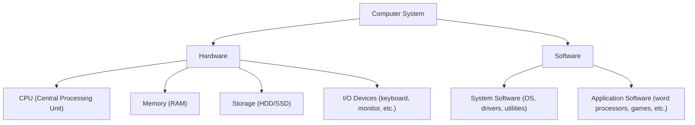
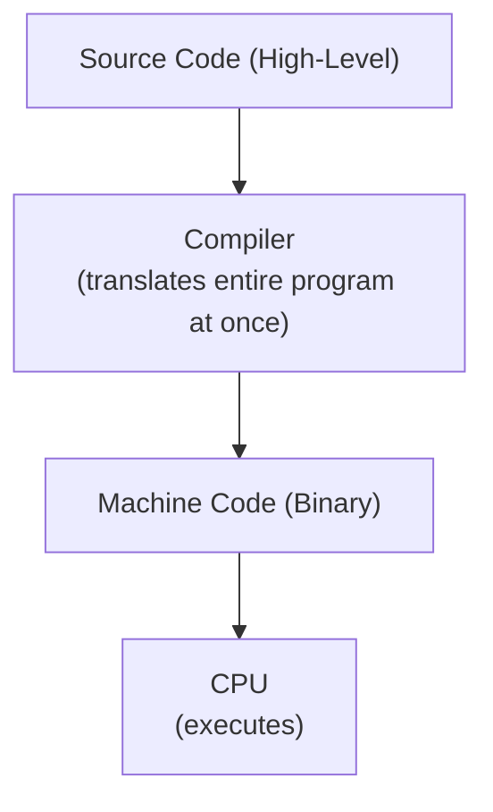
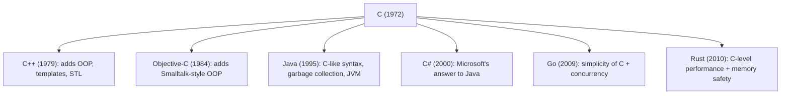
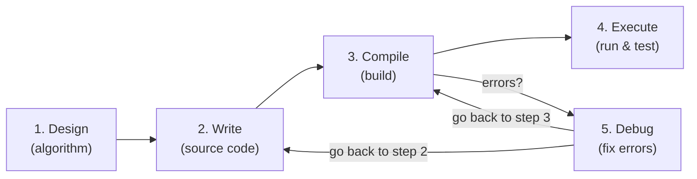
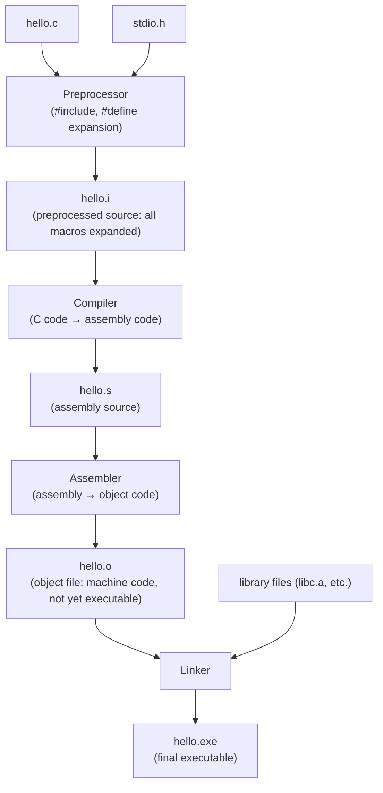
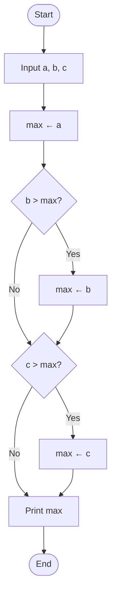

# Chapter 1 — Programming and C Language

[Repository Guide](../../README.md) | [English](Concepts_Lecture.md) | [한국어](Concepts_Lecture.ko.md)

> **Last Updated:** 2026-11-19
>
> Warming-Up C Programming, 천정아, Ch 1

> **Learning Objectives:**
> 1. Explain the concepts of software, programs, instructions, and programming
> 2. Distinguish low-level from high-level languages and machine-dependent from machine-independent languages
> 3. Explain the history, features, and applications of C and the reasons for learning it
> 4. Explain the build process of preprocessing, compiling, assembling, and linking and the output of each stage
> 5. Distinguish compile errors, link errors, and runtime errors and apply basic debugging techniques

---

## Table of Contents

- [1. Programming](#1-programming)
  - [1.1 Software and Programs](#11-software-and-programs)
  - [1.2 Programming Languages](#12-programming-languages)
  - [1.3 Machine-Dependent vs Machine-Independent](#13-machine-dependent-vs-machine-independent)
- [2. C Language](#2-c-language)
  - [2.1 History](#21-history)
  - [2.2 Features](#22-features)
  - [2.3 Applications](#23-applications)
  - [2.4 Reasons to Learn C](#24-reasons-to-learn-c)
  - [2.5 The C Standard and Compiler Extensions](#25-the-c-standard-and-compiler-extensions)
- [3. C Program Development](#3-c-program-development)
  - [3.1 Development Process](#31-development-process)
  - [3.2 Build Process](#32-build-process)
  - [3.3 Errors](#33-errors)
  - [3.4 Debugging](#34-debugging)
  - [3.5 Integrated Development Environments](#35-integrated-development-environments)
  - [3.6 Describing Algorithms](#36-describing-algorithms)
  - [3.7 Programs Made of Several Source Files](#37-programs-made-of-several-source-files)
- [Concept Applications](#concept-applications)
- [Summary](#summary)
- [Self-Check Questions](#self-check-questions)

---

<br>

## 1. Programming

### 1.1 Software and Programs

**Hardware** refers to the physical components of a computer (CPU, memory, storage, peripherals, etc.). **Software** is the collection of programs that run on the hardware and tell it what to do; software that runs on a smartphone is commonly called an **app**.



*Figure 1. Hardware and software that make up a computer system*

A **program** is a set of instructions written in a programming language to perform a specific task; it describes a sequence of operations for the computer hardware to carry out. The **instructions** that the hardware ultimately executes are binary codes the CPU can process, also called CPU instructions. **Programming** is the activity or process of designing and writing these instructions.

> **Key Point:** Without software, hardware is just an expensive collection of electronic components. Software gives hardware purpose.

Seen from the hardware side, a program runs as follows. An executable is normally stored on a storage device as a collection of machine instructions. When the user runs the program, the operating system loads the executable into memory, and the CPU repeatedly fetches one instruction at a time from memory, decodes it, and executes it. After an instruction finishes, the CPU moves on to the instruction at the next address, and when it meets a branch instruction, it moves to another address. The conditional and loop statements of Chapter 5 are ultimately translated into such branch instructions. Programming can therefore be described as writing down in advance, in a language people can understand, the instructions the CPU will carry out in this order.

### 1.2 Programming Languages

A **programming language** is a formal language used to describe the tasks a computer must perform in a program. Languages are classified as low-level or high-level by how close they are to machine hardware.

| Level | Language | Example | Readability | Portability |
|:------|:---------|:--------|:----------:|:-----------:|
| Low-level | Machine Language | `10110000 01100001` | Very low | None |
| Low-level | Assembly Language | `MOV AL, 61h` | Low | None |
| High-level | C, Java, Python | `printf("Hello");` | High | High |

*Table 1. Classification of programming languages by level*

The machine code `10110000 01100001` in the table is the binary code that corresponds, on an x86 CPU, to the assembly instruction `MOV AL, 61h` (load hexadecimal 61 into register AL).

**Machine Language** (1st generation):
- Consists of binary codes (`0`s and `1`s) that the CPU directly executes.
- Each instruction corresponds to a specific CPU operation.
- Because it is written in binary, it is very inconvenient for people to use and error-prone.
- It is different for every CPU architecture and therefore completely **machine-dependent**.

**Assembly Language** (2nd generation):
- Uses human-readable **mnemonics** (e.g., `MOV`, `ADD`, `JMP`) instead of binary.
- Has a one-to-one correspondence with machine instructions.
- An **assembler** translates an assembly program to machine code.
- It is still machine-dependent, so an assembly program for x86 cannot run on ARM.

**High-Level Languages** (3rd generation and above):
- Use syntax close to the natural language people speak (`if`, `while`, `return`).
- One high-level statement may translate to many machine instructions.
- A **compiler** or **interpreter** translates them to machine code.
- They are generally **machine-independent**, so the same source code can run on different platforms once it is translated for each platform.



*Figure 2. A high-level program translated by a compiler and executed by the CPU*

> **Note:** **Compilers and interpreters.** A **compiler** translates the entire source code into machine code before execution (C, C++). An **interpreter** translates and executes line by line at runtime (Python, JavaScript). Java combines both approaches: its compiler translates source code into bytecode, and the JVM executes that bytecode.

### 1.3 Machine-Dependent vs Machine-Independent

| Property | Machine-Dependent | Machine-Independent |
|:---------|:-----------------:|:-------------------:|
| Tied to a specific CPU | Yes | No |
| Examples | Machine language, Assembly | C, Java, Python |
| Portability | Cannot move between architectures | Same source runs on different systems |
| Performance | Maximum (direct hardware control) | Usually slightly lower (limits of compiler optimization, runtime translation in interpreters) |
| Development speed | Very slow | Fast |

*Table 2. Comparison of machine-dependent and machine-independent languages*

Machine language and assembly are **machine-dependent**. Code written for one CPU architecture cannot run on another without rewriting, so the program must be rewritten when the CPU type changes. Writing such programs also requires a good understanding of how the CPU works.

High-level languages are **machine-independent**. Programs can be written without being tied to a CPU type or hardware characteristics, and the same C source code can be compiled on different platforms (Windows, Linux, macOS) using the appropriate compiler for each system.

> **Key Point:** "Machine-independent" does not mean zero effort to port. Platform-specific features (e.g., system calls) may still differ. But the core language and logic remain the same.

---

<br>

## 2. C Language

### 2.1 History

C was created in **1972** by **Dennis Ritchie** at Bell Labs, building on the B language developed by **Ken Thompson**; the two developed UNIX together. Its primary purpose was to rewrite the UNIX operating system in a high-level language. C went on to strongly influence languages such as C++, C#, Objective-C, Java, JavaScript, and Perl.

```text
Timeline of C
──────────────────────────────────────────────────────────────
1969    B Language (Ken Thompson): for early UNIX on PDP-7
1972    C Language (Dennis Ritchie): Bell Labs, for UNIX on PDP-11
1978    K&R C: "The C Programming Language" book (Kernighan & Ritchie)
1989    ANSI C (C89): first official standard (ANSI X3.159-1989)
1990    C90: ISO adoption of ANSI C (ISO/IEC 9899:1990)
1999    C99: inline functions, variable-length arrays, // comments
2011    C11: multi-threading, _Generic, bounds-checking
2018    C18: bug fixes for C11 (no new features)
2024    C23: latest standard, ISO/IEC 9899:2024 (nullptr, #embed, auto type inference)
──────────────────────────────────────────────────────────────
```

*Figure 3. Timeline of the C language and its standards*

The bounds-checking interfaces of C11 (the `_s` functions such as `scanf_s`) belong to Annex K, an optional part of the standard, so not every compiler provides them.

> **Key Point:** "ANSI C" usually means C89/C90. It is the most widely supported baseline, and most modern compilers support at least C99. Source code written in **standard C** can be compiled by any C compiler and behaves the same way. Each C compiler adds its own extensions to the standard C features, so avoid extensions when portability matters.

### 2.2 Features

C has endured for over 50 years because of the following combination of strengths.

| Feature | Description |
|:--------|:------------|
| **Concise syntax** | It has few keywords (32 in C89) and a lean, minimal language design |
| **Procedural programming** | A program is divided into functions, and statements are executed in a defined order to carry out the task |
| **Flexibility** | It has few restrictions, so the programmer has fine-grained control |
| **Performance** | It compiles to efficient machine code with minimal runtime overhead |
| **Portability** | Standard C code compiles on virtually any platform with a C compiler |
| **High-level support** | Control statements, functions, and user-defined types such as structures let programs be written in a structured way |
| **Low-level support** | It supports direct memory access via pointers, bitwise operations, and hardware control |
| **Efficiency** | It has a small memory footprint and suits resource-constrained environments |
| **Foundation of modern languages** | C++, Java, C#, Python, Go, Rust, and others were influenced by C syntax and concepts |

*Table 3. Features of the C language*

On the other hand, its low-level features and few restrictions make C hard to learn and hard to use. The following is the simplest program written in C.

```c
#include <stdio.h>

int main(void) {
    printf("Hello, World!\n");
    return 0;
}
```

> **Note:** **Control and responsibility.** C gives you maximum control, but with that power comes responsibility. There is no garbage collector, no bounds checking, and no built-in exception handling. The programmer must manage everything explicitly.

### 2.3 Applications

C is widely used where performance-oriented development or portability is needed and where low-level hardware access matters. The table below also includes domains where C is used together with C++.

| Domain | Examples |
|:-------|:--------|
| Operating Systems | UNIX, Linux kernel, Windows kernel, macOS kernel |
| Language Implementations | CPython (the reference implementation of Python), Perl interpreter, early GCC |
| Databases | Oracle, MySQL, PostgreSQL, SQLite |
| Embedded Systems | Microcontrollers, IoT devices, smart TVs, automotive ECUs, satellites |
| High-Performance Applications | Microsoft Office, web browsers, high-performance libraries |
| Game Engines | Unreal Engine (C/C++), id Tech engines |
| Networking | TCP/IP stacks, Apache, Nginx |
| Scientific Computing | MATLAB internals, R internals, numerical libraries |

*Table 4. Application domains of C with examples*

An **embedded system** is a device that contains a special-purpose computer, and an **embedded program** is a program that runs on an embedded system. Today's compilers such as GCC, Clang, and MSVC are written mainly in C++, but they remain the core tools for compiling C programs.

> **Key Point:** The Linux kernel (over 30 million lines of code) is written almost entirely in C. This demonstrates that C scales from tiny embedded systems to massive, complex software.

### 2.4 Reasons to Learn C

1. **Fundamentals:** C teaches how computers actually work. Along with control structures, functions, and user-defined types, you deal directly with memory layout, pointers, stack vs heap, and manual resource management, so you can understand the inner workings of programs that other languages hide. These concepts apply everywhere.

2. **Lingua franca:** C is the common language of systems programming. OS APIs, hardware interfaces, and countless algorithms and libraries are developed and published in C. Understanding C lets you make easy use of this programming knowledge and interact with the entire software ecosystem.

3. **Foundation for other languages:** Learning C makes it significantly easier to learn C++, Java, C#, JavaScript, Go, Rust, and others, since they borrow heavily from C's syntax and semantics.



*Figure 4. Languages influenced by C*

> **Note:** **Tip for users of high-level languages.** Even if you plan to work primarily in Python or JavaScript, knowing C gives you a deeper understanding of what happens inside a language, such as memory allocation, CPU-level behavior, and why certain operations are fast or slow.

### 2.5 The C Standard and Compiler Extensions

The **C standard** is an international specification that defines the syntax and meaning of the C language and the standard library that every implementation must provide. Source code that follows the standard compiles on any compiler that supports the standard and runs with the same meaning. In the timeline of Section 2.1, C99 added `//` comments, inline functions, new data types such as `long long int`, variable-length arrays, improved IEEE 754 floating-point support, and variadic macros, and C11 added features such as anonymous structures, memory alignment, multithreading, and Unicode support while removing the unsafe `gets` function from the standard.

A compiler lets an option select which standard to compile against, and the standard reports the choice through the value of the macro `__STDC_VERSION__`. The following are the results of compiling the same program with only Clang's `-std` option changed. C89/C90 does not have this macro.

```c
#include <stdio.h>

int main(void)
{
#ifdef __STDC_VERSION__
    printf("__STDC_VERSION__ = %ldL\n", (long)__STDC_VERSION__);
#else
    printf("__STDC_VERSION__ is not defined\n");
#endif
    return 0;
}
```

| Option | Output |
|:-----|:-----|
| `-std=c89` | `__STDC_VERSION__ is not defined` |
| `-std=c99` | `__STDC_VERSION__ = 199901L` |
| `-std=c11` | `__STDC_VERSION__ = 201112L` |
| `-std=c17` | `__STDC_VERSION__ = 201710L` |
| `-std=c23` | `__STDC_VERSION__ = 202311L` |

*Table 5. Value of `__STDC_VERSION__` for each standard-selection option*

Compilers such as Visual C++, GCC, and Clang provide features of their own in addition to the standard features; these are called **extensions**. Code that uses an extension may fail to compile on a compiler that does not provide it. For example, writing a range as a single `case`, as in `case 1 ... 5:`, is an extension of GCC and Clang, and with the `-pedantic` option Clang reports this with the warning `case ranges are a C2y extension`. A program that must build on several compilers is written with standard features only and compiled with warning options that check conformance to the standard. Chapter 13 treats the standard headers and the features of each version in detail.

---

<br>

## 3. C Program Development

### 3.1 Development Process

The overall process of creating a C program follows four main phases, and when an error occurs, the program is debugged and the process returns to an earlier phase.



*Figure 5. Development process of a C program*

| Phase | Activity | Output |
|:------|:---------|:-------|
| Design | Analyze the problem, plan the algorithm and data structures | Pseudocode, flowchart |
| Write | Type the source code in a text editor or IDE | `.c` source file |
| Compile | Translate source code to machine code, fix any build errors | Executable binary |
| Execute | Run the program, verify it produces correct output | Program output |
| Debug | Identify and fix errors, repeat the compile-execute cycle | Corrected source code |

*Table 6. Activities and outputs of each development phase*

An **algorithm**, planned in the design phase, is a procedure or method for solving a problem logically, and it can be described in natural language, a flowchart, or pseudocode. In the writing phase, the task or algorithm the program must perform is described in a particular programming language, and a **source file** is created with a text editor or source code editor.

### 3.2 Build Process

When you "compile" a C program, multiple stages happen behind the scenes. The full build pipeline is as follows.



*Figure 6. Building an executable through preprocessing, compiling, assembling, and linking*

| Stage | Input | Output | What It Does |
|:------|:------|:-------|:-------------|
| **Preprocessor** | `.c` source | `.i` preprocessed | Expands `#include`, `#define`, `#ifdef`, removes comments |
| **Compiler** | `.i` preprocessed | `.s` assembly | Translates C to assembly, checks syntax and types |
| **Assembler** | `.s` assembly | `.o` object | Converts assembly to binary machine code |
| **Linker** | `.o` object(s) + libraries | executable | Combines object files, resolves external references (e.g., `printf`) |

*Table 7. Input, output, and role of each build stage*

One object file is produced per source file, and the linker combines the object files and libraries into a single executable. Visual Studio (Visual C++) uses the `.obj` extension for object files and `.exe` for executables (`first.c` → `first.obj` → `first.exe`), and it runs everything from preprocessing to linking with a single build command.

> **[Systems Programming]** Symbol resolution and relocation, in which the linker connects the external references left in object files (for example, `printf`) to their definitions in libraries, and loading, which places the finished executable in memory and starts it, are covered in Systems Programming. Knowing this process explains why a function whose definition is missing is reported as an error only at the link step, after compilation has finished (Section 3.3).

> **Key Point:** The preprocessor runs **before** actual compilation. It performs textual substitution and does not understand C syntax. This is why `#define` macros can cause subtle bugs.

In practice, the compiler driver (e.g., `gcc`) handles all stages automatically.

```bash
gcc hello.c -o hello      ← preprocessor + compiler + assembler + linker
gcc -E hello.c             ← preprocessor only (outputs .i)
gcc -S hello.c             ← preprocessor + compiler only (outputs .s)
gcc -c hello.c             ← preprocessor + compiler + assembler (outputs .o)
```

The text after `←` in the block above is an explanation, not part of the command. `gcc -E` writes its result to the screen (standard output), so to save a `.i` file, name the output file as in `gcc -E hello.c -o hello.i`.

Running each stage separately shows its output directly. The following are the results of processing the `hello.c` of Section 2.2 with Apple Clang (arm64 macOS). Preprocessing alone with `-E` replaces `#include <stdio.h>` with the contents of the header file, so the 6-line source becomes a 572-line `hello.i`. At the end of the file, the original `main` function remains without comments.

```text
# 2 "hello.c" 2

int main(void) {
    printf("Hello, World!\n");
    return 0;
}
```

Stopping after compilation with `-S` produces `hello.s`, which contains the assembly language of the arm64 CPU. The following is a part of it (`...` marks omitted instructions); `bl _printf` is the instruction that calls the `printf` function, and `.asciz` is a directive that places the string constant in memory.

```text
_main:
	sub	sp, sp, #32
	...
	adrp	x0, l_.str@PAGE
	add	x0, x0, l_.str@PAGEOFF
	bl	_printf
	...
	ret
l_.str:
	.asciz	"Hello, World!\n"
```

Going through assembly with `-c` produces the object file `hello.o`. The names (symbols) in an object file can be listed with the `nm` command.

```text
0000000000000000 T _main
                 U _printf
```

`T` is a symbol whose code is defined in this file, and `U` is an **undefined symbol**, one that is only used here and is defined elsewhere. `hello.c` defines `main`, but `printf` is in the standard library, so the executable is complete only after the linker finds the definition of `printf` in the library and connects it. Even for the same source, the assembly and the object file differ when the CPU differs, which is why Section 1.3 said that a high-level language program must be recompiled to move it to another CPU.

> **Note:** **C/C++ compilers.** Compilers such as GCC, Visual C++, and C++ Builder provide both a C compiler and a C++ compiler, and they compile a source file as C if its extension is `.c` and as C++ if it is `.cpp`. C and C++ are different languages, but because of these compilers they are often used together, so a C program must be saved with the `.c` extension.

### 3.3 Errors

Errors in C programs fall into three categories based on **when** they are detected.

| Error Type | When Detected | Cause | Example |
|:-----------|:-------------|:------|:--------|
| **Compile Error** | Compilation | Syntax mistakes, type mismatches, undeclared variables | Missing `;`, wrong type |
| **Link Error** | Linking | Missing function definitions, unresolved symbols | Calling a function that does not exist |
| **Runtime Error** | Execution | Logic errors, illegal operations | Division by zero, null pointer access |

*Table 8. Classification of errors by detection time*

A compile error occurs at the faulty part when the compiler parses the code, and no object code is produced until all compile errors are gone. An executable is produced only when there are no link errors, and finding the cause of a link error requires examining how several source files relate to each other. A runtime error (execution error) means the program produces wrong results or terminates abnormally during execution.

**Compile errors** (syntax errors):
```c
#include <stdio.h>

int main(void) {
    printf("Hello\n")   // ← missing semicolon → compile error
    return 0;
}
```

```text
err1.c:4:22: error: expected ';' after expression
    4 |     printf("Hello\n")
      |                      ^
      |                      ;
```

An error message has the form `file:line:column: kind: description`. Clang reports that a semicolon is needed at column 22 of line 4 and even marks where the `;` must be inserted. When the place of the missing semicolon runs into the next line, the error may be reported one line below the actual cause, so check the reported line together with the line before it.

**Link errors:**
```c
// main.c
void myFunction(void);  // declared but never defined anywhere

int main(void) {
    myFunction();        // ← linker cannot find the definition → link error
    return 0;
}
```

```text
Undefined symbols for architecture arm64:
  "_myFunction", referenced from:
      _main in err2-6c1b51.o
ld: symbol(s) not found for architecture arm64
clang: error: linker command failed with exit code 1 (use -v to see invocation)
```

This message comes from the linker `ld`, not from the compiler. Compilation succeeded thanks to the function prototype `void myFunction(void);`, but the definition of the undefined symbol `_myFunction` left in the object file was found in no object file or library. A link error message has no line number, so the cause is traced from the name whose definition is missing and the file that used the name (`referenced from`). Common causes are misspelling a function name and leaving the source file that contains the definition out of the project.

**Runtime errors** (logic errors):
```c
#include <stdio.h>

int main(void) {
    int a = 10, b = 0;
    printf("%d\n", a / b);  // ← division by zero → runtime error (crash)
    return 0;
}
```

Integer division by zero is undefined behavior in the C standard. On x86 systems it usually raises an exception that terminates the program abnormally, but other platforms may give different results.

On arm64 macOS, the following code did not terminate abnormally but printed 0 and ended normally (`b` was declared `volatile` so that the compiler could not compute it in advance). This is because the integer division instruction of arm64 (AArch64) CPUs does not raise an exception on division by zero but produces 0 as the result. That the same source terminates abnormally on x86 and gives a meaningless value on arm64 shows that undefined behavior does not even guarantee stopping with an error. The program must therefore check itself whether the divisor is 0 before dividing (Chapter 5, Section 2.11).

```c
volatile int b = 0;
int a = 10;

printf("%d\n", a / b);
printf("done\n");
```

```text
0
done
```

Besides errors, a compiler also issues **warnings**. An error stops the translation, whereas a warning only points out code that is grammatically correct but likely to be a mistake, and the object file is still produced. Many mistakes that lead to run-time errors, such as `if (x = 0)`, which confuses assignment with comparison, or the use of an uninitialized variable, show up first as warnings, so the habit of fixing code until no warnings remain reduces run-time errors. Also, one error often causes a cascade of following errors, so fix the error list from the first error at the top and compile again.

> **Caution:** Compile errors are the easiest to fix because the compiler tells you the line number and what went wrong. Runtime errors are the hardest because the program compiles and runs, but produces wrong results or crashes unexpectedly.

### 3.4 Debugging

**Debugging** is the process of finding and fixing errors (bugs) in a program. Its core is checking whether the program runs in the correct order and whether the values of expressions used during execution are correct. The story of Grace Hopper's team finding an actual moth (bug) trapped in a relay of the Harvard Mark II computer in 1947 is often told in connection with the term, but the word bug was already used for machine defects before then.

**Common debugging strategies:**

| Strategy | Description |
|:---------|:------------|
| Read the error message | Compiler messages include the file name, line number, and error type, so always read them carefully |
| `printf` debugging | Insert `printf` statements to print variable values at key points in the program |
| Rubber duck debugging | Explain your code line by line to someone (or a rubber duck). The act of explaining often reveals the bug |
| Use a debugger | Use tools like `gdb` (GNU Debugger) to step through code, set breakpoints, and inspect variables |
| Divide and conquer | Comment out sections of code to narrow down where the error occurs |

*Table 9. Common debugging strategies*

**Basic debugging with `printf`:**

```c
#include <stdio.h>

int main(void) {
    int x = 10, y = 3;
    int result = x / y;

    printf("[DEBUG] x = %d, y = %d\n", x, y);       // check values
    printf("[DEBUG] result = %d\n", result);           // expected 3 (integer division)

    // ... rest of program
    return 0;
}
```

The following is an example of finding a logic error with `printf` debugging. The average of the three scores 70, 85, and 90 is 245 / 3 = 81.666..., so 81.67 should appear to two decimal places, but the first version of the code prints 81.00.

```c
int a = 70, b = 85, c = 90;
double avg;

avg = (a + b + c) / 3;
printf("[DEBUG] a + b + c = %d\n", a + b + c);
printf("avg = %.2f\n", avg);

avg = (a + b + c) / 3.0;
printf("avg = %.2f\n", avg);
```

```text
[DEBUG] a + b + c = 245
avg = 81.00
avg = 81.67
```

Printing the intermediate value shows that the sum 245 is correct, so the error lies in the division step. Both `a + b + c` and `3` are of type `int`, so the integer division result 81 is computed first, and it becomes 81.0 when assigned to the `double` variable. Changing one operand to the floating-point constant `3.0` makes it a floating-point division, which gives 81.67. Computing the expected value in advance and comparing it with the actual value at each intermediate step of the computation narrows down the step where the error arises. Integer division and type conversion are treated in detail in Chapter 4.

> **Note:** **Tip on compiling habits.** Develop the habit of compiling frequently. Compile after every few lines, not after writing the entire program. The sooner you catch errors, the easier they are to fix.

> **Note:** **Tip on warning options.** Enable all warnings during compilation with `gcc -Wall -Wextra`. The compiler can catch many potential bugs before you even run the program.

A **debugger** is a tool that stops a running program at a chosen point and lets its state be examined. When a **breakpoint** is set on the line to stop at and the program is run in debug mode, execution stops at that line; at that point the values of variables can be inspected, or the program can be executed line by line to follow how the values change. When stepping line by line, one can choose either to pass over a function call as a single step or to enter the function. Visual Studio, Xcode, and Visual Studio Code provide this feature in the editor window, and on the command line `gdb` or `lldb` is used. `printf` debugging requires changing the code but works anywhere, while a debugger can examine many variables at once without changing the code.

### 3.5 Integrated Development Environments

An **integrated development environment (IDE)** is a development tool that bundles a source code editor, compiler, linker, and debugger into one program. On Windows, Microsoft Visual Studio is widely used; when installing the free Visual Studio Community edition, selecting the "Desktop development with C++" workload installs the C and C++ development tools together.

| Concept | File | Contents |
|:--------|:-----|:---------|
| Project | `*.vcxproj` | All the information needed to build one program: the source and header files it uses, compile options, and link options |
| Solution | `*.sln` | A workspace that groups related projects that must be worked on together. Every project belongs to a solution, and creating a project creates a solution along with it |

*Table 10. Projects and solutions in Visual Studio*

The steps for making a C program in Visual Studio are: create an empty project, add a source file (`first.c`), write the code, build ([Build] → [Build Solution]), and run ([Debug] → [Start Without Debugging]). Even if "C++ File" is chosen when adding a new item, the file is compiled as C if its name ends in `.c`. The Solution Explorer window shows the list of projects in the solution and the source and header files in each project.

The reason Visual Studio has a project created first, instead of starting with source code, is that the project decides which source files are compiled and linked with which options. The build result appears in the output window, and if there are compile errors, the error list window shows the file name, line number, and error code. The following table lists the main features and shortcut keys of Visual Studio as summarized by the textbook.

| Feature | Menu Item | Shortcut |
|:-----|:-----|:-----|
| Create a new project | [File] → [New] → [Project] | Ctrl+Shift+N |
| Add a new item | Select the project, then [Project] → [Add New Item] | Ctrl+Shift+A |
| Add an existing item | Select the project, then [Project] → [Add Existing Item] | Shift+Alt+A |
| Build | [Build] → [Build Solution] | F7 |
| Run | [Debug] → [Start Without Debugging] | Ctrl+F5 |
| Open a solution or project | [File] → [Open] → [Project/Solution] | Ctrl+Shift+O |
| Remove a source file from the project | Select the file, right-click → [Remove] | Del |
| Rename a source file | Select the file, right-click → [Rename] | F2 |

*Table 11. Main features and shortcut keys of Visual Studio*

> **Definition:** A **console program** is a program that takes input from the keyboard and prints text to the console (the command prompt or terminal). A Windows desktop application that uses mouse input and graphical output needs a platform library such as the Windows API, but a console program can be written with standard C and the standard library alone.

A program written with standard C and the standard library alone runs as a console program. When a program is run in Visual Studio with [Start Without Debugging], the console window stays open after the program ends, so the output can be checked. To run it outside Visual Studio, enter the path of the built executable (`.exe`) at the command prompt.

### 3.6 Describing Algorithms

> **Definition:** An **algorithm** is a procedure of finitely many steps for solving a problem logically. Each step must be unambiguous, and for given input the procedure must end in finite time and produce a result.

In the program design stage, the algorithm is settled before code is written. An algorithm can be described in three ways: natural language, a flowchart, or pseudo-code. **Natural language** spells out the processing in words; it is easy to write but tends to become ambiguous. A **flowchart** draws the order of processing with symbols and shapes, so the flow is visible at a glance. **Pseudo-code** imitates the form of a programming language to write the algorithm roughly; it is not bound to the syntax of a particular language yet is easy to translate into code. The algorithm that finds the largest of three integers a, b, and c is described in the three ways as follows.

In natural language, it reads as follows.

1. Read three integers a, b, and c.
2. Set a as the maximum so far, max.
3. If b is greater than max, change max to b.
4. If c is greater than max, change max to c.
5. Print max.

In pseudo-code, it reads as follows.

```text
input a, b, c
max <- a
if b > max then max <- b
if c > max then max <- c
print max
```

As a flowchart, it is shown in Figure 7.



*Figure 7. Flowchart of the algorithm that finds the maximum of three integers*

If the input is 12, 47, and 30, max is 12 after step 2, becomes 47 in step 3 because 47 > 12, and stays 47 in step 4 because 30 > 47 is false, so 47 is printed. Whichever of a, b, and c is the largest, max ends as the maximum of the three, and the algorithm also works correctly when two numbers are equal. The `if` statement needed to translate it into C code is learned in Chapter 5. Settling the algorithm first allows tracing it by hand with values before any code is written, so errors can be found at the design stage. The same algorithm can also be carried into languages other than C as it is.

### 3.7 Programs Made of Several Source Files

> **Definition:** An **object file** is a file that holds the result of translating one source file into machine language. Along with the machine code, it holds the symbols the file defines and a list of the symbols that must be found in other files, and it can be executed only after linking.

A simple program consists of one source file, but a large program, or one developed by several people together, is written as several source files. Each source file is then compiled separately into its own object file, and the linker combines all the object files and libraries into one executable. The following program puts a function that computes a square in `util.c` and the `main` that calls it in `main.c`.

```c
// util.c
int square(int x)
{
    return x * x;
}
```

```c
// main.c
#include <stdio.h>

int square(int x);     // prototype of a function defined in another file

int main(void)
{
    printf("%d\n", square(7));
    return 0;
}
```

```bash
cc -c util.c                  # creates util.o
cc -c main.c                  # creates main.o
cc util.o main.o -o app       # links the two object files
./app
```

```text
49
```

Running `nm main.o` shows that `main.o` still has `U _square` as an undefined symbol, and `nm util.o` shows `T _square` as a defined symbol. The linker connects the `_square` that `main.o` looks for with the definition in `util.o`. When one source file changes, only that file needs to be recompiled and linked, which shortens build time for a large program.

An executable must contain exactly one `main` function, the starting point of the program. Linking one more source file that defines `main` makes the linker report that there are two definitions of the same name.

```text
duplicate symbol '_main' in:
    .../other-25fc4d.o
    .../main.o
ld: 1 duplicate symbols
```

A Visual Studio project also corresponds to one executable, so putting several `.c` files that contain `main` into one project produces the same link error. To keep a separate file with `main` for each exercise, create a project for each exercise or mark the files to be excluded from the build. Sharing function prototypes through header files is treated in Chapter 12.

---

<br>

## Concept Applications

**True/False Check:**

| Statement | Judgment and Reason |
|:-----|:-----|
| Machine language and assembly language correspond one to one. | **T.** One assembly mnemonic corresponds to one machine instruction, and the assembler translates it. |
| C source code, once compiled, runs as the same executable on any CPU. | **F.** An executable is machine code of a CPU, so for another CPU it must be recompiled with that CPU's compiler. |
| The preprocessor checks C syntax while substituting `#define`. | **F.** The preprocessor does not understand syntax and only substitutes text; the compiler checks syntax. |
| An object file can be executed as it is. | **F.** Undefined symbols such as `printf` remain, so it becomes an executable only after linking. |
| Calling a function that has a prototype but no definition causes a compile error. | **F.** Compilation succeeds thanks to the prototype, and the linker, unable to find the definition, reports a link error. |
| A program with warnings but no errors produces no executable. | **F.** Warnings do not stop the translation, so an executable is produced, but warnings reveal causes of run-time errors and should be fixed. |
| An executable must contain exactly one `main` function. | **T.** A missing `main` or two or more `main` functions cause a link error. |
| An algorithm must be described in a programming language such as C. | **F.** It can also be described in natural language, a flowchart, or pseudo-code, and code is the result of translating the algorithm. |

---

<br>

## Summary

| Concept | Key Summary |
|:--------|:-------------|
| Software and Programs | Software is a collection of programs, and a program is a set of instructions describing the work the computer must do. |
| Programming Languages | Machine language (binary), assembly (mnemonics), and high-level languages (C, Java, Python) get progressively closer to human language. |
| Machine-Dependent | Machine and assembly languages are tied to a specific CPU architecture and must be rewritten when the CPU changes. |
| Machine-Independent | High-level languages can be ported to many platforms by recompiling for each platform. |
| C History | Dennis Ritchie created C at Bell Labs in 1972, and the standards continued as K&R C, ANSI C (C89), C99, C11, and C23. |
| C Features | C is concise and flexible, offers performance and portability, and supports both high-level features and low-level access. |
| C Applications | C is used in operating systems, language implementations, databases, embedded systems, game engines, and more. |
| Reasons to Learn C | C builds fundamentals, teaches the lingua franca of systems programming, and lays the foundation for C++, Java, Go, and Rust. |
| Development Process | Development proceeds through design, writing, compiling, and execution, and repeats with debugging when errors occur. |
| Build Process | An executable is produced through the preprocessor, compiler, assembler, and linker. |
| Compile Error | Syntax or type mistakes are caught during compilation. |
| Link Error | Missing definitions of functions or variables are caught during linking. |
| Runtime Error | Logic errors or illegal operations show up during execution. |
| Debugging | Read error messages, use `printf` debugging and `gdb`, and compile with `-Wall`. |
| Integrated Development Environment | An IDE bundles an editor, compiler, and debugger, and Visual Studio manages projects grouped into solutions. |
| The C standard and extensions | Code that follows the standard compiles with the same meaning on any compiler, while code that uses a compiler's extensions may not compile on other compilers. |
| Object files and symbols | An object file holds the symbols it defines (`T`) and undefined symbols (`U`), and the linker connects undefined symbols to definitions in other files and libraries. |
| Warnings | They point out code that is grammatically correct but likely to be a mistake, and the habit of removing warnings reduces run-time errors. |
| Debugger | It stops execution at a breakpoint to inspect variables, or steps line by line to follow how values change. |
| Console program | A program that uses only keyboard input and text output, which can be written in standard C alone. |
| Describing algorithms | An algorithm is described in natural language, a flowchart, or pseudo-code, whose strengths are ease of writing, visibility of the flow, and ease of translation into code, respectively. |
| Several source files | Object files compiled separately from each source file are linked into one executable, which must contain only one `main`. |

---

<br>

## Self-Check Questions

1. **Machine dependence and independence:** What must be done to run an assembly program and a C program written for an x86 CPU on an ARM CPU?

   <details>
   <summary>Answer</summary>

   Assembly is machine-dependent, so the x86 mnemonics cannot be used as they are, and the program must be rewritten with ARM instructions. C is machine-independent, so the same source code only needs to be recompiled with a compiler for ARM. However, any parts that use platform-specific features such as system calls may need changes.

   </details>

2. **Build stages:** Which stages run, and which file is produced, when you execute `gcc -c hello.c`? Why can that file not be executed directly?

   <details>
   <summary>Answer</summary>

   Preprocessing, compiling, and assembling run, producing the object file `hello.o`. The object file is in machine code, but its external references to functions defined elsewhere (in libraries), such as `printf`, are unresolved, so the linker must combine it with the libraries into an executable before it can run.

   </details>

3. **Classifying errors:** Name the type of error in each case. (a) The semicolon at the end of a statement is missing. (b) A function that is declared but never defined is called. (c) When computing an average, the last value instead of the total is divided by the count, and a wrong result is printed.

   <details>
   <summary>Answer</summary>

   (a) is a syntax mistake, so it is a compile error. (b) is a link error because the linker cannot find the function's definition. (c) is a runtime error (logic error) because compiling and linking succeed and the program runs, but it produces a wrong result.

   </details>

4. **Preprocessor:** List three things the preprocessor does, and explain how the preprocessor differs from the compiler.

   <details>
   <summary>Answer</summary>

   The preprocessor inserts the contents of header files named by `#include`, replaces macros defined by `#define`, and removes comments (it also handles conditional compilation such as `#ifdef`). The preprocessor runs before actual compilation and performs only textual substitution without understanding C syntax, whereas the compiler checks syntax and types and translates C code into assembly code.

   </details>

5. **Undefined symbols:** Explain why `_printf` is marked with `U` in the output of `nm hello.o`, and state when and how this symbol is resolved.

   <details>
   <summary>Answer</summary>

   `hello.c` only calls `printf` and does not define it, so the object file records it as an undefined symbol (`U`). It is resolved in the link stage when the linker finds the definition of `printf` in the standard library and connects it to the call site, after which the executable is produced.

   </details>

6. **Diagnosing link errors:** A project contains `main.c` and `util.c`, and `main.c` calls `square`, which is defined in `util.c`. What error occurs (a) when the project is built with `util.c` removed, and (b) when a `test.c` containing `main` is added to the project and it is built?

   <details>
   <summary>Answer</summary>

   (a) `main.c` compiles thanks to the prototype, but the definition of `square` cannot be found, so a link error about an undefined symbol occurs. (b) The executable would contain two definitions of `main`, so a link error about a duplicate symbol (`duplicate symbol '_main'`) occurs. In both cases compilation succeeds and linking fails.

   </details>

7. **Algorithm trace:** Write max after each step when the input 9, 9, 4 is given to the maximum algorithm of Section 3.6.

   <details>
   <summary>Answer</summary>

   After step 2, max is 9. In step 3, `9 > 9` is false, so max stays 9, and in step 4, `4 > 9` is also false, so it stays 9. The output is 9; the algorithm finds the maximum correctly even when values are equal.

   </details>

8. **Errors and warnings:** Is an executable produced for a program that has compile warnings but no errors? Explain with one example why warnings must not be ignored.

   <details>
   <summary>Answer</summary>

   Yes, because warnings do not stop the translation. However, code that uses assignment instead of comparison, such as `if (x = 0)`, only produces a warning and runs, but the condition is always false and the value of `x` changes, giving wrong results. Warnings reveal the causes of such run-time errors before execution, so they must be fixed.

   </details>
