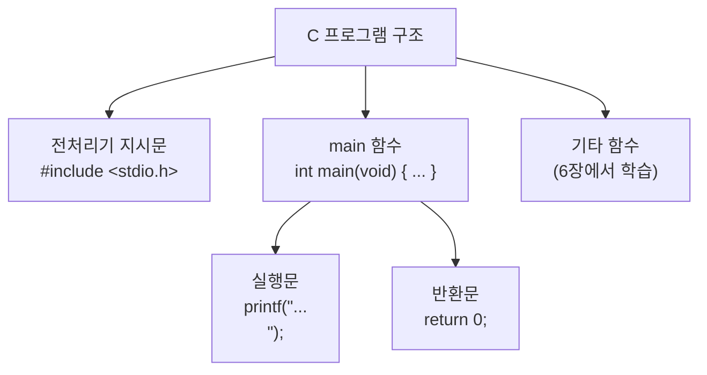
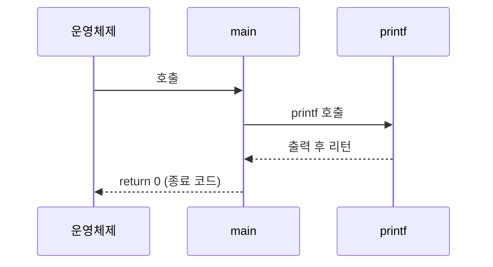

# 2장 — C 프로그램의 기본

[레포지토리 안내](../../README.ko.md) | [English](Concepts_Lecture.md) | [한국어](Concepts_Lecture.ko.md)

> **최종 수정일:** 2026-11-27
>
> Warming-Up C Programming, 천정아, Ch 2

> **학습 목표:**
> 1. C 프로그램의 기본 구조와 주석, `main` 함수, 종료 코드의 역할을 설명할 수 있다
> 2. 함수의 구성 요소와 함수가 호출되고 리턴하는 흐름을 설명할 수 있다
> 3. `printf`의 형식 문자열, 형식 지정자, 문자 폭과 정밀도를 사용하여 값을 출력할 수 있다
> 4. `scanf`로 하나 이상의 값을 입력받고 `&`가 필요한 이유를 설명할 수 있다
> 5. 변수를 선언, 대입, 초기화하여 입출력에 활용할 수 있다

---

## 목차

- [1. 첫 번째 C 프로그램](#1-첫-번째-c-프로그램)
  - [1.1 프로그램 구조](#11-프로그램-구조)
  - [1.2 주석](#12-주석)
  - [1.3 `main` 함수](#13-main-함수)
  - [1.4 종료 코드](#14-종료-코드)
- [2. 입력과 출력](#2-입력과-출력)
  - [2.1 콘솔 입출력](#21-콘솔-입출력)
  - [2.2 `printf`](#22-printf)
  - [2.3 `scanf`](#23-scanf)
  - [2.4 입출력에서의 변수 활용](#24-입출력에서의-변수-활용)
  - [2.5 입출력 프로그램의 작성](#25-입출력-프로그램의-작성)
  - [2.6 변수가 차지하는 메모리](#26-변수가-차지하는-메모리)
  - [2.7 입출력 프로그램의 작성 예: 시간 변환](#27-입출력-프로그램의-작성-예-시간-변환)
  - [2.8 형식 문자열의 흔한 실수](#28-형식-문자열의-흔한-실수)
- [3. C 문장](#3-c-문장)
- [개념 적용](#개념-적용)
- [요약](#요약)
- [점검 문제](#점검-문제)

---

<br>

## 1. 첫 번째 C 프로그램

### 1.1 프로그램 구조

모든 C 프로그램은 기본적인 구조를 따른다. 가장 간단한 완전한 프로그램을 한 줄씩 주석으로 설명하면 다음과 같다.

```c
// first.c
#include <stdio.h>    // I/O library header

int main(void)        // entry point function
{
    printf("First C Program\n");  // console output
    return 0;         // exit code to OS
}
```



*그림 1. C 프로그램의 구조*

| 구성 요소 | 역할 |
|:---------|:-----|
| `#include <stdio.h>` | 표준 입출력 라이브러리를 사용하기 위한 준비로, `printf`와 `scanf`를 사용할 수 있게 함 |
| `int main(void)` | 진입점 정의; 프로그램이 시작될 때 가장 먼저 호출되는 함수 |
| `{ ... }` | 중괄호로 함수 본문을 구분 |
| `printf("...\n");` | 문자열을 콘솔에 출력 |
| `return 0;` | 정상 종료를 의미하는 종료 코드 0을 OS에 반환 |

*표 1. 첫 번째 프로그램의 구성 요소와 역할*

> **핵심:** 함수 내부의 문장은 세미콜론(`;`)으로 끝나야 한다(중괄호로 묶은 블록과 5장의 제어문은 예외이다). 전처리기 지시문(`#include`)에는 세미콜론을 붙이지 **않는다**.

### 1.2 주석

**주석(comment)** 은 소스 코드에 대한 정보를 제공하거나 소스 코드의 일부를 컴파일하지 않게 만들 때 쓴다. 컴파일러가 무시하며, 사람이 읽기 위해 존재한다.

| 종류 | 문법 | 범위 |
|:----|:----|:----|
| 블록 주석 | `/* ... */` | 여러 줄에 걸칠 수 있음 |
| 줄 주석 | `// ...` | `//`부터 줄 끝까지 |

*표 2. C의 두 가지 주석*

`//` 줄 주석은 C99에서 추가된 기능이며, 지금은 대부분의 C 컴파일러에서 사용할 수 있다. 블록 주석은 코드 중간에도 넣을 수 있다.

```c
/* This is a block comment.
   It can span multiple lines. */

// This is a line comment.

int x = 10;  // inline comment after code
```

**코드 주석 처리(comment out)** 는 이미 작성한 코드를 삭제하지 않고 임시로 컴파일하지 않게 만드는 것이다.

```c
/* printf("This line is disabled.\n"); */

// printf("This line is also disabled.\n");
```

> **주의:** 블록 주석은 **중첩할 수 없다**. `/* 외부 /* 내부 */ 아직 안쪽? */`는 컴파일 에러를 일으킨다. `*/`가 첫 번째 매칭에서 주석을 닫기 때문이다.

Visual Studio 같은 편집기는 키워드, 주석, 문자열 상수를 서로 다른 색으로 보여 주는 구문별 색 지정 기능을 제공한다. 아래의 줄 이음 문제처럼 의도와 달리 주석이 된 코드는 주석의 색으로 표시되므로, 편집기의 색을 함께 보는 습관이 도움이 된다.

주석의 범위는 컴파일러가 소스를 읽는 규칙으로 정해지므로 겉모양과 다를 수 있다. 다음 코드에서 `//` 주석의 끝에 있는 `\`는 그 줄과 다음 줄을 하나로 잇는 줄 이음 표시이므로, 다음 줄의 `total += 5;`까지 주석이 되어 실행되지 않는다. 반대로 문자열 상수 안의 `/* ... */`는 주석이 아니라 출력할 문자이다.

```c
int total = 10;

// add the bonus \
total += 5;
printf("total = %d\n", total);
printf("/* not a comment */\n");
```

```text
warning: multi-line // comment [-Wcomment]
total = 10
/* not a comment */
```

첫 줄의 경고는 Clang이 컴파일할 때 낸 것이고, 나머지 두 줄은 실행 결과이다. 주석은 코드가 **무엇을** 하는지 되풀이하기보다 **왜** 그렇게 하는지를 쓸 때 가장 쓸모가 있으며, 코드를 고치면 주석도 함께 고쳐 둘이 어긋나지 않게 한다.

### 1.3 `main` 함수

C 프로그램은 `main` 함수 하나, 또는 `main` 함수와 여러 함수로 구성된다. **함수(function)** 는 다음 세 요소로 구성되며, 함수 본문은 세미콜론으로 끝나는 문장(선언문, 입력문, 출력문, 조건문, 반복문 등)으로 이루어진다.

| 구성 요소 | 의미 | `int main(void)`에서 |
|:---------|:----|:-----|
| 리턴형 | 함수가 리턴하는 값의 형식 | `int` |
| 함수 이름 | 함수를 구분하기 위한 이름 | `main` |
| 매개변수 | 함수를 수행하는 데 필요한 값 | `void` (없음) |

*표 3. 함수의 구성 요소*

함수가 호출되면 `{ }` 안에 있는 문장들이 위에서부터 순서대로 수행된다. 문장들을 수행하다가 함수의 끝(`}`)을 만나거나 `return`을 만나면, 함수를 호출한 곳으로 되돌아간다(리턴한다).

`main` 함수는 모든 C 프로그램의 **진입점(entry point)** 이다. 진입점 함수는 C 프로그램이 처음 시작될 때 호출되기로 약속된 함수이므로, OS가 컴파일된 프로그램을 실행하면 `main`부터 실행이 시작된다.

| 규칙 | 설명 |
|:----|:----|
| 반드시 하나만 | 모든 프로그램에는 `main` 함수가 하나만 있어야 한다 |
| 반환 타입 `int` | `main`은 정수 종료 코드를 OS에 반환한다 |
| 매개변수 `void` | `void`는 인자가 없음을 의미; 빈 괄호 `()`도 가능 |
| 대소문자 구분 | `main`은 유효; `Main`, `MAIN`, `mAiN`은 진입점이 **아님** |

*표 4. `main` 함수의 규칙*

```c
int main(void)    // [O] standard form
{
    return 0;
}
```

```c
int main()        // [O] also valid (empty parameter list)
{
    return 0;
}
```

> **핵심:** C는 **대소문자를 구분** 한다. `main`과 `Main`은 서로 다른 식별자이다. 컴파일러가 진입점으로 인식하는 것은 소문자 `main`뿐이다.

함수의 호출과 리턴은 진입점에서부터 이어진다. 운영체제가 프로그램을 실행하면 `main`을 호출하고, `main` 안의 `printf("Hello\n");`는 표준 라이브러리의 `printf` 함수를 호출한다. `printf`가 출력을 마치고 리턴하면 실행은 `main`의 다음 문장으로 돌아오며, `main`이 `return 0;`으로 리턴하면 실행의 흐름이 운영체제로 되돌아가면서 프로그램이 끝난다.



*그림 2. 진입점 함수의 호출과 리턴*

`main`은 이름, 개수, 반환형이 모두 정해진 함수이므로 다음과 같이 잘못 쓰면 프로그램이 만들어지지 않는다. 이름을 `Main`으로 쓰면 컴파일은 되지만, 링커가 진입점 `main`을 찾지 못해 링크 오류가 난다.

```text
Undefined symbols for architecture arm64:
  "_main", referenced from:
      <initial-undefines>
ld: symbol(s) not found for architecture arm64
```

`main`이 없는 프로그램도 같은 링크 오류를 내고, `main`이 둘 이상이면 같은 이름의 정의가 중복되었다는 링크 오류가 난다(1장 3.7절). 반환형을 `void`로 쓴 `void main(void)`는 C 표준의 형태가 아니므로 쓰지 않는다. 일부 컴파일러는 이를 허용하지만, Clang은 `error: 'main' must return 'int'` 오류로 거부한다. `main`은 콘솔 프로그램의 진입점이며, 교재는 Windows 데스크톱 응용 프로그램이 `main` 대신 `WinMain` 함수를 진입점으로 쓴다고 설명한다.

### 1.4 종료 코드

`main`의 `return` 문은 **종료 코드(exit code, exit status)** 를 운영체제에 전달한다. 종료 코드는 `main` 함수의 리턴 값(`int`형)이며 프로그램의 종료 상태를 나타낸다.

| 종료 코드 | 의미 |
|:--------:|:----|
| `0` | 정상 종료 (성공) |
| 0이 아닌 값 | 비정상 종료 (오류) |

*표 5. 종료 코드의 의미*

```c
int main(void)
{
    printf("Hello\n");
    return 0;   // tell the OS: program finished successfully
}
```

OS 또는 호출 스크립트는 이 종료 코드를 검사하여 프로그램의 성공과 실패 여부를 판단할 수 있다.

종료 코드는 셸에서 직접 확인할 수 있다. 다음 프로그램은 3을 반환하며, macOS와 Linux의 셸에서는 직전에 실행한 프로그램의 종료 코드를 `$?`로, Windows의 명령 프롬프트에서는 `%ERRORLEVEL%`로 읽는다.

```c
#include <stdio.h>

int main(void)
{
    printf("exiting with 3\n");
    return 3;
}
```

```text
$ ./exitcode
exiting with 3
$ echo $?
3
```

종료 코드의 값을 어떻게 해석할지는 운영체제와 그 프로그램을 호출하는 쪽의 약속이다. 0이 정상 종료라는 것은 공통이지만, 0이 아닌 값은 프로그램마다 의미를 정한다. 예를 들어 입력 파일을 열지 못하면 1, 입력 형식이 틀리면 2를 반환하도록 정해 두면, 프로그램을 실행한 스크립트가 종료 코드만 보고 실패의 원인을 구분할 수 있다.

> **참고:** **`return 0`의 생략.** C99 이후에서는 `main` 끝에 `return`을 생략하면 컴파일러가 자동으로 `0`을 반환한다. 이 예외는 `main` 함수에만 적용된다. 그러나 명확성을 위해 `return 0;`을 명시적으로 작성하는 것이 좋다.

---

<br>

## 2. 입력과 출력

### 2.1 콘솔 입출력

**콘솔 프로그램**은 콘솔(명령 프롬프트)에서 실행되는 프로그램으로, 키보드로부터 입력을 받아서 처리한 다음 결과를 콘솔에 텍스트로 출력한다. C에는 입출력 키워드가 내장되어 있지 않다. 대신 C 프로그램마다 공통으로 필요한 입력과 출력 기능을 **입출력 라이브러리**가 제공하며, 프로그램은 **헤더 파일**에 선언된 **라이브러리 함수**를 통해 입출력을 수행한다.

```c
#include <stdio.h>   // stdio = standard input/output
```

| 용어 | 의미 |
|:----|:----|
| `#include` | 헤더 파일의 내용을 소스에 복사하는 전처리기 지시문 |
| `<stdio.h>` | 표준 입출력 헤더; `printf`, `scanf` 등을 제공 |
| 표준 입력 | 키보드 (기본값) |
| 표준 출력 | 콘솔/화면 (기본값) |
| 헤더 파일 | 라이브러리 함수에 대한 정보(함수 이름, 리턴형, 매개변수), 즉 컴파일러에 필요한 함수 선언을 담은 파일 (`.h`) |

*표 6. 콘솔 입출력에 관한 용어*

라이브러리를 사용하려면 그 라이브러리의 헤더 파일을 `#include`로 포함해야 한다.


*그림 3. 표준 입력과 표준 출력의 흐름*

> **핵심:** `#include <stdio.h>`가 없으면 컴파일러가 `printf`와 `scanf`의 선언을 알 수 없어 에러(또는 표준에 따라 경고)가 발생한다.

### 2.2 `printf`

`printf`(print formatted)는 형식화된 출력을 콘솔에 출력한다. 문자열을 출력하는 기능 외에 값을 형식에 맞춰 출력하는 기능을 제공한다.

**기본 문법:**

```c
printf("format string", value1, value2, ...);
```

**형식 문자열**은 `" "` 안에 쓰며, 다음 요소를 포함할 수 있다.
- 일반 텍스트는 그대로 출력된다.
- **형식 지정자(format specifier)** 는 `%`와 약속된 문자로 이루어진 자리표시자로, 대응하는 값으로 대치된다.
- **이스케이프 시퀀스**는 `\n` 같은 특수 문자를 나타낸다.

#### 형식 지정자

| 지정자 | 타입 | 예시 |
|:-----:|:----|:----|
| `%d` | `int` (10진 정수) | `printf("%d", 42);` → `42` |
| `%f` | `float`/`double` | `printf("%f", 3.14);` → `3.140000` |
| `%c` | `char` (문자) | `printf("%c", 'A');` → `A` |
| `%s` | 문자열 | `printf("%s", "hi");` → `hi` |
| `%x` | `int` (16진수) | `printf("%x", 255);` → `ff` |
| `%X` | `int` (16진수, 대문자) | `printf("%X", 255);` → `FF` |
| `%e` | `float`/`double` (지수 표기) | `printf("%e", 0.001);` → `1.000000e-03` |

*표 7. `printf`의 주요 형식 지정자*

`%F`와 `%E`는 각각 `%f`, `%e`와 같지만 무한대(`INF`)나 지수 기호(`E`) 같은 문자를 대문자로 출력한다. 형식 문자열에 형식 지정자가 여러 개 있으면 형식 지정자와 출력할 값이 순서대로 대응하며, 형식 지정자와 값의 개수가 일치해야 한다.

```c wide-ok
int age = 20;
double height = 175.5;

printf("나이: %d\n", age);           // 나이: 20
printf("키: %f cm\n", height);       // 키: 175.500000 cm
printf("키: %.1f cm\n", height);     // 키: 175.5 cm
```

다음 코드는 표 7의 형식 지정자로 같은 값을 여러 형식으로 출력한다.

```c
int a = 10;
double b = 1.23;
char c = 'A';

printf("%d %o %x %X %#x\n", a, a, a, a, a);
printf("%f %e %g\n", b, b, b);
printf("%c %d\n", c, c);
printf("%s, 100%%\n", "text");
printf("%d %d %d\n", 10, 010, 0x10);
```

```text
10 12 a A 0xa
1.230000 1.230000e+00 1.23
A 65
text, 100%
10 8 16
```

첫 줄은 10진수 10을 10진수(`%d`), 8진수(`%o`), 16진수(`%x`, `%X`)로 출력한다. 8진수는 0\~7, 16진수는 0\~9와 a\~f(또는 A\~F)로 수를 나타내므로, 10은 8진수로 12, 16진수로 a이다. `%#x`처럼 `#`을 붙이면 16진수 앞에 `0x`가 함께 출력된다. 둘째 줄의 `%f`는 소수점 이하 6자리, `%e`는 지수 표기(1.23 × 10⁰), `%g`는 지수가 -4보다 작거나 6 이상이면 지수 표기를, 그 밖에는 소수점 표기를 쓰고 끝의 0을 지운다. 셋째 줄은 같은 `char` 값을 `%c`로는 문자 `A`로, `%d`로는 그 문자 코드 65로 출력한다. `%` 문자 자체를 출력하려면 `%%`를 쓴다. 마지막 줄은 소스 코드의 정수 상수도 진법을 표기할 수 있음을 보여 준다. 0으로 시작하는 `010`은 8진수 상수(10진수 8)이고, `0x`로 시작하는 `0x10`은 16진수 상수(10진수 16)이다. 따라서 자릿수를 맞추려고 정수 상수 앞에 0을 붙이면 값이 달라지므로 주의해야 한다.

#### 문자 폭과 정밀도

형식 지정자에 **문자 폭**(출력 폭)과 **정밀도**를 지정할 수 있다. 문자 폭은 `%`와 `d` 사이에 정수로 쓰며(`%6d`), 지정한 폭에 맞춰 오른쪽으로 정렬하여 출력한다. 문자 폭 앞에 `-`를 함께 쓰면(`%-6d`) 왼쪽으로 정렬한다. 정밀도는 `%`와 `f` 사이에 `.`과 정수로 지정하며(`%.2f`), 폭과 정밀도를 함께 지정할 수도 있다(`%8.2f`). 문자 폭을 지정하지 않으면 왼쪽부터 필요한 만큼만 출력하고, 정밀도를 지정하지 않으면 `%f`는 소수점 이하 6자리를 출력한다.

```c
int num = 123;
double pi = 3.14159;

printf("[%d]\n", num);       // [123]
printf("[%6d]\n", num);      // [   123]   (width 6, right-aligned)
printf("[%-6d]\n", num);     // [123   ]   (width 6, left-aligned)
printf("[%f]\n", pi);        // [3.141590] (6 decimal places)
printf("[%.2f]\n", pi);      // [3.14]
printf("[%8.2f]\n", pi);     // [    3.14] (width 8, 2 decimal places)
```

0으로 채우기(`%06d`) 같은 나머지 형식은 3장의 5.2절에서 다룬다.

문자 폭과 정밀도에는 몇 가지 세부 규칙이 있다. 다음 코드의 출력으로 각 규칙을 확인한다.

```c
printf("[%5d]\n", 123456);
printf("[%.2f] [%.2f]\n", 2.345, 2.355);
printf("[%8.3f] [%-8.2f]\n", 3.14159, 3.14159);
printf("[%+d] [%+d]\n", 42, -42);
printf("[%.0f] [%.0f] [%.0f]\n", 0.5, 1.5, 2.5);
printf("[%.3e]\n", 1234.5);
printf("[%10s] [%-10s]\n", "abc", "abc");
```

```text
[123456]
[2.35] [2.35]
[   3.142] [3.14    ]
[+42] [-42]
[0] [2] [2]
[1.234e+03]
[       abc] [abc       ]
```

- 문자 폭은 **최소** 폭이다. 출력할 값이 폭보다 길면 잘리지 않고 전부 출력되므로, `%5d`로 6자리 수 123456을 출력하면 그대로 `123456`이 나온다.
- 정밀도를 지정하면 그 자리에서 반올림한다. 다만 반올림은 메모리에 실제로 저장된 2진 근삿값을 기준으로 한다. 2.345는 2.34500000000000019...로, 2.355는 2.35499999999999998...로 저장되므로 `%.2f`로 출력하면 둘 다 `2.35`가 된다.
- 폭과 정밀도는 함께 쓸 수 있다. `%8.3f`는 소수점 이하 3자리로 만든 `3.142`(5문자)를 8칸에 오른쪽 정렬하여 앞에 빈칸 3개를 둔다. 소수점도 한 칸을 차지한다.
- `+` 플래그는 양수에도 부호를 붙이고, `-` 플래그는 왼쪽 정렬을 지정한다.
- 0.5, 1.5, 2.5처럼 2진수로 정확히 표현되는 중간값을 `%.0f`로 출력하면, 이 결과를 얻은 macOS의 C 라이브러리는 가장 가까운 짝수 쪽으로 반올림하여 `0`, `2`, `2`를 출력한다. 사사오입과 다를 수 있으므로, 정해진 방식의 반올림이 필요하면 출력에 맡기지 않고 직접 계산한다.
- `%e`의 정밀도는 지수 표기에서 소수점 이하 자릿수이다. 1234.5는 1.2345 × 10³이며 2진수로 정확히 표현되는 중간값이므로, 앞의 규칙에 따라 `%.3e`는 짝수 쪽인 `1.234e+03`을 출력한다. `%s`에도 폭과 `-`를 쓸 수 있다.

> **참고:** **`printf`의 반환값.** `printf`는 출력한 문자의 개수를 `int`로 반환한다. `int a = printf("Hello, C\n");`의 `a`는 줄바꿈까지 센 9이고, `printf("%d\n", 12345)`는 6을 반환한다. 대부분의 프로그램은 이 값을 쓰지 않지만, 출력에 실패하면 음수를 반환하므로 출력이 중요한 프로그램은 반환값으로 오류를 검사할 수 있다.

#### 줄바꿈과 커서 동작

`printf`는 자동으로 다음 줄로 이동하지 **않는다**. 커서는 출력된 텍스트 끝에 그대로 남는다. 줄바꿈 문자 `\n`을 사용하여 텍스트를 출력한 뒤 커서를 다음 줄로 이동해야 한다.

```c
printf("Hello");
printf("World\n");
// Output: HelloWorld   (no space, no line break between them)
```

```c wide-ok
printf("1번 줄\n");
printf("2번 줄\n");
// Output:
// Line 1
// Line 2
```

여러 `printf` 호출은 이전 출력의 마지막 커서 위치부터 이어서 출력한다. 즉 `printf`는 현재 커서 위치에 텍스트를 덧붙인다.

#### 형식 지정자와 인수의 일치

`printf`는 형식 지정자를 보고 다음 인수를 어떤 타입으로 읽을지 정한다. 형식 지정자와 인수의 타입이 맞지 않으면 C 표준에서 정의되지 않은 동작이 되어, 엉터리 값이 출력되거나 프로그램마다 결과가 달라진다. 컴파일러는 형식 문자열이 상수이면 이런 불일치를 찾아 경고한다.

```c
double d = 3.14;
int n = 7;

printf("%d\n", d);      // double printed with %d
printf("%f\n", n);      // int printed with %f
```

```text
warning: format specifies type 'int' but the argument has type 'double' [-Wformat]
warning: format specifies type 'double' but the argument has type 'int' [-Wformat]
```

`printf`는 인수를 변환해 주지 않으므로, `int` 값을 실수로 출력하려면 `(double)n`처럼 형 변환하거나 `%d`를 써야 한다. 형식 지정자의 개수와 인수의 개수가 다른 경우도 같은 문제이다. 인수가 모자라면 존재하지 않는 값을 읽게 되고, 남는 인수는 무시된다.

실수 상수의 타입도 주의할 필요가 있다. 소수점이 있는 상수 `1.23`은 `double`형이므로, `float f = 1.23;`은 8바이트 `double` 값을 4바이트 `float` 변수에 저장하면서 정밀도가 손실될 수 있다. 교재는 이 대입에 Visual Studio가 `warning C4305: '=': 'double'에서 'float'(으)로 잘립니다.` 경고를 낸다고 설명하며, Clang도 `-Wconversion` 옵션을 주면 `implicit conversion loses floating-point precision: 'double' to 'float'` 경고를 낸다. 상수 끝에 `f`를 붙인 `1.23f`는 처음부터 `float`형 상수이므로 경고가 나지 않는다. 실수형의 크기와 정밀도는 3장에서 다룬다.

### 2.3 `scanf`

`scanf`(scan formatted)는 콘솔에서 키보드로 입력한 값을 형식에 맞춰 변수로 읽어 온다.

**기본 문법:**

```c
scanf("format string", &variable1, &variable2, ...);
```

`&`(**주소 연산자**)는 각 변수 앞에 반드시 붙여야 한다. `scanf`는 입력값을 저장할 **메모리 주소**가 필요하다.

```c wide-ok
int num;
printf("숫자를 입력하세요: ");
scanf("%d", &num);            // read an integer from keyboard
printf("입력한 값: %d\n", num);
```

#### 여러 값 읽기

```c
int a, b;
scanf("%d %d", &a, &b);  // user types: 10 20
// a = 10, b = 20
```

여러 값을 읽을 때는 형식 지정자를 여러 개 쓴다. 형식 지정자와 입력받을 변수는 순서대로 대응하며, 개수가 일치해야 한다. `%d`, `%f` 같은 숫자 형식 지정자는 앞에 오는 공백 문자(빈칸, 탭, 줄바꿈)를 건너뛰고 읽으므로, 공백 문자가 값 사이의 구분자 역할을 한다. 형식 문자열에서 형식 지정자 사이에 빈칸을 쓰면 입력의 공백 문자를 모두 무시하고 다음 입력을 읽는다. 이 규칙은 공백 문자를 건너뛰지 않는 `%c` 앞에서 특히 중요하다(`"%c %c"`는 `a b`에서 `a`와 `b`를 읽지만, `"%c%c"`는 `a`와 빈칸을 읽는다).

```c
int day, month, year;
scanf("%d/%d/%d", &day, &month, &year);  // user types: 16/03/2026
// day = 16, month = 3, year = 2026
```

형식 문자열에 쓴 `/` 같은 일반 문자는 입력에서 같은 문자와 일치해야 한다.

`scanf`가 입력을 해석하는 방식은 입력 예를 바꿔 가며 확인할 수 있다. 다음 코드는 나이, 키, 몸무게를 읽고 `scanf`의 반환값 `r`과 세 변수를 출력한다. 각 변수는 읽지 못한 경우를 구별하기 위해 -1로 초기화했다.

```c
int age = -1, r;
double height = -1.0, weight = -1.0;

r = scanf("%d %lf %lf", &age, &height, &weight);
printf("r = %d, age = %d, height = %.1f, weight = %.1f\n", r, age, height, weight);
```

| 입력 | 출력 |
|:-----|:-----|
| `21 167.2 53.5` | `r = 3, age = 21, height = 167.2, weight = 53.5` |
| 세 값을 한 줄에 하나씩 입력 | `r = 3, age = 21, height = 167.2, weight = 53.5` |
| `21,167.2,53.5` | `r = 1, age = 21, height = -1.0, weight = -1.0` |
| `21 abc 53.5` | `r = 1, age = 21, height = -1.0, weight = -1.0` |
| 아무것도 입력하지 않고 입력을 끝냄 | `r = -1, age = -1, height = -1.0, weight = -1.0` |

*표 8. 입력에 따른 `scanf`의 반환값과 저장된 값*

`scanf`의 반환값은 값을 저장하는 데 성공한 변환의 개수이다. 숫자 형식은 입력 항목 사이의 빈칸, 탭, 줄바꿈을 모두 무시하므로, 세 값을 한 줄에 쓰든 줄을 바꿔 쓰든 결과가 같다. 셋째 입력에서는 21을 읽은 뒤 `,`가 실수의 시작이 될 수 없어 변환이 멈추고, 넷째 입력에서는 `abc`에서 멈춘다. 변환이 멈추면 그 뒤의 변수에는 아무 값도 저장되지 않아 초기값 -1.0이 그대로 남고, 읽지 못한 문자는 입력 버퍼에 남는다. 첫 변환 전에 입력이 끝나면 `EOF`(-1)를 반환한다. 따라서 `scanf`의 반환값을 기대한 개수와 비교하면 입력이 올바른지 판단할 수 있다.

형식 문자열에 일반 문자를 넣으면 입력에서 같은 문자를 요구한다. `scanf("%d/%d/%d", &y, &m, &d)`로 날짜를 읽으면 다음과 같다.

```text
input 2024/3/4   → r = 3: 2024-3-4
input 2024 3 4   → r = 1: 2024-0-0
input 2024/ 3/4  → r = 3: 2024-3-4
```

둘째 입력은 2024 다음에 `/`가 아니라 빈칸이 와서 첫 변환 뒤에 멈추고, 셋째 입력은 `/` 다음의 빈칸을 `%d`가 건너뛰므로 세 값을 모두 읽는다. `y`, `m`, `d`는 0으로 초기화한 변수이다.

> **주의:** `scanf`에서 `&`를 빠뜨리는 것은 초보자가 흔히 하는 실수이다. `&`가 없으면 변수의 **주소**가 아닌 **값**(대부분 쓰레기 값)이 전달되어 정의되지 않은 동작이나 프로그램 충돌이 발생한다.

`scanf`가 주소를 요구하는 이유는 함수의 인수 전달 방식에 있다. C의 함수는 인수의 **값을 복사**하여 받으므로, `scanf("%d", n)`처럼 변수의 값을 넘기면 `scanf`는 `n`의 복사본만 알 뿐 `n` 자체를 바꿀 수 없다. `&n`으로 변수의 주소를 넘기면 `scanf`는 그 주소의 메모리에 읽은 값을 직접 저장한다. 이 원리는 6장의 값에 의한 전달과 8장의 포인터에서 자세히 다룬다. 형식 문자열이 상수이면 컴파일러가 `&`를 빠뜨린 실수를 찾아 준다.

```text
warning: format specifies type 'int *' but the argument has type 'int' [-Wformat]
```

경고의 `int *`는 "`int`형 변수의 주소"를 뜻하는 포인터 타입이다. 반대로 `printf`는 값만 출력하면 되므로 `printf("%d", &n)`처럼 주소를 넘기면 안 된다.

#### `scanf`의 형식 지정자

| 지정자 | 타입 | 예시 |
|:-----:|:----|:----|
| `%d` | `int` (10진수로 입력) | `scanf("%d", &n);` |
| `%x` | `int` (16진수로 입력) | `scanf("%x", &n);` |
| `%i` | `int` (10진수, 8진수, 16진수로 입력) | `scanf("%i", &n);` (`012`는 8진수, `0x12`는 16진수) |
| `%f` | `float` | `scanf("%f", &f);` |
| `%lf` | `double` | `scanf("%lf", &d);` |
| `%c` | `char` | `scanf("%c", &ch);` |
| `%s` | 문자열 (char 배열) | `scanf("%s", str);` (배열은 `&` 불필요) |

*표 9. `scanf`의 주요 형식 지정자*

> **핵심:** `double`의 경우, `printf`는 `%f`를 사용하지만 `scanf`는 `%lf`를 사용한다. 이것은 흔한 버그의 원인이다. C99부터는 `printf`에 `%lf`를 써도 `%f`와 같게 동작한다.

> **참고:** **Visual Studio와 `scanf`.** Visual Studio 2022는 `scanf`를 안전하지 않은 함수로 보고 기본 설정에서 컴파일 에러(C4996)를 낸다. 대신 쓰라고 권하는 `scanf_s`는 C11의 선택 사항인 부록 K에 정의된 함수여서 gcc나 clang의 표준 라이브러리에는 대개 없다. 표준 C(ANSI C)를 기준으로 `scanf`를 의도적으로 사용하려면 소스 파일 맨 앞(`#include`보다 앞)에 `#define _CRT_SECURE_NO_WARNINGS`를 써서 에러가 발생하지 않도록 처리한다.

### 2.4 입출력에서의 변수 활용

**변수(variable)** 는 값을 저장하기 위한 공간이다. 컴퓨터는 값을 메모리에 저장하는데, 메모리는 한 바이트 단위로 값을 저장하고 각 바이트를 **주소(address)** 로 구분한다. 변수는 메모리 공간에 이름을 붙여 두고 주소 대신 이름으로 접근하는 방법을 제공한다. **데이터 타입(data type)** 은 `char`, `int`, `float`처럼 프로그램에서 사용되는 데이터의 종류이며, 데이터 타입에 따라 필요한 메모리 공간의 크기(`char`는 1바이트, `int`와 `float`는 대개 4바이트)와 메모리에 저장된 값의 의미가 결정된다(3장).

변수는 `printf`나 `scanf`에서 사용하기 전에 **선언** 해야 한다.

**선언**은 컴파일러에게 변수의 타입과 이름을 알려 주는 것이다.

```c
int count;       // declare an integer variable
double price;    // declare a floating-point variable
```

변수의 이름은 영문자와 숫자, 밑줄 기호(`_`)로 만들며, 첫 글자는 반드시 영문자나 밑줄 기호여야 한다(3장의 3.2절). **대입**은 변수에 값을 저장하는 것이다. 변수 이름 다음에 `=`을 쓰고 값을 적으며, 변수의 데이터 타입과 같은 형식의 값을 대입해야 한다.

```c
count = 5;
price = 19.99;
```

C의 `=`는 수학의 등호와 달리, 오른쪽(R-value)의 값을 왼쪽(L-value)에 적힌 변수의 메모리 공간에 저장하는 **대입 연산자**이다. **선언 + 초기화**는 선언과 대입을 하나의 문장으로 하는 것이다.

```c
int count = 5;
double price = 19.99;
```

**`printf`와 `scanf`에서 변수 사용:**

```c wide-ok
#include <stdio.h>

int main(void)
{
    int quantity;
    double unit_price;

    printf("수량과 단가를 입력하세요: ");
    scanf("%d %lf", &quantity, &unit_price);   // input

    double total = quantity * unit_price;

    printf("수량: %d\n", quantity);              // output
    printf("단가: %.2f\n", unit_price);
    printf("합계: %.2f\n", total);

    return 0;
}
```

변수는 사용하기 전에 항상 초기화한다. 초기화되지 않은 지역 변수에는 쓰레기 값이 들어 있어 예측 불가능한 결과를 초래한다.

초기화하지 않은 변수를 읽는 것은 컴파일러가 경고로 알려 주는 대표적인 실수이다. 다음 코드를 `-Wall`로 컴파일하면 Clang은 변수 `x`를 초기화하라고 경고한다.

```c
int x;

printf("%d\n", x);
```

```text
warning: variable 'x' is uninitialized when used here [-Wuninitialized]
```

선언과 대입의 관계는 메모리 그림으로 정리할 수 있다. `int x;`를 실행하면 `int`형 하나를 담을 공간이 메모리에 할당되고 `x`라는 이름이 붙는다. 이 시점의 내용은 정해지지 않았다. `x = 10;`은 그 공간에 10을 저장하고, `x = x + 5;`는 오른쪽에서 현재 값 10을 읽어 5를 더한 15를 같은 공간에 다시 저장한다.

```text
int x;          x: [ ???? ]   allocated, value not determined
x = 10;         x: [  10  ]   stores 10
x = x + 5;      x: [  15  ]   reads current value 10, stores 15
```

*그림 4. 선언과 대입에 따라 바뀌는 변수의 내용*

### 2.5 입출력 프로그램의 작성

입력, 처리, 출력의 세 단계를 갖춘 프로그램으로 이 절의 내용을 종합한다. 다음 프로그램은 실수 두 개를 읽어 사칙연산의 결과를 소수점 이하 둘째 자리까지 출력한다.

```c
#define _CRT_SECURE_NO_WARNINGS
#include <stdio.h>

int main(void)
{
    double x, y;

    printf("two real numbers? ");
    scanf("%lf %lf", &x, &y);

    printf("%.2f + %.2f = %.2f\n", x, y, x + y);
    printf("%.2f - %.2f = %.2f\n", x, y, x - y);
    printf("%.2f * %.2f = %.2f\n", x, y, x * y);
    printf("%.2f / %.2f = %.2f\n", x, y, x / y);
    return 0;
}
```

```text
two real numbers? 12.34 0.5
12.34 + 0.50 = 12.84
12.34 - 0.50 = 11.84
12.34 * 0.50 = 6.17
12.34 / 0.50 = 24.68
```

- 첫 줄의 `#define _CRT_SECURE_NO_WARNINGS`는 Visual Studio에서 `scanf`를 쓸 수 있게 하는 매크로이며, 다른 컴파일러에서는 아무 효과가 없다.
- `double x, y;`는 실수 두 개를 저장할 변수를 선언한다.
- `printf("two real numbers? ");`는 줄을 바꾸지 않는 안내 문구를 출력하므로, 입력은 안내 문구와 같은 줄에서 이루어진다.
- `scanf("%lf %lf", &x, &y);`는 `double`형 변수에 맞는 `%lf`로 두 값을 읽는다.
- 출력문 네 개는 형식 문자열 하나에 `%.2f` 세 개를 두고, 피연산자 두 개와 계산 결과를 인수로 넘긴다. 계산식 `x + y` 같은 수식도 인수가 될 수 있다.

입력 0.5는 `%.2f`에 의해 `0.50`으로 출력된다. 12.34 × 0.5 = 6.17이고 12.34 / 0.5 = 24.68이다. 두 번째 수로 0을 입력하면 실수 나눗셈의 결과는 `inf`가 되는데, 이를 막는 조건 검사는 5장에서 배운다.

### 2.6 변수가 차지하는 메모리

2.4절에서 변수는 이름이 붙은 메모리 공간이라고 했다. 변수를 선언하면 데이터 타입의 크기만큼 메모리가 할당되며, 그 공간의 첫 바이트의 주소가 변수의 주소이다. 변수의 주소는 `&변수`로 구하고 `%p`로 출력하며, 크기는 3장의 `sizeof`로 구한다.

```c
char c = 'A';
int n = 100;
double d = 3.5;

printf("c: %p, %zu byte\n", (void *)&c, sizeof c);
printf("n: %p, %zu bytes\n", (void *)&n, sizeof n);
printf("d: %p, %zu bytes\n", (void *)&d, sizeof d);
```

```text
c: 0x16f5a2b0b, 1 byte
n: 0x16f5a2b04, 4 bytes
d: 0x16f5a2af8, 8 bytes
```

```text
address   0x...af8 ─ 0x...aff   0x...b04 ─ 0x...b07   0x...b0b
        ┌─────────────────────┬─────────────────────┬──────────┐
        │ d = 3.5 (8 bytes)   │ n = 100 (4 bytes)   │ c = 'A'  │
        └─────────────────────┴─────────────────────┴──────────┘
```

*그림 5. 세 변수가 차지하는 메모리*

`char`는 1바이트, `int`는 4바이트, `double`은 8바이트를 차지하며, 각 변수는 그 크기만큼의 연속된 바이트를 쓴다. `d`는 0x...af8부터 0x...aff까지 8바이트, `n`은 0x...b04부터 4바이트이다. 변수가 놓이는 순서와 변수 사이의 빈 공간은 선언한 순서가 아니라 컴파일러가 정하므로, 이 예처럼 나중에 선언한 변수가 낮은 주소에 올 수도 있다. `scanf`에 `&n`을 넘기는 것은 이 주소를 알려 주어 `scanf`가 그 4바이트에 읽은 값을 쓰게 하는 것이며, 주소를 다루는 방법은 8장에서 자세히 배운다. 변수의 주소는 프로그램을 실행할 때마다 바뀔 수 있지만, 한 번 실행하는 동안에는 그 변수가 사라질 때까지 같은 주소를 유지한다. 따라서 `scanf`에 넘긴 주소에 저장된 값은 이후의 `printf`에서 같은 변수 이름으로 읽을 수 있다.

출력에 쓴 `%zu`는 `sizeof`의 결과 타입인 `size_t`의 형식 지정자이고, `%p`에 넘기는 주소는 `(void *)`로 형 변환한다. `%p`는 어떤 타입의 변수를 가리키는 주소인지와 관계없이 주소 자체를 출력하는 형식이어서, 표준은 그 인수를 "가리키는 대상의 타입이 정해지지 않은 주소"인 `void *`로 넘기도록 정해 두었다.

### 2.7 입출력 프로그램의 작성 예: 시간 변환

정수 나눗셈과 나머지를 쓰는 입출력 프로그램을 하나 더 작성한다. 다음 프로그램은 초 단위의 시간을 입력받아 시, 분, 초로 바꾸어 출력한다.

```c
#define _CRT_SECURE_NO_WARNINGS
#include <stdio.h>

int main(void)
{
    int total, hours, minutes, seconds;

    printf("seconds? ");
    scanf("%d", &total);

    hours = total / 3600;
    minutes = total % 3600 / 60;
    seconds = total % 60;

    printf("%d seconds = %d h %d min %d s\n", total, hours, minutes, seconds);
    printf("%02d:%02d:%02d\n", hours, minutes, seconds);
    return 0;
}
```

```text
seconds? 4000
4000 seconds = 1 h 6 min 40 s
01:06:40
```

입력이 4000일 때 계산을 따라가면 다음과 같다.

- `hours = 4000 / 3600`: `int`끼리의 나눗셈이므로 몫 1만 남는다.
- `minutes = 4000 % 3600 / 60`: `%`와 `/`는 우선순위가 같고 왼쪽부터 계산되므로 먼저 4000 % 3600 = 400을 구한 뒤 400 / 60 = 6이 된다.
- `seconds = 4000 % 60`: 4000 = 66 × 60 + 40이므로 40이다.

검산하면 1 × 3600 + 6 × 60 + 40 = 4000이다. 마지막 줄의 `%02d`는 2칸 폭에 모자라는 자리를 0으로 채우는 형식으로 3장 5.2절에서 다룬다. 59를 입력하면 `0 h 0 min 59 s`와 `00:00:59`가 출력된다. 같은 계산을 `double`로 하면 4000 / 3600이 1.111...이 되어 시간의 정수 부분을 얻을 수 없으므로, 단위를 나누는 계산에는 정수 나눗셈과 나머지가 알맞다. 같은 방법으로 분을 시간과 분으로, 원 단위 금액을 만 원, 천 원 단위로 나눌 수 있다. 예를 들어 금액 37500에서 `37500 / 10000`은 3, `37500 % 10000 / 1000`은 7, `37500 % 1000`은 500이다.

### 2.8 형식 문자열의 흔한 실수

`printf`와 `scanf`의 형식 문자열은 컴파일러가 인수와 대조할 수 있으므로, 다음과 같은 실수는 대부분 경고로 드러난다.

```c
double d;
int n = 1;

scanf("%f", &d);            // %f for a double
printf("%d %d\n", n);       // fewer arguments than format specifiers
printf("%d\n", &n);         // prints an address instead of a value
```

```text
warning: format specifies type 'float *' but the argument has type 'double *' [-Wformat]
warning: more '%' conversions than data arguments [-Wformat-insufficient-args]
warning: format specifies type 'int' but the argument has type 'int *' [-Wformat]
```

| 실수 | 일어나는 일 | 올바른 코드 |
|:-----|:-----|:-----|
| `scanf("%f", &d)` (`d`는 `double`) | 4바이트 `float`로 저장하여 8바이트 `double`의 값이 엉터리가 됨 | `scanf("%lf", &d)` |
| `printf("%d %d\n", n)` | 두 번째 `%d`가 존재하지 않는 인수를 읽음 | 인수를 형식 지정자의 개수만큼 넘김 |
| `printf("%d\n", &n)` | 변수의 값이 아니라 주소를 정수로 해석하려 함 | `printf("%d\n", n)` |
| `scanf("%d\n", &n)` | 형식 끝의 `\n`이 공백 문자를 계속 건너뛰므로 Enter 키를 눌러도 끝나지 않음 | `scanf("%d", &n)` |
| `scanf("input: %d", &n)` | 입력이 `input: `으로 시작하지 않으면 변환이 실패함 | 안내 문구는 `printf`로 출력하고 `scanf("%d", &n)` |

*표 10. 형식 문자열의 흔한 실수*

넷째 실수는 경고가 나지 않으므로 특히 주의해야 한다. `scanf("%d\n", &n)`에서 형식 문자열의 `\n`은 빈칸과 같은 공백 문자의 자리이며, 2.3절에서 본 것처럼 입력의 공백 문자를 모두 건너뛴다. 그래서 숫자를 입력하고 Enter 키를 눌러도 `scanf`는 공백이 아닌 문자가 나올 때까지 기다리며, 다음 숫자를 입력해야 비로소 끝난다. 입력 `7`, `8`을 두 줄로 주면 `n`에는 7이 저장되고 8은 버퍼에 남는다. 마지막 실수는 형식 문자열의 일반 문자가 입력에서 같은 문자를 요구한다는 2.3절의 규칙 때문이며, `scanf`의 형식 문자열에 안내 문구를 넣지 않는다.

---

<br>

## 3. C 문장

C 프로그램은 **문장(statement)** 으로 구성된다. 문장은 C 프로그램을 이루는 기본 단위로 컴퓨터가 순서대로 실행하는 명령이며, 선언문, 입력문, 출력문, 대입문 같은 문장은 세미콜론(`;`)으로 끝난다.

| 문장 유형 | 역할 | 예시 | 다루는 장 |
|:---------|:----|:----|:---------|
| 선언문 | 변수를 생성 | `int x;` | 2장 |
| 입력문 | 키보드에서 데이터를 읽음 | `scanf("%d", &x);` | 2장 |
| 출력문 | 화면에 데이터를 표시 | `printf("%d", x);` | 2장 |
| 대입문 | 값을 저장 | `x = 10;` | 2장 |
| 조건문 | 조건에 따라 코드를 실행 | `if (x > 0) { ... }` | 5장 |
| 반복문 | 코드를 반복 실행 | `for (i = 0; i < 10; i++) { ... }` | 5장 |
| 함수 호출 | 다른 함수를 호출 | `result = add(a, b);` | 6장 |

*표 11. C 문장의 종류와 다루는 장*

```c
int main(void)
{
    int a, b, sum;            // declaration statements
    scanf("%d %d", &a, &b);  // input statement
    sum = a + b;              // assignment statement
    printf("%d\n", sum);      // output statement
    return 0;                 // return statement
}
```

문장은 위에서 아래로, 하나씩 **순차적으로** 실행된다. 제어문(조건문, 반복문)이 흐름을 변경하지 않는 한 순서대로 진행된다. 중괄호로 묶은 블록과 `if`, `for` 같은 제어문은 끝에 세미콜론을 붙이지 않는다.

조건문(`if`, `switch`)과 반복문(`for`, `while`, `do-while`)은 여기서 간략히 소개하며, 자세한 내용은 5장에서 다룬다.

C에서 문장과 **수식(expression)** 은 다른 개념이다. 수식은 `a + b`, `x = 10`, `printf("Hi")`처럼 값을 계산하는 식이고, 수식 뒤에 세미콜론을 붙이면 **수식 문장(expression statement)** 이 된다. 대입문 `x = 10;`, 함수 호출문 `printf("Hi");`는 모두 수식 문장이다. `a + b;`도 문법상 올바른 수식 문장이지만 계산한 값을 어디에도 저장하지 않으므로 아무 효과가 없고, 컴파일러는 `expression result unused` 같은 경고를 낸다.

C 컴파일러는 문장의 끝을 줄바꿈이 아니라 세미콜론으로 판단한다. 따라서 한 문장을 여러 줄에 나누어 쓸 수도 있고, 여러 문장을 한 줄에 쓸 수도 있다. 다음 두 코드는 컴파일러에게 같은 프로그램이다.

```c
int main(void) { int a = 1; printf("%d\n", a); return 0; }
```

```c
int main(void)
{
    int a = 1;

    printf("%d\n",
           a);
    return 0;
}
```

컴파일러에게는 같지만 사람에게는 둘째 코드가 훨씬 읽기 쉽다. 보통은 한 줄에 한 문장씩 쓰고, `{`와 `}`는 새 줄에 쓰거나 줄 끝에 두는 방식 중 하나를 일관되게 쓰며, 블록 안의 문장은 한 단계 들여 쓴다. 들여쓰기는 컴파일러가 무시하므로 프로그램의 동작에 영향을 주지 않지만, 5장의 제어문처럼 블록이 겹치는 코드에서는 구조를 보여 주는 거의 유일한 단서가 된다.

---

<br>

## 개념 적용

**T/F 점검:**

| 문장 | 판단과 근거 |
|:-----|:-----|
| `#include <stdio.h>`도 문장이므로 끝에 세미콜론을 붙인다. | **F.** 전처리기 지시문은 C 문장이 아니므로 세미콜론을 붙이지 않는다. |
| `main` 함수의 이름을 `Main`으로 쓰면 컴파일 오류가 난다. | **F.** `Main`은 평범한 함수로 컴파일되고, 진입점 `main`이 없으므로 링크 오류가 난다. |
| `printf`는 문자열을 출력한 뒤 자동으로 줄을 바꾼다. | **F.** 줄을 바꾸려면 형식 문자열에 `\n`을 넣어야 한다. |
| `%5d`로 123456을 출력하면 앞의 다섯 자리만 출력된다. | **F.** 문자 폭은 최소 폭이므로 값이 길면 잘리지 않고 전부 출력된다. |
| `printf`와 `scanf` 모두 `double`형 변수에 `%lf`를 쓸 수 있다. | **T.** `scanf`는 `double`에 반드시 `%lf`를 쓰고, `printf`에서는 C99부터 `%lf`가 `%f`와 같다. |
| `scanf("%d %d", &a, &b)`는 두 값 사이를 줄바꿈으로 구분해도 읽는다. | **T.** 숫자 형식은 입력 항목 사이의 빈칸, 탭, 줄바꿈을 모두 건너뛴다. |
| 소스 코드의 정수 상수 `010`과 `10`은 같은 값이다. | **F.** 0으로 시작하는 `010`은 8진수 상수로 10진수 8이다. |
| 한 문장을 두 줄에 나누어 쓰면 컴파일 오류가 난다. | **F.** 문장의 끝은 세미콜론으로 정해지므로 줄을 나누어도 된다. |
| `scanf`가 0을 반환하면 입력이 끝난 것이다. | **F.** 0은 첫 변환에 실패했다는 뜻이고, 입력이 끝나면 `EOF`(음수)를 반환한다. |
| `scanf("%d\n", &n)`은 숫자를 입력하고 Enter 키를 누르면 바로 끝난다. | **F.** 형식 끝의 `\n`이 공백 문자를 계속 건너뛰므로 공백이 아닌 문자가 입력될 때까지 기다린다. |
| 변수들은 선언한 순서대로 메모리의 높은 주소 쪽으로 놓인다. | **F.** 변수의 배치 순서와 간격은 컴파일러가 정한다. |
| `4000 % 3600 / 60`은 4000 % 60과 같은 값이다. | **F.** 왼쪽부터 계산하여 400 / 60 = 6이고, 4000 % 60은 40이다. |

---

<br>

## 요약

| 개념 | 핵심 요약 |
|:----|:---------|
| 프로그램 구조 | C 프로그램은 `#include`, `main` 함수, 실행문, `return`으로 이루어진다. |
| 주석 | `/* 블록 */`과 `// 줄`(C99) 두 가지가 있으며, 블록 주석은 중첩할 수 없다. |
| 함수 | 리턴형, 함수 이름, 매개변수로 구성되고, `}`나 `return`을 만나면 호출한 곳으로 돌아간다. |
| `main` 함수 | 프로그램당 하나뿐인 진입점이며, `int`를 반환하고 이름의 대소문자를 구분한다. |
| 종료 코드 | `return 0`은 성공, 0이 아닌 값은 오류를 뜻하며, C99 이후 `main`에서만 생략할 수 있다. |
| `#include <stdio.h>` | `printf`와 `scanf`를 사용하려면 표준 입출력 헤더를 포함해야 한다. |
| `printf` | `%d`, `%f`, `%c`, `%s`, `%x`, `%e` 등으로 형식화된 출력을 하며, 커서는 마지막 문자 뒤에 남는다. |
| 문자 폭과 정밀도 | `%6d`는 오른쪽 정렬, `%-6d`는 왼쪽 정렬, `%.2f`는 소수점 이하 2자리로 출력한다. |
| `\n` | 줄바꿈 이스케이프 시퀀스이며, `printf`는 자동으로 줄을 바꾸지 않는다. |
| `scanf` | 형식화된 입력을 하며, 변수 앞에 `&`(주소 연산자)가 필요하고 `double`은 `%lf`로 읽는다. |
| 변수 | 이름이 붙은 메모리 공간이며, 사용 전에 선언하고 쓰레기 값을 막기 위해 초기화한다. |
| 문장 | 선언문, 입력문, 출력문, 대입문 등은 세미콜론으로 끝나며 위에서 아래로 순차 실행된다. |
| 함수의 호출과 리턴 | 운영체제가 `main`을 호출하고, `main`이 호출한 함수는 끝나면 호출한 곳으로 돌아오며, `main`이 리턴하면 프로그램이 끝난다. |
| 잘못된 `main` | `Main`처럼 이름이 틀리거나 `main`이 없거나 여럿이면 링크 오류이며, `void main`은 표준 형태가 아니다. |
| 진법과 정수 상수 | `%o`, `%x`, `%X`, `%#x`로 8진수와 16진수를 출력하고, 소스 코드에서 `010`은 8진수, `0x10`은 16진수 상수이다. |
| 형식 지정자의 일치 | 형식 지정자와 인수의 타입이 다르면 정의되지 않은 동작이며, `1.23`은 `double`형이므로 `float`에는 `1.23f`를 쓴다. |
| `scanf`의 반환값 | 저장에 성공한 변환의 개수를 반환하고, 첫 변환 전에 입력이 끝나면 `EOF`를 반환하며, 변환이 멈춘 뒤의 변수는 바뀌지 않는다. |
| 수식 문장 | 수식 뒤에 세미콜론을 붙인 문장이며, 대입문과 함수 호출문이 여기에 속한다. |
| 문장의 배치와 들여쓰기 | 문장의 끝은 세미콜론으로 정해지므로 줄 배치는 자유롭지만, 한 줄에 한 문장씩 쓰고 블록 안을 들여 쓴다. |
| 변수의 메모리 | 변수는 타입의 크기만큼 연속된 바이트를 차지하며, 첫 바이트의 주소가 변수의 주소이고 배치 순서는 컴파일러가 정한다. |
| 정수 나눗셈과 나머지의 활용 | `/`로 큰 단위의 몫을, `%`로 남은 양을 구하여 초를 시, 분, 초로 나눈다. |
| 형식 문자열의 실수 | `double`에 `%f`로 읽기, 인수 개수의 불일치, 값 대신 주소의 출력은 경고로 드러나지만, `scanf("%d\n")`의 `\n`은 경고 없이 입력을 기다리게 한다. |

---

<br>

## 점검 문제

1. **커서 동작:** 다음 코드의 출력을 줄 단위로 쓰라.

   ```c
   printf("A");
   printf("B\n");
   printf("C\n");
   ```

   <details>
   <summary>정답</summary>

   첫 줄에 `AB`, 둘째 줄에 `C`가 출력된다. `printf("A")`는 줄을 바꾸지 않으므로 다음 `printf`의 `B`가 같은 줄에 이어서 출력되고, `\n`을 만난 뒤에야 커서가 다음 줄로 이동한다.

   </details>

2. **`scanf`의 실수:** 다음 코드에서 잘못된 곳 두 군데를 찾고 고쳐라.

   ```c
   double d;
   scanf("%f", d);
   ```

   <details>
   <summary>정답</summary>

   `double`은 `scanf`에서 `%lf`로 읽어야 하고, 값을 저장할 주소를 넘기도록 변수 앞에 `&`를 붙여야 한다. 고친 코드는 `scanf("%lf", &d);`이다.

   </details>

3. **문자 폭과 정밀도:** `printf("[%5d][%-5d][%7.3f]\n", 42, 42, 3.14159);`의 출력을 쓰라.

   <details>
   <summary>정답</summary>

   `[   42][42   ][  3.142]`이다. `%5d`는 5칸에 오른쪽 정렬하여 앞에 빈칸 3개, `%-5d`는 왼쪽 정렬하여 뒤에 빈칸 3개를 둔다. `%7.3f`는 3.14159를 소수점 이하 3자리로 반올림한 `3.142`(5글자)를 7칸에 오른쪽 정렬하므로 앞에 빈칸 2개가 붙는다.

   </details>

4. **함수와 종료 코드:** `main` 함수에서 `return 0;`을 만나면 어떤 일이 일어나는가? `return`을 생략하면 어떻게 되는가?

   <details>
   <summary>정답</summary>

   `main` 함수가 끝나고 종료 코드 0이 운영체제에 전달되어 프로그램이 정상 종료되었음을 알린다. C99 이후에서는 `main`의 끝(`}`)에 도달하면 `return 0;`과 같이 0이 반환되므로 생략할 수 있지만, 이 예외는 `main` 함수에만 적용된다.

   </details>

5. **진법 출력:** `printf("%d %o %x %#X\n", 255, 255, 255, 255);`와 `printf("%d\n", 017 + 0x1F);`의 출력을 쓰라.

   <details>
   <summary>정답</summary>

   첫 문장은 `255 377 ff 0XFF`를 출력한다. 255는 8진수로 3 × 64 + 7 × 8 + 7 = 377, 16진수로 15 × 16 + 15 = ff이고, `%#X`는 대문자와 접두어 `0X`를 쓴다. 둘째 문장에서 `017`은 8진수로 10진수 15, `0x1F`는 16진수로 10진수 31이므로 46이 출력된다.

   </details>

6. **`scanf`의 반환값:** `int a = 0, b = 0; int r = scanf("%d %d", &a, &b);`에 입력 `5 x`를 주었을 때 `r`, `a`, `b`의 값을 쓰라.

   <details>
   <summary>정답</summary>

   첫 `%d`가 5를 읽어 `a`에 저장하고, 둘째 `%d`는 `x`를 정수로 바꿀 수 없어 멈춘다. 저장에 성공한 변환이 하나이므로 `r`은 1, `a`는 5이며 `b`는 초기값 0으로 남는다. `x`는 입력 버퍼에 남는다.

   </details>

7. **잘못된 `main`:** 다음 각 프로그램을 빌드하면 어느 단계에서 어떤 문제가 생기는가? (a) `int Main(void) { return 0; }`만 있는 프로그램, (b) `void main(void) { }`만 있는 프로그램

   <details>
   <summary>정답</summary>

   (a) `Main`은 일반 함수로 컴파일되지만 진입점 `main`의 정의가 없으므로 링크 단계에서 정의되지 않은 심볼 `_main`에 대한 링크 오류가 난다. (b) `main`의 반환형은 `int`여야 하므로 표준 C의 형태가 아니며, Clang은 컴파일 단계에서 `'main' must return 'int'` 오류를 낸다.

   </details>

8. **형식 지정자의 불일치:** `float f = 2.5f; printf("%d\n", f);`가 잘못된 이유를 설명하고 바르게 고쳐라.

   <details>
   <summary>정답</summary>

   `%d`는 `int`형 인수를 기대하지만 실제 인수는 실수(`printf`에 넘길 때 `double`로 승격된 `f`)이므로 정의되지 않은 동작이 되어 의미 없는 값이 출력될 수 있다. 실수를 출력하려면 `printf("%f\n", f);`로, 정수 부분만 출력하려면 `printf("%d\n", (int)f);`로 고친다.

   </details>
