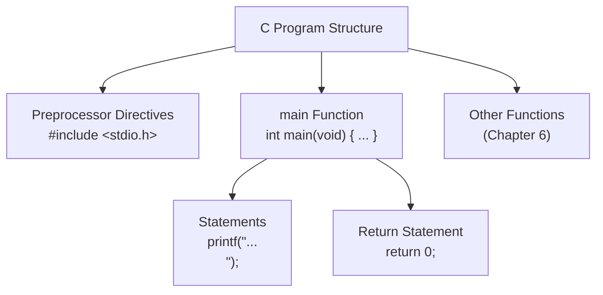
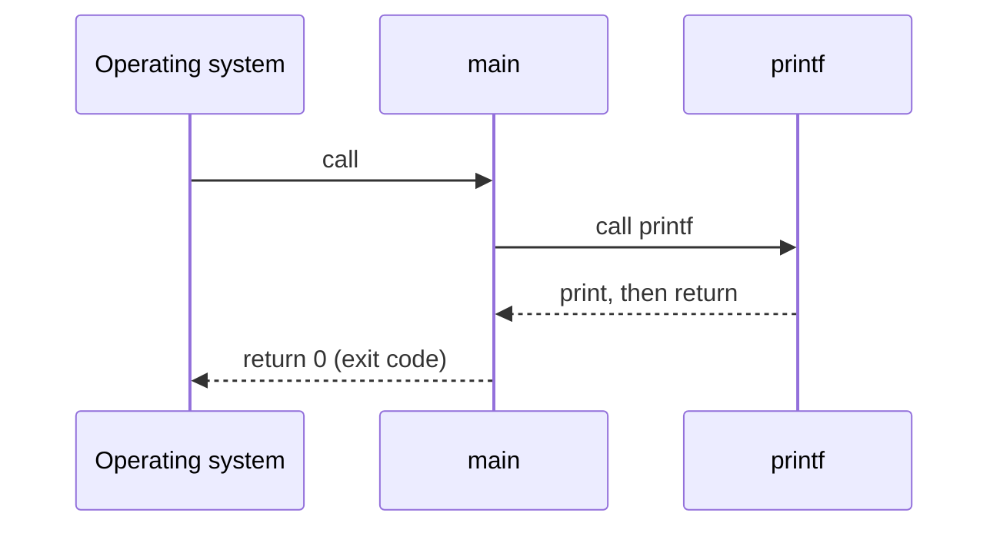

# Chapter 2 — C Program Basics

[Repository Guide](../../README.md) | [English](Concepts_Lecture.md) | [한국어](Concepts_Lecture.ko.md)

> **Last Updated:** 2026-11-27
>
> Warming-Up C Programming, 천정아, Ch 2

> **Learning Objectives:**
> 1. Explain the basic structure of a C program and the roles of comments, the `main` function, and the exit code
> 2. Explain the parts of a function and the flow of calling a function and returning from it
> 3. Print values using the format string, format specifiers, field width, and precision of `printf`
> 4. Read one or more values with `scanf` and explain why `&` is required
> 5. Declare, assign, and initialize variables and use them for input and output

---

## Table of Contents

- [1. First C Program](#1-first-c-program)
  - [1.1 Program Structure](#11-program-structure)
  - [1.2 Comments](#12-comments)
  - [1.3 `main` Function](#13-main-function)
  - [1.4 Exit Code](#14-exit-code)
- [2. Input and Output](#2-input-and-output)
  - [2.1 Console I/O](#21-console-io)
  - [2.2 `printf`](#22-printf)
  - [2.3 `scanf`](#23-scanf)
  - [2.4 Variables in I/O](#24-variables-in-io)
  - [2.5 Writing an Input and Output Program](#25-writing-an-input-and-output-program)
  - [2.6 Memory Occupied by Variables](#26-memory-occupied-by-variables)
  - [2.7 Example of an Input and Output Program: Time Conversion](#27-example-of-an-input-and-output-program-time-conversion)
  - [2.8 Common Mistakes in Format Strings](#28-common-mistakes-in-format-strings)
- [3. C Statements](#3-c-statements)
- [Concept Applications](#concept-applications)
- [Summary](#summary)
- [Self-Check Questions](#self-check-questions)

---

<br>

## 1. First C Program

### 1.1 Program Structure

Every C program follows a basic structure. Here is the simplest complete program, annotated line by line.

```c
// first.c
#include <stdio.h>    // I/O library header

int main(void)        // entry point function
{
    printf("First C Program\n");  // console output
    return 0;         // exit code to OS
}
```



*Figure 1. Structure of a C program*

| Part | Role |
|:-----|:-----|
| `#include <stdio.h>` | Prepare to use the standard I/O library so `printf` and `scanf` can be used |
| `int main(void)` | Define the entry point; the function called first when the program starts |
| `{ ... }` | Braces delimit the function body |
| `printf("...\n");` | Output a string to the console |
| `return 0;` | Return exit code 0 (normal termination) to the OS |

*Table 1. Parts of the first program and their roles*

> **Key Point:** Statements inside a function must end with a semicolon (`;`) (blocks enclosed in braces and the control statements of Chapter 5 are exceptions). Preprocessor directives (`#include`) do **not** end with a semicolon.

### 1.2 Comments

**Comments** provide information about the source code or keep part of the source code from being compiled. They are ignored by the compiler and exist solely for human readers.

| Style | Syntax | Scope |
|:------|:-------|:------|
| Block comment | `/* ... */` | Can span multiple lines |
| Line comment | `// ...` | From `//` to end of line |

*Table 2. The two kinds of comments in C*

The `//` line comment was added in C99 and is now available in most C compilers. A block comment can also be placed in the middle of code.

```c
/* This is a block comment.
   It can span multiple lines. */

// This is a line comment.

int x = 10;  // inline comment after code
```

**Commenting out code** means temporarily keeping code that has already been written from being compiled, without deleting it.

```c
/* printf("This line is disabled.\n"); */

// printf("This line is also disabled.\n");
```

> **Caution:** Block comments **cannot be nested**. `/* outer /* inner */ still inside? */` causes a compile error because `*/` closes the comment at the first match.

Editors such as Visual Studio provide syntax coloring, which shows keywords, comments, and string constants in different colors. Code that has become a comment against the intent, as in the line-continuation problem below, is shown in the comment color, so the habit of watching the editor's colors helps.

The extent of a comment is decided by the rules by which the compiler reads the source, so it can differ from how the code looks. In the following code, the `\` at the end of the `//` comment is a line-continuation mark that joins that line with the next one, so the comment extends to `total += 5;` on the next line, which is not executed. Conversely, `/* ... */` inside a string constant is not a comment but characters to be printed.

```c
int total = 10;

// add the bonus \
total += 5;
printf("total = %d\n", total);
printf("/* not a comment */\n");
```

```text
warning: multi-line // comment [-Wcomment]
total = 10
/* not a comment */
```

The warning on the first line was issued by Clang during compilation, and the remaining two lines are the output. A comment is most useful when it says **why** the code does something rather than repeating **what** it does, and when the code is changed, the comment is changed with it so that the two do not disagree.

### 1.3 `main` Function

A C program consists of a single `main` function, or of `main` and several other functions. A **function** consists of the following three parts, and its body is made up of statements that end with semicolons (declarations, input, output, conditionals, loops, etc.).

| Part | Meaning | In `int main(void)` |
|:-----|:--------|:-----|
| Return type | The type of the value the function returns | `int` |
| Function name | The name that identifies the function | `main` |
| Parameters | The values needed to perform the function | `void` (none) |

*Table 3. Parts of a function*

When a function is called, the statements inside `{ }` are executed in order from the top. When execution reaches the end of the function (`}`) or a `return`, control goes back to where the function was called (the function returns).

The `main` function is the **entry point** of every C program. The entry point is the function agreed to be called when a C program first starts, so when the OS runs a compiled program, execution begins at `main`.

| Rule | Description |
|:-----|:------------|
| Exactly one `main` | Every program must have one and only one `main` function |
| Return type `int` | `main` returns an integer exit code to the OS |
| Parameter `void` | `void` means no arguments; parentheses can also be empty `()` |
| Case-sensitive | `main` is valid; `Main`, `MAIN`, `mAiN` are **not** the entry point |

*Table 4. Rules for the `main` function*

```c
int main(void)    // [O] standard form
{
    return 0;
}
```

```c
int main()        // [O] also valid (empty parameter list)
{
    return 0;
}
```

> **Key Point:** C is **case-sensitive**. `main` and `Main` are different identifiers. Only lowercase `main` is recognized as the entry point by the compiler.

Calls and returns of functions proceed from the entry point. When the operating system runs a program, it calls `main`, and `printf("Hello\n");` inside `main` calls the `printf` function of the standard library. When `printf` finishes printing and returns, execution comes back to the next statement of `main`, and when `main` returns with `return 0;`, the flow of execution goes back to the operating system and the program ends.



*Figure 2. Call and return of the entry-point function*

`main` is a function whose name, number, and return type are all fixed, so the program is not produced if it is written wrongly as follows. If the name is written as `Main`, compilation succeeds, but the linker cannot find the entry point `main`, and a link error occurs.

```text
Undefined symbols for architecture arm64:
  "_main", referenced from:
      <initial-undefines>
ld: symbol(s) not found for architecture arm64
```

A program without `main` gives the same link error, and a program with two or more `main` functions gives a link error about a duplicated definition of the same name (Chapter 1, Section 3.7). `void main(void)`, which writes the return type as `void`, is not a form defined by the C standard, so it is not used. Some compilers accept it, but Clang rejects it with the error `error: 'main' must return 'int'`. `main` is the entry point of a console program, and the textbook explains that a Windows desktop application uses the `WinMain` function as its entry point instead of `main`.

### 1.4 Exit Code

The `return` statement in `main` sends an **exit code** (also called exit status) back to the operating system. The exit code is the return value of `main` (an `int`) and represents the program's termination status.

| Exit Code | Meaning |
|:---------:|:--------|
| `0` | Normal termination (success) |
| Non-zero | Abnormal termination (error) |

*Table 5. Meaning of exit codes*

```c
int main(void)
{
    printf("Hello\n");
    return 0;   // tell the OS: program finished successfully
}
```

The OS or a calling script can inspect this exit code to determine whether the program succeeded or failed.

The exit code can be checked directly in a shell. The following program returns 3; in a macOS or Linux shell, the exit code of the program run just before is read with `$?`, and in the Windows command prompt with `%ERRORLEVEL%`.

```c
#include <stdio.h>

int main(void)
{
    printf("exiting with 3\n");
    return 3;
}
```

```text
$ ./exitcode
exiting with 3
$ echo $?
3
```

How the value of an exit code is interpreted is an agreement between the operating system and whatever calls the program. That 0 means normal termination is common to all, but each program defines the meaning of nonzero values. For example, if a program is defined to return 1 when it cannot open its input file and 2 when the input format is wrong, a script that runs the program can tell the cause of a failure from the exit code alone.

> **Note:** **Omitting `return 0`.** In C99 and later, if `return` is omitted at the end of `main`, the compiler implicitly returns `0`. This exception applies only to `main`. However, it is good practice to write `return 0;` explicitly for clarity.

---

<br>

## 2. Input and Output

### 2.1 Console I/O

A **console program** runs in a console (command prompt): it takes input from the keyboard, processes it, and prints the result to the console as text. C does not have built-in I/O keywords. Instead, an **I/O library** provides the input and output features every C program needs, and programs perform I/O through **library functions** declared in **header files**.

```c
#include <stdio.h>   // stdio = standard input/output
```

| Term | Meaning |
|:-----|:--------|
| `#include` | Preprocessor directive that copies the contents of a header file into the source |
| `<stdio.h>` | Standard I/O header; provides `printf`, `scanf`, etc. |
| Standard input | Keyboard (default) |
| Standard output | Console/screen (default) |
| Header file | A file (`.h`) with information about library functions (name, return type, parameters), that is, the function declarations needed by the compiler |

*Table 6. Terms related to console I/O*

To use a library, its header file must be included with `#include`.


*Figure 3. Flow of standard input and standard output*

> **Key Point:** Without `#include <stdio.h>`, the compiler does not know the declarations of `printf` and `scanf`, and will report an error (or warning, depending on the standard).

### 2.2 `printf`

`printf` (print formatted) writes formatted output to the console. Besides printing strings, it can print values according to a format.

**Basic syntax:**

```c
printf("format string", value1, value2, ...);
```

The **format string** is written inside `" "` and can contain the following.
- Plain text is printed as-is.
- **Format specifiers**, made of `%` and an agreed character, are placeholders replaced by the corresponding values.
- **Escape sequences** represent special characters such as `\n`.

#### Format Specifiers

| Specifier | Type | Example |
|:---------:|:-----|:--------|
| `%d` | `int` (decimal) | `printf("%d", 42);` → `42` |
| `%f` | `float`/`double` | `printf("%f", 3.14);` → `3.140000` |
| `%c` | `char` (character) | `printf("%c", 'A');` → `A` |
| `%s` | string | `printf("%s", "hi");` → `hi` |
| `%x` | `int` (hexadecimal) | `printf("%x", 255);` → `ff` |
| `%X` | `int` (hexadecimal, uppercase) | `printf("%X", 255);` → `FF` |
| `%e` | `float`/`double` (scientific) | `printf("%e", 0.001);` → `1.000000e-03` |

*Table 7. Main format specifiers of `printf`*

`%F` and `%E` are the same as `%f` and `%e` but print characters such as infinity (`INF`) and the exponent sign (`E`) in uppercase. When a format string has several format specifiers, the specifiers and the values to print correspond in order, and their counts must match.

```c wide-ok
int age = 20;
double height = 175.5;

printf("Age: %d\n", age);           // Age: 20
printf("Height: %f cm\n", height);  // Height: 175.500000 cm
printf("Height: %.1f cm\n", height); // Height: 175.5 cm
```

The following code prints the same values in several formats with the format specifiers of Table 7.

```c
int a = 10;
double b = 1.23;
char c = 'A';

printf("%d %o %x %X %#x\n", a, a, a, a, a);
printf("%f %e %g\n", b, b, b);
printf("%c %d\n", c, c);
printf("%s, 100%%\n", "text");
printf("%d %d %d\n", 10, 010, 0x10);
```

```text
10 12 a A 0xa
1.230000 1.230000e+00 1.23
A 65
text, 100%
10 8 16
```

The first line prints decimal 10 in decimal (`%d`), octal (`%o`), and hexadecimal (`%x`, `%X`). Octal writes numbers with 0-7, and hexadecimal with 0-9 and a-f (or A-F), so 10 is 12 in octal and a in hexadecimal. Adding `#`, as in `%#x`, prints `0x` in front of the hexadecimal number. In the second line, `%f` prints 6 digits after the decimal point, `%e` uses exponential notation (1.23 × 10⁰), and `%g` uses exponential notation when the exponent is less than -4 or at least 6, uses decimal notation otherwise, and removes trailing zeros. The third line prints the same `char` value as the character `A` with `%c` and as its character code 65 with `%d`. To print the `%` character itself, write `%%`. The last line shows that integer constants in source code can also be written in a base. `010`, which starts with 0, is an octal constant (decimal 8), and `0x10`, which starts with `0x`, is a hexadecimal constant (decimal 16). Therefore, putting a 0 in front of an integer constant to align digits changes its value, which requires care.

#### Field Width and Precision

A format specifier can include a **field width** and a **precision**. The width is written as an integer between `%` and `d` (`%6d`), and the value is printed right-aligned in that width. Writing `-` before the width (`%-6d`) left-aligns it. The precision is written as `.` and an integer between `%` and `f` (`%.2f`), and width and precision can be combined (`%8.2f`). Without a width, the value is printed from the left using only as many characters as it needs; without a precision, `%f` prints 6 digits after the decimal point.

```c
int num = 123;
double pi = 3.14159;

printf("[%d]\n", num);       // [123]
printf("[%6d]\n", num);      // [   123]   (width 6, right-aligned)
printf("[%-6d]\n", num);     // [123   ]   (width 6, left-aligned)
printf("[%f]\n", pi);        // [3.141590] (6 decimal places)
printf("[%.2f]\n", pi);      // [3.14]
printf("[%8.2f]\n", pi);     // [    3.14] (width 8, 2 decimal places)
```

Other formats such as zero padding (`%06d`) are covered in Chapter 3, Section 5.2.

Width and precision follow several detailed rules. The output of the following code shows each rule.

```c
printf("[%5d]\n", 123456);
printf("[%.2f] [%.2f]\n", 2.345, 2.355);
printf("[%8.3f] [%-8.2f]\n", 3.14159, 3.14159);
printf("[%+d] [%+d]\n", 42, -42);
printf("[%.0f] [%.0f] [%.0f]\n", 0.5, 1.5, 2.5);
printf("[%.3e]\n", 1234.5);
printf("[%10s] [%-10s]\n", "abc", "abc");
```

```text
[123456]
[2.35] [2.35]
[   3.142] [3.14    ]
[+42] [-42]
[0] [2] [2]
[1.234e+03]
[       abc] [abc       ]
```

- The width is a **minimum** width. If the value to print is longer than the width, it is printed in full without truncation, so printing the 6-digit number 123456 with `%5d` gives `123456` unchanged.
- A precision rounds at that digit. However, rounding is based on the binary approximation actually stored in memory. 2.345 is stored as 2.34500000000000019... and 2.355 as 2.35499999999999998..., so both print as `2.35` with `%.2f`.
- Width and precision can be used together. `%8.3f` right-aligns `3.142` (5 characters), made with 3 decimal places, in 8 columns, putting 3 spaces in front. The decimal point also takes a column.
- The `+` flag puts a sign on positive numbers too, and the `-` flag specifies left alignment.
- When halfway values that binary represents exactly, such as 0.5, 1.5, and 2.5, are printed with `%.0f`, the macOS C library that produced this result rounds to the nearest even value and prints `0`, `2`, and `2`. This can differ from rounding half up, so when a specific rounding rule is required, compute it directly instead of leaving it to the output.
- The precision of `%e` is the number of digits after the decimal point in exponential notation. 1234.5 is 1.2345 × 10³, a midpoint that binary represents exactly, so by the preceding rule `%.3e` prints `1.234e+03`, on the even side. `%s` also accepts a width and `-`.

> **Note:** **Return value of `printf`.** `printf` returns the number of characters printed as an `int`. The `a` of `int a = printf("Hello, C\n");` is 9, counting the newline, and `printf("%d\n", 12345)` returns 6. Most programs do not use this value, but `printf` returns a negative value when output fails, so programs for which output matters can check for errors through the return value.

#### Newline and Cursor Behavior

`printf` does **not** automatically move to the next line. The cursor stays at the end of the printed text. Use the newline character `\n` to print the text and then move the cursor to the next line.

```c
printf("Hello");
printf("World\n");
// Output: HelloWorld   (no space, no line break between them)
```

```c wide-ok
printf("Line 1\n");
printf("Line 2\n");
// Output:
// Line 1
// Line 2
```

Multiple `printf` calls continue printing from the last cursor position of the previous output; that is, `printf` appends text at the current cursor position.

#### Matching Format Specifiers and Arguments

`printf` decides from each format specifier which type to read the next argument as. If a format specifier and the type of its argument do not match, the behavior is undefined by the C standard, so garbage values may be printed or the result may differ from program to program. When the format string is a constant, the compiler finds such mismatches and warns about them.

```c
double d = 3.14;
int n = 7;

printf("%d\n", d);      // double printed with %d
printf("%f\n", n);      // int printed with %f
```

```text
warning: format specifies type 'int' but the argument has type 'double' [-Wformat]
warning: format specifies type 'double' but the argument has type 'int' [-Wformat]
```

`printf` does not convert its arguments, so to print an `int` value as a floating-point number, either cast it as in `(double)n` or use `%d`. A difference between the number of format specifiers and the number of arguments causes the same problem: if arguments are missing, nonexistent values are read, and extra arguments are ignored.

The type of floating-point constants also needs attention. A constant with a decimal point, `1.23`, has type `double`, so `float f = 1.23;` stores an 8-byte `double` value in a 4-byte `float` variable and may lose precision. The textbook explains that Visual Studio issues the warning `warning C4305: '=': truncation from 'double' to 'float'` for this assignment, and Clang also issues the warning `implicit conversion loses floating-point precision: 'double' to 'float'` with the `-Wconversion` option. `1.23f`, with `f` appended to the constant, is a `float` constant from the start, so no warning appears. The sizes and precision of the floating-point types are treated in Chapter 3.

### 2.3 `scanf`

`scanf` (scan formatted) reads values typed on the keyboard in the console into variables according to a format.

**Basic syntax:**

```c
scanf("format string", &variable1, &variable2, ...);
```

The `&` (**address-of operator**) is required before each variable. `scanf` needs the memory address to store the input value.

```c wide-ok
int num;
printf("Enter a number: ");
scanf("%d", &num);            // read an integer from keyboard
printf("You entered: %d\n", num);
```

#### Reading Multiple Values

```c
int a, b;
scanf("%d %d", &a, &b);  // user types: 10 20
// a = 10, b = 20
```

To read several values, write several format specifiers. The specifiers and the variables that receive input correspond in order, and their counts must match. Numeric specifiers such as `%d` and `%f` skip any leading whitespace (spaces, tabs, newlines) before reading, so whitespace acts as a delimiter between values. A space between format specifiers in the format string makes `scanf` ignore all whitespace in the input before reading the next item. This rule matters most before `%c`, which does not skip whitespace (`"%c %c"` reads `a` and `b` from `a b`, but `"%c%c"` reads `a` and a space).

```c
int day, month, year;
scanf("%d/%d/%d", &day, &month, &year);  // user types: 16/03/2026
// day = 16, month = 3, year = 2026
```

Ordinary characters such as `/` in the format string must match the same characters in the input.

How `scanf` interprets input can be checked by varying the input. The following code reads an age, a height, and a weight and prints the return value `r` of `scanf` and the three variables. Each variable is initialized to -1 to distinguish the cases where nothing is read.

```c
int age = -1, r;
double height = -1.0, weight = -1.0;

r = scanf("%d %lf %lf", &age, &height, &weight);
printf("r = %d, age = %d, height = %.1f, weight = %.1f\n", r, age, height, weight);
```

| Input | Output |
|:-----|:-----|
| `21 167.2 53.5` | `r = 3, age = 21, height = 167.2, weight = 53.5` |
| The three values on separate lines | `r = 3, age = 21, height = 167.2, weight = 53.5` |
| `21,167.2,53.5` | `r = 1, age = 21, height = -1.0, weight = -1.0` |
| `21 abc 53.5` | `r = 1, age = 21, height = -1.0, weight = -1.0` |
| End of input without typing anything | `r = -1, age = -1, height = -1.0, weight = -1.0` |

*Table 8. Return value of `scanf` and stored values for each input*

The return value of `scanf` is the number of conversions that successfully stored a value. Numeric formats ignore all spaces, tabs, and newlines between input items, so the result is the same whether the three values are written on one line or on separate lines. In the third input, after 21 is read, `,` cannot start a floating-point number, so conversion stops; in the fourth input, it stops at `abc`. Once conversion stops, nothing is stored in the remaining variables, so their initial value -1.0 remains, and the unread characters stay in the input buffer. If the input ends before the first conversion, `EOF` (-1) is returned. Therefore, comparing the return value of `scanf` with the expected count tells whether the input is valid.

An ordinary character in the format string requires the same character in the input. Reading a date with `scanf("%d/%d/%d", &y, &m, &d)` gives the following.

```text
input 2024/3/4   → r = 3: 2024-3-4
input 2024 3 4   → r = 1: 2024-0-0
input 2024/ 3/4  → r = 3: 2024-3-4
```

The second input has a space instead of `/` after 2024, so conversion stops after the first item; in the third input, `%d` skips the space after `/`, so all three values are read. `y`, `m`, and `d` are variables initialized to 0.

> **Caution:** Forgetting `&` in `scanf` is a common beginner mistake. Without `&`, the program passes the **value** of the variable (likely garbage) instead of its **address**, causing undefined behavior or a crash.

The reason `scanf` requires addresses lies in how functions receive arguments. A C function receives a **copy of the value** of each argument, so if the value of a variable is passed, as in `scanf("%d", n)`, `scanf` knows only a copy of `n` and cannot change `n` itself. When the address of the variable is passed with `&n`, `scanf` stores the value it reads directly in the memory at that address. This principle is treated in detail under pass-by-value in Chapter 6 and pointers in Chapter 8. When the format string is a constant, the compiler finds a missing `&`.

```text
warning: format specifies type 'int *' but the argument has type 'int' [-Wformat]
```

The `int *` in the warning is a pointer type meaning "the address of an `int` variable." Conversely, `printf` only needs values to print them, so an address must not be passed to it, as in `printf("%d", &n)`.

#### Format Specifiers for `scanf`

| Specifier | Type | Example |
|:---------:|:-----|:--------|
| `%d` | `int` (read as decimal) | `scanf("%d", &n);` |
| `%x` | `int` (read as hexadecimal) | `scanf("%x", &n);` |
| `%i` | `int` (read as decimal, octal, or hexadecimal) | `scanf("%i", &n);` (`012` is octal, `0x12` is hexadecimal) |
| `%f` | `float` | `scanf("%f", &f);` |
| `%lf` | `double` | `scanf("%lf", &d);` |
| `%c` | `char` | `scanf("%c", &ch);` |
| `%s` | string (char array) | `scanf("%s", str);` (no `&` for arrays) |

*Table 9. Main format specifiers of `scanf`*

> **Key Point:** For `double`, `printf` uses `%f` but `scanf` uses `%lf`. This is a common source of bugs. Since C99, `%lf` in `printf` also behaves the same as `%f`.

> **Note:** **Visual Studio and `scanf`.** Visual Studio 2022 treats `scanf` as an unsafe function and reports a compile error (C4996) under its default settings. The `scanf_s` it recommends instead is defined in Annex K, an optional part of C11, so the standard libraries of gcc and clang usually do not have it. To use `scanf` intentionally according to standard C (ANSI C), write `#define _CRT_SECURE_NO_WARNINGS` at the very top of the source file (before any `#include`) so that no error occurs.

### 2.4 Variables in I/O

A **variable** is a space for storing a value. The computer stores values in memory; memory stores values one byte at a time and identifies each byte by its **address**. A variable gives a name to a memory space so that it can be accessed by name instead of by address. A **data type** is the kind of data used in a program, such as `char`, `int`, or `float`, and it determines the size of the memory space needed (`char` is 1 byte; `int` and `float` are usually 4 bytes) and the meaning of the value stored in memory (Chapter 3).

Variables must be **declared** before they can be used in `printf` or `scanf`.

**Declaration** tells the compiler the variable's type and name.

```c
int count;       // declare an integer variable
double price;    // declare a floating-point variable
```

A variable name is made of letters, digits, and the underscore (`_`), and its first character must be a letter or an underscore (Chapter 3, Section 3.2). **Assignment** stores a value in a variable. Write `=` after the variable name followed by the value, and assign a value of the same type as the variable's data type.

```c
count = 5;
price = 19.99;
```

Unlike the equals sign in mathematics, the `=` of C is the **assignment operator**, which stores the value on its right (R-value) in the memory space of the variable written on its left (L-value). **Declaration + initialization** declares and assigns in one statement.

```c
int count = 5;
double price = 19.99;
```

**Using variables with `printf` and `scanf`:**

```c wide-ok
#include <stdio.h>

int main(void)
{
    int quantity;
    double unit_price;

    printf("Enter quantity and unit price: ");
    scanf("%d %lf", &quantity, &unit_price);   // input

    double total = quantity * unit_price;

    printf("Quantity: %d\n", quantity);          // output
    printf("Unit Price: %.2f\n", unit_price);
    printf("Total: %.2f\n", total);

    return 0;
}
```

Variables are always initialized before they are used. Uninitialized local variables hold garbage values and cause unpredictable results.

Reading an uninitialized variable is a typical mistake that the compiler reports as a warning. When the following code is compiled with `-Wall`, Clang warns that the variable `x` should be initialized.

```c
int x;

printf("%d\n", x);
```

```text
warning: variable 'x' is uninitialized when used here [-Wuninitialized]
```

The relationship between declaration and assignment can be summarized with a memory picture. Executing `int x;` allocates space for one `int` in memory and gives it the name `x`. Its contents at this point are not determined. `x = 10;` stores 10 in that space, and `x = x + 5;` reads the current value 10 on the right, adds 5, and stores the resulting 15 back in the same space.

```text
int x;          x: [ ???? ]   allocated, value not determined
x = 10;         x: [  10  ]   stores 10
x = x + 5;      x: [  15  ]   reads current value 10, stores 15
```

*Figure 4. Contents of a variable changing with declaration and assignment*

### 2.5 Writing an Input and Output Program

The contents of this section are combined into a program with the three stages of input, processing, and output. The following program reads two real numbers and prints the results of the four arithmetic operations to two decimal places.

```c
#define _CRT_SECURE_NO_WARNINGS
#include <stdio.h>

int main(void)
{
    double x, y;

    printf("two real numbers? ");
    scanf("%lf %lf", &x, &y);

    printf("%.2f + %.2f = %.2f\n", x, y, x + y);
    printf("%.2f - %.2f = %.2f\n", x, y, x - y);
    printf("%.2f * %.2f = %.2f\n", x, y, x * y);
    printf("%.2f / %.2f = %.2f\n", x, y, x / y);
    return 0;
}
```

```text
two real numbers? 12.34 0.5
12.34 + 0.50 = 12.84
12.34 - 0.50 = 11.84
12.34 * 0.50 = 6.17
12.34 / 0.50 = 24.68
```

- `#define _CRT_SECURE_NO_WARNINGS` on the first line is a macro that allows `scanf` in Visual Studio, and it has no effect on other compilers.
- `double x, y;` declares variables to store two real numbers.
- `printf("two real numbers? ");` prints a prompt without a newline, so the input is typed on the same line as the prompt.
- `scanf("%lf %lf", &x, &y);` reads two values with `%lf`, which matches `double` variables.
- Each of the four output statements puts three `%.2f` in one format string and passes the two operands and the computed result as arguments. An expression such as `x + y` can also be an argument.

The input 0.5 is printed as `0.50` by `%.2f`. 12.34 × 0.5 = 6.17, and 12.34 / 0.5 = 24.68. If 0 is entered as the second number, the result of the floating-point division becomes `inf`; the condition test that prevents this is learned in Chapter 5.

### 2.6 Memory Occupied by Variables

Section 2.4 described a variable as a named memory space. Declaring a variable allocates memory of the size of its data type, and the address of the first byte of that space is the address of the variable. The address of a variable is obtained with `&variable` and printed with `%p`, and its size is obtained with the `sizeof` of Chapter 3.

```c
char c = 'A';
int n = 100;
double d = 3.5;

printf("c: %p, %zu byte\n", (void *)&c, sizeof c);
printf("n: %p, %zu bytes\n", (void *)&n, sizeof n);
printf("d: %p, %zu bytes\n", (void *)&d, sizeof d);
```

```text
c: 0x16f5a2b0b, 1 byte
n: 0x16f5a2b04, 4 bytes
d: 0x16f5a2af8, 8 bytes
```

```text
address   0x...af8 ─ 0x...aff   0x...b04 ─ 0x...b07   0x...b0b
        ┌─────────────────────┬─────────────────────┬──────────┐
        │ d = 3.5 (8 bytes)   │ n = 100 (4 bytes)   │ c = 'A'  │
        └─────────────────────┴─────────────────────┴──────────┘
```

*Figure 5. Memory occupied by three variables*

`char` occupies 1 byte, `int` 4 bytes, and `double` 8 bytes, and each variable uses that many consecutive bytes. `d` takes the 8 bytes from 0x...af8 to 0x...aff, and `n` 4 bytes from 0x...b04. The order in which variables are placed and the gaps between them are decided by the compiler, not by the order of declaration, so a variable declared later may come at a lower address, as in this example. Passing `&n` to `scanf` gives it this address so that `scanf` writes the value it reads into those 4 bytes; how to handle addresses is learned in detail in Chapter 8. The address of a variable may change from run to run, but during one run the variable keeps the same address until it disappears. Hence a value stored at the address passed to `scanf` can be read later in `printf` through the same variable name.

The `%zu` used in the output is the format specifier of `size_t`, the result type of `sizeof`, and the addresses passed to `%p` are cast to `(void *)`. `%p` prints the address itself regardless of what type of variable it points to, so the standard specifies that its argument be passed as `void *`, "an address whose pointed-to type is not specified."

### 2.7 Example of an Input and Output Program: Time Conversion

One more input and output program that uses integer division and the remainder is written. The following program reads a time in seconds and prints it converted to hours, minutes, and seconds.

```c
#define _CRT_SECURE_NO_WARNINGS
#include <stdio.h>

int main(void)
{
    int total, hours, minutes, seconds;

    printf("seconds? ");
    scanf("%d", &total);

    hours = total / 3600;
    minutes = total % 3600 / 60;
    seconds = total % 60;

    printf("%d seconds = %d h %d min %d s\n", total, hours, minutes, seconds);
    printf("%02d:%02d:%02d\n", hours, minutes, seconds);
    return 0;
}
```

```text
seconds? 4000
4000 seconds = 1 h 6 min 40 s
01:06:40
```

Following the computation for the input 4000:

- `hours = 4000 / 3600`: it is a division between `int` values, so only the quotient 1 remains.
- `minutes = 4000 % 3600 / 60`: `%` and `/` have the same precedence and are computed from the left, so 4000 % 3600 = 400 is computed first, and then 400 / 60 = 6.
- `seconds = 4000 % 60`: since 4000 = 66 × 60 + 40, it is 40.

Checking, 1 × 3600 + 6 × 60 + 40 = 4000. The `%02d` in the last line is a format that fills missing digits in a width of 2 with 0, treated in Chapter 3, Section 5.2. Entering 59 prints `0 h 0 min 59 s` and `00:00:59`. Doing the same computation with `double` would make 4000 / 3600 equal 1.111..., which does not give the integer part of the hours, so integer division and the remainder suit computations that split units. In the same way, minutes can be split into hours and minutes, and an amount in won into units of ten thousand and one thousand won. For example, for the amount 37500, `37500 / 10000` is 3, `37500 % 10000 / 1000` is 7, and `37500 % 1000` is 500.

### 2.8 Common Mistakes in Format Strings

The compiler can check the format strings of `printf` and `scanf` against their arguments, so most of the following mistakes show up as warnings.

```c
double d;
int n = 1;

scanf("%f", &d);            // %f for a double
printf("%d %d\n", n);       // fewer arguments than format specifiers
printf("%d\n", &n);         // prints an address instead of a value
```

```text
warning: format specifies type 'float *' but the argument has type 'double *' [-Wformat]
warning: more '%' conversions than data arguments [-Wformat-insufficient-args]
warning: format specifies type 'int' but the argument has type 'int *' [-Wformat]
```

| Mistake | What Happens | Correct Code |
|:-----|:-----|:-----|
| `scanf("%f", &d)` (`d` is a `double`) | Stores a 4-byte `float`, leaving the value of the 8-byte `double` meaningless | `scanf("%lf", &d)` |
| `printf("%d %d\n", n)` | The second `%d` reads a nonexistent argument | Pass as many arguments as format specifiers |
| `printf("%d\n", &n)` | Tries to interpret the address, not the value, of the variable as an integer | `printf("%d\n", n)` |
| `scanf("%d\n", &n)` | The `\n` at the end of the format keeps skipping whitespace, so pressing Enter does not end it | `scanf("%d", &n)` |
| `scanf("input: %d", &n)` | Conversion fails unless the input starts with `input: ` | Print the prompt with `printf`, then `scanf("%d", &n)` |

*Table 10. Common mistakes in format strings*

The fourth mistake needs particular care because it produces no warning. In `scanf("%d\n", &n)`, the `\n` in the format string stands for whitespace, like a space, and, as seen in Section 2.3, skips all whitespace in the input. So even after a number is typed and Enter is pressed, `scanf` waits until a non-whitespace character appears, and it ends only when the next number is typed. Given the input `7` and `8` on two lines, 7 is stored in `n`, and 8 remains in the buffer. The last mistake comes from the rule of Section 2.3 that ordinary characters in a format string require the same characters in the input; prompts are not put in the format string of `scanf`.

---

<br>

## 3. C Statements

A C program is composed of **statements**. A statement is the basic unit of a C program, an instruction that the computer executes in order, and statements such as declarations, input, output, and assignments end with a semicolon (`;`).

| Statement Type | Purpose | Example | Covered In |
|:---------------|:--------|:--------|:-----------|
| Declaration | Create a variable | `int x;` | Chapter 2 |
| Input | Read data from keyboard | `scanf("%d", &x);` | Chapter 2 |
| Output | Display data to screen | `printf("%d", x);` | Chapter 2 |
| Assignment | Store a value | `x = 10;` | Chapter 2 |
| Conditional | Execute code based on condition | `if (x > 0) { ... }` | Chapter 5 |
| Loop | Repeat code | `for (i = 0; i < 10; i++) { ... }` | Chapter 5 |
| Function call | Call another function | `result = add(a, b);` | Chapter 6 |

*Table 11. Kinds of C statements and the chapters that cover them*

```c
int main(void)
{
    int a, b, sum;            // declaration statements
    scanf("%d %d", &a, &b);  // input statement
    sum = a + b;              // assignment statement
    printf("%d\n", sum);      // output statement
    return 0;                 // return statement
}
```

Statements execute **sequentially**, from top to bottom, one after another. Execution proceeds in order unless a control statement (conditional or loop) changes the flow. Blocks enclosed in braces and control statements such as `if` and `for` do not end with a semicolon.

Conditional (`if`, `switch`) and loop (`for`, `while`, `do-while`) statements are introduced briefly here for awareness. Detailed coverage is in Chapter 5.

In C, a statement and an **expression** are different concepts. An expression is a formula that computes a value, such as `a + b`, `x = 10`, or `printf("Hi")`, and an expression followed by a semicolon becomes an **expression statement**. The assignment statement `x = 10;` and the function call statement `printf("Hi");` are both expression statements. `a + b;` is also a grammatically valid expression statement, but it stores the computed value nowhere and therefore has no effect, and the compiler issues a warning such as `expression result unused`.

A C compiler determines the end of a statement by the semicolon, not by the line break. Therefore one statement can be split over several lines, and several statements can be written on one line. The following two pieces of code are the same program to the compiler.

```c
int main(void) { int a = 1; printf("%d\n", a); return 0; }
```

```c
int main(void)
{
    int a = 1;

    printf("%d\n",
           a);
    return 0;
}
```

They are the same to the compiler, but the second is far easier for a person to read. Usually one statement is written per line, one of the two styles of placing `{` and `}` (on a new line or at the end of a line) is used consistently, and the statements inside a block are indented one level. The compiler ignores indentation, so it does not affect the behavior of the program, but in code with overlapping blocks, such as the control statements of Chapter 5, it becomes almost the only clue to the structure.

---

<br>

## Concept Applications

**True/False Check:**

| Statement | Judgment and Reason |
|:-----|:-----|
| `#include <stdio.h>` is also a statement, so it ends with a semicolon. | **F.** A preprocessor directive is not a C statement, so no semicolon is attached. |
| Writing the name of the `main` function as `Main` causes a compile error. | **F.** `Main` compiles as an ordinary function, and a link error occurs because there is no entry point `main`. |
| `printf` automatically starts a new line after printing a string. | **F.** To start a new line, `\n` must be put in the format string. |
| Printing 123456 with `%5d` prints only the first five digits. | **F.** The width is a minimum width, so a longer value is printed in full without truncation. |
| Both `printf` and `scanf` can use `%lf` for a `double` variable. | **T.** `scanf` must use `%lf` for `double`, and in `printf` `%lf` is the same as `%f` since C99. |
| `scanf("%d %d", &a, &b)` reads the two values even when they are separated by a newline. | **T.** Numeric formats skip all spaces, tabs, and newlines between input items. |
| The integer constants `010` and `10` in source code have the same value. | **F.** `010`, which starts with 0, is an octal constant equal to decimal 8. |
| Splitting one statement over two lines causes a compile error. | **F.** The end of a statement is set by the semicolon, so lines may be split. |
| When `scanf` returns 0, the input has ended. | **F.** 0 means the first conversion failed; at the end of input, `EOF` (a negative value) is returned. |
| `scanf("%d\n", &n)` ends as soon as a number is typed and Enter is pressed. | **F.** The `\n` at the end of the format keeps skipping whitespace, so it waits until a non-whitespace character is entered. |
| Variables are placed toward higher memory addresses in the order of declaration. | **F.** The placement order and spacing of variables are decided by the compiler. |
| `4000 % 3600 / 60` has the same value as 4000 % 60. | **F.** Computed from the left, it is 400 / 60 = 6, while 4000 % 60 is 40. |

---

<br>

## Summary

| Concept | Key Summary |
|:--------|:-------------|
| Program Structure | A C program consists of `#include`, the `main` function, statements, and `return`. |
| Comments | There are two kinds, `/* block */` and `// line` (C99), and block comments cannot be nested. |
| Functions | A function consists of a return type, a name, and parameters, and returns to its caller at `}` or `return`. |
| `main` Function | It is the single entry point per program, returns `int`, and its name is case-sensitive. |
| Exit Code | `return 0` means success and a non-zero value means an error, and since C99 it can be omitted only in `main`. |
| `#include <stdio.h>` | The standard I/O header must be included to use `printf` and `scanf`. |
| `printf` | It produces formatted output with `%d`, `%f`, `%c`, `%s`, `%x`, `%e`, and others, and the cursor stays after the last character. |
| Field Width and Precision | `%6d` right-aligns, `%-6d` left-aligns, and `%.2f` prints 2 digits after the decimal point. |
| `\n` | It is the newline escape sequence, and `printf` does not start a new line automatically. |
| `scanf` | It reads formatted input, needs `&` (address-of) before each variable, and reads `double` with `%lf`. |
| Variables | A variable is a named memory space that must be declared before use and initialized to avoid garbage values. |
| Statements | Declarations, input, output, assignments, and similar statements end with a semicolon and execute sequentially from top to bottom. |
| Function call and return | The operating system calls `main`, a function called by `main` returns to its caller when it ends, and the program ends when `main` returns. |
| Wrong `main` | A misspelled name such as `Main`, a missing `main`, or several `main` functions cause link errors, and `void main` is not a standard form. |
| Bases and integer constants | `%o`, `%x`, `%X`, and `%#x` print octal and hexadecimal numbers, and in source code `010` is an octal constant and `0x10` a hexadecimal constant. |
| Matching format specifiers | A mismatch between a format specifier and the argument type is undefined behavior, and since `1.23` is a `double`, `1.23f` is used for `float`. |
| Return value of `scanf` | It returns the number of conversions that stored a value, returns `EOF` if input ends before the first conversion, and leaves variables after a stopped conversion unchanged. |
| Expression statement | A statement formed by an expression followed by a semicolon, which includes assignment and function call statements. |
| Statement layout and indentation | The end of a statement is set by the semicolon, so line layout is free, but one statement is written per line and blocks are indented. |
| Memory of variables | A variable occupies consecutive bytes of its type's size, the address of the first byte is its address, and the compiler decides the placement order. |
| Using integer division and remainders | `/` gives the quotient in the larger unit and `%` the remaining amount, splitting seconds into hours, minutes, and seconds. |
| Mistakes in format strings | Reading a `double` with `%f`, mismatched argument counts, and printing an address instead of a value appear as warnings, but the `\n` in `scanf("%d\n")` makes input wait without a warning. |

---

<br>

## Self-Check Questions

1. **Cursor behavior:** Write the output of the following code line by line.

   ```c
   printf("A");
   printf("B\n");
   printf("C\n");
   ```

   <details>
   <summary>Answer</summary>

   The first line is `AB` and the second line is `C`. `printf("A")` does not end the line, so the `B` of the next `printf` is printed on the same line, and the cursor moves to the next line only after `\n`.

   </details>

2. **Mistakes with `scanf`:** Find and fix the two errors in the following code.

   ```c
   double d;
   scanf("%f", d);
   ```

   <details>
   <summary>Answer</summary>

   A `double` must be read with `%lf` in `scanf`, and `&` must be placed before the variable so that the address for storing the value is passed. The corrected code is `scanf("%lf", &d);`.

   </details>

3. **Field width and precision:** Write the output of `printf("[%5d][%-5d][%7.3f]\n", 42, 42, 3.14159);`.

   <details>
   <summary>Answer</summary>

   It is `[   42][42   ][  3.142]`. `%5d` right-aligns in 5 columns with 3 spaces in front, and `%-5d` left-aligns with 3 spaces after. `%7.3f` rounds 3.14159 to 3 decimal places as `3.142` (5 characters) and right-aligns it in 7 columns, so 2 spaces come first.

   </details>

4. **Functions and exit codes:** What happens when `main` reaches `return 0;`? What happens if `return` is omitted?

   <details>
   <summary>Answer</summary>

   The `main` function ends, and exit code 0 is passed to the operating system to report that the program terminated normally. Since C99, reaching the end (`}`) of `main` returns 0 just like `return 0;`, so it can be omitted, but this exception applies only to `main`.

   </details>

5. **Printing in other bases:** Write the output of `printf("%d %o %x %#X\n", 255, 255, 255, 255);` and `printf("%d\n", 017 + 0x1F);`.

   <details>
   <summary>Answer</summary>

   The first statement prints `255 377 ff 0XFF`. 255 is 3 × 64 + 7 × 8 + 7 = 377 in octal and 15 × 16 + 15 = ff in hexadecimal, and `%#X` uses uppercase letters and the prefix `0X`. In the second statement, `017` is octal for decimal 15 and `0x1F` is hexadecimal for decimal 31, so 46 is printed.

   </details>

6. **Return value of `scanf`:** Write the values of `r`, `a`, and `b` when the input `5 x` is given to `int a = 0, b = 0; int r = scanf("%d %d", &a, &b);`.

   <details>
   <summary>Answer</summary>

   The first `%d` reads 5 and stores it in `a`, and the second `%d` stops because it cannot convert `x` into an integer. One conversion stored a value, so `r` is 1, `a` is 5, and `b` stays at its initial value 0. `x` remains in the input buffer.

   </details>

7. **Wrong `main`:** At which stage and with what problem does each of the following programs fail to build? (a) A program consisting only of `int Main(void) { return 0; }` (b) A program consisting only of `void main(void) { }`

   <details>
   <summary>Answer</summary>

   (a) `Main` compiles as an ordinary function, but there is no definition of the entry point `main`, so a link error about the undefined symbol `_main` occurs in the link stage. (b) The return type of `main` must be `int`, so this is not a standard C form, and Clang reports the error `'main' must return 'int'` in the compile stage.

   </details>

8. **Mismatched format specifier:** Explain what is wrong with `float f = 2.5f; printf("%d\n", f);` and correct it.

   <details>
   <summary>Answer</summary>

   `%d` expects an `int` argument, but the actual argument is a floating-point value (`f`, promoted to `double` when passed to `printf`), so the behavior is undefined and a meaningless value may be printed. To print the real number, change it to `printf("%f\n", f);`, and to print only the integer part, change it to `printf("%d\n", (int)f);`.

   </details>
