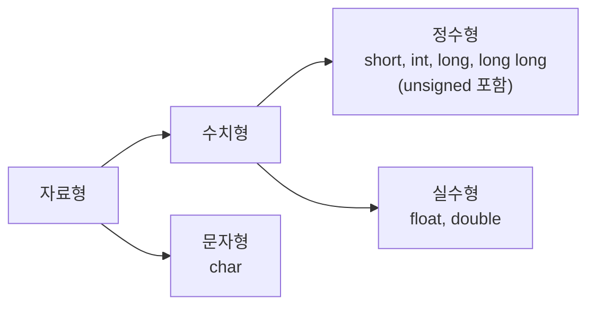

# 3장 실습 — 데이터 타입과 형식 지정자

[레포지토리 안내](../../README.ko.md) | [English](Concepts_Lab.md) | [한국어](Concepts_Lab.ko.md)

> **최종 수정일:** 2026-10-27
>
> 문제풀이 중심의 C언어 연습, 김용일과 강문설, Ch 3

> **학습 목표:**
> 1. 기본 데이터 타입의 크기와 표현 범위를 말하고, 여러 데이터 타입이 필요한 이유를 설명할 수 있다
> 2. `printf`의 형식 지정자와 폭, 정렬, 정밀도로 정수와 실수의 출력 형식을 정할 수 있다
> 3. `scanf`의 형식 지정자로 문자, 10진수, 8진수, 16진수, 실수를 입력받을 수 있다
> 4. `sizeof` 연산자로 데이터 타입과 상수가 차지하는 메모리 크기를 확인할 수 있다
> 5. Visual Studio에서 `scanf`를 쓸 때 나타나는 경고와 입력 버퍼 문제의 원인과 해결 방법을 설명할 수 있다

---

## 목차

- [1. 데이터 타입](#1-데이터-타입)
  - [1.1 데이터 타입의 분류](#11-데이터-타입의-분류)
  - [1.2 크기와 표현 범위](#12-크기와-표현-범위)
  - [1.3 여러 데이터 타입이 필요한 이유](#13-여러-데이터-타입이-필요한-이유)
- [2. printf의 형식 지정자](#2-printf의-형식-지정자)
  - [2.1 문자, 정수, 실수의 형식 지정자](#21-문자-정수-실수의-형식-지정자)
  - [2.2 폭, 정렬, 정밀도](#22-폭-정렬-정밀도)
- [3. scanf의 형식 지정자](#3-scanf의-형식-지정자)
  - [3.1 문자 입력](#31-문자-입력)
  - [3.2 10진수, 8진수, 16진수 입력](#32-10진수-8진수-16진수-입력)
  - [3.3 실수 입력](#33-실수-입력)
- [4. sizeof 연산자](#4-sizeof-연산자)
- [5. scanf 사용 시의 주의 사항](#5-scanf-사용-시의-주의-사항)
  - [5.1 C4996 경고](#51-c4996-경고)
  - [5.2 입력 버퍼와 형식 문자열의 공백](#52-입력-버퍼와-형식-문자열의-공백)
  - [5.3 C6031 경고](#53-c6031-경고)
  - [5.4 scanf_s](#54-scanf_s)
- [6. 실습 문제](#6-실습-문제)
  - [6.1 실수 세 개의 출력 형식 지정](#61-실수-세-개의-출력-형식-지정)
  - [6.2 두 정수의 합](#62-두-정수의-합)
  - [6.3 실수의 절반](#63-실수의-절반)
- [요약](#요약)
- [점검 문제](#점검-문제)

---

<br>

## 1. 데이터 타입

### 1.1 데이터 타입의 분류

**데이터 타입(data type)** 또는 자료형은 선언할 변수의 특징을 나타내는 키워드이다. 변수를 선언하는 것은 프로그래머가 정보를 사용하기 위해 필요한 메모리 영역을 확보하는 과정이며, 데이터 타입은 그 영역의 크기와 값을 해석하는 방식을 정한다([3장 1절](Concepts_Lecture.ko.md#1-데이터-타입)).



*그림 1. C의 기본 자료형의 분류*

문자형 `char`도 내부적으로는 문자의 코드를 저장하는 정수이다. 배열과 구조체 같은 자료형은 7장과 10장에서 다룬다.

### 1.2 크기와 표현 범위

다음은 Visual Studio(Windows)에서의 기본 데이터 타입의 크기와 표현 범위이다.

| 자료형 | 키워드 | 바이트 수 | 값의 범위 |
|:-----|:-----|-----:|:-----|
| 문자형 (부호 없음) | `unsigned char` | 1 | 0 ~ 255 |
| 문자형 (부호 있음) | `char` | 1 | -128 ~ 127 |
| 정수형 (부호 없음) | `unsigned short int` | 2 | 0 ~ 65,535 |
| 정수형 (부호 없음) | `unsigned int` | 4 | 0 ~ 4,294,967,295 |
| 정수형 (부호 없음) | `unsigned long int` | 4 | 0 ~ 4,294,967,295 |
| 정수형 (부호 있음) | `short int` | 2 | -32,768 ~ 32,767 |
| 정수형 (부호 있음) | `int` | 4 | -2,147,483,648 ~ 2,147,483,647 |
| 정수형 (부호 있음) | `long int` | 4 | -2,147,483,648 ~ 2,147,483,647 |
| 정수형 (부호 있음) | `long long` | 8 | -9,223,372,036,854,775,808 ~ 9,223,372,036,854,775,807 |
| 실수형 | `float` | 4 | 약 1.2 × 10⁻³⁸ ~ 3.4 × 10³⁸ (절댓값) |
| 실수형 | `double` | 8 | 약 2.2 × 10⁻³⁰⁸ ~ 1.8 × 10³⁰⁸ (절댓값) |

*표 1. Visual Studio에서의 기본 데이터 타입의 크기와 표현 범위*

> **주의:** C 표준은 각 타입이 표현해야 하는 최소 범위만 정하므로 크기는 플랫폼에 따라 다르다. 특히 `long`은 Windows에서 4바이트이지만 64비트 Linux와 macOS에서는 8바이트이다. `char`의 부호도 구현에 따라 다르며, x86 계열에서는 부호 있음이지만 ARM Linux에서는 부호 없음이 기본이다. 실수형의 범위는 정규화된 값의 절댓값 범위이며, 표현 오차와 정밀도는 [3장 1.2절](Concepts_Lecture.ko.md#12-실수형)에 정리되어 있다.

### 1.3 여러 데이터 타입이 필요한 이유

C가 여러 데이터 타입을 제공하는 이유는 두 가지이다.

- **데이터의 표현 방식이 다르다:** 정수는 2의 보수로, 실수는 부호, 지수, 가수로 나누어 IEEE 754 방식으로 표현한다. 같은 32비트라도 `int`와 `float`는 비트를 해석하는 방법이 다르다([3장 2.2절](Concepts_Lecture.ko.md#22-정수의-2진-표현-2의-보수), [2.3절](Concepts_Lecture.ko.md#23-실수의-2진-표현-ieee-754)).
- **메모리를 알맞게 쓰기 위해서이다:** 데이터의 표현 범위를 고려하여 자료형을 고르면 메모리를 아낄 수 있다. 반대로 작은 메모리 공간에 큰 데이터를 저장하면 표현할 수 없는 부분이 잘려 데이터가 손실된다.

---

<br>

## 2. printf의 형식 지정자

**형식 지정자(format specifier)** 는 변수나 데이터의 출력 형식을 정하는 특수 기호이다([3장 5절](Concepts_Lecture.ko.md#5-형식-지정자)).

### 2.1 문자, 정수, 실수의 형식 지정자

같은 값도 형식 지정자에 따라 다른 모습으로 출력된다.

```c
#include <stdio.h>

int main(void)
{
    char ch = 'A';      // character code 65
    int vA = 10;
    float vB = 10.2;
    double vC = -20.5;
    double vD = -0.005;

    printf("ch: %c, %d, %x \n", ch, ch, ch);
    printf("vA: %d, %o, %x \n", vA, vA, vA);
    printf("vB: %f, %e \n", vB, vB);
    printf("vC: %f, %e \n", vC, vC);
    printf("vD: %f, %e \n", vD, vD);

    return 0;
}
```

```text
ch: A, 65, 41 
vA: 10, 12, a 
vB: 10.200000, 1.020000e+01 
vC: -20.500000, -2.050000e+01 
vD: -0.005000, -5.000000e-03 
```

- **`%c`, `%d`, `%x`:** 문자 `'A'`의 코드 65를 문자, 10진수, 16진수(0x41)로 출력한다.
- **`%o`:** 10을 8진수로 출력하면 1 × 8 + 2 = 10이므로 `12`이다.
- **`%f`:** 소수점 아래 6자리까지 출력한다.
- **`%e`:** 지수 표기로 출력한다. `1.020000e+01`은 1.02 × 10¹ = 10.2이고, `-5.000000e-03`은 -5 × 10⁻³ = -0.005이다.

### 2.2 폭, 정렬, 정밀도

`%`와 변환 문자 사이에 출력 폭(최소 칸 수), 정렬, 채움 문자, 정밀도를 지정할 수 있다([3장 5.2절](Concepts_Lecture.ko.md#52-출력-폭과-정렬)).

```c
#include <stdio.h>

int main(void)
{
    int vA = 3;
    double vB = 1.23;

    printf("%d\n", vA);         // as many columns as needed
    printf("%4d\n", vA);        // width 4, right-aligned
    printf("%04d\n", vA);       // width 4, padded with 0
    printf("%-4d\n", vA);       // width 4, left-aligned
    printf("----------\n");
    printf("%f\n", vB);         // 6 digits after the point
    printf("%10.1f\n", vB);     // width 10, 1 digit after the point
    printf("%-10.1f\n", vB);    // width 10, left-aligned
    printf("%.1f\n", vB);       // 1 digit after the point
    printf("%6.1f\n", vB);      // width 6, 1 digit after the point

    return 0;
}
```

```text
3
   3
0003
3   
----------
1.230000
       1.2
1.2       
1.2
   1.2
```

| 지정 | 의미 | 예와 출력 |
|:-----|:-----|:-----|
| 폭 `n` | 최소 n칸을 쓰고 오른쪽으로 정렬한다 | `%4d` → `   3` |
| `0` 플래그 | 빈 칸을 0으로 채운다 | `%04d` → `0003` |
| `-` 플래그 | 왼쪽으로 정렬하고 오른쪽을 공백으로 채운다 | `%-4d` → `3   ` |
| 정밀도 `.m` | 실수를 소수점 아래 m자리까지 반올림하여 출력한다 | `%.1f` → `1.2` |
| 폭과 정밀도 `n.m` | 소수점과 부호를 포함하여 최소 n칸을 쓴다 | `%6.1f` → `   1.2` |

*표 2. 출력 폭, 정렬, 정밀도의 지정*

값이 폭보다 길면 폭은 무시되고 값 전체가 출력된다. 즉, 폭은 최소 칸 수이며 값을 자르지 않는다.

---

<br>

## 3. scanf의 형식 지정자

`scanf`는 콘솔 화면에서 입력받은 정보를 어떤 데이터 타입으로 읽을지 형식 지정자로 정하고, 읽은 값을 인자로 받은 주소의 메모리에 저장한다([3장 5.3절](Concepts_Lecture.ko.md#53-scanf)). 변수 이름 앞의 `&`는 그 변수의 메모리 시작 주소를 구하는 연산자이며, `scanf`는 이 주소를 알아야 값을 저장할 수 있다.

### 3.1 문자 입력

```c
#define _CRT_SECURE_NO_WARNINGS  // allows scanf in Visual Studio
#include <stdio.h>

int main(void)
{
    char chA;

    printf("input ch: ");
    scanf(" %c", &chA);     // & passes the address of chA

    printf("chA: %c, %d \n", chA, chA);

    return 0;
}
```

```text
input ch: B
chA: B, 66 
```

`%c`는 문자 하나를 읽는다. 형식 문자열의 `%c` 앞에 있는 공백의 역할은 5.2절에서 설명한다.

### 3.2 10진수, 8진수, 16진수 입력

`%d`, `%o`, `%x`는 입력을 각각 10진수, 8진수, 16진수로 해석하여 정수 변수에 저장한다.

```c
#define _CRT_SECURE_NO_WARNINGS  // allows scanf in Visual Studio
#include <stdio.h>

int main(void)
{
    int vA, vB, vC;

    printf("Enter the 3 data(10/8/16 진수): ");
    scanf(" %d %o %x", &vA, &vB, &vC);     // read as decimal, octal, and hexadecimal

    printf("vA: %d, %o, %x \n", vA, vA, vA);
    printf("vB: %d, %o, %#x \n", vB, vB, vB);   // # adds the prefix 0x
    printf("vC: %d, %o, %#x \n", vC, vC, vC);

    return 0;
}
```

```text
Enter the 3 data(10/8/16 진수): 11 20 a
vA: 11, 13, b 
vB: 16, 20, 0x10 
vC: 10, 12, 0xa 
```

같은 입력 `11`, `20`, `a`도 어떤 진법으로 읽느냐에 따라 저장되는 값이 다르다. `20`을 `%o`로 읽으면 2 × 8 = 16이 저장되고, `a`를 `%x`로 읽으면 10이 저장된다.

| 10진수 | 0 | 1 | ... | 7 | 8 | 9 | 10 | 11 | 12 | ... | 15 | 16 |
|:-----|:---:|:---:|:---:|:---:|:---:|:---:|:---:|:---:|:---:|:---:|:---:|:---:|
| 8진수 | 0 | 1 | ... | 7 | 10 | 11 | 12 | 13 | 14 | ... | 17 | 20 |
| 16진수 | 0 | 1 | ... | 7 | 8 | 9 | a | b | c | ... | f | 10 |

*표 3. 0부터 16까지의 수의 10진수, 8진수, 16진수 표기*

`%x`와 `%#x`의 차이는 `#` 플래그에 있다. `#`를 붙이면 16진수 앞에 `0x`가, 8진수(`%#o`) 앞에 `0`이 붙어 C 소스 코드의 정수 상수 표기와 같은 모양이 된다. 값이 0일 때는 접두사가 붙지 않는다.

### 3.3 실수 입력

`printf`에서는 `float`와 `double`을 모두 `%f`로 출력하지만, `scanf`에서는 `float` 변수에 `%f`를, `double` 변수에 `%lf`를 써야 한다.

```c
#define _CRT_SECURE_NO_WARNINGS  // allows scanf in Visual Studio
#include <stdio.h>

int main(void)
{
    float vA;
    double vB;

    printf("input real num(float): ");
    scanf(" %f", &vA);      // %f for float
    printf("input real num(double): ");
    scanf(" %lf", &vB);     // %lf for double

    printf("%.2f, %.2f \n", vA, vB);

    return 0;
}
```

```text
input real num(float): 1.323
input real num(double): -34.457
1.32, -34.46 
```

> **핵심:** `printf`에 넘긴 `float` 인자는 함수 호출 과정에서 `double`로 변환되므로 `%f` 하나로 두 타입을 출력할 수 있다. 반면 `scanf`는 값이 아니라 변수의 주소를 받으므로, 저장할 메모리의 크기(4바이트 또는 8바이트)를 형식 지정자로 정확히 알려야 한다. `double` 변수를 `%f`로 읽으면 정의되지 않은 동작이 되며, 대개 잘못된 값이 저장된다.

---

<br>

## 4. sizeof 연산자

`sizeof`는 데이터 타입이나 변수, 리터럴 상수가 메모리를 몇 바이트 차지하는지 구하는 연산자이다([3장 7절](Concepts_Lecture.ko.md#7-sizeof-연산자)). 함수 호출처럼 괄호를 쓰지만 함수가 아니라 연산자이며, 값은 컴파일할 때 정해진다.

```c
#include <stdio.h>

int main(void)
{
    char ch = 'A';
    int num = 10;
    short data = 3;
    double ave = 3.2;

    printf("1: %zu, %zu, %zu \n", sizeof(char), sizeof(ch), sizeof('A'));
    printf("2: %zu, %zu, %zu \n", sizeof(int), sizeof(num), sizeof(10));
    printf("3: %zu, %zu, %zu \n", sizeof(short), sizeof(data), sizeof(3));
    printf("4: %zu, %zu, %zu \n", sizeof(double), sizeof(ave), sizeof(3.2));

    return 0;
}
```

```text
1: 1, 1, 4 
2: 4, 4, 4 
3: 2, 2, 4 
4: 8, 8, 8 
```

- **`sizeof('A')`가 4인 이유:** C에서 문자 상수 `'A'`의 타입은 `char`가 아니라 `int`이다. 그래서 `char` 변수 `ch`는 1바이트이지만 문자 상수 `'A'`는 `int`의 크기인 4바이트이다. C++에서는 문자 상수가 `char`이므로 1이 된다.
- **`sizeof(3)`이 4인 이유:** 정수 상수 3의 타입은 `int`이므로, `short` 변수 `data`에 3을 저장하더라도 상수 3 자체는 4바이트이다.
- **`sizeof(3.2)`가 8인 이유:** 접미사가 없는 실수 상수의 타입은 `double`이다. `3.2f`처럼 `f`를 붙이면 `float` 상수가 되어 4바이트가 된다.

> **참고:** `sizeof`의 결과 타입은 `size_t`이며, C99부터 `size_t`를 출력하는 형식 지정자는 `%zu`이다. 예전 코드처럼 `%d`를 쓰면 64비트 환경에서 `size_t`(8바이트)와 `int`(4바이트)의 크기가 달라 경고가 나거나 잘못된 값이 출력될 수 있다. Visual Studio 2015 이전 버전은 `%zu`를 지원하지 않았다.

---

<br>

## 5. scanf 사용 시의 주의 사항

다음 코드는 C 표준에 맞게 작성한 것이고 실행도 되지만, Visual Studio에서 빌드하면 `scanf`에 경고와 오류가 표시된다.

```c
#include <stdio.h>
int main()
{
    int data;
    printf("input data: ");
    scanf("%d", &data);
    printf("data: %d \n", data);
}
```

Visual Studio의 오류 목록에는 오류로 처리된 C4996 경고(`'scanf': This function or variable may be unsafe. Consider using scanf_s instead.`)와 C6031 경고(반환 값이 무시되었습니다)가 나타나며, 실행할 때 드러나는 입력 버퍼 문제도 있다.

### 5.1 C4996 경고

Visual Studio(MSVC)는 `scanf`가 입력의 길이를 검사하지 않아 버퍼 오버플로가 일어날 수 있다는 이유로, 보안을 강화한 `scanf_s`를 쓰도록 권장하며 `scanf`에 C4996을 낸다. 새 프로젝트에 기본으로 켜져 있는 SDL(Security Development Lifecycle) 검사는 이 경고를 오류로 처리하므로 빌드가 실패한다. 해결 방법은 다음 중 하나를 소스 파일의 맨 위, `#include`보다 앞에 쓰는 것이다.

```c
#define _CRT_SECURE_NO_WARNINGS      // solution 1: a macro the MSVC headers check
// #pragma warning(disable:4996)    // solution 2: turn off warning C4996
#include <stdio.h>
```

`_CRT_SECURE_NO_WARNINGS`는 MSVC의 헤더 파일이 검사하는 매크로이므로 `#include <stdio.h>`보다 먼저 정의해야 효과가 있다. 프로젝트 속성에서 SDL 검사를 "아니요"로 바꾸면 C4996이 오류가 아닌 경고로 남는다.

> **참고:** C4996은 C 표준의 문제가 아니라 Microsoft 컴파일러의 정책이다. gcc와 clang은 `scanf`에 이런 경고를 내지 않으며, `_CRT_SECURE_NO_WARNINGS` 매크로와 `#pragma warning`은 아무 효과가 없다. 그래서 이 노트의 예제 코드는 `#define _CRT_SECURE_NO_WARNINGS`를 두어 Visual Studio와 다른 컴파일러에서 모두 그대로 컴파일되게 한다.

### 5.2 입력 버퍼와 형식 문자열의 공백

키보드로 입력한 내용은 Enter를 누르는 순간 줄바꿈 문자 `'\n'`까지 **입력 버퍼(input buffer)** 에 들어가고, `scanf`는 이 버퍼에서 필요한 만큼만 꺼내 간다. `%d`가 3을 읽으면 버퍼에는 `'\n'`이 남는다.

`%d`, `%f`, `%lf` 같은 숫자 변환은 앞에 있는 공백 문자(공백, 탭, 줄바꿈)를 스스로 건너뛰지만, `%c`는 공백 문자도 하나의 문자로 읽는다. 그래서 정수를 읽은 뒤 `scanf("%c", &ch);`로 문자를 읽으면 사용자가 문자를 입력하기도 전에 버퍼에 남은 `'\n'`이 읽힌다.

```c
#define _CRT_SECURE_NO_WARNINGS
#include <stdio.h>
int main(void)
{
    int num;
    char ch;
    printf("input num: ");
    scanf("%d", &num);
    printf("input ch: ");
    scanf("%c", &ch);          // no space before %c
    printf("num: %d, ch: %d\n", num, ch);
    return 0;
}
```

```text
input num: 5
input ch: num: 5, ch: 10
```

`ch`에 줄바꿈 문자의 코드 10이 저장되어, 문자를 입력받지 않고 바로 다음 줄이 실행되었다. 형식 문자열에서 `" %c"`처럼 변환 앞에 공백을 하나 넣으면 `scanf`가 공백 문자를 모두 건너뛴 뒤 읽으므로 이 문제가 없어진다. 숫자 변환에는 공백이 없어도 되지만, 항상 `" %d"`처럼 공백을 넣는 습관을 들이면 `%c`를 섞어 쓸 때의 실수를 막을 수 있다.

### 5.3 C6031 경고

C6031은 Visual Studio의 코드 분석기가 `scanf`의 반환값을 사용하지 않았다고 알리는 경고이다. `scanf`는 값을 저장한 항목의 개수를 반환하므로, 이 값을 검사하면 숫자가 아닌 입력 같은 실패를 알아낼 수 있다. 반환값을 쓰지 않는 코드는 C 표준에 맞으므로 컴파일과 실행에는 문제가 없으며, 경고를 숨기려면 맨 위에 `#pragma warning(disable:6031)`을 추가한다.

```c
#pragma warning(disable:4996)      // or: #define _CRT_SECURE_NO_WARNINGS
#pragma warning(disable:6031)
#include <stdio.h>
int main()
{
    int data;
    printf("input data: ");        // prompt
    scanf(" %d", &data);           // read an integer from the console
    printf("data: %d \n", data);
}
```

```text
input data: 3
data: 3 
```

`scanf(" %d", &data);`는 3을 입력하고 Enter를 누르면 정수 3의 2진수 값을 `data`의 메모리 시작 주소 `&data`에 저장한다. 그 전까지 `data`에는 쓰레기 값이 들어 있다.

### 5.4 scanf_s

`scanf` 대신 `scanf_s`를 써도 된다. `%d`처럼 숫자를 읽는 변환에서는 두 함수의 사용법과 동작이 같고, `scanf_s`를 쓰면 C4996 관련 코드를 추가하지 않아도 된다. 다만 `%c`, `%s`로 문자나 문자열을 읽을 때는 `scanf_s(" %c", &ch, 1);`처럼 버퍼의 크기를 인자로 함께 넘겨야 한다.

> **주의:** `scanf_s`는 Microsoft의 라이브러리가 제공하며, C11 표준에서는 구현이 선택적으로 제공하는 부록 K(Annex K)에만 정의되어 있다. gcc와 clang이 쓰는 대부분의 표준 라이브러리는 이를 제공하지 않으므로, `scanf_s`를 쓴 코드는 다른 컴파일러에서 컴파일되지 않을 수 있다.

---

<br>

## 6. 실습 문제

다음 문제는 형식 지정자로 입력과 출력의 형식을 정하는 연습이다.

### 6.1 실수 세 개의 출력 형식 지정

**문제:** `double` 변수 `no`, `in`, `out`에 실수를 입력받은 뒤, 다음 칸 배치와 같이 출력하라. 한 칸에 한 글자가 들어가며, `no`는 5칸, `in`은 6칸, `out`은 6칸을 차지한다.

```text
┌─┬─┬─┬─┬─┬─┬─┬─┬─┬─┬─┬─┬─┬─┬─┬─┬─┐
│ │1│.│3│4│ │-│2│5│.│1│0│0│0│5│1│2│
└─┴─┴─┴─┴─┴─┴─┴─┴─┴─┴─┴─┴─┴─┴─┴─┴─┘
 └── no ───┘└──── in ───┘└─── out ──┘
```

*그림 2. 1.345, -25.1, 512.3을 입력했을 때의 출력 칸 배치*

**풀이:** 칸 배치에서 폭과 정밀도를 읽는다. `no`는 5칸에 소수점 아래 2자리이므로 `%5.2f`, `in`은 6칸에 1자리이므로 `%6.1f`, `out`은 6칸에 소수점 없이 앞을 0으로 채우므로 `%06.0f`이다. 세 형식 지정자 사이에 공백을 넣지 않아야 칸이 바로 이어진다.

```c
#define _CRT_SECURE_NO_WARNINGS  // allows scanf in Visual Studio
#include <stdio.h>

int main(void)
{
    double no, in, out;

    printf("Enter 3 real num.: ");
    scanf("%lf %lf %lf", &no, &in, &out);

    printf("%5.2f%6.1f%06.0f\n", no, in, out);   // widths 5, 6, 6; out is padded with 0

    return 0;
}
```

```text
Enter 3 real num.: 1.345 -25.1 512.3
 1.34 -25.1000512
```

> **참고:** 1.345를 소수점 아래 2자리로 반올림하면 1.35가 될 것 같지만 1.34가 출력된다. 1.345는 2진수로 정확히 표현되지 않아 `double`에 1.34499999999999997...로 저장되기 때문이다. `%.0f`로 출력한 512.3은 소수 부분이 반올림되어 512가 된다.

### 6.2 두 정수의 합

**문제:** 정수형 변수 `no`, `count`에 값을 입력받은 뒤, 두 수의 합을 출력하라.

**풀이:** 한 번의 `scanf`로 두 정수를 읽는다. 형식 문자열의 두 `%d` 사이의 공백은 입력에서 두 수를 구분하는 공백, 탭, 줄바꿈과 대응한다.

```c
#define _CRT_SECURE_NO_WARNINGS  // allows scanf in Visual Studio
#include <stdio.h>

int main(void)
{
    int no, count;

    printf("Enter [no, count] value: ");
    scanf("%d %d", &no, &count);

    printf("%d + %d = %d\n", no, count, no + count);

    return 0;
}
```

```text
Enter [no, count] value: 3 -7
3 + -7 = -4
```

### 6.3 실수의 절반

**문제:** 실수(`double`)를 입력받은 뒤 그 값의 1/2을 출력하라. 출력 자릿수에 주의한다.

**풀이:** `num / 2`는 `double`을 `int`로 나누는 연산이므로 2가 `double`로 변환되어 실수 나눗셈이 된다([3장 6.1절](Concepts_Lecture.ko.md#61-묵시적-형-변환)). 반면 1/2을 그대로 곱해 `num * (1 / 2)`로 쓰면 `1 / 2`가 정수 나눗셈으로 0이 되어 결과가 항상 0이 된다. 결과는 `%.2f`로 소수점 아래 2자리까지 출력하고, 입력값은 `%g`로 출력하여 `%f`가 붙이는 불필요한 0을 없앤다.

```c
#define _CRT_SECURE_NO_WARNINGS  // allows scanf in Visual Studio
#include <stdio.h>

int main(void)
{
    double num;

    printf("Enter real num.(double): ");
    scanf("%lf", &num);

    printf("%g * 1/2 = %.2f\n", num, num / 2);   // %g drops the trailing zeros of num

    return 0;
}
```

```text
Enter real num.(double): 34.144
34.144 * 1/2 = 17.07
```

34.144 / 2 = 17.072이므로 `%.2f`는 셋째 자리의 2에서 버림되어 `17.07`을 출력한다. `%f`로 출력하면 `17.072000`이 된다.

---

<br>

## 요약

| 개념 | 핵심 요약 |
|:-----|:-----|
| 데이터 타입 | 변수의 메모리 크기와 값을 해석하는 방식을 정하는 키워드이며, 정수형, 실수형, 문자형이 있다. |
| 크기와 범위 | Visual Studio에서 `char` 1, `short` 2, `int`와 `long` 4, `long long`과 `double` 8바이트이며, 크기는 플랫폼에 따라 다를 수 있다. |
| 여러 타입이 필요한 이유 | 정수와 실수의 표현 방식이 다르고, 범위에 맞는 타입을 골라야 메모리를 알맞게 쓰고 데이터 손실을 막는다. |
| `printf` 형식 지정자 | `%c`, `%d`, `%o`, `%x`, `%f`, `%e`로 같은 값을 다른 형식으로 출력한다. |
| 폭, 정렬, 정밀도 | `%4d`, `%04d`, `%-4d`, `%10.1f`처럼 최소 칸 수, 채움, 정렬, 소수점 아래 자릿수를 지정한다. |
| `scanf` 형식 지정자 | `%c`, `%d`, `%o`, `%x`로 문자와 정수를 읽고, `float`는 `%f`, `double`은 `%lf`로 읽으며, 변수의 주소를 넘긴다. |
| `sizeof` | 타입, 변수, 상수의 바이트 수를 구하는 연산자이며, 결과는 `%zu`로 출력한다. 문자 상수의 타입은 `int`이다. |
| C4996 | MSVC가 `scanf`에 내는 보안 경고이며, `_CRT_SECURE_NO_WARNINGS`나 `#pragma warning(disable:4996)`로 끈다. |
| 입력 버퍼 | `%c`는 버퍼에 남은 줄바꿈도 읽으므로 `" %c"`처럼 앞에 공백을 넣어 공백 문자를 건너뛴다. |
| C6031 | `scanf`의 반환값을 쓰지 않았다는 코드 분석 경고이며, 표준 코드에는 문제가 없다. |
| `scanf_s` | MSVC가 제공하는 함수로, 다른 컴파일러에서는 쓸 수 없을 수 있다. |

---

<br>

## 점검 문제

1. **형식 지정자:** `int n = 255;`일 때 `printf("%d %o %x %#x\n", n, n, n, n);`의 출력을 쓰라.

   <details>
   <summary>정답</summary>

   `255 377 ff 0xff`이다. 255 = 3 × 64 + 7 × 8 + 7이므로 8진수로 377이고, 255 = 15 × 16 + 15이므로 16진수로 ff이다. `%#x`는 앞에 `0x`를 붙인다.

   </details>

2. **폭과 정렬:** `double d = 3.14159;`일 때 `printf("[%8.3f][%-8.2f]\n", d, d);`의 출력을 쓰라.

   <details>
   <summary>정답</summary>

   `[   3.142][3.14    ]`이다. 첫 번째는 소수점 아래 3자리로 반올림한 `3.142`(5칸)를 8칸에 오른쪽 정렬하고, 두 번째는 `3.14`(4칸)를 8칸에 왼쪽 정렬한다.

   </details>

3. **scanf와 double:** `double x;`를 `scanf("%f", &x);`로 읽으면 어떤 문제가 생기는가?

   <details>
   <summary>정답</summary>

   `%f`는 `float`(4바이트)의 주소를 기대하므로 `double`(8바이트) 변수의 메모리 일부에만 `float` 형식의 비트가 쓰이고, 나머지 바이트는 그대로 남는다. 형식 지정자와 인자의 타입이 맞지 않으므로 정의되지 않은 동작이며, 대개 잘못된 값이 저장된다. `double`은 `%lf`로 읽어야 한다.

   </details>

4. **sizeof:** `char c = 'x';`일 때 `sizeof(c)`와 `sizeof('x')`의 값이 다른 이유는 무엇인가?

   <details>
   <summary>정답</summary>

   `c`는 `char` 변수이므로 1바이트이지만, C에서 문자 상수 `'x'`의 타입은 `int`이므로 `sizeof('x')`는 `int`의 크기(대부분의 환경에서 4)이다.

   </details>

5. **입력 버퍼:** `scanf("%d", &n);` 다음에 `scanf("%c", &ch);`를 실행하면 사용자가 문자를 입력할 기회 없이 다음 줄로 넘어간다. 원인과 해결 방법을 설명하라.

   <details>
   <summary>정답</summary>

   정수를 입력하고 누른 Enter의 줄바꿈 문자 `'\n'`이 입력 버퍼에 남아 있다가 `%c`에 읽히기 때문이다. `scanf(" %c", &ch);`처럼 `%c` 앞에 공백을 넣으면 `scanf`가 버퍼의 공백 문자를 건너뛴 뒤 문자를 읽는다.

   </details>
