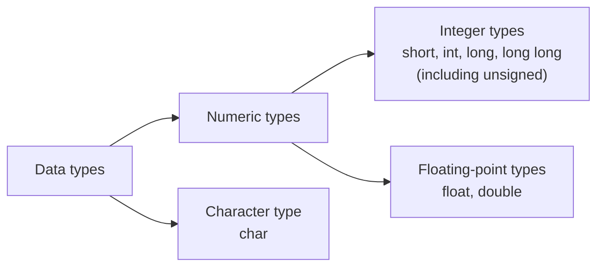

# Chapter 3 Lab — Data Types and Format Specifiers

[Repository Guide](../../README.md) | [English](Concepts_Lab.md) | [한국어](Concepts_Lab.ko.md)

> **Last Updated:** 2026-10-27
>
> 문제풀이 중심의 C언어 연습, 김용일 외, Ch 3

> **Learning Objectives:**
> 1. State the sizes and ranges of the basic data types and explain why several data types are needed
> 2. Set the output format of integers and real numbers with the format specifiers of `printf` and with width, alignment, and precision
> 3. Read characters and decimal, octal, hexadecimal, and real numbers with the format specifiers of `scanf`
> 4. Check the memory size of data types and constants with the `sizeof` operator
> 5. Explain the causes and remedies of the warnings and the input buffer problem that appear when `scanf` is used in Visual Studio

---

## Table of Contents

- [1. Data Types](#1-data-types)
  - [1.1 Classification of Data Types](#11-classification-of-data-types)
  - [1.2 Sizes and Ranges](#12-sizes-and-ranges)
  - [1.3 Why Several Data Types Are Needed](#13-why-several-data-types-are-needed)
- [2. Format Specifiers of printf](#2-format-specifiers-of-printf)
  - [2.1 Format Specifiers for Characters, Integers, and Real Numbers](#21-format-specifiers-for-characters-integers-and-real-numbers)
  - [2.2 Width, Alignment, and Precision](#22-width-alignment-and-precision)
- [3. Format Specifiers of scanf](#3-format-specifiers-of-scanf)
  - [3.1 Reading a Character](#31-reading-a-character)
  - [3.2 Reading Decimal, Octal, and Hexadecimal Numbers](#32-reading-decimal-octal-and-hexadecimal-numbers)
  - [3.3 Reading Real Numbers](#33-reading-real-numbers)
- [4. The sizeof Operator](#4-the-sizeof-operator)
- [5. Cautions When Using scanf](#5-cautions-when-using-scanf)
  - [5.1 Warning C4996](#51-warning-c4996)
  - [5.2 The Input Buffer and Spaces in the Format String](#52-the-input-buffer-and-spaces-in-the-format-string)
  - [5.3 Warning C6031](#53-warning-c6031)
  - [5.4 scanf_s](#54-scanf_s)
- [6. Practice Problems](#6-practice-problems)
  - [6.1 Setting the Output Format of Three Real Numbers](#61-setting-the-output-format-of-three-real-numbers)
  - [6.2 Sum of Two Integers](#62-sum-of-two-integers)
  - [6.3 Half of a Real Number](#63-half-of-a-real-number)
- [Summary](#summary)
- [Self-Check Questions](#self-check-questions)

---

<br>

## 1. Data Types

### 1.1 Classification of Data Types

A **data type** is a keyword that states the characteristics of a variable to be declared. Declaring a variable is the process by which the programmer secures the memory area needed to use information, and the data type determines the size of that area and how its value is interpreted ([Chapter 3, Section 1](Concepts_Lecture.md#1-data-types)).



*Figure 1. Classification of the basic data types of C*

The character type `char` is also internally an integer that stores the code of a character. Types such as arrays and structures are covered in Chapters 7 and 10.

### 1.2 Sizes and Ranges

The following are the sizes and ranges of the basic data types in Visual Studio (Windows).

| Kind | Keyword | Bytes | Range of values |
|:-----|:-----|-----:|:-----|
| Character (unsigned) | `unsigned char` | 1 | 0 to 255 |
| Character (signed) | `char` | 1 | -128 to 127 |
| Integer (unsigned) | `unsigned short int` | 2 | 0 to 65,535 |
| Integer (unsigned) | `unsigned int` | 4 | 0 to 4,294,967,295 |
| Integer (unsigned) | `unsigned long int` | 4 | 0 to 4,294,967,295 |
| Integer (signed) | `short int` | 2 | -32,768 to 32,767 |
| Integer (signed) | `int` | 4 | -2,147,483,648 to 2,147,483,647 |
| Integer (signed) | `long int` | 4 | -2,147,483,648 to 2,147,483,647 |
| Integer (signed) | `long long` | 8 | -9,223,372,036,854,775,808 to 9,223,372,036,854,775,807 |
| Floating point | `float` | 4 | About 1.2 × 10⁻³⁸ to 3.4 × 10³⁸ (magnitude) |
| Floating point | `double` | 8 | About 2.2 × 10⁻³⁰⁸ to 1.8 × 10³⁰⁸ (magnitude) |

*Table 1. Sizes and ranges of the basic data types in Visual Studio*

> **Caution:** The C standard fixes only the minimum range each type must represent, so sizes differ between platforms. In particular, `long` is 4 bytes on Windows but 8 bytes on 64-bit Linux and macOS. Whether `char` is signed is also implementation-defined; it is signed on x86 but unsigned by default on ARM Linux. The ranges of the floating-point types are the magnitude ranges of normalized values, and representation error and precision are summarized in [Chapter 3, Section 1.2](Concepts_Lecture.md#12-floating-point-types).

### 1.3 Why Several Data Types Are Needed

C provides several data types for two reasons.

- **Data are represented differently:** Integers are represented in two's complement, and real numbers in the IEEE 754 format, split into sign, exponent, and mantissa. Even with the same 32 bits, `int` and `float` interpret the bits differently ([Chapter 3, Section 2.2](Concepts_Lecture.md#22-integer-representation-twos-complement), [Section 2.3](Concepts_Lecture.md#23-floating-point-representation-ieee-754)).
- **Memory should be used appropriately:** Choosing a type by the range of the data saves memory. Conversely, storing large data in a small memory space cuts off the part that cannot be represented, and data is lost.

---

<br>

## 2. Format Specifiers of printf

A **format specifier** is a special symbol that sets the output format of a variable or data ([Chapter 3, Section 5](Concepts_Lecture.md#5-format-specifiers)).

### 2.1 Format Specifiers for Characters, Integers, and Real Numbers

The same value is printed differently depending on the format specifier.

```c
#include <stdio.h>

int main(void)
{
    char ch = 'A';      // character code 65
    int vA = 10;
    float vB = 10.2;
    double vC = -20.5;
    double vD = -0.005;

    printf("ch: %c, %d, %x \n", ch, ch, ch);
    printf("vA: %d, %o, %x \n", vA, vA, vA);
    printf("vB: %f, %e \n", vB, vB);
    printf("vC: %f, %e \n", vC, vC);
    printf("vD: %f, %e \n", vD, vD);

    return 0;
}
```

```text
ch: A, 65, 41 
vA: 10, 12, a 
vB: 10.200000, 1.020000e+01 
vC: -20.500000, -2.050000e+01 
vD: -0.005000, -5.000000e-03 
```

- **`%c`, `%d`, `%x`:** Print the code 65 of the character `'A'` as a character, in decimal, and in hexadecimal (0x41).
- **`%o`:** Printing 10 in octal gives `12`, because 1 × 8 + 2 = 10.
- **`%f`:** Prints six digits after the decimal point.
- **`%e`:** Prints in exponent notation. `1.020000e+01` is 1.02 × 10¹ = 10.2, and `-5.000000e-03` is -5 × 10⁻³ = -0.005.

### 2.2 Width, Alignment, and Precision

Between `%` and the conversion character, the output width (minimum number of columns), alignment, fill character, and precision can be specified ([Chapter 3, Section 5.2](Concepts_Lecture.md#52-width-and-alignment)).

```c
#include <stdio.h>

int main(void)
{
    int vA = 3;
    double vB = 1.23;

    printf("%d\n", vA);         // as many columns as needed
    printf("%4d\n", vA);        // width 4, right-aligned
    printf("%04d\n", vA);       // width 4, padded with 0
    printf("%-4d\n", vA);       // width 4, left-aligned
    printf("----------\n");
    printf("%f\n", vB);         // 6 digits after the point
    printf("%10.1f\n", vB);     // width 10, 1 digit after the point
    printf("%-10.1f\n", vB);    // width 10, left-aligned
    printf("%.1f\n", vB);       // 1 digit after the point
    printf("%6.1f\n", vB);      // width 6, 1 digit after the point

    return 0;
}
```

```text
3
   3
0003
3   
----------
1.230000
       1.2
1.2       
1.2
   1.2
```

| Specification | Meaning | Example and output |
|:-----|:-----|:-----|
| Width `n` | Uses at least n columns, right-aligned | `%4d` → `   3` |
| `0` flag | Fills empty columns with 0 | `%04d` → `0003` |
| `-` flag | Left-aligns and fills the right with spaces | `%-4d` → `3   ` |
| Precision `.m` | Prints a real number rounded to m digits after the decimal point | `%.1f` → `1.2` |
| Width and precision `n.m` | Uses at least n columns including the decimal point and sign | `%6.1f` → `   1.2` |

*Table 2. Specifying output width, alignment, and precision*

If the value is longer than the width, the width is ignored and the whole value is printed. That is, the width is a minimum number of columns and does not cut the value.

---

<br>

## 3. Format Specifiers of scanf

`scanf` decides with format specifiers as what data type the information entered on the console is read, and stores the value read in the memory at the address it receives as an argument ([Chapter 3, Section 5.3](Concepts_Lecture.md#53-scanf)). The `&` before a variable name is the operator that obtains the starting memory address of that variable, and `scanf` needs this address to store the value.

### 3.1 Reading a Character

```c
#define _CRT_SECURE_NO_WARNINGS  // allows scanf in Visual Studio
#include <stdio.h>

int main(void)
{
    char chA;

    printf("input ch: ");
    scanf(" %c", &chA);     // & passes the address of chA

    printf("chA: %c, %d \n", chA, chA);

    return 0;
}
```

```text
input ch: B
chA: B, 66 
```

`%c` reads one character. The role of the space before `%c` in the format string is explained in Section 5.2.

### 3.2 Reading Decimal, Octal, and Hexadecimal Numbers

`%d`, `%o`, and `%x` interpret the input as decimal, octal, and hexadecimal, respectively, and store it in an integer variable.

```c
#define _CRT_SECURE_NO_WARNINGS  // allows scanf in Visual Studio
#include <stdio.h>

int main(void)
{
    int vA, vB, vC;

    printf("Enter the 3 data(10/8/16 진수): ");
    scanf(" %d %o %x", &vA, &vB, &vC);     // read as decimal, octal, and hexadecimal

    printf("vA: %d, %o, %x \n", vA, vA, vA);
    printf("vB: %d, %o, %#x \n", vB, vB, vB);   // # adds the prefix 0x
    printf("vC: %d, %o, %#x \n", vC, vC, vC);

    return 0;
}
```

```text
Enter the 3 data(10/8/16 진수): 11 20 a
vA: 11, 13, b 
vB: 16, 20, 0x10 
vC: 10, 12, 0xa 
```

The same inputs `11`, `20`, and `a` store different values depending on the base used to read them. Reading `20` with `%o` stores 2 × 8 = 16, and reading `a` with `%x` stores 10.

| Decimal | 0 | 1 | ... | 7 | 8 | 9 | 10 | 11 | 12 | ... | 15 | 16 |
|:-----|:---:|:---:|:---:|:---:|:---:|:---:|:---:|:---:|:---:|:---:|:---:|:---:|
| Octal | 0 | 1 | ... | 7 | 10 | 11 | 12 | 13 | 14 | ... | 17 | 20 |
| Hexadecimal | 0 | 1 | ... | 7 | 8 | 9 | a | b | c | ... | f | 10 |

*Table 3. The numbers 0 to 16 written in decimal, octal, and hexadecimal*

The difference between `%x` and `%#x` lies in the `#` flag. With `#`, `0x` is added before a hexadecimal number and `0` before an octal number (`%#o`), giving the same form as integer constants in C source code. No prefix is added when the value is 0.

### 3.3 Reading Real Numbers

In `printf`, both `float` and `double` are printed with `%f`, but in `scanf`, `%f` must be used for a `float` variable and `%lf` for a `double` variable.

```c
#define _CRT_SECURE_NO_WARNINGS  // allows scanf in Visual Studio
#include <stdio.h>

int main(void)
{
    float vA;
    double vB;

    printf("input real num(float): ");
    scanf(" %f", &vA);      // %f for float
    printf("input real num(double): ");
    scanf(" %lf", &vB);     // %lf for double

    printf("%.2f, %.2f \n", vA, vB);

    return 0;
}
```

```text
input real num(float): 1.323
input real num(double): -34.457
1.32, -34.46 
```

> **Key Point:** A `float` argument passed to `printf` is converted to `double` during the function call, so a single `%f` prints both types. `scanf`, on the other hand, receives not the value but the address of the variable, so the format specifier must state exactly the size of the memory to store into (4 or 8 bytes). Reading a `double` variable with `%f` is undefined behavior and stores a wrong value.

---

<br>

## 4. The sizeof Operator

`sizeof` is the operator that gives how many bytes of memory a data type, variable, or literal constant occupies ([Chapter 3, Section 7](Concepts_Lecture.md#7-sizeof-operator)). It is written with parentheses like a function call, but it is an operator, not a function, and its value is fixed at compile time.

```c
#include <stdio.h>

int main(void)
{
    char ch = 'A';
    int num = 10;
    short data = 3;
    double ave = 3.2;

    printf("1: %zu, %zu, %zu \n", sizeof(char), sizeof(ch), sizeof('A'));
    printf("2: %zu, %zu, %zu \n", sizeof(int), sizeof(num), sizeof(10));
    printf("3: %zu, %zu, %zu \n", sizeof(short), sizeof(data), sizeof(3));
    printf("4: %zu, %zu, %zu \n", sizeof(double), sizeof(ave), sizeof(3.2));

    return 0;
}
```

```text
1: 1, 1, 4 
2: 4, 4, 4 
3: 2, 2, 4 
4: 8, 8, 8 
```

- **Why `sizeof('A')` is 4:** In C, the type of the character constant `'A'` is `int`, not `char`. So the `char` variable `ch` is 1 byte, but the character constant `'A'` has the size of `int`, 4 bytes. In C++, a character constant is a `char`, so the result is 1.
- **Why `sizeof(3)` is 4:** The type of the integer constant 3 is `int`, so even when 3 is stored in the `short` variable `data`, the constant 3 itself is 4 bytes.
- **Why `sizeof(3.2)` is 8:** A real constant without a suffix has the type `double`. Adding `f`, as in `3.2f`, makes it a `float` constant of 4 bytes.

> **Note:** The result type of `sizeof` is `size_t`, and from C99 the format specifier for printing `size_t` is `%zu`. Using `%d` as older code does can cause a warning or a wrong value in 64-bit environments, where `size_t` (8 bytes) and `int` (4 bytes) differ in size. Visual Studio versions before 2015 did not support `%zu`.

---

<br>

## 5. Cautions When Using scanf

The following code is written to the C standard and runs, but building it in Visual Studio marks `scanf` with a warning and an error.

```c
#include <stdio.h>
int main()
{
    int data;
    printf("input data: ");
    scanf("%d", &data);
    printf("data: %d \n", data);
}
```

Visual Studio's error list shows error C4996 (`'scanf': This function or variable may be unsafe. Consider using scanf_s instead.`) and warning C6031 (return value ignored), and there is also an input buffer problem that shows up at run time.

### 5.1 Warning C4996

Visual Studio (MSVC) recommends the security-enhanced `scanf_s` and issues C4996 for `scanf`, on the grounds that `scanf` does not check the length of the input and can cause buffer overflows. The SDL (Security Development Lifecycle) checks, turned on by default in new projects, treat this warning as an error, so the build fails. The remedy is to write one of the following at the very top of the source file, before `#include`.

```c
#define _CRT_SECURE_NO_WARNINGS      // solution 1: a macro the MSVC headers check
// #pragma warning(disable:4996)    // solution 2: turn off warning C4996
#include <stdio.h>
```

`_CRT_SECURE_NO_WARNINGS` is a macro that the MSVC header files check, so it takes effect only when defined before `#include <stdio.h>`. Setting SDL checks to "No" in the project properties leaves C4996 as a warning instead of an error.

> **Note:** C4996 is not a problem of the C standard but a policy of the Microsoft compiler. gcc and clang issue no such warning for `scanf`, and the `_CRT_SECURE_NO_WARNINGS` macro and `#pragma warning` have no effect there. That is why the example code of this repository defines `_CRT_SECURE_NO_WARNINGS`, so that it compiles unchanged in Visual Studio and in other compilers.

### 5.2 The Input Buffer and Spaces in the Format String

What is typed on the keyboard enters the **input buffer**, including the newline character `'\n'`, the moment Enter is pressed, and `scanf` takes out of this buffer only as much as it needs. After `%d` reads 3, `'\n'` remains in the buffer.

Numeric conversions such as `%d`, `%f`, and `%lf` skip leading white-space characters (spaces, tabs, newlines) by themselves, but `%c` reads a white-space character as a character too. So reading a character with `scanf("%c", &ch);` after reading an integer reads the `'\n'` left in the buffer before the user can type a character.

```c
#define _CRT_SECURE_NO_WARNINGS
#include <stdio.h>
int main(void)
{
    int num;
    char ch;
    printf("input num: ");
    scanf("%d", &num);
    printf("input ch: ");
    scanf("%c", &ch);          // no space before %c
    printf("num: %d, ch: %d\n", num, ch);
    return 0;
}
```

```text
input num: 5
input ch: num: 5, ch: 10
```

The code 10 of the newline character was stored in `ch`, and the next line ran at once without reading a character. Putting one space before the conversion in the format string, as in `" %c"`, makes `scanf` skip all white-space characters before reading, which removes the problem. Numeric conversions do not need the space, but the habit of always writing a space, as in `" %d"`, prevents mistakes when `%c` is mixed in.

### 5.3 Warning C6031

C6031 is a warning from Visual Studio's code analyzer that the return value of `scanf` was not used. `scanf` returns the number of items it stored, so checking this value detects failures such as input that is not a number. Code that does not use the return value conforms to the C standard, so compiling and running are not affected, and the warning can be hidden by adding `#pragma warning(disable:6031)` at the top.

```c
#pragma warning(disable:4996)      // or: #define _CRT_SECURE_NO_WARNINGS
#pragma warning(disable:6031)
#include <stdio.h>
int main()
{
    int data;
    printf("input data: ");        // prompt
    scanf(" %d", &data);           // read an integer from the console
    printf("data: %d \n", data);
}
```

```text
input data: 3
data: 3 
```

When 3 is entered and Enter is pressed, `scanf(" %d", &data);` stores the binary value of the integer 3 at `&data`, the starting memory address of `data`. Until then, `data` holds a garbage value.

### 5.4 scanf_s

`scanf_s` may be used instead of `scanf`. For conversions that read numbers, such as `%d`, the two functions are used and behave the same, and with `scanf_s` the code for C4996 is not needed. However, when reading a character or a string with `%c` or `%s`, the size of the buffer must also be passed as an argument, as in `scanf_s(" %c", &ch, 1);`.

> **Caution:** `scanf_s` is provided by Microsoft's library and is defined in the C11 standard only in Annex K, which implementations may provide optionally. Most standard libraries used by gcc and clang do not provide it, so code using `scanf_s` may not compile with other compilers.

---

<br>

## 6. Practice Problems

The following problems practice setting the formats of input and output with format specifiers. Each program compiles with `gcc -std=c99 -Wall` without warnings, and the outputs are from actual runs.

### 6.1 Setting the Output Format of Three Real Numbers

**Problem:** Read real numbers into the `double` variables `no`, `in`, and `out`, and print them in the column layout below. Each column holds one character; `no` takes 5 columns, `in` 6, and `out` 6.

```text
┌─┬─┬─┬─┬─┬─┬─┬─┬─┬─┬─┬─┬─┬─┬─┬─┬─┐
│ │1│.│3│4│ │-│2│5│.│1│0│0│0│5│1│2│
└─┴─┴─┴─┴─┴─┴─┴─┴─┴─┴─┴─┴─┴─┴─┴─┴─┘
 └── no ───┘└──── in ───┘└─── out ──┘
```

*Figure 2. The output column layout when 1.345, -25.1, and 512.3 are entered*

**Solution:** Read the widths and precisions from the column layout. `no` takes 5 columns with 2 digits after the decimal point, so `%5.2f`; `in` takes 6 columns with 1 digit, so `%6.1f`; and `out` takes 6 columns with no decimal point and leading zeros, so `%06.0f`. No spaces go between the three format specifiers, so the columns follow one another directly.

```c
#define _CRT_SECURE_NO_WARNINGS  // allows scanf in Visual Studio
#include <stdio.h>

int main(void)
{
    double no, in, out;

    printf("Enter 3 real num.: ");
    scanf("%lf %lf %lf", &no, &in, &out);

    printf("%5.2f%6.1f%06.0f\n", no, in, out);   // widths 5, 6, 6; out is padded with 0

    return 0;
}
```

```text
Enter 3 real num.: 1.345 -25.1 512.3
 1.34 -25.1000512
```

> **Note:** Rounding 1.345 to two digits after the decimal point would seem to give 1.35, but 1.34 is printed. This is because 1.345 is not exactly representable in binary and is stored in a `double` as 1.34499999999999997.... 512.3 printed with `%.0f` has its fractional part rounded and becomes 512.

### 6.2 Sum of Two Integers

**Problem:** Read values into the integer variables `no` and `count`, and print the sum of the two numbers.

**Solution:** Read both integers with one `scanf`. The space between the two `%d` in the format string matches the spaces, tabs, or newlines that separate the two numbers in the input.

```c
#define _CRT_SECURE_NO_WARNINGS  // allows scanf in Visual Studio
#include <stdio.h>

int main(void)
{
    int no, count;

    printf("Enter [no, count] value: ");
    scanf("%d %d", &no, &count);

    printf("%d + %d = %d\n", no, count, no + count);

    return 0;
}
```

```text
Enter [no, count] value: 3 -7
3 + -7 = -4
```

### 6.3 Half of a Real Number

**Problem:** Read a real number (`double`) and print half of its value. Pay attention to the number of printed digits.

**Solution:** `num / 2` divides a `double` by an `int`, so 2 is converted to `double` and the division is a real division ([Chapter 3, Section 6.1](Concepts_Lecture.md#61-implicit-conversion)). By contrast, multiplying by 1/2 directly, as in `num * (1 / 2)`, makes `1 / 2` an integer division equal to 0, so the result is always 0. The result is printed with `%.2f` to two digits after the decimal point, and the input value with `%g`, which removes the unneeded zeros that `%f` adds.

```c
#define _CRT_SECURE_NO_WARNINGS  // allows scanf in Visual Studio
#include <stdio.h>

int main(void)
{
    double num;

    printf("Enter real num.(double): ");
    scanf("%lf", &num);

    printf("%g * 1/2 = %.2f\n", num, num / 2);   // %g drops the trailing zeros of num

    return 0;
}
```

```text
Enter real num.(double): 34.144
34.144 * 1/2 = 17.07
```

34.144 / 2 = 17.072, so `%.2f` rounds down at the third digit, 2, and prints `17.07`. Printing with `%f` gives `17.072000`.

---

<br>

## Summary

| Concept | Key Summary |
|:-----|:-----|
| Data type | A keyword that determines a variable's memory size and how its value is interpreted; there are integer, floating-point, and character types. |
| Sizes and ranges | In Visual Studio, `char` is 1 byte, `short` 2, `int` and `long` 4, and `long long` and `double` 8; sizes can differ between platforms. |
| Why several types are needed | Integers and real numbers are represented differently, and choosing a type that fits the range uses memory appropriately and prevents data loss. |
| `printf` format specifiers | `%c`, `%d`, `%o`, `%x`, `%f`, and `%e` print the same value in different formats. |
| Width, alignment, precision | Specifiers such as `%4d`, `%04d`, `%-4d`, and `%10.1f` set the minimum columns, fill, alignment, and digits after the decimal point. |
| `scanf` format specifiers | `%c`, `%d`, `%o`, and `%x` read characters and integers, `float` is read with `%f` and `double` with `%lf`, and the address of the variable is passed. |
| `sizeof` | An operator that gives the size in bytes of a type, variable, or constant, printed with `%zu`; the type of a character constant is `int`. |
| C4996 | The security warning MSVC issues for `scanf`, turned off with `_CRT_SECURE_NO_WARNINGS` or `#pragma warning(disable:4996)`. |
| Input buffer | `%c` also reads a newline left in the buffer, so a space is put before it, as in `" %c"`, to skip white-space characters. |
| C6031 | A code analysis warning that the return value of `scanf` was not used; standard code has no problem. |
| `scanf_s` | A function provided by MSVC that may not be available with other compilers. |

---

<br>

## Self-Check Questions

1. **Format specifiers:** With `int n = 255;`, write the output of `printf("%d %o %x %#x\n", n, n, n, n);`.

   <details>
   <summary>Answer</summary>

   `255 377 ff 0xff`. Since 255 = 3 × 64 + 7 × 8 + 7, it is 377 in octal, and since 255 = 15 × 16 + 15, it is ff in hexadecimal. `%#x` adds `0x` in front.

   </details>

2. **Width and alignment:** With `double d = 3.14159;`, write the output of `printf("[%8.3f][%-8.2f]\n", d, d);`.

   <details>
   <summary>Answer</summary>

   `[   3.142][3.14    ]`. The first right-aligns `3.142` (5 columns), rounded to three digits after the decimal point, in 8 columns, and the second left-aligns `3.14` (4 columns) in 8 columns.

   </details>

3. **scanf and double:** What problem arises if `double x;` is read with `scanf("%f", &x);`?

   <details>
   <summary>Answer</summary>

   `%f` expects the address of a `float` (4 bytes), so bits in `float` format are written to only part of the memory of the `double` (8 bytes) variable, and the remaining bytes are left as they were. Because the format specifier and the argument type do not match, the behavior is undefined, and a wrong value is usually stored. A `double` must be read with `%lf`.

   </details>

4. **sizeof:** With `char c = 'x';`, why do `sizeof(c)` and `sizeof('x')` differ?

   <details>
   <summary>Answer</summary>

   `c` is a `char` variable, so it is 1 byte, but in C the type of the character constant `'x'` is `int`, so `sizeof('x')` is the size of `int` (4 in most environments).

   </details>

5. **Input buffer:** Executing `scanf("%c", &ch);` after `scanf("%d", &n);` moves on to the next line without giving the user a chance to type a character. Explain the cause and the remedy.

   <details>
   <summary>Answer</summary>

   The newline character `'\n'` from the Enter pressed after typing the integer remains in the input buffer and is read by `%c`. Putting a space before `%c`, as in `scanf(" %c", &ch);`, makes `scanf` skip the white-space characters in the buffer before reading a character.

   </details>
