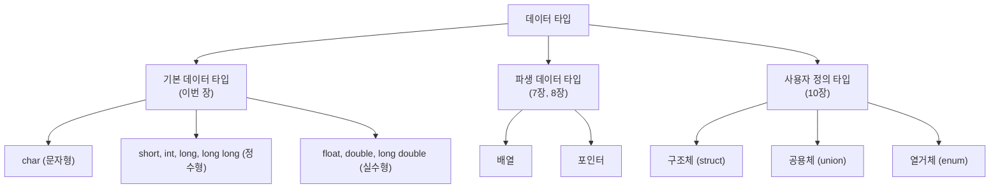

# 3장 — 데이터 타입과 변수

[레포지토리 안내](../../README.ko.md) | [English](Concepts_Lecture.md) | [한국어](Concepts_Lecture.ko.md)

> **최종 수정일:** 2026-11-27
>
> Warming-Up C Programming, 천정아, Ch 3

> **학습 목표:**
> 1. 데이터 타입이 메모리 크기와 2진 표현을 결정하는 방식을 설명하고 정수형, 실수형, 문자형의 크기와 범위를 비교할 수 있다
> 2. 10진수, 2진수, 16진수를 서로 변환하고 2의 보수로 음수를 표현할 수 있다
> 3. 정수형의 오버플로와 실수형의 정밀도, 표현 오차, 오버플로와 언더플로를 설명할 수 있다
> 4. 변수를 선언하고 초기화하며 식별자 규칙에 맞는 이름을 붙일 수 있다
> 5. 리터럴 상수, 매크로 상수, `const` 변수를 구분하여 사용할 수 있다
> 6. 형식 지정자, 형 변환, `sizeof` 연산자를 사용할 수 있다

---

## 목차

- [1. 데이터 타입](#1-데이터-타입)
  - [1.1 정수형](#11-정수형)
  - [1.2 실수형](#12-실수형)
  - [1.3 문자형](#13-문자형)
- [2. 2진 표현](#2-2진-표현)
  - [2.1 진법](#21-진법)
  - [2.2 정수의 2진 표현 (2의 보수)](#22-정수의-2진-표현-2의-보수)
  - [2.3 실수의 2진 표현 (IEEE 754)](#23-실수의-2진-표현-ieee-754)
- [3. 변수](#3-변수)
  - [3.1 선언과 초기화](#31-선언과-초기화)
  - [3.2 식별자와 이름 규칙](#32-식별자와-이름-규칙)
- [4. 상수와 리터럴](#4-상수와-리터럴)
  - [4.1 리터럴 상수](#41-리터럴-상수)
  - [4.2 매크로 상수 (`#define`)](#42-매크로-상수-define)
  - [4.3 `const` 변수](#43-const-변수)
  - [4.4 표준 라이브러리의 매크로 상수](#44-표준-라이브러리의-매크로-상수)
- [5. 형식 지정자](#5-형식-지정자)
  - [5.1 주요 지정자](#51-주요-지정자)
  - [5.2 출력 폭과 정렬](#52-출력-폭과-정렬)
  - [5.3 `scanf`](#53-scanf)
- [6. 형 변환](#6-형-변환)
  - [6.1 묵시적 형 변환](#61-묵시적-형-변환)
  - [6.2 명시적 형 변환 (캐스팅)](#62-명시적-형-변환-캐스팅)
  - [6.3 형 변환의 흔한 실수](#63-형-변환의-흔한-실수)
- [7. `sizeof` 연산자](#7-sizeof-연산자)
- [요약](#요약)
- [점검 문제](#점검-문제)

---

<br>

## 1. 데이터 타입

**데이터 타입**은 값을 저장하는 데 필요한 메모리의 크기와 2진 표현을 결정한다. 컴퓨터 시스템에서 2진 데이터로 값을 표현하고 저장하는 방식을 데이터 타입의 2진 표현이라고 하며, 모든 값에는 데이터 타입이 있다. 컴파일러는 데이터 타입에 따라 몇 바이트를 할당하고, 저장된 비트를 어떻게 해석할지 결정한다.



*그림 1. C의 데이터 타입 분류*

C에서 모든 변수는 **사용하기 전에** 타입을 선언해야 한다.

### 1.1 정수형

정수형은 소수점 없는 정수를 저장한다. C는 다양한 크기의 정수형을 제공하며, 아래 표의 크기와 범위는 32비트 플랫폼 기준이다(64비트 Windows도 같다).

| 타입 | 크기 | 범위 (signed) | 형식 |
|:-----|:----:|:-------------|:----:|
| `char` | 1 B | -128 ~ 127 | `%d` |
| `short` | 2 B | -32,768 ~ 32,767 | `%hd` |
| `int` | 4 B | -2,147,483,648 ~ 2,147,483,647 | `%d` |
| `long` | 4 B | -2,147,483,648 ~ 2,147,483,647 | `%ld` |
| `long long` | 8 B | -9,223,372,036,854,775,808 ~ 9,223,372,036,854,775,807 (약 $\pm 9.2 \times 10^{18}$) | `%lld` |

*표 1. 부호 있는 정수형의 크기, 범위, 형식 지정자 (32비트 플랫폼)*

`long long`은 C99에 추가된 데이터 타입이다. 64비트 Linux와 macOS에서는 `long`이 8바이트로 `long long`과 범위가 같다. `char`가 부호 있는 형인지 부호 없는 형인지는 구현에 따라 다르며(x86의 Windows, Linux와 macOS는 signed, ARM Linux는 unsigned), 표는 signed인 경우의 범위이다.

C 표준은 `sizeof(short)` ≤ `sizeof(int)` ≤ `sizeof(long)`을 보장한다.

#### `signed`와 `unsigned`

정수형은 부호 있는 정수형과 부호 없는 정수형으로 구분된다. 생략하면 `signed`(음수 가능)이므로, 부호 없는 정수형에는 `unsigned`를 써 준다. `unsigned`를 붙이면 음수 범위를 제거하고 양수 범위를 약 두 배로 확장한다. 아래 코드의 주석에서 2B는 약 21억(2 billion)을 뜻한다.

```c
int a = -10;              // signed (default) → range: -2B ~ +2B
unsigned int b = 100;     // unsigned → range: 0 ~ 4,294,967,295
```

| Signed 타입 | Unsigned 타입 | 크기 | Unsigned 범위 |
|:-----------|:------------|:----:|:------------|
| `char` | `unsigned char` | 1 B | 0 ~ 255 |
| `short` | `unsigned short` | 2 B | 0 ~ 65,535 |
| `int` | `unsigned int` | 4 B | 0 ~ 4,294,967,295 |
| `long` | `unsigned long` | 4 B | 0 ~ 4,294,967,295 |
| `long long` | `unsigned long long` | 8 B | 0 ~ 18,446,744,073,709,551,615 |

*표 2. 부호 없는 정수형의 크기와 범위 (32비트 플랫폼)*

> **핵심:** `signed int`와 `int`는 같다. `unsigned`와 `unsigned int`도 같다. 마찬가지로 `short`는 `short int`, `signed short`, `signed short int`와 같고, `long`은 `long int`, `signed long`, `signed long int`와 같으며, `unsigned short`는 `unsigned short int`, `unsigned long`은 `unsigned long int`와 같다.

#### 오버플로와 언더플로

모든 정수형에는 **고정된 범위(유효 범위)** 가 있다. 정수형 변수에 유효 범위 밖의 값을 저장하면 정수형의 크기에 맞춰 나머지 상위 비트를 잘라 버리므로, 항상 유효 범위 안의 값만 저장된다. 이렇게 값이 넘쳐흘러 유효 범위 안의 값으로 설정되는 것을 **오버플로(overflow)** 라고 하며, 최솟값보다 작아지는 경우를 따로 **언더플로(underflow)** 라고 부르기도 한다. 결과적으로 값은 유효 범위 안에서 순환(wrap around)한다.

```c
#include <limits.h>

int max = INT_MAX;       // 2,147,483,647
printf("%d\n", max + 1); // -2,147,483,648  (wraps around!)
```

```text
          Overflow
    ┌───── INT_MAX + 1 ────────────┐
    │                              ▼
... ─2 ─1  0  1  2 ... INT_MAX  INT_MIN ...
                         ▲                │
                         └── INT_MIN - 1 ─┘
                              Underflow
```

*그림 2. `int`의 오버플로와 언더플로에 따른 값의 순환*

```c
char n = 128;             // char range: -128~127 → overflow!
printf("%d\n", n);        // -128  (wraps around)

unsigned char red = 300;  // unsigned char range: 0~255 → overflow!
printf("%d\n", red);      // 44   (300 - 256 = 44)
```

`char n = 128;`은 4바이트 정수 128(`0x00000080`)의 하위 1바이트 `0x80`(`10000000`)만 `n`에 저장하고 상위 3바이트를 잘라 버린다. 최상위 비트가 부호 비트이므로 이 비트 패턴은 -128로 해석된다. `unsigned char red = 300;`은 300(`0x0000012C`)의 하위 1바이트 `0x2C`(`00101100`)만 저장하므로 44가 된다.

```text
char n = 128;
  128 (int)  : 00000000 00000000 00000000 10000000
  n (char)   :                            10000000  = 0x80 → -128

unsigned char red = 300;
  300 (int)  : 00000000 00000000 00000001 00101100
  red        :                            00101100  = 0x2C → 44
```

*그림 3. 상위 바이트를 잘라 1바이트에 저장하는 과정*

> **주의:** C 표준에서 부호 없는 정수형의 순환은 $2^N$($N$은 비트 수)으로 나눈 나머지로 정의된 동작이다. 반면 `INT_MAX + 1`처럼 부호 있는 정수의 산술 연산이 범위를 넘는 것은 정의되지 않은 동작(undefined behavior)이고, `char n = 128;`처럼 범위 밖의 값을 부호 있는 정수형으로 변환한 결과는 구현에 따라 정해진다. 2의 보수를 쓰는 대부분의 시스템에서 위와 같이 순환한 결과가 나오지만, 컴파일러의 최적화가 순환을 가정하지 않을 수 있으므로 부호 있는 정수의 오버플로에 의존하는 코드는 쓰지 않는다.

`<limits.h>`를 포함하면 `INT_MAX`, `INT_MIN`, `SHRT_MAX` 등 타입 범위 상수를 사용할 수 있다.

### 1.2 실수형

실수형은 **부동소수점(floating point)** 방식으로 실수를 저장한다. 값은 $1.xxx \times 2^n$ 형태로 표현되며, 가수(xxx)가 정밀도를, 지수($n$)가 범위를 결정한다.

| 타입 | 크기 | 정밀도 | 형식 | 범위 |
|:-----|:----:|:------|:----:|:-----|
| `float` | 4 B | 유효숫자 약 7자리 | `%f` | $\pm 1.17549 \times 10^{-38}$ ~ $\pm 3.40282 \times 10^{38}$ |
| `double` | 8 B | 유효숫자 약 15자리 | `%lf` (입력), `%f` (출력) | $\pm 2.22507 \times 10^{-308}$ ~ $\pm 1.79769 \times 10^{308}$ |
| `long double` | 8+ B | 유효숫자 15자리 이상 | `%Lf` | ≥ `double` |

*표 3. 실수형의 크기, 정밀도, 형식 지정자, 범위*

범위의 왼쪽 값은 0이 아닌 정규화된 수 가운데 절댓값이 가장 작은 값이고, 오른쪽 값은 절댓값이 가장 큰 값이다. `long double`의 크기는 컴파일러에 따라 다르며, Visual C++에서는 `double`과 같은 8바이트이다.

```c
float pi_f = 3.14f;       // 'f' suffix for float literal
double pi_d = 3.14159265; // decimal literals default to double
```

> **주의:** `unsigned`는 실수형에 **적용할 수 없다**. `unsigned float`과 `unsigned double`은 잘못된 문법이다.

#### 정밀도(Precision)

**정밀도**란 실수형이 정확하게 저장할 수 있는 **유효숫자의 총 개수**이다. 소수점 이하 자릿수가 아니다.

```c
float  f = 123456789.123456789f;
double d = 123456789.123456789;

printf("float:  %.15f\n", f);  // 123456792.000000000000000 (wrong after ~7 digits)
printf("double: %.15f\n", d);  // 123456789.123456791043282 (wrong after ~15 digits)
```

`float`는 유효숫자 약 7자리, `double`은 약 15자리이다. 같은 값 9.876543210987654를 `float`와 `double` 변수에 저장하여 `%.15f`로 출력하면 `float`는 `9.876543045043945`로 소수점 이하 6자리까지만 맞고, `double`은 `9.876543210987654`로 모두 맞는다. 대부분의 계산에서는 `double`을 사용한다.

#### 표현 오차

컴퓨터는 숫자를 **이진수(2진법)** 로 저장한다. 일부 소수(예: 0.1)는 이진수로 정확히 표현할 수 없다. 마치 1/3을 10진수로 정확히 쓸 수 없는 것과 같다. 0.1을 2진수로 바꾸면 $0.1_{10} = 0.000110011001100\ldots_2$처럼 `0011`이 끝없이 반복되므로, 가수부의 비트 수에서 반올림한 근삿값이 저장된다(`float`의 0.1은 비트 패턴 `0x3DCCCCCD`이다).

```c
double x = 0.1 + 0.2;
printf("%.20f\n", x);  // 0.30000000000000004441  (not exactly 0.3!)

if (x == 0.3) { ... }  // [X] may be false!
```

> **주의:** 실수끼리 `==`로 비교하지 않고, 허용 오차(tolerance)를 사용한다.
> ```c
> #include <math.h>
> if (fabs(x - 0.3) < 1e-9) { /* close enough */ }
> ```

#### 실수형 오버플로와 언더플로

- **오버플로:** 표현 가능한 최댓값보다 큰 값을 저장하면 `INF`(무한대)로 설정된다.
- **언더플로:** 0이 아닌 정규화된 최솟값보다 절댓값이 작은 값을 저장하면, 가수부의 유효 비트를 줄인 **비정규화 수(denormalized number)** 로 표현하여 정밀도가 떨어진다. 그보다도 작아지면 결국 `0.0`으로 설정된다.

```c
#include <float.h>

float num = 3.40282e38f;    // near FLT_MAX → OK
num = 3.40282e40f;          // overflow → inf
num = 1.17549e-42f;         // denormalized (reduced precision)
num = 1.17549e-46f;         // underflow → 0.0
```

`float`로 표현할 수 있는 가장 작은 비정규화 수는 약 $1.4 \times 10^{-45}$이므로 `1.17549e-46f`는 0이 된다. `1.17549e-42f`는 `%e`로 출력하면 `1.175689e-42`로 유효숫자가 줄어든 것을 볼 수 있다. 범위를 벗어나는 리터럴(`3.40282e40f`, `1.17549e-46f`)에는 컴파일러가 경고를 낸다.

### 1.3 문자형

각 문자에는 대응하는 **문자 코드**가 있으며, ASCII 코드, EBCDIC 코드, 한글 완성형 코드 등이 쓰인다. `char`는 대개 **ASCII** 인코딩을 사용하여 단일 문자를 저장한다 (1바이트). 내부적으로는 문자의 정수 코드를 저장하므로, `char`형 변수에 `'A'`를 저장하면 실제로는 ASCII 코드 65(`0x41`)가 저장된다.

```c
char letter = 'A';       // stores 65 internally
printf("%c\n", letter);   // A  (as character)
printf("%d\n", letter);   // 65 (as integer)
```

| 문자 | ASCII | 설명 |
|:----:|:-----:|:----|
| `'A'`~`'Z'` | 65~90 | 영문 대문자 |
| `'a'`~`'z'` | 97~122 | 영문 소문자 |
| `'0'`~`'9'` | 48~57 | 숫자 문자 |
| `' '` | 32 | 공백 |

*표 4. 주요 문자의 ASCII 코드*

ASCII는 7비트 코드로 0\~127의 128개 코드로 이루어지며, 33개의 제어 문자와 95개의 출력 가능한 문자로 구성된다. ASCII 코드 0\~31과 127은 장치를 제어하기 위한 **제어 문자**(출력 불가)이고, 32\~126은 **출력 가능 문자**이다.

EBCDIC은 IBM 메인프레임에서 쓰는 8비트 문자 코드이다. 한글은 ASCII에 없으므로 별도의 코드를 쓴다. 한글 완성형 코드(KS X 1001)는 자주 쓰는 한글 2,350자에 2바이트 코드를 하나씩 배정하고, Windows의 CP949는 이를 확장하여 현대 한글 11,172자를 모두 표현한다. 오늘날 널리 쓰는 유니코드의 UTF-8 인코딩은 한글 한 글자를 3바이트로 저장한다. 어느 방식이든 한글 한 글자는 1바이트인 `char` 하나에 담을 수 없으므로 문자열로 다룬다.

`char`는 본질적으로 1바이트 크기의 작은 정수이므로, 산술 연산이 가능하다.

```c
char ch = 'M';
char prev = ch - 1;    // 'L' (76)
char next = ch + 1;    // 'N' (78)
char lower = ch + 32;  // 'm' (109)
```

같은 `char` 값을 `%c`, `%d`, `%#x`로 출력하면 각각 문자, 10진 코드, `0x`가 붙은 16진 코드가 나온다. 예를 들어 `'M'`은 `M`, `77`, `0x4d`로 출력된다. `char`는 작은 크기의 정수를 저장하는 정수형으로도 유용하며(`char n = 97;`이면 `n + 1`은 98), `unsigned char`는 `unsigned char flags = 0x81;`(2진 데이터 `10000001`)처럼 1바이트 크기의 2진 데이터를 저장할 때 주로 사용한다.

ASCII에서 영문 대문자와 소문자의 코드 차이는 항상 32이다 (`'a' - 'A' == 32`).

#### 이스케이프 시퀀스

이스케이프 시퀀스는 출력할 수 없는 제어 문자나 문자열 안에서 특별하게 표기해야 하는 문자를 표현한다. 역슬래시(`\`)와 정해진 문자로 표현한다.

| 이스케이프 | 이름 | ASCII | 설명 |
|:--------:|:----|:-----:|:----|
| `\n` | 줄바꿈(newline) | 10 | 다음 줄로 이동 |
| `\t` | 탭(tab) | 9 | 수평 탭 |
| `\0` | 널(null) | 0 | 널 문자 (문자열 종료) |
| `\\` | 역슬래시 | 92 | 리터럴 `\` |
| `\"` | 큰따옴표 | 34 | 문자열 안에서 `"` 출력 |
| `\'` | 작은따옴표 | 39 | 문자 리터럴 안에서 `'` 출력 |

*표 5. 주요 이스케이프 시퀀스*

```c
printf("Hello\tWorld\n");   // Hello	World (tab + newline)
printf("She said \"Hi\"\n"); // She said "Hi"
printf("Path: C:\\Users\n"); // Path: C:\Users
```

`\x` 뒤에 16진수 ASCII 코드를 적어 문자를 표현할 수도 있다.

```c
char newline = '\xa';  // '\xa' == '\n' == ASCII 10
```

---

<br>

## 2. 2진 표현

### 2.1 진법

컴퓨터는 모든 데이터를 **이진수(2진법)** 로 저장한다. 10진수, 2진수, 16진수 변환을 이해하는 것이 기본이다.

**10진수(base 10) → 각 자릿수는 10의 거듭제곱:**

```text
45,238 = 4×10⁴ + 5×10³ + 2×10² + 3×10¹ + 8×10⁰
```

**2진수(base 2) → 각 자릿수는 2의 거듭제곱:**

```text
11011₂ = 1×2⁴ + 1×2³ + 0×2² + 1×2¹ + 1×2⁰
       = 16   + 8    + 0    + 2    + 1    = 27₁₀
```

**10진수 → 2진수:** 10진수를 몫이 0이 될 때까지 2로 계속 나누고, 나머지를 마지막에 구한 것부터 거꾸로 읽는다.

```text
27 ÷ 2 = 13 … 1   ↑
13 ÷ 2 =  6 … 1   │
 6 ÷ 2 =  3 … 0   │  read the remainders from bottom to top
 3 ÷ 2 =  1 … 1   │
 1 ÷ 2 =  0 … 1   │
27₁₀ = 11011₂
```

**2진수의 덧셈:** 각 자리에서 0 + 0 = 0, 0 + 1 = 1, 1 + 0 = 1, $1 + 1 = 10_2$(그 자리는 0, 윗자리로 1 올림)이다.

```text
    100101₂   (37)
  + 110011₂   (51)
  ─────────
   1011000₂   (88)
```

**16진수(base 16) → 숫자 0\~9와 문자 A\~F:**

| 10진 | 0 | 1 | ... | 9 | 10 | 11 | 12 | 13 | 14 | 15 |
|:---:|:-:|:-:|:---:|:-:|:--:|:--:|:--:|:--:|:--:|:--:|
| 16진 | 0 | 1 | ... | 9 | A  | B  | C  | D  | E  | F  |

*표 6. 10진수와 16진수 숫자의 대응*

```text
0x3A0B = 3×16³ + 10×16² + 0×16¹ + 11×16⁰
       = 12288 + 2560   + 0     + 11     = 14,859₁₀
```

16진수 한 자리는 2진수 네 자리와 정확히 대응하므로(예: `0x2C` = `0010 1100`), 2진 데이터를 짧게 쓸 때 16진수를 쓴다.

C에서 리터럴 접두사로 진법을 지정한다.

```c
int dec = 27;      // decimal
int bin = 0b11011; // binary (standard since C23, compiler extension before)
int oct = 033;     // octal (prefix 0)
int hex = 0x1B;    // hexadecimal (prefix 0x)
```

### 2.2 정수의 2진 표현 (2의 보수)

**컴퓨터의 음수 표현 방식**

현대 시스템은 **2의 보수(two's complement)** 를 사용한다. 부호 있는 정수형에서는 최상위 비트(MSB)가 **부호 비트(sign bit)** 이다: `0` = 양수, `1` = 음수.

**-n을 구하는 법:** n을 2진수로 쓰고, 모든 비트를 반전(0은 1로, 1은 0으로)한 뒤, 그 결과에 1을 더한다.

```text
+7 in 8-bit:  0 0 0 0 0 1 1 1
flip all bits: 1 1 1 1 1 0 0 0
add 1:         1 1 1 1 1 0 0 1  → -7
```

음수를 표현하는 방식에는 2의 보수 외에도 최상위 비트를 부호로만 쓰는 **부호화 절대치(sign-magnitude)** 와 모든 비트를 반전한 것을 음수로 쓰는 **1의 보수(one's complement)** 가 있다. 3비트로 비교하면 다음과 같다.

| 비트 | 부호화 절대치 | 1의 보수 | 2의 보수 | unsigned |
|:----:|:----:|:----:|:----:|:----:|
| `000` | 0 | 0 | 0 | 0 |
| `001` | +1 | +1 | +1 | 1 |
| `010` | +2 | +2 | +2 | 2 |
| `011` | +3 | +3 | +3 | 3 |
| `100` | -0 | -3 | -4 | 4 |
| `101` | -1 | -2 | -3 | 5 |
| `110` | -2 | -1 | -2 | 6 |
| `111` | -3 | -0 | -1 | 7 |

*표 7. 3비트 패턴의 방식별 해석*

3비트의 부호화 절대치와 1의 보수는 -3\~+3의 7개 값만 표현하고 0의 표현이 +0과 -0의 둘이지만, 2의 보수는 -4\~+3의 8개 값을 표현하고 0의 표현이 하나이다. 부호 없는 3비트 정수는 0\~7을 표현한다.

**2의 보수를 사용하는 이유**
- 0의 표현이 하나뿐이다(부호화 절대치, 1의 보수와 달리).
- 덧셈 회로가 양수와 음수를 구분하지 않고 동일하게 작동하므로, 뺄셈도 음수의 덧셈으로 처리할 수 있다.
- 하드웨어 구현이 간단하다.

> **[컴퓨터구조]** 2의 보수를 쓰면 가산기 하나로 양수와 음수의 덧셈을 구분 없이 처리하고 뺄셈도 덧셈으로 바꾸어 처리할 수 있다. 이런 정수 산술 장치와 IEEE 754 부동소수점 연산 장치(2.3절)를 하드웨어로 구현하는 방법은 컴퓨터구조의 데이터 표현과 산술 장치에서 다룬다.

부호 없는 정수형은 최상위 비트도 값을 저장하는 용도로 사용한다. 즉 변수의 데이터 타입이 변수에 저장된 값의 의미를 결정한다.

> **핵심:** 같은 비트 패턴이라도 타입에 따라 의미가 달라진다. `short a = -7`과 `unsigned short b = 65529`는 **동일한 비트**(`0xFFF9`)를 가지지만, 타입이 해석을 결정한다. `b`에서는 최상위 비트가 $2^{15}$에 해당하는 값으로 간주된다.

두 변수를 `printf("%08x", ...)`로 출력하면(`%08x`는 8문자 폭에 맞춰 16진수로 출력하고 빈칸에 0을 채운다) `a`는 `fffffff9`, `b`는 `0000fff9`가 나온다. `short`형 값은 출력할 때 4바이트 `int`로 변환되면서 `a`는 부호가 확장되기 때문이며, 두 값의 하위 2바이트 `fff9`만 비교해야 한다.

2의 보수에서 덧셈은 부호를 신경 쓰지 않고 비트 단위로 더한 뒤, 정해진 비트 수를 넘는 올림을 버리면 된다. 8비트로 5 + (-3)을 계산하면 다음과 같다.

```text
    5 =   0000 0101  (0x05)
   -3 =   1111 1101  (0xfd)   inverting 3 = 0000 0011 gives 1111 1100, adding 1 gives 1111 1101
  sum = 1 0000 0010           the carry 1 into the 9th bit is discarded
    →     0000 0010 = 2  (0x02)
```

*그림 4. 8비트 2의 보수로 계산한 5 + (-3)*

결과 2는 5 - 3과 같으므로, 뺄셈 회로 없이 덧셈 회로만으로 뺄셈을 처리할 수 있다. 반면 두 양수의 합이 표현 범위를 넘으면 부호 비트가 1이 되어 음수로 해석된다. `signed char x = 100, y = 50;`에서 `x + y`는 `int`로 계산되어 150이지만, 이를 `signed char` 변수에 저장하면 150의 비트 패턴 `1001 0110`이 부호 있는 값으로 해석되어 150 - 256 = -106이 된다. 이 환경에서 실행한 결과도 `-106`이었다. 부호 있는 정수형으로 바꿀 때 범위를 벗어난 값의 결과는 C 표준에서 구현이 정하는 동작이므로, 대부분의 컴파일러가 이렇게 동작하더라도 이식성 있는 코드는 이런 저장에 의존하지 않는다.

### 2.3 실수의 2진 표현 (IEEE 754)

실수는 **부호 비트 + 지수 + 가수**로 저장된다.

```text
Value = (-1)^sign × 1.mantissa × 2^(exponent - bias)
```

| 타입 | 부호 | 지수 | 가수 | 총 비트 | 바이어스 |
|:-----|:----:|:----:|:----:|:------:|:------:|
| `float` (단정도) | 1비트 | 8비트 | 23비트 | 32비트 | 127 |
| `double` (배정도) | 1비트 | 11비트 | 52비트 | 64비트 | 1023 |

*표 8. 단정도와 배정도 실수의 비트 구성*

- **가수 비트**가 많을수록 정밀도(유효숫자)가 높아진다.
- **지수 비트**가 많을수록 표현 가능한 범위가 넓어진다.

이것이 `float`의 유효숫자가 약 7자리(23비트 가수)이고, `double`이 약 15자리(52비트 가수)인 이유이다. 정규화된 수는 맨 앞의 1을 저장하지 않으므로 실제 유효 비트는 24비트와 53비트이며, $\log_{10} 2^{24} \approx 7.2$, $\log_{10} 2^{53} \approx 15.9$이다.

**예: 23.625를 `float`로 표현하기.** 정수 부분 23은 $10111_2$이고, 소수 부분 0.625는 0.5 + 0.125이므로 $0.101_2$이다. 따라서 $23.625 = 10111.101_2 = 1.0111101_2 \times 2^4$이다. 부호 비트는 0, 지수부는 $4 + 127 = 131 = 10000011_2$, 가수부는 소수점 아래의 0111101 뒤에 0을 채운 23비트이다.

```text
23.625 = 10111.101₂ = 1.0111101₂ × 2⁴
sign | exponent (131) | mantissa (23 bits)
  0  | 1000 0011      | 0111 1010 0000 0000 0000 000
= 0100 0001 1011 1101 0000 0000 0000 0000₂ = 0x41BD0000
```

> **참고:** **IEEE 754의 세부 규칙.** 0, 무한대, NaN, 비정규화 수를 나타내는 특수한 지수 값까지 모두 외울 필요는 없지만, 구조를 알면 `float`와 `double`의 정밀도와 범위 차이를 설명할 수 있다.

---

<br>

## 3. 변수

프로그램에서 사용되는 데이터에는 변수와 상수가 있다. **변수**는 프로그램 실행 중 값을 변경할 수 있는 이름이 붙은 메모리 영역이다. **상수**는 값을 변경할 수 없는 데이터이다.

### 3.1 선언과 초기화

**선언**은 컴파일러에게 변수의 데이터 타입과 이름을 알려주는 것이다. 같은 타입의 변수를 여러 개 선언하려면 콤마(`,`) 다음에 변수 이름을 나열한다. **초기화**는 변수가 메모리에 할당될 때 초기값을 지정하는 것이고, **대입**은 이미 만들어진 변수에 값을 저장하는 것이다.

```c
int x;                // declaration: value is garbage (undefined)
int y = 10;           // declaration + initialization
x = 5;                // assignment

int a, b, c;          // multiple declarations
int m = 1, n = 2;    // multiple with initialization
```

> **주의:** 초기화되지 않은 지역 변수에는 **쓰레기 값**(이전에 메모리에 있던 임의의 값)이 들어 있다. 이를 사용하면 **정의되지 않은 동작**이 발생하며, 컴파일러가 경고를 출력한다(Visual Studio는 컴파일 에러로 처리하기도 한다). 함수 밖에 선언한 전역 변수는 자동으로 0으로 초기화된다.

초기값의 타입이 변수의 타입과 다르면 컴파일러가 변수의 타입에 맞춰 값을 자동 변환하여 초기화하지만 경고가 발생할 수 있다.

```c
float rate = 0.2;     // ⚠ 0.2 is double → converted to float (possible precision loss)
int weight = 50.5;    // ⚠ 50.5 is double → truncated to 50 (data loss)
```

변수 선언문의 위치도 표준에 따라 다르다. ANSI C(C89/C90)는 선언문을 블록의 시작 부분, 즉 `{` 바로 다음에 다른 문장보다 먼저 쓰도록 제한한다. C99부터는 블록 안의 어디에서나 선언할 수 있으므로 변수를 처음 쓰는 곳 가까이에서 선언할 수 있다. 교재의 예제는 ANSI C의 규칙에 맞춰 함수의 앞부분에서 모든 변수를 선언한다.

여러 변수를 한 문장에 선언할 때 초기값은 각 변수에 따로 붙는다. `int a, b = 0;`은 `b`만 0으로 초기화하고 `a`는 초기화하지 않는다. 두 변수를 모두 0으로 시작하려면 `int a = 0, b = 0;`으로 쓴다. 반면 함수 밖에서 선언한 전역 변수는 초기값을 쓰지 않아도 0으로 초기화된다(6장).

### 3.2 식별자와 이름 규칙

**식별자(identifier)** 는 변수 이름, 함수 이름처럼 프로그래머가 만들어서 사용하는 이름이다.

| 규칙 | 유효한 예시 | 잘못된 예시 |
|:----|:---------|:---------|
| 영문자, 숫자, `_`만 사용 | `score1`, `tax_rate` | `annual-salary` (하이픈) |
| 첫 글자는 영문자 또는 `_` | `_amount`, `count` | `2019income` (숫자 시작) |
| 대소문자 구분 | `length` ≠ `Length` | 없음 |
| 키워드 사용 불가 | 없음 | `int`, `return`, `case` |
| 공백 포함 불가 | `taxRate` | `total amount` |

*표 9. 식별자 규칙과 예시*

밑줄 기호(`_`)를 제외한 다른 기호는 사용할 수 없다. **키워드(keyword)** 는 `int`, `return`처럼 C 언어에서 특별한 의미로 사용되도록 약속된 단어이다. 변수 이름은 의미가 명확한 이름을 사용하는 것이 좋다. 밑줄로 시작하는 이름도 규칙상 유효하지만, `_`와 대문자 또는 `__`로 시작하는 이름은 표준 라이브러리용으로 예약되어 있으므로 피한다.

**이름 관례:**

```c
int usage2019;       // digits OK (just not at start)
double _amount;      // underscore start OK
double tax_rate;     // snake_case: words separated by _
double taxRate;      // camelCase: capitalize each new word
```

---

<br>

## 4. 상수와 리터럴

### 4.1 리터럴 상수

**상수(constant)** 는 프로그램에서 값이 변경되지 않는 요소이다. 상수에는 소스 코드에서 직접 사용되는 **리터럴 상수(literal constant)** 와, 값에 이름을 붙여 사용하는 **기호 상수(symbolic constant)** 가 있다. 기호 상수는 4.2절의 매크로 상수와 4.3절의 `const` 변수로 만든다. 변수처럼 이름이 붙은 메모리에 저장되지 않고 한 번 사용된 다음 없어지는 값을 **임시값(temporary value)** 이라고 하며, 수식에 쓴 리터럴 상수는 임시값으로 쓰인다.

| 분류 | 구분 | 예 | 데이터 타입 |
|:-----|:----|:---|:---------|
| 문자형 | 일반 문자 | `'x'`, `'A'` | `int` |
| 문자형 | 이스케이프 시퀀스 | `'\n'`, `'\t'`, `'\b'`, `'\xa'` | `int` |
| 정수형 | 10진수 | `-10`, `42` | `int` |
| 정수형 | 16진수 | `0xa`, `0XA`, `0xFF` | `int` |
| 정수형 | 8진수 | `012` | `int` |
| 정수형 | unsigned | `65536u`, `65536U` | `unsigned int` |
| 정수형 | long | `1234567l`, `1234567L` | `long` |
| 정수형 | unsigned long | `1234567ul`, `1234567UL` | `unsigned long` |
| 실수형 | 부동소수점 표기 | `56.78`, `.5` | `double` |
| 실수형 | 지수 표기 | `5.678e1`, `.5e0` | `double` |
| 실수형 | float 접미사 | `0.25f`, `0.25F` | `float` |
| 문자열 | 문자열 상수 | `"hello"`, `"x"` | `char[]` |

*표 10. 리터럴 상수의 종류와 데이터 타입*

> **핵심:** `'x'`는 **문자** 리터럴 (타입 `int`, 값 120). `"x"`는 **문자열** 리터럴 (타입 `char[2]`, `'x'` + `'\0'` 저장). 둘은 다르다.

리터럴 상수의 타입은 접미사로 바꿀 수 있다. 정수 상수에 `U`를 붙이면 `unsigned`, `L`을 붙이면 `long`, `LL`을 붙이면 `long long`이 되고, 실수 상수에 `f`를 붙이면 `float`, `L`을 붙이면 `long double`이 된다. 실수 상수는 `56.78`처럼 소수점으로 쓰거나 `5.678e1`(5.678 × 10¹)처럼 지수로 쓸 수 있다. 다음은 각 리터럴의 크기를 arm64 macOS에서 `sizeof`로 확인한 결과이다.

```c
printf("10 %zu, 10L %zu, 10LL %zu, 1.5f %zu, 1.5 %zu, 1.5L %zu\n",
       sizeof(10), sizeof(10L), sizeof(10LL), sizeof(1.5f), sizeof(1.5), sizeof(1.5L));
```

```text
10 4, 10L 8, 10LL 8, 1.5f 4, 1.5 8, 1.5L 8
```

접미사가 없는 정수 상수는 `int`, 소수점이 있는 실수 상수는 `double`이 기본이다. `10L`의 크기는 `long`의 크기와 같으므로 64비트 Windows에서는 4바이트이고, 이 환경에서 `1.5L`이 `1.5`와 같은 8바이트인 것도 `long double`의 크기가 플랫폼마다 다르기 때문이다(7절).

### 4.2 매크로 상수 (`#define`)

`#define`은 **기호 상수(symbolic constant)** 의 하나인 **매크로 상수**를 만든다. `#define`문은 전처리기 문장이며, 전처리기가 컴파일 전에 모든 해당 이름을 지정된 값으로 대치한다.

```c
#define HOURLY_WAGE 8350
#define PI 3.141592

wage = HOURLY_WAGE * hours;  // preprocessor replaces → wage = 8350 * hours;
```

`hours`가 5이면 `wage`는 8350 × 5 = 41750이 된다.

**규칙과 주의사항:** `#define`문의 끝에는 세미콜론이 필요 없으며, 매크로 상수의 값은 변경할 수 없다.

```c
#define MAX_SIZE 100    // [O] correct: no semicolon at end
#define MAX_SIZE 100;   // [X] wrong: semicolon gets substituted too!

// After preprocessing with the wrong version:
int arr[MAX_SIZE];  →  int arr[100;];  // syntax error!
```

```c
#define HOURLY_WAGE 8350
HOURLY_WAGE = 9000;           // [X] compile error: macro is not a variable
printf("HOURLY_WAGE\n");      // prints "HOURLY_WAGE": strings are NOT replaced
printf("%d\n", HOURLY_WAGE);  // prints 8350: identifier IS replaced
```

매크로 상수의 정의에 `=`를 넣는 것도 흔한 실수이다. 전처리기는 이름 뒤의 텍스트 전체를 그대로 대치하므로, `#define WRONG_PI = 3.14159`를 정의하고 `WRONG_PI * r * r`을 쓰면 전처리 결과는 `= 3.14159 * r * r`이 된다. 컴파일러는 대치된 결과를 보고 오류를 보고하므로, 오류가 매크로를 사용한 줄에서 나타나고 원인은 정의에 있다.

```text
macro2.c:7:20: error: expected expression
    7 |     printf("%f\n", WRONG_PI * r * r);
      |                    ^
macro2.c:2:18: note: expanded from macro 'WRONG_PI'
    2 | #define WRONG_PI = 3.14159
      |                  ^
```

Clang은 `expanded from macro` 안내로 매크로의 정의 위치를 함께 알려 준다. 전처리 결과를 직접 보려면 `cc -E`로 전처리만 실행한다(1장 3.2절). 올바르게 정의한 `#define PI 3.14159`를 쓴 `return PI * r * r;`은 전처리 뒤 `return 3.14159 * r * r;`이 된다.

### 4.3 `const` 변수

`const`는 초기화 이후 값을 **변경할 수 없는** 변수를 선언한다. `const` 변수의 값을 변경하면 컴파일 에러가 발생한다.

```c
const int BUF_SIZE = 256;
const double PI = 3.141592;

BUF_SIZE = 128;  // [X] compile error
```

> **주의:** `const` 변수는 **선언 시 초기화** 해야 한다. 초기화하지 않은 선언이 C에서 문법 오류는 아니지만(C++에서는 오류이다), 이후 값을 대입할 수 없으므로 지역 변수이면 쓰레기 값이 그대로 남아 무용지물이 된다.
> ```c
> const int size;      // [X] useless: can never assign a value
> const int size = 10; // [O] correct
> ```

| 특성 | `#define` | `const` |
|:----|:---------:|:-------:|
| 타입 검사 | ❌ 없음 | ✅ 있음 |
| 유효 범위 | 정의된 위치부터 파일 끝까지 (`#undef` 전까지) | 일반 변수와 같음 (블록 또는 파일) |
| 디버거 가시성 | ❌ 없음 (대치됨) | ✅ 있음 |
| 세미콜론 | ❌ 붙이지 않음 | ✅ 일반 문장 |

*표 11. 매크로 상수와 `const` 변수의 비교*

기호 상수를 사용하면 값이 바뀔 때 정의 한 곳만 고치면 되므로 프로그램을 수정하기 쉽고, 숫자 대신 의미 있는 이름이 드러나므로 프로그램을 이해하기 쉽다.

### 4.4 표준 라이브러리의 매크로 상수

표준 C 라이브러리는 데이터 타입의 범위와 특성을 매크로 상수로 제공한다. 정수형의 범위는 `<limits.h>`에, 실수형의 특성은 `<float.h>`에 정의되어 있으므로, 플랫폼마다 다를 수 있는 값을 숫자로 직접 쓰지 않고 이 상수로 쓰면 이식성이 높아진다. 다음은 주요 상수를 arm64 macOS에서 출력한 결과이다.

```c
#include <stdio.h>
#include <limits.h>
#include <float.h>

int main(void)
{
    printf("CHAR_BIT = %d\n", CHAR_BIT);
    printf("SCHAR_MIN = %d, SCHAR_MAX = %d, UCHAR_MAX = %d\n", SCHAR_MIN, SCHAR_MAX, UCHAR_MAX);
    printf("INT_MIN = %d, INT_MAX = %d\n", INT_MIN, INT_MAX);
    printf("UINT_MAX = %u\n", UINT_MAX);
    printf("LLONG_MAX = %lld\n", LLONG_MAX);
    printf("FLT_DIG = %d, DBL_DIG = %d\n", FLT_DIG, DBL_DIG);
    printf("FLT_MAX = %e, DBL_MAX = %e\n", FLT_MAX, DBL_MAX);
    printf("FLT_EPSILON = %e, DBL_EPSILON = %e\n", FLT_EPSILON, DBL_EPSILON);
    return 0;
}
```

```text
CHAR_BIT = 8
SCHAR_MIN = -128, SCHAR_MAX = 127, UCHAR_MAX = 255
INT_MIN = -2147483648, INT_MAX = 2147483647
UINT_MAX = 4294967295
LLONG_MAX = 9223372036854775807
FLT_DIG = 6, DBL_DIG = 15
FLT_MAX = 3.402823e+38, DBL_MAX = 1.797693e+308
FLT_EPSILON = 1.192093e-07, DBL_EPSILON = 2.220446e-16
```

| 상수 | 헤더 | 뜻 |
|:-----|:-----|:-----|
| `CHAR_BIT` | `<limits.h>` | 1바이트의 비트 수 |
| `INT_MIN`, `INT_MAX` | `<limits.h>` | `int`의 최솟값과 최댓값 |
| `UINT_MAX` | `<limits.h>` | `unsigned int`의 최댓값 |
| `FLT_DIG`, `DBL_DIG` | `<float.h>` | 반올림 오차 없이 보존되는 10진 유효숫자의 자릿수 |
| `FLT_MAX`, `DBL_MAX` | `<float.h>` | 표현할 수 있는 가장 큰 유한한 값 |
| `FLT_EPSILON`, `DBL_EPSILON` | `<float.h>` | 1.0과 1.0보다 큰 가장 가까운 수의 차이 |

*표 12. 데이터 타입의 범위와 특성을 나타내는 주요 매크로 상수*

`INT_MAX`는 2³¹ - 1 = 2147483647이고 `INT_MIN`은 -2³¹이므로 `int`가 32비트 2의 보수임을 알 수 있다. `FLT_DIG`가 6, `DBL_DIG`가 15라는 것은 10진수 6자리, 15자리까지는 저장했다가 다시 출력해도 유효숫자가 바뀌지 않는다는 보장이며, 1.2절에서 `float`의 정밀도를 약 7자리라고 한 것과 같은 성질을 보수적으로 나타낸 값이다. `DBL_EPSILON`은 2⁻⁵²로, 1 근처에서 `double`이 구별할 수 있는 가장 작은 차이이다. 1.2절의 허용 오차 비교에서 오차의 크기를 정할 때 이 값을 기준으로 삼을 수 있다.

---

<br>

## 5. 형식 지정자

형식 지정자는 `printf`와 `scanf`에서 데이터를 해석하는 방식을 제어한다.

### 5.1 주요 지정자

| 지정자 | 타입 | 출력 예시 |
|:-----:|:----|:---------|
| `%d` | `int` (10진수) | `42` |
| `%u` | `unsigned int` | `100` |
| `%f` | `float`/`double` | `3.140000` |
| `%e` | `float`/`double` (지수 표기) | `3.140000e+00` |
| `%c` | `char` | `A` |
| `%s` | 문자열 | `hello` |
| `%x` | `int` (16진수, 소문자) | `2a` |
| `%X` | `int` (16진수, 대문자) | `2A` |
| `%#x` | `int` (16진수, `0x` 접두사) | `0x2a` |
| `%o` | `int` (8진수) | `52` |
| `%%` | 리터럴 `%` | `%` |

*표 13. 주요 형식 지정자*

### 5.2 출력 폭과 정렬

| 형식 | 의미 | 예시 (`42` 또는 π) |
|:----:|:----|:-----------|
| `%10d` | 우측 정렬, 폭 10 | `????????42` |
| `%-10d` | 좌측 정렬, 폭 10 | `42????????` |
| `%010d` | 0 채움, 폭 10 | `0000000042` |
| `%+d` | 부호 표시 | `+42` |
| `%.2f` | 소수점 이하 2자리 | `3.14` |
| `%.15f` | 소수점 이하 15자리 | `3.141592653589793` |
| `%08x` | 16진수, 0 채움, 폭 8 | `0000002a` |

*표 14. 출력 폭, 정렬, 정밀도의 지정*

(`?` = 공백)

```c
int no = 34, in = 124, out = 512;

printf("%5d", no);      //    34   (right-aligned, width 5)
printf("%-6d", in);     // 124    (left-aligned, width 6)
printf("%06d", out);    // 000512 (zero-padded, width 6)
```

세 문장을 이어서 실행하면 줄바꿈 없이 이어 붙어 `   34124   000512`가 출력된다.

정리하면 `%Nd`는 N칸에 우측 정렬(기본)하고, `%-Nd`는 좌측 정렬하며, `%0Nd`는 빈칸을 0으로 채운다.

### 5.3 `scanf`

```c
int num;
scanf("%d", &num);  // & (address-of operator) is required
```

> **주의:** `scanf`는 변수 자체가 아닌 **주소** (`&num`)를 요구한다. `&`를 빠뜨리면 정의되지 않은 동작이 발생한다.

---

<br>

## 6. 형 변환

### 6.1 묵시적 형 변환

피연산자의 타입이 다를 때, C는 작은 타입을 큰 타입으로 **승격(promotion)** 한다.


*그림 5. 산술 연산에서 타입이 승격되는 순서*

이 순서는 `long long`과 `unsigned` 타입을 생략한 단순화이다. 또 `char`와 `short`는 같은 타입끼리 연산할 때도 먼저 `int`로 승격된다(정수 승격). 대입할 때는 오른쪽 값이 왼쪽 변수의 타입으로 변환되므로, 큰 타입의 값을 작은 타입의 변수에 대입하면 데이터가 손실될 수 있고 컴파일러가 경고한다.

```c
int a = 5;
double b = 2.0;
double result = a + b;  // a promoted to double → 7.0

double weight;
weight = 50;  // 50 (int) → 50.0 (double)

int length;
length = 12.5; // ⚠ 12.5 (double) → 12 (int), data loss!
```

### 6.2 명시적 형 변환 (캐스팅)

```c
int a = 7, b = 2;
double result;

result = a / b;          // int / int = int → 3 → 3.0
result = (double)a / b;  // double / int = double → 3.5
```

> **핵심:** `a / b`에서 둘 다 `int`이므로, 정수 나눗셈이 **먼저** 수행되어 결과가 3이 되고, 이것이 3.0으로 `double`에 대입된다. 실수 나눗셈을 하려면 **최소 하나의** 피연산자를 캐스팅해야 한다.

### 6.3 형 변환의 흔한 실수

형 변환은 컴파일러가 자동으로 하는 경우가 많아 결과를 예상하지 못하기 쉽다. 다음 코드는 자주 혼동되는 네 가지 경우를 보여 준다.

```c
int i1 = 3.99, i2 = -3.99;
unsigned int u = 1;
int n = -1;
char c = 'A';

printf("%d %d\n", i1, i2);
printf("%d\n", c + 1);
printf("%d\n", n < u);
printf("%u\n", (unsigned int)n);
printf("%.1f\n", 7 / 2 * 2.0);
printf("%.1f\n", 7 / 2.0 * 2);
```

```text
3 -3
66
0
4294967295
6.0
7.0
```

- **실수에서 정수로의 변환은 반올림이 아니라 버림이다.** 소수 부분을 버리고 0 쪽으로 자르므로 3.99는 3, -3.99는 -4가 아니라 -3이 된다. 반올림이 필요하면 양수에서 `(int)(x + 0.5)`처럼 0.5를 더한 뒤 변환한다. Clang은 이 초기화에 `implicit conversion from 'double' to 'int' changes value from 3.99 to 3` 경고를 낸다.
- **`char`는 연산에서 `int`로 승격된다.** `c + 1`은 `'A'`의 코드 65에 1을 더한 `int` 값 66이며, 이를 문자로 보려면 `%c`로 출력하거나 `char` 변수에 저장한다.
- **부호 있는 정수와 부호 없는 정수를 비교하면 부호 있는 쪽이 부호 없는 정수로 바뀐다.** `n < u`에서 -1은 `unsigned int`로 변환되어 4294967295(2³² - 1)가 되므로, 수학적으로 참인 `-1 < 1`이 거짓(0)이 된다. Clang은 `-Wextra`를 주면 `comparison of integers of different signs` 경고를 낸다. 넷째 출력은 -1을 `unsigned int`로 변환한 실제 값이다.
- **변환은 연산 하나마다 일어난다.** `7 / 2 * 2.0`은 왼쪽부터 계산되어 먼저 `7 / 2`가 정수 나눗셈 3이 되고, 그다음에 3 × 2.0 = 6.0이 된다. 반면 `7 / 2.0 * 2`는 첫 연산부터 실수 나눗셈 3.5가 되어 7.0이 나온다. 수식 전체가 아니라 연산자마다 두 피연산자의 타입을 보고 변환이 결정된다는 점에 주의해야 한다.

---

<br>

## 7. `sizeof` 연산자

`sizeof`는 데이터 타입, 변수, 리터럴의 **바이트 크기**를 컴파일 시점에 계산하는 연산자이다(C99의 가변 길이 배열은 실행 시점에 계산한다). 데이터 타입의 크기는 플랫폼에 따라 다르다.

```c
printf("char:   %d\n", sizeof(char));    // 1
printf("short:  %d\n", sizeof(short));   // 2
printf("int:    %d\n", sizeof(int));     // 4
printf("long:   %d\n", sizeof(long));    // 4
printf("float:  %d\n", sizeof(float));   // 4
printf("double: %d\n", sizeof(double));  // 8
```

주석의 값은 32비트 플랫폼과 64비트 Windows 기준이며, 64비트 Linux와 macOS에서는 `sizeof(long)`이 8이다.

`sizeof`는 변수와 리터럴에도 사용할 수 있다.

```c
int a;
printf("%d\n", sizeof(a));      // 4
printf("%d\n", sizeof(3.14));   // 8  (double literal)
printf("%d\n", sizeof(0.25f));  // 4  (float literal)
printf("%d\n", sizeof('x'));    // 4  (char literal is int in C!)
printf("%d\n", sizeof("x"));   // 2  ('x' + '\0')
```

> **주의:** `sizeof`의 결과 타입은 부호 없는 정수형인 `size_t`이므로, C99 이후에는 `%zu`로 출력하는 것이 정확하다(`printf("%zu\n", sizeof(int));`). 위 예제처럼 `%d`를 쓰면 gcc와 clang이 형식 불일치 경고를 내며, `size_t`가 8바이트인 64비트 환경에서는 원칙적으로 정의되지 않은 동작이다.

4.1절에서 본 것처럼 C에서 문자 리터럴 `'x'`의 타입은 `int`(4바이트)이다 (`char`(1바이트)가 아님). 이것은 C만의 특성이며, C++에서는 `sizeof('x')`가 1이다.

데이터 타입의 크기가 플랫폼에 따라 다르므로 실제 크기는 `sizeof`로 확인한다. 다음은 64비트 ARM CPU와 macOS로 이루어진 플랫폼에서 기본 타입의 크기를 출력한 결과이다.

```c
printf("char %zu, short %zu, int %zu, long %zu, long long %zu\n",
       sizeof(char), sizeof(short), sizeof(int), sizeof(long), sizeof(long long));
printf("float %zu, double %zu, long double %zu\n",
       sizeof(float), sizeof(double), sizeof(long double));
```

```text
char 1, short 2, int 4, long 8, long long 8
float 4, double 8, long double 8
```

> **용어 정의:** **플랫폼(platform)** 은 프로그램이 실행되는 하드웨어(주로 CPU)와 운영체제의 조합이다. 교재는 32비트 Windows를 Win32, 64비트 Windows를 Win64라는 플랫폼으로 소개하며, 같은 C 코드라도 플랫폼에 따라 데이터 타입의 크기가 달라질 수 있다.

이 환경에서 `long`은 8바이트로, 64비트 Windows의 4바이트와 다르다. `long double`도 이 환경에서는 `double`과 같은 8바이트이다. C 표준은 `char`가 1바이트라는 것, 각 정수형의 최소 범위(`short`와 `int`는 16비트, `long`은 32비트, `long long`은 64비트 이상), 그리고 `short`, `int`, `long`, `long long`의 범위가 이 순서로 줄어들지 않는다는 것만 보장하므로, 특정 크기의 정수가 필요하면 13장에서 다루는 `int32_t` 같은 고정 폭 정수형을 쓴다.

---

<br>

## 요약

| 개념 | 핵심 요약 |
|:----|:---------|
| 데이터 타입 | 값을 저장하는 메모리의 크기와 비트의 해석 방식을 결정한다. |
| 정수형 | 32비트 플랫폼에서 `char`는 1B, `short`는 2B, `int`는 4B, `long`은 4B, `long long`은 8B이다. |
| `signed`/`unsigned` | `unsigned`는 음수를 없애고 양수 범위를 약 2배로 늘리며, 실수형에는 붙일 수 없다. |
| 오버플로 | 정수형의 범위를 넘는 값은 상위 비트가 잘려 범위 안에서 순환하며, 부호 있는 연산의 오버플로는 정의되지 않은 동작이다. |
| 실수형 | `float`는 4B에 유효숫자 약 7자리, `double`은 8B에 유효숫자 약 15자리이다. |
| 정밀도 | 소수점 이하 자릿수가 아니라 유효숫자의 총 개수이며, 2진 표현 때문에 표현 오차가 생긴다. |
| `char` / ASCII | `char`는 1바이트 정수이고, ASCII 0\~31과 127은 제어 문자, 32\~126은 출력 가능 문자이다. |
| 이스케이프 시퀀스 | `\n`(줄바꿈), `\t`(탭), `\0`(널), `\\`, `\"`처럼 역슬래시로 특수 문자를 나타낸다. |
| 2진수 / 2의 보수 | 최상위 비트가 부호 비트이고, 비트를 반전한 뒤 1을 더해 음수를 표현한다. |
| IEEE 754 | 실수를 부호, 지수, 가수로 저장하며, 이 구성이 정밀도와 범위의 차이를 만든다. |
| 변수 | 사용 전에 선언해야 하고, 쓰레기 값을 피하려면 항상 초기화한다. |
| 식별자 | 영문자, 숫자, `_`만 쓰고, 숫자로 시작하거나 키워드를 쓸 수 없으며, 대소문자를 구분한다. |
| 리터럴 | 접미사 `f`(float), `L`(long), `u`(unsigned)와 접두사 `0x`(16진), `0`(8진)으로 타입과 진법을 정한다. |
| `#define` | 전처리기 매크로이며, 끝에 세미콜론을 쓰지 않고 문자열 안의 이름은 대치되지 않는다. |
| `const` | 타입 검사를 받는 상수이며, 선언할 때 반드시 초기화한다. |
| 형식 지정자 | `%d`, `%f`, `%c`, `%x`, `%e` 등을 쓰고, 폭은 `%Nd`, `%-Nd`, `%0Nd`로 지정한다. |
| 형 변환 | 묵시적 변환(승격)과 `(type)`을 쓰는 명시적 변환(캐스팅)이 있다. |
| `sizeof` | 바이트 크기를 `size_t`로 반환하며, C에서 `'x'`는 `int`(4B), `"x"`는 `char[2]`(2B)이다. |
| 2의 보수의 덧셈 | 비트 단위로 더하고 넘치는 올림을 버리면 부호와 관계없이 맞는 결과가 나오며, 범위를 넘는 합은 부호 비트가 바뀌어 음수로 해석된다. |
| 선언문의 위치 | ANSI C는 블록의 시작에서만, C99 이후는 블록 안 어디서나 선언할 수 있고, `int a, b = 0;`은 `b`만 초기화한다. |
| 리터럴의 접미사 | `U`, `L`, `LL`, `f`로 리터럴의 타입을 정하며, 접미사가 없으면 정수는 `int`, 실수는 `double`이다. |
| 표준 매크로 상수 | `<limits.h>`의 `INT_MAX` 등과 `<float.h>`의 `DBL_EPSILON` 등이 타입의 범위와 특성을 알려 준다. |
| 형 변환의 함정 | 실수에서 정수로는 0 쪽으로 버리고, 부호 있는 값과 부호 없는 값을 비교하면 부호 없는 쪽으로 바뀌며, 변환은 연산자마다 결정된다. |
| 플랫폼 | 하드웨어와 운영체제의 조합이며, `long`과 `long double`의 크기처럼 플랫폼에 따라 달라지는 값은 `sizeof`로 확인한다. |

---

<br>

## 점검 문제

1. **2의 보수:** -20을 8비트 2의 보수로 나타내고 16진수로도 쓰라. 같은 비트 패턴을 `unsigned char`로 해석하면 얼마인가?

   <details>
   <summary>정답</summary>

   20은 `00010100`이다. 모든 비트를 반전하면 `11101011`이고, 1을 더하면 `11101100`이므로 -20은 `11101100` = `0xEC`이다. 같은 비트를 `unsigned char`로 해석하면 128 + 64 + 32 + 8 + 4 = 236이며, 이는 256 - 20과 같다.

   </details>

2. **진법 변환:** 10진수 45를 2진수와 16진수로 바꾸라.

   <details>
   <summary>정답</summary>

   45를 2로 계속 나누면 나머지가 차례로 1, 0, 1, 1, 0, 1이고, 이를 거꾸로 읽으면 $101101_2$이다. 2진수를 오른쪽부터 네 자리씩 묶으면 `0010 1101`이므로 16진수로는 `0x2D`이다(2 × 16 + 13 = 45).

   </details>

3. **정수 오버플로:** `unsigned char c = 260;`과 `char n = 200;`(`char`가 signed인 시스템)에 저장되는 값은 각각 얼마인가?

   <details>
   <summary>정답</summary>

   `c`에는 260의 하위 1바이트만 저장되므로 260 - 256 = 4이다. 200은 `11001000`이고 최상위 비트가 1이므로 signed `char`에서는 200 - 256 = -56으로 해석된다. 부호 없는 형의 결과는 표준이 정한 것이고, 부호 있는 형으로 변환한 결과는 구현에 따라 정해지지만 2의 보수 시스템에서는 대개 -56이다.

   </details>

4. **정수 나눗셈과 캐스팅:** `int a = 9, b = 4;`일 때 `double r1 = a / b;`와 `double r2 = (double)a / b;`의 값은?

   <details>
   <summary>정답</summary>

   `r1`은 2.0이다. `a / b`가 정수 나눗셈으로 먼저 계산되어 2가 되고, 그 값이 `double`로 변환되어 대입되기 때문이다. `r2`는 2.25이다. `a`를 `double`로 캐스팅하면 `b`도 `double`로 승격되어 실수 나눗셈이 수행된다.

   </details>

5. **리터럴과 `sizeof`:** C에서 `sizeof('A')`, `sizeof("AB")`, `sizeof(1.5f)`의 값은 각각 얼마인가?

   <details>
   <summary>정답</summary>

   차례로 4, 3, 4이다. C에서 문자 리터럴 `'A'`의 타입은 `int`이므로 4바이트이다. 문자열 리터럴 `"AB"`는 `'A'`, `'B'`와 끝의 `'\0'`을 저장하는 `char[3]`이므로 3바이트이다. `1.5f`는 `float` 리터럴이므로 4바이트이다.

   </details>

6. **2의 보수의 덧셈:** 8비트 2의 보수로 -7 + 4를 계산하는 과정을 비트로 쓰고, 결과를 10진수로 쓰라.

   <details>
   <summary>정답</summary>

   7은 `0000 0111`이므로 반전하면 `1111 1000`, 1을 더하면 -7은 `1111 1001`(0xf9)이다. 4는 `0000 0100`이다. 더하면 `1111 1101`이고 올림이 없다. 최상위 비트가 1이므로 음수이며, 반전 후 1을 더하면 `0000 0011` = 3이므로 결과는 -3이다.

   </details>

7. **형 변환:** 다음 각 식의 값을 쓰라. (a) `(int)-2.7` (b) `5 / 2 * 2.0` (c) `5 / 2.0 * 2` (d) `-2 < 3u`

   <details>
   <summary>정답</summary>

   (a) 0 쪽으로 버리므로 -2이다. (b) `5 / 2`가 정수 나눗셈 2가 된 뒤 2 × 2.0 = 4.0이다. (c) `5 / 2.0`이 2.5이므로 2.5 × 2 = 5.0이다. (d) -2가 `unsigned int`로 변환되어 2³² - 2 = 4294967294가 되므로 비교는 거짓(0)이다(`unsigned int`가 32비트일 때).

   </details>

8. **매크로 상수:** `#define SIZE 10;`으로 정의하고 `int total = SIZE * 2;`를 쓰면 전처리 결과는 무엇이며 어떤 문제가 생기는가?

   <details>
   <summary>정답</summary>

   전처리기가 `SIZE`를 `10;`으로 대치하므로 `int total = 10; * 2;`가 된다. `int total = 10;`까지가 하나의 문장이 되고, 남은 `* 2;`는 정수 2에 역참조 연산자 `*`를 적용한 식으로 해석되므로 Clang은 `indirection requires pointer operand` 오류를 낸다. 매크로 정의의 끝에는 세미콜론을 쓰지 않는다.

   </details>
