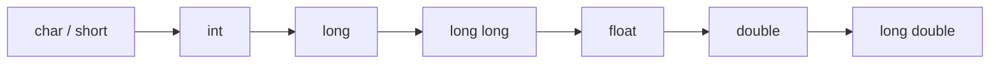

# 4장 — 연산자

[레포지토리 안내](../../README.ko.md) | [English](Concepts_Lecture.md) | [한국어](Concepts_Lecture.ko.md)

> **최종 수정일:** 2026-11-19
>
> Warming-Up C Programming, 천정아, Ch 4

> **학습 목표:**
> 1. 수식, 연산자, 피연산자의 관계를 설명하고 연산자를 피연산자 수에 따라 분류할 수 있다
> 2. 정수 나눗셈, 실수 나눗셈, 나머지 연산을 구분하여 수학 공식을 C 수식으로 옮길 수 있다
> 3. 전위와 후위 증감 연산자가 수식 안에서 내는 값의 차이를 추적할 수 있다
> 4. 관계 연산자와 논리 연산자의 결과값과 단락 평가를 설명할 수 있다
> 5. 비트 연산자와 시프트 연산자로 정수의 특정 비트를 결합하고 추출할 수 있다
> 6. 형 변환 규칙과 연산자의 우선순위, 결합 방향을 적용하여 수식의 값을 구할 수 있다

---

## 목차

- [1. 수식과 피연산자](#1-수식과-피연산자)
  - [1.1 수식](#11-수식)
  - [1.2 연산자와 피연산자](#12-연산자와-피연산자)
- [2. 산술 연산자](#2-산술-연산자)
  - [2.1 연산자 종류](#21-연산자-종류)
  - [2.2 정수 나눗셈 vs 실수 나눗셈](#22-정수-나눗셈-vs-실수-나눗셈)
  - [2.3 나머지 연산자](#23-나머지-연산자)
  - [2.4 수학 공식의 C 변환](#24-수학-공식의-c-변환)
- [3. 증감 연산자](#3-증감-연산자)
  - [3.1 전위 vs 후위](#31-전위-vs-후위)
  - [3.2 단독 사용 vs 수식 내 사용](#32-단독-사용-vs-수식-내-사용)
  - [3.3 사용 제한](#33-사용-제한)
  - [3.4 상세 추적 예제](#34-상세-추적-예제)
  - [3.5 한 수식 안의 여러 증감](#35-한-수식-안의-여러-증감)
- [4. 관계 연산자](#4-관계-연산자)
  - [4.1 비교 연산자](#41-비교-연산자)
  - [4.2 결과 타입](#42-결과-타입)
  - [4.3 흔한 실수: `=`와 `==`](#43-흔한-실수-와-)
- [5. 논리 연산자](#5-논리-연산자)
  - [5.1 AND, OR, NOT](#51-and-or-not)
  - [5.2 진리표](#52-진리표)
  - [5.3 단락 평가](#53-단락-평가)
  - [5.4 C에서의 참과 거짓](#54-c에서의-참과-거짓)
  - [5.5 논리 연산자의 우선순위와 드모르간 법칙](#55-논리-연산자의-우선순위와-드모르간-법칙)
- [6. 비트 연산자](#6-비트-연산자)
  - [6.1 비트 AND, OR, XOR, NOT](#61-비트-and-or-xor-not)
  - [6.2 시프트 연산자](#62-시프트-연산자)
  - [6.3 실전 예제: RGB 색상](#63-실전-예제-rgb-색상)
  - [6.4 비트 마스크와 부호 있는 값의 시프트](#64-비트-마스크와-부호-있는-값의-시프트)
- [7. 대입 연산자](#7-대입-연산자)
  - [7.1 단순 대입과 복합 대입](#71-단순-대입과-복합-대입)
  - [7.2 연쇄 대입](#72-연쇄-대입)
  - [7.3 대입 연산식의 값과 복합 대입의 우선순위](#73-대입-연산식의-값과-복합-대입의-우선순위)
- [8. 조건 연산자](#8-조건-연산자)
  - [8.1 삼항 연산자](#81-삼항-연산자)
  - [8.2 if/else와의 대응](#82-ifelse와의-대응)
- [9. 수식에서의 형 변환](#9-수식에서의-형-변환)
  - [9.1 묵시적 승격](#91-묵시적-승격)
  - [9.2 캐스트 연산자](#92-캐스트-연산자)
  - [9.3 수식 결과의 sizeof](#93-수식-결과의-sizeof)
  - [9.4 콤마 연산자](#94-콤마-연산자)
- [10. 연산자 우선순위와 결합 방향](#10-연산자-우선순위와-결합-방향)
  - [10.1 우선순위 표](#101-우선순위-표)
  - [10.2 결합 방향](#102-결합-방향)
  - [10.3 괄호 활용](#103-괄호-활용)
  - [10.4 복잡한 수식의 단계별 평가](#104-복잡한-수식의-단계별-평가)
- [요약](#요약)
- [점검 문제](#점검-문제)

---

<br>

## 1. 수식과 피연산자

### 1.1 수식

**수식(expression)** 은 값을 생성하는 C의 모든 요소를 말한다. 수식에는 다음이 포함된다.

| 종류 | 예 | 값 |
|:----|:---|:---|
| 상수 (리터럴) | `42` | `42` |
| 변수 | `x` (`x = 10`일 때) | `10` |
| 연산 | `3 + 4` | `7` |
| 함수 호출 | `sqrt(9.0)` | `3.0` |
| 대입 | `x = 5` | `5` |

*표 1. 수식의 종류와 값*

모든 수식에는 **타입**과 **값**이 있다. `x = 5`와 같은 대입문도 값이 `5`인 수식이다.

```c
int x;
x = 5;              // 대입 수식, 값은 5
printf("%d\n", x=5); // 5 출력: 대입도 수식이다
```

### 1.2 연산자와 피연산자

**연산자(operator)** 는 하나 이상의 **피연산자(operand)** 에 대해 연산을 수행하는 기호이다.

연산자는 피연산자의 **수**에 따라 다음과 같이 분류된다.

| 분류 | 피연산자 수 | 예 |
|:----|:----------:|:---|
| 단항(unary) | 1 | `sizeof(x)`, `-x`, `+x`, `!a`, `~a`, `++x`, `x--` |
| 이항(binary) | 2 | `a + b`, `a = b`, `a > b`, `a && b` |
| 삼항(ternary) | 3 | `a ? b : c` |

*표 2. 피연산자 수에 따른 연산자 분류*

```c
int a = 10, b = 3;

sizeof(a);    // 단항: 피연산자 1개 (a)
a + b;        // 이항: 피연산자 2개 (a, b)
a > b ? a : b; // 삼항: 피연산자 3개 (a>b, a, b)
```

---

<br>

## 2. 산술 연산자

### 2.1 연산자 종류

| 연산자 | 이름 | 예 | 결과 |
|:------:|:----|:---|:----|
| `+` | 덧셈 | `7 + 3` | `10` |
| `-` | 뺄셈 | `7 - 3` | `4` |
| `*` | 곱셈 | `7 * 3` | `21` |
| `/` | 나눗셈 | `7 / 3` | `2` (정수) |
| `%` | 나머지 | `7 % 3` | `1` |
| `+x` | 단항 양수 | `+5` | `5` |
| `-x` | 단항 음수 (부호 반전) | `-5` | `-5` |

*표 3. 산술 연산자*

> **참고:** 단항 `+`와 `-`는 이항 `+`, `-`와 다르다. 단항 연산자는 피연산자 하나에 작용하며, `+x`는 값을 그대로 내고 `-x`는 부호를 반전한다.

### 2.2 정수 나눗셈 vs 실수 나눗셈

`/`의 **양쪽 피연산자 모두** 정수이면, C는 **정수 나눗셈**을 수행한다. 소수 부분은 **절삭(truncation)** 되며, 반올림하지 않는다.

```c
int a = 7, b = 2;
printf("%d\n", a / b);       // 3  (3.5가 아님: 절삭!)
printf("%d\n", -7 / 2);      // -3 (0 방향으로 절삭)
```

실수 결과를 얻으려면 **최소 하나의 피연산자**가 실수형이어야 한다.

```c
int a = 7, b = 2;
double result;

result = a / b;              // int / int = 3 → 3.0으로 대입
result = (double)a / b;      // double / int = 3.5
result = a / (double)b;      // int / double = 3.5
result = 7.0 / 2;            // double / int = 3.5
```

> **주의:** `result = a / b;`는 정수 나눗셈이 **먼저** 수행되어 결과가 3이 된 후, 3이 3.0으로 `double`에 대입된다. 캐스트나 실수 리터럴은 대입 후가 아니라 **나눗셈 자체**에 있어야 한다.

### 2.3 나머지 연산자

`%` (나머지, modulo) 연산자는 정수 나눗셈의 **나머지**를 반환한다. **정수 피연산자에서만** 작동한다.

```c
printf("%d\n", 10 % 3);   // 1   (10 = 3*3 + 1)
printf("%d\n", 10 % 5);   // 0   (10 = 5*2 + 0)
printf("%d\n", -7 % 2);   // -1  (C99 이후: 부호는 피제수를 따름)
```

```c
// ❌ 컴파일 에러: %는 실수형에 사용 불가
// double r = 7.5 % 2.0;
```

주요 활용 사례는 다음과 같다.
- **짝수와 홀수 판별:** `n % 2 == 0`이면 짝수이다.
- **자릿수 추출:** `n % 10`은 마지막 자릿수이다.
- **순환(wraparound):** `i`가 0 이상이면 `i % N`은 항상 `[0, N-1]` 범위에 있으므로, 인덱스를 이 범위 안에서 순환시킬 수 있다.

### 2.4 수학 공식의 C 변환

수학 표기를 C 연산자로 변환할 때의 핵심 규칙은 다음과 같다.
- 곱셈은 반드시 명시한다(`2x` → `2*x`).
- 나눗셈은 `/`를 사용하되, 정수 나눗셈과 실수 나눗셈을 구분해야 한다.
- 거듭제곱은 곱셈 반복 또는 `<math.h>`의 `pow()`를 사용한다.

| 수학 공식 | C 수식 | 주의 |
|:---------|:-------|:----|
| $(a + b) / 2$ | `(a + b) / 2.0` | `2.0`으로 정수 나눗셈을 막는다 |
| $C = \frac{5}{9}(F - 32)$ | `5.0 / 9 * (F - 32)` | `5/9`는 정수 나눗셈으로 `0`이 된다 |
| $x^3 + 2x - 5$ | `x*x*x + 2*x - 5` | 곱셈을 명시하며, `^`는 거듭제곱이 아니라 비트 XOR이다 |
| $\frac{a + b}{a^2 b^2}$ | `(double)(a + b) / (a*a * b*b)` | 캐스트로 정수 절삭을 막는다 |

*표 4. 수학 공식과 C 수식의 대응*

```c
// 화씨를 섭씨로 변환
int F = 100;
double C = 5.0 / 9 * (F - 32);   // 37.777...
// ❌ 잘못된 예: 5/9 * (F - 32) → 0 * 68 = 0 (정수 나눗셈!)

// 두 정수의 평균
int a = 7, b = 4;
double avg = (a + b) / 2.0;       // 5.5
// ❌ 잘못된 예: (a + b) / 2 → 11 / 2 = 5 (정수 나눗셈!)

// 다항식: x^3 + 2x - 5
int x = 3;
int result = x*x*x + 2*x - 5;    // 27 + 6 - 5 = 28

// 정수 피연산자가 포함된 분수식
int p = 3, q = 4;
double frac = (double)(p + q) / (p*p * q*q);  // 7.0 / 144 = 0.048611...
```

---

<br>

## 3. 증감 연산자

### 3.1 전위 vs 후위

| 연산자 | 이름 | 동작 |
|:------:|:----|:----|
| `++x` | 전위 증가 | x를 **먼저** 증가시키고, 증가된 값을 사용 |
| `--x` | 전위 감소 | x를 **먼저** 감소시키고, 감소된 값을 사용 |
| `x++` | 후위 증가 | x의 현재 값을 **먼저** 사용하고, 그 후에 증가 |
| `x--` | 후위 감소 | x의 현재 값을 **먼저** 사용하고, 그 후에 감소 |

*표 5. 전위와 후위 증감 연산자*

### 3.2 단독 사용 vs 수식 내 사용

**단독**으로 사용할 때(한 줄에 해당 연산만 있을 때)는 전위와 후위의 **결과가 동일**하다.

```c
int x = 5;
x++;    // x → 6
++x;    // x → 7
// 둘 다 x를 1 증가시킬 뿐: 단독 사용 시 차이 없음
```

차이는 **수식 내에서** 나타난다.

```c
int a, x;

// 전위: 먼저 증가, 그 다음 사용
x = 5;
a = ++x;   // x가 6이 되고, a = 6
// 결과: x = 6, a = 6

// 후위: 먼저 사용, 그 다음 증가
x = 5;
a = x++;   // a = 5 (기존 값), 그 다음 x가 6이 됨
// 결과: x = 6, a = 5
```

> **핵심:** 전위는 값을 바꾼 뒤 읽고(변경 후 읽기), 후위는 값을 읽은 뒤 바꾼다(읽기 후 변경).

### 3.3 사용 제한

`++`와 `--`는 **변수(lvalue)에만** 사용할 수 있다. 상수나 일반 수식에는 사용할 수 없다.

```c
int count = 5;
count++;        // ✅ OK: 변수
++count;        // ✅ OK: 변수

// 10++;         // ❌ 에러: 상수
// (count+1)--;  // ❌ 에러: 수식이지 변수가 아님
// ++(a+b);      // ❌ 에러: 수식
```

### 3.4 상세 추적 예제

```c
#include <stdio.h>

int main(void) {
    int a = 5, b = 5;

    printf("a   = %d\n", a);       // a   = 5
    printf("a++ = %d\n", a++);     // a++ = 5  (5를 출력 후, a가 6이 됨)
    printf("a   = %d\n", a);       // a   = 6

    printf("b   = %d\n", b);       // b   = 5
    printf("++b = %d\n", ++b);     // ++b = 6  (b가 6이 된 후, 6을 출력)
    printf("b   = %d\n", b);       // b   = 6

    return 0;
}
```

각 줄을 실행한 뒤의 출력 값과 변수 값은 다음과 같다.

| 줄 | 수식 | 출력 값 | `a` (이후) | `b` (이후) |
|:---|:----|:------:|:--------:|:--------:|
| `printf("a   = %d\n", a)` | `a` | 5 | 5 | 5 |
| `printf("a++ = %d\n", a++)` | `a++` | 5 | 6 | 5 |
| `printf("a   = %d\n", a)` | `a` | 6 | 6 | 5 |
| `printf("b   = %d\n", b)` | `b` | 5 | 6 | 5 |
| `printf("++b = %d\n", ++b)` | `++b` | 6 | 6 | 6 |
| `printf("b   = %d\n", b)` | `b` | 6 | 6 | 6 |

*표 6. 증감 연산자 예제의 단계별 추적*

### 3.5 한 수식 안의 여러 증감

증감 연산자는 값을 계산하는 동시에 변수를 바꾸는 **부수 효과(side effect)** 를 가진다. C 표준은 한 수식 안에서 연산자의 피연산자를 어떤 순서로 평가할지 대부분 정하지 않으므로, 같은 변수를 한 수식에서 두 번 이상 바꾸거나, 한 번 바꾸면서 다른 곳에서 그 값을 읽으면 결과가 정해지지 않는다.

```c
int i = 1, n;

n = i++ + i++;      // i를 한 수식에서 두 번 바꾼다
```

```text
warning: multiple unsequenced modifications to 'i' [-Wunsequenced]
```

이 코드는 컴파일러가 두 `i++` 중 어느 것을 먼저 평가하든, 두 증가를 언제 반영하든 표준을 어기지 않는다. 실제로 이 경우는 정의되지 않은 동작이므로 컴파일러와 최적화 옵션에 따라 `n`과 `i`의 값이 달라질 수 있고, 어떤 값이 나오더라도 그 값에 의미가 없다. `printf("%d %d", i, i++)`처럼 함수 인수에서 같은 변수를 읽고 바꾸는 것도 같은 문제이다. 해결 방법은 증감을 별도의 문장으로 분리하여 `n = i + (i + 1); i += 2;`처럼 의도를 명시하는 것이다. 평가 순서와 순서점(sequence point)의 정확한 규칙은 13장에서 다룬다.

---

<br>

## 4. 관계 연산자

### 4.1 비교 연산자

관계 연산자는 두 값을 비교하여 정수 결과를 생성한다.

| 연산자 | 의미 | 예 | 결과 |
|:------:|:----|:---|:----:|
| `>` | 초과 | `5 > 3` | `1` |
| `<` | 미만 | `5 < 3` | `0` |
| `>=` | 이상 | `5 >= 5` | `1` |
| `<=` | 이하 | `5 <= 3` | `0` |
| `==` | 같다 | `5 == 5` | `1` |
| `!=` | 같지 않다 | `5 != 3` | `1` |

*표 7. 관계 연산자*

### 4.2 결과 타입

C에서 관계 수식의 결과는 항상 `int`형이며, **참이면 1**, **거짓이면 0**이다. C89/C90에는 별도의 `bool` 타입이 없고, C99에서 `_Bool` 타입과 `<stdbool.h>`의 `bool`이 추가된 뒤에도 관계 수식의 결과 타입은 `int`이다.

```c
int result;
result = (10 > 5);      // result = 1 (참)
result = (10 == 5);     // result = 0 (거짓)
printf("%d\n", 3 < 7);  // 1 출력
printf("%d\n", 3 > 7);  // 0 출력
```

### 4.3 흔한 실수: `=`와 `==`

| 기호 | 의미 | 사용 |
|:----:|:----|:----|
| `=` | **대입** | `x = 5;` x에 5를 저장 |
| `==` | **동등 비교** | `x == 5` x가 5와 같은지 확인 |

*표 8. 대입 연산자와 동등 비교 연산자*

```c
int x = 10;

if (x == 5) { ... }  // ✅ 비교: x가 5인지 확인
if (x = 5)  { ... }  // ⚠ 대입: x에 5를 대입하고, 5가 0이 아니므로 항상 참!
```

> **주의:** `if (x = 5)`는 컴파일 에러 없이 통과하지만, x에 5를 대입한 후 5가 0이 아니므로 항상 참으로 평가된다. C에서 가장 흔한 버그 중 하나이다. gcc와 clang은 `-Wall` 옵션을 주면 경고하지만, 모든 컴파일러가 기본 설정에서 경고하는 것은 아니다.

관계 연산자를 잘못 쓰면 컴파일 오류가 나기도 하지만, 더 위험한 것은 다른 연산자로 해석되어 컴파일이 되는 경우이다. `x =< 5`는 `=<`라는 연산자가 없으므로 컴파일 오류이지만, `x =! 5`는 `x = !5`, 즉 `x`에 0을 대입하는 식으로 해석된다. `x`가 3일 때 `if (x =! 5)`를 실행하면 조건은 거짓이고 `x`는 0으로 바뀐다. 두 문자로 된 연산자는 `<=`, `>=`, `==`, `!=`처럼 등호가 항상 뒤에 오고, 두 문자 사이에 빈칸을 넣은 `= =`도 오류이다. 반대로 `!= 0`은 생략할 수 있으므로 `if (x != 0)`과 `if (x)`는 같은 뜻이다.

---

<br>

## 5. 논리 연산자

### 5.1 AND, OR, NOT

논리 연산자는 조건을 결합하거나 부정한다.

| 연산자 | 이름 | 설명 | 예 |
|:------:|:----|:----|:---|
| `&&` | 논리 AND | **양쪽 모두** 참이면 참 | `(a > 0) && (b > 0)` |
| `\|\|` | 논리 OR | **하나 이상** 참이면 참 | `(a > 0) \|\| (b > 0)` |
| `!` | 논리 NOT | 참과 거짓을 반전 | `!(a > 0)` |

*표 9. 논리 연산자*

```c
int age = 25, income = 3000;

// AND: 양쪽 조건이 모두 참이어야 함
if (age >= 20 && income >= 2000)
    printf("자격 충족\n");

// OR: 하나 이상의 조건이 참이면 됨
if (age < 18 || age > 65)
    printf("특별 요금\n");

// NOT: 조건을 반전
if (!0)
    printf("출력됨\n");  // !0 = 1 (참)
```

### 5.2 진리표

**AND (`&&`)**

| A | B | A && B |
|:-:|:-:|:------:|
| 0 | 0 | 0 |
| 0 | 1 | 0 |
| 1 | 0 | 0 |
| 1 | 1 | 1 |

*표 10. 논리 AND의 진리표*

**OR (`||`)**

| A | B | A \|\| B |
|:-:|:-:|:--------:|
| 0 | 0 | 0 |
| 0 | 1 | 1 |
| 1 | 0 | 1 |
| 1 | 1 | 1 |

*표 11. 논리 OR의 진리표*

**NOT (`!`)**

| A | !A |
|:-:|:--:|
| 0 | 1 |
| 0이 아닌 값 | 0 |

*표 12. 논리 NOT의 진리표*

### 5.3 단락 평가

C는 논리 수식을 **왼쪽에서 오른쪽으로** 평가하며, **결과가 확정되면 즉시 평가를 중단**한다.

- **`&&`:** 왼쪽 피연산자가 **거짓(0)** 이면, 오른쪽 피연산자는 **평가하지 않는다** (결과는 이미 0).
- **`||`:** 왼쪽 피연산자가 **참(0이 아닌 값)** 이면, 오른쪽 피연산자는 **평가하지 않는다** (결과는 이미 1).

```c
int a = 0, b = 5;

// 단락 AND: a가 0(거짓)이므로, (b++)는 평가되지 않음
if (a && b++) {
    // 실행 안 됨
}
printf("b = %d\n", b);  // b = 5 (b++가 건너뛰어짐!)

// 단락 OR: a가 0(거짓)이므로, 오른쪽은 평가됨
a = 0;
b = 5;
if (a || b++) {
    // 실행됨 (b++가 5로 평가, 0이 아니므로 참)
}
printf("b = %d\n", b);  // b = 6 (b++가 실행됨)
```

> **참고:** **단락 평가를 이용한 보호.** 단락 평가는 위험한 연산을 **보호**하는 데 유용하다.
> ```c
> if (b != 0 && a / b > 2) { ... }  // b가 0이 아닐 때만 나눗셈 실행
> ```

### 5.4 C에서의 참과 거짓

C89에는 별도의 불리언(boolean) 타입이 **없다**. 대신 정수값으로 참과 거짓을 다음과 같이 판단한다.
- **0**은 **거짓(false)** 으로 취급한다.
- **0이 아닌 모든 값**(양수 또는 음수)은 **참(true)** 으로 취급한다.

```c
int x = -5;
if (x)   printf("true\n");   // "true" 출력: x가 0이 아님
if (!0)  printf("true\n");   // "true" 출력: !0 = 1

printf("%d\n", !0);    // 1
printf("%d\n", !5);    // 0  (0이 아닌 값 → 0)
printf("%d\n", !-3);   // 0  (음수도 참이므로 !(-3) = 0)
```

> **핵심:** `!`, `&&`, `||`의 결과는 입력이 어떤 정수값이든 항상 `0` 또는 `1` (`int`형)이다.

### 5.5 논리 연산자의 우선순위와 드모르간 법칙

세 논리 연산자의 우선순위는 `!`가 가장 높고, 그다음이 `&&`, 가장 낮은 것이 `||`이다. `!`는 단항 연산자이므로 관계 연산자보다도 먼저 결합하고, `&&`와 `||`는 관계 연산자보다 늦게 결합한다. 따라서 `a > 0 && b > 0`은 괄호 없이도 `(a > 0) && (b > 0)`으로 계산되지만, `!x > 3`은 `!(x > 3)`이 아니라 `(!x) > 3`으로 계산된다.

```c
int x = 1, a = 1, b = 0, c = 0;

printf("%d %d\n", !x > 3, !(x > 3));
printf("%d %d\n", a || b && c, (a || b) && c);
printf("%d %d\n", !(a && b), !a || !b);
printf("%d %d\n", !!5, !!0);
```

```text
0 1
1 0
1 1
1 0
```

- 첫 줄에서 `!x > 3`은 `!1`, 즉 0을 3과 비교하므로 0이고, `!(x > 3)`은 `1 > 3`이 거짓이므로 그 부정인 1이다. Clang은 이 식에 `logical not is only applied to the left hand side of this comparison` 경고를 낸다.
- 둘째 줄에서 `a || b && c`는 `&&`가 먼저 결합하여 `a || (b && c)` = `1 || 0` = 1이고, `(a || b) && c`는 `1 && 0` = 0이다. 두 식이 다르므로, `&&`와 `||`를 섞을 때는 괄호로 의도를 밝힌다.
- 셋째 줄은 **드모르간 법칙**의 한 예이다. `!(a && b)`와 `!a || !b`는 모든 a, b에 대해 같은 값을 가지며, 마찬가지로 `!(a || b)`와 `!a && !b`도 같다. 조건 전체를 부정할 때 각 조건을 부정하고 `&&`와 `||`를 맞바꾸면 된다. 예를 들어 "점수가 0 이상 100 이하가 아니다"인 `!(score >= 0 && score <= 100)`은 `score < 0 || score > 100`으로 쓸 수 있다.
- 넷째 줄의 `!!`는 0이 아닌 값을 1로, 0을 0으로 바꾸어 임의의 정수를 참과 거짓의 값 1과 0으로 정규화한다.

---

<br>

## 6. 비트 연산자

비트 연산자는 정수 값의 **개별 비트**에 대해 연산을 수행한다.

### 6.1 비트 AND, OR, XOR, NOT

| 연산자 | 이름 | 설명 |
|:------:|:----|:----|
| `&` | 비트 AND | **양쪽 비트 모두** 1일 때만 1 |
| `\|` | 비트 OR | **하나 이상**의 비트가 1이면 1 |
| `^` | 비트 XOR | 비트가 **서로 다르면** 1 |
| `~` | 비트 NOT | 모든 비트 반전 (1의 보수) |

*표 13. 비트 연산자*

각 비트에 대한 연산 결과는 다음과 같다.

| a | b | a & b | a \| b | a ^ b | ~a |
|:-:|:-:|:-----:|:------:|:-----:|:--:|
| 0 | 0 | 0 | 0 | 0 | 1 |
| 0 | 1 | 0 | 1 | 1 | 1 |
| 1 | 0 | 0 | 1 | 1 | 0 |
| 1 | 1 | 1 | 1 | 0 | 0 |

*표 14. 비트 단위 진리표*

> **[논리설계]** 표 14의 진리표는 부울 대수의 논리곱(AND), 논리합(OR), 배타적 논리합(XOR), 부정(NOT)과 같으며, 하드웨어에서는 각각 AND, OR, XOR, NOT 게이트로 구현된다. 비트 연산자는 정수의 각 비트 자리에 이 게이트를 하나씩 적용한 것과 같고, 부울 대수와 논리 게이트는 논리설계에서 다룬다.

```c
unsigned char a = 0xB5;  // 1011 0101
unsigned char b = 0x6D;  // 0110 1101

printf("a & b = %02X\n", a & b);   // 0010 0101 = 0x25
printf("a | b = %02X\n", a | b);   // 1111 1101 = 0xFD
printf("a ^ b = %02X\n", a ^ b);   // 1101 1000 = 0xD8
printf("~a    = %02X\n", (unsigned char)~a);  // 0100 1010 = 0x4A
```

> **주의:** 비트 연산자(`&`, `|`)와 논리 연산자(`&&`, `||`)를 혼동하지 않아야 한다. 비트 연산자는 정수의 각 비트에 개별적으로 작용하고, 논리 연산자는 전체 값을 참과 거짓으로 판단한다.

### 6.2 시프트 연산자

| 연산자 | 이름 | 설명 |
|:------:|:----|:----|
| `<<` | 왼쪽 시프트 | 비트를 왼쪽으로 n자리 이동하고, 오른쪽은 0으로 채움 |
| `>>` | 오른쪽 시프트 | 비트를 오른쪽으로 n자리 이동하며, unsigned 값과 0 이상의 signed 값은 왼쪽을 0으로 채우고, 음수인 signed 값은 구현에 따라 다름 (대부분 부호 비트로 채움) |

*표 15. 시프트 연산자*

```c
unsigned char x = 0x0D;    // 0000 1101 = 13

printf("%02X\n", x << 1);  // 0001 1010 = 0x1A = 26  (x2)
printf("%02X\n", x << 4);  // 1101 0000 = 0xD0 = 208 (x16)
printf("%02X\n", x >> 1);  // 0000 0110 = 0x06 = 6   (/2)
printf("%02X\n", x >> 2);  // 0000 0011 = 0x03 = 3   (/4)
```

> **참고:** **시프트와 2의 거듭제곱.** 왼쪽 시프트 n비트는 결과가 타입의 범위를 넘지 않는 한 $2^n$을 곱하는 것과 같다. 오른쪽 시프트 n비트는 $2^n$으로 나눈 몫과 같다 (unsigned 값 기준).

### 6.3 실전 예제: RGB 색상

32비트 RGB 모델에서는 하나의 `unsigned int`에 세 가지 색상 채널(과 사용하지 않는 상위 바이트)을 저장한다.

```text
비트 위치:  31──24  23──16  15───8   7───0
           [ 0x00 ][ Blue ][ Green ][ Red  ]
```

*그림 1. 32비트 RGB 값의 비트 배치*

**R, G, B를 하나의 RGB 값으로 결합** ([연습 문제 3](Exercises.ko.md#연습-문제-3-red-green-blue-값을-16진수-rgb-값으로-변환)에서 사용):

왼쪽 시프트(`<<`)로 각 채널을 위치시키고, OR(`|`)로 결합한다.

```c
unsigned int red = 255, green = 0, blue = 130;

unsigned int rgb = (blue << 16) | (green << 8) | red;
printf("RGB = 0X%06X\n", rgb);  // RGB = 0X8200FF
```

단계별 과정:
```text
red   = 0x000000FF              (비트 0-7)
green = 0x00000000  << 8  → 0x00000000  (비트 8-15)
blue  = 0x00000082  << 16 → 0x00820000  (비트 16-23)
모두 OR:                     0x008200FF
```

**하나의 RGB 값에서 R, G, B 추출** ([연습 문제 4](Exercises.ko.md#연습-문제-4-16진수-rgb-값을-red-green-blue-값으로-변환)에서 사용):

오른쪽 시프트(`>>`)와 AND 마스크(`& 0xFF`)로 각 채널을 분리한다.

```c
unsigned int rgb = 0xA73B03;

unsigned int red   = rgb & 0xFF;           // 비트 0-7
unsigned int green = (rgb >> 8) & 0xFF;    // 비트 8-15
unsigned int blue  = (rgb >> 16) & 0xFF;   // 비트 16-23

printf("Red   = 0X%02X (%d)\n", red, red);     // Red   = 0X03 (3)
printf("Green = 0X%02X (%d)\n", green, green);  // Green = 0X3B (59)
printf("Blue  = 0X%02X (%d)\n", blue, blue);    // Blue  = 0XA7 (167)
```

단계별 과정:
```text
rgb         = 0x00A73B03

red   = rgb & 0xFF           = 0x03  (하위 8비트 마스크)
green = (rgb >> 8) & 0xFF    = 0x3B  (8비트 오른쪽 시프트 후 마스크)
blue  = (rgb >> 16) & 0xFF   = 0xA7  (16비트 오른쪽 시프트 후 마스크)
```

> **핵심:** 마스크 `0xFF` (이진수 `1111 1111`)는 정확히 8비트를 분리한다. `& 0xFF`는 하위 8비트를 제외한 모든 비트를 0으로 만든다. 먼저 시프트로 원하는 채널을 하위 8비트로 이동시킨 뒤, 마스크로 추출한다.

### 6.4 비트 마스크와 부호 있는 값의 시프트

**비트 마스크(bit mask)** 는 특정 비트만 골라 조작하기 위해 만든 값이다. 비트 n만 1인 마스크는 `1u << n`으로 만들고, 연산자에 따라 그 비트를 켜거나, 끄거나, 뒤집거나, 검사한다. AND는 마스크의 0인 자리를 0으로 만들고, OR는 마스크의 1인 자리를 1로 만들며, XOR는 마스크의 1인 자리를 반전한다.

| 작업 | 식 | 원리 |
|:-----|:-----|:-----|
| 비트 n 켜기 | `x \| (1u << n)` | 1과 OR하면 1, 0과 OR하면 원래 값 |
| 비트 n 끄기 | `x & ~(1u << n)` | 비트 n만 0인 마스크와 AND |
| 비트 n 뒤집기 | `x ^ (1u << n)` | 1과 XOR하면 반전, 0과 XOR하면 원래 값 |
| 비트 n 검사 | `(x >> n) & 1` | 비트 n을 맨 아래로 옮긴 뒤 최하위 비트만 남김 |
| 하위 4비트 꺼내기 | `x & 0x0F` | 하위 4비트만 1인 마스크와 AND |

*표 16. 비트 마스크를 이용한 비트 조작*

```c
unsigned char x = 0x5A;     /* 0101 1010 */

printf("set bit 0:    %02X\n", x | (1u << 0));
printf("clear bit 1:  %02X\n", x & ~(1u << 1));
printf("toggle bit 7: %02X\n", x ^ (1u << 7));
printf("test bit 3:   %d\n", (x >> 3) & 1);
printf("test bit 2:   %d\n", (x >> 2) & 1);
printf("low nibble:   %X\n", x & 0x0F);
```

```text
set bit 0:    5B
clear bit 1:  58
toggle bit 7: DA
test bit 3:   1
test bit 2:   0
low nibble:   A
```

`0x5A`는 `0101 1010`이다. 비트 0을 켜면 `0101 1011` = `0x5B`, 비트 1을 끄면 `0101 1000` = `0x58`, 비트 7을 뒤집으면 `1101 1010` = `0xDA`이다. 비트 3은 1이고 비트 2는 0이며, 하위 4비트는 `1010` = `0xA`이다. 비트 번호는 최하위 비트를 0으로 세며, 마스크에 `1u`처럼 부호 없는 상수를 쓰면 비트 31을 다룰 때 부호 비트로 인한 문제를 피할 수 있다.

부호 있는 음수의 오른쪽 시프트는 C 표준에서 구현이 정하는 동작이다. 대부분의 컴파일러는 빈 상위 비트를 부호 비트로 채우는 **산술 시프트**를 하므로, 이 환경에서 `-15 >> 2`는 -4이다. 이는 -15 / 4 = -3.75를 음의 무한대 쪽으로 내린 값이며, 0 쪽으로 버리는 정수 나눗셈 `-15 / 4`의 결과 -3과 다르다. 따라서 음수에서는 오른쪽 시프트를 2의 거듭제곱 나눗셈 대신 쓸 수 없다. 또 시프트하는 비트 수가 음수이거나 피연산자의 비트 수 이상이면(32비트 `int`에서 `x << 32`) 정의되지 않은 동작이다.

---

<br>

## 7. 대입 연산자

### 7.1 단순 대입과 복합 대입

**단순 대입** 연산자 `=`는 변수에 값을 저장한다. **복합 대입** 연산자는 산술 또는 비트 연산과 대입을 결합한다.

| 연산자 | 동등한 표현 | 예 |
|:------:|:----------|:---|
| `=` | 없음 | `x = 10` |
| `+=` | `x = x + y` | `x += 3` → `x = x + 3` |
| `-=` | `x = x - y` | `x -= 2` → `x = x - 2` |
| `*=` | `x = x * y` | `x *= 4` → `x = x * 4` |
| `/=` | `x = x / y` | `x /= 2` → `x = x / 2` |
| `%=` | `x = x % y` | `x %= 3` → `x = x % 3` |
| `&=` | `x = x & y` | `x &= 0xFF` |
| `\|=` | `x = x \| y` | `x \|= 0x80` |
| `^=` | `x = x ^ y` | `x ^= mask` |
| `<<=` | `x = x << n` | `x <<= 4` |
| `>>=` | `x = x >> n` | `x >>= 8` |

*표 17. 단순 대입 연산자와 복합 대입 연산자*

```c
int score = 80;
score += 10;   // score = 80 + 10 = 90
score -= 5;    // score = 90 - 5 = 85
score *= 2;    // score = 85 * 2 = 170
score /= 10;   // score = 170 / 10 = 17
score %= 3;    // score = 17 % 3 = 2
```

### 7.2 연쇄 대입

대입 연산자는 **오른쪽에서 왼쪽으로** 결합하므로, 연쇄 대입은 오른쪽부터 평가된다.

```c
int a, b, c;
a = b = c = 0;
// 평가 순서: a = (b = (c = 0))
// c = 0 → b = 0 → a = 0
```

```c
int x, y;
x = y = 10 + 5;
// y = 15, 그 다음 x = 15
```

### 7.3 대입 연산식의 값과 복합 대입의 우선순위

대입도 하나의 수식이므로 값을 가진다. **대입 연산식의 값은 왼쪽 변수에 저장된 값**이다. 7.2절의 연쇄 대입이 가능한 것도 `c = 0`의 값 0이 다시 `b`에 대입되기 때문이다.

```c
int a, b;

printf("%d\n", a = 7);
b = (a = 2) * 3;
printf("%d %d\n", a, b);
```

```text
7
2 6
```

`printf`의 인수 `a = 7`은 `a`에 7을 저장하고 그 값 7을 인수로 넘긴다. 둘째 문장에서 괄호 안의 `a = 2`가 먼저 실행되어 그 값 2에 3을 곱한 6이 `b`에 저장된다. 대입 연산자는 우선순위가 매우 낮으므로 `b = a = 2 * 3`이라고 쓰면 `b = (a = (2 * 3))`이 되어 `a`와 `b`가 모두 6이 된다. 괄호가 필요한 이유이다.

복합 대입 연산자도 우선순위가 대입 연산자와 같아, 콤마 연산자(9.4절)를 빼면 가장 늦게 계산된다. 따라서 `x *= y + 1`은 `x = x * y + 1`이 아니라 `x = x * (y + 1)`이다. `x`가 3, `y`가 4이면 `x *= y + 1`의 결과는 3 × 5 = 15이다. 오른쪽 수식 전체를 먼저 계산한 뒤 왼쪽 변수와 연산한다고 기억하면 된다.

---

<br>

## 8. 조건 연산자

### 8.1 삼항 연산자

**조건 연산자** `? :`는 C에서 유일한 삼항 연산자이다 (피연산자 3개).

```text
조건 ? 참일_때_값 : 거짓일_때_값
```

```c
int a = 10, b = 20;
int max = (a > b) ? a : b;    // max = 20

printf("%s\n", (a % 2 == 0) ? "짝수" : "홀수");  // "짝수"
```

### 8.2 if/else와의 대응

조건 연산자는 간단한 `if/else`의 축약형이다.

```c
// if/else 사용
int abs_val;
if (x >= 0)
    abs_val = x;
else
    abs_val = -x;

// 삼항 연산자: 동일한 동작
int abs_val = (x >= 0) ? x : -x;
```

> **참고:** **삼항 연산자와 if/else의 선택.** 삼항 연산자는 간결한 수식에 적합하다. 여러 문장이 필요한 복잡한 로직에는 `if/else`를 사용하는 것이 가독성이 좋다.

---

<br>

## 9. 수식에서의 형 변환

### 9.1 묵시적 승격

수식에서 피연산자의 타입이 다를 때, C는 작은 타입을 큰 타입으로 자동 **승격(promotion)** 한다.

**정수 승격(integer promotion):** `char`와 `short`는 산술 수식에서 `int`로 승격된다. `short`와 `int`의 크기가 같은 환경의 `unsigned short`처럼 `int`가 원래 타입의 모든 값을 나타낼 수 없으면 `unsigned int`로 승격된다.

```c
char a = 10, b = 20;
// 수식 a + b에서:
// a가 int로 승격, b가 int로 승격
// 결과 타입: int
printf("%zu\n", sizeof(a + b));  // 4 (int), 1 (char)이 아님
```

**일반 산술 변환** (이항 연산자용):



*그림 2. 일반 산술 변환의 타입 순위*

작은 타입이 큰 타입에 맞춰 변환된다. 이 순서는 `unsigned` 정수형에 관한 규칙을 생략하여 단순화한 것이다.

```c
int i = 5;
double d = 2.5;
double result = i + d;   // i가 double로 승격 → 5.0 + 2.5 = 7.5
```

### 9.2 캐스트 연산자

**캐스트 연산자** `(type)`은 값을 지정된 타입으로 명시적 변환한다. 캐스트는 높은 우선순위를 가진 **단항 연산자**이다.

```c
int a = 7, b = 2;

// 캐스트 없이: 정수 나눗셈
double r1 = a / b;           // 3.0

// 캐스트 사용: 실수 나눗셈
double r2 = (double)a / b;   // 3.5
```

캐스트는 **바로 뒤따르는 피연산자에만** 적용된다는 점에 주의해야 한다.

```c
int a = 3, b = 4;

(double)(a + b)              // 합(7)을 double로 캐스트 → 7.0
(double)a + b                // a만 캐스트 → 3.0 + 4 = 7.0
(double)(a / b)              // ⚠ 정수 나눗셈 먼저 (0), 그 후 캐스트 → 0.0
```

### 9.3 수식 결과의 sizeof

`sizeof`를 수식에 적용하면, 피연산자 타입이 아닌 **결과 타입**의 크기를 반환한다.

```c
char c = 'A';
short s = 100;

printf("%zu\n", sizeof(c));        // 1 (char)
printf("%zu\n", sizeof(c + c));    // 4 (char + char → int, 정수 승격)
printf("%zu\n", sizeof(s + s));    // 4 (short + short → int)
printf("%zu\n", sizeof(c + 1.0));  // 8 (char + double → double)
```

> **핵심:** `char` 두 개를 더하더라도 정수 승격 때문에 결과는 `int`가 된다.

### 9.4 콤마 연산자

**콤마 연산자(comma operator)** `,`는 두 수식을 왼쪽부터 차례로 평가하고, 오른쪽 수식의 값을 전체 수식의 값으로 한다. 왼쪽 수식의 값은 버려지므로, 왼쪽에는 대입이나 증감처럼 부수 효과가 있는 수식을 둔다. 콤마 연산자는 모든 연산자 가운데 우선순위가 가장 낮다.

```c
int a, b, c;

a = (b = 3, b + 4);     // b에 3을 대입한 뒤 b + 4의 값 7을 a에 대입
c = 5, 6;               // (c = 5), 6 으로 해석된다
printf("%d %d %d\n", a, b, c);
```

```text
7 3 5
```

첫 문장은 괄호 안에서 `b = 3`을 먼저 실행하고 `b + 4`의 값 7을 괄호 전체의 값으로 하여 `a`에 대입한다. 둘째 문장은 콤마 연산자의 우선순위가 대입보다 낮으므로 `(c = 5), 6`이 되어 `c`는 5이고, 오른쪽의 6은 버려진다. Clang은 이 6에 `expression result unused` 경고를 낸다. 콤마 연산자는 5장의 `for (i = 0, j = 10; ...)`처럼 한 자리에 여러 수식을 써야 할 때 주로 쓴다. 함수 호출 `f(a, b)`나 선언 `int a, b;`의 콤마는 인수와 선언을 구분하는 구분자이며 콤마 연산자가 아니다.

---

<br>

## 10. 연산자 우선순위와 결합 방향

### 10.1 우선순위 표

하나의 수식에 여러 연산자가 있으면, **우선순위**가 어떤 연산을 먼저 수행할지 결정한다. 우선순위가 높을수록 먼저 결합한다.

| 우선순위 | 연산자 | 설명 |
|:-------:|:------|:----|
| 1 (최고) | `x++` `x--` `()` `[]` `.` `->` | 후위 증감, 함수 호출, 배열 첨자, 멤버 접근 |
| 2 | `++x` `--x` `+x` `-x` `!` `~` `(type)` `*` `&` `sizeof` | 단항 연산자 |
| 3 | `*` `/` `%` | 곱셈, 나눗셈, 나머지 |
| 4 | `+` `-` | 덧셈, 뺄셈 |
| 5 | `<<` `>>` | 비트 시프트 |
| 6 | `<` `<=` `>` `>=` | 관계 (부등식) |
| 7 | `==` `!=` | 관계 (등식) |
| 8 | `&` | 비트 AND |
| 9 | `^` | 비트 XOR |
| 10 | `\|` | 비트 OR |
| 11 | `&&` | 논리 AND |
| 12 | `\|\|` | 논리 OR |
| 13 | `?:` | 조건 (삼항) |
| 14 | `=` `+=` `-=` `*=` `/=` `%=` 등 | 대입 |
| 15 (최저) | `,` | 쉼표 |

*표 18. 연산자 우선순위*

```c
int x = 2 + 3 * 4;      // 3*4 먼저 → 2 + 12 = 14 (20이 아님)
int y = (2 + 3) * 4;    // 2+3 먼저 → 5 * 4 = 20
int z = 5 > 3 && 2 < 4; // (5>3) && (2<4) → 1 && 1 = 1
```

### 10.2 결합 방향

연산자의 우선순위가 **같을 때**, **결합 방향(associativity)** 이 평가 순서를 결정한다.

| 결합 방향 | 연산자 | 예 |
|:---------|:------|:---|
| 왼쪽 → 오른쪽 | 후위 연산자와 대부분의 이항 연산자: `+`, `-`, `*`, `/`, `%`, `<`, `>`, `==`, `&&`, `,` 등 | `a - b - c` = `(a - b) - c` |
| 오른쪽 → 왼쪽 | 우선순위 2의 단항 연산자, 대입, 삼항 | `a = b = c` = `a = (b = c)` |

*표 19. 연산자의 결합 방향*

```c
int result = 10 - 3 - 2;
// 왼쪽→오른쪽: (10 - 3) - 2 = 5 (10 - (3-2) = 9가 아님)

int a, b, c;
a = b = c = 0;
// 오른쪽→왼쪽: a = (b = (c = 0))
```

### 10.3 괄호 활용

우선순위 표를 전부 외우기보다, **괄호**를 사용하여 의도를 명확하게 표현하는 것이 좋다.

```c
// 모호함: (a & b) == 0 인가, a & (b == 0) 인가?
if (a & b == 0) { ... }   // ⚠ 실제로는: a & (b == 0), ==가 &보다 우선순위가 높기 때문

// 명확함: 비트 연산자에는 항상 괄호를 사용
if ((a & b) == 0) { ... } // ✅ 올바르고 읽기 쉬움
```

> **주의:** 비트 연산자(`&`, `|`, `^`)는 관계 연산자(`==`, `!=`)보다 **우선순위가 낮다**. 이것은 흔한 버그의 원인이다. 비교문에서 비트 연산자를 사용할 때는 반드시 괄호로 감싸야 한다.

### 10.4 복잡한 수식의 단계별 평가

우선순위와 결합 방향을 적용하면 괄호가 없는 수식도 하나의 계산 순서로 정해진다. `int x = 3, y = 4;`일 때 다음 대입문을 계산한다.

```c
z = x + y * 2 > 10 && !(x == y) ? x << 1 : y % 3;
```

| 단계 | 적용하는 연산 | 결과 |
|:-----|:-----|:-----|
| 1 | 괄호 `(x == y)` | `3 == 4` → 0 |
| 2 | 단항 `!` | `!0` → 1 |
| 3 | 곱셈 `y * 2` | 8 |
| 4 | 덧셈 `x + 8` | 11 |
| 5 | 관계 `11 > 10` | 1 |
| 6 | 논리 AND `1 && 1` | 1 |
| 7 | 조건 연산자 `1 ? x << 1 : y % 3` | 참이므로 `x << 1`만 계산하여 6 |
| 8 | 대입 `z = 6` | `z`는 6 |

*표 20. 복잡한 수식의 단계별 평가*

실제로 실행하면 `z = 6`이 출력된다. 7단계에서 조건 연산자는 조건이 참이므로 `y % 3`을 계산하지 않는다. 조건 연산자도 `&&`, `||`처럼 필요한 피연산자만 평가한다. 표의 순서는 연산자가 결합하는 순서이며, 1단계와 3단계처럼 서로 의존하지 않는 계산은 컴파일러가 어느 쪽을 먼저 해도 결과가 같다. 이런 수식은 우선순위를 시험하는 예제로는 유용하지만, 실제 코드에서는 `cond = (x + y * 2 > 10) && (x != y);`처럼 중간 결과에 이름을 붙이고 괄호를 넣어 나누어 쓰는 편이 읽기 쉽다.

---

<br>

## 요약

| 개념 | 핵심 요약 |
|:-----|:-----|
| 수식 | 상수, 변수, 연산, 함수 호출, 대입처럼 값을 가지는 모든 요소이며, 모든 수식에는 타입과 값이 있다. |
| 단항, 이항, 삼항 연산자 | 피연산자가 각각 1개, 2개, 3개인 연산자이며, `sizeof`, `+`, `?:`가 그 예이다. |
| 산술 연산자 | 이항 연산자 `+`, `-`, `*`, `/`, `%`와 단항 연산자 `+x`, `-x`가 있다. |
| 정수 나눗셈 | `int / int`는 소수 부분을 절삭하므로, 실수 결과가 필요하면 피연산자 중 하나 이상을 실수형으로 만든다. |
| 나머지 `%` | 정수 나눗셈의 나머지를 구하며 정수 피연산자에만 쓸 수 있다. |
| 공식 변환 | `2.0` 같은 실수 리터럴이나 캐스트로 정수 나눗셈을 막고, 곱셈은 `*`로 명시한다. |
| 전위 `++x` | 먼저 증가시킨 뒤 증가된 값을 수식에 사용한다. |
| 후위 `x++` | 현재 값을 수식에 먼저 사용한 뒤 증가시킨다. |
| 증감 연산의 제한 | 증감 연산자는 변수에만 쓸 수 있고 상수나 수식에는 쓸 수 없다. |
| 관계 연산자 | `>`, `<`, `>=`, `<=`, `==`, `!=`의 결과는 `int`형 1 또는 0이다. |
| `=`와 `==` | `=`는 대입, `==`는 비교이며, 둘을 혼동하는 것은 흔한 버그이다. |
| 논리 연산자 | `&&`(AND), `\|\|`(OR), `!`(NOT)로 조건을 결합하거나 부정한다. |
| 단락 평가 | `&&`는 왼쪽이 거짓이면, `\|\|`는 왼쪽이 참이면 오른쪽 피연산자를 평가하지 않는다. |
| 참과 거짓 | 0은 거짓이고 0이 아닌 모든 값은 참이다. |
| 비트 연산자 | `&`, `\|`, `^`, `~`는 정수의 각 비트에 개별적으로 작용한다. |
| 시프트 연산자 | `<<`는 n비트 이동마다 $2^n$을 곱하고, `>>`는 unsigned 값을 $2^n$으로 나눈 몫을 구한다. |
| RGB 결합 | `(blue << 16) \| (green << 8) \| red`로 세 채널을 한 값에 모은다. |
| RGB 추출 | `(rgb >> n) & 0xFF`로 원하는 채널을 하위 8비트로 옮겨 분리한다. |
| 복합 대입 | `+=`, `-=`, `*=`, `/=`, `%=`, `&=`, `\|=`, `^=`, `<<=`, `>>=`는 연산과 대입을 결합한다. |
| 연쇄 대입 | `a = b = c = 0`은 오른쪽에서 왼쪽으로 결합하여 `a = (b = (c = 0))`으로 평가된다. |
| 삼항 연산자 | `조건 ? 참값 : 거짓값`은 간단한 if/else를 하나의 수식으로 쓴 것이다. |
| 묵시적 승격 | `char`와 `short`는 산술 수식에서 `int`로 승격되며, `int`가 모든 값을 나타낼 수 없으면 `unsigned int`로 승격된다. |
| 캐스트 연산자 | `(type)수식`은 명시적으로 형을 변환하며 바로 뒤의 피연산자에만 적용된다. |
| 우선순위 | 후위 연산자, 단항, 곱셈 계열, 덧셈 계열, 시프트, 관계, 비트, 논리, 조건, 대입, 쉼표의 순서로 먼저 결합한다. |
| 결합 방향 | 대부분의 이항 연산자는 왼쪽에서 오른쪽으로, 단항, 대입, 삼항 연산자는 오른쪽에서 왼쪽으로 결합한다. |
| 괄호 | 확실하지 않으면 괄호를 쓰며, 특히 비트 연산자와 비교 연산자를 함께 쓸 때 필요하다. |
| 부수 효과와 평가 순서 | 한 수식에서 같은 변수를 두 번 이상 바꾸거나 바꾸면서 읽으면 정의되지 않은 동작이므로 증감은 별도 문장으로 쓴다. |
| 관계 연산자의 오용 | `=<`는 오류이지만 `=!`는 대입과 부정으로 해석되어 컴파일되며, `!= 0`은 생략할 수 있다. |
| 논리 연산자의 우선순위 | `!`가 가장 높고 `&&`, `||` 순이며, `!x > 3`은 `(!x) > 3`으로 계산된다. |
| 드모르간 법칙 | `!(a && b)`는 `!a || !b`와, `!(a || b)`는 `!a && !b`와 같다. |
| 비트 마스크 | `1u << n`을 OR하면 켜고, 반전하여 AND하면 끄고, XOR하면 뒤집으며, `(x >> n) & 1`로 검사한다. |
| 부호 있는 값의 시프트 | 음수의 오른쪽 시프트는 구현이 정하는 동작이고, 비트 수 이상으로 시프트하면 정의되지 않은 동작이다. |
| 대입 연산식의 값 | 대입식의 값은 저장된 값이며, `x *= y + 1`은 `x = x * (y + 1)`이다. |
| 콤마 연산자 | 왼쪽부터 평가하고 오른쪽 값을 결과로 하며, 우선순위가 가장 낮다. |

---

<br>

## 점검 문제

1. **정수 나눗셈과 캐스트:** `int a = 7, b = 2;`일 때 `a / b`, `(double)a / b`, `(double)(a / b)`, `a % b`, `-7 / 2`, `-7 % 2`의 값을 각각 쓰라.

   <details>
   <summary>정답</summary>

   차례로 3, 3.5, 3.0, 1, -3, -1이다. `a / b`는 정수 나눗셈이라 3.5의 소수 부분이 절삭된다. `(double)a / b`는 캐스트가 `a`에만 먼저 적용되어 실수 나눗셈이 되지만, `(double)(a / b)`는 정수 나눗셈의 결과 3을 나중에 변환하므로 3.0이다. C99 이후 정수 나눗셈은 0 방향으로 절삭하므로 `-7 / 2`는 -3이고, 나머지의 부호는 피제수를 따르므로 `-7 % 2`는 -1이다.

   </details>

2. **전위와 후위:** `int x = 5; int a = x++; int b = ++x;`를 차례로 실행한 뒤 `a`, `b`, `x`의 값을 쓰라.

   <details>
   <summary>정답</summary>

   `a`는 5, `b`는 7, `x`는 7이다. `x++`는 현재 값 5를 `a`에 넘긴 뒤 `x`를 6으로 만든다. `++x`는 `x`를 먼저 7로 만든 뒤 그 값을 `b`에 넘긴다.

   </details>

3. **단락 평가:** `int a = 0, b = 5;`에서 `int r = (a != 0) && (b++ > 3);`을 실행한 뒤의 `r`과 `b`를 쓰라. 이어서 `r = (a == 0) || (b++ > 3);`을 실행하면 `r`과 `b`는 어떻게 되는가?

   <details>
   <summary>정답</summary>

   첫 문장 뒤에는 `r`이 0, `b`가 5이다. `a != 0`이 거짓이므로 `&&`의 오른쪽 `b++ > 3`은 평가되지 않는다. 두 번째 문장 뒤에는 `r`이 1, `b`가 여전히 5이다. `a == 0`이 참이므로 `||`의 결과가 1로 확정되어 오른쪽이 평가되지 않는다.

   </details>

4. **비트 연산:** `unsigned int rgb = 0x12AB34;`에서 Green 채널을 꺼내는 식과 그 값을 쓰라. 또 Red가 `0x10`, Green이 `0x20`, Blue가 `0x30`일 때 그림 1의 배치로 결합한 RGB 값을 16진수로 쓰라.

   <details>
   <summary>정답</summary>

   Green은 비트 8~15에 있으므로 `(rgb >> 8) & 0xFF`로 꺼내며, 값은 `0xAB`(171)이다. 결합한 값은 `(0x30 << 16) | (0x20 << 8) | 0x10` = `0x302010`이다.

   </details>

5. **우선순위:** `int a = 5, b = 2;`일 때 `a & b == 0`과 `(a & b) == 0`의 값을 각각 구하고, 결과가 다른 이유를 설명하라.

   <details>
   <summary>정답</summary>

   `a & b == 0`은 0이고 `(a & b) == 0`은 1이다. `==`가 `&`보다 우선순위가 높으므로 첫 식은 `a & (b == 0)`, 즉 `5 & 0` = 0으로 계산된다. 두 번째 식은 `5 & 2`(이진수 `101 & 010`) = 0을 먼저 구한 뒤 0과 비교하므로 1이다.

   </details>

6. **드모르간 법칙:** `!(age >= 8 && age < 65)`를 `!` 없이 쓰라. 또 `age`가 70일 때 원래 식과 바꾼 식의 값을 구하라.

   <details>
   <summary>정답</summary>

   각 조건을 부정하고 `&&`를 `||`로 바꾸면 `age < 8 || age >= 65`이다. `age`가 70이면 원래 식은 `!(1 && 0)` = `!0` = 1이고, 바꾼 식도 `0 || 1` = 1이다.

   </details>

7. **비트 마스크:** `unsigned char f = 0x2C;`(`0010 1100`)에서 (a) 비트 0을 켠 값, (b) 비트 3을 끈 값, (c) 비트 5를 검사한 값을 16진수 또는 0과 1로 쓰라.

   <details>
   <summary>정답</summary>

   (a) `f | (1u << 0)` = `0010 1101` = `0x2D`이다. (b) `f & ~(1u << 3)`은 비트 3의 1을 지우므로 `0010 0100` = `0x24`이다. (c) `(f >> 5) & 1`은 비트 5가 1이므로 1이다.

   </details>

8. **대입과 콤마:** `int a, b; a = (b = 5, b * 2); b += a -= 3;`을 실행한 뒤 `a`와 `b`의 값을 쓰라.

   <details>
   <summary>정답</summary>

   첫 문장 뒤 `b`는 5, `a`는 10이다. 둘째 문장은 대입 연산자가 오른쪽에서 왼쪽으로 결합하므로 `b += (a -= 3)`이다. `a -= 3`으로 `a`가 7이 되고 그 값 7이 `b`에 더해져 `b`는 12가 된다. 따라서 `a`는 7, `b`는 12이다.

   </details>
