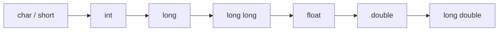

# Chapter 4 — Operators

[Repository Guide](../../README.md) | [English](Concepts_Lecture.md) | [한국어](Concepts_Lecture.ko.md)

> **Last Updated:** 2026-11-27
>
> Warming-Up C Programming, 천정아, Ch 4

> **Learning Objectives:**
> 1. Explain the relationship among expressions, operators, and operands, and classify operators by the number of operands
> 2. Distinguish integer division, floating-point division, and the remainder operation, and translate mathematical formulas into C expressions
> 3. Trace the different values that prefix and postfix increment and decrement operators produce inside an expression
> 4. Explain the result values of relational and logical operators and short-circuit evaluation
> 5. Combine and extract specific bits of an integer with bitwise and shift operators
> 6. Compute the value of an expression by applying the type conversion rules and operator precedence and associativity

---

## Table of Contents

- [1. Expressions and Operands](#1-expressions-and-operands)
  - [1.1 Expressions](#11-expressions)
  - [1.2 Operators and Operands](#12-operators-and-operands)
- [2. Arithmetic Operators](#2-arithmetic-operators)
  - [2.1 Operators](#21-operators)
  - [2.2 Integer Division vs Float Division](#22-integer-division-vs-float-division)
  - [2.3 Modulo Operator](#23-modulo-operator)
  - [2.4 Math Formula Conversion to C](#24-math-formula-conversion-to-c)
- [3. Increment and Decrement Operators](#3-increment-and-decrement-operators)
  - [3.1 Prefix vs Postfix](#31-prefix-vs-postfix)
  - [3.2 Standalone vs In Expressions](#32-standalone-vs-in-expressions)
  - [3.3 Restrictions](#33-restrictions)
  - [3.4 Detailed Trace Example](#34-detailed-trace-example)
  - [3.5 Several Increments in One Expression](#35-several-increments-in-one-expression)
- [4. Relational Operators](#4-relational-operators)
  - [4.1 Comparison Operators](#41-comparison-operators)
  - [4.2 Result Type](#42-result-type)
  - [4.3 Common Mistake: `=` vs `==`](#43-common-mistake--vs-)
- [5. Logical Operators](#5-logical-operators)
  - [5.1 AND, OR, NOT](#51-and-or-not)
  - [5.2 Truth Tables](#52-truth-tables)
  - [5.3 Short-Circuit Evaluation](#53-short-circuit-evaluation)
  - [5.4 Truthiness in C](#54-truthiness-in-c)
  - [5.5 Precedence of Logical Operators and De Morgan's Laws](#55-precedence-of-logical-operators-and-de-morgans-laws)
- [6. Bitwise Operators](#6-bitwise-operators)
  - [6.1 Bitwise AND, OR, XOR, NOT](#61-bitwise-and-or-xor-not)
  - [6.2 Shift Operators](#62-shift-operators)
  - [6.3 Practical Example: RGB Color](#63-practical-example-rgb-color)
  - [6.4 Bit Masks and Shifts of Signed Values](#64-bit-masks-and-shifts-of-signed-values)
- [7. Assignment Operators](#7-assignment-operators)
  - [7.1 Simple and Compound Assignment](#71-simple-and-compound-assignment)
  - [7.2 Chained Assignment](#72-chained-assignment)
  - [7.3 Value of an Assignment Expression and Precedence of Compound Assignment](#73-value-of-an-assignment-expression-and-precedence-of-compound-assignment)
- [8. Conditional Operator](#8-conditional-operator)
  - [8.1 Ternary Operator](#81-ternary-operator)
  - [8.2 Equivalent if/else](#82-equivalent-ifelse)
- [9. Type Conversion in Expressions](#9-type-conversion-in-expressions)
  - [9.1 Implicit Promotion](#91-implicit-promotion)
  - [9.2 Cast Operator](#92-cast-operator)
  - [9.3 sizeof of Expression Result](#93-sizeof-of-expression-result)
  - [9.4 The Comma Operator](#94-the-comma-operator)
- [10. Operator Precedence and Associativity](#10-operator-precedence-and-associativity)
  - [10.1 Precedence Table](#101-precedence-table)
  - [10.2 Associativity](#102-associativity)
  - [10.3 Use Parentheses When in Doubt](#103-use-parentheses-when-in-doubt)
  - [10.4 Step-by-Step Evaluation of a Complex Expression](#104-step-by-step-evaluation-of-a-complex-expression)
- [Summary](#summary)
- [Self-Check Questions](#self-check-questions)

---

<br>

## 1. Expressions and Operands

### 1.1 Expressions

An **expression** is any element in C that produces a value. Expressions include the following.

| Kind | Example | Value |
|:-----|:--------|:------|
| Constant (literal) | `42` | `42` |
| Variable | `x` (where `x = 10`) | `10` |
| Operation | `3 + 4` | `7` |
| Function call | `sqrt(9.0)` | `3.0` |
| Assignment | `x = 5` | `5` |

*Table 1. Kinds of expressions and their values*

Every expression has a **type** and a **value**. Even an assignment like `x = 5` is an expression whose value is `5`.

```c
int x;
x = 5;              // assignment expression, value is 5
printf("%d\n", x=5); // prints 5: assignment is an expression
```

### 1.2 Operators and Operands

An **operator** is a symbol that performs an operation on one or more **operands**.

Operators are classified by the **number of operands** they take as follows.

| Category | Operands | Examples |
|:---------|:--------:|:--------|
| Unary | 1 | `sizeof(x)`, `-x`, `+x`, `!a`, `~a`, `++x`, `x--` |
| Binary | 2 | `a + b`, `a = b`, `a > b`, `a && b` |
| Ternary | 3 | `a ? b : c` |

*Table 2. Classification of operators by the number of operands*

```c
int a = 10, b = 3;

sizeof(a);    // unary: one operand (a)
a + b;        // binary: two operands (a, b)
a > b ? a : b; // ternary: three operands (a>b, a, b)
```

---

<br>

## 2. Arithmetic Operators

### 2.1 Operators

| Operator | Name | Example | Result |
|:--------:|:-----|:--------|:-------|
| `+` | Addition | `7 + 3` | `10` |
| `-` | Subtraction | `7 - 3` | `4` |
| `*` | Multiplication | `7 * 3` | `21` |
| `/` | Division | `7 / 3` | `2` (integer) |
| `%` | Modulo (remainder) | `7 % 3` | `1` |
| `+x` | Unary plus | `+5` | `5` |
| `-x` | Unary minus (negation) | `-5` | `-5` |

*Table 3. Arithmetic operators*

> **Note:** Unary `+` and `-` are different from binary `+` and `-`. A unary operator works on a single operand: `+x` yields the value itself, and `-x` negates the value.

### 2.2 Integer Division vs Float Division

When **both operands** of `/` are integers, C performs **integer division**. The fractional part is **truncated** (not rounded).

```c
int a = 7, b = 2;
printf("%d\n", a / b);       // 3  (not 3.5: truncated!)
printf("%d\n", -7 / 2);      // -3 (truncates toward zero)
```

To get a floating-point result, **at least one operand** must be a floating-point type.

```c
int a = 7, b = 2;
double result;

result = a / b;              // int / int = 3 → assigned as 3.0
result = (double)a / b;      // double / int = 3.5
result = a / (double)b;      // int / double = 3.5
result = 7.0 / 2;            // double / int = 3.5
```

> **Caution:** `result = a / b;` performs integer division **first** (result: 3), then converts 3 to 3.0 for assignment. The cast or literal must appear **in the division itself**, not after.

### 2.3 Modulo Operator

The `%` (modulo) operator returns the **remainder** of integer division. It works **only with integer operands**.

```c
printf("%d\n", 10 % 3);   // 1   (10 = 3*3 + 1)
printf("%d\n", 10 % 5);   // 0   (10 = 5*2 + 0)
printf("%d\n", -7 % 2);   // -1  (sign follows dividend in C99+)
```

```c
// [X] Compile error: % does not work with floats
// double r = 7.5 % 2.0;
```

Common use cases are as follows.
- **Even/odd check:** `n % 2 == 0` means the number is even.
- **Extracting digits:** `n % 10` gives the last digit.
- **Cyclic wraparound:** If `i` is 0 or greater, `i % N` always lies in the range `[0, N-1]`, so an index can cycle within this range.

### 2.4 Math Formula Conversion to C

Mathematical notation must be rewritten using C operators. The key rules are as follows.
- Multiplication must be explicit (`2x` becomes `2*x`).
- Division uses `/`, and integer division must be distinguished from floating-point division.
- Exponents use repeated multiplication or `pow()` from `<math.h>`.

| Math Formula | C Expression | Notes |
|:-------------|:-------------|:------|
| $(a + b) / 2$ | `(a + b) / 2.0` | `2.0` prevents integer division |
| $C = \frac{5}{9}(F - 32)$ | `5.0 / 9 * (F - 32)` | `5/9` would be `0` by integer division |
| $x^3 + 2x - 5$ | `x*x*x + 2*x - 5` | Multiplication is explicit, and `^` is bitwise XOR, not a power operator |
| $\frac{a + b}{a^2 b^2}$ | `(double)(a + b) / (a*a * b*b)` | The cast prevents integer truncation |

*Table 4. Correspondence between mathematical formulas and C expressions*

```c
// Fahrenheit to Celsius
int F = 100;
double C = 5.0 / 9 * (F - 32);   // 37.777...
// [X] Wrong: 5/9 * (F - 32) → 0 * 68 = 0 (integer division!)

// Average of two integers
int a = 7, b = 4;
double avg = (a + b) / 2.0;       // 5.5
// [X] Wrong: (a + b) / 2 → 11 / 2 = 5 (integer division!)

// Polynomial: x^3 + 2x - 5
int x = 3;
int result = x*x*x + 2*x - 5;    // 27 + 6 - 5 = 28

// Fraction with integer operands
int p = 3, q = 4;
double frac = (double)(p + q) / (p*p * q*q);  // 7.0 / 144 = 0.048611...
```

---

<br>

## 3. Increment and Decrement Operators

### 3.1 Prefix vs Postfix

| Operator | Name | Action |
|:--------:|:-----|:-------|
| `++x` | Prefix increment | Increment x **first**, then use the new value |
| `--x` | Prefix decrement | Decrement x **first**, then use the new value |
| `x++` | Postfix increment | Use the current value of x **first**, then increment |
| `x--` | Postfix decrement | Use the current value of x **first**, then decrement |

*Table 5. Prefix and postfix increment and decrement operators*

### 3.2 Standalone vs In Expressions

When used **standalone** (as the only operation on a line), prefix and postfix produce the **same effect**.

```c
int x = 5;
x++;    // x becomes 6
++x;    // x becomes 7
// Both just increment x by 1: no difference in standalone use
```

The difference appears **inside expressions**.

```c
int a, x;

// Prefix: increment FIRST, then use
x = 5;
a = ++x;   // x becomes 6, then a = 6
// Result: x = 6, a = 6

// Postfix: use FIRST, then increment
x = 5;
a = x++;   // a = 5 (old value), then x becomes 6
// Result: x = 6, a = 5
```

> **Key Point:** Prefix changes the value and then reads it (change, then read), while postfix reads the value and then changes it (read, then change).

### 3.3 Restrictions

`++` and `--` can **only** be applied to variables (lvalues). They cannot be used on constants or general expressions.

```c
int count = 5;
count++;        // [O] OK: variable
++count;        // [O] OK: variable

// 10++;         // [X] Error: constant
// (count+1)--;  // [X] Error: expression, not a variable
// ++(a+b);      // [X] Error: expression
```

### 3.4 Detailed Trace Example

```c
#include <stdio.h>

int main(void) {
    int a = 5, b = 5;

    printf("a   = %d\n", a);       // a   = 5
    printf("a++ = %d\n", a++);     // a++ = 5  (prints 5, then a becomes 6)
    printf("a   = %d\n", a);       // a   = 6

    printf("b   = %d\n", b);       // b   = 5
    printf("++b = %d\n", ++b);     // ++b = 6  (b becomes 6, then prints 6)
    printf("b   = %d\n", b);       // b   = 6

    return 0;
}
```

The printed value and the variable values after each line are as follows.

| Line | Expression | Printed Value | `a` after | `b` after |
|:-----|:-----------|:------------:|:---------:|:---------:|
| `printf("a   = %d\n", a)` | `a` | 5 | 5 | 5 |
| `printf("a++ = %d\n", a++)` | `a++` | 5 | 6 | 5 |
| `printf("a   = %d\n", a)` | `a` | 6 | 6 | 5 |
| `printf("b   = %d\n", b)` | `b` | 5 | 6 | 5 |
| `printf("++b = %d\n", ++b)` | `++b` | 6 | 6 | 6 |
| `printf("b   = %d\n", b)` | `b` | 6 | 6 | 6 |

*Table 6. Step-by-step trace of the increment operator example*

### 3.5 Several Increments in One Expression

Increment and decrement operators have a **side effect**: they change a variable while computing a value. The C standard mostly leaves unspecified the order in which the operands of an operator are evaluated, so if one expression changes the same variable twice or more, or changes it once while reading its value elsewhere, the result is not determined.

```c
int i = 1, n;

n = i++ + i++;      // changes i twice in one expression
```

```text
warning: multiple unsequenced modifications to 'i' [-Wunsequenced]
```

With this code, the compiler does not violate the standard whichever of the two `i++` it evaluates first or whenever it applies the two increments. In fact this case is undefined behavior, so the values of `n` and `i` may differ with the compiler and the optimization options, and whatever values appear carry no meaning. Reading and changing the same variable in function arguments, as in `printf("%d %d", i, i++)`, has the same problem. The remedy is to separate the increments into their own statements and state the intent explicitly, as in `n = i + (i + 1); i += 2;`. The exact rules of evaluation order and sequence points are treated in Chapter 13.

---

<br>

## 4. Relational Operators

### 4.1 Comparison Operators

Relational operators compare two values and produce an integer result.

| Operator | Meaning | Example | Result |
|:--------:|:--------|:--------|:------:|
| `>` | Greater than | `5 > 3` | `1` |
| `<` | Less than | `5 < 3` | `0` |
| `>=` | Greater than or equal | `5 >= 5` | `1` |
| `<=` | Less than or equal | `5 <= 3` | `0` |
| `==` | Equal to | `5 == 5` | `1` |
| `!=` | Not equal to | `5 != 3` | `1` |

*Table 7. Relational operators*

### 4.2 Result Type

In C, relational expressions always evaluate to an `int`: **1 for true** and **0 for false**. There is no dedicated `bool` type in C89/C90, and even after C99 added the `_Bool` type and `bool` in `<stdbool.h>`, the result type of a relational expression is still `int`.

```c
int result;
result = (10 > 5);      // result = 1 (true)
result = (10 == 5);     // result = 0 (false)
printf("%d\n", 3 < 7);  // prints 1
printf("%d\n", 3 > 7);  // prints 0
```

### 4.3 Common Mistake: `=` vs `==`

| Symbol | Meaning | Usage |
|:------:|:--------|:------|
| `=` | **Assignment** | `x = 5;` stores 5 in x |
| `==` | **Equality comparison** | `x == 5` checks if x equals 5 |

*Table 8. The assignment operator and the equality operator*

```c
int x = 10;

if (x == 5) { ... }  // [O] Comparison: checks if x is 5
if (x = 5)  { ... }  // ⚠ Assignment: sets x to 5, then checks if 5 is non-zero (always true!)
```

> **Caution:** `if (x = 5)` compiles without error, but it assigns 5 to x and always evaluates to true (since 5 is non-zero). This is one of the most common bugs in C. gcc and clang warn about it with the `-Wall` option, but not every compiler warns with its default settings.

Misusing a relational operator sometimes causes a compile error, but more dangerous is the case where it is interpreted as another operator and compiles. `x =< 5` is a compile error because there is no operator `=<`, but `x =! 5` is interpreted as `x = !5`, an expression that assigns 0 to `x`. When `x` is 3, executing `if (x =! 5)` makes the condition false and changes `x` to 0. In the two-character operators `<=`, `>=`, `==`, and `!=`, the equals sign always comes second, and `= =`, with a space between the two characters, is also an error. Conversely, `!= 0` can be omitted, so `if (x != 0)` and `if (x)` mean the same thing.

---

<br>

## 5. Logical Operators

### 5.1 AND, OR, NOT

Logical operators combine or negate conditions.

| Operator | Name | Description | Example |
|:--------:|:-----|:------------|:--------|
| `&&` | Logical AND | True if **both** operands are true | `(a > 0) && (b > 0)` |
| `\|\|` | Logical OR | True if **at least one** operand is true | `(a > 0) \|\| (b > 0)` |
| `!` | Logical NOT | Inverts true and false | `!(a > 0)` |

*Table 9. Logical operators*

```c wide-ok
int age = 25, income = 3000;

// AND: both conditions must be true
if (age >= 20 && income >= 2000)
    printf("Eligible\n");

// OR: at least one condition must be true
if (age < 18 || age > 65)
    printf("Special rate\n");

// NOT: inverts the condition
if (!0)
    printf("This prints\n");  // !0 = 1 (true)
```

### 5.2 Truth Tables

**AND (`&&`)**

| A | B | A && B |
|:-:|:-:|:------:|
| 0 | 0 | 0 |
| 0 | 1 | 0 |
| 1 | 0 | 0 |
| 1 | 1 | 1 |

*Table 10. Truth table of logical AND*

**OR (`||`)**

| A | B | A \|\| B |
|:-:|:-:|:--------:|
| 0 | 0 | 0 |
| 0 | 1 | 1 |
| 1 | 0 | 1 |
| 1 | 1 | 1 |

*Table 11. Truth table of logical OR*

**NOT (`!`)**

| A | !A |
|:-:|:--:|
| 0 | 1 |
| non-zero | 0 |

*Table 12. Truth table of logical NOT*

### 5.3 Short-Circuit Evaluation

C evaluates logical expressions **left to right** and **stops as soon as the result is determined**.

- **`&&`:** If the left operand is **false (0)**, the right operand is **not evaluated** (result is already 0).
- **`||`:** If the left operand is **true (non-zero)**, the right operand is **not evaluated** (result is already 1).

```c
int a = 0, b = 5;

// Short-circuit AND: a is 0 (false), so (b++) is never evaluated
if (a && b++) {
    // not entered
}
printf("b = %d\n", b);  // b = 5 (b++ was skipped!)

// Short-circuit OR: a is 0 (false), so right side IS evaluated
a = 0;
b = 5;
if (a || b++) {
    // entered (b++ evaluates to 5, which is true)
}
printf("b = %d\n", b);  // b = 6 (b++ was executed)
```

> **Note:** **Guarding with short-circuit evaluation.** Short-circuit evaluation is useful for **guarding** potentially dangerous operations.
> ```c
> if (b != 0 && a / b > 2) { ... }  // division only happens if b != 0
> ```

### 5.4 Truthiness in C

C89 does **not** have a native boolean type. Instead, it judges truth and falsehood from integer values as follows.
- **0** is treated as **false**.
- **Any non-zero value** (positive or negative) is treated as **true**.

```c
int x = -5;
if (x)   printf("true\n");   // prints "true": x is non-zero
if (!0)  printf("true\n");   // prints "true": !0 = 1

printf("%d\n", !0);    // 1
printf("%d\n", !5);    // 0  (any non-zero becomes 0)
printf("%d\n", !-3);   // 0  (negative non-zero is also true, so !(-3) = 0)
```

> **Key Point:** The result of `!`, `&&`, and `||` is always `0` or `1` (type `int`), even though the input can be any integer value.

### 5.5 Precedence of Logical Operators and De Morgan's Laws

Among the three logical operators, `!` has the highest precedence, `&&` the next, and `||` the lowest. `!` is a unary operator, so it binds even before the relational operators, whereas `&&` and `||` bind after the relational operators. Hence `a > 0 && b > 0` is computed as `(a > 0) && (b > 0)` without parentheses, but `!x > 3` is computed as `(!x) > 3`, not `!(x > 3)`.

```c
int x = 1, a = 1, b = 0, c = 0;

printf("%d %d\n", !x > 3, !(x > 3));
printf("%d %d\n", a || b && c, (a || b) && c);
printf("%d %d\n", !(a && b), !a || !b);
printf("%d %d\n", !!5, !!0);
```

```text
0 1
1 0
1 1
1 0
```

- In the first line, `!x > 3` compares `!1`, that is 0, with 3, so it is 0, and `!(x > 3)` is 1, the negation of the false `1 > 3`. Clang issues the warning `logical not is only applied to the left hand side of this comparison` for this expression.
- In the second line, `a || b && c` binds `&&` first, giving `a || (b && c)` = `1 || 0` = 1, while `(a || b) && c` is `1 && 0` = 0. The two expressions differ, so when `&&` and `||` are mixed, the intent is stated with parentheses.
- The third line is an instance of **De Morgan's laws**. `!(a && b)` and `!a || !b` have the same value for all a and b, and likewise `!(a || b)` and `!a && !b` are equal. To negate a whole condition, negate each condition and swap `&&` and `||`. For example, "the score is not between 0 and 100 inclusive," `!(score >= 0 && score <= 100)`, can be written as `score < 0 || score > 100`.
- The `!!` in the fourth line turns a nonzero value into 1 and 0 into 0, normalizing any integer to the truth values 1 and 0.

---

<br>

## 6. Bitwise Operators

Bitwise operators work on the **individual bits** of integer values.

### 6.1 Bitwise AND, OR, XOR, NOT

| Operator | Name | Description |
|:--------:|:-----|:------------|
| `&` | Bitwise AND | 1 only if **both** bits are 1 |
| `\|` | Bitwise OR | 1 if **at least one** bit is 1 |
| `^` | Bitwise XOR | 1 if bits are **different** |
| `~` | Bitwise NOT | Flips all bits (one's complement) |

*Table 13. Bitwise operators*

The result of each operation on single bits is as follows.

| a | b | a & b | a \| b | a ^ b | ~a |
|:-:|:-:|:-----:|:------:|:-----:|:--:|
| 0 | 0 | 0 | 0 | 0 | 1 |
| 0 | 1 | 0 | 1 | 1 | 1 |
| 1 | 0 | 0 | 1 | 1 | 0 |
| 1 | 1 | 1 | 1 | 0 | 0 |

*Table 14. Bit-level truth table*

> **[Digital Logic Design]** The truth tables in Table 14 are those of Boolean conjunction (AND), disjunction (OR), exclusive OR (XOR), and negation (NOT), which hardware implements with AND, OR, XOR, and NOT gates. A bitwise operator is the same as applying one such gate to each bit position of an integer; Boolean algebra and logic gates are covered in Digital Logic Design.

```c
unsigned char a = 0xB5;  // 1011 0101
unsigned char b = 0x6D;  // 0110 1101

printf("a & b = %02X\n", a & b);   // 0010 0101 = 0x25
printf("a | b = %02X\n", a | b);   // 1111 1101 = 0xFD
printf("a ^ b = %02X\n", a ^ b);   // 1101 1000 = 0xD8
printf("~a    = %02X\n", (unsigned char)~a);  // 0100 1010 = 0x4A
```

> **Caution:** Do not confuse bitwise operators (`&`, `|`) with logical operators (`&&`, `||`). Bitwise operators work bit by bit on integers, while logical operators treat the entire value as true or false.

### 6.2 Shift Operators

| Operator | Name | Description |
|:--------:|:-----|:------------|
| `<<` | Left shift | Shifts bits left by n positions and fills the right with 0 |
| `>>` | Right shift | Shifts bits right by n positions; unsigned values and non-negative signed values are filled with 0 on the left, while the fill for negative signed values is implementation-defined (most compilers use the sign bit) |

*Table 15. Shift operators*

```c
unsigned char x = 0x0D;    // 0000 1101 = 13

printf("%02X\n", x << 1);  // 0001 1010 = 0x1A = 26  (×2)
printf("%02X\n", x << 4);  // 1101 0000 = 0xD0 = 208 (×16)
printf("%02X\n", x >> 1);  // 0000 0110 = 0x06 = 6   (÷2)
printf("%02X\n", x >> 2);  // 0000 0011 = 0x03 = 3   (÷4)
```

> **Note:** **Shifts and powers of 2.** Left shifting by n bits is equivalent to multiplying by $2^n$ as long as the result stays within the range of the type. Right shifting by n bits is equivalent to the quotient of division by $2^n$ (for unsigned values).

### 6.3 Practical Example: RGB Color

In a 32-bit RGB model, a single `unsigned int` stores three color channels (and an unused high byte).

```text
Bit position:  31──24  23──16  15───8   7───0
               [ 0x00 ][ Blue ][ Green ][ Red  ]
```

*Figure 1. Bit layout of a 32-bit RGB value*

**Combining R, G, B into a single RGB value** (used in [Exercise 3](Exercises.md#exercise-3-convert-red-green-and-blue-values-to-a-hexadecimal-rgb-value)):

Use left shift (`<<`) to position each channel, then OR (`|`) to combine them.

```c
unsigned int red = 255, green = 0, blue = 130;

unsigned int rgb = (blue << 16) | (green << 8) | red;
printf("RGB = 0X%06X\n", rgb);  // RGB = 0X8200FF
```

Step-by-step:
```text
red   = 0x000000FF              (bits 0-7)
green = 0x00000000  << 8  → 0x00000000  (bits 8-15)
blue  = 0x00000082  << 16 → 0x00820000  (bits 16-23)
OR all together:             0x008200FF
```

**Extracting R, G, B from a single RGB value** (used in [Exercise 4](Exercises.md#exercise-4-convert-a-hexadecimal-rgb-value-to-red-green-and-blue-values)):

Use right shift (`>>`) and an AND mask (`& 0xFF`) to isolate each channel.

```c
unsigned int rgb = 0xA73B03;

unsigned int red   = rgb & 0xFF;           // bits 0-7
unsigned int green = (rgb >> 8) & 0xFF;    // bits 8-15
unsigned int blue  = (rgb >> 16) & 0xFF;   // bits 16-23

printf("Red   = 0X%02X (%d)\n", red, red);     // Red   = 0X03 (3)
printf("Green = 0X%02X (%d)\n", green, green);  // Green = 0X3B (59)
printf("Blue  = 0X%02X (%d)\n", blue, blue);    // Blue  = 0XA7 (167)
```

Step-by-step:
```text
rgb         = 0x00A73B03

red   = rgb & 0xFF           = 0x03  (mask lower 8 bits)
green = (rgb >> 8) & 0xFF    = 0x3B  (shift right 8, then mask)
blue  = (rgb >> 16) & 0xFF   = 0xA7  (shift right 16, then mask)
```

> **Key Point:** The mask `0xFF` (binary `1111 1111`) isolates exactly 8 bits. `& 0xFF` zeroes out all bits except the lowest 8. Shifting first moves the desired channel into the low 8 bits, and masking then extracts it.

### 6.4 Bit Masks and Shifts of Signed Values

A **bit mask** is a value made to select particular bits for manipulation. A mask with only bit n set is made with `1u << n`, and depending on the operator, that bit is turned on, turned off, flipped, or tested. AND makes the positions where the mask is 0 into 0, OR makes the positions where the mask is 1 into 1, and XOR inverts the positions where the mask is 1.

| Task | Expression | Principle |
|:-----|:-----|:-----|
| Set bit n | `x \| (1u << n)` | OR with 1 gives 1, OR with 0 keeps the original |
| Clear bit n | `x & ~(1u << n)` | AND with a mask whose only 0 is bit n |
| Flip bit n | `x ^ (1u << n)` | XOR with 1 inverts, XOR with 0 keeps the original |
| Test bit n | `(x >> n) & 1` | Move bit n to the bottom, then keep only the least significant bit |
| Extract the low 4 bits | `x & 0x0F` | AND with a mask whose low 4 bits are 1 |

*Table 16. Bit manipulation with bit masks*

```c
unsigned char x = 0x5A;     /* 0101 1010 */

printf("set bit 0:    %02X\n", x | (1u << 0));
printf("clear bit 1:  %02X\n", x & ~(1u << 1));
printf("toggle bit 7: %02X\n", x ^ (1u << 7));
printf("test bit 3:   %d\n", (x >> 3) & 1);
printf("test bit 2:   %d\n", (x >> 2) & 1);
printf("low nibble:   %X\n", x & 0x0F);
```

```text
set bit 0:    5B
clear bit 1:  58
toggle bit 7: DA
test bit 3:   1
test bit 2:   0
low nibble:   A
```

`0x5A` is `0101 1010`. Setting bit 0 gives `0101 1011` = `0x5B`, clearing bit 1 gives `0101 1000` = `0x58`, and flipping bit 7 gives `1101 1010` = `0xDA`. Bit 3 is 1 and bit 2 is 0, and the low 4 bits are `1010` = `0xA`. Bits are numbered from 0 at the least significant bit, and using an unsigned constant such as `1u` in a mask avoids problems caused by the sign bit when handling bit 31.

The right shift of a signed negative value is implementation-defined by the C standard. Most compilers perform an **arithmetic shift**, which fills the vacated upper bits with the sign bit, so in this environment `-15 >> 2` is -4. This is -15 / 4 = -3.75 rounded down toward negative infinity, which differs from the result -3 of the integer division `-15 / 4`, which truncates toward zero. Therefore, for negative values a right shift cannot replace division by a power of 2. Also, shifting by a negative number of bits or by at least the bit width of the operand (`x << 32` for a 32-bit `int`) is undefined behavior.

---

<br>

## 7. Assignment Operators

### 7.1 Simple and Compound Assignment

The **simple assignment** operator `=` stores a value in a variable. **Compound assignment** operators combine an arithmetic or bitwise operation with assignment.

| Operator | Equivalent | Example |
|:--------:|:-----------|:--------|
| `=` | None | `x = 10` |
| `+=` | `x = x + y` | `x += 3` → `x = x + 3` |
| `-=` | `x = x - y` | `x -= 2` → `x = x - 2` |
| `*=` | `x = x * y` | `x *= 4` → `x = x * 4` |
| `/=` | `x = x / y` | `x /= 2` → `x = x / 2` |
| `%=` | `x = x % y` | `x %= 3` → `x = x % 3` |
| `&=` | `x = x & y` | `x &= 0xFF` |
| `\|=` | `x = x \| y` | `x \|= 0x80` |
| `^=` | `x = x ^ y` | `x ^= mask` |
| `<<=` | `x = x << n` | `x <<= 4` |
| `>>=` | `x = x >> n` | `x >>= 8` |

*Table 17. Simple and compound assignment operators*

```c
int score = 80;
score += 10;   // score = 80 + 10 = 90
score -= 5;    // score = 90 - 5 = 85
score *= 2;    // score = 85 * 2 = 170
score /= 10;   // score = 170 / 10 = 17
score %= 3;    // score = 17 % 3 = 2
```

### 7.2 Chained Assignment

Assignment is **right-associative**, so chained assignments evaluate right to left.

```c
int a, b, c;
a = b = c = 0;
// Evaluated as: a = (b = (c = 0))
// c = 0 → b = 0 → a = 0
```

```c
int x, y;
x = y = 10 + 5;
// y = 15, then x = 15
```

### 7.3 Value of an Assignment Expression and Precedence of Compound Assignment

An assignment is also an expression, so it has a value. **The value of an assignment expression is the value stored in the left-hand variable.** The chained assignment of Section 7.2 works because the value 0 of `c = 0` is assigned again to `b`.

```c
int a, b;

printf("%d\n", a = 7);
b = (a = 2) * 3;
printf("%d %d\n", a, b);
```

```text
7
2 6
```

The argument `a = 7` of `printf` stores 7 in `a` and passes the value 7 as the argument. In the second statement, `a = 2` inside the parentheses runs first, and its value 2 multiplied by 3 gives 6, which is stored in `b`. The assignment operator has very low precedence, so writing `b = a = 2 * 3` gives `b = (a = (2 * 3))`, making both `a` and `b` equal to 6. This is why the parentheses are needed.

Compound assignment operators also have the same precedence as the assignment operator, so apart from the comma operator (Section 9.4) they are computed last. Therefore `x *= y + 1` is not `x = x * y + 1` but `x = x * (y + 1)`. If `x` is 3 and `y` is 4, the result of `x *= y + 1` is 3 × 5 = 15. It suffices to remember that the whole right-hand expression is computed first and then combined with the left-hand variable.

---

<br>

## 8. Conditional Operator

### 8.1 Ternary Operator

The **conditional operator** `? :` is the only ternary operator in C (three operands).

```text
condition ? value_if_true : value_if_false
```

```c wide-ok
int a = 10, b = 20;
int max = (a > b) ? a : b;    // max = 20

printf("%s\n", (a % 2 == 0) ? "even" : "odd");  // "even"
```

### 8.2 Equivalent if/else

The conditional operator is a compact alternative to a simple `if/else`.

```c
// Using if/else
int abs_val;
if (x >= 0)
    abs_val = x;
else
    abs_val = -x;

// Using ternary: equivalent
int abs_val = (x >= 0) ? x : -x;
```

> **Note:** **Choosing between the ternary operator and if/else.** Use the ternary operator for simple, short expressions. For complex logic with multiple statements, prefer `if/else` for readability.

---

<br>

## 9. Type Conversion in Expressions

### 9.1 Implicit Promotion

When operands in an expression have different types, C automatically **promotes** smaller types to larger types before performing the operation.

**Integer promotion:** `char` and `short` are promoted to `int` when used in an arithmetic expression. If `int` cannot represent every value of the original type, as for `unsigned short` where `short` and `int` have the same size, the operand is promoted to `unsigned int` instead.

```c
char a = 10, b = 20;
// In the expression a + b:
// a is promoted to int, b is promoted to int
// Result type: int
printf("%zu\n", sizeof(a + b));  // 4 (int), not 1 (char)
```

**Usual arithmetic conversion** (for binary operators):



*Figure 2. Type ranking in the usual arithmetic conversions*

The smaller type is converted to match the larger type. This ordering is a simplification that omits the rules for `unsigned` integer types.

```c
int i = 5;
double d = 2.5;
double result = i + d;   // i promoted to double → 5.0 + 2.5 = 7.5
```

### 9.2 Cast Operator

The **cast operator** `(type)` explicitly converts a value to a specified type. The cast is a **unary operator** with high precedence.

```c
int a = 7, b = 2;

// Without cast: integer division
double r1 = a / b;           // 3.0

// With cast: floating-point division
double r2 = (double)a / b;   // 3.5
```

Note that the cast applies only to the **immediately following operand**.

```c
int a = 3, b = 4;

(double)(a + b)              // casts the sum (7) to double → 7.0
(double)a + b                // casts a only → 3.0 + 4 = 7.0
(double)(a / b)              // ⚠ integer division first (0), then cast → 0.0
```

### 9.3 sizeof of Expression Result

`sizeof` applied to an expression returns the size of the expression's **result type**, not the operand type.

```c
char c = 'A';
short s = 100;

printf("%zu\n", sizeof(c));        // 1 (char)
printf("%zu\n", sizeof(c + c));    // 4 (char + char → int, due to integer promotion)
printf("%zu\n", sizeof(s + s));    // 4 (short + short → int)
printf("%zu\n", sizeof(c + 1.0));  // 8 (char + double → double)
```

> **Key Point:** Even adding two `char` values produces an `int` result because of integer promotion.

### 9.4 The Comma Operator

The **comma operator** `,` evaluates two expressions in order from the left and takes the value of the right-hand expression as the value of the whole expression. The value of the left-hand expression is discarded, so an expression with a side effect, such as an assignment or an increment, is placed on the left. The comma operator has the lowest precedence of all operators.

```c
int a, b, c;

a = (b = 3, b + 4);     // assign 3 to b, then assign the value 7 of b + 4 to a
c = 5, 6;               // interpreted as (c = 5), 6
printf("%d %d %d\n", a, b, c);
```

```text
7 3 5
```

The first statement executes `b = 3` inside the parentheses first and assigns to `a` the value 7 of `b + 4`, which is the value of the whole parenthesized expression. In the second statement, the comma operator has lower precedence than assignment, so it becomes `(c = 5), 6`; `c` is 5, and the 6 on the right is discarded. Clang issues the warning `expression result unused` for this 6. The comma operator is mainly used where several expressions must be written in one place, as in `for (i = 0, j = 10; ...)` of Chapter 5. The commas in a function call `f(a, b)` and in a declaration `int a, b;` are separators between arguments and declarators, not the comma operator.

---

<br>

## 10. Operator Precedence and Associativity

### 10.1 Precedence Table

When an expression has multiple operators, **precedence** determines which operations are performed first. Higher precedence means the operator binds more tightly.

| Precedence | Operators | Description |
|:----------:|:----------|:------------|
| 1 (highest) | `x++` `x--` `()` `[]` `.` `->` | Postfix increment and decrement, function call, subscript, member access |
| 2 | `++x` `--x` `+x` `-x` `!` `~` `(type)` `*` `&` `sizeof` | Unary operators |
| 3 | `*` `/` `%` | Multiplication, division, modulo |
| 4 | `+` `-` | Addition, subtraction |
| 5 | `<<` `>>` | Bitwise shift |
| 6 | `<` `<=` `>` `>=` | Relational (inequality) |
| 7 | `==` `!=` | Relational (equality) |
| 8 | `&` | Bitwise AND |
| 9 | `^` | Bitwise XOR |
| 10 | `\|` | Bitwise OR |
| 11 | `&&` | Logical AND |
| 12 | `\|\|` | Logical OR |
| 13 | `?:` | Conditional (ternary) |
| 14 | `=` `+=` `-=` `*=` `/=` `%=` etc. | Assignment |
| 15 (lowest) | `,` | Comma |

*Table 18. Operator precedence*

```c
int x = 2 + 3 * 4;      // 3*4 first → 2 + 12 = 14 (not 20)
int y = (2 + 3) * 4;    // 2+3 first → 5 * 4 = 20
int z = 5 > 3 && 2 < 4; // (5>3) && (2<4) → 1 && 1 = 1
```

### 10.2 Associativity

When operators have the **same precedence**, **associativity** determines the evaluation order.

| Associativity | Operators | Example |
|:--------------|:----------|:--------|
| Left-to-right | Postfix operators and most binary operators: `+`, `-`, `*`, `/`, `%`, `<`, `>`, `==`, `&&`, `,`, etc. | `a - b - c` = `(a - b) - c` |
| Right-to-left | Unary operators of precedence 2, assignment, ternary | `a = b = c` = `a = (b = c)` |

*Table 19. Associativity of operators*

```c
int result = 10 - 3 - 2;
// Left-to-right: (10 - 3) - 2 = 5 (not 10 - (3-2) = 9)

int a, b, c;
a = b = c = 0;
// Right-to-left: a = (b = (c = 0))
```

### 10.3 Use Parentheses When in Doubt

Rather than memorizing the entire precedence table, use **parentheses** to make your intent explicit.

```c
// Ambiguous: is it (a & b) == 0 or a & (b == 0)?
if (a & b == 0) { ... }   // ⚠ Actually: a & (b == 0), because == has higher precedence than &

// Clear: always use parentheses with bitwise operators
if ((a & b) == 0) { ... } // [O] Correct and readable
```

> **Caution:** Bitwise operators (`&`, `|`, `^`) have **lower precedence** than relational operators (`==`, `!=`). This is a common source of bugs. Always parenthesize bitwise expressions in comparisons.

### 10.4 Step-by-Step Evaluation of a Complex Expression

Applying precedence and associativity fixes a single order of computation even for an expression without parentheses. With `int x = 3, y = 4;`, the following assignment statement is computed.

```c
z = x + y * 2 > 10 && !(x == y) ? x << 1 : y % 3;
```

| Step | Operation Applied | Result |
|:-----|:-----|:-----|
| 1 | Parentheses `(x == y)` | `3 == 4` → 0 |
| 2 | Unary `!` | `!0` → 1 |
| 3 | Multiplication `y * 2` | 8 |
| 4 | Addition `x + 8` | 11 |
| 5 | Relational `11 > 10` | 1 |
| 6 | Logical AND `1 && 1` | 1 |
| 7 | Conditional operator `1 ? x << 1 : y % 3` | True, so only `x << 1` is computed, giving 6 |
| 8 | Assignment `z = 6` | `z` is 6 |

*Table 20. Step-by-step evaluation of a complex expression*

Running it actually prints `z = 6`. In step 7 the conditional operator does not compute `y % 3` because the condition is true. Like `&&` and `||`, the conditional operator evaluates only the operands it needs. The order in the table is the order in which the operators bind; computations that do not depend on each other, such as steps 1 and 3, give the same result whichever the compiler does first. Such an expression is useful as an exercise in precedence, but in real code it is easier to read when it is split up with names for intermediate results and parentheses, as in `cond = (x + y * 2 > 10) && (x != y);`.

---

<br>

## Summary

| Concept | Key Summary |
|:--------|:------------|
| Expression | An expression is anything with a value, such as a constant, variable, operation, function call, or assignment, and every expression has a type and a value. |
| Unary, binary, ternary operators | These operators take 1, 2, and 3 operands, respectively, as in `sizeof`, `+`, and `?:`. |
| Arithmetic operators | C has the binary operators `+`, `-`, `*`, `/`, `%` and the unary operators `+x`, `-x`. |
| Integer division | `int / int` truncates the fractional part, so at least one operand must be a floating-point type when a floating-point result is needed. |
| Modulo `%` | It yields the remainder of integer division and works only with integer operands. |
| Formula conversion | A floating-point literal such as `2.0` or a cast prevents integer division, and multiplication must be written explicitly with `*`. |
| Prefix `++x` | It increments first and then uses the new value in the expression. |
| Postfix `x++` | It uses the current value in the expression first and then increments. |
| Increment restriction | Increment and decrement operators apply only to variables, not to constants or expressions. |
| Relational operators | The result of `>`, `<`, `>=`, `<=`, `==`, `!=` is the `int` value 1 or 0. |
| `=` vs `==` | `=` is assignment and `==` is comparison, and mixing them up is a common bug. |
| Logical operators | `&&` (AND), `\|\|` (OR), and `!` (NOT) combine or negate conditions. |
| Short-circuit evaluation | `&&` skips the right operand when the left is false, and `\|\|` skips it when the left is true. |
| Truthiness | 0 is false and every non-zero value is true. |
| Bitwise operators | `&`, `\|`, `^`, `~` operate on each bit of an integer individually. |
| Shift operators | `<<` multiplies by $2^n$ for an n-bit shift, and `>>` yields the quotient of an unsigned value divided by $2^n$. |
| RGB combining | `(blue << 16) \| (green << 8) \| red` gathers the three channels into one value. |
| RGB extracting | `(rgb >> n) & 0xFF` moves the desired channel into the low 8 bits and isolates it. |
| Compound assignment | `+=`, `-=`, `*=`, `/=`, `%=`, `&=`, `\|=`, `^=`, `<<=`, `>>=` combine an operation with assignment. |
| Chained assignment | `a = b = c = 0` associates right to left and is evaluated as `a = (b = (c = 0))`. |
| Ternary operator | `condition ? true_val : false_val` writes a simple if/else as a single expression. |
| Implicit promotion | `char` and `short` are promoted to `int` in arithmetic expressions, or to `unsigned int` when `int` cannot represent all their values. |
| Cast operator | `(type)expr` converts a type explicitly and applies only to the immediately following operand. |
| Precedence | Operators bind in the order postfix, unary, multiplicative, additive, shift, relational, bitwise, logical, conditional, assignment, and comma. |
| Associativity | Most binary operators associate left to right, while unary, assignment, and ternary operators associate right to left. |
| Parentheses | Parentheses should be used when in doubt, especially when bitwise and comparison operators appear together. |
| Side effects and evaluation order | Changing the same variable twice or more in one expression, or reading it while changing it, is undefined behavior, so increments are written as separate statements. |
| Misused relational operators | `=<` is an error, but `=!` compiles as assignment and negation, and `!= 0` may be omitted. |
| Precedence of logical operators | `!` is highest, followed by `&&` and `||`, and `!x > 3` is computed as `(!x) > 3`. |
| De Morgan's laws | `!(a && b)` equals `!a || !b`, and `!(a || b)` equals `!a && !b`. |
| Bit masks | ORing `1u << n` sets a bit, ANDing its inverse clears it, XORing flips it, and `(x >> n) & 1` tests it. |
| Shifts of signed values | Right-shifting a negative value is implementation-defined, and shifting by at least the bit width is undefined behavior. |
| Value of an assignment expression | The value of an assignment is the stored value, and `x *= y + 1` is `x = x * (y + 1)`. |
| Comma operator | It evaluates from the left, takes the right-hand value as the result, and has the lowest precedence. |

---

<br>

## Self-Check Questions

1. **Integer division and casts:** Given `int a = 7, b = 2;`, write the values of `a / b`, `(double)a / b`, `(double)(a / b)`, `a % b`, `-7 / 2`, and `-7 % 2`.

   <details>
   <summary>Answer</summary>

   They are 3, 3.5, 3.0, 1, -3, and -1. `a / b` is integer division, so the fractional part of 3.5 is truncated. In `(double)a / b`, the cast applies to `a` first and the division becomes floating-point, but `(double)(a / b)` converts the integer result 3 afterward, giving 3.0. Since C99, integer division truncates toward zero, so `-7 / 2` is -3, and the sign of the remainder follows the dividend, so `-7 % 2` is -1.

   </details>

2. **Prefix and postfix:** After executing `int x = 5; int a = x++; int b = ++x;` in order, write the values of `a`, `b`, and `x`.

   <details>
   <summary>Answer</summary>

   `a` is 5, `b` is 7, and `x` is 7. `x++` gives the current value 5 to `a` and then makes `x` 6. `++x` first makes `x` 7 and then gives that value to `b`.

   </details>

3. **Short-circuit evaluation:** Given `int a = 0, b = 5;`, write `r` and `b` after executing `int r = (a != 0) && (b++ > 3);`. What are `r` and `b` after then executing `r = (a == 0) || (b++ > 3);`?

   <details>
   <summary>Answer</summary>

   After the first statement, `r` is 0 and `b` is 5. Because `a != 0` is false, the right operand `b++ > 3` of `&&` is not evaluated. After the second statement, `r` is 1 and `b` is still 5. Because `a == 0` is true, the result of `||` is fixed at 1 and the right operand is not evaluated.

   </details>

4. **Bitwise operations:** For `unsigned int rgb = 0x12AB34;`, write the expression that extracts the Green channel and its value. Also write in hexadecimal the RGB value obtained by combining Red `0x10`, Green `0x20`, and Blue `0x30` in the layout of Figure 1.

   <details>
   <summary>Answer</summary>

   Green occupies bits 8-15, so it is extracted with `(rgb >> 8) & 0xFF`, and its value is `0xAB` (171). The combined value is `(0x30 << 16) | (0x20 << 8) | 0x10` = `0x302010`.

   </details>

5. **Precedence:** Given `int a = 5, b = 2;`, find the values of `a & b == 0` and `(a & b) == 0`, and explain why they differ.

   <details>
   <summary>Answer</summary>

   `a & b == 0` is 0 and `(a & b) == 0` is 1. Because `==` has higher precedence than `&`, the first expression is computed as `a & (b == 0)`, that is, `5 & 0` = 0. The second expression first computes `5 & 2` (binary `101 & 010`) = 0 and then compares it with 0, giving 1.

   </details>

6. **De Morgan's laws:** Write `!(age >= 8 && age < 65)` without `!`. Also compute the values of the original and rewritten expressions when `age` is 70.

   <details>
   <summary>Answer</summary>

   Negating each condition and changing `&&` to `||` gives `age < 8 || age >= 65`. When `age` is 70, the original expression is `!(1 && 0)` = `!0` = 1, and the rewritten expression is also `0 || 1` = 1.

   </details>

7. **Bit masks:** For `unsigned char f = 0x2C;` (`0010 1100`), write in hexadecimal or as 0 or 1 (a) the value with bit 0 set, (b) the value with bit 3 cleared, and (c) the result of testing bit 5.

   <details>
   <summary>Answer</summary>

   (a) `f | (1u << 0)` = `0010 1101` = `0x2D`. (b) `f & ~(1u << 3)` erases the 1 in bit 3, giving `0010 0100` = `0x24`. (c) `(f >> 5) & 1` is 1 because bit 5 is 1.

   </details>

8. **Assignment and comma:** Write the values of `a` and `b` after executing `int a, b; a = (b = 5, b * 2); b += a -= 3;`.

   <details>
   <summary>Answer</summary>

   After the first statement, `b` is 5 and `a` is 10. The second statement is `b += (a -= 3)` because assignment operators associate from right to left. `a -= 3` makes `a` 7, and that value 7 is added to `b`, making `b` 12. Therefore `a` is 7 and `b` is 12.

   </details>
