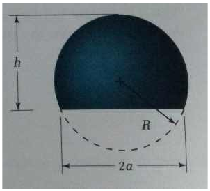
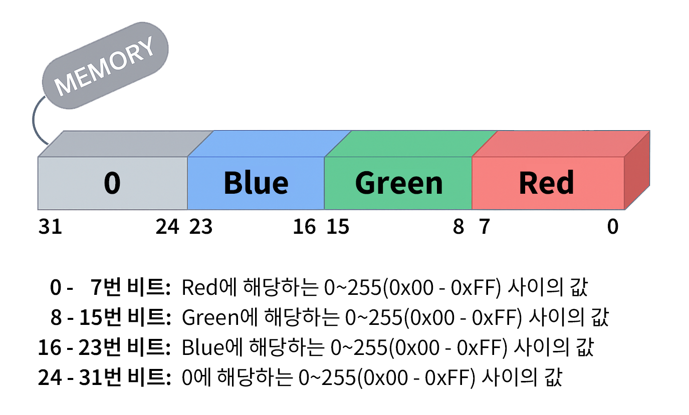

# 4장 연습 문제 — 연산자

[레포지토리 안내](../../README.ko.md) | [English](Exercises.md) | [한국어](Exercises.ko.md)

> **최종 수정일:** 2026-10-27
>
> Warming-Up C Programming, 천정아, Ch 4

**문항 출처:** 임영희 교수, 컴퓨터언어Ⅰ (DCCS101-04)

**공통 요구사항:** 모든 프로그램에서 의미 있는 변수명을 사용해야 한다.

연습 문제 1\~4는 실습 문제이고, 연습 문제 5\~14는 교재 4장의 연습 문제 1\~10번, 연습 문제 15\~25는 교재 4장의 프로그래밍 과제 1\~11번이다.

---

<br>

## 연습 문제 1: 헬멧의 체적과 표면적 계산

**문제:** 헬멧의 체적(Volume)과 표면적(Surface Area)을 구하는 프로그램을 작성하라.

헬멧은 그림 1처럼 반지름이 R인 구에서 밑면(base)의 지름이 2a가 되도록 잘라 낸 모양이며, h는 헬멧의 높이이다. 헬멧의 표면적과 체적은 높이 h와 밑면 반지름 a로부터 다음 공식에 의해 계산된다.



*그림 1. 헬멧의 높이 h, 구의 반지름 R, 밑면 지름 2a*

$$V = \frac{\pi}{6} \times h \times (3a^2 + h^2)$$

$$S = 2\pi \times \left(\frac{h}{3} + \frac{V}{\pi \times h^2}\right) \times h$$

- **입력(Input):** 헬멧의 높이(h)와 base 반지름(a) (단, h와 a는 정수)
- **출력(Output):** 헬멧의 체적(V)과 표면적(S)

**프로그램 요구사항:**

1. π 값은 3.14159265를 사용하며, `#define`문을 이용하여 매크로 상수로 정의한다.
2. 입력 데이터인 헬멧의 높이(h)와 base 반지름(a)은 `int`형이다.
3. 정수 나눗셈이 발생하지 않도록 주의하여, 실행 예와 같이 정확한 계산 결과를 출력해야 한다.

**실행 예시:**

```text
헬멧의 높이: 1
base 반지름 입력: 1
헬멧의 체적: 2.094395
헬멧의 표면적: 6.283185

Program ended with exit code: 0
```

```text
헬멧의 높이: 12
base 반지름 입력: 20
헬멧의 체적: 8444.601043
헬멧의 표면적: 1709.026402

Program ended with exit code: 0
```

**[풀이](Solutions.ko.md#연습-문제-1-헬멧의-체적과-표면적-계산)**

---

<br>

## 연습 문제 2: 시간과 초의 환산

**교재 문항:** 4장 프로그래밍 과제 8번 응용

**문제:** 실행 예시를 참고하여 다음 두 가지를 수행하는 프로그램을 작성하라.

1. 시, 분, 초를 입력받아 총 몇 초인지로 환산한다.
2. 초를 입력받아 시, 분, 초로 환산한다.

- **입력(Input):**
  1. 시, 분, 초 (단, 시, 분, 초는 모두 정수)
  2. 전체 초 (정수)
- **출력(Output):**
  1. 전체 초
  2. 시간, 분, 초

**프로그램 요구사항:** 다음의 기호 상수를 사용한다.

```c
#define SEC_PER_HOUR 3600
#define SEC_PER_MIN  60
```

**실행 예시:**

```text
시간을 차례로 입력하세요(시,분,초): 2 10 47
2시간 10분 47초는 총 7847초입니다.
-----------------------------------
환산할 초를 입력하세요: 3989
3989초는 1시간 6분 29초입니다.

Program ended with exit code: 0
```

```text
시간을 차례로 입력하세요(시,분,초): 7 1 55
7시간 1분 55초는 총 25315초입니다.
-----------------------------------
환산할 초를 입력하세요: 25315
25315초는 7시간 1분 55초입니다.

Program ended with exit code: 0
```

**[풀이](Solutions.ko.md#연습-문제-2-시간과-초의-환산)**

---

<br>

## 연습 문제 3: Red, Green, Blue 값을 16진수 RGB 값으로 변환

**배경:** RGB 모델은 컴퓨터에서 색을 표현하는 방식 중 하나이며, 각각 0\~255의 값을 갖는 빨강(Red), 초록(Green), 파랑(Blue)의 세 가지 색상을 조합하여 색상을 표현한다. 이 문제와 연습 문제 4에서는 그림 2처럼 32비트 정수의 0\~7번 비트에 Red, 8\~15번 비트에 Green, 16\~23번 비트에 Blue 값을 각각 0\~255(0x00\~0xFF) 범위로 저장하고, 상위 8비트(24\~31번)는 0으로 채운다.



*그림 2. RGB 모델의 32비트 메모리 배치*

**문제:** 사용자로부터 10진수 0~255 사이의 Red, Green, Blue 값을 각각 입력받아, 4바이트 크기의 RGB 값을 만들고 6자리 16진수로 출력하라.

- **입력(Input):** Red, Green, Blue (0~255 사이의 정수)
- **출력(Output):** RGB 값 (6자리 16진수)

**실행 예시:**

```text
Red 값 입력(0-255): 255
Green 값 입력(0-255): 0
Blue 값 입력(0-255): 130

RGB = 0X8200FF

Program ended with exit code: 0
```

```text
Red 값 입력(0-255): 67
Green 값 입력(0-255): 200
Blue 값 입력(0-255): 13

RGB = 0X0DC843

Program ended with exit code: 0
```

**[풀이](Solutions.ko.md#연습-문제-3-red-green-blue-값을-16진수-rgb-값으로-변환)**

---

<br>

## 연습 문제 4: 16진수 RGB 값을 Red, Green, Blue 값으로 변환

**문제:** 사용자로부터 6자리 16진수 정수의 RGB 값을 입력받아, Red, Green, Blue 값을 각각 추출하여 아래 형태로 출력하라. 비트 배치는 연습 문제 3의 그림 2와 같다.

- **입력(Input):** RGB 값 (6자리 16진수)
- **출력(Output):** Red, Green, Blue 각각의 2자리 16진수와 10진수 값

**실행 예시:**

```text
RGB 값 입력(16진수 6자리): A73803

Red   = 0X03 (3)
Green = 0X38 (56)
Blue  = 0XA7 (167)

Program ended with exit code: 0
```

```text
RGB 값 입력(16진수 6자리): FF00DD

Red   = 0XDD (221)
Green = 0X00 (0)
Blue  = 0XFF (255)

Program ended with exit code: 0
```

**[풀이](Solutions.ko.md#연습-문제-4-16진수-rgb-값을-red-green-blue-값으로-변환)**

---

<br>

## 연습 문제 5: 연산자에 대한 설명

**교재 문항:** 4장 연습 문제 1번

**문제:** 연산자에 대한 다음 설명 중 잘못된 것을 모두 고르라.

- ① 연산자는 연산에 사용되는 기호이다.
- ② 연산의 대상이 되는 값을 피연산자라고 한다.
- ③ 연산자를 포함하는 수식에는 항상 값이 있다.
- ④ 피연산자가 없는 연산자도 있다.
- ⑤ `#`을 연산자로 정의해서 사용할 수 있다.
- ⑥ `^`는 단항 연산자이다.
- ⑦ 콤마(`,`)도 연산자이다.
- ⑧ 연산식을 다른 수식의 일부로 사용할 수 없다.

**[풀이](Solutions.ko.md#연습-문제-5-연산자에-대한-설명)**

---

<br>

## 연습 문제 6: 단항 연산자

**교재 문항:** 4장 연습 문제 2번

**문제:** 다음 중 단항 연산자를 모두 고르라.

- ① `+`
- ② `-`
- ③ `++`
- ④ `!`
- ⑤ `sizeof`
- ⑥ `<<`
- ⑦ `&&`
- ⑧ `~`
- ⑨ `*=`
- ⑩ `==`

**[풀이](Solutions.ko.md#연습-문제-6-단항-연산자)**

---

<br>

## 연습 문제 7: 산술 연산자에 대한 설명

**교재 문항:** 4장 연습 문제 3번

**문제:** 산술 연산자에 대한 다음 설명 중 잘못된 것을 모두 고르라.

- ① 더하기(`+`), 빼기(`-`), 곱하기(`*`), 나누기(`/`), 나머지(`%`) 연산자가 있다.
- ② `+`, `-`는 부호 연산자로 사용될 수 있다.
- ③ 정수 / 정수는 몫을 실수로 구한다.
- ④ 나머지(`%`) 연산자는 실수에도 사용할 수 있다.
- ⑤ 정수와 실수를 혼합 연산하면 실수형으로 형 변환한다.
- ⑥ 피연산자의 데이터형이 같을 때는 형 변환하지 않는다.
- ⑦ `+`, `-` 연산자보다 `*`, `/` 연산자의 우선순위가 높다.

**[풀이](Solutions.ko.md#연습-문제-7-산술-연산자에-대한-설명)**

---

<br>

## 연습 문제 8: 연산식의 결과 형

**교재 문항:** 4장 연습 문제 4번

**문제:** 다음 연산식의 결과가 어떤 형인지 쓰라.

- (1) `1 + 0.5`
- (2) `1.01F + 0.5`
- (3) `0.5F * 2.4`
- (4) `12 + 56`
- (5) `char ch = 'a';`일 때 `ch + 1`
- (6) `short a = 10, b = 20;`일 때 `a - b`

**[풀이](Solutions.ko.md#연습-문제-8-연산식의-결과-형)**

---

<br>

## 연습 문제 9: 연산 후 수식과 변수의 값

**교재 문항:** 4장 연습 문제 5번

**문제:** 다음과 같이 선언된 변수에 대하여 연산을 수행한 후 연산식의 값과 `x`, `y`, `z` 변수의 값을 쓰라. (1)~(12) 각각에 대하여 `x`, `y`, `z` 변수가 다음과 같이 선언된 것으로 간주한다.

```c
int x = 1, y = 2, z = 3;
```

- (1) `z % y`
- (2) `++y;`
- (3) `z = x--;`
- (4) `z = y = x;`
- (5) `z *= x;`
- (6) `z *= y + 1;`
- (7) `x > z && y < z`
- (8) `! x || y < z`
- (9) `x && y`
- (10) `z << y`
- (11) `x |= z`
- (12) `y = x + 1 > z ? y : y - 1;`

**[풀이](Solutions.ko.md#연습-문제-9-연산-후-수식과-변수의-값)**

---

<br>

## 연습 문제 10: 관계 연산자와 논리 연산자에 대한 설명

**교재 문항:** 4장 연습 문제 6번

**문제:** 관계 연산자와 논리 연산자에 대한 다음 설명 중 잘못된 것을 모두 고르라.

- ① 두 수의 값을 비교하는 연산자를 관계 연산자라고 한다.
- ② `=`은 두 수가 같은지 비교하는 연산자이다.
- ③ 논리 연산식의 값은 항상 0 또는 1이다.
- ④ 관계 연산자와 논리 연산자를 함께 사용하면 관계 연산자부터 수행한다.
- ⑤ `~`은 논리 NOT 연산자이다.
- ⑥ 논리 연산자의 피연산자의 값이 1일 때만 참으로 간주한다.
- ⑦ `expr != 0` 대신 `!expr`을 사용할 수 있다.
- ⑧ `&&` 연산이 `||`보다 먼저 수행된다.

**[풀이](Solutions.ko.md#연습-문제-10-관계-연산자와-논리-연산자에-대한-설명)**

---

<br>

## 연습 문제 11: 특정 비트값을 조작하기 위한 데이터

**교재 문항:** 4장 연습 문제 7번

**문제:** 비트 논리 연산에서 이용되어 특정 비트값을 조작하기 위한 목적의 데이터를 무엇이라고 하는가?

**[풀이](Solutions.ko.md#연습-문제-11-특정-비트값을-조작하기-위한-데이터)**

---

<br>

## 연습 문제 12: 연산 순서대로 괄호로 묶기

**교재 문항:** 4장 연습 문제 8번

**문제:** 다음 연산식에 대하여 연산이 수행되는 순서대로 `()`로 묶어서 표시하라.

- (1) `x - y / 3`
- (2) `x < 0 || x > 100`
- (3) `x == 0 || y == 0 && z == 1`
- (4) `x = a > b`
- (5) `!x && !y`
- (6) `x += y * 2`
- (7) `~x & y`
- (8) `x < 0 || ! y && z`
- (9) `x = x > 0 ? y + 1 : z + 2`
- (10) `z = (double) x / y`

**[풀이](Solutions.ko.md#연습-문제-12-연산-순서대로-괄호로-묶기)**

---

<br>

## 연습 문제 13: 조건 연산자를 이용한 입장료 계산

**교재 문항:** 4장 연습 문제 9번

**문제:** 다음은 입장료를 계산하는 코드이다. 입장료가 성수기(6~8월)에는 70,000원이고, 성수기가 아닌 경우에는 35,000원이 되도록 조건 연산자를 이용해서 코드의 빈칸을 채우라.

```c
#define _CRT_SECURE_NO_WARNINGS    // Visual Studio 2022에서 scanf 사용 시 필요
#include <stdio.h>

int main(void)
{
    int month;
    int fee;

    printf("what month? ");
    scanf("%d", &month);            // 몇 월인지 입력받는다.
    fee = ______________________________;

    printf("entrance fee = %d\n", fee);
}
```

**[풀이](Solutions.ko.md#연습-문제-13-조건-연산자를-이용한-입장료-계산)**

---

<br>

## 연습 문제 14: 비트 연산 프로그램의 실행 결과

**교재 문항:** 4장 연습 문제 10번

**문제:** 다음 프로그램의 실행 결과를 쓰라.

```c
#include <stdio.h>

int main(void)
{
    unsigned char a = 0xcd;
    unsigned char b = 0xf0;
    unsigned char c;

    c = a ^ b;
    printf("z = %02x\n", c);

    c = ~a | b << 2;
    printf("z = %02x\n", c);
}
```

**[풀이](Solutions.ko.md#연습-문제-14-비트-연산-프로그램의-실행-결과)**

---

<br>

## 연습 문제 15: 밀도 계산

**교재 문항:** 4장 프로그래밍 과제 1번

**문제:** 질량과 부피를 실수로 입력받아 밀도를 구하는 프로그램을 작성하라. 질량은 g 단위로 입력받고, 부피는 $\text{cm}^3$ 단위로 입력받는다.

$$\text{밀도}(\text{g/cm}^3) = \frac{\text{질량}(\text{g})}{\text{부피}(\text{cm}^3)}$$

**실행 예시:**

```text
질량(g)? 33
부피(세제곱센티미터)? 400
밀도: 0.082500
```

**[풀이](Solutions.ko.md#연습-문제-15-밀도-계산)**

---

<br>

## 연습 문제 16: 전기 요금 계산

**교재 문항:** 4장 프로그래밍 과제 2번

**문제:** 월 사용량(kWh)을 입력받아 전기 요금을 계산하는 프로그램을 작성하라. 사용량에 따른 요금은 190원/kWh이다.

$$\text{전기 요금} = \text{월 사용량}(\text{kWh}) \times 190\,\text{원/kWh}$$

**실행 예시:**

```text
월 사용량(kWh)? 375
전기 요금: 71250원
```

**[풀이](Solutions.ko.md#연습-문제-16-전기-요금-계산)**

---

<br>

## 연습 문제 17: 기본 요금을 포함한 전기 요금 계산

**교재 문항:** 4장 프로그래밍 과제 3번

**문제:** 기본 요금과 월 사용량(kWh)을 입력받아 전기 요금을 계산하는 프로그램을 작성하라. 사용량에 따른 요금은 190원/kWh이다. 기본 요금을 저장할 변수를 별도로 선언하지 않고 복합 대입 연산자를 이용해서 연산식을 만들 수 있다.

$$\text{전기 요금} = \text{기본 요금} + \text{월 사용량}(\text{kWh}) \times 190\,\text{원/kWh}$$

**실행 예시:**

```text
기본 요금? 2500
월 사용량(kWh)? 375
전기 요금: 73750원
```

**[풀이](Solutions.ko.md#연습-문제-17-기본-요금을-포함한-전기-요금-계산)**

---

<br>

## 연습 문제 18: 월 값의 유효성 판별

**교재 문항:** 4장 프로그래밍 과제 4번

**문제:** 날짜 중 월을 입력받아서 1~12 사이의 값이 입력되면 올바른 값이라고 출력하고, 아니면 잘못된 값이라고 출력하는 프로그램을 작성하라. `printf` 함수는 리턴값이 있는 함수이므로, `expr1 ? expr2 : expr3`의 `expr1`, `expr2`, `expr3` 위치에 `printf` 함수의 호출을 사용할 수 있다.

**실행 예시:**

```text
몇 월? 15
잘못된 값입니다.
```

**[풀이](Solutions.ko.md#연습-문제-18-월-값의-유효성-판별)**

---

<br>

## 연습 문제 19: 화씨 온도를 섭씨 온도로 변환

**교재 문항:** 4장 프로그래밍 과제 5번

**문제:** 화씨 온도(°F)를 실수로 입력받아 섭씨 온도(°C)로 변환해서 출력하는 프로그램을 작성하라. 화씨 온도를 섭씨 온도로 변환하는 공식은 다음과 같다. 정수 / 정수는 몫을 정수로 구하므로 `5/9`는 0이 된다. 따라서 `5.0/9.0`을 구해서 사용해야 한다.

$$\text{섭씨 온도} = (\text{화씨 온도} - 32) \times \frac{5}{9}$$

**실행 예시:**

```text
화씨온도? 72
72 F = 22.22 C
```

**[풀이](Solutions.ko.md#연습-문제-19-화씨-온도를-섭씨-온도로-변환)**

---

<br>

## 연습 문제 20: 운동 에너지 계산

**교재 문항:** 4장 프로그래밍 과제 6번

**문제:** 질량과 속력을 실수로 입력받아 운동 에너지를 구하는 프로그램을 작성하라. 질량은 kg 단위, 속력은 m/s 단위로 입력받는다.

$$\text{운동 에너지} = \frac{1}{2} \times \text{질량} \times (\text{속력})^2$$

**실행 예시:**

```text
질량(kg)? 5.5
속력(m/s)? 4
운동에너지: 44.00 J
```

**[풀이](Solutions.ko.md#연습-문제-20-운동-에너지-계산)**

---

<br>

## 연습 문제 21: 퍼센트 농도 계산

**교재 문항:** 4장 프로그래밍 과제 7번

**문제:** 용매의 질량과 용질의 질량을 정수로 입력받아 용액의 퍼센트 농도를 구하는 프로그램을 작성하라. 용매의 질량과 용질의 질량은 g 단위로 입력받는다.

$$\text{퍼센트 농도}(\%) = \frac{\text{용질의 질량}}{\text{용매의 질량} + \text{용질의 질량}} \times 100$$

**실행 예시:**

```text
용매(g)? 200
용질(g)? 24
농도: 10.71 %
```

**[풀이](Solutions.ko.md#연습-문제-21-퍼센트-농도-계산)**

---

<br>

## 연습 문제 22: 재생 시간의 시, 분, 초 환산

**교재 문항:** 4장 프로그래밍 과제 8번

**문제:** 동영상의 재생 시간을 초 단위로 입력받아 몇 시간 몇 분 몇 초인지 출력하는 프로그램을 작성하라. 조건 연산자를 이용하면 "재생 시간은 0시간 5분 0초입니다."라고 출력하는 대신 "재생 시간은 5분입니다."라고 출력하도록, 즉 시, 분, 초 값이 0이 아닌 경우에만 출력하도록 프로그램을 개선할 수 있다.

**실행 예시:**

```text
재생 시간(초)? 3750
재생 시간은 1시간 2분 30초입니다.
```

**[풀이](Solutions.ko.md#연습-문제-22-재생-시간의-시-분-초-환산)**

---

<br>

## 연습 문제 23: 할인가와 에누리 금액 계산

**교재 문항:** 4장 프로그래밍 과제 9번

**문제:** 제품의 가격과 할인율(%)을 입력받아서 할인가와 에누리 금액을 출력하는 프로그램을 작성하라.

**실행 예시:**

```text
제품의 가격? 12000
할인율(%)? 25
할인가: 9000원 (3000원 할인)
```

**[풀이](Solutions.ko.md#연습-문제-23-할인가와-에누리-금액-계산)**

---

<br>

## 연습 문제 24: 바이트 단위의 16진수 출력

**교재 문항:** 4장 프로그래밍 과제 10번

**문제:** 부호 없는 정수를 16진수로 입력받아 최하위 바이트부터 순서대로 각 바이트의 값을 16진수로 출력하는 프로그램을 작성하라. `&` 연산자를 이용한 비트마스크를 이용한다.

**실행 예시:**

```text
16진수로 데이터를 입력하세요: 0xa1b2c3d4
byte 0 : d4
byte 1 : c3
byte 2 : b2
byte 3 : a1
```

**[풀이](Solutions.ko.md#연습-문제-24-바이트-단위의-16진수-출력)**

---

<br>

## 연습 문제 25: 오버플로우를 처리하는 RGB 색상 만들기

**교재 문항:** 4장 프로그래밍 과제 11번

**문제:** 24비트 트루컬러를 나타내는 RGB 표기법은 red, green, blue에 각각 8비트를 사용해서 색상을 표현한다. RGB 색상은 32비트 부호 없는 정수로 저장되는데, 최하위 바이트부터 red, green, blue의 순서로 색상 정보를 저장하고 최상위 바이트는 사용하지 않는다. 이 비트 배치는 연습 문제 3의 그림 2와 같다. red, green, blue를 입력받아서 RGB 색상을 만들어서 출력하는 프로그램을 작성하라. RGB 색상을 출력할 때는 바이트 단위로 값을 알아보기 쉽도록 16진수로 출력한다. red, green, blue 값으로 255보다 큰 값을 입력하면 오버플로우로 처리해야 한다. 즉, red 값으로 256이 입력되면 red에는 256이 아니라 0이 저장되어야 한다.

**실행 예시:**

```text
red? 256
green? 128
blue? 255
RGB 색상: FF8000
```

**[풀이](Solutions.ko.md#연습-문제-25-오버플로우를-처리하는-rgb-색상-만들기)**
