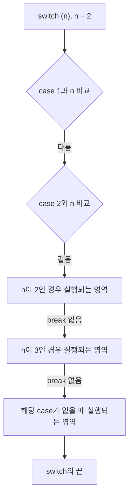

# 5장 실습 — 조건문과 반복문

[레포지토리 안내](../../README.ko.md) | [English](Concepts_Lab.md) | [한국어](Concepts_Lab.ko.md)

> **최종 수정일:** 2026-10-27
>
> 문제풀이 중심의 C언어 연습, 김용일과 강문설, Ch 5, 6

> **학습 목표:**
> 1. `if`, `if-else`, `if-else if-else`를 조건의 개수에 맞게 골라 쓰고, 여러 문장을 복합문으로 묶을 수 있다
> 2. `switch`문에서 `break`와 `default`가 실행 흐름에 주는 영향을 설명할 수 있다
> 3. 반복문의 세 요소인 시작 값, 조건, 증감 크기를 `for`, `while`, `do-while`로 표현할 수 있다
> 4. 범위 조건과 입력 오류 처리를 포함하여 성적 등급, 시각 변환 같은 분기 프로그램을 작성할 수 있다
> 5. 누적 합, 홀수의 합, 팩토리얼, 구간의 합을 반복문으로 계산할 수 있다

---

## 목차

- [1. 조건문](#1-조건문)
  - [1.1 if](#11-if)
  - [1.2 if-else](#12-if-else)
  - [1.3 if-else if-else](#13-if-else-if-else)
  - [1.4 복합문](#14-복합문)
- [2. switch문](#2-switch문)
  - [2.1 case와 break](#21-case와-break)
  - [2.2 break가 없는 경우](#22-break가-없는-경우)
  - [2.3 default](#23-default)
- [3. 조건문 실습](#3-조건문-실습)
  - [3.1 양수, 0, 음수 판별](#31-양수-0-음수-판별)
  - [3.2 영문 대문자와 소문자 판별](#32-영문-대문자와-소문자-판별)
  - [3.3 24시각을 12시각으로 변환](#33-24시각을-12시각으로-변환)
  - [3.4 if로 성적 등급 판정](#34-if로-성적-등급-판정)
  - [3.5 switch로 등급별 메시지 출력](#35-switch로-등급별-메시지-출력)
- [4. 반복문](#4-반복문)
  - [4.1 반복문이 필요한 경우](#41-반복문이-필요한-경우)
  - [4.2 반복문의 세 요소](#42-반복문의-세-요소)
  - [4.3 for와 while](#43-for와-while)
  - [4.4 do-while](#44-do-while)
- [5. 반복문 실습](#5-반복문-실습)
  - [5.1 1부터 5까지의 합](#51-1부터-5까지의-합)
  - [5.2 누적 합의 과정 출력](#52-누적-합의-과정-출력)
  - [5.3 1부터 10까지의 홀수의 합](#53-1부터-10까지의-홀수의-합)
  - [5.4 팩토리얼과 계산 과정](#54-팩토리얼과-계산-과정)
  - [5.5 부호가 번갈아 바뀌는 합의 과정 출력](#55-부호가-번갈아-바뀌는-합의-과정-출력)
  - [5.6 두 정수 사이의 합](#56-두-정수-사이의-합)
- [요약](#요약)
- [점검 문제](#점검-문제)

---

<br>

## 1. 조건문

조건문은 주어진 기준에 맞으면 어떤 문장을 실행하고, 맞지 않으면 실행하지 않거나 다른 문장을 실행하게 한다. 시험의 합격과 불합격처럼 기준에 따라 수행할 일이 달라질 때 쓴다([5장 2절](Concepts_Lecture.ko.md#2-조건문)).

### 1.1 if

`if`는 주어진 조건이 참(true)일 때에만 관심이 있는 경우에 쓴다. 조건식의 결과가 참이면 바로 다음 문장을 실행하고, 거짓이면 그 문장을 건너뛴다([5장 2.1절](Concepts_Lecture.ko.md#21-if)).

```c
if (age > 19)
    printf("성인! \n");    // executed only when the condition is true
printf("if와 상관없이 무조건 수행되는 코드 \n");
```

`age`가 20 이상이면 두 줄이 모두 출력되고, 19 이하이면 둘째 줄만 출력된다. 이 코드는 조건이 거짓일 때에 대한 안내 문구가 없다.

> **참고:** C에서 관계식이나 논리식의 결과는 참이면 1, 거짓이면 0으로 표현된다. `if`의 조건식은 0이 아니면 참, 0이면 거짓으로 판단한다.

### 1.2 if-else

`if-else`는 조건이 참인 경우와 거짓인 경우 각각에 수행할 일이 있을 때 쓴다([5장 2.3절](Concepts_Lecture.ko.md#23-if-else)).

```c
if (age > 19)
    printf("성인! \n");      // executed when the condition is true
else
    printf("청소년! \n");    // executed when the condition is false
printf("if와 상관없이 무조건 수행되는 코드 \n");
```

`else`는 `if`의 조건식이 거짓인 경우 전체를 가리키므로, `else (조건식)`처럼 `else`에 조건식을 붙일 수 없다.

### 1.3 if-else if-else

조건이 참과 거짓의 두 가지가 아니라 세 가지 이상으로 나뉘면 `else if`로 조건을 추가한다([5장 2.4절](Concepts_Lecture.ko.md#24-else-if)). `if-else`만으로 세 경우를 구분하려면, 첫 `if`에서 거짓으로 판단된 나머지 두 경우가 전달되는 `else`를 복합문으로 만들고 그 안에 다시 `if-else`를 넣어야 한다.

```c
if (num > 0)
    printf("Positive number!");
else {                          // num <= 0: two cases remain
    if (num == 0)
        printf("Zero!");
    else
        printf("Negative number!");
}
```

`else` 안에 `if`문 하나만 있으면 중괄호를 없애 `else if`로 쓸 수 있으며, 그 결과가 3.1절의 `if-else if-else` 구조이다. `else if (또 다른 조건식)`을 이어 붙이면 조건을 몇 개든 차례로 검사할 수 있고, 처음 참이 된 블록 하나만 실행된다.

### 1.4 복합문

`if`와 `else`가 실행하는 것은 바로 다음의 문장 하나이다. 나이가 20세 이상이면 "성인!"을 출력하고 요금 `price`를 3000원으로, 20세 미만이면 "청소년!"을 출력하고 요금을 1600원으로 정하려면, 각 경우에 실행할 두 문장을 중괄호 `{ }`로 묶은 **복합문(compound statement)** 을 만들어야 한다([5장 2.2절](Concepts_Lecture.ko.md#22-복합문--블록)).

```c
if (age > 19) {
    printf("성인! \n");
    price = 3000;
}
else {
    printf("청소년! \n");
    price = 1600;
}
printf("if와 상관없이 수행되는 코드 \n");
```

> **주의:** 중괄호 없이 `if (age > 19) printf("성인! \n"); price = 3000; else ...`처럼 쓰면, `if`에 속하는 것은 `printf` 하나뿐이고 `price = 3000;`은 `if`와 관계없는 문장이 된다. 그 결과 `else`가 짝지을 `if`를 잃어 컴파일 오류가 난다. `else`가 없는 경우에는 오류 없이 컴파일되지만 `price = 3000;`이 조건과 관계없이 항상 실행된다.

---

<br>

## 2. switch문

### 2.1 case와 break

`switch`문은 기준 값(정수식)의 값에 따라 실행할 구문(case)을 고른다. 식의 값과 같은 case 레이블로 이동하여 그 뒤의 문장을 실행하고, `break`를 만나면 `switch`를 빠져나간다([5장 2.7절](Concepts_Lecture.ko.md#27-switch)).

```c
switch (n) {
case 1:
    printf("n이 1인 경우 실행되는 영역\n");
    break;
case 2:
    printf("n이 2인 경우 실행되는 영역\n");
    break;
case 3:
    printf("n이 3인 경우 실행되는 영역\n");
    break;
default:
    printf("해당 case가 없을 때 실행되는 영역\n");
}
```

### 2.2 break가 없는 경우

case의 끝에 `break`가 없으면 `switch`를 빠져나가지 않고 다음 case의 문장을 이어서 실행한다. 위 코드에서 모든 `break`를 지우고 n = 2로 실행하면 다음 순서로 진행된다.



*그림 1. break가 없는 switch문에서 n이 2일 때의 실행 순서*

다음은 같은 n = 2에 대해 `break`가 있는 경우와 없는 경우, 그리고 일치하는 case가 없는 n = 7을 실행한 결과이다.

```text
[with break, n = 2]
n이 2인 경우 실행되는 영역
[without break, n = 2]
n이 2인 경우 실행되는 영역
n이 3인 경우 실행되는 영역
해당 case가 없을 때 실행되는 영역
[with break, n = 7]
해당 case가 없을 때 실행되는 영역
```

`switch`의 마지막에 있는 `default`(또는 마지막 case)에서는 `break`를 생략해도 바로 `switch`의 끝에 도달하므로 동작이 같다.

### 2.3 default

n의 값이 어떤 case와도 같지 않으면 `default:` 뒤의 문장들이 실행되고 `switch`를 빠져나온다. `default`가 없으면 아무 문장도 실행하지 않고 `switch`를 빠져나온다. 입력 값이 예상한 범위를 벗어났을 때 오류 메시지를 출력하는 데 `default`를 쓴다(3.5절).

---

<br>

## 3. 조건문 실습

다음 문제의 풀이 코드는 이 단원 폴더의 예제 파일이다. 메시지 끝에 `\n`이 없으므로 실제 터미널에서는 다음 프롬프트가 메시지 바로 뒤에 이어진다.

### 3.1 양수, 0, 음수 판별

**문제:** 정수를 입력받아 양수이면 `Positive number!`, 0이면 `Zero!`, 음수이면 `Negative number!`를 출력하라.

**풀이:** 세 경우로 나뉘므로 `if-else if-else`를 쓴다. 첫 조건 `num1 > 0`이 거짓이면 0 이하의 수만 남으므로 둘째 조건은 `num1 == 0`만 검사하면 되고, 나머지는 음수이다.

**코드:** [Example_SignCheck.c](Example_SignCheck.c)

```c
#define _CRT_SECURE_NO_WARNINGS  // allows scanf in Visual Studio
#include <stdio.h>

int main()
{
    int num1;

    printf("Input num: ");
    scanf(" %d", &num1);

    if (num1 > 0)
        printf("Positive number!");
    else if (num1 == 0)
        printf("Zero!");
    else
        printf("Negative number!");
}
```

```text
Input num: -5
Negative number!
```

```text
Input num: 0
Zero!
```

### 3.2 영문 대문자와 소문자 판별

**문제:** 문자 하나를 입력받아 영문 대문자이면 `Large Letters of English!`, 소문자이면 `Small Letters of English!`, 영문자가 아니면 `Input error!`를 출력하라.

**풀이:** 문자는 ASCII 코드라는 정수로 저장되고, 대문자 `'A'`\~`'Z'`는 65\~90, 소문자 `'a'`\~`'z'`는 97\~122에 연속으로 놓여 있다. 따라서 범위 비교 `ch >= 'A' && ch <= 'Z'`로 대문자를 판별할 수 있다. 코드에 주석으로 남긴 것처럼 10진수 코드 65와 90을 직접 써도 같지만, 문자 상수 `'A'`를 쓰면 ASCII 값을 몰라도 되고 의도가 분명해진다. `scanf`의 형식 문자열 `" %c"`는 앞의 공백 문자를 건너뛰고 문자 하나를 읽는다([3장 실습 5.2절](../Ch03_Data-Types-and-Variables/Concepts_Lab.ko.md#52-입력-버퍼와-형식-문자열의-공백)).

**코드:** [Example_LetterCase.c](Example_LetterCase.c)

```c
#define _CRT_SECURE_NO_WARNINGS  // allows scanf in Visual Studio
#include <stdio.h>

int main()
{
    char ch;

    printf(">> Input char: ");
    scanf(" %c", &ch);

    /*
    if (ch >= 65 && ch <= 90)
        printf("Large Letters of English!");
    else if (ch >= 97 && ch <= 122)
        printf("Small Letters of English!");
    else
        printf("Input Error!");
    */

    if (ch >= 'A' && ch <= 'Z')  // when the decimal ASCII values are not known
        printf("Large Letters of English!");
    else if (ch >= 'a' && ch <= 'z')
        printf("Small Letters of English!");
    else
        printf("Input error!");
}
```

```text
>> Input char: g
Small Letters of English!
```

```text
>> Input char: 1
Input error!
```

### 3.3 24시각을 12시각으로 변환

**문제:** 0\~23의 시각을 입력받아 1\~11은 `[1 A.M]`\~`[11 A.M]`, 12는 `[12 P.M]`, 13\~23은 `[1 P.M]`\~`[11 P.M]`, 0은 `[12 A.M]`으로 출력하고, 그 밖의 정수에는 `Input Error!`를 출력하라. A.M은 라틴어 Ante Meridiem(오전), P.M은 Post Meridiem(오후)의 약자이다.

**풀이:** 시각의 범위를 네 구간과 오류로 나눈다. 13~23은 12를 빼서 오후 시각으로 바꾸고, 0(자정)은 12를 더해 `[12 A.M]`으로 출력한다. 12(정오)는 오후이므로 따로 `[12 P.M]`으로 처리한다.

| 입력 | 출력 |
|:-----|:-----|
| 0 | `[12 A.M]` |
| 1~11 | `[1 A.M]`~`[11 A.M]` |
| 12 | `[12 P.M]` |
| 13~23 | `[1 P.M]`~`[11 P.M]` |
| 그 밖의 정수 | `Input Error!` |

*표 1. 24시각의 입력과 12시각 출력의 대응*

**코드:** [Example_TwelveHourClock.c](Example_TwelveHourClock.c)

```c
#define _CRT_SECURE_NO_WARNINGS  // allows scanf in Visual Studio
#include <stdio.h>

int main()
{
    int time;

    printf(">> Input Time(0~23): ");
    scanf(" %d", &time);

    if (time >= 1 && time <= 11)
        printf("[%d A.M]", time);
    else if (time == 12)
        printf("[%d P.M]", time);
    else if (time >= 13 && time <= 23)
        printf("[%d P.M]", time - 12);
    else if (time == 0)
        printf("[%d A.M]", time + 12);
    else
        printf("Input Error!");
}
```

```text
>> Input Time(0~23): 0
[12 A.M]
```

```text
>> Input Time(0~23): 12
[12 P.M]
```

```text
>> Input Time(0~23): 15
[3 P.M]
```

```text
>> Input Time(0~23): 24
Input Error!
```

### 3.4 if로 성적 등급 판정

**문제:** 0\~100의 성적을 입력받아 100\~90은 A, 89\~80은 B, 79\~70은 C, 69\~60은 D, 60점 미만은 F를 `if` 스타일로 출력하라. 0\~100이 아닌 값이 입력되면 `Input error!`를 출력한다.

**풀이:** 모든 정수가 입력될 수 있다고 보고 각 구간의 위와 아래를 모두 검사한다. 0\~100 밖의 값은 어느 구간에도 들지 않으므로 마지막 `else`에서 오류가 된다. 코드의 첫 번째 주석은 성적이 0\~100으로만 입력된다고 가정한 형태로, 앞의 조건이 이미 높은 점수를 걸러 냈으므로 각 조건에 아래 경계만 쓰면 된다([5장 2.4절](Concepts_Lecture.ko.md#24-else-if)). 두 번째 주석은 0\~100인지 바깥 `if`에서 한 번만 검사하고 그 안에서 등급을 나누는 형태로, 범위 검사와 등급 판정이 분리되어 읽기 쉽다.

**코드:** [Example_GradeIfElse.c](Example_GradeIfElse.c)

```c
#define _CRT_SECURE_NO_WARNINGS  // allows scanf in Visual Studio
#include <stdio.h>

int main()
{
    int score;

    printf(">> Input score(0~100): ");  // written for the case where any integer is entered
    scanf(" %d", &score);

    if (score >= 90 && score <= 100)
        printf("%d is a/an A!", score);
    else if (score >= 80 && score <= 89)
        printf("%d is a/an B!", score);
    else if (score >= 70 && score <= 79)
        printf("%d is a/an C!", score);
    else if (score >= 60 && score <= 69)
        printf("%d is a/an D!", score);
    else if (score < 60 && score >= 0)
        printf("%d is a/an F!", score);
    else
        printf("Input error!");

    /* If the score is assumed to be entered only in 0-100, it can be written as follows
    if (score >= 90)
        printf("%d is a/an A!", score);
    else if (score >= 80)
        printf("%d is a/an B!", score);
    else if (score >= 70)
        printf("%d is a/an C!", score);
    else if (score >= 60)
        printf("%d is a/an D!", score);
    else
        printf("%d is a/an F!", score);
    */

    /* If the score can be any integer, writing it as follows is better

    if (score >= 0 && score <= 100)
    {
        if (score >= 90 && score <= 100)
            printf("%d is a/an A!", score);
        else if (score >= 80 && score <= 89)
            printf("%d is a/an B!", score);
        else if (score >= 70 && score <= 79)
            printf("%d is a/an C!", score);
        else if (score >= 60 && score <= 69)
            printf("%d is a/an D!", score);
        else if (score < 60 && score >= 0)
            printf("%d is a/an F!", score);
        else
            printf("Input error!");
    }
    */
}
```

```text
>> Input score(0~100): 100
100 is a/an A!
```

```text
>> Input score(0~100): 59
59 is a/an F!
```

```text
>> Input score(0~100): 101
Input error!
```

### 3.5 switch로 등급별 메시지 출력

**문제:** 1\~7의 등급을 입력받아 1은 `Very good!`, 2\~3은 `Good!`, 4\~5는 `So So!`, 6\~7은 `Cheer up!`을 `switch`문으로 출력하고, 1\~7이 아니면 `Input error!`를 출력하라.

**풀이:** case 레이블에는 범위나 관계식을 쓸 수 없고 정수 상수 하나만 올 수 있으므로, 1부터 7까지 case를 하나씩 둔다. 1~7이 아닌 값은 `default`에서 처리한다. 코드 끝의 주석처럼 2와 3, 4와 5, 6과 7은 같은 일을 하므로, `break`가 없으면 다음 case로 이어서 실행되는 성질을 이용하여 2, 4, 6의 문장을 모두 지우고 `case 2: case 3:`처럼 레이블을 연달아 쓸 수 있다(2.2절).

**코드:** [Example_GradeSwitch.c](Example_GradeSwitch.c)

```c
#define _CRT_SECURE_NO_WARNINGS  // allows scanf in Visual Studio
#include <stdio.h>

int main()
{
    int grade;

    printf(">> Input grade(1~7): ");
    scanf(" %d", &grade);

    switch (grade) {
    case 1:
        printf("Very good!");
        break;
    case 2:
        printf("Good!");
        break;
    case 3:
        printf("Good!");
        break;
    case 4:
        printf("So So!");
        break;
    case 5:
        printf("So So!");
        break;
    case 6:
        printf("Cheer up!");
        break;
    case 7:
        printf("Cheer up!");
        break;
    default:
        printf("Input error!");
        // break; may be omitted in the last default
    }

    /* Improvement: cases 2-3, 4-5, and 6-7 do the same thing.
       Without break, execution continues into the next case, so cases 2, 4, and 6
       can have all their statements removed.

       Also, a case label cannot take a range or a relational expression;
       each case handles exactly one value.
    */
}
```

```text
>> Input grade(1~7): 1
Very good!
```

```text
>> Input grade(1~7): 5
So So!
```

```text
>> Input grade(1~7): 8
Input error!
```

---

<br>

## 4. 반복문

### 4.1 반복문이 필요한 경우

"Hello world!"를 화면에 1,000번 출력하려면 `printf`를 1,000번 써야 할까? 1부터 3까지의 합은 `1 + 2 + 3`으로 쓸 수 있지만, 12부터 327까지 3의 배수의 합 `12 + 15 + ... + 324 + 327`은 수식으로 모두 쓰기 어렵다. 이처럼 같은 형태의 작업을 값만 바꾸어 되풀이할 때 **반복문(iteration statement)** 을 쓴다([5장 3절](Concepts_Lecture.ko.md#3-반복문)).

### 4.2 반복문의 세 요소

1부터 3까지 하나씩 증가하면서 화면에 출력하는 작업을 생각한다. 이때 반복 자체와 반복할 때마다 해야 하는 작업을 구분해야 한다. 반복문에는 다음 세 가지가 반드시 필요하다.

| 요소 | 의미 | 예 |
|:-----|:-----|:-----|
| 시작 값 (start value) | 반복을 시작하는 값 | `i = 1` |
| 조건 (condition) | 반복을 계속할지 정하는 조건 | `i < 4` (1, 2, 3에서 참이고 4에서 거짓) |
| 증감 크기 (step size) | 한 번 반복할 때마다 바뀌는 크기 | `i++` |

*표 2. 반복문의 세 요소*

반복할 때마다 해야 하는 작업(statement)은 1 → 2 → 3으로 바뀌는 값을 화면에 출력하는 일이다.

### 4.3 for와 while

`for`문은 세 요소를 괄호 안에 한데 묶어 표현하고, `while`문은 세 요소를 나누어 표현한다([5장 3.1절](Concepts_Lecture.ko.md#31-for), [3.2절](Concepts_Lecture.ko.md#32-while)).

```text
 while문                         for문
┌──────────────────────┐        ┌───────────────────────────────┐
│ int i;               │        │ int i;                        │
│ i = 0;         ①     │        │ for (i = 0; i < 10; i++)      │
│ while (i < 10) ②     │        │      ①       ②       ③       │
│ {                    │        │ {                             │
│   printf(...);       │        │   printf(...);                │
│   i++;         ③     │        │ }                             │
│ }                    │        │                               │
└──────────────────────┘        └───────────────────────────────┘
 ① 시작 값(초기식)   ② 조건(조건식)   ③ 증감 크기(증감식)
```

*그림 2. while문과 for문에서 반복문의 세 요소의 위치*

다음 프로그램은 1부터 3까지를 출력한 뒤, 1부터 3까지의 합을 `for`, `while`, `do-while`로 각각 구한다.

```c
#include <stdio.h>

int main(void)
{
    int i, sum;

    for (i = 1; i < 4; i++)         // start value; condition; step size
        printf(" %d", i);
    printf("\n");

    sum = 0;
    for (i = 1; i < 4; i++)
        sum = sum + i;              // sum += i;
    printf("for: %d, i = %d\n", sum, i);

    i = 1;                          // (1) start value
    sum = 0;
    while (i < 4) {                 // (2) condition
        sum = sum + i;
        i++;                        // (3) step size
    }
    printf("while: %d, i = %d\n", sum, i);

    i = 1;
    sum = 0;
    do {
        sum = sum + i;
        i++;
    } while (i < 4);                // a semicolon ends a do-while
    printf("do-while: %d, i = %d\n", sum, i);

    return 0;
}
```

```text
 1 2 3
for: 6, i = 4
while: 6, i = 4
do-while: 6, i = 4
```

세 반복문 모두 `i`가 4가 되어 조건 `i < 4`가 거짓이 되는 순간 끝나므로, 반복이 끝난 뒤 `i`는 4이다.

### 4.4 do-while

`do-while`은 참과 거짓을 판단하기 전에 반복 내용을 무조건 한 번 실행한 뒤, `while`의 조건이 만족되는 동안 반복 내용을 다시 실행한다([5장 3.3절](Concepts_Lecture.ko.md#33-do-while)).

```c
do {
    /* statements to repeat */
} while (condition);    // a semicolon is required here
```

`do-while`에서는 `while`이 문장의 마지막에 있으므로 `while ( )` 끝에 세미콜론을 써야 한다. 시작 값이 처음부터 조건을 만족하지 않으면 두 반복문의 차이가 드러난다.

```c
#include <stdio.h>

int main(void)
{
    int i, sum;

    i = 5; sum = 0;
    while (i < 4) {                 // false at the start: the body never runs
        sum = sum + i;
        i++;
    }
    printf("while: %d\n", sum);

    i = 5; sum = 0;
    do {                            // the body runs once before the check
        sum = sum + i;
        i++;
    } while (i < 4);
    printf("do-while: %d\n", sum);

    return 0;
}
```

```text
while: 0
do-while: 5
```

`i = 5`에서 `while`은 조건 `5 < 4`가 거짓이므로 본문을 한 번도 실행하지 않지만, `do-while`은 본문을 한 번 실행하여 `sum`에 5를 더한 뒤 조건을 검사하고 끝난다.

---

<br>

## 5. 반복문 실습

### 5.1 1부터 5까지의 합

**문제:** `for`문으로 1부터 5까지의 합을 출력하라.

**풀이:** 합을 저장할 누적 변수 `sum`을 0으로 초기화하고, `i`를 1부터 5까지 늘리며 `sum += i`를 반복한다([5장 5.1절](Concepts_Lecture.ko.md#51-카운터와-누적기)).

```c
#include <stdio.h>

int main(void)
{
    int i, sum = 0;

    for (i = 1; i <= 5; i++)  // i takes 1, 2, 3, 4, 5
        sum += i;             // add i to the running sum

    printf("1~5까지 합: %d\n", sum);

    return 0;
}
```

```text
1~5까지 합: 15
```

### 5.2 누적 합의 과정 출력

**문제:** `for`문으로 1부터 5까지의 합을 구하되, 반복할 때마다 `i`와 그때까지의 합을 출력하라.

**풀이:** 5.1절의 반복 안에서 `sum`을 갱신한 직후에 출력한다. `%2d`와 `%3d`로 폭을 정하여 숫자를 오른쪽으로 맞춘다.

```c
#include <stdio.h>

int main(void)
{
    int i, sum = 0;

    for (i = 1; i <= 5; i++) {
        sum += i;                      // sum of 1 to i
        printf("%2d: %3d\n", i, sum);  // print i and the sum so far
    }

    return 0;
}
```

```text
 1:   1
 2:   3
 3:   6
 4:  10
 5:  15
```

### 5.3 1부터 10까지의 홀수의 합

**문제:** `for`문으로 1부터 10까지의 홀수의 합을 출력하라. 증감 크기를 1로 고정하는 방법과 직접 정하는 방법을 모두 쓴다.

**풀이:** 첫 번째 방법은 `i`를 1씩 늘리며 모든 정수를 방문하고, `i % 2 == 1`인 홀수만 더한다.

```c
#include <stdio.h>

int main(void)
{
    int i, sum = 0;

    for (i = 1; i <= 10; i++)  // step size 1: visit every integer
        if (i % 2 == 1)        // keep only the odd ones
            sum += i;

    printf("The sum of odd numbers from 1 to 10: %d\n", sum);

    return 0;
}
```

두 번째 방법은 `i`를 1에서 시작하여 2씩 늘려 홀수 1, 3, 5, 7, 9만 방문한다. 조건 검사와 반복 횟수가 절반으로 줄고, 나머지 연산이 필요 없다.

```c
#include <stdio.h>

int main(void)
{
    int i, sum = 0;

    for (i = 1; i <= 10; i += 2)  // step size 2: 1, 3, 5, 7, 9
        sum += i;

    printf("The sum of odd numbers from 1 to 10: %d\n", sum);

    return 0;
}
```

두 프로그램의 출력은 같다. 1 + 3 + 5 + 7 + 9 = 25이다.

```text
The sum of odd numbers from 1 to 10: 25
```

### 5.4 팩토리얼과 계산 과정

**문제:** 1~10의 양의 정수 n을 입력받아 n!(factorial)을 출력하되, 중간 계산 과정도 `5!= 5*4*3*2*1= 120`처럼 출력하라.

**풀이:** 곱을 저장할 변수 `fact`는 곱셈의 항등원인 1로 초기화한다(합의 경우 0으로 초기화하는 것과 대응한다). `i`를 n부터 1까지 줄이며 `fact *= i`를 반복하고, 곱하는 수를 출력한다. 마지막 인수 1 뒤에는 `*`를 붙이지 않도록 `i > 1`일 때만 `*`를 출력한다. 1~10이 아닌 값은 `Input error!`를 출력하고 끝낸다. 10! = 3,628,800은 `int`의 범위 안에 있지만, 13! = 6,227,020,800은 `int`의 최댓값을 넘는다.

```c
#define _CRT_SECURE_NO_WARNINGS  // allows scanf in Visual Studio
#include <stdio.h>

int main(void)
{
    int n, i;
    int fact = 1;   // the product starts at 1, the identity of multiplication

    printf("Enter the desired 'factorial' value: ");
    scanf("%d", &n);

    if (n < 1 || n > 10) {
        printf("Input error!\n");
        return 1;
    }

    printf("%d!= ", n);
    for (i = n; i >= 1; i--) {      // count down from n to 1
        fact *= i;
        printf("%d", i);
        if (i > 1)                  // no operator after the last factor
            printf("*");
    }
    printf("= %d\n", fact);


    return 0;
}
```

```text
Enter the desired 'factorial' value: 4
4!= 4*3*2*1= 24
```

```text
Enter the desired 'factorial' value: 5
5!= 5*4*3*2*1= 120
```

```text
Enter the desired 'factorial' value: 11
Input error!
```

### 5.5 부호가 번갈아 바뀌는 합의 과정 출력

**문제:** `1 - 2 + 3 - 4 + ...`처럼 부호가 번갈아 바뀌는 합을 1부터 10까지 한 줄씩 늘려 가며 수식과 함께 출력하라.

**풀이:** 바깥 `for`문이 i = 1부터 10까지 반복하면서 홀수 i는 더하고 짝수 i는 빼서 그때까지의 합 `sum`을 구한다. 안쪽 `for`문은 j = 2부터 i까지 반복하며 홀수 j 앞에는 ` + `를, 짝수 j 앞에는 ` - `를 붙여 수식을 출력한다. 1이 수식의 첫 항이므로 안쪽 반복 앞에서 따로 출력한다([5장 3.4절](Concepts_Lecture.ko.md#34-중첩-반복문)). 10까지의 결과만 출력하는 형태는 [HW05 문제 3](../../Coursework/HW05_Control-Statements-III/Assignment-Explanation.ko.md#4-문제-3-반복문-연습-3)에서 다룬다.

```c
#include <stdio.h>

int main(void)
{
    int i, j, sum = 0;

    for (i = 1; i <= 10; i++) {
        if (i % 2 == 1)  // odd terms are added, even terms are subtracted
            sum += i;
        else
            sum -= i;

        printf("1");                      // the expression always starts with 1
        for (j = 2; j <= i; j++) {        // print the terms 2 to i with their signs
            if (j % 2 == 1)
                printf(" + %d", j);
            else
                printf(" - %d", j);
        }
        printf(" = %d\n", sum);           // sum now holds 1 - 2 + ... (+/-) i
    }

    return 0;
}
```

```text
1 = 1
1 - 2 = -1
1 - 2 + 3 = 2
1 - 2 + 3 - 4 = -2
1 - 2 + 3 - 4 + 5 = 3
1 - 2 + 3 - 4 + 5 - 6 = -3
1 - 2 + 3 - 4 + 5 - 6 + 7 = 4
1 - 2 + 3 - 4 + 5 - 6 + 7 - 8 = -4
1 - 2 + 3 - 4 + 5 - 6 + 7 - 8 + 9 = 5
1 - 2 + 3 - 4 + 5 - 6 + 7 - 8 + 9 - 10 = -5
```

### 5.6 두 정수 사이의 합

**문제:** 두 정수를 입력받아 작은 값과 큰 값을 정한 뒤, 작은 값부터 큰 값까지의 합을 구하라. 두 값은 같지 않다고 가정한다.

**풀이:** 입력 순서와 관계없이 반복의 시작 값과 끝 값을 정하기 위해 `if-else`로 작은 값을 `small`에, 큰 값을 `large`에 저장한다. 그 다음 `small`부터 `large`까지 더한다. 같은 값이 입력되면 `else`로 가서 두 변수가 같은 값이 되고, 그 값 하나의 합이 출력된다.

```c
#define _CRT_SECURE_NO_WARNINGS  // allows scanf in Visual Studio
#include <stdio.h>

int main(void)
{
    int a, b, small, large, i;
    int sum = 0;

    printf(">> input two values: ");
    scanf("%d %d", &a, &b);

    if (a < b) {        // decide which value is the start and which is the end
        small = a;
        large = b;
    }
    else {
        small = b;
        large = a;
    }

    for (i = small; i <= large; i++)
        sum += i;

    printf("->sum(%d~%d): %d\n", small, large, sum);


    return 0;
}
```

```text
>> input two values: 4 9
->sum(4~9): 39
```

```text
>> input two values: 12 10
->sum(10~12): 33
```

> **참고:** 연속된 정수의 합은 반복 없이 등차수열의 합 공식 (small + large) × (large - small + 1) / 2로도 구할 수 있다. 4부터 9까지는 13 × 6 / 2 = 39이다. 이 공식은 반복 횟수와 관계없이 곱셈 몇 번으로 끝나지만, 곱이 `int`의 범위를 넘지 않는지 따져야 한다.

0이 입력될 때까지 1~100의 정수를 입력받아 최댓값과 최솟값을 구하는 반복 문제는 [HW05 문제 1](../../Coursework/HW05_Control-Statements-III/Assignment-Explanation.ko.md#2-문제-1-반복문-연습-1)에서 다룬다.

---

<br>

## 요약

| 개념 | 핵심 요약 |
|:-----|:-----|
| `if` | 조건이 참일 때만 다음 문장 하나를 실행한다. |
| `if-else` | 조건이 참일 때와 거짓일 때 각각 실행할 문장을 정하며, `else`에는 조건식을 붙일 수 없다. |
| `if-else if-else` | 세 가지 이상의 경우를 차례로 검사하며, 처음 참이 된 블록 하나만 실행한다. |
| 복합문 | 여러 문장을 `{ }`로 묶어 `if`나 `else`가 실행하는 하나의 문장으로 만든다. |
| `switch`와 `break` | 정수식과 같은 case로 이동하여 실행하고, `break`를 만나면 `switch`를 빠져나간다. |
| `break` 생략 | `break`가 없으면 다음 case의 문장을 이어서 실행하며, 여러 case가 같은 일을 할 때 이용한다. |
| `default` | 일치하는 case가 없을 때 실행되며, 입력 오류 처리에 쓴다. |
| 반복문의 세 요소 | 시작 값, 조건, 증감 크기이며, `for`는 한데 묶고 `while`은 나누어 표현한다. |
| `do-while` | 본문을 먼저 한 번 실행한 뒤 조건을 검사하며, 끝에 세미콜론이 필요하다. |
| 누적 합과 누적 곱 | 합은 0, 곱은 1로 초기화한 변수에 반복하여 더하거나 곱한다. |

---

<br>

## 점검 문제

1. **복합문:** 다음 코드에서 `age`가 15일 때 출력과 `price`의 값을 쓰라.

   ```c
   int price = 0;
   if (age > 19)
       printf("성인! \n");
       price = 3000;
   printf("price: %d\n", price);
   ```

   <details>
   <summary>정답</summary>

   `if`에 속하는 것은 첫 `printf` 하나뿐이므로 `성인!`은 출력되지 않는다. 들여쓰기와 관계없이 `price = 3000;`은 항상 실행되므로 `price: 3000`이 출력된다. 두 문장을 조건에 묶으려면 `{ }`로 복합문을 만들어야 한다.

   </details>

2. **switch와 break:** 2.1절의 `switch`에서 `case 2:`의 `break`만 지우고 n = 2로 실행하면 무엇이 출력되는가?

   <details>
   <summary>정답</summary>

   `n이 2인 경우 실행되는 영역`을 출력한 뒤 `break`가 없으므로 `case 3:`의 `n이 3인 경우 실행되는 영역`을 이어서 출력하고, 그 case의 `break`에서 `switch`를 빠져나간다.

   </details>

3. **반복문의 세 요소:** 12부터 327까지의 3의 배수의 합을 구하는 `for`문을 쓰고, 시작 값, 조건, 증감 크기를 밝혀라.

   <details>
   <summary>정답</summary>

   `for (i = 12; i <= 327; i += 3) sum += i;`이다. 시작 값은 `i = 12`, 조건은 `i <= 327`, 증감 크기는 `i += 3`이다. 12와 327이 모두 3의 배수이므로 3씩 늘리면 3의 배수만 방문하며, 합은 17,967이다.

   </details>

4. **while과 do-while:** 사용자가 0을 입력할 때까지 정수를 입력받아 합을 구하려 한다. 입력을 적어도 한 번은 받아야 할 때 `while`과 `do-while` 중 어느 것이 자연스러운가?

   <details>
   <summary>정답</summary>

   `do-while`이다. 입력을 먼저 받은 뒤 그 값이 0인지 검사하므로 조건 검사가 끝에 오는 구조와 맞는다. `while`로 쓰려면 반복 전에 입력을 한 번 받거나 조건 변수를 0이 아닌 값으로 미리 초기화해야 한다.

   </details>

5. **팩토리얼:** 5.4절의 프로그램에서 `fact`를 0으로 초기화하면 결과가 어떻게 되는가?

   <details>
   <summary>정답</summary>

   0에 무엇을 곱해도 0이므로 모든 n에 대해 결과가 0이 된다. 곱을 누적하는 변수는 곱셈의 항등원인 1로 초기화해야 한다.

   </details>
