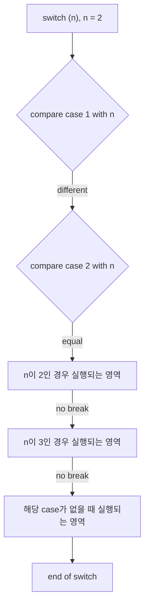

# Chapter 5 Lab — Conditional Statements and Loops

[Repository Guide](../../README.md) | [English](Concepts_Lab.md) | [한국어](Concepts_Lab.ko.md)

> **Last Updated:** 2026-10-27
>
> 문제풀이 중심의 C언어 연습, 김용일과 강문설, Ch 5, 6

> **Learning Objectives:**
> 1. Choose `if`, `if-else`, or `if-else if-else` to fit the number of conditions, and group several statements into a compound statement
> 2. Explain how `break` and `default` affect the flow of execution in a `switch` statement
> 3. Express the three elements of a loop, start value, condition, and step size, with `for`, `while`, and `do-while`
> 4. Write branching programs such as grade classification and clock conversion, including range conditions and input error handling
> 5. Compute running sums, sums of odd numbers, factorials, and sums over a range with loops

---

## Table of Contents

- [1. Conditional Statements](#1-conditional-statements)
  - [1.1 if](#11-if)
  - [1.2 if-else](#12-if-else)
  - [1.3 if-else if-else](#13-if-else-if-else)
  - [1.4 Compound Statements](#14-compound-statements)
- [2. The switch Statement](#2-the-switch-statement)
  - [2.1 case and break](#21-case-and-break)
  - [2.2 Without break](#22-without-break)
  - [2.3 default](#23-default)
- [3. Conditional Statement Practice](#3-conditional-statement-practice)
  - [3.1 Positive, Zero, or Negative](#31-positive-zero-or-negative)
  - [3.2 Uppercase or Lowercase English Letter](#32-uppercase-or-lowercase-english-letter)
  - [3.3 Converting the 24-Hour Clock to the 12-Hour Clock](#33-converting-the-24-hour-clock-to-the-12-hour-clock)
  - [3.4 Grading with if](#34-grading-with-if)
  - [3.5 Messages by Grade with switch](#35-messages-by-grade-with-switch)
- [4. Loops](#4-loops)
  - [4.1 When Loops Are Needed](#41-when-loops-are-needed)
  - [4.2 The Three Elements of a Loop](#42-the-three-elements-of-a-loop)
  - [4.3 for and while](#43-for-and-while)
  - [4.4 do-while](#44-do-while)
- [5. Loop Practice](#5-loop-practice)
  - [5.1 Sum from 1 to 5](#51-sum-from-1-to-5)
  - [5.2 Printing the Running Sum](#52-printing-the-running-sum)
  - [5.3 Sum of the Odd Numbers from 1 to 10](#53-sum-of-the-odd-numbers-from-1-to-10)
  - [5.4 Factorial and Its Calculation Steps](#54-factorial-and-its-calculation-steps)
  - [5.5 Printing an Alternating Sum Step by Step](#55-printing-an-alternating-sum-step-by-step)
  - [5.6 Sum Between Two Integers](#56-sum-between-two-integers)
- [Summary](#summary)
- [Self-Check Questions](#self-check-questions)

---

<br>

## 1. Conditional Statements

A conditional statement executes a statement if a given criterion is met and otherwise skips it or executes another statement. It is used when the work to do depends on a criterion, as with passing or failing an exam ([Chapter 5, Section 2](Concepts_Lecture.md#2-conditional-statements)).

### 1.1 if

`if` is used when only the case where the condition is true matters. If the result of the condition is true, the next statement is executed; if false, that statement is skipped ([Chapter 5, Section 2.1](Concepts_Lecture.md#21-if)).

```c
if (age > 19)
    printf("성인! \n");    // executed only when the condition is true
printf("if와 상관없이 무조건 수행되는 코드 \n");
```

If `age` is 20 or more, both lines are printed; if 19 or less, only the second line is printed. This code has no message for when the condition is false.

> **Note:** In C, the result of a relational or logical expression is represented as 1 for true and 0 for false. The condition of `if` is judged true if it is not 0 and false if it is 0.

### 1.2 if-else

`if-else` is used when there is work to do both when the condition is true and when it is false ([Chapter 5, Section 2.3](Concepts_Lecture.md#23-if-else)).

```c
if (age > 19)
    printf("성인! \n");      // executed when the condition is true
else
    printf("청소년! \n");    // executed when the condition is false
printf("if와 상관없이 무조건 수행되는 코드 \n");
```

`else` covers the whole case in which the condition of `if` is false, so a condition cannot be attached to `else`, as in `else (condition)`.

### 1.3 if-else if-else

When the conditions divide into three or more cases rather than just true and false, conditions are added with `else if` ([Chapter 5, Section 2.4](Concepts_Lecture.md#24-else-if)). To distinguish three cases with `if-else` alone, the `else` that receives the two remaining cases judged false by the first `if` must be made into a compound statement containing another `if-else`.

```c
if (num > 0)
    printf("Positive number!");
else {                          // num <= 0: two cases remain
    if (num == 0)
        printf("Zero!");
    else
        printf("Negative number!");
}
```

When an `else` contains only one `if` statement, the braces can be removed and it can be written as `else if`, giving the `if-else if-else` structure of Section 3.1. Chaining `else if (another condition)` lets any number of conditions be checked in order, and only the first block whose condition is true is executed.

### 1.4 Compound Statements

`if` and `else` execute only the single statement that follows. To print "성인!" and set the fee `price` to 3000 won for ages 20 and above, and to print "청소년!" and set the fee to 1600 won for ages below 20, the two statements of each case must be grouped in braces `{ }` into a **compound statement** ([Chapter 5, Section 2.2](Concepts_Lecture.md#22-compound-statements--blocks)).

```c
if (age > 19) {
    printf("성인! \n");
    price = 3000;
}
else {
    printf("청소년! \n");
    price = 1600;
}
printf("if와 상관없이 수행되는 코드 \n");
```

> **Caution:** Written without braces, as in `if (age > 19) printf("성인! \n"); price = 3000; else ...`, only the `printf` belongs to the `if`, and `price = 3000;` becomes a statement unrelated to the `if`. As a result, `else` loses its matching `if` and a compile error occurs. Without an `else`, the code compiles without error, but `price = 3000;` is always executed regardless of the condition.

---

<br>

## 2. The switch Statement

### 2.1 case and break

The `switch` statement chooses the clause (case) to execute according to the value of a reference value (an integer expression). It jumps to the case label equal to the value of the expression and executes the statements after it, leaving the `switch` when it meets `break` ([Chapter 5, Section 2.7](Concepts_Lecture.md#27-switch)).

```c
switch (n) {
case 1:
    printf("n이 1인 경우 실행되는 영역\n");
    break;
case 2:
    printf("n이 2인 경우 실행되는 영역\n");
    break;
case 3:
    printf("n이 3인 경우 실행되는 영역\n");
    break;
default:
    printf("해당 case가 없을 때 실행되는 영역\n");
}
```

### 2.2 Without break

Without a `break` at the end of a case, execution does not leave the `switch` but continues with the statements of the next case. Removing every `break` from the code above and running it with n = 2 proceeds in the following order.



*Figure 1. Order of execution in a switch statement without break when n is 2*

The following are the results for the same n = 2 with and without `break`, and for n = 7, which matches no case.

```text
[with break, n = 2]
n이 2인 경우 실행되는 영역
[without break, n = 2]
n이 2인 경우 실행되는 영역
n이 3인 경우 실행되는 영역
해당 case가 없을 때 실행되는 영역
[with break, n = 7]
해당 case가 없을 때 실행되는 영역
```

In the `default` (or the last case) at the end of the `switch`, omitting `break` behaves the same, because the end of the `switch` is reached right away.

### 2.3 default

If the value of n equals no case, the statements after `default:` are executed and the `switch` is left. Without `default`, no statement is executed and the `switch` is left. `default` is used to print an error message when an input value is outside the expected range (Section 3.5).

---

<br>

## 3. Conditional Statement Practice

The solution code of the following problems is the example files in this unit folder. Each file compiles with `gcc -std=c99 -Wall` without warnings, and the outputs are from actual runs. The messages end without `\n`, so in a real terminal the next prompt follows the message directly.

### 3.1 Positive, Zero, or Negative

**Problem:** Read an integer and print `Positive number!` if it is positive, `Zero!` if it is 0, and `Negative number!` if it is negative.

**Solution:** There are three cases, so `if-else if-else` is used. If the first condition `num1 > 0` is false, only numbers of 0 or less remain, so the second condition needs to check only `num1 == 0`, and the rest are negative.

**Code:** [Example_SignCheck.c](Example_SignCheck.c)

```c
#define _CRT_SECURE_NO_WARNINGS  // allows scanf in Visual Studio
#include <stdio.h>

int main()
{
    int num1;

    printf("Input num: ");
    scanf(" %d", &num1);

    if (num1 > 0)
        printf("Positive number!");
    else if (num1 == 0)
        printf("Zero!");
    else
        printf("Negative number!");
}
```

```text
Input num: -5
Negative number!
```

```text
Input num: 0
Zero!
```

### 3.2 Uppercase or Lowercase English Letter

**Problem:** Read one character and print `Large Letters of English!` if it is an uppercase English letter, `Small Letters of English!` if lowercase, and `Input error!` if it is not an English letter.

**Solution:** A character is stored as an integer, its ASCII code, and the uppercase letters `'A'`-`'Z'` lie consecutively at 65-90 and the lowercase letters `'a'`-`'z'` at 97-122. So a range comparison `ch >= 'A' && ch <= 'Z'` identifies an uppercase letter. As the commented-out code shows, writing the decimal codes 65 and 90 directly works the same, but the character constant `'A'` does not require knowing the ASCII value and makes the intent clear. The format string `" %c"` of `scanf` skips leading white-space characters and reads one character ([Chapter 3 Lab, Section 5.2](../Ch03_Data-Types-and-Variables/Concepts_Lab.md#52-the-input-buffer-and-spaces-in-the-format-string)).

**Code:** [Example_LetterCase.c](Example_LetterCase.c)

```c
#define _CRT_SECURE_NO_WARNINGS  // allows scanf in Visual Studio
#include <stdio.h>

int main()
{
    char ch;

    printf(">> Input char: ");
    scanf(" %c", &ch);

    /*
    if (ch >= 65 && ch <= 90)
        printf("Large Letters of English!");
    else if (ch >= 97 && ch <= 122)
        printf("Small Letters of English!");
    else
        printf("Input Error!");
    */

    if (ch >= 'A' && ch <= 'Z')  // when the decimal ASCII values are not known
        printf("Large Letters of English!");
    else if (ch >= 'a' && ch <= 'z')
        printf("Small Letters of English!");
    else
        printf("Input error!");
}
```

```text
>> Input char: g
Small Letters of English!
```

```text
>> Input char: 1
Input error!
```

### 3.3 Converting the 24-Hour Clock to the 12-Hour Clock

**Problem:** Read an hour from 0 to 23 and print `[1 A.M]`-`[11 A.M]` for 1-11, `[12 P.M]` for 12, `[1 P.M]`-`[11 P.M]` for 13-23, and `[12 A.M]` for 0, and print `Input Error!` for any other integer. A.M abbreviates the Latin Ante Meridiem (before noon) and P.M Post Meridiem (after noon).

**Solution:** The range of the hour is divided into four intervals and an error. For 13-23, 12 is subtracted to give the afternoon hour, and 0 (midnight) has 12 added to print `[12 A.M]`. 12 (noon) is in the afternoon, so it is handled separately as `[12 P.M]`.

| Input | Output |
|:-----|:-----|
| 0 | `[12 A.M]` |
| 1-11 | `[1 A.M]`-`[11 A.M]` |
| 12 | `[12 P.M]` |
| 13-23 | `[1 P.M]`-`[11 P.M]` |
| Any other integer | `Input Error!` |

*Table 1. Correspondence between 24-hour input and 12-hour output*

**Code:** [Example_TwelveHourClock.c](Example_TwelveHourClock.c)

```c
#define _CRT_SECURE_NO_WARNINGS  // allows scanf in Visual Studio
#include <stdio.h>

int main()
{
    int time;

    printf(">> Input Time(0~23): ");
    scanf(" %d", &time);

    if (time >= 1 && time <= 11)
        printf("[%d A.M]", time);
    else if (time == 12)
        printf("[%d P.M]", time);
    else if (time >= 13 && time <= 23)
        printf("[%d P.M]", time - 12);
    else if (time == 0)
        printf("[%d A.M]", time + 12);
    else
        printf("Input Error!");
}
```

```text
>> Input Time(0~23): 0
[12 A.M]
```

```text
>> Input Time(0~23): 12
[12 P.M]
```

```text
>> Input Time(0~23): 15
[3 P.M]
```

```text
>> Input Time(0~23): 24
Input Error!
```

### 3.4 Grading with if

**Problem:** Read a score from 0 to 100 and print, in `if` style, A for 100-90, B for 89-80, C for 79-70, D for 69-60, and F below 60. If a value outside 0-100 is entered, print `Input error!`.

**Solution:** Assuming any integer can be entered, both the upper and lower bounds of each interval are checked. A value outside 0-100 falls in no interval, so it becomes an error in the last `else`. The first comment of the code shows the form that assumes scores are entered only in 0-100; since the earlier conditions have already filtered out higher scores, each condition needs only a lower bound ([Chapter 5, Section 2.4](Concepts_Lecture.md#24-else-if)). The second comment shows the form that checks 0-100 once in an outer `if` and divides the grades inside it, which separates the range check from the grading and is easier to read.

**Code:** [Example_GradeIfElse.c](Example_GradeIfElse.c)

```c
#define _CRT_SECURE_NO_WARNINGS  // allows scanf in Visual Studio
#include <stdio.h>

int main()
{
    int score;

    printf(">> Input score(0~100): ");  // written for the case where any integer is entered
    scanf(" %d", &score);

    if (score >= 90 && score <= 100)
        printf("%d is a/an A!", score);
    else if (score >= 80 && score <= 89)
        printf("%d is a/an B!", score);
    else if (score >= 70 && score <= 79)
        printf("%d is a/an C!", score);
    else if (score >= 60 && score <= 69)
        printf("%d is a/an D!", score);
    else if (score < 60 && score >= 0)
        printf("%d is a/an F!", score);
    else
        printf("Input error!");

    /* If the score is assumed to be entered only in 0-100, it can be written as follows
    if (score >= 90)
        printf("%d is a/an A!", score);
    else if (score >= 80)
        printf("%d is a/an B!", score);
    else if (score >= 70)
        printf("%d is a/an C!", score);
    else if (score >= 60)
        printf("%d is a/an D!", score);
    else
        printf("%d is a/an F!", score);
    */

    /* If the score can be any integer, writing it as follows is better

    if (score >= 0 && score <= 100)
    {
        if (score >= 90 && score <= 100)
            printf("%d is a/an A!", score);
        else if (score >= 80 && score <= 89)
            printf("%d is a/an B!", score);
        else if (score >= 70 && score <= 79)
            printf("%d is a/an C!", score);
        else if (score >= 60 && score <= 69)
            printf("%d is a/an D!", score);
        else if (score < 60 && score >= 0)
            printf("%d is a/an F!", score);
        else
            printf("Input error!");
    }
    */
}
```

```text
>> Input score(0~100): 100
100 is a/an A!
```

```text
>> Input score(0~100): 59
59 is a/an F!
```

```text
>> Input score(0~100): 101
Input error!
```

### 3.5 Messages by Grade with switch

**Problem:** Read a grade from 1 to 7 and print, with a `switch` statement, `Very good!` for 1, `Good!` for 2-3, `So So!` for 4-5, and `Cheer up!` for 6-7, and print `Input error!` if it is not 1-7.

**Solution:** A case label cannot hold a range or a relational expression, only a single integer constant, so one case is given for each of 1 to 7. Values other than 1-7 are handled in `default`. As the comment at the end of the code says, 2 and 3, 4 and 5, and 6 and 7 do the same thing, so the property that execution continues into the next case without `break` lets the statements of 2, 4, and 6 be removed and the labels written in a row, as in `case 2: case 3:` (Section 2.2).

**Code:** [Example_GradeSwitch.c](Example_GradeSwitch.c)

```c
#define _CRT_SECURE_NO_WARNINGS  // allows scanf in Visual Studio
#include <stdio.h>

int main()
{
    int grade;

    printf(">> Input grade(1~7): ");
    scanf(" %d", &grade);

    switch (grade) {
    case 1:
        printf("Very good!");
        break;
    case 2:
        printf("Good!");
        break;
    case 3:
        printf("Good!");
        break;
    case 4:
        printf("So So!");
        break;
    case 5:
        printf("So So!");
        break;
    case 6:
        printf("Cheer up!");
        break;
    case 7:
        printf("Cheer up!");
        break;
    default:
        printf("Input error!");
        // break; may be omitted in the last default
    }

    /* Improvement: cases 2-3, 4-5, and 6-7 do the same thing.
       Without break, execution continues into the next case, so cases 2, 4, and 6
       can have all their statements removed.

       Also, a case label cannot take a range or a relational expression;
       each case handles exactly one value.
    */
}
```

```text
>> Input grade(1~7): 1
Very good!
```

```text
>> Input grade(1~7): 5
So So!
```

```text
>> Input grade(1~7): 8
Input error!
```

---

<br>

## 4. Loops

### 4.1 When Loops Are Needed

To print "Hello world!" 1,000 times, must `printf` be written 1,000 times? The sum from 1 to 3 can be written as `1 + 2 + 3`, but the sum of the multiples of 3 from 12 to 327, `12 + 15 + ... + 324 + 327`, is hard to write out as an expression. When work of the same form is repeated with only the values changing, an **iteration statement** (loop) is used ([Chapter 5, Section 3](Concepts_Lecture.md#3-loop-statements)).

### 4.2 The Three Elements of a Loop

Consider printing the values 1 to 3, increasing one at a time. The repetition itself must be distinguished from the work to do in each repetition. A loop always needs the following three things.

| Element | Meaning | Example |
|:-----|:-----|:-----|
| Start value | The value at which the repetition starts | `i = 1` |
| Condition | The condition that decides whether to continue | `i < 4` (true for 1, 2, and 3, false for 4) |
| Step size | The amount of change in each repetition | `i++` |

*Table 2. The three elements of a loop*

The work to do in each repetition (the statement) is printing the value as it changes 1 → 2 → 3.

### 4.3 for and while

The `for` statement expresses the three elements together inside its parentheses, and the `while` statement expresses them separately ([Chapter 5, Section 3.1](Concepts_Lecture.md#31-for), [Section 3.2](Concepts_Lecture.md#32-while)).

```text
 while statement                 for statement
┌──────────────────────┐        ┌───────────────────────────────┐
│ int i;               │        │ int i;                        │
│ i = 0;         ①     │        │ for (i = 0; i < 10; i++)      │
│ while (i < 10) ②     │        │      ①       ②       ③       │
│ {                    │        │ {                             │
│   printf(...);       │        │   printf(...);                │
│   i++;         ③     │        │ }                             │
│ }                    │        │                               │
└──────────────────────┘        └───────────────────────────────┘
 ① start value (init)   ② condition   ③ step size (update)
```

*Figure 2. Positions of the three elements of a loop in while and for statements*

The following program prints 1 to 3 and then computes the sum of 1 to 3 with each of `for`, `while`, and `do-while`.

```c
#include <stdio.h>

int main(void)
{
    int i, sum;

    for (i = 1; i < 4; i++)         // start value; condition; step size
        printf(" %d", i);
    printf("\n");

    sum = 0;
    for (i = 1; i < 4; i++)
        sum = sum + i;              // sum += i;
    printf("for: %d, i = %d\n", sum, i);

    i = 1;                          // (1) start value
    sum = 0;
    while (i < 4) {                 // (2) condition
        sum = sum + i;
        i++;                        // (3) step size
    }
    printf("while: %d, i = %d\n", sum, i);

    i = 1;
    sum = 0;
    do {
        sum = sum + i;
        i++;
    } while (i < 4);                // a semicolon ends a do-while
    printf("do-while: %d, i = %d\n", sum, i);

    return 0;
}
```

```text
 1 2 3
for: 6, i = 4
while: 6, i = 4
do-while: 6, i = 4
```

All three loops end the moment `i` becomes 4 and the condition `i < 4` turns false, so `i` is 4 after each loop.

### 4.4 do-while

`do-while` executes the body once unconditionally before judging true or false, and then executes the body again while the condition of `while` is satisfied ([Chapter 5, Section 3.3](Concepts_Lecture.md#33-do-while)).

```c
do {
    /* statements to repeat */
} while (condition);    // a semicolon is required here
```

In `do-while`, the `while` is at the end of the statement, so a semicolon must be written at the end of `while ( )`. The difference between the two loops shows when the start value does not satisfy the condition from the beginning.

```c
#include <stdio.h>

int main(void)
{
    int i, sum;

    i = 5; sum = 0;
    while (i < 4) {                 // false at the start: the body never runs
        sum = sum + i;
        i++;
    }
    printf("while: %d\n", sum);

    i = 5; sum = 0;
    do {                            // the body runs once before the check
        sum = sum + i;
        i++;
    } while (i < 4);
    printf("do-while: %d\n", sum);

    return 0;
}
```

```text
while: 0
do-while: 5
```

With `i = 5`, the condition `5 < 4` of `while` is false, so its body never runs, but `do-while` runs its body once, adds 5 to `sum`, then checks the condition and ends.

---

<br>

## 5. Loop Practice

The solutions to the following problems compile with `gcc -std=c99 -Wall` without warnings, and the outputs are from actual runs.

### 5.1 Sum from 1 to 5

**Problem:** Print the sum from 1 to 5 with a `for` statement.

**Solution:** Initialize the accumulator `sum`, which stores the sum, to 0, and repeat `sum += i` while increasing `i` from 1 to 5 ([Chapter 5, Section 5.1](Concepts_Lecture.md#51-counter-and-accumulator)).

```c
#include <stdio.h>

int main(void)
{
    int i, sum = 0;

    for (i = 1; i <= 5; i++)  // i takes 1, 2, 3, 4, 5
        sum += i;             // add i to the running sum

    printf("1~5까지 합: %d\n", sum);

    return 0;
}
```

```text
1~5까지 합: 15
```

### 5.2 Printing the Running Sum

**Problem:** Compute the sum from 1 to 5 with a `for` statement, printing `i` and the sum so far at each repetition.

**Solution:** Print right after updating `sum` inside the loop of Section 5.1. The widths `%2d` and `%3d` right-align the numbers.

```c
#include <stdio.h>

int main(void)
{
    int i, sum = 0;

    for (i = 1; i <= 5; i++) {
        sum += i;                      // sum of 1 to i
        printf("%2d: %3d\n", i, sum);  // print i and the sum so far
    }

    return 0;
}
```

```text
 1:   1
 2:   3
 3:   6
 4:  10
 5:  15
```

### 5.3 Sum of the Odd Numbers from 1 to 10

**Problem:** Print the sum of the odd numbers from 1 to 10 with a `for` statement, both with a fixed step size of 1 and with a step size of your choice.

**Solution:** The first method increases `i` by 1, visiting every integer, and adds only the odd numbers with `i % 2 == 1`.

```c
#include <stdio.h>

int main(void)
{
    int i, sum = 0;

    for (i = 1; i <= 10; i++)  // step size 1: visit every integer
        if (i % 2 == 1)        // keep only the odd ones
            sum += i;

    printf("The sum of odd numbers from 1 to 10: %d\n", sum);

    return 0;
}
```

The second method starts `i` at 1 and increases it by 2, visiting only the odd numbers 1, 3, 5, 7, and 9. It halves the number of condition checks and repetitions and needs no remainder operation.

```c
#include <stdio.h>

int main(void)
{
    int i, sum = 0;

    for (i = 1; i <= 10; i += 2)  // step size 2: 1, 3, 5, 7, 9
        sum += i;

    printf("The sum of odd numbers from 1 to 10: %d\n", sum);

    return 0;
}
```

The two programs print the same output. 1 + 3 + 5 + 7 + 9 = 25.

```text
The sum of odd numbers from 1 to 10: 25
```

### 5.4 Factorial and Its Calculation Steps

**Problem:** Read a positive integer n from 1 to 10 and print n! (factorial), also printing the calculation steps, as in `5!= 5*4*3*2*1= 120`.

**Solution:** The variable `fact`, which stores the product, is initialized to 1, the identity of multiplication (corresponding to initializing a sum to 0). Repeat `fact *= i` while decreasing `i` from n to 1, and print each factor. To avoid a `*` after the last factor 1, `*` is printed only when `i > 1`. A value other than 1-10 prints `Input error!` and ends the program. 10! = 3,628,800 is within the range of `int`, but 13! = 6,227,020,800 exceeds the maximum `int`.

```c
#define _CRT_SECURE_NO_WARNINGS  // allows scanf in Visual Studio
#include <stdio.h>

int main(void)
{
    int n, i;
    int fact = 1;   // the product starts at 1, the identity of multiplication

    printf("Enter the desired 'factorial' value: ");
    scanf("%d", &n);

    if (n < 1 || n > 10) {
        printf("Input error!\n");
        return 1;
    }

    printf("%d!= ", n);
    for (i = n; i >= 1; i--) {      // count down from n to 1
        fact *= i;
        printf("%d", i);
        if (i > 1)                  // no operator after the last factor
            printf("*");
    }
    printf("= %d\n", fact);


    return 0;
}
```

```text
Enter the desired 'factorial' value: 4
4!= 4*3*2*1= 24
```

```text
Enter the desired 'factorial' value: 5
5!= 5*4*3*2*1= 120
```

```text
Enter the desired 'factorial' value: 11
Input error!
```

### 5.5 Printing an Alternating Sum Step by Step

**Problem:** Print the alternating sum `1 - 2 + 3 - 4 + ...` with its expression, extending it one term per line from 1 to 10.

**Solution:** The outer `for` statement repeats for i = 1 to 10, adding odd i and subtracting even i to obtain the sum so far, `sum`. The inner `for` statement repeats for j = 2 to i and prints the expression, putting ` + ` before odd j and ` - ` before even j. 1 is the first term of the expression, so it is printed separately before the inner loop ([Chapter 5, Section 3.4](Concepts_Lecture.md#34-nested-loops)). The form that prints only the result up to 10 is covered in [HW05 Problem 3](../../Coursework/HW05_Control-Statements-III/Assignment-Explanation.md#4-problem-3-loop-practice-3).

```c
#include <stdio.h>

int main(void)
{
    int i, j, sum = 0;

    for (i = 1; i <= 10; i++) {
        if (i % 2 == 1)  // odd terms are added, even terms are subtracted
            sum += i;
        else
            sum -= i;

        printf("1");                      // the expression always starts with 1
        for (j = 2; j <= i; j++) {        // print the terms 2 to i with their signs
            if (j % 2 == 1)
                printf(" + %d", j);
            else
                printf(" - %d", j);
        }
        printf(" = %d\n", sum);           // sum now holds 1 - 2 + ... (+/-) i
    }

    return 0;
}
```

```text
1 = 1
1 - 2 = -1
1 - 2 + 3 = 2
1 - 2 + 3 - 4 = -2
1 - 2 + 3 - 4 + 5 = 3
1 - 2 + 3 - 4 + 5 - 6 = -3
1 - 2 + 3 - 4 + 5 - 6 + 7 = 4
1 - 2 + 3 - 4 + 5 - 6 + 7 - 8 = -4
1 - 2 + 3 - 4 + 5 - 6 + 7 - 8 + 9 = 5
1 - 2 + 3 - 4 + 5 - 6 + 7 - 8 + 9 - 10 = -5
```

### 5.6 Sum Between Two Integers

**Problem:** Read two integers, determine the smaller and the larger, and compute the sum from the smaller value to the larger. Assume the two values are not equal.

**Solution:** To set the start and end values of the loop regardless of the input order, `if-else` stores the smaller value in `small` and the larger in `large`. Then the values from `small` to `large` are added. If equal values are entered, the `else` branch makes both variables the same value, and the sum of that single value is printed.

```c
#define _CRT_SECURE_NO_WARNINGS  // allows scanf in Visual Studio
#include <stdio.h>

int main(void)
{
    int a, b, small, large, i;
    int sum = 0;

    printf(">> input two values: ");
    scanf("%d %d", &a, &b);

    if (a < b) {        // decide which value is the start and which is the end
        small = a;
        large = b;
    }
    else {
        small = b;
        large = a;
    }

    for (i = small; i <= large; i++)
        sum += i;

    printf("->sum(%d~%d): %d\n", small, large, sum);


    return 0;
}
```

```text
>> input two values: 4 9
->sum(4~9): 39
```

```text
>> input two values: 12 10
->sum(10~12): 33
```

> **Note:** The sum of consecutive integers can also be computed without a loop by the formula for an arithmetic series, (small + large) × (large - small + 1) / 2. From 4 to 9 it is 13 × 6 / 2 = 39. This formula takes a few multiplications regardless of the number of terms, but it must be checked that the product does not exceed the range of `int`.

The loop problem that reads integers from 1 to 100 until 0 is entered and finds the maximum and minimum is covered in [HW05 Problem 1](../../Coursework/HW05_Control-Statements-III/Assignment-Explanation.md#2-problem-1-loop-practice-1).

---

<br>

## Summary

| Concept | Key Summary |
|:-----|:-----|
| `if` | Executes the next single statement only when the condition is true. |
| `if-else` | Sets the statements to execute when the condition is true and when it is false; no condition can be attached to `else`. |
| `if-else if-else` | Checks three or more cases in order and executes only the first block whose condition is true. |
| Compound statement | Groups several statements in `{ }` into one statement executed by `if` or `else`. |
| `switch` and `break` | Jumps to the case equal to the integer expression and executes it, leaving the `switch` at `break`. |
| Omitting `break` | Without `break`, execution continues with the statements of the next case, which is used when several cases do the same work. |
| `default` | Executed when no case matches; used for handling input errors. |
| Three elements of a loop | Start value, condition, and step size; `for` expresses them together and `while` separately. |
| `do-while` | Executes the body once before checking the condition and needs a semicolon at the end. |
| Running sums and products | Add or multiply repeatedly into a variable initialized to 0 for a sum and 1 for a product. |

---

<br>

## Self-Check Questions

1. **Compound statements:** In the following code, write the output and the value of `price` when `age` is 15.

   ```c
   int price = 0;
   if (age > 19)
       printf("성인! \n");
       price = 3000;
   printf("price: %d\n", price);
   ```

   <details>
   <summary>Answer</summary>

   Only the first `printf` belongs to the `if`, so `성인!` is not printed. Regardless of the indentation, `price = 3000;` is always executed, so `price: 3000` is printed. To tie both statements to the condition, they must be made into a compound statement with `{ }`.

   </details>

2. **switch and break:** In the `switch` of Section 2.1, if only the `break` of `case 2:` is removed and the code is run with n = 2, what is printed?

   <details>
   <summary>Answer</summary>

   It prints `n이 2인 경우 실행되는 영역` and, since there is no `break`, continues to print `n이 3인 경우 실행되는 영역` of `case 3:`, then leaves the `switch` at that case's `break`.

   </details>

3. **The three elements of a loop:** Write a `for` statement that computes the sum of the multiples of 3 from 12 to 327, and identify its start value, condition, and step size.

   <details>
   <summary>Answer</summary>

   `for (i = 12; i <= 327; i += 3) sum += i;`. The start value is `i = 12`, the condition is `i <= 327`, and the step size is `i += 3`. Both 12 and 327 are multiples of 3, so increasing by 3 visits only multiples of 3, and the sum is 17,967.

   </details>

4. **while and do-while:** A program must read integers until the user enters 0 and compute their sum. When input must be read at least once, which is more natural, `while` or `do-while`?

   <details>
   <summary>Answer</summary>

   `do-while`. The input is read first and then checked for 0, which fits a structure whose condition check comes at the end. With `while`, the input must be read once before the loop, or the condition variable must be initialized in advance to a value other than 0.

   </details>

5. **Factorial:** In the program of Section 5.4, what happens if `fact` is initialized to 0?

   <details>
   <summary>Answer</summary>

   Anything multiplied by 0 is 0, so the result is 0 for every n. A variable that accumulates a product must be initialized to 1, the identity of multiplication.

   </details>
