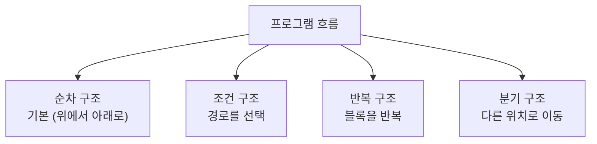
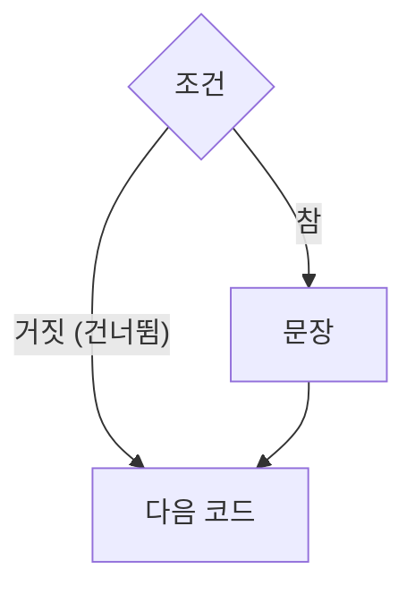
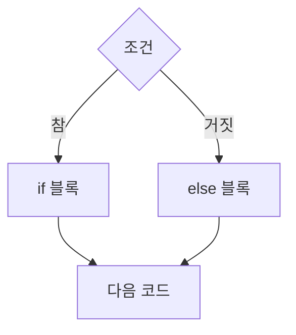
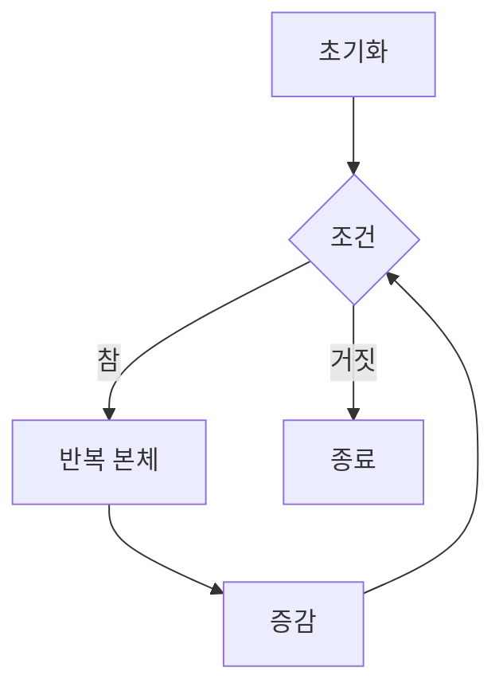
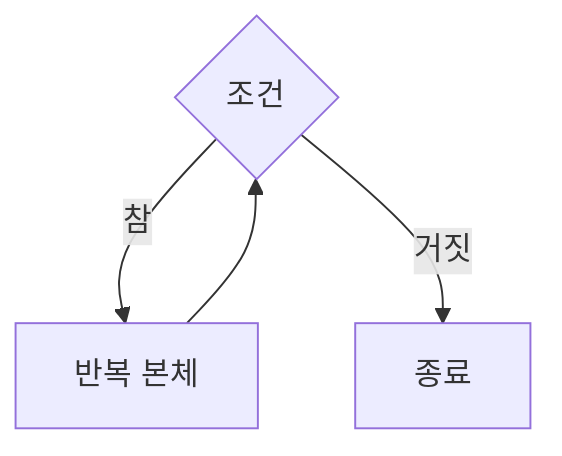
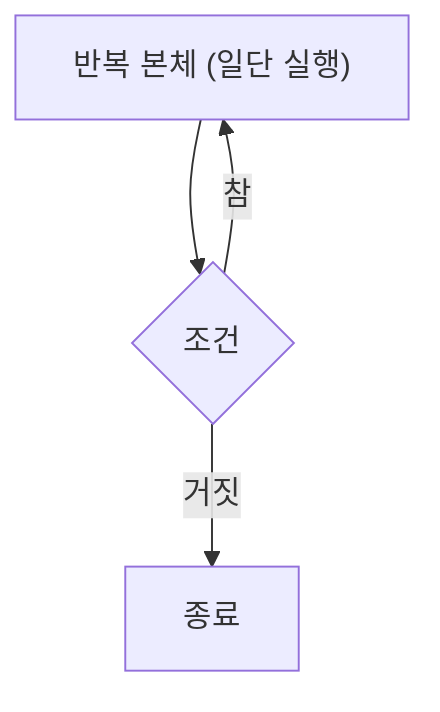

# 5장 — 제어문

[레포지토리 안내](../../README.ko.md) | [English](Concepts_Lecture.md) | [한국어](Concepts_Lecture.ko.md)

> **최종 수정일:** 2026-11-19
>
> Warming-Up C Programming, 천정아, Ch 5

> **학습 목표:**
> 1. 순차, 조건, 반복, 분기 구조를 구분하고 각 구조에 쓰는 C 키워드를 말할 수 있다
> 2. `if`, `if-else`, `else if`, 중첩 `if`로 조건에 따라 실행 경로를 선택할 수 있다
> 3. `switch`문의 규칙과 폴스루 동작을 설명하고 `if-else`와 비교하여 알맞은 문장을 고를 수 있다
> 4. `for`, `while`, `do-while`의 실행 흐름과 최소 실행 횟수를 비교할 수 있다
> 5. `break`, `continue`, `goto`, `return`이 제어를 옮기는 위치를 추적할 수 있다
> 6. 카운터, 누적기, 최댓값 추적, 입력 검증, 메뉴 같은 반복 패턴을 구현할 수 있다

---

## 목차

- [1. 제어문 개요](#1-제어문-개요)
- [2. 조건문](#2-조건문)
  - [2.1 `if`](#21-if)
  - [2.2 복합문 / 블록](#22-복합문--블록)
  - [2.3 `if-else`](#23-if-else)
  - [2.4 `else if`](#24-else-if)
  - [2.5 중첩 `if`](#25-중첩-if)
  - [2.6 독립된 여러 `if`](#26-독립된-여러-if)
  - [2.7 `switch`](#27-switch)
  - [2.8 `if-else`와 `switch` 비교](#28-if-else와-switch-비교)
  - [2.9 `switch` 사용 시 주의 사항](#29-switch-사용-시-주의-사항)
  - [2.10 조건문 작성 시 흔한 실수](#210-조건문-작성-시-흔한-실수)
  - [2.11 조건문 응용: 사칙연산 계산기](#211-조건문-응용-사칙연산-계산기)
- [3. 반복문](#3-반복문)
  - [3.1 `for`](#31-for)
  - [3.2 `while`](#32-while)
  - [3.3 `do-while`](#33-do-while)
  - [3.4 중첩 반복문](#34-중첩-반복문)
  - [3.5 `for` vs `while` vs `do-while` 비교](#35-for-vs-while-vs-do-while-비교)
  - [3.6 루프 제어 변수의 선언과 유효 범위](#36-루프-제어-변수의-선언과-유효-범위)
  - [3.7 `for`의 변형과 널 문장](#37-for의-변형과-널-문장)
  - [3.8 반복문과 입력 버퍼](#38-반복문과-입력-버퍼)
  - [3.9 반복문 작성 시 흔한 실수](#39-반복문-작성-시-흔한-실수)
- [4. 분기문](#4-분기문)
  - [4.1 `break`](#41-break)
  - [4.2 `continue`](#42-continue)
  - [4.3 `goto`](#43-goto)
  - [4.4 `return`](#44-return)
  - [4.5 무한 반복과 탈출 위치](#45-무한-반복과-탈출-위치)
- [5. 자주 사용되는 패턴](#5-자주-사용되는-패턴)
  - [5.1 카운터와 누적기](#51-카운터와-누적기)
  - [5.2 최댓값/최솟값 추적](#52-최댓값최솟값-추적)
  - [5.3 입력 검증 반복](#53-입력-검증-반복)
  - [5.4 메뉴 기반 프로그램](#54-메뉴-기반-프로그램)
  - [5.5 약수와 소수 판별](#55-약수와-소수-판별)
  - [5.6 자릿수 분해와 유클리드 호제법](#56-자릿수-분해와-유클리드-호제법)
- [요약](#요약)
- [점검 문제](#점검-문제)

---

<br>

## 1. 제어문 개요

기본적으로 C는 문장을 **순차적으로**(위에서 아래로) 실행한다. **제어문**은 분기 또는 반복을 통해 이 흐름을 변경한다.



*그림 1. 프로그램 흐름의 네 가지 구조*

| 분류 | 목적 | C 키워드 |
|:----|:----|:--------|
| 조건문 | 조건에 따라 다른 블록 실행 | `if`, `else`, `else if`, `switch`, `case`, `default` |
| 반복문 | 조건이 참인 동안 블록 반복 | `for`, `while`, `do-while` |
| 분기문 | 블록 탈출 또는 건너뛰기 | `break`, `continue`, `goto`, `return` |

*표 1. 제어문의 분류*

**삼항 연산자**(`? :`)는 조건 *식(expression)*이지 문(statement)은 아니지만, `max = (a > b) ? a : b;`처럼 조건문과 비슷한 역할을 한다.

조건문과 반복문이 검사하는 조건은 특별한 타입의 값이 아니라 평범한 수식이다. 관계 연산자(`<`, `==` 등)와 논리 연산자(`&&`, `||`, `!`)는 결과가 참이면 `int`형 값 1을, 거짓이면 0을 만든다(4장). 제어문은 조건식의 값이 0인지 아닌지만 보므로, 관계식이 아닌 `a - 3`이나 `n % 2` 같은 산술식도 조건식으로 쓸 수 있다.

```c
int a = 3, b = 7;

printf("%d %d %d\n", a < b, a == b, !(a < b));
if (a - 3)
    printf("a - 3 is nonzero\n");
else
    printf("a - 3 is zero\n");
```

```text
1 0 0
a - 3 is zero
```

`a < b`는 참이므로 1, `a == b`는 거짓이므로 0, `!(a < b)`는 참을 부정하므로 0이다. `a - 3`의 값은 0이므로 `if`는 거짓으로 판정하고 `else` 쪽 문장을 실행한다.

제어문의 흐름은 **순서도(flowchart)** 로 나타내면 이해하기 쉽다. 순서도에서 마름모는 조건 검사를, 직사각형은 처리를, 화살표는 실행 순서를 나타내며, 2절과 3절의 실행 흐름 그림이 모두 이 방식으로 그린 순서도이다. 조건문은 마름모에서 갈라진 흐름이 다시 한 점에서 합쳐지는 모양이고, 반복문은 화살표가 마름모로 되돌아가는 고리 모양이다. 어떤 제어 구조든 들어가는 곳과 나오는 곳이 하나씩이라는 성질이 구조적 프로그래밍(structured programming)의 기본 원칙이며, 4.3절에서 `goto`를 피하는 이유도 `goto`가 이 성질을 깨기 때문이다.

---

<br>

## 2. 조건문

### 2.1 `if`

`if`문은 조건이 참(0이 아닌 값)일 때**만** 블록을 실행한다.

**문법:**

```c
if (조건) {
    // 조건이 참(0이 아닌 값)일 때 실행
}
```

**실행 흐름:**



*그림 2. if문의 실행 흐름*

```c
int score = 85;

if (score >= 60) {
    printf("합격!\n");
}
```

C에서 0이 아닌 모든 값은 **참(true)** 이고, 0은 **거짓(false)** 이다. 따라서 `if (1)`은 항상 실행되고, `if (0)`은 절대 실행되지 않는다.

`if`의 괄호 뒤에는 문장이 정확히 하나 온다. 여러 문장을 실행하려면 2.2절의 복합문으로 묶어 하나의 문장으로 만든다. 조건식 자리에 `if (n)`처럼 변수 하나만 쓰기도 하는데, 이는 `if (n != 0)`과 같은 뜻이고 `if (!n)`은 `if (n == 0)`과 같은 뜻이다. 짧은 형태는 C 코드에서 흔히 쓰이지만, 처음 배울 때는 비교 연산자를 명시해 값이 0인지 묻는 의도를 드러내는 편이 읽기 쉽다.

### 2.2 복합문 / 블록

**복합문(compound statement, 블록)** 은 중괄호 `{}`로 여러 문장을 묶는 것이다.

```c
if (score >= 90) {
    printf("등급: A\n");
    printf("우수합니다!\n");
}
```

중괄호가 없으면 **첫 번째 문장만** `if`에 속한다.

```c
if (score >= 90)
    printf("등급: A\n");      // if에 속함
    printf("우수합니다!\n");    // 항상 실행됨! (if와 무관)
```

> **주의:** 단일 문장이라도 항상 중괄호 `{}`를 사용하는 것이 좋다. 나중에 코드를 추가할 때 버그를 방지하고, 의도를 명확히 한다.

중괄호의 위치는 두 가지 방식이 널리 쓰인다. 여는 중괄호 `{`를 제어문의 `)` 바로 뒤에 두면 소스 코드의 줄 수가 줄고, `{`를 다음 줄에 따로 두면 여는 중괄호와 닫는 중괄호의 열이 맞아 블록의 범위가 눈에 잘 띈다. 어느 방식이든 블록 안의 문장은 한 단계 들여 쓰고, 한 프로그램 안에서는 한 가지 방식을 일관되게 쓴다.

```c
if (num < 0) {      // 여는 중괄호를 같은 줄에 둔다
    num = -num;
}

if (num < 0)
{                   // 여는 중괄호를 다음 줄에 둔다
    num = -num;
}
```

복합문은 제어문 전용 문법이 아니라 단일 문장이 올 수 있는 곳이면 어디에나 쓸 수 있는 문장이다. 블록 안에서 선언한 변수는 그 블록 안에서만 쓸 수 있으며, 이 규칙은 6장의 유효 범위에서 자세히 다룬다.

### 2.3 `if-else`

참일 때와 거짓일 때, 두 가지 경로를 제공한다.

**문법:**

```c
if (조건) {
    // 참일 때 실행
} else {
    // 거짓일 때 실행
}
```

**실행 흐름:**



*그림 3. if-else문의 실행 흐름*

```c
int num = 7;

if (num % 2 == 0) {
    printf("%d은(는) 짝수\n", num);
} else {
    printf("%d은(는) 홀수\n", num);
}
```

**`if-else` vs 별개의 `if` 두 개:**

```c
// if-else: 정확히 하나의 분기만 실행 (상호 배타적)
if (x > 0) {
    printf("양수\n");
} else {
    printf("양수 아님\n");
}

// 별개의 if 두 개: 각 조건이 독립적으로 검사됨
if (x > 0) {
    printf("양수\n");
}
if (x % 2 == 0) {
    printf("짝수\n");
}
```

값 하나를 고르는 `if-else`는 조건 연산자로 바꿔 쓸 수 있다. 다음 두 코드는 정수 `num`의 절댓값을 `abs_val`에 저장하는 같은 동작을 한다. `num`이 -12이면 두 코드 모두 `abs_val`에 12를 저장한다.

```c
// if-else로 작성
if (num < 0)
    abs_val = -num;
else
    abs_val = num;

// 조건 연산자로 작성
abs_val = (num < 0) ? -num : num;
```

`if-else`는 실행할 **문장**을 고르고, 조건 연산자는 식의 **값**을 고른다. 따라서 조건 연산자는 양쪽이 모두 값을 만드는 식일 때만 쓸 수 있고, 한쪽에서 출력하고 다른 쪽에서 대입하는 것처럼 하는 일이 서로 다른 분기에는 `if-else`를 쓴다.

### 2.4 `else if`

`else if` 사다리는 조건을 **순차적으로** 검사한다. 참인 조건을 찾으면 해당 블록을 실행하고, 나머지 조건은 모두 **건너뛴다**.

**문법:**

```c
if (조건1) {
    // 블록 1
} else if (조건2) {
    // 블록 2
} else if (조건3) {
    // 블록 3
} else {
    // 기본 블록 (선택 사항)
}
```

마지막 `else`는 **선택 사항**이지만, 예외 상황을 처리하기 위해 권장된다.

```c
int score;
printf("점수 입력: ");
scanf("%d", &score);

if (score >= 90) {
    printf("등급: A\n");
} else if (score >= 80) {
    printf("등급: B\n");
} else if (score >= 70) {
    printf("등급: C\n");
} else if (score >= 60) {
    printf("등급: D\n");
} else {
    printf("등급: F\n");
}
```

> **핵심:** 조건이 순서대로 검사되므로, 두 번째 조건 `score >= 80`은 이미 `score >= 90`이 거짓으로 판정된 뒤에 검사되어 점수가 80 이상 90 미만임을 뜻한다. 따라서 `score >= 80 && score < 90`처럼 쓸 **필요가 없다**. C에서 수학처럼 `80 <= score < 90`이라고 쓰면 `(80 <= score) < 90`으로 계산되어 항상 참이 되므로, 범위는 반드시 `&&`로 나누어 써야 한다.

### 2.5 중첩 `if`

`if` 또는 `else` 블록 안에 또 다른 `if`문을 넣는 것이다.

```c
int x, y;
scanf("%d %d", &x, &y);

if (x == 0 && y == 0) {
    printf("원점\n");
} else if (x == 0) {
    printf("y축 위\n");
} else if (y == 0) {
    printf("x축 위\n");
} else {
    if (x > 0 && y > 0) {
        printf("제1사분면\n");
    } else if (x < 0 && y > 0) {
        printf("제2사분면\n");
    } else if (x < 0 && y < 0) {
        printf("제3사분면\n");
    } else {
        printf("제4사분면\n");
    }
}
```

깊게 중첩된 `if`문은 가독성이 떨어지므로, `else if` 사다리나 조기 반환(early return)을 사용하여 구조를 평탄하게 만드는 것이 좋다.

중첩 `if`에서 중괄호를 생략하면 `else`가 어느 `if`에 속하는지 헷갈리기 쉽다. C의 규칙은 `else`가 **아직 짝이 없는 가장 가까운 `if`** 와 짝을 이룬다는 것이며, 들여쓰기는 이 규칙에 아무 영향을 주지 않는다. 이 모호함을 **매달린 else(dangling else)** 문제라고 한다.

```c
int a = 5, b = -3;

if (a > 0)
    if (b > 0)
        printf("both positive\n");
else
    printf("a is not positive\n");
```

```text
a is not positive
```

들여쓰기만 보면 `else`가 바깥쪽 `if (a > 0)`에 속하는 것처럼 보이지만, 실제로는 가장 가까운 안쪽 `if (b > 0)`과 짝을 이룬다. `a`가 5이므로 바깥쪽 조건은 참이고, 안쪽 조건 `b > 0`이 거짓이므로 안쪽 `if`의 `else`가 실행되어 의도와 반대되는 메시지가 출력된다. 이 코드를 `-Wall`로 컴파일하면 Clang은 `add explicit braces to avoid dangling else` 경고를 낸다. 바깥쪽 `if`에 `else`를 붙이려면 안쪽 `if`를 중괄호로 감싼다.

```c
if (a > 0) {
    if (b > 0)
        printf("both positive\n");
} else {
    printf("a is not positive\n");
}
```

중괄호를 넣으면 안쪽 `if`가 블록 안에서 끝나므로 `else`는 바깥쪽 `if`와 짝을 이루고, `a`가 5이고 `b`가 -3이면 이 코드는 아무것도 출력하지 않는다.

`else` 블록 안에 다른 문장 없이 `if`문 하나만 있으면 그 `else`와 `if`를 붙여 `else if`로 쓸 수 있다. 즉 `else if`는 별도의 키워드가 아니라 `else` 다음에 `if`문이 온 형태이다. 다음 두 코드는 8세 미만은 무료, 65세 이상은 5000원, 그 밖에는 10000원인 입장료를 같은 방식으로 계산한다.

```c
// else 블록 안의 중첩 if
if (age < 8)
    fee = 0;
else {
    if (age >= 65)
        fee = 5000;
    else
        fee = 10000;
}

// 같은 판단을 else if로 작성
if (age < 8)
    fee = 0;
else if (age >= 65)
    fee = 5000;
else
    fee = 10000;
```

### 2.6 독립된 여러 `if`

조건이 **상호 배타적이지 않을 때**는 별개의 `if`문을 사용한다. 각 조건이 독립적으로 평가된다.

```c
int temp = 35;

if (temp > 30) {
    printf("더움\n");       // 출력됨
}
if (temp > 20) {
    printf("따뜻함\n");     // 역시 출력됨
}
if (temp > 10) {
    printf("온화함\n");     // 역시 출력됨
}
```

세 조건 모두 참이므로 세 메시지가 모두 출력된다. 이를 `else if`와 비교하면, `else if`에서는 **첫 번째** 일치 블록만 실행된다.

독립된 조건은 앞의 조건과 관계없이 따로 검사해야 한다. 다음 프로그램은 나이로 기본 입장료를 정한 뒤, 지역 주민(`resident`가 1)이면 나이와 관계없이 1000원을 할인한다. 할인 조건을 앞의 `else if` 사다리에 이어 붙이면 나이 조건 중 하나가 참이 되는 순간 할인 검사를 건너뛰게 되므로, 할인은 별도의 `if`로 검사한다. `fee > 0`은 무료 입장에서 할인 때문에 요금이 음수가 되는 것을 막는 조건이다.

```c
int age, resident, fee;

scanf("%d %d", &age, &resident);
if (age < 8)
    fee = 0;
else if (age >= 65)
    fee = 5000;
else
    fee = 10000;

if (resident == 1 && fee > 0)   // 나이 판단과 독립된 조건
    fee -= 1000;

printf("fee = %d\n", fee);
```

| 입력 (`age resident`) | 기본 입장료 | 출력 |
|:-----|-----:|:-----|
| `5 1` | 0 | `fee = 0` |
| `30 1` | 10000 | `fee = 9000` |
| `70 0` | 5000 | `fee = 5000` |
| `70 1` | 5000 | `fee = 4000` |

*표 2. 입장료 프로그램의 입력별 실행 결과*

### 2.7 `switch`

`switch`문은 **정수 또는 문자 식**의 값에 따라 블록을 선택한다. 여러 이산적(discrete) 값을 비교할 때 긴 `else if` 사다리보다 깔끔하다.

**문법:**

```c
switch (식) {
case 값1:
    // 문장
    break;
case 값2:
    // 문장
    break;
// ...
default:
    // 일치하는 case가 없을 때 실행
}
```

```c
char unit;
printf("온도 단위 (C/F): ");
scanf(" %c", &unit);

switch (unit) {
case 'C':
case 'c':
    printf("섭씨\n");
    break;
case 'F':
case 'f':
    printf("화씨\n");
    break;
default:
    printf("잘못된 단위!\n");
}
```

**핵심 규칙:**

| 규칙 | 설명 |
|:----|:----|
| 식의 타입 | `char`, `int`, `long` 같은 정수형이어야 한다. `float`, `double`, 문자열은 **불가**하다. |
| case 레이블 | 정수 **상수** 식이어야 한다 (변수 불가). |
| `break` | **폴스루(fall-through)** 를 방지하려면 필요하다. 없으면 다음 case의 문장이 이어서 실행된다. |
| `default` | 선택 사항이며, 어떤 case에도 일치하지 않는 값을 처리한다. |
| 중복 case | 불가하다. 각 case 레이블은 고유해야 한다. |

*표 3. switch문의 핵심 규칙*

**폴스루 동작 (`break` 누락):**

```c
int n = 1;
switch (n) {
case 1:
    printf("one\n");      // 출력됨
    // break 없음!
case 2:
    printf("two\n");      // 역시 출력됨! (폴스루)
    break;
case 3:
    printf("three\n");
    break;
}
// 출력: one
//       two
```

> **주의:** `break`를 빠뜨리는 것은 C에서 가장 흔한 버그 중 하나이다. 의도적인 폴스루(`'C'`와 `'c'`를 묶는 경우 등)는 명확히 표시해야 한다.

**`switch`로 정수 범위 처리 (성적 등급 매기기):**

```c
int score = 85;
switch (score / 10) {
case 10:
case 9:
    printf("A\n");
    break;
case 8:
    printf("B\n");
    break;
case 7:
    printf("C\n");
    break;
case 6:
    printf("D\n");
    break;
default:
    printf("F\n");
}
```

### 2.8 `if-else`와 `switch` 비교

| 특성 | `if-else` | `switch` |
|:----|:---------|:---------|
| 조건 타입 | 임의의 논리 식 | 정수/문자 동등 비교만 가능 |
| 범위 검사 | `score >= 90` | 직접 불가 (`score / 10` 사용) |
| 다중 값 | `if (x == 1 \|\| x == 2)` | `case 1: case 2:` (폴스루) |
| 실수/문자열 | 지원 | 미지원 |
| 가독성 | 범위/복합 조건에 적합 | 많은 이산 값에 적합 |
| 성능 | 순차 검사 | 점프 테이블 사용 가능 (case가 많을 때 빠름) |

*표 4. if-else문과 switch문의 비교*

하나의 변수를 여러 **상수 정수/문자 값**과 비교할 때는 `switch`를 사용하는 것이 좋고, 범위, 실수 비교, 복합 조건에는 `if-else`를 사용한다.

### 2.9 `switch` 사용 시 주의 사항

`switch`는 일치하는 `case`로 이동한 다음, `break`나 `switch`의 끝을 만날 때까지 그 아래의 문장을 차례로 실행한다. `case` 레이블은 실행을 시작할 위치를 표시할 뿐 구역을 나누는 칸막이가 아니므로, `break`가 없으면 다음 `case`의 문장도 실행된다. 다음 코드는 모든 `break`를 생략한 메뉴 처리이다.

```c
int menu = 2;

switch (menu) {
case 1:
    printf("open\n");
case 2:
    printf("edit\n");
case 3:
    printf("save\n");
default:
    printf("invalid\n");
}
```

```text
edit
save
invalid
```

실행 순서는 세 단계로 정리된다. 첫째, 정수식 `menu`를 한 번 평가하여 2를 얻는다. 둘째, 값이 2인 `case 2`를 찾아 그 위치로 이동한다. 셋째, `case 2`, `case 3`, `default`의 문장을 차례로 실행하고 `switch`의 끝에서 빠져나간다. `case 1`의 문장은 이동한 위치보다 위에 있으므로 실행되지 않는다.

`default`는 생략할 수 있다. 일치하는 `case`가 없고 `default`도 없으면 `switch`는 아무 문장도 실행하지 않고 끝난다. `default`는 `switch` 안의 어느 위치에 두어도 일치하는 `case`가 없을 때만 선택되지만, 읽기 쉽도록 보통 맨 끝에 둔다. 맨 끝의 `default`에는 `break`가 없어도 결과가 같지만, 나중에 그 뒤에 `case`를 추가할 때 생기는 폴스루를 막기 위해 `default`에도 `break`를 쓰는 것이 안전하다.

`case` 레이블에는 `1`, `'A'`, `2 + 3`처럼 컴파일할 때 값이 정해지는 **정수 상수식**만 올 수 있다. `case n:`처럼 변수를 쓰거나 `case 1.5:`처럼 실수를 쓰면 컴파일 오류이다. 범위 하나를 `case` 하나로 쓰는 표준 문법은 없으므로, 범위 검사는 `if`로 하거나 2.7절의 `score / 10`처럼 범위를 정수 하나로 바꾸어 비교한다.

`case` 레이블 바로 다음에 변수 선언을 쓰는 것도 주의해야 한다. C17까지의 표준에서 레이블 다음에는 문장만 올 수 있고 선언은 문장이 아니므로, 다음 코드는 표준을 엄격히 따르는 컴파일러에서 오류가 된다. 이 코드를 컴파일한 Clang은 C23의 확장 기능이라는 경고를 낸다.

```c
switch (op) {
case 1:
    int sum = a + b;    // 레이블 다음에 선언이 온다
    printf("%d\n", sum);
    break;
}
```

```text
warning: label followed by a declaration is a C23 extension [-Wc23-extensions]
```

`case`의 문장을 중괄호로 묶어 블록을 만들면 선언이 블록 안의 첫 항목이 되므로 어느 표준에서나 올바른 코드가 되고, 변수의 유효 범위도 그 `case` 안으로 한정된다.

```c
switch (op) {
case 1: {
    int sum = a + b;    // 블록 안의 선언
    printf("%d\n", sum);
    break;
}
}
```

> **참고:** **폴스루 경고.** 의도하지 않은 폴스루를 찾기 위해 Clang과 GCC는 `-Wimplicit-fallthrough` 옵션을 제공한다. 위의 메뉴 코드를 이 옵션으로 컴파일하면 Clang은 `break` 없이 이어지는 `case 2:`, `case 3:`, `default:`마다 `unannotated fall-through between switch labels` 경고를 낸다. 이 옵션은 `-Wall`에 포함되지 않으므로 따로 지정해야 한다.

### 2.10 조건문 작성 시 흔한 실수

조건문의 오류는 대부분 컴파일은 되지만 의도와 다르게 동작하는 논리 오류이다. 다음 표는 자주 나타나는 다섯 가지 실수를 정리한 것이다.

| 실수 | 잘못된 코드 | 실제 동작 | 올바른 코드 |
|:-----|:-----|:-----|:-----|
| 대입과 비교의 혼동 | `if (x = 0)` | `x`에 0을 대입하고 식의 값 0을 조건으로 쓰므로 블록이 실행되지 않고 `x`의 값도 바뀜 | `if (x == 0)` |
| 조건 뒤의 세미콜론 | `if (x > 0);` | 빈 문장이 `if`의 본체가 되어 다음 블록은 조건과 관계없이 항상 실행됨 | `if (x > 0)` |
| 수학식 형태의 범위 | `if (0 < x < 10)` | `(0 < x) < 10`으로 계산되어 0이나 1을 10과 비교하므로 항상 참 | `if (0 < x && x < 10)` |
| 실수의 동등 비교 | `if (0.1 + 0.2 == 0.3)` | 2진 표현의 반올림 오차 때문에 거짓 | `if (fabs(a - b) < 1e-9)`처럼 오차 범위로 비교 |
| 문자와 문자열의 혼동 | `case "A":` | 문자열은 정수 상수가 아니므로 컴파일 오류 | `case 'A':` |

*표 5. 조건문 작성 시 흔한 실수*

첫 번째 실수는 특히 찾기 어렵다. 대입식 `x = 0`의 값은 대입된 값 0이므로 조건은 항상 거짓이 되고, 반대로 `if (x = 5)`는 항상 참이 된다. 어느 경우든 `x`의 원래 값은 사라진다. `x`가 5일 때 `if (x = 0)`을 실행한 뒤 `x`를 출력하면 `x = 0`이 나온다. Clang은 `-Wall`에서 `using the result of an assignment as a condition without parentheses` 경고를 내므로, 경고를 켜고 컴파일하면 이런 실수를 미리 찾을 수 있다. 세 번째 실수는 C 표준에서는 올바른 수식이지만, Apple Clang 21은 `chained comparison 'X < Y < Z' does not behave the same as a mathematical expression` 오류로 거부한다. 네 번째 실수에서 `fabs`는 `<math.h>`의 절댓값 함수이며, 실수의 표현 오차는 3장의 IEEE 754 형식에서 생긴다.

### 2.11 조건문 응용: 사칙연산 계산기

조건문을 종합한 예로, `3.5 * 2`처럼 입력한 수식을 계산하는 프로그램을 작성한다. 연산자는 문자 하나이므로 `switch`로 고르고, 0으로 나누는 경우는 `case '/'` 안의 `if`로 따로 검사한다.

```c
#define _CRT_SECURE_NO_WARNINGS
#include <stdio.h>

int main(void)
{
    double a, b;
    char op;

    printf("expression? ");
    if (scanf("%lf %c %lf", &a, &op, &b) != 3) {
        printf("invalid input\n");
        return 1;
    }

    switch (op) {
    case '+':
        printf("%.2f + %.2f = %.2f\n", a, b, a + b);
        break;
    case '-':
        printf("%.2f - %.2f = %.2f\n", a, b, a - b);
        break;
    case '*':
    case 'x':
        printf("%.2f * %.2f = %.2f\n", a, b, a * b);
        break;
    case '/':
        if (b == 0.0)
            printf("division by zero\n");
        else
            printf("%.2f / %.2f = %.2f\n", a, b, a / b);
        break;
    default:
        printf("unknown operator %c\n", op);
        break;
    }
    return 0;
}
```

각 부분이 하는 일은 다음과 같다.

- `scanf("%lf %c %lf", &a, &op, &b)`는 실수, 문자, 실수를 차례로 읽는다. 형식 문자열의 빈칸은 입력의 공백을 건너뛰므로 `7 / 2`와 `7/2`를 모두 읽을 수 있다. 세 값을 모두 읽으면 3을 반환하므로, 3이 아니면 잘못된 입력으로 보고 `return 1`로 프로그램을 끝낸다.
- `switch (op)`는 `char`형 연산자를 정수 상수인 문자 리터럴 `'+'`, `'-'` 등과 비교한다.
- `case '*':`와 `case 'x':`는 의도적으로 폴스루를 이용해 두 문자를 같은 곱셈으로 처리한다.
- `case '/'` 안의 `if`는 나누는 수가 0인지 먼저 검사한다. 실수 0.0으로 나누면 C에서 오류가 나지 않고 `inf` 같은 특수한 값이 나오므로 프로그램이 직접 검사해야 한다.
- `default`는 네 연산자 중 어느 것도 아닌 문자를 처리한다.

```text
expression? 7 / 2
7.00 / 2.00 = 3.50
expression? 3 x 4
3.00 * 4.00 = 12.00
expression? 5 / 0
division by zero
expression? 2 ^ 3
unknown operator ^
expression? abc
invalid input
```

같은 계산기를 `else if` 사다리(`if (op == '+') ... else if (op == '-') ...`)로도 작성할 수 있다. 연산자 문자 하나를 여러 상수와 비교하는 이 문제에서는 `switch`가 비교 대상을 한 번만 쓰므로 더 간결하고, 0으로 나누기처럼 범위나 실수 조건이 필요한 부분에만 `if`를 섞어 쓰는 것이 두 문장의 장점을 함께 살리는 방법이다.

---

<br>

## 3. 반복문

### 3.1 `for`

`for` 반복문은 **반복 횟수가 미리 정해져 있을 때** 가장 적합하다.

**문법:**

```c
for (초기화; 조건; 증감) {
    // 반복 본체
}
```

**실행 흐름:**



*그림 4. for문의 실행 흐름*

1. **초기화:** 반복문 시작 전에 한 번만 실행된다.
2. **조건:** 매 반복 전에 검사하며, 거짓이면 반복문을 종료한다.
3. **반복 본체:** 조건이 참이면 실행된다.
4. **증감:** 매 반복 후에 실행되고, 다시 2단계로 돌아간다.

```c
// 1부터 5까지 출력
for (int i = 1; i <= 5; i++) {
    printf("%d ", i);
}
// 출력: 1 2 3 4 5
```

반복이 진행되는 모습은 루프 제어 변수 `i`와 누적 변수 `sum`의 값을 회차마다 출력하면 확인할 수 있다.

```c
int i, sum = 0;

for (i = 1; i <= 5; i++) {
    sum += i;
    printf("i = %d, sum = %d\n", i, sum);
}
printf("after loop: i = %d\n", i);
```

```text
i = 1, sum = 1
i = 2, sum = 3
i = 3, sum = 6
i = 4, sum = 10
i = 5, sum = 15
after loop: i = 6
```

조건 `i <= 5`는 모두 6번 검사된다. 앞의 5번은 참이어서 본체가 실행되고, `i`가 6이 된 뒤의 6번째 검사가 거짓이어서 반복이 끝난다. 따라서 반복이 끝난 뒤 `i`의 값은 마지막으로 처리한 5가 아니라 6이다. 일반적으로 `a <= b`일 때 `for (i = a; i <= b; i++)`의 본체는 `b - a + 1`번 실행되고, `n >= 0`일 때 `for (i = 0; i < n; i++)`의 본체는 `n`번 실행된다. 0부터 시작하여 `<`로 끝을 검사하는 두 번째 형태는 7장에서 원소가 n개인 배열의 인덱스 0부터 n - 1까지를 훑는 표준 형태가 된다.

**자주 쓰는 패턴:**

```c
// 역순 카운트
for (int i = 10; i >= 1; i--) {
    printf("%d ", i);
}

// 2씩 증가
for (int i = 0; i <= 10; i += 2) {
    printf("%d ", i);
}

// 1~100 합계
int sum = 0;
for (int i = 1; i <= 100; i++) {
    sum += i;
}
printf("합계: %d\n", sum);  // 5050
```

**`for`의 구성 요소 생략:**

```c
int i = 0;
for ( ; i < 5; ) {      // 초기화와 증감 생략
    printf("%d ", i);
    i++;
}

for (;;) {               // 무한 반복 (모든 요소 생략)
    // break로 탈출
}
```

> **주의:** `break`나 `return` 없는 무한 반복문은 끝나지 않고 계속 실행되어 프로그램이 멈춘 것처럼 보인다.

초기식, 조건식, 증감식을 모두 생략해도 두 세미콜론은 반드시 써야 하며, `for ()`는 컴파일 오류이다. 조건식을 생략하면 항상 참으로 간주되므로 `for (;;)`는 `while (1)`과 같은 무한 반복이 된다. 콘솔에서 무한 반복에 빠진 프로그램은 Ctrl+C로 강제 종료한다.

### 3.2 `while`

`while` 반복문은 **종료 조건이 실행 중 입력이나 이벤트에 따라 결정될 때** 가장 적합하다.

**문법:**

```c
while (조건) {
    // 반복 본체
}
```

**실행 흐름:**



*그림 5. while문의 실행 흐름*

조건은 매 반복 **전에** 검사된다. 처음부터 거짓이면 본체가 한 번도 실행되지 않는다.

```c
// 감시값(sentinel) 제어 반복: -1이면 종료
int num, sum = 0, count = 0;

printf("정수 입력 (종료: -1): ");
scanf("%d", &num);

while (num != -1) {
    sum += num;
    count++;
    printf("정수 입력 (종료: -1): ");
    scanf("%d", &num);
}

if (count > 0) {
    printf("합계: %d, 평균: %.2f\n", sum, (double)sum / count);
}
```

이 반복문에서 -1은 처리할 데이터가 아니라 입력이 끝났음을 알리는 표시이다. 이런 값을 **감시값(sentinel)** 이라고 하며, 감시값은 정상적인 데이터로 나올 수 없는 값으로 정해야 한다. 감시값을 읽은 회차에는 합계와 개수를 갱신하지 않아야 하므로, 첫 값을 반복문 앞에서 한 번 읽고 다음 값은 본체의 끝에서 읽어, 조건 `num != -1`이 값을 읽은 직후에 검사되게 한다. 입력이 `10 20 -1`이면 `num`은 10, 20, -1의 순서로 바뀌고, `sum`은 10, 30이 되며 -1은 더해지지 않는다.

**`break`를 이용한 무한 반복:**

```c
while (1) {
    int n;
    printf("양수를 입력하세요: ");
    scanf("%d", &n);
    if (n > 0) {
        printf("입력한 값: %d\n", n);
        break;
    }
    printf("잘못된 입력! 다시 시도하세요.\n");
}
```

### 3.3 `do-while`

`do-while` 반복문은 본체를 **최소 한 번 반드시 실행**한 후 조건을 검사한다.

**문법:**

```c
do {
    // 반복 본체
} while (조건);  // <-- 세미콜론 필수!
```

**실행 흐름:**



*그림 6. do-while문의 실행 흐름*

```c
int choice;
do {
    printf("1. 실행  2. 종료\n");
    printf("선택: ");
    scanf("%d", &choice);
    if (choice < 1 || choice > 2) {
        printf("잘못된 선택!\n");
    }
} while (choice != 2);
printf("종료합니다!\n");
```

> **주의:** `do-while`문에서 `while(조건);` 뒤의 **세미콜론**을 빠뜨리지 않아야 한다. 흔한 문법 오류이다.

**최소 한 번 실행 보장:**

```c
// do-while: x > 10이어도 본체가 한 번은 실행됨
int x = 100;
do {
    printf("x = %d\n", x);  // 한 번 출력됨
} while (x < 10);

// while: x > 10이면 본체가 실행되지 않음
while (x < 10) {
    printf("x = %d\n", x);  // 출력되지 않음
}
```

### 3.4 중첩 반복문

반복문 안에 또 다른 반복문을 넣는 것이다. **내부 반복문은** 외부 반복문의 한 번의 반복마다 **모든 반복을 완료**한다.

**좌측 정렬 삼각형 패턴:**

```c
int n = 4;
for (int i = 1; i <= n; i++) {        // 행
    for (int j = 1; j <= i; j++) {    // 열
        printf("*");
    }
    printf("\n");
}
```

출력:
```text
*
**
***
****
```

바깥쪽 반복문의 `i`가 행 번호이고, 안쪽 반복문은 `j`를 1부터 `i`까지 움직이며 `*`를 찍는다. 안쪽 반복의 끝 값이 바깥쪽의 `i`에 따라 달라지므로 1행에는 1개, 2행에는 2개처럼 행마다 별의 개수가 하나씩 늘어난다. 안쪽 반복이 끝날 때마다 `printf("\n")`으로 줄을 바꾸며, 출력되는 별의 총개수는 1 + 2 + 3 + 4 = 10이다. 일반적으로 n행 삼각형의 안쪽 본체는 n(n + 1)/2번 실행되므로, 중첩 반복문의 실행 횟수는 바깥쪽 횟수와 안쪽 횟수의 곱이나 합으로 따져 확인한다.

**우측 정렬 삼각형 패턴:**

```c
int n = 4;
for (int i = 1; i <= n; i++) {
    for (int j = 1; j <= n - i; j++) {   // 앞쪽 공백
        printf(" ");
    }
    for (int j = 1; j <= i; j++) {       // 별
        printf("*");
    }
    printf("\n");
}
```

출력:
```text
   *
  **
 ***
****
```

**구구단 (2차원 출력):**

```c
for (int i = 1; i <= 9; i++) {
    for (int j = 1; j <= 9; j++) {
        printf("%3d", i * j);
    }
    printf("\n");
}
```

**부호 교대 합계 (`1-2+3-4+...+9-10`):**

```c
int sum = 0;
for (int i = 1; i <= 10; i++) {
    if (i % 2 == 1) {
        sum += i;
    } else {
        sum -= i;
    }
}
printf("결과: %d\n", sum);  // -5
```

### 3.5 `for` vs `while` vs `do-while` 비교

| 특성 | `for` | `while` | `do-while` |
|:----|:------|:--------|:-----------|
| 적합한 경우 | 반복 횟수가 정해진 경우 | 횟수 미정, 이벤트 기반 | 최소 한 번 실행 필요 |
| 조건 검사 시점 | 매 반복 전 | 매 반복 전 | 매 반복 후 |
| 최소 실행 횟수 | 0 | 0 | 1 |
| 대표 용도 | 카운팅, 배열 순회 | 감시값 반복, 입력 읽기 | 입력 검증, 메뉴 |
| 문법 | `for (초기화; 조건; 증감)` | `while (조건)` | `do { } while (조건);` |

*표 6. for, while, do-while문의 비교*

`for` 반복문은 언제나 `while` 반복문으로 바꿀 수 있고 그 반대도 가능하므로, 의도를 가장 명확히 전달하는 형태를 선택한다.

```c
// 동치인 반복문:

// for 버전
for (int i = 0; i < 5; i++) {
    printf("%d ", i);
}

// while 버전
int i = 0;
while (i < 5) {
    printf("%d ", i);
    i++;
}
```

### 3.6 루프 제어 변수의 선언과 유효 범위

> **용어 정의:** **루프 제어 변수(loop control variable)** 는 `for`의 초기식, 조건식, 증감식에서 반복 횟수를 제어하는 변수이다. 루프 제어 변수의 값은 회차마다 바뀌어야 하며, 어느 시점에는 조건식을 거짓으로 만들어 반복이 끝나게 해야 한다.

루프 제어 변수는 두 위치에서 선언할 수 있다. ANSI C(C89/C90)는 변수를 블록의 시작 부분에서만 선언할 수 있게 하므로, 함수의 앞부분에서 `int i;`를 선언하고 `for (i = 0; ...)`처럼 대입만 한다. C99부터는 `for (int i = 0; ...)`처럼 초기식에서 바로 선언할 수 있다. 교재의 예제는 ANSI C 방식을 따르고, Visual Studio 2022를 포함한 현재의 컴파일러는 두 방식을 모두 지원한다.

두 방식은 변수의 유효 범위가 다르다. 함수 앞부분에서 선언한 `i`는 반복문이 끝난 뒤에도 남으므로 3.1절의 예처럼 마지막 값 6을 확인할 수 있다. 초기식에서 선언한 `i`의 유효 범위는 그 `for`문 안으로 한정되므로, 반복문 다음에서 `i`를 쓰면 컴파일 오류가 난다.

```c
for (int i = 0; i < 3; i++)
    printf("%d ", i);
printf("%d\n", i);      // i는 이미 유효 범위 밖
```

```text
error: use of undeclared identifier 'i'
```

초기식에서 선언한 변수는 반복문이 끝나면 사라지므로, 같은 함수 안의 다음 `for`문에서 `int i`를 다시 선언해도 된다. 반복이 끝난 뒤의 값이 필요하면 함수 앞부분에서 선언하고, 필요하지 않으면 초기식에서 선언하여 변수가 쓰이는 범위를 좁히는 것이 실수를 줄인다.

### 3.7 `for`의 변형과 널 문장

`for`의 증감식은 `i++`만 쓰는 것이 아니다. `i--`로 감소시키거나, `i += 2`로 2씩 늘리거나, `i *= 10`으로 10배씩 늘릴 수도 있다. 다음 표는 증감식에 따라 루프 제어 변수가 갖는 값을 정리한 것이다.

| `for`문의 머리 | 본체가 실행될 때 `i`의 값 | 실행 횟수 |
|:-----|:-----|-----:|
| `for (i = 5; i >= 0; i--)` | 5, 4, 3, 2, 1, 0 | 6 |
| `for (i = 1; i < 100; i += 2)` | 1, 3, 5, ..., 99 | 50 |
| `for (i = 1; i <= 100000; i *= 10)` | 1, 10, 100, 1000, 10000, 100000 | 6 |
| `for (i = 0; i > 5; i++)` | 없음 (처음부터 조건이 거짓) | 0 |

*표 7. 증감식에 따른 루프 제어 변수의 값*

초기식과 증감식에는 **콤마 연산자**로 여러 식을 쓸 수 있다. 콤마 연산자는 왼쪽 식부터 차례로 평가하므로, 두 변수를 함께 움직이는 반복을 한 줄로 쓸 수 있다.

```c
int i, j;

for (i = 0, j = 10; i < j; i += 3, j -= 3)
    printf("i = %d, j = %d\n", i, j);
printf("end: i = %d, j = %d\n", i, j);
```

```text
i = 0, j = 10
i = 3, j = 7
end: i = 6, j = 4
```

회차마다 `i`는 3씩 늘고 `j`는 3씩 줄어든다. 세 번째 검사에서 `i`가 6, `j`가 4가 되어 `i < j`가 거짓이 되므로 본체는 두 번 실행된다. 조건식에는 식을 하나만 쓰는 것이 원칙이다. `i < 5, j > 0`처럼 콤마로 이으면 마지막 식 `j > 0`의 값만 조건으로 쓰이므로, 두 조건을 함께 검사하려면 `&&`를 쓴다.

`for`의 반복할 문장도 생략할 수 있다. 세미콜론 하나만으로 이루어진 문장은 아무 일도 하지 않으며, 이 문법 때문에 `for`의 괄호 뒤에 실수로 세미콜론을 붙이면 그 빈 문장이 반복 본체가 된다.

> **용어 정의:** **널 문장(null statement)** 은 세미콜론 하나만으로 이루어져 아무 동작도 하지 않는 문장이다. 문법상 문장이 필요하지만 할 일이 없는 자리에 쓴다.

```c
int i;

for (i = 0; i < 5; i++);    // 반복 본체는 널 문장
    printf("i = %d\n", i);
```

```text
i = 5
```

들여쓰기만 보면 `printf`가 반복될 것처럼 보이지만, 실제 반복 본체는 `;`이다. 반복문은 아무 일도 하지 않고 `i`를 5까지 증가시킨 뒤 끝나고, 그다음 문장인 `printf`가 한 번 실행되어 `i = 5`를 출력한다. Clang은 이 코드에 `for loop has empty body` 경고를 낸다. `while (조건);`도 같은 문제를 일으키며, 조건이 처음에 참이면 본체가 조건에 관련된 값을 바꾸지 않으므로 무한 반복이 된다. 의도적으로 빈 본체를 쓸 때는 세미콜론을 다음 줄에 따로 두거나 `{ }`로 써서 실수가 아님을 드러낸다.

### 3.8 반복문과 입력 버퍼

키보드로 입력한 내용은 `scanf`로 바로 전달되지 않고 먼저 입력 버퍼에 쌓인다. 반복문 안에서 입력을 읽을 때 생기는 문제는 대부분 이 버퍼의 동작을 이해하면 설명된다.

> **용어 정의:** **입력 버퍼(input buffer)** 는 키보드로 입력한 문자들을 프로그램이 읽어 갈 때까지 저장해 두는 메모리 영역이다. 콘솔에서는 Enter 키를 누르는 순간 그 줄의 문자와 줄바꿈 문자 `'\n'`이 함께 버퍼에 들어간다.

`scanf`는 입력 버퍼가 비어 있을 때만 새 입력을 기다리므로, 앞의 `scanf`가 읽지 않고 남긴 문자는 다음 `scanf`가 먼저 가져간다. 정수와 실수를 읽는 `%d`, `%lf`는 앞에 있는 공백 문자(빈칸, 탭, 줄바꿈)를 건너뛰지만, 문자 하나를 읽는 `%c`는 공백 문자도 문자로 읽는다. 다음 프로그램은 폭과 높이를 읽은 뒤 사각형을 그릴 문자를 읽으며, 첫 번째 `%c`가 무엇을 읽는지 확인하기 위해 읽은 문자의 코드값을 출력한다.

```c
#define _CRT_SECURE_NO_WARNINGS
#include <stdio.h>

int main(void)
{
    int width, height, i, j;
    char ch;

    printf("width and height? ");
    scanf("%d %d", &width, &height);
    printf("character? ");
    scanf("%c", &ch);
    printf("\nch = %d\n", ch);

    printf("character again? ");
    scanf(" %c", &ch);
    for (i = 0; i < height; i++) {
        for (j = 0; j < width; j++)
            printf("%c", ch);
        printf("\n");
    }
    return 0;
}
```

```text
width and height? 4 2
character?
ch = 10
character again? *
****
****
```

`4 2`를 입력하고 Enter 키를 누르면 버퍼에는 `4`, 빈칸, `2`, `'\n'`이 들어간다. `scanf("%d %d", ...)`가 4와 2를 읽은 뒤에도 `'\n'`이 버퍼에 남으므로, 첫 번째 `scanf("%c", &ch)`는 키 입력을 기다리지 않고 이 `'\n'`을 읽는다. 출력된 코드값 10은 줄바꿈 문자의 ASCII 코드이다. 두 번째 호출처럼 `%c` 앞에 빈칸을 넣은 `" %c"`는 남아 있는 공백 문자를 모두 건너뛴 뒤 문자를 읽으므로, 새로 입력한 `*`를 읽어 폭 4, 높이 2의 사각형을 그린다. 정수를 읽는 `"%d%d"`는 빈칸이 없어도 공백 문자를 건너뛰므로 이 문제가 생기지 않는다.

반복문 안에서 입력을 읽을 때는 `scanf`의 반환값도 확인해야 한다. `scanf`는 값을 저장하는 데 성공한 변환의 개수를 반환하고, 첫 변환 전에 입력이 끝나면 `EOF`(음수, 보통 -1)를 반환한다. 다음 반복문은 정수를 읽는 데 성공하는 동안만 합계를 누적한다.

```c
int n, sum = 0, count = 0;

while (scanf("%d", &n) == 1) {
    sum += n;
    count++;
}
printf("count = %d, sum = %d\n", count, sum);
```

```text
3 4 10
x 5
count = 3, sum = 17
```

세 정수 3, 4, 10을 읽은 뒤 네 번째 호출은 `x`를 정수로 바꿀 수 없어 0을 반환하므로 반복이 끝나고, `x`와 그 뒤의 `5`는 버퍼에 남는다. 반환값을 확인하지 않고 `while (1)` 안에서 `scanf("%d", &n)`만 되풀이하면, 읽지 못한 `x`가 버퍼에 계속 남아 매 회차 같은 실패가 반복되므로 무한 반복에 빠진다. 입력의 끝은 macOS와 Linux의 터미널에서 Ctrl+D로, Windows의 콘솔에서 Ctrl+Z 다음 Enter로 알린다. Visual Studio에서 `scanf`를 쓸 때 필요한 설정은 3장 실습 5.1절에 정리되어 있다.

### 3.9 반복문 작성 시 흔한 실수

반복문의 실수는 반복 횟수가 하나 많거나 적은 경우와 반복이 끝나지 않는 경우로 나뉜다.

- **경계값 하나 차이(off-by-one):** 1부터 10까지 더하려면서 `for (i = 1; i < 10; i++)`로 쓰면 본체는 9번만 실행되어 10이 빠진다. 시작 값, 끝 값, `<`와 `<=`의 선택을 3.1절의 횟수 공식으로 확인하고, 첫 회차와 마지막 회차의 변수 값을 직접 대입해 보는 것이 가장 확실하다.
- **갱신 누락:** `while (i < 5) { printf("%d", i); }`처럼 본체에서 `i`를 바꾸지 않으면 조건이 영원히 참이다. `while`과 `do-while`은 `for`와 달리 갱신 위치가 머리에 없으므로, 본체 안에서 조건에 관련된 변수가 바뀌는지 확인한다.
- **잘못된 방향의 갱신:** `for (i = 10; i > 0; i++)`는 `i`가 커지기만 하므로 조건이 거짓이 되지 않는다. 실제로는 `int`의 최댓값을 넘는 순간 부호 있는 정수 오버플로가 일어나는데, 이는 정의되지 않은 동작이므로 결과를 예측할 수 없다.
- **실수형 루프 제어 변수:** 0.1은 2진수로 정확히 표현되지 않으므로, 0.1을 10번 더한 값은 1.0과 같지 않다.

```c
double x = 0.0;
int k;

for (k = 0; k < 10; k++)
    x += 0.1;
printf("x = %.17f\n", x);
printf("x == 1.0 is %d\n", x == 1.0);
```

```text
x = 0.99999999999999989
x == 1.0 is 0
```

따라서 `for (x = 0.0; x != 1.0; x += 0.1)`은 `x`가 1.0을 정확히 지나치지 않아 끝나지 않는다. 반복 횟수는 정수 변수로 세고, 실수 값은 `x = k * 0.1`처럼 정수로부터 계산하는 것이 안전하다.

---

<br>

## 4. 분기문

### 4.1 `break`

`break`는 **가장 안쪽의 반복문** 또는 `switch`문을 즉시 탈출한다.

```c
for (int i = 1; i <= 100; i++) {
    if (i * i > 50) {
        printf("i^2 > 50인 첫 번째 i: %d\n", i);
        break;  // for 반복문 탈출
    }
}
```

중첩 반복문에서 `break`는 **내부** 반복문만 탈출한다.

```c
for (int i = 0; i < 3; i++) {
    for (int j = 0; j < 3; j++) {
        if (j == 1) {
            break;  // 내부 반복문만 탈출
        }
        printf("(%d,%d) ", i, j);
    }
}
// 출력: (0,0) (1,0) (2,0)
```

바깥쪽 반복의 `i`가 0, 1, 2일 때마다 안쪽 반복은 `j`가 0인 회차만 출력하고, `j`가 1이 되면 `break`로 안쪽 반복만 끝낸다. 바깥쪽 반복은 영향을 받지 않으므로 `i`가 바뀔 때마다 안쪽 반복이 다시 처음부터 시작된다. 바깥쪽 반복까지 한 번에 끝내는 방법은 4.5절에서 다룬다.

### 4.2 `continue`

`continue`는 **현재 반복의 나머지 부분을 건너뛰고** 다음 반복으로 넘어간다 (`while`/`do-while`에서는 조건 검사로, `for`에서는 증감 단계로 이동).

```c
// 홀수만 출력
for (int i = 1; i <= 10; i++) {
    if (i % 2 == 0) {
        continue;  // 짝수 건너뜀
    }
    printf("%d ", i);
}
// 출력: 1 3 5 7 9
```

`for` 반복문에서 `continue`는 조건이 아니라 **증감식**(`i++`)으로 이동하고, `while` 반복문에서는 **조건 검사**로 바로 이동한다. 따라서 `while`에서는 `continue` 전에 반복 변수가 갱신되는지 확인하지 않으면 무한 반복에 빠질 수 있다.

### 4.3 `goto`

`goto`는 레이블이 붙은 문장으로 무조건 이동한다. 코드를 추적하기 어렵게 만들므로(스파게티 코드) **일반적으로 사용을 피한다**.

```c
for (int i = 0; i < 10; i++) {
    for (int j = 0; j < 10; j++) {
        if (i + j == 15) {
            goto found;  // 두 반복문 모두 탈출
        }
    }
}
found:
printf("완료\n");
```

> **주의:** 거의 모든 경우에 `goto`를 피해야 한다. 흔히 허용되는 예외는 깊게 중첩된 반복문에서 한 번에 탈출하는 경우와, 오류가 났을 때 함수 끝의 정리 코드로 이동하는 경우이다. 그 밖에는 `break`, `continue`, 또는 함수를 대신 사용한다.

### 4.4 `return`

`return`은 **현재 함수를 종료**하고 선택적으로 값을 반환한다. `main`에서 사용하면 프로그램이 종료된다.

```c
int find_first_negative(int arr[], int size) {
    for (int i = 0; i < size; i++) {
        if (arr[i] < 0) {
            return arr[i];  // 함수 즉시 종료
        }
    }
    return 0;  // 음수 없음
}
```

### 4.5 무한 반복과 탈출 위치

반복 횟수를 미리 알 수 없는 프로그램은 조건을 항상 참으로 두는 무한 반복을 만들고, 반복을 끝낼 조건을 본체 안에서 검사하는 경우가 많다. 탈출 위치에 따라 반복은 세 가지 모양이 된다. 머리에서 조건을 검사하는 `while`과 `for`, 꼬리에서 검사하는 `do-while`, 그리고 본체의 중간에서 `break`로 빠져나가는 무한 반복이다. 세 번째 모양은 "입력을 읽고, 끝 표시이면 탈출하고, 아니면 처리한다"처럼 탈출 판단이 처리의 중간에 오는 경우에 알맞다.

메뉴 처리 프로그램을 무한 반복과 `switch`로 만들 때는 `switch` 안의 `break`가 `switch`만 빠져나간다는 점에 주의해야 한다. `case 0:`에서 `break`를 실행해도 바깥쪽 반복은 계속되므로, 다음 프로그램은 반복의 계속 여부를 나타내는 변수 `running`을 두고 종료 메뉴에서 그 값을 0으로 바꾼다.

```c
int menu, running = 1;

while (running) {
    printf("menu (1: hello, 2: bye, 0: quit)? ");
    scanf("%d", &menu);
    switch (menu) {
    case 1:
        printf("hello\n");
        break;
    case 2:
        printf("bye\n");
        break;
    case 0:
        running = 0;        // 반복을 끝내도록 표시
        break;              // switch만 빠져나감
    default:
        printf("invalid\n");
        break;
    }
}
printf("finished\n");
```

```text
menu (1: hello, 2: bye, 0: quit)? 1
hello
menu (1: hello, 2: bye, 0: quit)? 2
bye
menu (1: hello, 2: bye, 0: quit)? 7
invalid
menu (1: hello, 2: bye, 0: quit)? 0
finished
```

0을 입력한 회차에서 `running`이 0이 되고, `break`로 `switch`를 빠져나온 뒤 반복의 머리에서 조건 `running`이 거짓으로 판정되어 반복이 끝난다. `main` 안이라면 `case 0:`에서 `return 0;`으로 프로그램을 바로 끝내는 방법도 있다.

중첩 반복문을 한 번에 빠져나갈 때도 같은 원리를 쓴다. 다음 코드는 곱이 12이고 합이 7인 1부터 9까지의 두 수를 찾는다. 첫 번째 방법은 찾았음을 나타내는 변수 `found`를 두고 안쪽 반복이 끝날 때마다 검사하는 것이고, 두 번째 방법은 4.3절의 `goto`로 반복 바깥의 레이블로 바로 이동하는 것이다.

```c
int i, j, found = 0;

for (i = 1; i <= 9; i++) {
    for (j = 1; j <= 9; j++) {
        if (i * j == 12 && i + j == 7) {
            found = 1;
            break;          // 안쪽 반복을 끝냄
        }
    }
    if (found)
        break;              // 바깥쪽 반복을 끝냄
}
if (found)
    printf("flag: i = %d, j = %d\n", i, j);

for (i = 1; i <= 9; i++)
    for (j = 1; j <= 9; j++)
        if (i * j == 12 && i + j == 7)
            goto done;      // 두 반복을 한 번에 빠져나감
done:
    printf("goto: i = %d, j = %d\n", i, j);
```

```text
flag: i = 3, j = 4
goto: i = 3, j = 4
```

`i`가 3, `j`가 4일 때 조건이 처음 참이 된다. 첫 번째 방법에서 안쪽 `break`는 `j`의 반복만 끝내므로, 바깥쪽 반복의 `if (found) break;`가 없으면 `i`가 4, 5, ...로 계속 증가한다. `break`가 반복을 끝낼 때는 증감식을 실행하지 않으므로 반복이 끝난 뒤에도 `i`와 `j`는 3과 4로 남는다. 두 방법은 같은 결과를 내며, 변수를 쓰는 방법은 구조적 프로그래밍의 원칙을 지키고 `goto`를 쓰는 방법은 코드가 짧다. 6장에서 배우는 함수로 탐색을 분리하면 `return`으로 두 반복을 한 번에 끝낼 수 있어 가장 깔끔하다.

---

<br>

## 5. 자주 사용되는 패턴

### 5.1 카운터와 누적기

**카운터**는 무언가가 몇 번 발생했는지 추적한다. **누적기**는 누적 합계를 추적한다.

```c
int sum = 0;    // 누적기
int count = 0;  // 카운터
int num;

printf("정수를 입력하세요 (0이면 종료):\n");
while (1) {
    scanf("%d", &num);
    if (num == 0) {
        break;
    }
    sum += num;
    count++;
}

if (count > 0) {
    printf("합계: %d\n", sum);
    printf("개수: %d\n", count);
    printf("평균: %.2f\n", (double)sum / count);
}
```

> **핵심:** 실수 평균이 필요하면 나누기 전에 `double`로 캐스팅하라: `(double)sum / count`. 정수 나눗셈 `sum / count`는 소수 부분을 버린다.

### 5.2 최댓값/최솟값 추적

최댓값과 최솟값을 **첫 번째 입력값**으로 초기화한 후, 새 값이 들어올 때마다 갱신한다.

```c
int num, max, min, count = 0;

while (1) {
    printf("값 입력 (0이면 종료): ");
    scanf("%d", &num);
    if (num == 0) {
        break;
    }

    if (count == 0) {
        max = min = num;  // 첫 번째 값으로 둘 다 초기화
    } else {
        if (num > max) max = num;
        if (num < min) min = num;
    }
    count++;
}

if (count > 0) {
    printf("MAX: %d, MIN: %d\n", max, min);
}
```

**삼항 연산자**로 간결하게 최댓값과 최솟값을 구할 수도 있다.

```c
int a, b, c;
scanf("%d %d %d", &a, &b, &c);

int max = (a > b) ? a : b;
max = (max > c) ? max : c;
printf("Max: %d\n", max);
```

### 5.3 입력 검증 반복

`do-while`을 사용하여 유효한 입력을 받을 때까지 반복한다.

```c
int score;
do {
    printf("점수 입력 (0-100): ");
    scanf("%d", &score);
    if (score < 0 || score > 100) {
        printf("오류! 점수는 0-100이어야 합니다.\n");
    }
} while (score < 0 || score > 100);

printf("유효한 점수: %d\n", score);
```

### 5.4 메뉴 기반 프로그램

`while(1)`, `switch`, `do-while`을 조합하여 대화형 메뉴를 구현한다.

```c
#include <stdio.h>

int main() {
    char menu;

    while (1) {
        printf("========================\n");
        printf("1. 옵션 A\n");
        printf("2. 옵션 B\n");
        printf("3. 종료\n");
        printf("========================\n");

        // do-while로 입력 검증
        do {
            printf("선택: ");
            scanf(" %c", &menu);
            if (menu < '1' || menu > '3') {
                printf("잘못된 입력! 다시 선택하세요.\n");
            }
        } while (menu < '1' || menu > '3');

        if (menu == '3') {
            printf("종료합니다!\n");
            break;
        }

        switch (menu) {
        case '1':
            printf("옵션 A를 선택했습니다\n");
            break;
        case '2':
            printf("옵션 B를 선택했습니다\n");
            break;
        }
    }

    return 0;
}
```

> **참고:** **공백 문자 건너뛰기.** `scanf`로 `char`를 읽을 때 `" %c"` (앞에 공백)를 사용하면 입력 버퍼에 남아 있는 공백이나 개행 문자를 건너뛸 수 있다.

### 5.5 약수와 소수 판별

**소수(prime number)** 는 1과 자기 자신만을 약수로 갖는 2 이상의 정수이다. n이 소수인지 판별하려면 2부터 시작하는 후보 d로 n을 나누어 나머지가 0인 d가 있는지 찾는다. n = a × b로 인수분해되면 a와 b 중 작은 쪽은 √n 이하이므로, 후보는 `d * d <= n`인 범위까지만 검사하면 된다. 다음 프로그램은 2부터 30까지의 소수를 출력한다.

```c
int n, d, is_prime;

for (n = 2; n <= 30; n++) {
    is_prime = 1;                 // 소수라고 가정하고 시작
    for (d = 2; d * d <= n; d++) {
        if (n % d == 0) {         // 약수를 찾으면 소수가 아님
            is_prime = 0;
            break;
        }
    }
    if (is_prime)
        printf("%d ", n);
}
printf("\n");
```

```text
2 3 5 7 11 13 17 19 23 29
```

바깥쪽 반복은 검사할 수 n을, 안쪽 반복은 약수 후보 d를 움직인다. `is_prime`은 판별 결과를 담는 변수로, 회차마다 1로 다시 초기화해야 앞의 수의 결과가 남지 않는다. n이 2나 3이면 `d * d <= n`이 처음부터 거짓이므로 안쪽 반복이 한 번도 실행되지 않고 소수로 남는다. n이 25이면 d가 2, 3, 4일 때는 나누어떨어지지 않고 5에서 나머지가 0이 되어 소수가 아님이 판정된다. 29는 d가 2부터 5까지 검사되고(6 × 6 = 36 > 29) 모두 나누어떨어지지 않으므로 소수이다. 약수를 하나라도 찾으면 더 검사할 필요가 없으므로 `break`로 안쪽 반복을 끝내는데, 이 `break`는 바깥쪽 반복에는 영향을 주지 않는다.

### 5.6 자릿수 분해와 유클리드 호제법

양의 정수 n에서 `n % 10`은 일의 자리 숫자이고, `n / 10`은 일의 자리를 떼어 낸 나머지 수이다. 두 연산을 n이 0이 될 때까지 되풀이하면 일의 자리부터 숫자를 하나씩 꺼낼 수 있다. 다음 코드는 4096의 자릿수 합과 숫자를 거꾸로 배열한 수를 구하며, 회차마다 변수의 값을 출력한다.

```c
int n = 4096, sum = 0, rev = 0, d;

while (n > 0) {
    d = n % 10;               // 일의 자리 숫자
    sum += d;
    rev = rev * 10 + d;       // 지금까지의 수 뒤에 d를 붙임
    n /= 10;                  // 일의 자리를 떼어 냄
    printf("d = %d, n = %d, sum = %d, rev = %d\n", d, n, sum, rev);
}
```

```text
d = 6, n = 409, sum = 6, rev = 6
d = 9, n = 40, sum = 15, rev = 69
d = 0, n = 4, sum = 15, rev = 690
d = 4, n = 0, sum = 19, rev = 6904
```

`rev = rev * 10 + d`는 지금까지 만든 수를 한 자리 왼쪽으로 옮기고 새 숫자를 일의 자리에 붙인다. 반복 횟수는 n의 자릿수와 같으며, n이 처음부터 0이면 본체는 실행되지 않으므로 0의 자릿수 합은 0으로 남는다. 음수를 다루려면 부호를 따로 처리해야 한다. C의 `%`는 피연산자의 부호를 따르므로 `-4096 % 10`은 -6이기 때문이다.

두 정수의 최대공약수(GCD)를 구하는 **유클리드 호제법(Euclidean algorithm)** 도 `while`의 전형적인 예이다. a를 b로 나눈 나머지를 r이라 하면 gcd(a, b) = gcd(b, r)이 성립하므로, (a, b)를 (b, r)로 바꾸는 일을 b가 0이 될 때까지 되풀이하면 그때의 a가 최대공약수이다.

```c
int a = 48, b = 18, r;

while (b != 0) {
    r = a % b;
    printf("a = %d, b = %d, r = %d\n", a, b, r);
    a = b;
    b = r;
}
printf("gcd = %d\n", a);
```

```text
a = 48, b = 18, r = 12
a = 18, b = 12, r = 6
a = 12, b = 6, r = 0
gcd = 6
```

48 = 2 × 18 + 12, 18 = 1 × 12 + 6, 12 = 2 × 6 + 0의 순서로 나머지가 줄어들어 세 번째 회차에서 b가 0이 되고, 이때의 a인 6이 48과 18의 최대공약수이다. 나머지는 매 회차 b보다 작아지므로 반복은 반드시 끝난다. 처음에 a < b이면 첫 회차의 나머지가 a 자신이 되어 두 값이 자리를 바꾸므로 순서를 미리 맞출 필요가 없다.

---

<br>

## 요약

| 개념 | 핵심 요약 |
|:-----|:-----|
| 제어문 | 조건, 반복, 분기를 통해 위에서 아래로 진행하는 순차 흐름을 바꾼다. |
| `if` | 조건이 0이 아닌 값(참)일 때만 블록을 실행한다. |
| 복합문 | `{}`로 여러 문장을 하나로 묶으며, 단일 문장에도 중괄호를 쓰는 것이 안전하다. |
| `if-else` | 하나의 조건에 대해 상호 배타적인 두 경로 중 하나를 실행한다. |
| `else if` | 조건을 순서대로 검사하여 처음 참이 된 블록만 실행하고 나머지는 건너뛴다. |
| 중첩 `if` | `if`나 `else` 블록 안에 다시 `if`를 두는 구조이며, 깊은 중첩은 가독성을 떨어뜨린다. |
| 독립된 여러 `if` | 각 조건을 독립적으로 검사하므로 여러 블록이 함께 실행될 수 있다. |
| `switch` | 정수식의 값과 같은 case로 이동하며, `break`가 없으면 다음 case로 폴스루한다. |
| `switch`와 `if-else` | `switch`는 이산적인 상수 값의 비교에, `if-else`는 범위와 복합 조건에 적합하다. |
| `for` | `for(초기화; 조건; 증감)` 형태로 반복 횟수가 정해진 반복에 적합하다. |
| `while` | 조건을 먼저 검사하므로 본체가 한 번도 실행되지 않을 수 있으며, 감시값이나 이벤트 기반 반복에 적합하다. |
| `do-while` | 본체를 최소 한 번 실행한 뒤 조건을 검사하며, `while()` 뒤에 세미콜론이 필요하다. |
| 중첩 반복문 | 외부 반복 한 번마다 내부 반복이 전부 실행되며, 2차원 패턴 출력에 쓰인다. |
| `break` | 가장 안쪽의 반복문이나 `switch`문을 즉시 탈출한다. |
| `continue` | 현재 반복의 나머지를 건너뛰며, `for`에서는 증감식으로, `while`에서는 조건 검사로 이동한다. |
| `goto` | 레이블로 무조건 이동하며, 코드를 추적하기 어렵게 만들므로 일반적으로 피한다. |
| `return` | 현재 함수를 종료하며, `main`에서 실행하면 프로그램이 종료된다. |
| 카운터와 누적기 | `count++`로 횟수를 세고 `sum += val`로 합계를 누적한다. |
| 최댓값과 최솟값 | 첫 입력값으로 초기화한 뒤 새 값과 비교하며 갱신한다. |
| 입력 검증 | `do-while`로 최소 한 번 입력받은 뒤 유효할 때까지 반복한다. |
| 메뉴 기반 프로그램 | `while(1)`, `switch`, `do-while`을 조합하여 대화형 프로그램을 구현한다. |
| 삼항 연산자 | `(조건) ? 참값 : 거짓값`은 간결한 인라인 조건식이다. |
| 조건식의 값 | 관계식과 논리식은 1이나 0을 만들며, 제어문은 조건식의 값이 0이 아니면 참으로 본다. |
| 매달린 else | `else`는 짝이 없는 가장 가까운 `if`와 짝을 이루므로, 중첩 `if`에서는 중괄호로 의도를 밝힌다. |
| `switch`의 세부 규칙 | `case`는 정수 상수식만 받고, `default`는 어디에 있어도 일치가 없을 때만 선택되며, `case` 다음의 선언은 블록으로 감싼다. |
| 루프 제어 변수 | 초기식에서 선언하면 유효 범위가 `for`문 안으로 한정되고, 함수 앞부분에서 선언하면 반복 뒤에도 값을 쓸 수 있다. |
| 콤마 연산자와 널 문장 | 콤마 연산자로 여러 변수를 함께 갱신할 수 있고, `for (...);`의 세미콜론은 널 문장을 본체로 만든다. |
| 입력 버퍼 | `%c`는 버퍼에 남은 `'\n'`도 읽으므로 `" %c"`로 공백을 건너뛰고, 반복 입력은 `scanf`의 반환값으로 끝을 판단한다. |
| 감시값 | 입력의 끝을 알리는 특별한 값이며, 정상 데이터로 나올 수 없는 값으로 정한다. |
| 반복문의 흔한 실수 | 경계값 하나 차이, 갱신 누락, 잘못된 방향의 갱신, 실수형 루프 제어 변수가 대표적이다. |
| 탈출 위치 | `switch` 안의 `break`는 `switch`만 빠져나가므로, 반복을 끝내려면 상태 변수, `return`, `goto`를 쓴다. |
| 소수 판별 | 2부터 `d * d <= n`까지의 후보로 나누어 나머지가 0인 약수가 없으면 소수이다. |
| 자릿수 분해와 유클리드 호제법 | `n % 10`과 `n / 10`으로 숫자를 꺼내고, (a, b)를 (b, a % b)로 바꾸어 b가 0이 될 때의 a가 최대공약수이다. |

---

<br>

## 점검 문제

1. **`else if`의 순서:** 2.4절의 등급 코드에서 조건의 순서를 `score >= 60`, `score >= 70`, `score >= 80`, `score >= 90`으로 뒤집으면 점수 85는 어떤 등급을 받는가? 그 이유는 무엇인가?

   <details>
   <summary>정답</summary>

   등급 D를 받는다. `else if` 사다리는 처음 참이 된 블록만 실행하는데, 85는 첫 조건 `score >= 60`에서 이미 참이 되어 나머지 조건은 검사되지 않는다. 범위를 좁혀 가는 사다리는 큰 기준부터 검사해야 한다.

   </details>

2. **폴스루:** 다음 코드의 출력을 쓰라.

   ```c
   int n = 2;
   switch (n) {
   case 1: printf("one\n");
   case 2: printf("two\n");
   case 3: printf("three\n"); break;
   default: printf("other\n");
   }
   ```

   <details>
   <summary>정답</summary>

   `two`와 `three`가 한 줄씩 출력된다. `case 2`로 이동한 뒤 `break`가 없으므로 `case 3`의 문장까지 이어서 실행되고, 그 뒤의 `break`에서 `switch`를 빠져나간다. `case 1`과 `default`는 실행되지 않는다.

   </details>

3. **반복 횟수:** `for (i = 0; i < 10; i += 3)`의 본체는 몇 번 실행되며, 반복이 끝난 뒤 `i`의 값은 얼마인가? 또 조건이 처음부터 거짓일 때 `while`과 `do-while`의 본체는 각각 몇 번 실행되는가?

   <details>
   <summary>정답</summary>

   `i`가 0, 3, 6, 9일 때 4번 실행되고, 9 다음의 증감에서 `i`가 12가 되어 조건 `i < 10`이 거짓이 되므로 반복이 끝난 뒤 `i`는 12이다. 조건이 처음부터 거짓이면 `while`의 본체는 0번, `do-while`의 본체는 1번 실행된다.

   </details>

4. **`break`와 `continue`:** 다음 코드의 출력을 쓰라.

   ```c
   for (int i = 1; i <= 10; i++) {
       if (i % 3 == 0) continue;
       if (i > 7) break;
       printf("%d ", i);
   }
   ```

   <details>
   <summary>정답</summary>

   `1 2 4 5 7 `이 출력된다. 3과 6은 `continue`로 출력을 건너뛰고, 8에서 `i > 7`이 참이 되어 `break`로 반복을 끝낸다. 9와 10은 검사되지 않는다.

   </details>

5. **`while`과 `continue`:** `int i = 0; while (i < 5) { if (i == 2) continue; i++; }`는 끝나지 않는다. 이유를 설명하고, `i`가 2일 때 남은 문장만 건너뛰면서 반복이 끝나도록 고치는 방법을 쓰라.

   <details>
   <summary>정답</summary>

   `i`가 2가 되면 `continue`가 증감 문장 `i++`를 건너뛰고 바로 조건 검사로 돌아가므로, `i`가 2에 머물러 무한 반복이 된다. `continue` 앞에서 `i`를 증가시키거나(`if (i == 2) { i++; continue; }`), 갱신이 증감식에서 이루어지는 `for (i = 0; i < 5; i++)`로 바꾸면 반복이 끝난다.

   </details>

6. **매달린 else:** 다음 코드에서 `x`가 -1일 때와 `x`가 5일 때의 출력을 각각 쓰라.

   ```c
   if (x > 0)
       if (x > 10)
           printf("big\n");
   else
       printf("not positive\n");
   ```

   <details>
   <summary>정답</summary>

   `else`는 가장 가까운 `if (x > 10)`과 짝을 이룬다. `x`가 -1이면 바깥쪽 조건 `x > 0`이 거짓이고 바깥쪽 `if`에는 `else`가 없으므로 아무것도 출력되지 않는다. `x`가 5이면 바깥쪽 조건은 참, 안쪽 조건 `x > 10`은 거짓이므로 안쪽 `if`의 `else`가 실행되어 `not positive`가 출력된다. 들여쓰기의 의도와 정반대로 동작한다.

   </details>

7. **입력 버퍼:** `scanf("%d", &n);` 다음에 `scanf("%c", &ch);`를 실행하고 키보드로 `7`과 Enter 키를 누른 뒤 `y`와 Enter 키를 누를 생각이었다. `ch`에 저장되는 값은 무엇이며, `y`를 읽게 하려면 어떻게 고쳐야 하는가?

   <details>
   <summary>정답</summary>

   첫 번째 `scanf`가 7을 읽은 뒤 버퍼에 `'\n'`이 남으므로, `scanf("%c", &ch)`는 새 입력을 기다리지 않고 `'\n'`(코드값 10)을 `ch`에 저장한다. `scanf(" %c", &ch);`처럼 `%c` 앞에 빈칸을 넣으면 남은 공백 문자를 건너뛴 뒤 `y`를 읽는다.

   </details>

8. **반복 추적:** 다음 코드가 끝난 뒤 `i`와 `s`의 값을 쓰라.

   ```c
   int i, s;
   for (i = 1, s = 0; i <= 10; i += 3)
       s += i;
   ```

   <details>
   <summary>정답</summary>

   본체는 `i`가 1, 4, 7, 10일 때 4번 실행되어 `s`는 1 + 4 + 7 + 10 = 22가 된다. 10 다음의 증감에서 `i`가 13이 되어 조건이 거짓이 되므로 `i`는 13, `s`는 22이다.

   </details>

9. **폴스루 누적:** `x`가 0이고 `k`가 3일 때 다음 `switch`가 끝난 뒤 `x`의 값을 쓰라.

   ```c
   switch (k) {
   case 1: x += 1;
   case 3: x += 3;
   case 5: x += 5;
       break;
   default: x += 100;
   }
   ```

   <details>
   <summary>정답</summary>

   `case 3`으로 이동하여 `x += 3`을 실행하고, `break`가 없으므로 `case 5`의 `x += 5`까지 실행한 뒤 `break`로 빠져나간다. `x`는 0 + 3 + 5 = 8이다. `case 1`과 `default`는 실행되지 않는다.

   </details>

10. **유클리드 호제법:** 5.6절의 반복문으로 84와 36의 최대공약수를 구할 때 회차마다의 `a`, `b`, `r`을 쓰라.

    <details>
    <summary>정답</summary>

    첫 회차는 `a = 84, b = 36, r = 12`이고(84 = 2 × 36 + 12), 두 번째 회차는 `a = 36, b = 12, r = 0`이다(36 = 3 × 12). 이때 `b`가 0이 되어 반복이 끝나고 최대공약수는 12이다.

    </details>
