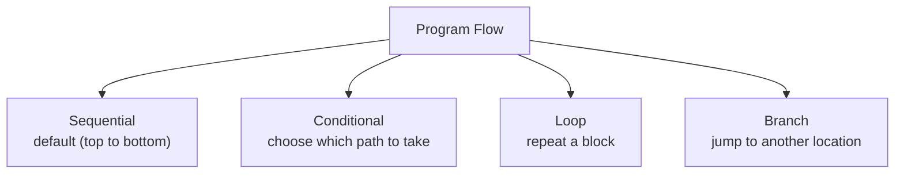
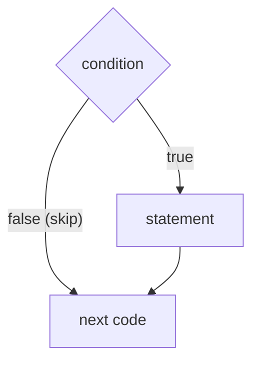
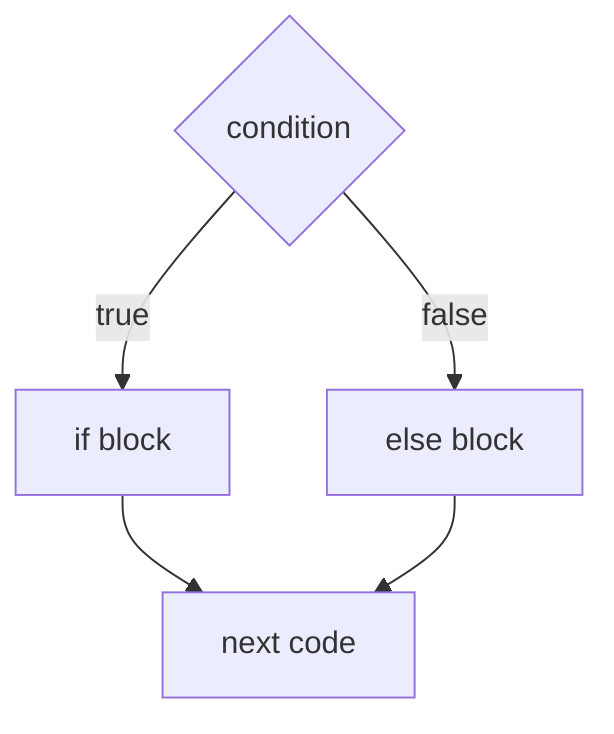
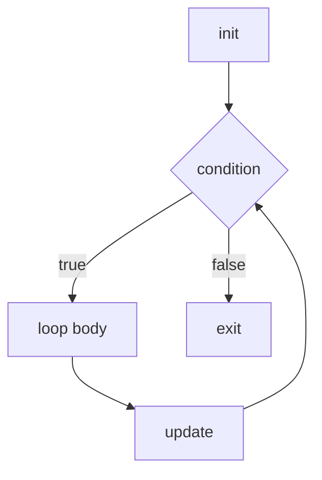
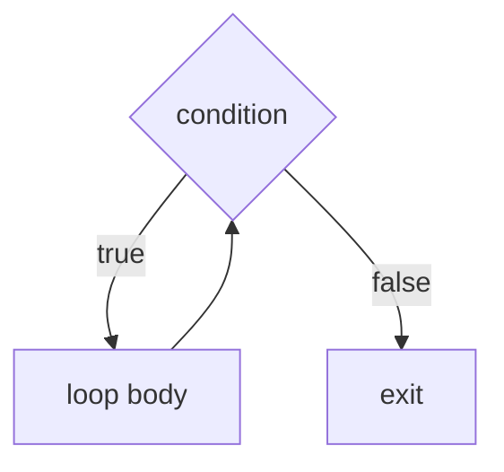
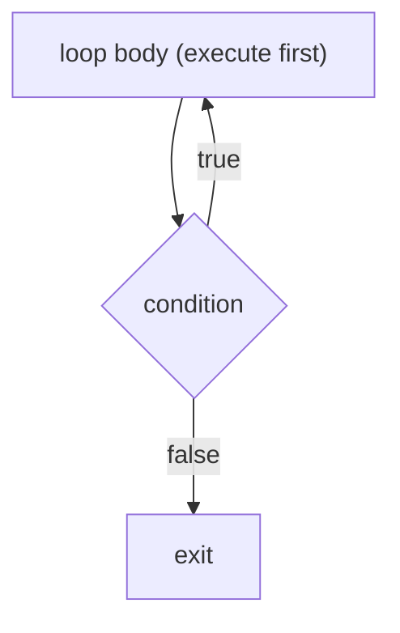

# Chapter 5 — Control Statements

[Repository Guide](../../README.md) | [English](Concepts_Lecture.md) | [한국어](Concepts_Lecture.ko.md)

> **Last Updated:** 2026-11-27
>
> Warming-Up C Programming, 천정아, Ch 5

> **Learning Objectives:**
> 1. Distinguish the sequential, conditional, loop, and branch structures and name the C keywords used for each
> 2. Choose an execution path by a condition with `if`, `if-else`, `else if`, and nested `if`
> 3. Explain the rules of the `switch` statement and its fall-through behavior, and choose between it and `if-else`
> 4. Compare the execution flow and minimum number of executions of `for`, `while`, and `do-while`
> 5. Trace where `break`, `continue`, `goto`, and `return` transfer control
> 6. Implement loop patterns such as counters, accumulators, max tracking, input validation, and menus

---

## Table of Contents

- [1. Control Statements Overview](#1-control-statements-overview)
- [2. Conditional Statements](#2-conditional-statements)
  - [2.1 `if`](#21-if)
  - [2.2 Compound Statements / Blocks](#22-compound-statements--blocks)
  - [2.3 `if-else`](#23-if-else)
  - [2.4 `else if`](#24-else-if)
  - [2.5 Nested `if`](#25-nested-if)
  - [2.6 Multiple Independent `if`](#26-multiple-independent-if)
  - [2.7 `switch`](#27-switch)
  - [2.8 `if-else` vs `switch` Comparison](#28-if-else-vs-switch-comparison)
  - [2.9 Cautions for `switch`](#29-cautions-for-switch)
  - [2.10 Common Mistakes in Conditional Statements](#210-common-mistakes-in-conditional-statements)
  - [2.11 Application of Conditionals: A Four-Function Calculator](#211-application-of-conditionals-a-four-function-calculator)
- [3. Loop Statements](#3-loop-statements)
  - [3.1 `for`](#31-for)
  - [3.2 `while`](#32-while)
  - [3.3 `do-while`](#33-do-while)
  - [3.4 Nested Loops](#34-nested-loops)
  - [3.5 `for` vs `while` vs `do-while` Comparison](#35-for-vs-while-vs-do-while-comparison)
  - [3.6 Declaring Loop Control Variables and Their Scope](#36-declaring-loop-control-variables-and-their-scope)
  - [3.7 Variations of `for` and the Null Statement](#37-variations-of-for-and-the-null-statement)
  - [3.8 Loops and the Input Buffer](#38-loops-and-the-input-buffer)
  - [3.9 Common Mistakes in Loops](#39-common-mistakes-in-loops)
- [4. Branch Statements](#4-branch-statements)
  - [4.1 `break`](#41-break)
  - [4.2 `continue`](#42-continue)
  - [4.3 `goto`](#43-goto)
  - [4.4 `return`](#44-return)
  - [4.5 Infinite Loops and Exit Points](#45-infinite-loops-and-exit-points)
- [5. Common Patterns](#5-common-patterns)
  - [5.1 Counter and Accumulator](#51-counter-and-accumulator)
  - [5.2 Max/Min Tracking](#52-maxmin-tracking)
  - [5.3 Input Validation Loop](#53-input-validation-loop)
  - [5.4 Menu-Driven Program](#54-menu-driven-program)
  - [5.5 Divisors and Primality Testing](#55-divisors-and-primality-testing)
  - [5.6 Digit Extraction and the Euclidean Algorithm](#56-digit-extraction-and-the-euclidean-algorithm)
- [Summary](#summary)
- [Self-Check Questions](#self-check-questions)

---

<br>

## 1. Control Statements Overview

By default, C executes statements **sequentially** (top to bottom). **Control statements** alter this flow by branching or repeating.



*Figure 1. The four structures of program flow*

| Category | Purpose | C Keywords |
|:---------|:--------|:-----------|
| Conditional | Execute different blocks based on conditions | `if`, `else`, `else if`, `switch`, `case`, `default` |
| Loop | Repeat a block while a condition is true | `for`, `while`, `do-while` |
| Branch | Jump out of or skip within a block | `break`, `continue`, `goto`, `return` |

*Table 1. Classification of control statements*

The **ternary operator** (`? :`) is a conditional *expression*, not a statement, but it serves a purpose similar to a conditional statement, as in `max = (a > b) ? a : b;`.

The condition that a conditional or loop statement tests is not a value of a special type but an ordinary expression. Relational operators (`<`, `==`, and so on) and logical operators (`&&`, `||`, `!`) produce the `int` value 1 when the result is true and 0 when it is false (Chapter 4). Because a control statement only checks whether the value of the condition is zero, an arithmetic expression such as `a - 3` or `n % 2`, which is not a relational expression, can also serve as a condition.

```c
int a = 3, b = 7;

printf("%d %d %d\n", a < b, a == b, !(a < b));
if (a - 3)
    printf("a - 3 is nonzero\n");
else
    printf("a - 3 is zero\n");
```

```text
1 0 0
a - 3 is zero
```

`a < b` is true, so it gives 1; `a == b` is false, so it gives 0; `!(a < b)` negates a true value, so it gives 0. The value of `a - 3` is 0, so the `if` judges the condition false and executes the statement on the `else` side.

The flow of control statements is easy to follow when it is drawn as a **flowchart**. In a flowchart, a diamond represents a condition test, a rectangle represents processing, and an arrow represents the order of execution; all the execution-flow figures in Sections 2 and 3 are flowcharts drawn this way. A conditional statement has the shape of a flow that splits at a diamond and joins again at one point, and a loop has the shape of a cycle in which an arrow returns to the diamond. The property that every control structure has exactly one entry and one exit is the basic principle of structured programming, and Section 4.3 avoids `goto` because `goto` breaks this property.

---

<br>

## 2. Conditional Statements

### 2.1 `if`

The `if` statement executes a block **only when** the condition is true (non-zero).

**Syntax:**

```c
if (condition) {
    // executed when condition is true (non-zero)
}
```

**Execution flow:**



*Figure 2. Execution flow of the if statement*

```c wide-ok
int score = 85;

if (score >= 60) {
    printf("Passed!\n");
}
```

In C, any non-zero value is **true**, and zero is **false**. So `if (1)` always executes, and `if (0)` never executes.

Exactly one statement follows the parentheses of an `if`. To execute several statements, group them into one statement with the compound statement of Section 2.2. A condition is sometimes written as a single variable, as in `if (n)`; this means the same as `if (n != 0)`, and `if (!n)` means the same as `if (n == 0)`. The short forms are common in C code, but while learning, writing the comparison operator explicitly makes the intent of asking whether the value is zero easier to read.

### 2.2 Compound Statements / Blocks

A **compound statement** (block) groups multiple statements with braces `{}`.

```c wide-ok
if (score >= 90) {
    printf("Grade: A\n");
    printf("Excellent!\n");
}
```

Without braces, only the **first statement** belongs to `if`.

```c wide-ok
if (score >= 90)
    printf("Grade: A\n");      // belongs to if
    printf("Excellent!\n");    // ALWAYS executes (not part of if!)
```

> **Caution:** It is best to use braces `{}` even for single statements. This prevents bugs when adding lines later and makes intent clear.

Two styles of brace placement are widely used. Placing the opening brace `{` right after the `)` of the control statement reduces the number of source lines, and placing `{` alone on the next line aligns the opening and closing braces in the same column so that the extent of the block stands out. In either style, the statements inside the block are indented one level, and one style is used consistently within a program.

```c
if (num < 0) {      // opening brace on the same line
    num = -num;
}

if (num < 0)
{                   // opening brace on the next line
    num = -num;
}
```

A compound statement is not a syntax reserved for control statements; it is a statement that may appear anywhere a single statement may appear. A variable declared inside a block can be used only inside that block, and Chapter 6 treats this rule in detail under scope.

### 2.3 `if-else`

Provides two paths: one for true, one for false.

**Syntax:**

```c
if (condition) {
    // executed when true
} else {
    // executed when false
}
```

**Execution flow:**



*Figure 3. Execution flow of the if-else statement*

```c wide-ok
int num = 7;

if (num % 2 == 0) {
    printf("%d is even\n", num);
} else {
    printf("%d is odd\n", num);
}
```

**When to use `if-else` vs two separate `if` statements:**

```c wide-ok
// if-else: exactly one branch executes (mutually exclusive)
if (x > 0) {
    printf("positive\n");
} else {
    printf("non-positive\n");
}

// Two separate ifs: both conditions are checked independently
if (x > 0) {
    printf("positive\n");
}
if (x % 2 == 0) {
    printf("even\n");
}
```

An `if-else` that chooses one value can be rewritten with the conditional operator. The following two pieces of code perform the same action of storing the absolute value of the integer `num` in `abs_val`. When `num` is -12, both store 12 in `abs_val`.

```c
// written with if-else
if (num < 0)
    abs_val = -num;
else
    abs_val = num;

// written with the conditional operator
abs_val = (num < 0) ? -num : num;
```

An `if-else` chooses which **statement** to execute, while the conditional operator chooses the **value** of an expression. Therefore the conditional operator can be used only when both sides are expressions that produce values; for branches that do different kinds of work, such as printing on one side and assigning on the other, `if-else` is used.

### 2.4 `else if`

The `else if` ladder checks conditions **sequentially**. Once a true condition is found, its block executes and all remaining conditions are **skipped**.

**Syntax:**

```c
if (condition1) {
    // block 1
} else if (condition2) {
    // block 2
} else if (condition3) {
    // block 3
} else {
    // default block (optional)
}
```

The final `else` is **optional** but recommended as a catch-all.

```c wide-ok
int score;
printf("Enter score: ");
scanf("%d", &score);

if (score >= 90) {
    printf("Grade: A\n");
} else if (score >= 80) {
    printf("Grade: B\n");
} else if (score >= 70) {
    printf("Grade: C\n");
} else if (score >= 60) {
    printf("Grade: D\n");
} else {
    printf("Grade: F\n");
}
```

> **Key Point:** Because conditions are checked in order, the second condition `score >= 80` is checked only after `score >= 90` has been rejected, so it means a score of at least 80 and less than 90. You therefore do **not** need `score >= 80 && score < 90`. Writing `80 <= score < 90` as in mathematics is computed in C as `(80 <= score) < 90`, which is always true, so a range must be split with `&&`.

### 2.5 Nested `if`

An `if` statement inside another `if` or `else` block.

```c wide-ok
int x, y;
scanf("%d %d", &x, &y);

if (x == 0 && y == 0) {
    printf("Origin\n");
} else if (x == 0) {
    printf("On the y-axis\n");
} else if (y == 0) {
    printf("On the x-axis\n");
} else {
    if (x > 0 && y > 0) {
        printf("Quadrant 1\n");
    } else if (x < 0 && y > 0) {
        printf("Quadrant 2\n");
    } else if (x < 0 && y < 0) {
        printf("Quadrant 3\n");
    } else {
        printf("Quadrant 4\n");
    }
}
```

Deeply nested `if` statements become hard to read, so it is better to flatten the structure with `else if` ladders or early returns.

When braces are omitted in a nested `if`, it is easy to misjudge which `if` an `else` belongs to. The rule of C is that an `else` pairs with **the nearest `if` that does not yet have a partner**, and indentation has no effect on this rule. This ambiguity is called the **dangling else** problem.

```c
int a = 5, b = -3;

if (a > 0)
    if (b > 0)
        printf("both positive\n");
else
    printf("a is not positive\n");
```

```text
a is not positive
```

Judging by the indentation alone, the `else` seems to belong to the outer `if (a > 0)`, but it actually pairs with the nearest inner `if (b > 0)`. Since `a` is 5, the outer condition is true; since the inner condition `b > 0` is false, the `else` of the inner `if` runs, and a message opposite to the intent is printed. When this code is compiled with `-Wall`, Clang issues the warning `add explicit braces to avoid dangling else`. To attach the `else` to the outer `if`, wrap the inner `if` in braces.

```c
if (a > 0) {
    if (b > 0)
        printf("both positive\n");
} else {
    printf("a is not positive\n");
}
```

With the braces, the inner `if` ends inside the block, so the `else` pairs with the outer `if`, and when `a` is 5 and `b` is -3 this code prints nothing.

When an `else` block contains nothing but a single `if` statement, that `else` and `if` can be joined and written as `else if`. In other words, `else if` is not a separate keyword but the form in which an `if` statement follows `else`. The following two pieces of code compute the same admission fee: free under 8 years old, 5000 won at 65 or older, and 10000 won otherwise.

```c
// nested if inside the else block
if (age < 8)
    fee = 0;
else {
    if (age >= 65)
        fee = 5000;
    else
        fee = 10000;
}

// the same decision written with else if
if (age < 8)
    fee = 0;
else if (age >= 65)
    fee = 5000;
else
    fee = 10000;
```

### 2.6 Multiple Independent `if`

When conditions are **not mutually exclusive**, use separate `if` statements. Each condition is evaluated independently.

```c wide-ok
int temp = 35;

if (temp > 30) {
    printf("Hot\n");       // prints
}
if (temp > 20) {
    printf("Warm\n");      // also prints
}
if (temp > 10) {
    printf("Mild\n");      // also prints
}
```

All three conditions are true, so all three messages print. Compare this to `else if`, where only the **first** matching block would execute.

Independent conditions must be tested separately, regardless of the preceding conditions. The following program sets the basic admission fee by age and then, if the visitor is a local resident (`resident` is 1), gives a discount of 1000 won regardless of age. If the discount condition were appended to the preceding `else if` ladder, the discount test would be skipped as soon as one of the age conditions became true, so the discount is tested with a separate `if`. The condition `fee > 0` prevents the discount from making the fee negative for free admission.

```c
int age, resident, fee;

scanf("%d %d", &age, &resident);
if (age < 8)
    fee = 0;
else if (age >= 65)
    fee = 5000;
else
    fee = 10000;

if (resident == 1 && fee > 0)   // condition independent of the age decision
    fee -= 1000;

printf("fee = %d\n", fee);
```

| Input (`age resident`) | Basic Fee | Output |
|:-----|-----:|:-----|
| `5 1` | 0 | `fee = 0` |
| `30 1` | 10000 | `fee = 9000` |
| `70 0` | 5000 | `fee = 5000` |
| `70 1` | 5000 | `fee = 4000` |

*Table 2. Results of the admission fee program for each input*

### 2.7 `switch`

The `switch` statement selects a block based on the value of an **integer or character expression**. It is often cleaner than a long `else if` ladder for discrete value matching.

**Syntax:**

```c
switch (expression) {
case value1:
    // statements
    break;
case value2:
    // statements
    break;
// ...
default:
    // executed if no case matches
}
```

```c wide-ok
char unit;
printf("Temperature unit (C/F): ");
scanf(" %c", &unit);

switch (unit) {
case 'C':
case 'c':
    printf("Celsius\n");
    break;
case 'F':
case 'f':
    printf("Fahrenheit\n");
    break;
default:
    printf("Invalid unit!\n");
}
```

**Critical rules:**

| Rule | Detail |
|:-----|:-------|
| Expression type | Must be an integer type such as `char`, `int`, or `long`. `float`, `double`, and strings are **not** allowed. |
| Case labels | Must be integer **constant** expressions (not variables). |
| `break` | Needed to prevent **fall-through**. Without it, the statements of the next case also execute. |
| `default` | Optional. Handles values not matched by any case. |
| Duplicate cases | Not allowed. Each case label must be unique. |

*Table 3. Key rules of the switch statement*

**Fall-through behavior (missing `break`):**

```c
int n = 1;
switch (n) {
case 1:
    printf("one\n");      // prints
    // no break!
case 2:
    printf("two\n");      // also prints! (fall-through)
    break;
case 3:
    printf("three\n");
    break;
}
// Output: one
//         two
```

> **Caution:** Forgetting `break` is one of the most common bugs in C. Intentional fall-through (like grouping `'C'` and `'c'`) should be clearly documented.

**Using `switch` with integer ranges (score grading):**

```c
int score = 85;
switch (score / 10) {
case 10:
case 9:
    printf("A\n");
    break;
case 8:
    printf("B\n");
    break;
case 7:
    printf("C\n");
    break;
case 6:
    printf("D\n");
    break;
default:
    printf("F\n");
}
```

### 2.8 `if-else` vs `switch` Comparison

| Feature | `if-else` | `switch` |
|:--------|:----------|:---------|
| Condition type | Any boolean expression | Integer/character equality only |
| Range checks | `score >= 90` | Not directly (use `score / 10`) |
| Multiple values | `if (x == 1 \|\| x == 2)` | `case 1: case 2:` (fall-through) |
| Float/string | Supported | Not supported |
| Readability | Better for ranges/complex conditions | Better for many discrete values |
| Performance | Sequential check | May use jump table (faster for many cases) |

*Table 4. Comparison of the if-else and switch statements*

When a single variable is compared against many **constant integer/char values**, `switch` is the better choice, and `if-else` is used for ranges, floating-point comparisons, or complex conditions.

### 2.9 Cautions for `switch`

A `switch` jumps to the matching `case` and then executes the statements below it in order until it meets a `break` or the end of the `switch`. A `case` label only marks the position where execution starts; it is not a partition between sections, so without a `break` the statements of the next `case` are executed as well. The following code is a menu handler with every `break` omitted.

```c
int menu = 2;

switch (menu) {
case 1:
    printf("open\n");
case 2:
    printf("edit\n");
case 3:
    printf("save\n");
default:
    printf("invalid\n");
}
```

```text
edit
save
invalid
```

The order of execution comes down to three steps. First, the integer expression `menu` is evaluated once, giving 2. Second, `case 2`, whose value is 2, is found, and control jumps to that position. Third, the statements of `case 2`, `case 3`, and `default` are executed in order, and control leaves at the end of the `switch`. The statement of `case 1` lies above the position jumped to, so it is not executed.

`default` may be omitted. If no `case` matches and there is no `default`, the `switch` ends without executing any statement. Wherever `default` is placed inside the `switch`, it is chosen only when no `case` matches, but it is usually placed at the end for readability. A `default` at the end gives the same result without a `break`, but writing a `break` in `default` as well is safer, because it prevents the fall-through that would occur if a `case` were later added after it.

A `case` label may contain only an **integer constant expression** whose value is fixed at compile time, such as `1`, `'A'`, or `2 + 3`. Using a variable, as in `case n:`, or a floating-point value, as in `case 1.5:`, is a compile error. Standard C has no syntax for writing a range as a single `case`, so a range test is done with `if`, or the range is converted to a single integer and compared, as with `score / 10` in Section 2.7.

A variable declaration immediately after a `case` label also needs care. In the standards up to C17, only a statement may follow a label, and a declaration is not a statement, so the following code is an error on a compiler that strictly follows the standard. Clang, which compiled this code, issues a warning that it is a C23 extension.

```c
switch (op) {
case 1:
    int sum = a + b;    // a declaration follows the label
    printf("%d\n", sum);
    break;
}
```

```text
warning: label followed by a declaration is a C23 extension [-Wc23-extensions]
```

When the statements of the `case` are wrapped in braces to form a block, the declaration becomes the first item inside the block, so the code is correct under every standard, and the scope of the variable is also limited to that `case`.

```c
switch (op) {
case 1: {
    int sum = a + b;    // declaration inside a block
    printf("%d\n", sum);
    break;
}
}
```

> **Note:** **Fall-through warnings.** To find unintended fall-through, Clang and GCC provide the `-Wimplicit-fallthrough` option. When the menu code above is compiled with this option, Clang issues the warning `unannotated fall-through between switch labels` at each of `case 2:`, `case 3:`, and `default:`, which are reached without a `break`. This option is not part of `-Wall`, so it must be specified separately.

### 2.10 Common Mistakes in Conditional Statements

Most errors in conditional statements are logic errors that compile but behave differently from the intent. The following table summarizes five frequent mistakes.

| Mistake | Wrong Code | Actual Behavior | Correct Code |
|:-----|:-----|:-----|:-----|
| Confusing assignment with comparison | `if (x = 0)` | Assigns 0 to `x` and uses the expression value 0 as the condition, so the block never runs and `x` is changed | `if (x == 0)` |
| Semicolon after the condition | `if (x > 0);` | The empty statement becomes the body of the `if`, so the next block always runs regardless of the condition | `if (x > 0)` |
| A range in mathematical form | `if (0 < x < 10)` | Evaluated as `(0 < x) < 10`, which compares 0 or 1 with 10, so it is always true | `if (0 < x && x < 10)` |
| Equality comparison of floating-point values | `if (0.1 + 0.2 == 0.3)` | False because of rounding errors in the binary representation | Compare within a tolerance, as in `if (fabs(a - b) < 1e-9)` |
| Confusing characters with strings | `case "A":` | A string is not an integer constant, so it is a compile error | `case 'A':` |

*Table 5. Common mistakes in conditional statements*

The first mistake is especially hard to find. The value of the assignment expression `x = 0` is the assigned value 0, so the condition is always false; conversely, `if (x = 5)` is always true. In either case the original value of `x` is lost. If `x` is 5, executing `if (x = 0)` and then printing `x` gives `x = 0`. Clang issues the warning `using the result of an assignment as a condition without parentheses` under `-Wall`, so compiling with warnings enabled catches this mistake early. The third mistake is a valid expression in standard C, but Apple Clang 21 rejects it with the error `chained comparison 'X < Y < Z' does not behave the same as a mathematical expression`. In the fourth mistake, `fabs` is the absolute-value function of `<math.h>`, and the representation error of floating-point values comes from the IEEE 754 format of Chapter 3.

### 2.11 Application of Conditionals: A Four-Function Calculator

As an example that combines the conditional statements, the following program evaluates an expression entered as, for example, `3.5 * 2`. The operator is a single character, so it is selected with `switch`, and division by zero is tested separately with an `if` inside `case '/'`.

```c
#define _CRT_SECURE_NO_WARNINGS
#include <stdio.h>

int main(void)
{
    double a, b;
    char op;

    printf("expression? ");
    if (scanf("%lf %c %lf", &a, &op, &b) != 3) {
        printf("invalid input\n");
        return 1;
    }

    switch (op) {
    case '+':
        printf("%.2f + %.2f = %.2f\n", a, b, a + b);
        break;
    case '-':
        printf("%.2f - %.2f = %.2f\n", a, b, a - b);
        break;
    case '*':
    case 'x':
        printf("%.2f * %.2f = %.2f\n", a, b, a * b);
        break;
    case '/':
        if (b == 0.0)
            printf("division by zero\n");
        else
            printf("%.2f / %.2f = %.2f\n", a, b, a / b);
        break;
    default:
        printf("unknown operator %c\n", op);
        break;
    }
    return 0;
}
```

Each part does the following.

- `scanf("%lf %c %lf", &a, &op, &b)` reads a floating-point number, a character, and a floating-point number in order. A space in the format string skips whitespace in the input, so both `7 / 2` and `7/2` can be read. It returns 3 when all three values are read, so any other value is treated as invalid input and the program ends with `return 1`.
- `switch (op)` compares the `char` operator with the character literals `'+'`, `'-'`, and so on, which are integer constants.
- `case '*':` and `case 'x':` use fall-through deliberately to treat the two characters as the same multiplication.
- The `if` inside `case '/'` first tests whether the divisor is 0. Dividing by the floating-point value 0.0 does not raise an error in C but produces a special value such as `inf`, so the program must test it itself.
- `default` handles any character that is none of the four operators.

```text
expression? 7 / 2
7.00 / 2.00 = 3.50
expression? 3 x 4
3.00 * 4.00 = 12.00
expression? 5 / 0
division by zero
expression? 2 ^ 3
unknown operator ^
expression? abc
invalid input
```

The same calculator can also be written with an `else if` ladder (`if (op == '+') ... else if (op == '-') ...`). In this problem, which compares one operator character with several constants, `switch` is more concise because the value being compared is written only once, and mixing in `if` only where a range or floating-point condition is needed, as with division by zero, combines the strengths of both statements.

---

<br>

## 3. Loop Statements

### 3.1 `for`

The `for` loop is ideal when the **number of iterations is known** in advance.

**Syntax:**

```c
for (initialization; condition; update) {
    // loop body
}
```

**Execution flow:**



*Figure 4. Execution flow of the for statement*

1. **Initialization:** Executes once before the loop starts.
2. **Condition:** Checked before each iteration; if it is false, the loop exits.
3. **Loop body:** Executes if the condition is true.
4. **Update:** Executes after each iteration, then control goes back to step 2.

```c
// Print 1 to 5
for (int i = 1; i <= 5; i++) {
    printf("%d ", i);
}
// Output: 1 2 3 4 5
```

The progress of the loop can be observed by printing the values of the loop control variable `i` and the accumulating variable `sum` in every iteration.

```c
int i, sum = 0;

for (i = 1; i <= 5; i++) {
    sum += i;
    printf("i = %d, sum = %d\n", i, sum);
}
printf("after loop: i = %d\n", i);
```

```text
i = 1, sum = 1
i = 2, sum = 3
i = 3, sum = 6
i = 4, sum = 10
i = 5, sum = 15
after loop: i = 6
```

The condition `i <= 5` is tested 6 times in all. The first 5 tests are true, so the body runs; the 6th test, after `i` has become 6, is false, so the loop ends. Hence the value of `i` after the loop is 6, not the last processed value 5. In general, when `a <= b`, the body of `for (i = a; i <= b; i++)` runs `b - a + 1` times, and when `n >= 0`, the body of `for (i = 0; i < n; i++)` runs `n` times. The second form, which starts at 0 and tests the end with `<`, becomes the standard form in Chapter 7 for scanning the indices 0 through n - 1 of an array of n elements.

**Common patterns:**

```c wide-ok
// Count down
for (int i = 10; i >= 1; i--) {
    printf("%d ", i);
}

// Step by 2
for (int i = 0; i <= 10; i += 2) {
    printf("%d ", i);
}

// Sum from 1 to 100
int sum = 0;
for (int i = 1; i <= 100; i++) {
    sum += i;
}
printf("Sum: %d\n", sum);  // 5050
```

**Omitting parts of `for`:**

```c
int i = 0;
for ( ; i < 5; ) {      // init and update omitted
    printf("%d ", i);
    i++;
}

for (;;) {               // infinite loop (all parts omitted)
    // use break to exit
}
```

> **Caution:** An infinite loop without `break` or `return` keeps running without end, so the program appears frozen.

Even when the initialization, condition, and update are all omitted, the two semicolons must be written, and `for ()` is a compile error. An omitted condition is treated as always true, so `for (;;)` is an infinite loop equivalent to `while (1)`. A program stuck in an infinite loop in the console is terminated with Ctrl+C.

### 3.2 `while`

The `while` loop is ideal when the **termination condition depends on runtime input** or events.

**Syntax:**

```c
while (condition) {
    // loop body
}
```

**Execution flow:**



*Figure 5. Execution flow of the while statement*

The condition is checked **before** each iteration. If false initially, the body never executes.

```c wide-ok
// Sentinel-controlled loop: -1 to stop
int num, sum = 0, count = 0;

printf("Enter number (-1 to stop): ");
scanf("%d", &num);

while (num != -1) {
    sum += num;
    count++;
    printf("Enter number (-1 to stop): ");
    scanf("%d", &num);
}

if (count > 0) {
    printf("Sum: %d, Average: %.2f\n", sum, (double)sum / count);
}
```

In this loop, -1 is not data to be processed but a mark indicating that the input has ended. Such a value is called a **sentinel**, and it must be chosen so that it cannot appear as normal data. In the iteration that reads the sentinel, the sum and count must not be updated, so the first value is read once before the loop and each next value is read at the end of the body, which makes the condition `num != -1` be tested immediately after a value is read. If the input is `10 20 -1`, `num` takes the values 10, 20, and -1 in order, `sum` becomes 10 and then 30, and -1 is not added.

**Infinite loop with `break`:**

```c wide-ok
while (1) {
    int n;
    printf("Enter a positive number: ");
    scanf("%d", &n);
    if (n > 0) {
        printf("You entered: %d\n", n);
        break;
    }
    printf("Invalid! Try again.\n");
}
```

### 3.3 `do-while`

The `do-while` loop **always executes the body at least once**, then checks the condition.

**Syntax:**

```c
do {
    // loop body
} while (condition);  // <-- semicolon required!
```

**Execution flow:**



*Figure 6. Execution flow of the do-while statement*

```c wide-ok
int choice;
do {
    printf("1. Play  2. Quit\n");
    printf("Choice: ");
    scanf("%d", &choice);
    if (choice < 1 || choice > 2) {
        printf("Invalid choice!\n");
    }
} while (choice != 2);
printf("Goodbye!\n");
```

> **Caution:** Do not forget the **semicolon** after `while(condition);` in a `do-while` loop. This is a common syntax error.

**Guaranteed single execution:**

```c
// do-while: body always runs at least once
int x = 100;
do {
    printf("x = %d\n", x);  // prints once even though x > 10
} while (x < 10);

// while: body may never run
while (x < 10) {
    printf("x = %d\n", x);  // never prints
}
```

### 3.4 Nested Loops

A loop inside another loop. The **inner loop completes all iterations** for each single iteration of the outer loop.

**Left-aligned triangle pattern:**

```c
int n = 4;
for (int i = 1; i <= n; i++) {        // rows
    for (int j = 1; j <= i; j++) {    // columns
        printf("*");
    }
    printf("\n");
}
```

Output:
```text
*
**
***
****
```

The `i` of the outer loop is the row number, and the inner loop moves `j` from 1 to `i`, printing `*`. Because the end value of the inner loop depends on the outer `i`, the number of stars grows by one per row: 1 in row 1, 2 in row 2, and so on. After each inner loop finishes, `printf("\n")` starts a new line, and the total number of stars printed is 1 + 2 + 3 + 4 = 10. In general, the inner body of an n-row triangle runs n(n + 1)/2 times, so the execution count of nested loops is checked as a product or sum of the outer and inner counts.

**Right-aligned triangle pattern:**

```c
int n = 4;
for (int i = 1; i <= n; i++) {
    for (int j = 1; j <= n - i; j++) {   // leading spaces
        printf(" ");
    }
    for (int j = 1; j <= i; j++) {       // stars
        printf("*");
    }
    printf("\n");
}
```

Output:
```text
   *
  **
 ***
****
```

**Multiplication table (2D output):**

```c
for (int i = 1; i <= 9; i++) {
    for (int j = 1; j <= 9; j++) {
        printf("%3d", i * j);
    }
    printf("\n");
}
```

**Alternating sign sum (`1-2+3-4+...+9-10`):**

```c wide-ok
int sum = 0;
for (int i = 1; i <= 10; i++) {
    if (i % 2 == 1) {
        sum += i;
    } else {
        sum -= i;
    }
}
printf("Result: %d\n", sum);  // -5
```

### 3.5 `for` vs `while` vs `do-while` Comparison

| Feature | `for` | `while` | `do-while` |
|:--------|:------|:--------|:-----------|
| Best for | Known iteration count | Unknown count, event-driven | Must execute at least once |
| Condition check | Before each iteration | Before each iteration | After each iteration |
| Minimum executions | 0 | 0 | 1 |
| Typical use | Counting, iterating arrays | Sentinel loops, reading input | Input validation, menus |
| Syntax | `for (init; cond; upd)` | `while (cond)` | `do { } while (cond);` |

*Table 6. Comparison of the for, while, and do-while statements*

Any `for` loop can be rewritten as a `while` loop and vice versa, so the form that makes the intent clearest is chosen.

```c
// Equivalent loops:

// for version
for (int i = 0; i < 5; i++) {
    printf("%d ", i);
}

// while version
int i = 0;
while (i < 5) {
    printf("%d ", i);
    i++;
}
```

### 3.6 Declaring Loop Control Variables and Their Scope

> **Definition:** A **loop control variable** is a variable that controls the number of iterations in the initialization, condition, and update of a `for`. Its value must change in every iteration, and at some point it must make the condition false so that the loop ends.

A loop control variable can be declared in two places. ANSI C (C89/C90) allows variables to be declared only at the beginning of a block, so `int i;` is declared at the start of the function and the loop only assigns it, as in `for (i = 0; ...)`. From C99 on, it can be declared directly in the initialization, as in `for (int i = 0; ...)`. The textbook's examples follow the ANSI C style, and current compilers, including Visual Studio 2022, support both styles.

The two styles give the variable different scopes. An `i` declared at the start of the function remains after the loop ends, so its last value 6 can be inspected, as in the example of Section 3.1. The scope of an `i` declared in the initialization is limited to that `for` statement, so using `i` after the loop is a compile error.

```c
for (int i = 0; i < 3; i++)
    printf("%d ", i);
printf("%d\n", i);      // i is already out of scope
```

```text
error: use of undeclared identifier 'i'
```

A variable declared in the initialization disappears when the loop ends, so `int i` may be declared again in the next `for` statement of the same function. If the value after the loop is needed, declare the variable at the start of the function; if not, declaring it in the initialization narrows the range in which the variable is used and reduces mistakes.

### 3.7 Variations of `for` and the Null Statement

The update of a `for` is not limited to `i++`. It can decrease the variable with `i--`, increase it by 2 with `i += 2`, or multiply it by 10 with `i *= 10`. The following table summarizes the values the loop control variable takes for each update.

| `for` Header | Values of `i` When the Body Runs | Iterations |
|:-----|:-----|-----:|
| `for (i = 5; i >= 0; i--)` | 5, 4, 3, 2, 1, 0 | 6 |
| `for (i = 1; i < 100; i += 2)` | 1, 3, 5, ..., 99 | 50 |
| `for (i = 1; i <= 100000; i *= 10)` | 1, 10, 100, 1000, 10000, 100000 | 6 |
| `for (i = 0; i > 5; i++)` | None (the condition is false from the start) | 0 |

*Table 7. Values of the loop control variable for each update*

The initialization and update may contain several expressions joined by the **comma operator**. The comma operator evaluates its expressions from left to right, so a loop that moves two variables together can be written on one line.

```c
int i, j;

for (i = 0, j = 10; i < j; i += 3, j -= 3)
    printf("i = %d, j = %d\n", i, j);
printf("end: i = %d, j = %d\n", i, j);
```

```text
i = 0, j = 10
i = 3, j = 7
end: i = 6, j = 4
```

In each iteration, `i` increases by 3 and `j` decreases by 3. At the third test, `i` is 6 and `j` is 4, so `i < j` is false and the body runs twice. The rule is to write only one expression in the condition. Joining conditions with a comma, as in `i < 5, j > 0`, uses only the value of the last expression `j > 0` as the condition, so `&&` is used to test both conditions together.

The statement to be repeated by a `for` may also be omitted. A statement consisting of a single semicolon does nothing, and because of this syntax, a semicolon accidentally placed after the parentheses of a `for` makes that empty statement the loop body.

> **Definition:** A **null statement** is a statement consisting of a single semicolon that performs no action. It is used where the grammar requires a statement but there is nothing to do.

```c
int i;

for (i = 0; i < 5; i++);    // the loop body is a null statement
    printf("i = %d\n", i);
```

```text
i = 5
```

Judging by the indentation, `printf` seems to be repeated, but the actual loop body is `;`. The loop increases `i` to 5 without doing anything else and ends, and then the next statement, `printf`, runs once and prints `i = 5`. Clang issues the warning `for loop has empty body` for this code. `while (condition);` causes the same problem, and if the condition is true at first, the body never changes the values the condition depends on, so the loop becomes infinite. When an empty body is intended, place the semicolon alone on the next line or write `{ }` to show that it is not a mistake.

### 3.8 Loops and the Input Buffer

What is typed on the keyboard is not passed directly to `scanf`; it first accumulates in the input buffer. Most problems that arise when a loop reads input are explained by understanding how this buffer behaves.

> **Definition:** The **input buffer** is a memory area that stores the characters typed on the keyboard until the program reads them. In the console, the characters of a line enter the buffer together with the newline character `'\n'` at the moment the Enter key is pressed.

`scanf` waits for new input only when the input buffer is empty, so characters that an earlier `scanf` left unread are taken first by the next `scanf`. `%d` and `%lf`, which read integers and floating-point numbers, skip leading whitespace characters (spaces, tabs, and newlines), but `%c`, which reads a single character, reads a whitespace character as a character too. The following program reads a width and a height and then the character to draw a rectangle with, and it prints the code of the character read by the first `%c` to show what that conversion reads.

```c
#define _CRT_SECURE_NO_WARNINGS
#include <stdio.h>

int main(void)
{
    int width, height, i, j;
    char ch;

    printf("width and height? ");
    scanf("%d %d", &width, &height);
    printf("character? ");
    scanf("%c", &ch);
    printf("\nch = %d\n", ch);

    printf("character again? ");
    scanf(" %c", &ch);
    for (i = 0; i < height; i++) {
        for (j = 0; j < width; j++)
            printf("%c", ch);
        printf("\n");
    }
    return 0;
}
```

```text
width and height? 4 2
character?
ch = 10
character again? *
****
****
```

When `4 2` is typed and the Enter key is pressed, the buffer receives `4`, a space, `2`, and `'\n'`. Even after `scanf("%d %d", ...)` reads 4 and 2, `'\n'` remains in the buffer, so the first `scanf("%c", &ch)` reads this `'\n'` without waiting for a key press. The printed code 10 is the ASCII code of the newline character. A format `" %c"` with a space before `%c`, as in the second call, skips all remaining whitespace before reading a character, so it reads the newly typed `*` and draws a rectangle of width 4 and height 2. The integer format `"%d%d"` skips whitespace even without a space, so this problem does not occur there.

When a loop reads input, the return value of `scanf` must also be checked. `scanf` returns the number of conversions that successfully stored a value, and it returns `EOF` (a negative value, usually -1) if the input ends before the first conversion. The following loop accumulates the sum only while it succeeds in reading an integer.

```c
int n, sum = 0, count = 0;

while (scanf("%d", &n) == 1) {
    sum += n;
    count++;
}
printf("count = %d, sum = %d\n", count, sum);
```

```text
3 4 10
x 5
count = 3, sum = 17
```

After the three integers 3, 4, and 10 are read, the fourth call cannot convert `x` into an integer and returns 0, so the loop ends, and `x` and the following `5` remain in the buffer. If a loop simply repeated `scanf("%d", &n)` inside `while (1)` without checking the return value, the unread `x` would stay in the buffer and the same failure would repeat in every iteration, producing an infinite loop. The end of input is signaled with Ctrl+D in a macOS or Linux terminal and with Ctrl+Z followed by Enter in the Windows console. The settings needed to use `scanf` in Visual Studio are summarized in Section 5.1 of the Chapter 3 lab notes.

### 3.9 Common Mistakes in Loops

Mistakes in loops fall into two groups: running one iteration too many or too few, and never ending.

- **Off-by-one errors:** Writing `for (i = 1; i < 10; i++)` to add 1 through 10 runs the body only 9 times and leaves out 10. Checking the start value, the end value, and the choice between `<` and `<=` with the count formulas of Section 3.1, and substituting the variable values of the first and last iterations by hand, is the most reliable check.
- **Missing update:** If the body does not change `i`, as in `while (i < 5) { printf("%d", i); }`, the condition stays true forever. Unlike `for`, `while` and `do-while` have no update position in the header, so check that the body changes the variables the condition depends on.
- **Update in the wrong direction:** `for (i = 10; i > 0; i++)` only increases `i`, so the condition never becomes false. In practice, signed integer overflow occurs the moment `i` passes the maximum value of `int`, and since this is undefined behavior, the result cannot be predicted.
- **Floating-point loop control variables:** 0.1 is not represented exactly in binary, so the result of adding 0.1 ten times is not equal to 1.0.

```c
double x = 0.0;
int k;

for (k = 0; k < 10; k++)
    x += 0.1;
printf("x = %.17f\n", x);
printf("x == 1.0 is %d\n", x == 1.0);
```

```text
x = 0.99999999999999989
x == 1.0 is 0
```

Therefore `for (x = 0.0; x != 1.0; x += 0.1)` never ends, because `x` never lands exactly on 1.0. It is safer to count iterations with an integer variable and to compute the floating-point value from the integer, as in `x = k * 0.1`.

---

<br>

## 4. Branch Statements

### 4.1 `break`

`break` immediately exits the **innermost enclosing loop** or `switch` statement.

```c wide-ok
for (int i = 1; i <= 100; i++) {
    if (i * i > 50) {
        printf("First i where i^2 > 50: %d\n", i);
        break;  // exits the for loop
    }
}
```

In nested loops, `break` only exits the **inner** loop.

```c
for (int i = 0; i < 3; i++) {
    for (int j = 0; j < 3; j++) {
        if (j == 1) {
            break;  // exits inner loop only
        }
        printf("(%d,%d) ", i, j);
    }
}
// Output: (0,0) (1,0) (2,0)
```

For each value 0, 1, and 2 of the outer `i`, the inner loop prints only in the iteration where `j` is 0, and when `j` becomes 1, `break` ends only the inner loop. The outer loop is not affected, so the inner loop starts over from the beginning each time `i` changes. Ways to end the outer loop at once as well are treated in Section 4.5.

### 4.2 `continue`

`continue` skips the **rest of the current iteration** and jumps to the next iteration (to the condition check in `while`/`do-while`, or to the update step in `for`).

```c
// Print odd numbers only
for (int i = 1; i <= 10; i++) {
    if (i % 2 == 0) {
        continue;  // skip even numbers
    }
    printf("%d ", i);
}
// Output: 1 3 5 7 9
```

In a `for` loop, `continue` jumps to the **update** expression (`i++`), not the condition, and in a `while` loop it jumps directly to the **condition** check. Therefore, in a `while` loop, if the loop variable is not updated before `continue`, the loop may never end.

### 4.3 `goto`

`goto` unconditionally jumps to a labeled statement. It is **generally avoided** because it makes code hard to follow (spaghetti code).

```c wide-ok
for (int i = 0; i < 10; i++) {
    for (int j = 0; j < 10; j++) {
        if (i + j == 15) {
            goto found;  // break out of both loops
        }
    }
}
found:
printf("Done\n");
```

> **Caution:** Avoid `goto` in almost all cases. The commonly accepted exceptions are breaking out of deeply nested loops at once and jumping to the cleanup code at the end of a function when an error occurs. Otherwise, use `break`, `continue`, or functions instead.

### 4.4 `return`

`return` exits the **current function** and optionally returns a value. In `main`, it terminates the program.

```c
int find_first_negative(int arr[], int size) {
    for (int i = 0; i < size; i++) {
        if (arr[i] < 0) {
            return arr[i];  // exits function immediately
        }
    }
    return 0;  // no negative found
}
```

### 4.5 Infinite Loops and Exit Points

A program that cannot know the number of iterations in advance often builds an infinite loop whose condition is always true and tests the ending condition inside the body. Depending on where the exit is, a loop takes one of three shapes: `while` and `for`, which test the condition at the head; `do-while`, which tests it at the tail; and an infinite loop that leaves from the middle of the body with `break`. The third shape suits cases where the exit decision falls in the middle of the processing, as in "read the input, leave if it is the end mark, and otherwise process it."

When a menu program is built from an infinite loop and a `switch`, note that a `break` inside the `switch` leaves only the `switch`. Executing `break` in `case 0:` does not stop the outer loop, so the following program keeps a variable `running` that indicates whether to continue and sets it to 0 in the quit menu.

```c
int menu, running = 1;

while (running) {
    printf("menu (1: hello, 2: bye, 0: quit)? ");
    scanf("%d", &menu);
    switch (menu) {
    case 1:
        printf("hello\n");
        break;
    case 2:
        printf("bye\n");
        break;
    case 0:
        running = 0;        // mark the loop to end
        break;              // leaves only the switch
    default:
        printf("invalid\n");
        break;
    }
}
printf("finished\n");
```

```text
menu (1: hello, 2: bye, 0: quit)? 1
hello
menu (1: hello, 2: bye, 0: quit)? 2
bye
menu (1: hello, 2: bye, 0: quit)? 7
invalid
menu (1: hello, 2: bye, 0: quit)? 0
finished
```

In the iteration where 0 is entered, `running` becomes 0; after `break` leaves the `switch`, the condition `running` at the head of the loop is judged false, and the loop ends. Inside `main`, another option is to end the program immediately with `return 0;` in `case 0:`.

The same principle is used to leave nested loops at once. The following code finds two numbers from 1 to 9 whose product is 12 and whose sum is 7. The first method keeps a variable `found` that records the discovery and tests it after each inner loop ends; the second method jumps directly to a label outside the loops with the `goto` of Section 4.3.

```c
int i, j, found = 0;

for (i = 1; i <= 9; i++) {
    for (j = 1; j <= 9; j++) {
        if (i * j == 12 && i + j == 7) {
            found = 1;
            break;          // ends the inner loop
        }
    }
    if (found)
        break;              // ends the outer loop
}
if (found)
    printf("flag: i = %d, j = %d\n", i, j);

for (i = 1; i <= 9; i++)
    for (j = 1; j <= 9; j++)
        if (i * j == 12 && i + j == 7)
            goto done;      // leaves both loops at once
done:
    printf("goto: i = %d, j = %d\n", i, j);
```

```text
flag: i = 3, j = 4
goto: i = 3, j = 4
```

The condition first becomes true when `i` is 3 and `j` is 4. In the first method, the inner `break` ends only the loop over `j`, so without the `if (found) break;` of the outer loop, `i` would keep increasing to 4, 5, and so on. When `break` ends a loop, the update is not executed, so `i` and `j` remain 3 and 4 after the loops. The two methods give the same result; the variable method keeps the principle of structured programming, and the `goto` method is shorter. Separating the search into a function, as learned in Chapter 6, allows `return` to end both loops at once, which is the cleanest.

---

<br>

## 5. Common Patterns

### 5.1 Counter and Accumulator

A **counter** tracks how many times something occurs. An **accumulator** tracks a running total.

```c wide-ok
int sum = 0;    // accumulator
int count = 0;  // counter
int num;

printf("Enter numbers (0 to stop):\n");
while (1) {
    scanf("%d", &num);
    if (num == 0) {
        break;
    }
    sum += num;
    count++;
}

if (count > 0) {
    printf("Sum: %d\n", sum);
    printf("Count: %d\n", count);
    printf("Average: %.2f\n", (double)sum / count);
}
```

> **Key Point:** Always cast to `double` before dividing when you need a floating-point average: `(double)sum / count`. Integer division `sum / count` truncates the decimal part.

### 5.2 Max/Min Tracking

Initialize the maximum and minimum with the **first input**, then update them as new values arrive.

```c wide-ok
int num, max, min, count = 0;

while (1) {
    printf("Input value (0 to stop): ");
    scanf("%d", &num);
    if (num == 0) {
        break;
    }

    if (count == 0) {
        max = min = num;  // first value initializes both
    } else {
        if (num > max) max = num;
        if (num < min) min = num;
    }
    count++;
}

if (count > 0) {
    printf("MAX: %d, MIN: %d\n", max, min);
}
```

You can also use the **ternary operator** to find the maximum and minimum compactly.

```c
int a, b, c;
scanf("%d %d %d", &a, &b, &c);

int max = (a > b) ? a : b;
max = (max > c) ? max : c;
printf("Max: %d\n", max);
```

### 5.3 Input Validation Loop

Use `do-while` to repeat until valid input is received.

```c wide-ok
int score;
do {
    printf("Enter score (0-100): ");
    scanf("%d", &score);
    if (score < 0 || score > 100) {
        printf("Error! Score must be 0-100.\n");
    }
} while (score < 0 || score > 100);

printf("Valid score: %d\n", score);
```

### 5.4 Menu-Driven Program

Combine `while(1)`, `switch`, and `do-while` to implement an interactive menu.

```c wide-ok
#include <stdio.h>

int main() {
    char menu;

    while (1) {
        printf("========================\n");
        printf("1. Option A\n");
        printf("2. Option B\n");
        printf("3. Quit\n");
        printf("========================\n");

        // Input validation with do-while
        do {
            printf("Select: ");
            scanf(" %c", &menu);
            if (menu < '1' || menu > '3') {
                printf("Invalid! Try again.\n");
            }
        } while (menu < '1' || menu > '3');

        if (menu == '3') {
            printf("Goodbye!\n");
            break;
        }

        switch (menu) {
        case '1':
            printf("You selected Option A\n");
            break;
        case '2':
            printf("You selected Option B\n");
            break;
        }
    }

    return 0;
}
```

> **Note:** **Skipping whitespace.** When reading a `char` with `scanf`, use `" %c"` (with a leading space) to skip any leftover whitespace or newline characters in the input buffer.

### 5.5 Divisors and Primality Testing

A **prime number** is an integer greater than or equal to 2 whose only divisors are 1 and itself. To test whether n is prime, divide n by candidates d starting at 2 and look for a d that leaves remainder 0. If n factors as n = a × b, the smaller of a and b is at most √n, so the candidates need to be tested only while `d * d <= n`. The following program prints the primes from 2 to 30.

```c
int n, d, is_prime;

for (n = 2; n <= 30; n++) {
    is_prime = 1;                 // start by assuming n is prime
    for (d = 2; d * d <= n; d++) {
        if (n % d == 0) {         // a divisor means n is not prime
            is_prime = 0;
            break;
        }
    }
    if (is_prime)
        printf("%d ", n);
}
printf("\n");
```

```text
2 3 5 7 11 13 17 19 23 29
```

The outer loop moves the number n to be tested, and the inner loop moves the divisor candidate d. `is_prime` is a variable that holds the result of the test, and it must be reset to 1 in every iteration so that the result for the previous number does not remain. When n is 2 or 3, `d * d <= n` is false from the start, so the inner loop never runs and n stays prime. When n is 25, the divisions by d = 2, 3, and 4 leave remainders, and d = 5 leaves remainder 0, so n is judged not prime. For 29, d from 2 to 5 is tested (6 × 6 = 36 > 29), and none divides evenly, so 29 is prime. Once a single divisor is found, there is no need to test further, so `break` ends the inner loop; this `break` does not affect the outer loop.

### 5.6 Digit Extraction and the Euclidean Algorithm

For a positive integer n, `n % 10` is the units digit, and `n / 10` is the number left after removing the units digit. Repeating the two operations until n becomes 0 extracts the digits one by one, starting from the units place. The following code computes the digit sum of 4096 and the number with its digits reversed, printing the values of the variables in each iteration.

```c
int n = 4096, sum = 0, rev = 0, d;

while (n > 0) {
    d = n % 10;               // units digit
    sum += d;
    rev = rev * 10 + d;       // append d to the number so far
    n /= 10;                  // remove the units digit
    printf("d = %d, n = %d, sum = %d, rev = %d\n", d, n, sum, rev);
}
```

```text
d = 6, n = 409, sum = 6, rev = 6
d = 9, n = 40, sum = 15, rev = 69
d = 0, n = 4, sum = 15, rev = 690
d = 4, n = 0, sum = 19, rev = 6904
```

`rev = rev * 10 + d` shifts the number built so far one place to the left and appends the new digit in the units place. The number of iterations equals the number of digits of n, and if n is 0 from the start, the body does not run, so the digit sum of 0 stays 0. Handling negative numbers requires treating the sign separately, because C's `%` follows the sign of the operand, so `-4096 % 10` is -6.

The **Euclidean algorithm**, which computes the greatest common divisor (GCD) of two integers, is also a typical example of `while`. If r is the remainder of dividing a by b, then gcd(a, b) = gcd(b, r) holds, so repeatedly replacing (a, b) with (b, r) until b becomes 0 leaves the greatest common divisor in a.

```c
int a = 48, b = 18, r;

while (b != 0) {
    r = a % b;
    printf("a = %d, b = %d, r = %d\n", a, b, r);
    a = b;
    b = r;
}
printf("gcd = %d\n", a);
```

```text
a = 48, b = 18, r = 12
a = 18, b = 12, r = 6
a = 12, b = 6, r = 0
gcd = 6
```

The remainders shrink in the order 48 = 2 × 18 + 12, 18 = 1 × 12 + 6, and 12 = 2 × 6 + 0, so b becomes 0 in the third iteration, and the a at that point, 6, is the greatest common divisor of 48 and 18. The remainder is smaller than b in every iteration, so the loop always ends. If a < b at the start, the remainder of the first iteration is a itself, so the two values swap places, and there is no need to order them beforehand.

---

<br>

## Summary

| Concept | Key Summary |
|:--------|:------------|
| Control statements | They change the sequential top-to-bottom flow through conditions, loops, and branches. |
| `if` | It executes a block only when the condition is non-zero (true). |
| Compound statement | `{}` groups multiple statements into one, and using braces even for a single statement is safer. |
| `if-else` | It executes one of two mutually exclusive paths based on a single condition. |
| `else if` | It checks conditions in order, executes only the first block whose condition is true, and skips the rest. |
| Nested `if` | It places another `if` inside an `if` or `else` block, and deep nesting hurts readability. |
| Multiple independent `if` | Each condition is checked independently, so several blocks can execute together. |
| `switch` | It jumps to the case equal to the value of an integer expression, and without `break` it falls through to the next case. |
| `switch` vs `if-else` | `switch` suits comparisons against discrete constant values, while `if-else` suits ranges and complex conditions. |
| `for` | Written as `for(init; cond; update)`, it suits loops with a known number of iterations. |
| `while` | It checks the condition first, so the body may never execute, and it suits sentinel or event-driven loops. |
| `do-while` | It executes the body at least once before checking the condition and needs a semicolon after `while()`. |
| Nested loops | The inner loop runs completely for each outer iteration, which is used for 2D pattern output. |
| `break` | It immediately exits the innermost loop or `switch` statement. |
| `continue` | It skips the rest of the current iteration and jumps to the update in `for` or to the condition check in `while`. |
| `goto` | It jumps unconditionally to a label and is generally avoided because it makes code hard to follow. |
| `return` | It exits the current function, and executing it in `main` terminates the program. |
| Counter and accumulator | `count++` counts occurrences and `sum += val` accumulates a total. |
| Max and min tracking | The values are initialized with the first input and updated by comparing each new value. |
| Input validation | `do-while` reads input at least once and repeats until it is valid. |
| Menu-driven program | `while(1)`, `switch`, and `do-while` combine to implement an interactive program. |
| Ternary operator | `(cond) ? val_true : val_false` is a compact inline conditional expression. |
| Value of a condition | Relational and logical expressions produce 1 or 0, and a control statement treats a nonzero condition value as true. |
| Dangling else | An `else` pairs with the nearest `if` without a partner, so nested `if` statements state the intent with braces. |
| Detailed rules of `switch` | A `case` takes only an integer constant expression, `default` is chosen only when nothing matches wherever it is placed, and a declaration after a `case` is wrapped in a block. |
| Loop control variable | Declared in the initialization, its scope is limited to the `for` statement; declared at the start of the function, its value can be used after the loop. |
| Comma operator and null statement | The comma operator lets several variables be updated together, and the semicolon in `for (...);` makes a null statement the body. |
| Input buffer | `%c` also reads a `'\n'` left in the buffer, so `" %c"` skips whitespace, and repeated input uses the return value of `scanf` to detect the end. |
| Sentinel | A special value that marks the end of input, chosen so that it cannot appear as normal data. |
| Common mistakes in loops | Off-by-one errors, missing updates, updates in the wrong direction, and floating-point loop control variables are typical. |
| Exit points | A `break` inside a `switch` leaves only the `switch`, so ending the loop requires a state variable, `return`, or `goto`. |
| Primality testing | n is prime if no candidate from 2 while `d * d <= n` divides it with remainder 0. |
| Digit extraction and the Euclidean algorithm | Digits are extracted with `n % 10` and `n / 10`, and replacing (a, b) with (b, a % b) leaves the GCD in a when b becomes 0. |

---

<br>

## Self-Check Questions

1. **Order of `else if`:** In the grading code of Section 2.4, if the order of the conditions is reversed to `score >= 60`, `score >= 70`, `score >= 80`, `score >= 90`, which grade does a score of 85 receive, and why?

   <details>
   <summary>Answer</summary>

   It receives grade D. An `else if` ladder executes only the first block whose condition is true, and 85 already satisfies the first condition `score >= 60`, so the remaining conditions are not checked. A ladder that narrows a range must check the largest threshold first.

   </details>

2. **Fall-through:** Write the output of the following code.

   ```c
   int n = 2;
   switch (n) {
   case 1: printf("one\n");
   case 2: printf("two\n");
   case 3: printf("three\n"); break;
   default: printf("other\n");
   }
   ```

   <details>
   <summary>Answer</summary>

   `two` and `three` are printed on separate lines. After jumping to `case 2`, there is no `break`, so execution continues into the statement of `case 3`, and the `break` there exits the `switch`. `case 1` and `default` are not executed.

   </details>

3. **Iteration count:** How many times does the body of `for (i = 0; i < 10; i += 3)` execute, and what is the value of `i` after the loop? Also, when the condition is false from the start, how many times do the bodies of `while` and `do-while` execute?

   <details>
   <summary>Answer</summary>

   It executes 4 times, for `i` equal to 0, 3, 6, and 9. The update after 9 makes `i` 12, so the condition `i < 10` becomes false and `i` is 12 after the loop. When the condition is false from the start, the body of `while` executes 0 times and the body of `do-while` executes once.

   </details>

4. **`break` and `continue`:** Write the output of the following code.

   ```c
   for (int i = 1; i <= 10; i++) {
       if (i % 3 == 0) continue;
       if (i > 7) break;
       printf("%d ", i);
   }
   ```

   <details>
   <summary>Answer</summary>

   The output is `1 2 4 5 7 `. 3 and 6 skip the output through `continue`, and at 8, `i > 7` becomes true and `break` ends the loop. 9 and 10 are never checked.

   </details>

5. **`while` and `continue`:** `int i = 0; while (i < 5) { if (i == 2) continue; i++; }` never ends. Explain why, and write a way to fix it so that the loop ends while still skipping only the remaining statements when `i` is 2.

   <details>
   <summary>Answer</summary>

   When `i` becomes 2, `continue` skips the update statement `i++` and returns directly to the condition check, so `i` stays at 2 and the loop never ends. Incrementing `i` before `continue` (`if (i == 2) { i++; continue; }`) or switching to `for (i = 0; i < 5; i++)`, where the update happens in the update expression, makes the loop end.

   </details>

6. **Dangling else:** Write the output of the following code when `x` is -1 and when `x` is 5.

   ```c
   if (x > 0)
       if (x > 10)
           printf("big\n");
   else
       printf("not positive\n");
   ```

   <details>
   <summary>Answer</summary>

   The `else` pairs with the nearest `if (x > 10)`. When `x` is -1, the outer condition `x > 0` is false, and the outer `if` has no `else`, so nothing is printed. When `x` is 5, the outer condition is true and the inner condition `x > 10` is false, so the `else` of the inner `if` runs and `not positive` is printed. The code behaves exactly opposite to the intent shown by the indentation.

   </details>

7. **Input buffer:** After `scanf("%d", &n);`, the program executes `scanf("%c", &ch);`, and the user intended to type `7` and Enter, then `y` and Enter. What value is stored in `ch`, and how should the code be changed so that it reads `y`?

   <details>
   <summary>Answer</summary>

   After the first `scanf` reads 7, `'\n'` remains in the buffer, so `scanf("%c", &ch)` stores `'\n'` (code 10) in `ch` without waiting for new input. Putting a space before `%c`, as in `scanf(" %c", &ch);`, skips the remaining whitespace and then reads `y`.

   </details>

8. **Loop trace:** Write the values of `i` and `s` after the following code ends.

   ```c
   int i, s;
   for (i = 1, s = 0; i <= 10; i += 3)
       s += i;
   ```

   <details>
   <summary>Answer</summary>

   The body runs 4 times, with `i` equal to 1, 4, 7, and 10, so `s` becomes 1 + 4 + 7 + 10 = 22. The update after 10 makes `i` 13, and the condition becomes false, so `i` is 13 and `s` is 22.

   </details>

9. **Accumulated fall-through:** When `x` is 0 and `k` is 3, write the value of `x` after the following `switch` ends.

   ```c
   switch (k) {
   case 1: x += 1;
   case 3: x += 3;
   case 5: x += 5;
       break;
   default: x += 100;
   }
   ```

   <details>
   <summary>Answer</summary>

   Control jumps to `case 3` and executes `x += 3`; since there is no `break`, it continues with `x += 5` of `case 5` and then leaves with `break`. `x` is 0 + 3 + 5 = 8. `case 1` and `default` are not executed.

   </details>

10. **Euclidean algorithm:** When the loop of Section 5.6 computes the greatest common divisor of 84 and 36, write `a`, `b`, and `r` for each iteration.

    <details>
    <summary>Answer</summary>

    The first iteration has `a = 84, b = 36, r = 12` (84 = 2 × 36 + 12), and the second has `a = 36, b = 12, r = 0` (36 = 3 × 12). At this point `b` becomes 0, the loop ends, and the greatest common divisor is 12.

    </details>
