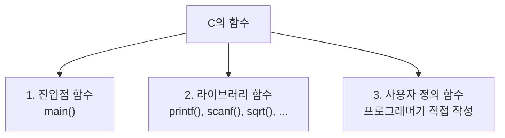

# 6장 — 함수

[레포지토리 안내](../../README.ko.md) | [English](Concepts_Lecture.md) | [한국어](Concepts_Lecture.ko.md)

> **최종 수정일:** 2026-11-19
>
> Warming-Up C Programming, 천정아, Ch 6

> **학습 목표:**
> 1. 함수가 필요한 이유와 함수의 세 가지 종류를 설명할 수 있다
> 2. 함수의 정의, 선언(원형), 호출을 구분하여 작성할 수 있다
> 3. 매개변수와 인수의 관계와 값에 의한 전달을 설명할 수 있다
> 4. 지역 변수와 전역 변수의 유효 범위, 수명, 초기값을 비교할 수 있다
> 5. 함수 호출 오버헤드와 재귀 함수의 기저 조건을 설명할 수 있다

---

## 목차

- [1. 함수 개념](#1-함수-개념)
  - [1.1 함수의 필요성](#11-함수의-필요성)
  - [1.2 함수의 종류](#12-함수의-종류)
  - [1.3 함수 사용의 세 가지 요소](#13-함수-사용의-세-가지-요소)
  - [1.4 표준 라이브러리 함수의 사용](#14-표준-라이브러리-함수의-사용)
- [2. 함수 기본](#2-함수-기본)
  - [2.1 함수 정의](#21-함수-정의)
  - [2.2 반환형](#22-반환형)
  - [2.3 함수 이름](#23-함수-이름)
  - [2.4 매개변수와 인수](#24-매개변수와-인수)
  - [2.5 함수 호출](#25-함수-호출)
  - [2.6 함수 선언 (원형)](#26-함수-선언-원형)
  - [2.7 함수를 설계하는 절차](#27-함수를-설계하는-절차)
  - [2.8 함수 호출 시 주의 사항](#28-함수-호출-시-주의-사항)
  - [2.9 함수 정의와 호출의 흔한 실수](#29-함수-정의와-호출의-흔한-실수)
  - [2.10 매개변수와 반환값에 따른 함수의 네 가지 형태](#210-매개변수와-반환값에-따른-함수의-네-가지-형태)
- [3. 지역 변수와 전역 변수](#3-지역-변수와-전역-변수)
  - [3.1 지역 변수](#31-지역-변수)
  - [3.2 전역 변수](#32-전역-변수)
  - [3.3 유효 범위 규칙](#33-유효-범위-규칙)
  - [3.4 블록 유효 범위의 추적](#34-블록-유효-범위의-추적)
  - [3.5 호출 스택과 지역 변수의 생성과 소멸](#35-호출-스택과-지역-변수의-생성과-소멸)
- [4. 함수 호출 오버헤드](#4-함수-호출-오버헤드)
- [5. 재귀 함수 (소개)](#5-재귀-함수-소개)
- [개념 적용](#개념-적용)
- [요약](#요약)
- [점검 문제](#점검-문제)

---

<br>

## 1. 함수 개념

### 1.1 함수의 필요성

**함수**는 특정 작업을 수행하는 이름이 붙은 재사용 가능한 코드 블록이다. 함수는 입력(매개변수)을 받아 결과(반환값)를 내는 블랙박스로 볼 수 있으며, 호출하는 쪽은 함수 내부의 구현을 몰라도 함수를 사용할 수 있다. 함수가 없으면 프로그램이 길고, 반복적이며, 유지보수가 어려워진다. 함수는 네 가지 핵심 이점을 제공한다:

| 이점 | 설명 |
|:----|:----|
| **코드 재사용** | 한 번 작성하고 여러 번 호출하므로 같은 코드를 복사하여 붙여 넣을 필요가 없다 |
| **모듈화** | 큰 문제를 작고 관리 가능한 조각으로 분리 |
| **가독성** | `main()`이 목차처럼 읽히고, 세부 사항은 함수 내부에 숨겨짐 |
| **유지보수성** | 하나의 함수에서 버그를 수정하면 모든 호출 지점이 자동으로 수정됨 |

*표 1. 함수가 주는 네 가지 이점*

**변경 전 (모든 코드가 `main()` 안에 있는 경우):**

```c
#include <stdio.h>

int main() {
    // --- 5의 팩토리얼 계산 ---
    int fact1 = 1;
    for (int i = 1; i <= 5; i++) {
        fact1 *= i;
    }
    printf("5! = %d\n", fact1);

    // --- 8의 팩토리얼 계산 (중복된 로직!) ---
    int fact2 = 1;
    for (int i = 1; i <= 8; i++) {
        fact2 *= i;
    }
    printf("8! = %d\n", fact2);

    return 0;
}
```

**변경 후 (반복되는 로직을 함수로 추출한 경우):**

```c
#include <stdio.h>

int factorial(int n) {
    int result = 1;
    for (int i = 1; i <= n; i++) {
        result *= i;
    }
    return result;
}

int main() {
    printf("5! = %d\n", factorial(5));
    printf("8! = %d\n", factorial(8));
    return 0;
}
```

중복된 반복문이 사라졌다. 팩토리얼 알고리즘을 변경해야 할 때 `factorial()`만 수정하면 된다.

### 1.2 함수의 종류

C 프로그램에서는 세 가지 범주의 함수를 사용한다:



*그림 1. C 함수의 세 가지 종류*

| 분류 | 예시 | 비고 |
|:----|:----|:----|
| 진입점 | `main()` | 모든 C 프로그램에는 정확히 하나의 `main()`이 있어야 한다. 프로그램이 시작될 때 운영체제 쪽에서 호출하며 프로그래머가 직접 호출하지 않는다. 실행이 여기서 시작된다. |
| 라이브러리 | `printf()`, `scanf()`, `sqrt()` | C 표준 라이브러리에서 제공한다. 적절한 헤더(`<stdio.h>`, `<math.h>` 등)를 `#include`해야 한다. |
| 사용자 정의 | `factorial()`, `isLeapYear()` | 프로그래머가 특정 하위 문제를 해결하기 위해 작성한다. |

*표 2. 함수의 종류별 예시와 특징*

> **핵심:** `#include <stdio.h>`는 함수 코드 자체를 포함하는 것이 **아니다**. 컴파일러가 함수 호출 방법을 알 수 있도록 **선언(원형)** 을 포함하는 것이다. 실제 구현은 나중에 링커가 연결한다.

### 1.3 함수 사용의 세 가지 요소

C에서 함수를 사용하려면 세 가지 요소가 필요하다:


*그림 2. 함수 사용의 세 가지 요소*

| 요소 | 목적 | 필수 여부 |
|:----|:----|:---------|
| **정의** | 함수를 구현 (헤더 + 본체) | 반드시 정확히 한 번 |
| **선언** (원형) | 함수의 존재를 컴파일러에 알림 (반환형, 이름, 매개변수) | 호출이 정의 **앞에** 오는 경우 필요 |
| **호출** | 특정 인수로 함수를 실행 | 사용하려면 반드시 필요 |

*표 3. 함수 사용의 세 요소와 필요 여부*

세 요소 중 생략할 수 있는 것은 선언뿐이며, 함수의 정의가 호출보다 앞에 있으면 선언이 없어도 된다.

### 1.4 표준 라이브러리 함수의 사용

표준 라이브러리 함수는 정의가 이미 라이브러리에 있으므로, 헤더 파일을 포함하여 선언만 가져오면 호출할 수 있다. 수학 함수는 `<math.h>`, 정수의 절댓값 같은 일반 유틸리티 함수는 `<stdlib.h>`에 선언되어 있다.

```c
#include <stdio.h>
#include <math.h>
#include <stdlib.h>

int main(void)
{
    printf("%.4f %.1f %.1f\n", sqrt(2.0), pow(2.0, 10.0), fabs(-3.5));
    printf("%.1f %.1f %.1f %.1f\n", floor(2.7), ceil(2.1), floor(-2.7), round(2.5));
    printf("%d\n", abs(-7));
    return 0;
}
```

```text
1.4142 1024.0 3.5
2.0 3.0 -3.0 3.0
7
```

| 함수 | 헤더 | 하는 일 | 매개변수와 반환형 |
|:-----|:-----|:-----|:-----|
| `sqrt(x)` | `<math.h>` | 제곱근 | `double`을 받아 `double` 반환 |
| `pow(x, y)` | `<math.h>` | x의 y제곱 | `double` 두 개를 받아 `double` 반환 |
| `fabs(x)` | `<math.h>` | 실수의 절댓값 | `double`을 받아 `double` 반환 |
| `floor(x)`, `ceil(x)` | `<math.h>` | x 이하의 최대 정수, x 이상의 최소 정수 | `double`을 받아 `double` 반환 |
| `round(x)` | `<math.h>` | 가장 가까운 정수로 반올림하며 중간값은 0에서 먼 쪽으로 보냄 (C99) | `double`을 받아 `double` 반환 |
| `abs(n)` | `<stdlib.h>` | 정수의 절댓값 | `int`를 받아 `int` 반환 |

*표 4. 자주 쓰는 표준 라이브러리 함수*

`floor(-2.7)`은 -2.7 이하의 최대 정수이므로 -2가 아니라 -3이며, 0 쪽으로 버리는 형 변환 `(int)-2.7`의 결과 -2와 다르다. `round(2.5)`는 중간값을 0에서 먼 쪽으로 보내므로 3이다. 수학 함수는 실수를 다루므로 정수의 절댓값에는 `fabs` 대신 `abs`를 쓴다. 라이브러리 함수를 쓸 때도 2.4절의 규칙이 그대로 적용되어, 인수는 원형에 적힌 매개변수의 타입으로 변환되고 반환값은 원형의 반환형을 가진다. Linux의 GCC에서는 수학 함수를 링크하려면 `cc main.c -lm`처럼 수학 라이브러리를 지정해야 하는 경우가 있다.

---

<br>

## 2. 함수 기본

### 2.1 함수 정의

함수 정의는 **헤더**와 **본체**로 구성된다.

```text
┌─── 함수 헤더 ────────────────────────────┐
│  반환형   함수이름(매개변수 목록)             │
└────────────────────────────────────────┘
┌─── 함수 본체 ──────┐
│  {               │
│      문장들;       │
│      return 값;   │
│  }               │
└──────────────────┘
```

*그림 3. 함수 정의의 헤더와 본체*

**주석이 달린 예제:**

```c
/*  반환형
 *    │
 *    │    함수 이름
 *    │       │
 *    │       │        매개변수 목록
 *    │       │            │            */
    int     factorial   (int n)          // ← 헤더
    {                                    // ← 본체 시작
        int result = 1;                  //   지역 변수
        for (int i = 1; i <= n; i++) {
            result *= i;
        }
        return result;                   //   호출자에게 값 반환
    }                                    // ← 본체 끝
```

| 구성 요소 | 설명 |
|:---------|:----|
| 반환형 | 호출자에게 돌려보내는 값의 데이터 타입 (`int`, `double`, `void`, ...) |
| 함수 이름 | 명명 규칙을 따르는 식별자 (2.3절 참조) |
| 매개변수 목록 | 호출자로부터 값을 전달받는 `타입 이름` 쌍의 쉼표 구분 목록 |
| 본체 `{}` | 함수가 호출될 때 실행되는 코드 블록 |

*표 5. 함수 정의의 구성 요소*

### 2.2 반환형

반환형은 함수가 돌려보내는 값의 종류를 지정한다.

| 반환형 | 의미 | 예시 |
|:------|:----|:----|
| `int` | 정수를 반환 | `int factorial(int n)` |
| `double` | 실수를 반환 | `double getAverage(int a, int b)` |
| `void` | 아무것도 반환하지 않음 | `void printMenu(void)` |

*표 6. 반환형의 종류*

```c
// int 반환형
int square(int x) {
    return x * x;
}

// double 반환형
double average(int a, int b) {
    return (double)(a + b) / 2;
}

// void 반환형: 반환값 없음
void printLine(void) {
    printf("--------------------\n");
}
```

**중요한 규칙:**

1. **함수는 하나의 값만 반환할 수 있다.** 여러 결과를 반환하려면 포인터가 필요하다 (8장에서 다룸).
2. 반환형을 생략하면 C89에서는 `int`로 간주했다. C99부터는 이 암시적 `int` 규칙이 표준에서 제거되었으므로 **항상 반환형을 명시적으로 작성해야 한다.**
3. `void` 함수는 `return;` (값 없이)을 사용하여 조기에 종료하거나, 닫는 `}`까지 실행이 흘러가도록 할 수 있다.
4. 반환형이 `void`가 아닌 함수는 `return 식;`으로 값을 돌려주어야 하며, 식의 타입이 반환형과 다르면 값이 반환형으로 변환된다(예: `int` 함수의 `return 3.7;`은 3을 돌려준다).

```c
void printIfPositive(int n) {
    if (n <= 0) {
        return;           // 조기 종료, 값 없음
    }
    printf("%d\n", n);
}   // 여기서 암묵적 return
```

함수에서 여러 값을 돌려주려면 매개변수로 포인터를 전달한다. 함수는 이 포인터를 통해 호출자의 변수를 직접 수정할 수 있으며, 자세한 내용은 8장에서 다룬다.

### 2.3 함수 이름

함수 이름은 변수와 동일한 **식별자 규칙**을 따른다 (3장):

| 규칙 | 예시 |
|:----|:----|
| 문자 또는 `_`로 시작해야 함 | `factorial`, `_helper` |
| 문자, 숫자, `_`를 포함할 수 있음 | `calc2dArea` |
| C 키워드는 사용 불가 | `return`, `int`는 함수 이름으로 쓸 수 없음 |
| 대소문자를 구분함 | `factorial`과 `Factorial`은 서로 다름 |

*표 7. 함수 이름의 식별자 규칙*

**명명 규칙 (권장):**

| 규칙 | 스타일 | 예시 |
|:----|:------|:----|
| snake_case | `동사_명사` | `get_factorial`, `is_leap_year` |
| camelCase | `동사명사` | `getFactorial`, `isLeapYear` |
| PascalCase | `동사명사` | `GetDaysOfMonth`, `PrintMenu` |

*표 8. 함수 이름의 명명 규칙*

명명 규칙은 **하나**를 선택하여 프로그램 전체에서 일관되게 사용하고, 함수 이름에는 함수가 하는 일을 설명하는 동사와 명사의 조합을 쓴다(`getFactorial`, `isLeapYear`, `printMenu`).

> **주의:** C에서는 **같은 이름의 함수를 두 개 정의할 수 없다** (오버로딩 불가). 프로그램 내에서 각 함수 이름은 고유해야 한다.

### 2.4 매개변수와 인수

**매개변수(parameter)** 와 **인수(argument)** 는 관련되어 있지만 서로 다른 개념이다:

| 용어 | 다른 이름 | 위치 | 역할 |
|:----|:---------|:----|:----|
| **매개변수** | 형식 매개변수 (formal parameter) | 함수 **정의**에서 | 전달받는 값을 저장하는 지역 변수 |
| **인수** | 실제 매개변수 (actual parameter) | 함수 **호출 지점**에서 | 함수에 전달하는 실제 값 또는 식 |

*표 9. 매개변수와 인수의 비교*

```c
//                  매개변수 (형식)
//                    ↓
int square(int x) {
    return x * x;
}

int main() {
    int result = square(5);   // 5는 인수 (실제)
    //                 ↑
    //               인수
    return 0;
}
```

**매개변수 선언 규칙:**

```c
// 올바름: 각 매개변수에 자체 타입이 필요
int add(int a, int b) {
    return a + b;
}

// 잘못됨: 변수 선언처럼 타입을 공유할 수 없음
// int add(int a, b) { ... }   ← 컴파일 오류!
```

함수 정의에서 매개변수의 타입을 생략하면 컴파일 오류가 나고, C17까지는 매개변수의 이름을 생략해도 오류가 난다(C23부터는 정의에서도 이름 없는 매개변수를 허용한다). 매개변수의 개수에는 제한이 없다.

**매개변수가 없는 함수:**

```c
// 두 형태 모두 "매개변수 없음"을 의미:
void printMenu(void) { ... }   // 명시적 void: 권장
void printMenu() { ... }       // 빈 괄호: 정의에서는 유효
```

> **핵심:** C23 이전의 **원형(선언)** 에서 `void printMenu()`는 매개변수의 개수와 타입을 지정하지 않은 선언이어서 컴파일러가 인수를 검사하지 않고, `void printMenu(void)`는 매개변수가 없음을 뜻한다. C23부터는 빈 괄호도 매개변수가 없다는 뜻이다. 명확성을 위해 원형에서는 항상 `void`를 사용하라.

**값에 의한 전달 (pass by value):**

C에서 인수는 **값에 의해** 전달된다. 매개변수는 함수가 호출될 때 생성되어 인수의 **복사본**으로 초기화되는 지역 변수이며, 함수가 반환하면 소멸한다. 따라서 매개변수를 변경해도 원래 변수에는 **영향을 주지 않는다**.

```c
void tryToChange(int x) {
    x = 100;   // 지역 복사본만 수정
    printf("함수 내부: x = %d\n", x);   // 100
}

int main() {
    int num = 5;
    tryToChange(num);
    printf("함수 호출 후: num = %d\n", num);  // 여전히 5!
    return 0;
}
```

```text
출력:
함수 내부: x = 100
함수 호출 후: num = 5
```

> **참고:** **미리보기.** 호출자의 변수를 수정하려면 값 대신 **주소(포인터)** 를 전달한다. 이 방식을 흔히 **참조에 의한 전달(pass by reference)** 이라고 부르지만, 엄밀히는 주소 값이 복사되어 전달되는 값에 의한 전달이다. 자세한 내용은 8장에서 다룬다.

### 2.5 함수 호출

함수를 실행하려면 함수 이름 뒤에 인수를 포함한 괄호를 작성한다.

```c
// 함수를 호출하고 반환값 사용
int result = factorial(5);              // 반환값을 저장
printf("8! = %d\n", factorial(8));      // 반환값을 식에서 직접 사용

// void 함수 호출
printLine();                            // 캡처할 반환값 없음
```

**함수 호출 규칙:**

1. 호출 지점 이전에 함수가 **정의되었거나 선언되어** 있어야 한다.
2. 인수의 개수와 순서가 매개변수와 일치해야 한다. 인수의 타입이 매개변수와 다르면 원형이 보이는 곳에서는 매개변수의 타입으로 자동 변환된다(예: `char` 매개변수에 101을 넘기면 문자 `'e'`가 전달된다).
3. 반환값은 임의의 식에서 사용하거나, 변수에 대입하거나, 무시할 수 있다.
4. 인수도 식이므로 인수의 값을 먼저 계산한 다음 함수를 호출한다.
5. 반환형이 `void`인 함수의 호출은 값이 없으므로 다른 식의 피연산자로 쓸 수 없다.

**다른 함수에서 함수 호출:**

```c
#include <stdio.h>

int isLeapYear(int year) {
    return (year % 4 == 0 && year % 100 != 0) || (year % 400 == 0);
}

int GetDaysOfMonth(int year, int month) {
    if (month == 2) {
        return isLeapYear(year) ? 29 : 28;   // isLeapYear() 호출
    }
    switch (month) {
    case 4: case 6: case 9: case 11:
        return 30;
    default:
        return 31;
    }
}

int main() {
    int days = GetDaysOfMonth(2024, 2);       // GetDaysOfMonth() 호출
    printf("2024년 2월은 %d일\n", days);       // 29
    return 0;
}
```

### 2.6 함수 선언 (원형)

**함수 선언**(또는 **원형(prototype)**, **시그니처(signature)**)은 전체 정의가 나타나기 **전에** 함수의 인터페이스를 컴파일러에 알려준다.

**문법:**

```c
반환형 함수이름(매개변수_목록);   // ← 세미콜론, 본체 없음
```

**원형이 필요한 이유:**

C 컴파일러는 소스 코드를 **위에서 아래로** 읽는다. `main()`이 그 *아래에* 정의된 함수를 호출하면, 컴파일러는 아직 그 함수의 반환형이나 매개변수 타입을 모른다. 원형은 인터페이스를 미리 선언하여 이 문제를 해결한다.

```c
#include <stdio.h>

// ─── 원형 (선언) ───
int factorial(int n);         // 매개변수 이름 포함 (권장)
int isLeapYear(int);          // 매개변수 이름 생략 (유효)

int main() {
    printf("5! = %d\n", factorial(5));      // OK: 위에서 원형 확인됨
    printf("Leap? %d\n", isLeapYear(2024)); // OK: 위에서 원형 확인됨
    return 0;
}

// ─── 정의 ───
int factorial(int n) {
    int result = 1;
    for (int i = 1; i <= n; i++) {
        result *= i;
    }
    return result;
}

int isLeapYear(int year) {
    return (year % 4 == 0 && year % 100 != 0) || (year % 400 == 0);
}
```

**원형 규칙:**

| 규칙 | 예시 |
|:----|:----|
| 정의의 반환형 및 매개변수 타입과 일치해야 함 | `int factorial(int n);`은 `int factorial(int n) { ... }`과 일치 |
| 매개변수 **이름**은 원형에서 선택 사항 | `int add(int, int);`은 유효 |
| **세미콜론**으로 끝나야 함 | `int factorial(int n);` (`int factorial(int n) { }` 아님) |
| 일반적으로 **`main()` 앞** 또는 헤더 파일에 배치 | 가독성을 위한 관례 |

*표 10. 함수 원형의 규칙*

매개변수 이름은 선택 사항이지만 원형에는 항상 포함하는 것이 좋다. 이름이 문서 역할을 하므로 `double power(double base, int exponent);`가 `double power(double, int);`보다 훨씬 읽기 쉽다.

**원형이 없을 때 생기는 문제:**

```c
#include <stdio.h>

int main() {
    // factorial()이 아래에 정의되어 있고 위에 원형이 없는 경우:
    // 컴파일러가 int 반환형으로 가정하거나 (C89) 오류를 발생시킴 (C99+)
    printf("5! = %d\n", factorial(5));   // 경고 또는 오류!
    return 0;
}

int factorial(int n) {
    int result = 1;
    for (int i = 1; i <= n; i++) result *= i;
    return result;
}
```

> **주의:** C99부터는 선언 없이 함수를 호출하는 암시적 선언이 표준에서 제거되어, 컴파일러가 진단 메시지를 내야 한다. gcc 14 이상과 clang 16 이상은 기본적으로 **오류**로 처리하고, 그 이전 버전은 경고만 내고 `int`를 반환하는 함수로 가정한다. 항상 원형을 제공하거나 사용 전에 함수를 정의하라.

### 2.7 함수를 설계하는 절차

필요한 기능을 함수로 만들 때는 함수의 바깥에서 보이는 모습, 즉 이름, 매개변수, 반환형을 먼저 정하고 본체를 나중에 작성한다. 두 정수의 최대공약수를 구하는 함수를 예로 들면 절차는 다음과 같다.

1. **이름을 정한다.** 함수가 하는 일이 드러나도록 `get_gcd`로 정한다.
2. **호출한 곳에서 받아 올 값을 정하고 매개변수 목록을 만든다.** 최대공약수를 구할 두 정수가 필요하므로 `int x, int y`이다.
3. **처리 결과의 타입을 반환형으로 정한다.** 최대공약수는 정수이므로 `int`이다.
4. **본체를 작성한다.** 매개변수는 본체 안에서 일반 지역 변수처럼 쓸 수 있고, 필요한 변수를 더 선언할 수 있다. 여기서는 5장 5.6절의 유클리드 호제법을 그대로 옮긴다.

```c
int get_gcd(int x, int y)
{
    int r;

    while (y != 0) {
        r = x % y;
        x = y;
        y = r;
    }
    return x;
}
```

`printf("%d %d %d\n", get_gcd(84, 36), get_gcd(17, 5), get_gcd(9, 27));`의 출력은 `12 1 9`이다. 84와 36은 (84, 36) → (36, 12) → (12, 0)으로 12가 되고, 서로소인 17과 5는 1이 된다. 9와 27처럼 첫 인수가 작으면 첫 회차에서 (27, 9)로 자리가 바뀌므로 호출하는 쪽이 순서를 신경 쓰지 않아도 된다. 함수 안에서 매개변수 `x`, `y`의 값을 바꾸었지만, 이는 인수의 복사본이므로 호출한 쪽의 값은 바뀌지 않는다(2.4절).

이미 작성한 코드에서 함수를 뽑아낼 때도 같은 절차를 따른다. 1.1절의 예처럼 `main` 안에서 같은 모양으로 되풀이되는 코드를 찾아 그 부분을 함수의 본체로 옮기고, 되풀이될 때마다 달라지는 값을 매개변수로, 그 코드가 만들어 낸 결과를 반환값으로 정한다. 함수 하나는 한 가지 일만 하도록 만들면 이름을 붙이기 쉽고 다른 곳에서 다시 쓰기도 쉽다.

### 2.8 함수 호출 시 주의 사항

**인수는 먼저 평가된다.** 인수도 수식이므로 상수, 변수, 연산식, 함수 호출을 인수로 쓸 수 있으며, 함수를 호출하기 전에 모든 인수의 값을 먼저 계산한다. `draw_line('=', len * 2)`는 `len * 2`를 먼저 계산한 뒤 그 값을 넘기고, `get_factorial(add(1, 3))`은 `add(1, 3)`을 먼저 호출하여 반환값 4를 받은 뒤 `get_factorial(4)`를 호출한다. 다만 인수가 여러 개일 때 어느 인수를 먼저 평가할지는 정해져 있지 않다(4장 3.5절).

**인수 전달은 매개변수의 초기화이다.** 함수가 호출되면 매개변수가 생성되고 인수의 값으로 초기화된다. 다음 프로그램에서 `get_area(r)`를 호출하면 `double radius = r;`이 실행되는 것과 같으므로, `int`형 인수 `r`은 `double`형으로 변환되어 전달된다.

```c
double get_area(double radius)
{
    const double pi = 3.14;

    return pi * radius * radius;
}

int main(void)
{
    int r;

    for (r = 1; r <= 5; r++)
        printf("r = %d, area = %.2f\n", r, get_area(r));
    return 0;
}
```

```text
r = 1, area = 3.14
r = 2, area = 12.56
r = 3, area = 28.26
r = 4, area = 50.24
r = 5, area = 78.50
```

`r`이 3인 회차를 따라가면, 인수 `r`의 값 3이 `double`형 3.0으로 변환되어 `radius`를 초기화하고, 본체가 3.14 × 3.0 × 3.0 = 28.26을 계산하여 반환한다. 반환값은 `get_area(r)`라는 호출식의 값이 되어 `printf`의 인수로 쓰인다. 함수가 반환하면 `radius`와 `pi`는 소멸하고, 다음 회차에 다시 생성된다.

**인수의 개수는 매개변수와 같아야 한다.** 원형이 보이는 곳에서 인수가 모자라거나 남으면 컴파일러가 오류를 낸다. 다음은 매개변수가 3개인 `get_max`에 인수를 2개, 4개 넘겼을 때 Clang이 낸 오류이다. 교재는 인수가 남는 경우를 경고로 설명하는데, 이는 컴파일러마다 처리가 다른 부분이므로 어느 경우든 개수를 맞춰야 한다.

```text
error: too few arguments to function call, expected 3, have 2
error: too many arguments to function call, expected 3, have 4
```

**인수의 타입이 다르면 암시적으로 변환된다.** 매개변수가 `int`형인 `get_max`에 `get_max(12.34, 0.5, 7.9)`처럼 실수를 넘기면, 각 인수가 `int`로 변환되어 `get_max(12, 0, 7)`이 호출되고 12가 반환된다. 반환값 12를 `double`형 변수에 대입하면 12.0이 되므로, 실수 부분은 이미 인수 전달 단계에서 사라진 뒤이다. Clang은 각 인수에 `implicit conversion from 'double' to 'int' changes value from 12.34 to 12` 같은 경고를 낸다. 반환할 때도 같은 원리로, 반환하는 값의 타입이 반환형과 다르면 반환형으로 변환된다.

**함수는 이름으로 구분된다.** `get_ma(1, 2, 3)`처럼 이름을 잘못 쓰면 컴파일러는 선언되지 않은 함수라는 진단을 내고, 선언만 있고 정의가 없는 함수를 호출하면 링크 오류가 난다(1장 3.3절).

### 2.9 함수 정의와 호출의 흔한 실수

함수와 관련된 실수 가운데 다음 다섯 가지는 컴파일러가 대부분 찾아 주므로, 메시지를 읽고 원인을 연결할 수 있어야 한다.

```c
int sign(int n)
{
    if (n > 0)
        return 1;
    else if (n < 0)
        return -1;
}                               // n이 0이면 반환값이 없다

double half(double x);          // 원형의 반환형은 double

int half(double x)              // 정의의 반환형은 int
{
    return x / 2;
}

void hello(void)
{
    printf("hello\n");
}

int main(void)
{
    int r = hello();            // void 함수의 반환값을 쓴다
    return 0;
}
```

```text
warning: non-void function does not return a value in all control paths [-Wreturn-type]
error: conflicting types for 'half'
error: initializing 'int' with an expression of incompatible type 'void'
```

- **반환하지 않는 경로:** `sign(0)`은 어느 `return`도 만나지 못하고 함수의 끝에 이른다. 반환형이 `void`가 아닌 함수에서 이런 경로가 있으면 경고가 나고, 그 반환값을 쓰면 정의되지 않은 동작이다. 마지막에 `return 0;`을 두어 모든 경로가 값을 반환하게 한다.
- **원형과 정의의 불일치:** 원형과 정의의 반환형이나 매개변수 타입이 다르면 `conflicting types` 오류이다. 원형은 정의의 헤더를 복사하고 끝에 세미콜론을 붙여 만드는 것이 안전하다.
- **`void` 함수의 값 사용:** 반환형이 `void`인 함수의 호출식에는 값이 없으므로 대입하거나 연산에 쓸 수 없다.
- **헤더 뒤의 세미콜론:** 정의를 `int square(int x);`처럼 세미콜론으로 끝내고 본체를 쓰면, 그 줄은 원형이 되고 뒤의 `{ ... }`는 어디에도 속하지 않아 `expected identifier or '('` 오류가 난다.
- **함수 안의 함수 정의:** 표준 C는 함수 안에서 다른 함수를 정의하는 것을 허용하지 않는다. Clang은 `main` 안에 정의한 함수에 `function definition is not allowed here` 오류를 낸다. 모든 함수는 다른 함수의 바깥에서 나란히 정의한다.

### 2.10 매개변수와 반환값에 따른 함수의 네 가지 형태

함수는 매개변수가 있는지와 반환값이 있는지에 따라 네 가지 형태로 나뉜다. 어느 형태로 만들지는 함수가 바깥에서 받아야 할 값과 바깥에 돌려줘야 할 값이 있는지로 정한다.

| 형태 | 원형의 예 | 쓰임 |
|:-----|:-----|:-----|
| 매개변수와 반환값이 모두 없음 | `void print_line(void);` | 정해진 출력처럼 항상 같은 일을 한다 |
| 매개변수만 있음 | `void print_stars(int n);` | 받은 값에 따라 출력하거나 처리하지만 결과를 돌려주지 않는다 |
| 반환값만 있음 | `int read_positive(void);` | 입력처럼 함수 안에서 값을 만들어 돌려준다 |
| 매개변수와 반환값이 모두 있음 | `int max2(int a, int b);` | 받은 값으로 계산한 결과를 돌려준다 |

*표 11. 매개변수와 반환값에 따른 함수의 형태*

```c
void print_line(void)
{
    printf("----------\n");
}

void print_stars(int n)
{
    int i;

    for (i = 0; i < n; i++)
        printf("*");
    printf("\n");
}

int read_positive(void)
{
    int n;

    do {
        printf("positive integer? ");
        scanf("%d", &n);
    } while (n <= 0);
    return n;
}

int max2(int a, int b)
{
    return a > b ? a : b;
}

int main(void)
{
    int n;

    print_line();
    n = read_positive();
    print_stars(max2(n, 3));
    print_line();
    return 0;
}
```

```text
----------
positive integer? -2
positive integer? 5
*****
----------
```

`read_positive`는 양수가 입력될 때까지 5장의 `do-while`로 다시 묻고, 읽은 값을 반환한다. `-2`를 입력하면 조건 `n <= 0`이 참이어서 한 번 더 묻고, 5에서 반복이 끝난다. `print_stars(max2(n, 3))`는 인수 자리의 `max2(5, 3)`이 먼저 호출되어 5를 반환한 뒤 `print_stars(5)`가 호출되는 구조이다(2.8절). 반환값이 있는 함수는 이처럼 다른 함수의 인수나 수식 안에 쓸 수 있지만, 반환형이 `void`인 `print_line()`은 문장으로만 호출할 수 있다.

---

<br>

## 3. 지역 변수와 전역 변수

### 3.1 지역 변수

**지역 변수**는 블록 `{}` 안에서 선언한 변수이며, 대개 함수 본체 안에 선언한다. 해당 블록이 실행되는 동안에만 존재한다.

```c
void funcA() {
    int x = 10;   // funcA의 지역 변수
    printf("funcA: x = %d\n", x);
}

void funcB() {
    int x = 20;   // funcB의 지역 변수: funcA의 x와 독립적
    printf("funcB: x = %d\n", x);
}

int main() {
    funcA();   // 출력: funcA: x = 10
    funcB();   // 출력: funcB: x = 20
    // printf("%d", x);   // 오류: 여기서 x에 접근 불가
    return 0;
}
```

**지역 변수의 특성:**

| 속성 | 설명 |
|:----|:----|
| 유효 범위 (scope) | 선언 위치부터 해당 `{}` 블록의 끝까지 |
| 수명 (lifetime) | 블록에 진입할 때 생성되고, 블록을 벗어나면 소멸 |
| 저장 위치 | 일반적으로 스택(stack) 영역 |
| 초기값 | 명시적으로 초기화하지 않으면 **미정의**(쓰레기 값) |
| 독립성 | 서로 다른 함수에서 같은 변수 이름을 충돌 없이 사용 가능 |

*표 12. 지역 변수의 특성*

```c
int main() {
    for (int i = 0; i < 3; i++) {
        int temp = i * 10;   // 매 반복마다 생성되고, 반복 끝에 소멸
        printf("%d ", temp);
    }
    // printf("%d", temp);  // 오류: temp는 여기에 존재하지 않음
    return 0;
}
```

함수 안의 지역 변수는 함수가 호출될 때마다 새로 생성되고 반환할 때 소멸하며, 반복문 블록 안의 지역 변수는 반복할 때마다 생성되고 소멸한다. 매개변수도 지역 변수이므로 함수 안에서 매개변수를 바꾸어도 호출한 쪽에는 영향이 없고, 함수가 만든 값을 호출한 쪽에 넘기려면 반환값을 이용한다.

> **주의:** 지역 변수는 자동으로 0으로 초기화되지 **않는다**. 사용 전에 항상 초기화하라. 그렇지 않으면 예측 불가능한 쓰레기 값이 나온다.

### 3.2 전역 변수

**전역 변수**는 **모든 함수 바깥**에서 선언되며, 일반적으로 파일 상단에 위치한다. 선언 지점부터 파일 끝까지 접근 가능하다.

```c
#include <stdio.h>

int count = 0;   // 전역 변수: 이 줄 아래 어디서든 접근 가능

void increment() {
    count++;   // 전역 변수를 수정
}

void printCount() {
    printf("count = %d\n", count);
}

int main() {
    increment();
    increment();
    increment();
    printCount();   // count = 3
    return 0;
}
```

세 번의 `increment()` 호출이 모두 같은 `count`를 바꾸므로 `printCount()`는 3을 출력한다. 함수 안에서 바꾼 전역 변수의 값은 함수가 반환한 뒤에도 유지된다.

**전역 변수의 특성:**

| 속성 | 설명 |
|:----|:----|
| 유효 범위 (scope) | 선언 지점부터 소스 파일의 끝까지 |
| 수명 (lifetime) | 프로그램 전체 실행 기간 (프로그램 시작 시 생성, 종료 시 소멸) |
| 저장 위치 | 데이터(data) 영역 |
| 초기값 | **자동으로 `0`으로 초기화됨** (지역 변수와 다름) |
| 접근성 | 선언 이후에 정의된 모든 함수에서 접근 가능 |

*표 13. 전역 변수의 특성*

```c
#include <stdio.h>

int g;   // 전역: 자동으로 0으로 초기화됨

int main() {
    printf("g = %d\n", g);   // g = 0 (보장됨)

    int local;
    // printf("local = %d\n", local);  // 위험: 미초기화, 쓰레기 값
    return 0;
}
```

전역 변수를 남용하면 어떤 함수가 전역 변수를 수정하는지 추적하기 어려워져 **숨겨진 의존성**과 디버그하기 힘든 버그가 생긴다. 따라서 값은 가능한 한 매개변수로 전달한다.

전역 변수도 선언하기 전에는 쓸 수 없다. 전역 변수의 사용 범위는 파일 전체가 아니라 **선언한 위치부터 파일의 끝까지**이므로, 다음 코드처럼 전역 변수를 함수보다 아래에서 선언하면 그 함수 안에서는 이름을 찾을 수 없다.

```c
void show(void)
{
    printf("%d\n", total);      // total은 아직 선언되지 않았다
}

int total = 10;
```

```text
error: use of undeclared identifier 'total'
```

그래서 전역 변수는 보통 `#include` 다음, 모든 함수 정의보다 앞에서 선언한다. 생존 기간도 지역 변수와 다르다. 지역 변수는 블록이 실행될 때 생성되고 블록을 벗어날 때 소멸하지만, 전역 변수는 프로그램이 시작될 때 생성되어 프로그램이 끝날 때까지 남는다. 이 때문에 전역 변수는 함수를 여러 번 호출하는 동안 값을 유지할 수 있고, 초기값을 쓰지 않으면 0으로 초기화된다.

### 3.3 유효 범위 규칙

지역 변수와 전역 변수의 이름이 같으면, 해당 유효 범위 내에서 **지역 변수가 우선한다**. 이를 **섀도잉(shadowing)** 이라 한다.

```c
#include <stdio.h>

int x = 100;   // 전역

void demo() {
    int x = 50;   // 지역: 전역 x를 가림
    printf("demo() 내부: x = %d\n", x);       // 50 (지역)
}

int main() {
    printf("demo() 전: x = %d\n", x);          // 100 (전역)
    demo();
    printf("demo() 후: x = %d\n", x);          // 100 (전역, 변경 없음)

    {
        int x = 999;   // 블록 지역: 전역 x를 가림
        printf("블록 내부: x = %d\n", x);       // 999
    }
    printf("블록 후: x = %d\n", x);             // 100 (전역)

    return 0;
}
```

```text
출력:
demo() 전: x = 100
demo() 내부: x = 50
demo() 후: x = 100
블록 내부: x = 999
블록 후: x = 100
```

**유효 범위 우선순위:**

```text
동일한 이름이 여러 수준에 존재할 때:
  내부 블록 변수  >  외부 블록 변수  >  전역 변수
  (가장 안쪽 범위가 우선)
```

*그림 4. 같은 이름의 변수가 여러 범위에 있을 때의 우선순위*

| 범위 수준 | 변수 | 접근 가능한 곳 |
|:---------|:----|:-------------|
| 블록 `{}` | 블록 내부에서 선언 | 해당 블록 내에서만 |
| 함수 | 함수 상단에서 선언 | 선언 지점부터 함수 끝까지 |
| 파일 (전역) | 모든 함수 바깥에서 선언 | 선언 지점부터 파일 끝까지 |

*표 14. 범위 수준별 변수의 접근 범위*

지역 변수와 전역 변수에 같은 이름을 쓰지 않는다. 섀도잉은 코드를 혼란스럽게 만들고 흔한 버그의 원인이 되므로, 구별되고 설명적인 이름을 사용한다.

### 3.4 블록 유효 범위의 추적

교재는 전역 변수, `main`의 지역 변수, `while` 블록의 지역 변수가 모두 `x`라는 같은 이름을 쓰는 예로 영역 규칙을 설명한다. 이름이 같아도 선언한 위치가 다르면 서로 다른 변수이며, 어떤 문장에서 `x`를 쓰면 그 문장을 감싼 가장 안쪽 블록부터 바깥쪽으로 찾아 처음 만나는 선언이 선택된다.

```c
int x = 1;                      // 전역 x

void show(void)
{
    printf("show: x = %d\n", x);
}

int main(void)
{
    int x = 10;                 // main의 x
    int i = 0;

    printf("main: x = %d\n", x);
    while (i < 2) {
        int x = 100 + i;        // while 블록의 x

        printf("while: x = %d\n", x);
        i++;
    }
    printf("main: x = %d\n", x);
    show();
    return 0;
}
```

```text
main: x = 10
while: x = 100
while: x = 101
main: x = 10
show: x = 1
```

| 출력한 문장의 위치 | 선택된 `x` | 이유 |
|:-----|:-----|:-----|
| `while` 앞의 `main` | `main`의 `x` (10) | `main` 블록의 선언이 전역 선언보다 안쪽에 있음 |
| `while` 블록 안 | 블록의 `x` (100, 101) | 가장 안쪽 블록의 선언이며 반복할 때마다 새로 생성됨 |
| `while` 뒤의 `main` | `main`의 `x` (10) | 블록의 `x`는 블록을 벗어나며 소멸함 |
| `show` 안 | 전역 `x` (1) | `show`에는 `x`의 지역 선언이 없고 `main`의 `x`는 `main` 안에서만 보임 |

*표 15. 같은 이름의 변수가 선택되는 위치*

`show`가 `main`에서 호출되었다고 해서 `main`의 `x`가 보이는 것은 아니다. 유효 범위는 호출 관계가 아니라 소스 코드에서 선언이 놓인 위치로 정해진다. `-Wshadow` 옵션을 주면 Clang은 이런 섀도잉마다 `declaration shadows a variable in the global scope`, `declaration shadows a local variable` 경고를 내므로, 의도하지 않은 섀도잉을 찾을 수 있다.

### 3.5 호출 스택과 지역 변수의 생성과 소멸

지역 변수와 매개변수는 함수가 호출될 때 **호출 스택(call stack)** 이라는 메모리 영역에 자리를 받고, 함수가 반환하면 그 자리를 돌려준다. 함수 하나가 호출될 때 스택에 만들어지는 영역을 **스택 프레임(stack frame)** 이라고 한다. 다음 코드는 재귀 함수 `depth`가 자신을 세 번 호출하는 동안 매개변수와 지역 변수의 주소를 출력한다.

```c
int depth(int n)
{
    int local = n * 10;

    printf("depth(%d): &n = %p, &local = %p\n", n, (void *)&n, (void *)&local);
    if (n == 3)
        return local;
    return depth(n + 1);
}

int main(void)
{
    int result;

    printf("main: &result = %p\n", (void *)&result);
    result = depth(1);
    printf("result = %d\n", result);
    return 0;
}
```

```text
main: &result = 0x16f7b6b08
depth(1): &n = 0x16f7b6ad8, &local = 0x16f7b6ad4
depth(2): &n = 0x16f7b6a98, &local = 0x16f7b6a94
depth(3): &n = 0x16f7b6a58, &local = 0x16f7b6a54
result = 30
```

```text
             ┌────────────────────────┐   높은 주소
             │ main:     result       │  0x...b08
             ├────────────────────────┤
             │ depth(1): n=1 local=10 │  0x...ad8
             ├────────────────────────┤
             │ depth(2): n=2 local=20 │  0x...a98
             ├────────────────────────┤
             │ depth(3): n=3 local=30 │  0x...a58   ← 가장 최근의 호출
             └────────────────────────┘   낮은 주소
```

*그림 5. 재귀 호출 중 호출 스택의 프레임*

호출이 한 단계 깊어질 때마다 `n`과 `local`의 주소가 0x40(64)바이트씩 낮아진다. 이 환경의 스택은 높은 주소에서 낮은 주소 쪽으로 자라며, 같은 함수라도 호출마다 별도의 프레임에 자기만의 `n`과 `local`을 갖는다. `depth(3)`이 30을 반환하면 그 프레임이 사라지고, 반환값은 `depth(2)`의 `return depth(n + 1);`을 거쳐 `depth(1)`, `main`의 순서로 전달된다. 2.4절에서 매개변수를 바꿔도 인수가 바뀌지 않는 이유, 8장 3.5절에서 지역 변수의 주소를 반환하면 안 되는 이유, 5절의 재귀가 기저 조건 없이 계속되면 스택 오버플로가 나는 이유가 모두 이 구조에서 나온다. 프레임의 크기와 스택이 자라는 방향은 컴파일러와 플랫폼이 정한다.

---

<br>

## 4. 함수 호출 오버헤드

모든 함수 호출에는 **호출 스택**이 관리하는 일련의 배후 작업이 수반된다:

```text
함수 호출 메커니즘
─────────────────────────────────────────
1. 복귀 주소 저장 (돌아올 위치)
2. CPU 레지스터 값 저장
3. 인수를 스택에 push
4. 함수 코드로 점프
5. 함수 본체 실행
6. 반환값을 레지스터에 배치
7. 스택 pop (레지스터, 인수 복원)
8. 복귀 주소로 점프
─────────────────────────────────────────
```

*그림 6. 함수 호출과 복귀의 단계*

구체적인 단계와 순서는 CPU와 호출 규약(calling convention)에 따라 다르다. 예를 들어 x86-64 환경에서는 처음 몇 개의 인수를 스택이 아니라 레지스터로 전달한다.

> **[시스템프로그래밍]** 함수가 호출될 때마다 스택에 만들어지는 스택 프레임(복귀 주소, 저장된 레지스터, 지역 변수)과, 인수를 어느 레지스터나 스택 위치로 전달할지 정한 호출 규약은 프로그램의 기계 수준 표현으로서 시스템프로그래밍에서 다룬다. 이 구조를 알면 지역 변수가 함수가 끝날 때 사라지는 이유(3.1절)와 함수 호출 오버헤드가 생기는 이유를 함께 이해할 수 있다.

이 과정을 **함수 호출 오버헤드**라 한다. 상당한 계산을 수행하는 큰 함수의 경우 오버헤드는 무시할 수 있다. 그러나 **매우 작은 함수**(예: 한 줄짜리 계산)의 경우, 실제 작업에 비해 오버헤드가 상대적으로 클 수 있다.

```c
// 작은 함수: 수행하는 작업에 비해 오버헤드가 상대적으로 큼
int square(int x) {
    return x * x;
}

// 촘촘한 반복문에서 호출: 오버헤드 누적
for (int i = 0; i < 1000000; i++) {
    result += square(i);   // 함수 호출 오버헤드 × 1,000,000
}
```

> **핵심:** C++은 이 오버헤드를 줄이기 위해 `inline` 함수를 도입했다. `inline`은 함수 본체를 호출 지점에 직접 펼쳐 넣어 호출과 복귀 과정을 없애 달라는 요청이며, 실제로 펼칠지는 컴파일러가 결정한다. C99도 `inline` 키워드를 지원하지만 링크 규칙이 C++과 조금 다르다.

오버헤드를 줄이려고 함수 사용을 피할 필요는 없다. 함수의 가독성, 유지보수성, 재사용성 이점은 거의 모든 경우에서 작은 성능 비용을 훨씬 능가하므로, 프로파일링으로 실제 병목이 확인된 경우에만 최적화한다.

---

<br>

## 5. 재귀 함수 (소개)

**재귀 함수**는 **자기 자신을 호출**하는 함수이다. 모든 재귀 함수에는 다음이 필요하다:

1. **기저 조건 (base case):** 재귀를 멈추는 조건이다.
2. **재귀 조건 (recursive case):** 더 작거나 간단한 입력으로 자기 자신을 호출하는 경우이다.

```c
#include <stdio.h>

// 팩토리얼: n! = n × (n-1) × ... × 2 × 1
int factorial(int n) {
    if (n <= 1) {         // 기저 조건
        return 1;
    }
    return n * factorial(n - 1);   // 재귀 조건
}

int main() {
    printf("5! = %d\n", factorial(5));   // 120
    return 0;
}
```

**`factorial(4)` 실행 추적:**

```text
factorial(4)
  → 4 * factorial(3)
       → 3 * factorial(2)
            → 2 * factorial(1)
                 → returns 1      (기저 조건)
            → returns 2 * 1 = 2
       → returns 3 * 2 = 6
  → returns 4 * 6 = 24
```

*그림 7. factorial(4)의 재귀 호출 추적*

**다른 예제 (양의 정수의 자릿수 세기):**

```c
int countDigits(int n) {
    if (n < 10) {         // 기저 조건: 한 자리 수
        return 1;
    }
    return 1 + countDigits(n / 10);   // 재귀 조건
}
// countDigits(9128) = 1 + countDigits(912)
//                   = 1 + 1 + countDigits(91)
//                   = 1 + 1 + 1 + countDigits(9)
//                   = 1 + 1 + 1 + 1 = 4
```

> **주의:** 적절한 기저 조건이 없는 재귀 함수는 무한히 자기 자신을 호출하여 **스택 오버플로**(호출 스택의 메모리가 고갈)를 일으킨다. 기저 조건에 도달할 수 있는지 항상 확인하라.

> **핵심:** 재귀로 풀 수 있는 모든 문제는 반복문(iteration)으로도 풀 수 있다(필요하면 스택을 직접 관리한다). 재귀는 자기 유사적(self-similar)인 문제(팩토리얼, 피보나치, 트리 순회)에 우아하지만, 반복적 해법이 함수 호출 오버헤드가 낮아 종종 더 효율적이다.

재귀 함수와 반복문은 같은 문제를 다른 방식으로 푼다. 재귀는 문제를 같은 모양의 작은 문제로 바꾸어 정의를 그대로 코드로 옮길 수 있다는 장점이 있지만, 호출할 때마다 4절의 호출 오버헤드가 생긴다. 특히 한 번의 호출이 자기 자신을 두 번 이상 호출하면 호출 횟수가 빠르게 늘어난다. 다음 코드는 피보나치 수 F(n) = F(n - 1) + F(n - 2) (F(0) = 0, F(1) = 1)를 재귀로 구하면서 호출 횟수를 세고, 같은 값을 반복문으로도 구한다.

```c
int calls = 0;

int fib(int n)
{
    calls++;
    if (n <= 1)
        return n;
    return fib(n - 1) + fib(n - 2);
}

int fib_loop(int n)
{
    int a = 0, b = 1, t, i;

    for (i = 0; i < n; i++) {
        t = a + b;
        a = b;
        b = t;
    }
    return a;
}

int main(void)
{
    int n, f;

    for (n = 5; n <= 25; n += 10) {
        calls = 0;
        f = fib(n);
        printf("fib(%d) = %d, calls = %d, loop = %d\n", n, f, calls, fib_loop(n));
    }
    return 0;
}
```

```text
fib(5) = 5, calls = 15, loop = 5
fib(15) = 610, calls = 1973, loop = 610
fib(25) = 75025, calls = 242785, loop = 75025
```

`main`은 `printf`의 인수 안에서 `calls`를 읽기 전에 `f = fib(n);`을 별도의 문장으로 실행하여, 인수의 평가 순서에 결과가 좌우되지 않게 한다. `fib(5)`는 `fib(4)`와 `fib(3)`을 호출하고, `fib(4)`가 다시 `fib(3)`을 호출하므로 같은 값을 여러 번 계산한다. 호출 횟수 C(n)은 C(n) = C(n - 1) + C(n - 2) + 1이므로 C(5) = 15이고, n이 10 늘어날 때마다 100배 이상 늘어난다. 반복문 `fib_loop`는 n번만 반복하므로 같은 결과를 훨씬 빨리 구한다. 교재도 성능 면에서는 반복문이 낫지만, 재귀는 알고리즘을 단순하게 표현하는 장점이 있다고 정리한다.

재귀든 반복이든 결과가 타입의 범위를 넘지 않는지도 확인해야 한다. 팩토리얼은 빠르게 커져 12! = 479001600까지는 `int`(최댓값 2147483647)에 들어가지만, 13! = 6227020800은 들어가지 않는다. 앞의 `factorial`로 `factorial(13)`을 계산하면 부호 있는 정수 오버플로가 일어나 결과를 믿을 수 없으므로, 13 이상을 다루려면 반환형을 `long long`으로 바꾼다. `long long`도 20!까지만 담을 수 있다.

---

<br>

## 개념 적용

**T/F 점검:**

| 문장 | 판단과 근거 |
|:-----|:-----|
| C에서 인수는 값으로 전달되므로 함수 안에서 매개변수를 바꿔도 인수는 바뀌지 않는다. | **T.** 매개변수는 인수의 복사본으로 초기화되는 지역 변수이다. |
| 함수의 정의가 호출보다 앞에 있으면 원형이 없어도 된다. | **T.** 컴파일러가 호출을 만나기 전에 정의에서 반환형과 매개변수를 이미 알기 때문이다. |
| `void` 함수는 `return` 문을 쓸 수 없다. | **F.** 값 없는 `return;`으로 함수를 일찍 끝낼 수 있다. |
| 함수 안의 지역 변수는 자동으로 0으로 초기화된다. | **F.** 지역 변수의 처음 값은 정해지지 않으며, 0으로 초기화되는 것은 전역 변수이다. |
| `main`에서 호출한 함수 안에서는 `main`의 지역 변수를 이름으로 쓸 수 있다. | **F.** 유효 범위는 선언의 위치로 정해지므로 `main`의 지역 변수는 `main` 안에서만 보인다. |
| 재귀 함수의 호출마다 매개변수와 지역 변수가 따로 만들어진다. | **T.** 호출마다 별도의 스택 프레임이 생긴다. |
| `int` 매개변수에 실수 인수를 넘기면 반올림된 값이 전달된다. | **F.** 실수는 `int`로 변환될 때 0 쪽으로 버려지므로 7.9는 7이 된다. |

---

<br>

## 요약

| 개념 | 핵심 요약 |
|:-----|:-----|
| 함수의 필요성 | 함수는 코드 재사용, 모듈화, 가독성, 유지보수성을 높인다. |
| 함수의 종류 | 함수는 진입점 함수(`main`), 라이브러리 함수(`printf`, `scanf`), 사용자 정의 함수로 나뉜다. |
| 함수 사용의 세 가지 요소 | 함수를 쓰려면 정의, 선언(원형), 호출이 필요하며 정의가 호출보다 앞에 있으면 선언을 생략할 수 있다. |
| 함수 정의 | 함수 정의는 반환형, 이름, 매개변수 목록으로 된 헤더와 `{}`로 감싼 본체로 이루어진다. |
| 반환형 | 반환형은 `int`, `double`, `void` 등이며 함수는 값을 하나만 반환할 수 있고, 반환형의 생략은 C99부터 허용되지 않는다. |
| 함수 이름 | 함수 이름은 3장의 식별자 규칙을 따르고 동사와 명사를 조합하며, C에서는 같은 이름의 함수를 두 번 정의할 수 없다. |
| 매개변수와 인수 | 매개변수는 정의에서 값을 받는 지역 변수이고, 인수는 호출할 때 전달하는 실제 값이다. |
| 값에 의한 전달 | 인수의 값이 매개변수로 복사되므로 매개변수를 바꾸어도 원래 변수는 바뀌지 않는다. |
| 함수 호출 | 호출 지점보다 앞에 선언이나 정의가 있어야 하며, 반환값은 식 안에서 쓸 수 있다. |
| 함수 원형 | `반환형 이름(매개변수);` 형태의 원형은 정의보다 앞서 호출할 수 있게 하며, 원형에서 매개변수 이름은 생략할 수 있다. |
| 지역 변수 | 지역 변수는 `{}` 안에서 선언되어 블록이 실행되는 동안만 존재하고, 자동으로 초기화되지 않는다. |
| 전역 변수 | 전역 변수는 모든 함수 바깥에서 선언되어 선언 지점부터 파일 끝까지 쓸 수 있고, 자동으로 `0`으로 초기화된다. |
| 유효 범위 규칙 | 이름이 같으면 안쪽 범위의 변수가 바깥쪽 범위의 변수를 가리므로 지역 변수가 전역 변수보다 우선한다. |
| 함수 호출 오버헤드 | 호출할 때마다 복귀 주소와 레지스터의 저장, 인수 전달, 복원이 필요하므로 작은 함수일수록 오버헤드의 비중이 크다. |
| 재귀 함수 | 재귀 함수는 자기 자신을 호출하며, 기저 조건이 없거나 기저 조건에 도달하지 못하면 스택 오버플로가 일어난다. |
| 다중 반환값 | 함수는 여러 값을 직접 반환할 수 없으므로 포인터 매개변수를 사용하며, 이는 8장에서 다룬다. |
| 함수의 설계 | 이름, 매개변수, 반환형을 먼저 정하고 본체를 작성하며, 되풀이되는 코드에서 달라지는 값을 매개변수로 뽑는다. |
| 인수의 평가와 전달 | 인수를 모두 먼저 계산한 뒤, 그 값으로 매개변수를 초기화하며, 타입이 다르면 매개변수의 타입으로 변환된다. |
| 인수의 개수 | 원형이 보이면 인수가 모자라거나 남을 때 컴파일러가 진단하며, 개수는 항상 매개변수와 같아야 한다. |
| 전역 변수의 범위와 수명 | 선언한 위치부터 파일 끝까지 쓸 수 있고, 프로그램이 시작될 때 생성되어 끝날 때까지 남는다. |
| 재귀와 반복 | 재귀는 정의를 그대로 옮기기 쉽지만 호출 오버헤드가 있고, 피보나치처럼 호출이 갈라지면 반복문보다 크게 느리다. |
| 표준 라이브러리 함수 | 헤더로 선언을 가져와 호출하며, `<math.h>`의 함수는 `double`을 다루고 정수의 절댓값은 `<stdlib.h>`의 `abs`로 구한다. |
| 함수의 흔한 실수 | 반환하지 않는 경로, 원형과 정의의 불일치, `void` 함수의 값 사용, 헤더 뒤의 세미콜론, 함수 안의 함수 정의가 대표적이다. |
| 블록 유효 범위 | 같은 이름이면 가장 안쪽 블록의 선언이 선택되고, 유효 범위는 호출 관계가 아니라 선언의 위치로 정해진다. |
| 호출 스택 | 호출마다 매개변수와 지역 변수를 담는 스택 프레임이 생겼다가 반환하면 사라지며, 재귀 호출도 호출마다 별도의 프레임을 갖는다. |

---

<br>

## 점검 문제

1. **값에 의한 전달:** `void addTen(int n) { n += 10; }`을 정의하고 `main()`에서 `int x = 5; addTen(x); printf("%d\n", x);`를 실행하면 무엇이 출력되는가?

   <details>
   <summary>정답</summary>

   5가 출력된다. `addTen()`이 호출될 때 매개변수 `n`은 `x`의 값 5를 복사하여 초기화되는 지역 변수이므로, `n`을 15로 바꾸어도 `x`는 바뀌지 않는다. `n`은 함수가 반환할 때 소멸한다.

   </details>

2. **함수 원형:** `main()` 아래에 정의된 `double average(int a, int b)`를 `main()`에서 호출하려면 `main()` 앞에 무엇을 써야 하는가?

   <details>
   <summary>정답</summary>

   원형 `double average(int a, int b);`를 쓴다. 원형에서는 매개변수 이름을 생략한 `double average(int, int);`도 유효하며, 어느 쪽이든 세미콜론으로 끝나고 본체가 없다. 원형이 없으면 C99 이후의 컴파일러는 암시적 선언에 대해 경고나 오류를 낸다.

   </details>

3. **유효 범위:** 전역 변수 `int x = 1;`과 함수 `void f(void) { int x = 2; x++; }`가 있을 때, `main()`에서 `f();`를 호출한 뒤 `printf("%d\n", x);`를 실행하면 무엇이 출력되는가?

   <details>
   <summary>정답</summary>

   1이 출력된다. `f()` 안의 `x`는 전역 `x`를 가리는 지역 변수이므로 `x++`는 지역 변수만 3으로 바꾸고, 그 지역 변수는 `f()`가 반환할 때 소멸한다. `main()`의 `x`는 전역 변수를 가리키므로 값이 1 그대로이다.

   </details>

4. **재귀 추적:** 5절의 `countDigits()`에 대해 `countDigits(50070)`과 `countDigits(0)`의 반환값을 구하고, `countDigits(50070)`에서 함수가 모두 몇 번 호출되는지 쓰라.

   <details>
   <summary>정답</summary>

   `countDigits(50070)`은 50070, 5007, 500, 50, 5의 순서로 모두 5번 호출되고, 5에서 기저 조건 `n < 10`을 만나 1을 반환한 뒤 각 단계에서 1씩 더해져 5를 반환한다. `countDigits(0)`은 0이 처음부터 기저 조건을 만족하므로 1을 반환한다.

   </details>

5. **변수의 초기값:** 초기화하지 않은 전역 변수 `int g;`와 `main()` 안의 지역 변수 `int local;`의 값은 각각 어떻게 되는가?

   <details>
   <summary>정답</summary>

   전역 변수 `g`는 프로그램이 시작될 때 자동으로 0으로 초기화되므로 0이 보장된다. 지역 변수 `local`은 자동으로 초기화되지 않으므로 값이 정해져 있지 않으며, 초기화하기 전에 읽으면 예측할 수 없는 쓰레기 값이 나온다.

   </details>

6. **인수 전달의 추적:** `int get_max(int a, int b, int c)`가 세 수 중 최댓값을 반환할 때, `double d = get_max(3.9, 7.2, 7.8);`를 실행한 뒤 `d`의 값은 얼마인가?

   <details>
   <summary>정답</summary>

   인수가 매개변수의 타입 `int`로 변환되어 `get_max(3, 7, 7)`이 호출되므로 7이 반환되고, `d`는 7.0이다. 실수 부분은 인수를 전달할 때 버려지므로, 실수 그대로 비교한 최댓값 7.8이 아니다.

   </details>

7. **재귀 호출 횟수:** 5절의 `fib`로 `fib(4)`를 계산할 때 함수는 모두 몇 번 호출되는가? C(0) = C(1) = 1에서 시작하여 C(n) = C(n - 1) + C(n - 2) + 1로 구하라.

   <details>
   <summary>정답</summary>

   C(2) = 1 + 1 + 1 = 3, C(3) = 3 + 1 + 1 = 5, C(4) = 5 + 3 + 1 = 9이므로 9번 호출된다. 같은 방식으로 C(5) = 9 + 5 + 1 = 15이며, 5절의 실행 결과와 같다.

   </details>

8. **함수 설계:** 정수 n을 받아 1부터 n까지의 합을 반환하는 함수를 2.7절의 절차로 설계하고, n이 0 이하이면 0을 반환하도록 작성하라.

   <details>
   <summary>정답</summary>

   이름은 `sum_to`, 매개변수는 `int n`, 반환형은 `int`로 정한다. 본체는 `int i, s = 0; for (i = 1; i <= n; i++) s += i; return s;`이다. n이 0 이하이면 반복이 한 번도 실행되지 않으므로 별도의 검사 없이 0이 반환된다. 예를 들어 `sum_to(10)`은 55를 반환한다.

   </details>

9. **반환 경로:** 다음 함수의 문제점을 설명하고 고쳐라. `int is_even(int n) { if (n % 2 == 0) return 1; }`

   <details>
   <summary>정답</summary>

   n이 홀수이면 어느 `return`도 실행되지 않고 함수가 끝나므로 반환값이 정해지지 않는다. 그 값을 쓰면 정의되지 않은 동작이며, 컴파일러는 `non-void function does not return a value in all control paths` 경고를 낸다. `if` 다음에 `return 0;`을 더하거나 `return n % 2 == 0;`처럼 관계식의 값 1과 0을 그대로 반환한다.

   </details>

10. **라이브러리 함수:** `floor(-4.5)`, `ceil(-4.5)`, `round(-4.5)`, `(int)-4.5`의 값을 쓰라.

    <details>
    <summary>정답</summary>

    `floor(-4.5)`는 -4.5 이하의 최대 정수 -5.0, `ceil(-4.5)`는 -4.5 이상의 최소 정수 -4.0이다. `round(-4.5)`는 중간값을 0에서 먼 쪽으로 보내므로 -5.0이고, `(int)-4.5`는 0 쪽으로 버리므로 -4이다.

    </details>
