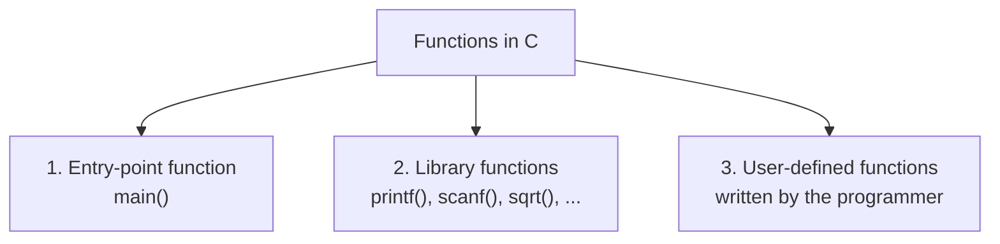
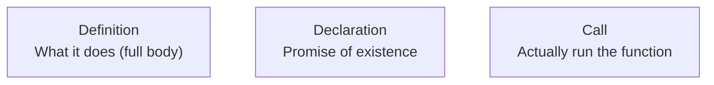

# Chapter 6 — Functions

[Repository Guide](../../README.md) | [English](Concepts_Lecture.md) | [한국어](Concepts_Lecture.ko.md)

> **Last Updated:** 2026-11-19
>
> Warming-Up C Programming, 천정아, Ch 6

> **Learning Objectives:**
> 1. Explain why functions are needed and describe the three kinds of functions
> 2. Write function definitions, declarations (prototypes), and calls and tell them apart
> 3. Explain the relationship between parameters and arguments and how pass by value works
> 4. Compare the scope, lifetime, and initial value of local and global variables
> 5. Explain function call overhead and the base case of a recursive function

---

## Table of Contents

- [1. Function Concepts](#1-function-concepts)
  - [1.1 The Need for Functions](#11-the-need-for-functions)
  - [1.2 Function Types](#12-function-types)
  - [1.3 Function Requirements](#13-function-requirements)
  - [1.4 Using Standard Library Functions](#14-using-standard-library-functions)
- [2. Function Basics](#2-function-basics)
  - [2.1 Function Definition](#21-function-definition)
  - [2.2 Return Type](#22-return-type)
  - [2.3 Function Name](#23-function-name)
  - [2.4 Parameters and Arguments](#24-parameters-and-arguments)
  - [2.5 Function Call](#25-function-call)
  - [2.6 Function Declaration (Prototype)](#26-function-declaration-prototype)
  - [2.7 Procedure for Designing a Function](#27-procedure-for-designing-a-function)
  - [2.8 Cautions When Calling Functions](#28-cautions-when-calling-functions)
  - [2.9 Common Mistakes in Defining and Calling Functions](#29-common-mistakes-in-defining-and-calling-functions)
  - [2.10 Four Forms of Functions by Parameters and Return Values](#210-four-forms-of-functions-by-parameters-and-return-values)
- [3. Local and Global Variables](#3-local-and-global-variables)
  - [3.1 Local Variables](#31-local-variables)
  - [3.2 Global Variables](#32-global-variables)
  - [3.3 Scope Rules](#33-scope-rules)
  - [3.4 Tracing Block Scope](#34-tracing-block-scope)
  - [3.5 The Call Stack and the Creation and Destruction of Local Variables](#35-the-call-stack-and-the-creation-and-destruction-of-local-variables)
- [4. Function Call Overhead](#4-function-call-overhead)
- [5. Recursive Functions (Introduction)](#5-recursive-functions-introduction)
- [Concept Applications](#concept-applications)
- [Summary](#summary)
- [Self-Check Questions](#self-check-questions)

---

<br>

## 1. Function Concepts

### 1.1 The Need for Functions

A **function** is a named, reusable block of code that performs a specific task. A function can be viewed as a black box that takes inputs (parameters) and produces a result (return value); the caller can use the function without knowing how it is implemented. Without functions, programs become long, repetitive, and hard to maintain. Functions provide four core benefits:

| Benefit | Description |
|:--------|:------------|
| **Code Reuse** | Write once and call many times, so the same code never has to be copied and pasted |
| **Modularity** | Break a large problem into smaller, manageable pieces |
| **Readability** | `main()` reads like an outline; details are hidden inside functions |
| **Maintainability** | Fix a bug in one function and every call site is fixed automatically |

*Table 1. Four benefits of functions*

**Before (everything inside `main()`):**

```c
#include <stdio.h>

int main() {
    // --- compute factorial of 5 ---
    int fact1 = 1;
    for (int i = 1; i <= 5; i++) {
        fact1 *= i;
    }
    printf("5! = %d\n", fact1);

    // --- compute factorial of 8 (duplicated logic!) ---
    int fact2 = 1;
    for (int i = 1; i <= 8; i++) {
        fact2 *= i;
    }
    printf("8! = %d\n", fact2);

    return 0;
}
```

**After (the repeated logic extracted into a function):**

```c
#include <stdio.h>

int factorial(int n) {
    int result = 1;
    for (int i = 1; i <= n; i++) {
        result *= i;
    }
    return result;
}

int main() {
    printf("5! = %d\n", factorial(5));
    printf("8! = %d\n", factorial(8));
    return 0;
}
```

The duplicated loop is gone. If the factorial algorithm needs to change, only `factorial()` has to be edited.

### 1.2 Function Types

C programs use three categories of functions:



*Figure 1. Three kinds of functions in C*

| Category | Example | Notes |
|:---------|:--------|:------|
| Entry point | `main()` | Every C program must have exactly one `main()`. It is called from the operating system side when the program starts, and the programmer never calls it directly. Execution starts here. |
| Library | `printf()`, `scanf()`, `sqrt()` | Provided by the C standard library. Must `#include` the appropriate header (`<stdio.h>`, `<math.h>`, etc.). |
| User-defined | `factorial()`, `isLeapYear()` | Written by the programmer to solve specific sub-problems. |

*Table 2. Examples and characteristics of each kind of function*

> **Key Point:** `#include <stdio.h>` does **not** include the function code itself. It includes the **declarations** (prototypes) so the compiler knows how to call them. The actual implementation is linked later by the linker.

### 1.3 Function Requirements

To use a function in C, three elements are needed:



*Figure 2. Three elements of using a function*

| Element | Purpose | Required |
|:--------|:--------|:----------|
| **Definition** | Implements the function (header + body) | Yes, exactly once |
| **Declaration** (prototype) | Tells the compiler the function exists (return type, name, parameters) | Needed if the call appears **before** the definition |
| **Call** | Executes the function with specific arguments | Yes, otherwise the function is never used |

*Table 3. Three elements of using a function and whether each is required*

Of the three elements, only the declaration can be omitted; it is unnecessary when the function definition appears before the call.

### 1.4 Using Standard Library Functions

The definitions of standard library functions already exist in the library, so they can be called once their declarations are brought in by including a header file. Mathematical functions are declared in `<math.h>`, and general utility functions such as the absolute value of an integer in `<stdlib.h>`.

```c
#include <stdio.h>
#include <math.h>
#include <stdlib.h>

int main(void)
{
    printf("%.4f %.1f %.1f\n", sqrt(2.0), pow(2.0, 10.0), fabs(-3.5));
    printf("%.1f %.1f %.1f %.1f\n", floor(2.7), ceil(2.1), floor(-2.7), round(2.5));
    printf("%d\n", abs(-7));
    return 0;
}
```

```text
1.4142 1024.0 3.5
2.0 3.0 -3.0 3.0
7
```

| Function | Header | What It Does | Parameters and Return Type |
|:-----|:-----|:-----|:-----|
| `sqrt(x)` | `<math.h>` | Square root | Takes a `double`, returns a `double` |
| `pow(x, y)` | `<math.h>` | x to the power y | Takes two `double` values, returns a `double` |
| `fabs(x)` | `<math.h>` | Absolute value of a real number | Takes a `double`, returns a `double` |
| `floor(x)`, `ceil(x)` | `<math.h>` | Largest integer not greater than x, smallest integer not less than x | Takes a `double`, returns a `double` |
| `round(x)` | `<math.h>` | Rounds to the nearest integer, sending halfway values away from zero (C99) | Takes a `double`, returns a `double` |
| `abs(n)` | `<stdlib.h>` | Absolute value of an integer | Takes an `int`, returns an `int` |

*Table 4. Frequently used standard library functions*

`floor(-2.7)` is the largest integer not greater than -2.7, so it is -3, not -2, which differs from the result -2 of the conversion `(int)-2.7`, which truncates toward zero. `round(2.5)` sends the halfway value away from zero, so it is 3. Mathematical functions handle real numbers, so for the absolute value of an integer `abs` is used instead of `fabs`. The rules of Section 2.4 apply to library functions as well: arguments are converted to the parameter types written in the prototype, and the return value has the return type of the prototype. With GCC on Linux, linking mathematical functions sometimes requires specifying the math library, as in `cc main.c -lm`.

---

<br>

## 2. Function Basics

### 2.1 Function Definition

A function definition consists of a **header** and a **body**.

```text
┌─── Function Header ─────────────────────────┐
│  return_type  function_name(parameter_list) │
└─────────────────────────────────────────────┘
┌─── Function Body ───┐
│  {                  │
│      statements;    │
│      return value;  │
│  }                  │
└─────────────────────┘
```

*Figure 3. Header and body of a function definition*

**Annotated example:**

```c
/*  return type
 *    │
 *    │    function name
 *    │       │
 *    │       │        parameter list
 *    │       │            │            */
    int     factorial   (int n)          // ← header
    {                                    // ← body begins
        int result = 1;                  //   local variable
        for (int i = 1; i <= n; i++) {
            result *= i;
        }
        return result;                   //   return value to caller
    }                                    // ← body ends
```

| Component | Description |
|:----------|:------------|
| Return type | Data type of the value sent back to the caller (`int`, `double`, `void`, ...) |
| Function name | Identifier following the naming rules (see Section 2.3) |
| Parameter list | Comma-separated list of `type name` pairs that receive values from the caller |
| Body `{}` | The block of code that executes when the function is called |

*Table 5. Components of a function definition*

### 2.2 Return Type

The return type specifies what kind of value the function sends back.

| Return Type | Meaning | Example |
|:------------|:--------|:--------|
| `int` | Returns an integer | `int factorial(int n)` |
| `double` | Returns a floating-point number | `double getAverage(int a, int b)` |
| `void` | Returns nothing | `void printMenu(void)` |

*Table 6. Kinds of return types*

```c
// int return type
int square(int x) {
    return x * x;
}

// double return type
double average(int a, int b) {
    return (double)(a + b) / 2;
}

// void return type: no return value
void printLine(void) {
    printf("--------------------\n");
}
```

**Important rules:**

1. **A function can return only ONE value.** To return multiple results, you need pointers (covered in Chapter 8).
2. If the return type is omitted, C89 assumed `int`. C99 removed this implicit `int` rule from the standard, so **always write the return type explicitly.**
3. A `void` function may use `return;` (no value) to exit early, or simply let execution fall through to the closing `}`.
4. A function whose return type is not `void` must send back a value with `return expression;`, and if the type of the expression differs from the return type, the value is converted to the return type (for example, `return 3.7;` in an `int` function returns 3).

```c
void printIfPositive(int n) {
    if (n <= 0) {
        return;           // early exit, no value
    }
    printf("%d\n", n);
}   // implicit return here
```

To send back several values from a function, pointers are passed as parameters. The function can then modify the caller's variables directly through those pointers; Chapter 8 covers this in detail.

### 2.3 Function Name

Function names follow the same **identifier rules** as variables (Chapter 3):

| Rule | Example |
|:-----|:--------|
| Must start with a letter or `_` | `factorial`, `_helper` |
| Can contain letters, digits, `_` | `calc2dArea` |
| Cannot be a C keyword | `return` and `int` cannot be function names |
| Case-sensitive | `factorial` and `Factorial` are different |

*Table 7. Identifier rules for function names*

**Naming conventions (recommended):**

| Convention | Style | Example |
|:-----------|:------|:--------|
| snake_case | `verb_noun` | `get_factorial`, `is_leap_year` |
| camelCase | `verbNoun` | `getFactorial`, `isLeapYear` |
| PascalCase | `VerbNoun` | `GetDaysOfMonth`, `PrintMenu` |

*Table 8. Naming conventions for function names*

**One** naming convention is chosen and used consistently throughout the program, and function names combine a verb and a noun that describe what the function does (`getFactorial`, `isLeapYear`, `printMenu`).

> **Caution:** In C, you **cannot** define two functions with the same name (no overloading). Each function name must be unique within the program.

### 2.4 Parameters and Arguments

**Parameter** and **argument** are related but distinct concepts:

| Term | Also Called | Location | Role |
|:-----|:-----------|:---------|:-----|
| **Parameter** | Formal parameter | In the function **definition** | A local variable that receives the incoming value |
| **Argument** | Actual parameter | At the function **call site** | The actual value or expression passed to the function |

*Table 9. Comparison of parameters and arguments*

```c
//                 parameter (formal)
//                    ↓
int square(int x) {
    return x * x;
}

int main() {
    int result = square(5);   // 5 is the argument (actual)
    //                 ↑
    //              argument
    return 0;
}
```

**Parameter declaration rules:**

```c
// CORRECT: each parameter needs its own type
int add(int a, int b) {
    return a + b;
}

// WRONG: cannot share type like variable declarations
// int add(int a, b) { ... }   ← compile error!
```

Omitting a parameter's type in a function definition is a compile error, and through C17 omitting a parameter's name is also an error (C23 allows unnamed parameters in definitions as well). There is no limit on the number of parameters.

**No-parameter functions:**

```c
// Both forms mean "no parameters":
void printMenu(void) { ... }   // explicit void: preferred
void printMenu() { ... }       // empty parentheses: also valid in definitions
```

> **Key Point:** In a **prototype** (declaration) before C23, `void printMenu()` declares a function without specifying the number or types of its parameters, so the compiler does not check the arguments, while `void printMenu(void)` means the function takes no parameters. Since C23, empty parentheses also mean no parameters. Always use `void` in prototypes for clarity.

**Pass by value:**

In C, arguments are passed **by value**. A parameter is a local variable that is created when the function is called and initialized with a **copy** of the argument, and it is destroyed when the function returns. Therefore changes to the parameter do **not** affect the original variable.

```c
void tryToChange(int x) {
    x = 100;   // modifies the LOCAL copy only
    printf("Inside function: x = %d\n", x);   // 100
}

int main() {
    int num = 5;
    tryToChange(num);
    printf("After function call: num = %d\n", num);  // still 5!
    return 0;
}
```

```text
Output:
Inside function: x = 100
After function call: num = 5
```

> **Note:** **Preview.** To modify the caller's variable, pass its **address** (pointer) instead of its value. This is often called **pass by reference**, but strictly speaking it is still pass by value, because the address itself is copied. Chapter 8 covers this in detail.

### 2.5 Function Call

To execute a function, write its name followed by parentheses containing the arguments.

```c
// Calling a function and using its return value
int result = factorial(5);              // store return value
printf("8! = %d\n", factorial(8));      // use return value directly in expression

// Calling a void function
printLine();                            // no return value to capture
```

**Rules for function calls:**

1. The function must be **defined or declared** before the point where it is called.
2. The number and order of arguments must match the parameters. If an argument's type differs from the parameter's type, the argument is converted to the parameter's type wherever a prototype is visible (for example, passing 101 to a `char` parameter passes the character `'e'`).
3. The return value can be used in any expression, assigned to a variable, or discarded.
4. An argument is itself an expression, so its value is computed first and then the function is called.
5. A call to a function whose return type is `void` has no value, so it cannot be used as an operand of another expression.

**Calling a function from another function:**

```c
#include <stdio.h>

int isLeapYear(int year) {
    return (year % 4 == 0 && year % 100 != 0) || (year % 400 == 0);
}

int GetDaysOfMonth(int year, int month) {
    if (month == 2) {
        return isLeapYear(year) ? 29 : 28;   // calls isLeapYear()
    }
    switch (month) {
    case 4: case 6: case 9: case 11:
        return 30;
    default:
        return 31;
    }
}

int main() {
    int days = GetDaysOfMonth(2024, 2);       // calls GetDaysOfMonth()
    printf("Feb 2024 has %d days\n", days);   // 29
    return 0;
}
```

### 2.6 Function Declaration (Prototype)

A **function declaration** (also called a **prototype** or **signature**) tells the compiler about a function's interface **before** its full definition appears.

**Syntax:**

```c
return_type function_name(parameter_list);   // ← semicolon, no body
```

**Why prototypes are needed:**

The C compiler reads source code **top to bottom**. If `main()` calls a function that is defined *below* `main()`, the compiler does not yet know that function's return type or parameter types. A prototype solves this by declaring the interface early.

```c
#include <stdio.h>

// ─── Prototypes (declarations) ───
int factorial(int n);         // parameter name included (recommended)
int isLeapYear(int);          // parameter name omitted (also valid)

int main() {
    printf("5! = %d\n", factorial(5));      // OK: prototype seen above
    printf("Leap? %d\n", isLeapYear(2024)); // OK: prototype seen above
    return 0;
}

// ─── Definitions ───
int factorial(int n) {
    int result = 1;
    for (int i = 1; i <= n; i++) {
        result *= i;
    }
    return result;
}

int isLeapYear(int year) {
    return (year % 4 == 0 && year % 100 != 0) || (year % 400 == 0);
}
```

**Prototype rules:**

| Rule | Example |
|:-----|:--------|
| Must match the definition's return type and parameter types | `int factorial(int n);` matches `int factorial(int n) { ... }` |
| Parameter **names** are optional in prototypes | `int add(int, int);` is valid |
| Must end with a **semicolon** | `int factorial(int n);` (not `int factorial(int n) { }`) |
| Typically placed **before `main()`** or in a header file | Convention for readability |

*Table 10. Rules for function prototypes*

Parameter names are optional, but it is better to always include them in prototypes. The names serve as documentation, so `double power(double base, int exponent);` is far more readable than `double power(double, int);`.

**What goes wrong without a prototype:**

```c
#include <stdio.h>

int main() {
    // If factorial() is defined below and NO prototype exists above:
    // The compiler may assume int return type (C89) or produce an error (C99+)
    printf("5! = %d\n", factorial(5));   // warning or error!
    return 0;
}

int factorial(int n) {
    int result = 1;
    for (int i = 1; i <= n; i++) result *= i;
    return result;
}
```

> **Caution:** Since C99, implicit declaration (calling a function without a prior declaration) has been removed from the standard, so the compiler must issue a diagnostic. gcc 14 and later and clang 16 and later treat it as an **error** by default, while earlier versions only warn and assume a function returning `int`. Always provide a prototype or define the function before using it.

### 2.7 Procedure for Designing a Function

When a needed feature is made into a function, decide first how the function looks from outside, that is, its name, parameters, and return type, and write the body afterward. Taking a function that computes the greatest common divisor of two integers as an example, the procedure is as follows.

1. **Choose the name.** Choose `get_gcd` so that what the function does is clear.
2. **Decide which values to receive from the caller and write the parameter list.** Two integers whose greatest common divisor is to be found are needed, so the list is `int x, int y`.
3. **Make the type of the result the return type.** The greatest common divisor is an integer, so it is `int`.
4. **Write the body.** Parameters can be used inside the body like ordinary local variables, and more variables can be declared as needed. Here the Euclidean algorithm of Chapter 5, Section 5.6 is carried over as it is.

```c
int get_gcd(int x, int y)
{
    int r;

    while (y != 0) {
        r = x % y;
        x = y;
        y = r;
    }
    return x;
}
```

The output of `printf("%d %d %d\n", get_gcd(84, 36), get_gcd(17, 5), get_gcd(9, 27));` is `12 1 9`. 84 and 36 become 12 through (84, 36) → (36, 12) → (12, 0), and 17 and 5, which are coprime, give 1. When the first argument is smaller, as with 9 and 27, the first iteration swaps them into (27, 9), so the caller need not care about the order. The function changes the values of the parameters `x` and `y`, but these are copies of the arguments, so the caller's values do not change (Section 2.4).

The same procedure applies when a function is extracted from code already written. As in the example of Section 1.1, find code repeated in the same shape inside `main`, move that part into the body of a function, and make the values that differ in each repetition the parameters and the result the code produces the return value. Making each function do only one thing makes it easy to name and easy to reuse elsewhere.

### 2.8 Cautions When Calling Functions

**Arguments are evaluated first.** Since an argument is also an expression, a constant, a variable, an arithmetic expression, or a function call can be an argument, and the values of all arguments are computed before the function is called. `draw_line('=', len * 2)` computes `len * 2` first and passes the value, and `get_factorial(add(1, 3))` first calls `add(1, 3)`, receives the return value 4, and then calls `get_factorial(4)`. However, when there are several arguments, which one is evaluated first is not specified (Chapter 4, Section 3.5).

**Passing an argument is initializing a parameter.** When a function is called, its parameters are created and initialized with the values of the arguments. In the following program, calling `get_area(r)` is like executing `double radius = r;`, so the `int` argument `r` is converted to `double` when it is passed.

```c
double get_area(double radius)
{
    const double pi = 3.14;

    return pi * radius * radius;
}

int main(void)
{
    int r;

    for (r = 1; r <= 5; r++)
        printf("r = %d, area = %.2f\n", r, get_area(r));
    return 0;
}
```

```text
r = 1, area = 3.14
r = 2, area = 12.56
r = 3, area = 28.26
r = 4, area = 50.24
r = 5, area = 78.50
```

Following the iteration in which `r` is 3, the value 3 of the argument `r` is converted to the `double` 3.0 and initializes `radius`, and the body computes 3.14 × 3.0 × 3.0 = 28.26 and returns it. The return value becomes the value of the call expression `get_area(r)` and is used as an argument of `printf`. When the function returns, `radius` and `pi` are destroyed, and they are created again in the next iteration.

**The number of arguments must equal the number of parameters.** Where a prototype is visible, the compiler reports an error if arguments are missing or extra. The following are the errors Clang reported when 2 and 4 arguments were passed to `get_max`, which has 3 parameters. The textbook describes the case of extra arguments as a warning; since compilers handle this part differently, the count must match in either case.

```text
error: too few arguments to function call, expected 3, have 2
error: too many arguments to function call, expected 3, have 4
```

**Arguments of a different type are converted implicitly.** When floating-point values are passed to `get_max`, whose parameters are `int`, as in `get_max(12.34, 0.5, 7.9)`, each argument is converted to `int`, so `get_max(12, 0, 7)` is called and 12 is returned. Assigning the return value 12 to a `double` variable gives 12.0; the fractional parts were already lost when the arguments were passed. Clang issues warnings such as `implicit conversion from 'double' to 'int' changes value from 12.34 to 12` for each argument. The same principle applies on return: if the type of the returned value differs from the return type, it is converted to the return type.

**Functions are distinguished by name.** If a name is misspelled, as in `get_ma(1, 2, 3)`, the compiler reports an undeclared function, and calling a function that is declared but not defined causes a link error (Chapter 1, Section 3.3).

### 2.9 Common Mistakes in Defining and Calling Functions

Among the mistakes involving functions, the compiler catches most of the following five, so it is important to read the messages and connect them to their causes.

```c
int sign(int n)
{
    if (n > 0)
        return 1;
    else if (n < 0)
        return -1;
}                               // no return value when n is 0

double half(double x);          // the prototype's return type is double

int half(double x)              // the definition's return type is int
{
    return x / 2;
}

void hello(void)
{
    printf("hello\n");
}

int main(void)
{
    int r = hello();            // uses the return value of a void function
    return 0;
}
```

```text
warning: non-void function does not return a value in all control paths [-Wreturn-type]
error: conflicting types for 'half'
error: initializing 'int' with an expression of incompatible type 'void'
```

- **A path without a return:** `sign(0)` meets no `return` and reaches the end of the function. If a function whose return type is not `void` has such a path, a warning is issued, and using its return value is undefined behavior. Put `return 0;` at the end so that every path returns a value.
- **Mismatch between prototype and definition:** If the return type or parameter types of the prototype and the definition differ, it is a `conflicting types` error. It is safest to make the prototype by copying the header of the definition and appending a semicolon.
- **Using the value of a `void` function:** The call expression of a function whose return type is `void` has no value, so it cannot be assigned or used in an operation.
- **A semicolon after the header:** If a definition is ended with a semicolon, as in `int square(int x);`, and the body follows, that line becomes a prototype, and the `{ ... }` after it belongs to nothing, causing the error `expected identifier or '('`.
- **A function definition inside a function:** Standard C does not allow defining a function inside another function. Clang reports `function definition is not allowed here` for a function defined inside `main`. All functions are defined side by side, outside other functions.

### 2.10 Four Forms of Functions by Parameters and Return Values

Functions fall into four forms according to whether they have parameters and whether they have a return value. Which form to use is decided by whether the function must receive values from outside and whether it must give values back.

| Form | Example Prototype | Use |
|:-----|:-----|:-----|
| Neither parameters nor return value | `void print_line(void);` | Always does the same job, such as a fixed output |
| Parameters only | `void print_stars(int n);` | Prints or processes according to the received values but returns no result |
| Return value only | `int read_positive(void);` | Produces a value inside the function and returns it, as with input |
| Both parameters and return value | `int max2(int a, int b);` | Returns a result computed from the received values |

*Table 11. Forms of functions by parameters and return values*

```c
void print_line(void)
{
    printf("----------\n");
}

void print_stars(int n)
{
    int i;

    for (i = 0; i < n; i++)
        printf("*");
    printf("\n");
}

int read_positive(void)
{
    int n;

    do {
        printf("positive integer? ");
        scanf("%d", &n);
    } while (n <= 0);
    return n;
}

int max2(int a, int b)
{
    return a > b ? a : b;
}

int main(void)
{
    int n;

    print_line();
    n = read_positive();
    print_stars(max2(n, 3));
    print_line();
    return 0;
}
```

```text
----------
positive integer? -2
positive integer? 5
*****
----------
```

`read_positive` asks again with the `do-while` of Chapter 5 until a positive number is entered and returns the value read. Entering `-2` makes the condition `n <= 0` true, so it asks once more, and the loop ends at 5. In `print_stars(max2(n, 3))`, `max2(5, 3)` in the argument position is called first and returns 5, after which `print_stars(5)` is called (Section 2.8). A function with a return value can be used like this as an argument of another function or within an expression, but `print_line()`, whose return type is `void`, can be called only as a statement.

---

<br>

## 3. Local and Global Variables

### 3.1 Local Variables

A **local variable** is a variable declared inside a block `{}`, usually inside a function body. It exists only while that block is executing.

```c
void funcA() {
    int x = 10;   // local to funcA
    printf("funcA: x = %d\n", x);
}

void funcB() {
    int x = 20;   // local to funcB: independent from funcA's x
    printf("funcB: x = %d\n", x);
}

int main() {
    funcA();   // prints: funcA: x = 10
    funcB();   // prints: funcB: x = 20
    // printf("%d", x);   // ERROR: x is not accessible here
    return 0;
}
```

**Characteristics of local variables:**

| Property | Description |
|:---------|:------------|
| Scope | From declaration to the end of the enclosing `{}` block |
| Lifetime | Created when the block is entered, destroyed when it exits |
| Storage | Usually the stack area |
| Initial value | **Undefined** (garbage) unless explicitly initialized |
| Independence | Different functions can use the same variable name without conflict |

*Table 12. Characteristics of local variables*

```c
int main() {
    for (int i = 0; i < 3; i++) {
        int temp = i * 10;   // created each iteration, destroyed at end of iteration
        printf("%d ", temp);
    }
    // printf("%d", temp);  // ERROR: temp does not exist here
    return 0;
}
```

A local variable inside a function is created anew each time the function is called and destroyed when it returns, and a local variable inside a loop block is created and destroyed on every iteration. Parameters are local variables too, so changing a parameter inside a function does not affect the caller; to pass a value computed by the function back to the caller, use the return value.

> **Caution:** Local variables are **not** automatically initialized to zero. Always initialize them before use, or you will get unpredictable garbage values.

### 3.2 Global Variables

A **global variable** is declared **outside all functions**, typically at the top of the file. It is accessible from its declaration point to the end of the file.

```c
#include <stdio.h>

int count = 0;   // global variable: accessible everywhere below this line

void increment() {
    count++;   // modifies the global variable
}

void printCount() {
    printf("count = %d\n", count);
}

int main() {
    increment();
    increment();
    increment();
    printCount();   // count = 3
    return 0;
}
```

All three calls to `increment()` change the same `count`, so `printCount()` prints 3. A value assigned to a global variable inside a function remains after the function returns.

**Characteristics of global variables:**

| Property | Description |
|:---------|:------------|
| Scope | From declaration point to the end of the source file |
| Lifetime | Entire program execution (created at program start, destroyed at program end) |
| Storage | The data area |
| Initial value | **Automatically initialized to `0`** (unlike local variables) |
| Accessibility | Any function defined after the declaration can access it |

*Table 13. Characteristics of global variables*

```c
#include <stdio.h>

int g;   // global: automatically initialized to 0

int main() {
    printf("g = %d\n", g);   // g = 0 (guaranteed)

    int local;
    // printf("local = %d\n", local);  // DANGEROUS: uninitialized, garbage value
    return 0;
}
```

Overusing global variables makes it hard to track which functions modify them, leading to **hidden dependencies** and bugs that are difficult to debug. Values are therefore passed as parameters wherever possible.

A global variable also cannot be used before it is declared. The scope of a global variable runs **from the point of its declaration to the end of the file**, not over the whole file, so if a global variable is declared below a function, as in the following code, its name cannot be found inside that function.

```c
void show(void)
{
    printf("%d\n", total);      // total has not been declared yet
}

int total = 10;
```

```text
error: use of undeclared identifier 'total'
```

This is why global variables are usually declared after `#include` and before all function definitions. Their lifetime also differs from that of local variables. A local variable is created when its block executes and destroyed when control leaves the block, whereas a global variable is created when the program starts and remains until the program ends. Because of this, a global variable can keep its value across many calls of a function, and it is initialized to 0 when no initial value is written.

### 3.3 Scope Rules

When a local variable and a global variable share the same name, the **local variable takes precedence** within its scope. This is called **shadowing**.

```c
#include <stdio.h>

int x = 100;   // global

void demo() {
    int x = 50;   // local: shadows the global x
    printf("Inside demo(): x = %d\n", x);       // 50 (local)
}

int main() {
    printf("Before demo(): x = %d\n", x);       // 100 (global)
    demo();
    printf("After demo(): x = %d\n", x);        // 100 (global, unchanged)

    {
        int x = 999;   // block-local: shadows the global x
        printf("Inside block: x = %d\n", x);    // 999
    }
    printf("After block: x = %d\n", x);         // 100 (global)

    return 0;
}
```

```text
Output:
Before demo(): x = 100
Inside demo(): x = 50
After demo(): x = 100
Inside block: x = 999
After block: x = 100
```

**Scope resolution priority:**

```text
When the same name exists at multiple levels:
  Inner block variable  >  Outer block variable  >  Global variable
  (innermost scope wins)
```

*Figure 4. Priority when variables with the same name exist in several scopes*

| Scope Level | Variable | Accessible Where |
|:------------|:---------|:-----------------|
| Block `{}` | Declared inside a block | Only within that block |
| Function | Declared at the top of a function | From the declaration to the end of the function |
| File (global) | Declared outside all functions | From declaration to end of file |

*Table 14. Accessible range of variables at each scope level*

Local and global variables should not share a name. Shadowing makes code confusing and is a common source of bugs, so distinct, descriptive names are used.

### 3.4 Tracing Block Scope

The textbook explains the scope rules with an example in which a global variable, a local variable of `main`, and a local variable of a `while` block all use the same name `x`. Even with the same name, variables declared in different places are different variables, and when a statement uses `x`, the declaration found first while searching outward from the innermost block enclosing that statement is chosen.

```c
int x = 1;                      // global x

void show(void)
{
    printf("show: x = %d\n", x);
}

int main(void)
{
    int x = 10;                 // x of main
    int i = 0;

    printf("main: x = %d\n", x);
    while (i < 2) {
        int x = 100 + i;        // x of the while block

        printf("while: x = %d\n", x);
        i++;
    }
    printf("main: x = %d\n", x);
    show();
    return 0;
}
```

```text
main: x = 10
while: x = 100
while: x = 101
main: x = 10
show: x = 1
```

| Location of the Printing Statement | `x` Chosen | Reason |
|:-----|:-----|:-----|
| `main`, before `while` | `x` of `main` (10) | The declaration in the `main` block is inside the global one |
| Inside the `while` block | The block's `x` (100, 101) | It is the innermost declaration and is created anew in each iteration |
| `main`, after `while` | `x` of `main` (10) | The block's `x` is destroyed when control leaves the block |
| Inside `show` | Global `x` (1) | `show` has no local declaration of `x`, and the `x` of `main` is visible only inside `main` |

*Table 15. Where each variable of the same name is chosen*

Being called from `main` does not make the `x` of `main` visible in `show`. Scope is decided not by the calling relationship but by where the declaration sits in the source code. With the `-Wshadow` option, Clang issues the warnings `declaration shadows a variable in the global scope` and `declaration shadows a local variable` for each such shadowing, so unintended shadowing can be found.

### 3.5 The Call Stack and the Creation and Destruction of Local Variables

Local variables and parameters receive their places in a memory area called the **call stack** when a function is called, and give the places back when the function returns. The area created on the stack when one function is called is called a **stack frame**. The following code prints the addresses of the parameter and local variable while the recursive function `depth` calls itself three times.

```c
int depth(int n)
{
    int local = n * 10;

    printf("depth(%d): &n = %p, &local = %p\n", n, (void *)&n, (void *)&local);
    if (n == 3)
        return local;
    return depth(n + 1);
}

int main(void)
{
    int result;

    printf("main: &result = %p\n", (void *)&result);
    result = depth(1);
    printf("result = %d\n", result);
    return 0;
}
```

```text
main: &result = 0x16f7b6b08
depth(1): &n = 0x16f7b6ad8, &local = 0x16f7b6ad4
depth(2): &n = 0x16f7b6a98, &local = 0x16f7b6a94
depth(3): &n = 0x16f7b6a58, &local = 0x16f7b6a54
result = 30
```

```text
high address ┌────────────────────────┐
             │ main:     result       │  0x...b08
             ├────────────────────────┤
             │ depth(1): n=1 local=10 │  0x...ad8
             ├────────────────────────┤
             │ depth(2): n=2 local=20 │  0x...a98
             ├────────────────────────┤
             │ depth(3): n=3 local=30 │  0x...a58   ← most recent call
low address  └────────────────────────┘
```

*Figure 5. Frames of the call stack during the recursive calls*

Each time the calls go one level deeper, the addresses of `n` and `local` drop by 0x40 (64) bytes. The stack in this environment grows from high addresses toward low addresses, and even the same function has its own `n` and `local` in a separate frame for each call. When `depth(3)` returns 30, its frame disappears, and the return value is passed through `return depth(n + 1);` of `depth(2)` to `depth(1)` and then to `main`. Why changing a parameter does not change the argument (Section 2.4), why the address of a local variable must not be returned (Chapter 8, Section 3.5), and why recursion without a base case causes a stack overflow (Section 5) all follow from this structure. The size of a frame and the direction in which the stack grows are decided by the compiler and the platform.

---

<br>

## 4. Function Call Overhead

Every function call involves a sequence of behind-the-scenes operations managed by the **call stack**:

```text
Function Call Mechanism
─────────────────────────────────────────
1. Save the return address (where to come back)
2. Save CPU register values
3. Push arguments onto the stack
4. Jump to the function code
5. Execute the function body
6. Place return value in a register
7. Pop the stack (restore registers, arguments)
8. Jump back to the return address
─────────────────────────────────────────
```

*Figure 6. Steps of a function call and return*

The exact steps and their order depend on the CPU and the calling convention. For example, on x86-64 the first several arguments are passed in registers rather than on the stack.

> **[Systems Programming]** The stack frame created on the stack for each call (return address, saved registers, local variables) and the calling convention that decides which registers or stack locations carry the arguments are part of the machine-level representation of programs covered in Systems Programming. Knowing this structure explains both why local variables disappear when a function returns (Section 3.1) and where the function call overhead comes from.

This process is called **function call overhead**. For large functions that perform significant computation, the overhead is negligible. However, for **very small functions** (e.g., a one-line calculation), the overhead can be relatively significant compared to the actual work.

```c
// Small function: overhead is relatively large compared to the work done
int square(int x) {
    return x * x;
}

// Called in a tight loop: overhead accumulates
for (int i = 0; i < 1000000; i++) {
    result += square(i);   // function call overhead × 1,000,000
}
```

> **Key Point:** C++ introduced `inline` functions to mitigate this overhead. `inline` is a request to expand the function body directly at the call site and eliminate the call and return steps, but the compiler decides whether to actually expand it. C99 also supports the `inline` keyword, but its linkage rules differ slightly from C++.

There is no need to avoid functions just to reduce overhead. The readability, maintainability, and reusability benefits of functions far outweigh the small performance cost in nearly all cases, so optimization is done only when profiling reveals an actual bottleneck.

---

<br>

## 5. Recursive Functions (Introduction)

A **recursive function** is a function that calls **itself**. Every recursive function needs:

1. **Base case:** a condition that stops the recursion.
2. **Recursive case:** the case in which the function calls itself with a smaller or simpler input.

```c
#include <stdio.h>

// Factorial: n! = n × (n-1) × ... × 2 × 1
int factorial(int n) {
    if (n <= 1) {         // base case
        return 1;
    }
    return n * factorial(n - 1);   // recursive case
}

int main() {
    printf("5! = %d\n", factorial(5));   // 120
    return 0;
}
```

**Execution trace for `factorial(4)`:**

```text
factorial(4)
  → 4 * factorial(3)
       → 3 * factorial(2)
            → 2 * factorial(1)
                 → returns 1      (base case)
            → returns 2 * 1 = 2
       → returns 3 * 2 = 6
  → returns 4 * 6 = 24
```

*Figure 7. Recursive call trace of factorial(4)*

**Another example (counting the digits of a positive integer):**

```c
int countDigits(int n) {
    if (n < 10) {         // base case: single digit
        return 1;
    }
    return 1 + countDigits(n / 10);   // recursive case
}
// countDigits(9128) = 1 + countDigits(912)
//                   = 1 + 1 + countDigits(91)
//                   = 1 + 1 + 1 + countDigits(9)
//                   = 1 + 1 + 1 + 1 = 4
```

> **Caution:** A recursive function without a proper base case will call itself infinitely, causing a **stack overflow** (the call stack runs out of memory). Always ensure the base case is reachable.

> **Key Point:** Any problem that can be solved recursively can also be solved with a loop (iteration), managing a stack explicitly if necessary. Recursion is elegant for problems that are naturally self-similar (factorial, Fibonacci, tree traversal), but iterative solutions are often more efficient due to lower function call overhead.

Recursive functions and loops solve the same problems in different ways. Recursion has the advantage that a problem is turned into a smaller problem of the same shape, so the definition can be carried into code as it is, but every call incurs the call overhead of Section 4. In particular, when one call invokes itself twice or more, the number of calls grows quickly. The following code computes the Fibonacci number F(n) = F(n - 1) + F(n - 2) (F(0) = 0, F(1) = 1) recursively while counting the calls, and also computes the same value with a loop.

```c
int calls = 0;

int fib(int n)
{
    calls++;
    if (n <= 1)
        return n;
    return fib(n - 1) + fib(n - 2);
}

int fib_loop(int n)
{
    int a = 0, b = 1, t, i;

    for (i = 0; i < n; i++) {
        t = a + b;
        a = b;
        b = t;
    }
    return a;
}

int main(void)
{
    int n, f;

    for (n = 5; n <= 25; n += 10) {
        calls = 0;
        f = fib(n);
        printf("fib(%d) = %d, calls = %d, loop = %d\n", n, f, calls, fib_loop(n));
    }
    return 0;
}
```

```text
fib(5) = 5, calls = 15, loop = 5
fib(15) = 610, calls = 1973, loop = 610
fib(25) = 75025, calls = 242785, loop = 75025
```

`main` executes `f = fib(n);` as a separate statement before `calls` is read among the arguments of `printf`, so that the result does not depend on the evaluation order of the arguments. `fib(5)` calls `fib(4)` and `fib(3)`, and `fib(4)` calls `fib(3)` again, so the same value is computed many times. The number of calls C(n) satisfies C(n) = C(n - 1) + C(n - 2) + 1, so C(5) = 15, and it grows more than a hundredfold each time n increases by 10. The loop `fib_loop` repeats only n times, so it computes the same result far faster. The textbook likewise concludes that loops are better for performance, while recursion has the advantage of expressing an algorithm simply.

Whether with recursion or a loop, it must also be checked that the result does not exceed the range of its type. Factorials grow quickly: up to 12! = 479001600 fits in an `int` (maximum 2147483647), but 13! = 6227020800 does not. Computing `factorial(13)` with the `factorial` above causes signed integer overflow and an untrustworthy result, so handling 13 or more requires changing the return type to `long long`. Even `long long` can hold only up to 20!.

---

<br>

## Concept Applications

**True/False Check:**

| Statement | Judgment and Reason |
|:-----|:-----|
| In C, arguments are passed by value, so changing a parameter inside the function does not change the argument. | **T.** A parameter is a local variable initialized with a copy of the argument. |
| If a function's definition precedes its call, no prototype is needed. | **T.** The compiler already knows the return type and parameters from the definition before meeting the call. |
| A `void` function cannot use a `return` statement. | **F.** It can end early with `return;`, which has no value. |
| Local variables inside a function are automatically initialized to 0. | **F.** The initial value of a local variable is undetermined; global variables are the ones initialized to 0. |
| Inside a function called from `main`, the local variables of `main` can be used by name. | **F.** Scope is decided by where declarations are placed, so the local variables of `main` are visible only inside `main`. |
| Each call of a recursive function creates its own parameters and local variables. | **T.** Each call gets a separate stack frame. |
| Passing a floating-point argument to an `int` parameter passes the rounded value. | **F.** Converting a real number to `int` truncates toward zero, so 7.9 becomes 7. |

---

<br>

## Summary

| Concept | Key Summary |
|:-----|:-----|
| The Need for Functions | Functions improve code reuse, modularity, readability, and maintainability. |
| Function Types | Functions are divided into the entry-point function (`main`), library functions (`printf`, `scanf`), and user-defined functions. |
| Function Requirements | Using a function requires a definition, a declaration (prototype), and a call, and the declaration can be omitted if the definition comes before the call. |
| Function Definition | A function definition consists of a header made of the return type, name, and parameter list, and a body enclosed in `{}`. |
| Return Type | The return type is `int`, `double`, `void`, and so on; a function can return only one value, and omitting the return type has not been allowed since C99. |
| Function Name | A function name follows the identifier rules of Chapter 3 and combines a verb and a noun, and C does not allow two functions with the same name. |
| Parameters and Arguments | A parameter is a local variable in the definition that receives a value, and an argument is the actual value passed at the call. |
| Pass by Value | The argument's value is copied into the parameter, so changing the parameter does not change the original variable. |
| Function Call | A declaration or definition must appear before the call point, and the return value can be used inside expressions. |
| Function Prototype | A prototype of the form `return_type name(params);` allows calling a function before its definition, and parameter names may be omitted in it. |
| Local Variables | A local variable is declared inside `{}`, exists only while the block executes, and is not initialized automatically. |
| Global Variables | A global variable is declared outside all functions, can be used from its declaration to the end of the file, and is automatically initialized to `0`. |
| Scope Rules | When names are the same, a variable in an inner scope hides one in an outer scope, so a local variable takes precedence over a global variable. |
| Function Call Overhead | Every call needs saving the return address and registers, passing arguments, and restoring them, so the share of overhead grows as the function gets smaller. |
| Recursive Functions | A recursive function calls itself, and a stack overflow occurs if there is no base case or the base case is never reached. |
| Multiple Return Values | A function cannot return several values directly, so pointer parameters are used, which Chapter 8 covers. |
| Designing a function | Decide the name, parameters, and return type first, then write the body, extracting the varying values of repeated code as parameters. |
| Evaluating and passing arguments | All arguments are computed first and their values initialize the parameters, being converted to the parameter types when they differ. |
| Number of arguments | When a prototype is visible, the compiler diagnoses missing or extra arguments, and the count must always equal the number of parameters. |
| Scope and lifetime of globals | A global can be used from its declaration to the end of the file, and it is created at program start and remains until the end. |
| Recursion and iteration | Recursion carries a definition into code easily but has call overhead, and when calls branch, as with Fibonacci, it is far slower than a loop. |
| Standard library functions | They are called after their declarations are brought in by headers; the functions of `<math.h>` handle `double`, and the absolute value of an integer is computed with `abs` of `<stdlib.h>`. |
| Common function mistakes | A path without a return, a prototype that mismatches the definition, using the value of a `void` function, a semicolon after the header, and a function defined inside a function are typical. |
| Block scope | With the same name, the declaration of the innermost block is chosen, and scope is decided by where declarations are placed, not by calling relationships. |
| Call stack | Each call creates a stack frame holding its parameters and local variables, which disappears on return, and every recursive call has its own frame. |

---

<br>

## Self-Check Questions

1. **Pass by value:** If `void addTen(int n) { n += 10; }` is defined and `main()` runs `int x = 5; addTen(x); printf("%d\n", x);`, what is printed?

   <details>
   <summary>Answer</summary>

   5 is printed. When `addTen()` is called, the parameter `n` is a local variable initialized with a copy of the value 5 of `x`, so changing `n` to 15 does not change `x`. `n` is destroyed when the function returns.

   </details>

2. **Function prototype:** To call `double average(int a, int b)`, defined below `main()`, from `main()`, what must be written before `main()`?

   <details>
   <summary>Answer</summary>

   Write the prototype `double average(int a, int b);`. The form without parameter names, `double average(int, int);`, is also valid in a prototype; either way it ends with a semicolon and has no body. Without a prototype, compilers for C99 and later issue a warning or an error for the implicit declaration.

   </details>

3. **Scope:** Given the global variable `int x = 1;` and the function `void f(void) { int x = 2; x++; }`, what is printed if `main()` calls `f();` and then runs `printf("%d\n", x);`?

   <details>
   <summary>Answer</summary>

   1 is printed. The `x` inside `f()` is a local variable that shadows the global `x`, so `x++` changes only the local variable to 3, and that local variable is destroyed when `f()` returns. The `x` in `main()` refers to the global variable, so its value is still 1.

   </details>

4. **Recursion trace:** For `countDigits()` in Section 5, find the return values of `countDigits(50070)` and `countDigits(0)`, and state how many times the function is called in total for `countDigits(50070)`.

   <details>
   <summary>Answer</summary>

   `countDigits(50070)` is called 5 times in total, with 50070, 5007, 500, 50, and 5; at 5 it meets the base case `n < 10` and returns 1, and each level adds 1, so it returns 5. `countDigits(0)` returns 1 because 0 satisfies the base case from the start.

   </details>

5. **Initial values of variables:** What are the values of an uninitialized global variable `int g;` and an uninitialized local variable `int local;` inside `main()`?

   <details>
   <summary>Answer</summary>

   The global variable `g` is automatically initialized to 0 when the program starts, so it is guaranteed to be 0. The local variable `local` is not initialized automatically, so its value is indeterminate, and reading it before initializing it yields an unpredictable garbage value.

   </details>

6. **Tracing argument passing:** When `int get_max(int a, int b, int c)` returns the largest of three numbers, what is the value of `d` after `double d = get_max(3.9, 7.2, 7.8);` executes?

   <details>
   <summary>Answer</summary>

   The arguments are converted to the parameter type `int`, so `get_max(3, 7, 7)` is called, 7 is returned, and `d` is 7.0. The fractional parts are discarded when the arguments are passed, so the result is not 7.8, the maximum when compared as real numbers.

   </details>

7. **Number of recursive calls:** How many times in all is the function called when `fib` of Section 5 computes `fib(4)`? Compute it with C(n) = C(n - 1) + C(n - 2) + 1, starting from C(0) = C(1) = 1.

   <details>
   <summary>Answer</summary>

   C(2) = 1 + 1 + 1 = 3, C(3) = 3 + 1 + 1 = 5, and C(4) = 5 + 3 + 1 = 9, so it is called 9 times. In the same way C(5) = 9 + 5 + 1 = 15, which agrees with the output in Section 5.

   </details>

8. **Designing a function:** Design, by the procedure of Section 2.7, a function that takes an integer n and returns the sum from 1 to n, and write it so that it returns 0 when n is 0 or less.

   <details>
   <summary>Answer</summary>

   Choose the name `sum_to`, the parameter `int n`, and the return type `int`. The body is `int i, s = 0; for (i = 1; i <= n; i++) s += i; return s;`. When n is 0 or less, the loop never runs, so 0 is returned without a separate test. For example, `sum_to(10)` returns 55.

   </details>

9. **Return paths:** Explain the problem with the following function and correct it. `int is_even(int n) { if (n % 2 == 0) return 1; }`

   <details>
   <summary>Answer</summary>

   When n is odd, no `return` executes and the function ends, so the return value is undetermined. Using that value is undefined behavior, and the compiler issues the warning `non-void function does not return a value in all control paths`. Add `return 0;` after the `if`, or return the value 1 or 0 of the relational expression directly, as in `return n % 2 == 0;`.

   </details>

10. **Library functions:** Write the values of `floor(-4.5)`, `ceil(-4.5)`, `round(-4.5)`, and `(int)-4.5`.

    <details>
    <summary>Answer</summary>

    `floor(-4.5)` is -5.0, the largest integer not greater than -4.5, and `ceil(-4.5)` is -4.0, the smallest integer not less than -4.5. `round(-4.5)` sends the halfway value away from zero, so it is -5.0, and `(int)-4.5` truncates toward zero, so it is -4.

    </details>
