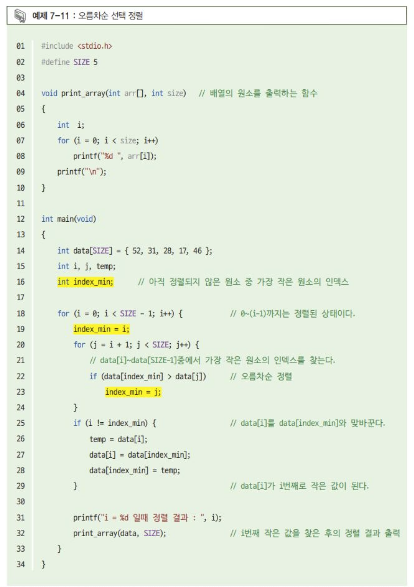

# 7장 연습 문제 — 배열

[레포지토리 안내](../../README.ko.md) | [English](Exercises.md) | [한국어](Exercises.ko.md)

> **최종 수정일:** 2026-11-19
>
> Warming-Up C Programming, 천정아, Ch 7

**문항 출처:** 연습 문제 1~3은 임영희 교수, 컴퓨터언어Ⅰ (DCCS101-04)

**공통 요구사항:** 모든 문제에서 배열의 크기는 매크로 상수로 지정한다.

---

<br>

## 목차

- [연습 문제 1: UPC 바코드의 검증 숫자 계산](#연습-문제-1-upc-바코드의-검증-숫자-계산)
- [연습 문제 2: 선택 정렬 변형](#연습-문제-2-선택-정렬-변형)
- [연습 문제 3: 빈도와 상대 빈도 계산](#연습-문제-3-빈도와-상대-빈도-계산)
- [연습 문제 4: 배열 선언의 판단](#연습-문제-4-배열-선언의-판단)
- [연습 문제 5: 2차원 배열 누적의 실행 결과](#연습-문제-5-2차원-배열-누적의-실행-결과)
- [연습 문제 6: 배열 매개변수에 대한 설명](#연습-문제-6-배열-매개변수에-대한-설명)
- [연습 문제 7: 실수 배열을 채우고 합계를 구하는 함수](#연습-문제-7-실수-배열을-채우고-합계를-구하는-함수)
- [연습 문제 8: 좌석 예매](#연습-문제-8-좌석-예매)
- [연습 문제 9: 배열의 왼쪽 회전](#연습-문제-9-배열의-왼쪽-회전)

---

<br>

## 연습 문제 1: UPC 바코드의 검증 숫자 계산

**문제:** UPC 바코드는 총 12자리 숫자로 이루어지며, 마지막 12번째 숫자는 이전 11자리의 숫자를 바탕으로 생성된 오류 검증용 숫자(check digit)이다. 예를 들어 바코드 0 36000 29145 2에서 마지막 숫자 2는 앞 11자리 03600029145로 계산한 검증 숫자이다. 아래에 12번째 숫자를 생성하는 프로그램의 예시 코드가 주어질 때, 이를 배열을 이용하도록 변환하여 작성하라.

**예시 코드:**

```c
#include <stdio.h>
int main() {
    int dig1, dig2, dig3, dig4, dig5, dig6, dig7, dig8, dig9, dig10, dig11, dig12, sum;

    printf("Please enter the first eleven UPC digits, separated by white space: \n");

    scanf("%d%d%d%d%d%d%d%d%d%d%d", &dig1, &dig2, &dig3, &dig4, &dig5, &dig6, &dig7, &dig8, &dig9, &dig10, &dig11);

    printf("입력된 숫자: %d%d%d%d%d%d%d%d%d%d%d\n", dig1, dig2, dig3, dig4, dig5, dig6, dig7, dig8, dig9, dig10, dig11);

    sum = 3 * (dig1 + dig3 + dig5 + dig7 + dig9 + dig11);
    sum = sum + (dig2 + dig4 + dig6 + dig8 + dig10);
    dig12 = (10 - sum % 10) % 10;

    printf("The check digit is %d \n", dig12);

    return 0;
}
```

**변환할 프로그램의 뼈대:**

```c
#include <stdio.h>
#define SIZE 12
int main()
{
    int dig[SIZE];
    int sum, i;
    // ...
    return 0;
}
```

**프로그램 요구사항:**

1. 예시 코드를 배열을 이용하도록 바꾸어 작성한다.
2. 배열의 크기는 매크로 상수로 지정한다.

**실행 예시:**

```text
Please enter the first eleven UPC digits, separated by white space:
0 3 6 0 0 0 2 9 1 4 5
입력된 숫자: 03600029145
The check digit is 2

Program ended with exit code: 0
```

**[풀이](Solutions.ko.md#연습-문제-1-upc-바코드의-검증-숫자-계산)**

---

<br>

## 연습 문제 2: 선택 정렬 변형

**교재 문항:** 7장 예제 7-11 (오름차순 선택 정렬)의 변형

**문제:** 교재 262쪽 예제 7-11의 선택 정렬은 아직 정렬되지 않은 원소 중 최솟값을 골라 앞에서부터 자리를 채운다. 이를 오름차순 정렬은 그대로 유지하되, 최댓값을 선택하여 뒤에서부터 제자리를 찾는 방식으로 바꾸어 작성하라.



*그림 1. 교재 예제 7-11의 오름차순 선택 정렬 코드*

**예제 7-11 코드:**

```c
#include <stdio.h>
#define SIZE 5

void print_array(int arr[], int size)   // 배열의 원소를 출력하는 함수
{
    int i;
    for (i = 0; i < size; i++)
        printf("%d ", arr[i]);
    printf("\n");
}

int main(void)
{
    int data[SIZE] = { 52, 31, 28, 17, 46 };
    int i, j, temp;
    int index_min;      // 아직 정렬되지 않은 원소 중 가장 작은 원소의 인덱스

    for (i = 0; i < SIZE - 1; i++) {            // 0~(i-1)까지는 정렬된 상태이다.
        index_min = i;
        for (j = i + 1; j < SIZE; j++) {
            // data[i]~data[SIZE-1] 중에서 가장 작은 원소의 인덱스를 찾는다.
            if (data[index_min] > data[j])      // 오름차순 정렬
                index_min = j;
        }
        if (i != index_min) {                   // data[i]를 data[index_min]과 맞바꾼다.
            temp = data[i];
            data[i] = data[index_min];
            data[index_min] = temp;
        }                                       // data[i]가 i번째로 작은 값이 된다.

        printf("i = %d 일 때 정렬 결과 : ", i);
        print_array(data, SIZE);                // i번째 작은 값을 찾은 후의 정렬 결과 출력
    }
}
```

**예제 7-11의 실행 결과:**

```text
i = 0 일 때 정렬 결과 : 17 31 28 52 46 
i = 1 일 때 정렬 결과 : 17 28 31 52 46 
i = 2 일 때 정렬 결과 : 17 28 31 52 46 
i = 3 일 때 정렬 결과 : 17 28 31 46 52 
```

**[풀이](Solutions.ko.md#연습-문제-2-선택-정렬-변형)**

---

<br>

## 연습 문제 3: 빈도와 상대 빈도 계산

**문제:** 원소의 개수가 40개인 1차원 정수 배열을 150~199 사이의 임의의 값으로 채우고, 구간별 빈도수(frequency)와 상대 빈도수(relative frequency)를 계산하여 출력하는 프로그램을 작성하라.

- 입력: 없음
- 출력: 구간별 빈도수와 상대 빈도수(실행 예시 참고)

**프로그램 요구사항:**

1. 각 구간의 빈도수와 상대 빈도수를 저장할 배열을 다음과 같이 선언한다.

   ```c
   int frequency[5] = { 0 };
   double relative_freq[5];
   ```

2. `rand()` 함수를 이용하여 배열의 원소에 150~199 사이의 값을 대입한다.
3. `srand()` 함수를 호출하여 `rand()` 함수의 시드(seed) 값을 바꾼다.

   ```c
   srand((unsigned)time(NULL));
   ```

4. 빈도수를 계산할 때 `switch`문을 사용한다.

**실행 예시:**

```text
배열 내용:
165  183  186  171  165  190  174  151  152  198
193  172  196  165  199  181  181  167  155  160
191  191  175  184  187  197  160  164  198  155
155  152  157  165  170  169  153  196  151  169

------------------------------
값의 범위        도수      상대도수
------------------------------
150 - 159       9       0.225
160 - 169      10       0.250
170 - 179       5       0.125
180 - 189       6       0.150
190 - 199      10       0.250

Program ended with exit code: 0
```

**[풀이](Solutions.ko.md#연습-문제-3-빈도와-상대-빈도-계산)**

---

<br>

## 연습 문제 4: 배열 선언의 판단

**교재 문항:** 7장 연습 문제 2번

**문제:** 다음 여섯 선언이 모두 함수 안에 있다고 할 때, ANSI C를 따르는 컴파일러(예: Visual Studio)에서 잘못된 선언을 모두 고르라. 그리고 C99 이후를 지원하는 컴파일러에서 결과가 달라지는 선언이 있으면 그 이유를 쓰라.

- ① `int arr[10];`
- ② `int arr[0];`
- ③ `double arr[];`
- ④ `#define MAX 10` 다음의 `int arr[MAX];`
- ⑤ `const int max = 10;` 다음의 `int arr[max];`
- ⑥ `int size = 10;` 다음의 `int arr[size];`

**[풀이](Solutions.ko.md#연습-문제-4-배열-선언의-판단)**

---

<br>

## 연습 문제 5: 2차원 배열 누적의 실행 결과

**교재 문항:** 7장 연습 문제 12번의 변형

**문제:** 다음 프로그램의 실행 결과를 쓰라.

```c
#include <stdio.h>

int main(void)
{
    int x[4][3] = { { 2, 4, 6 }, { 1, 3 }, { 5 } };
    int i, j;

    for (i = 0; i < 3; i++)
        for (j = 0; j < 3; j++)
            x[3][j] += x[i][j];
    for (i = 0; i < 4; i++) {
        for (j = 0; j < 3; j++)
            printf("%2d", x[i][j]);
        printf("\n");
    }
    return 0;
}
```

**[풀이](Solutions.ko.md#연습-문제-5-2차원-배열-누적의-실행-결과)**

---

<br>

## 연습 문제 6: 배열 매개변수에 대한 설명

**교재 문항:** 7장 연습 문제 6번

**문제:** 배열을 함수의 인자로 전달하는 방법에 대한 다음 설명 가운데 잘못된 것을 모두 고르라.

- ① 함수의 매개변수로 1차원 배열을 선언할 때는 배열의 크기를 반드시 지정해야 한다.
- ② 배열을 매개변수로 갖는 함수를 호출할 때는 배열의 이름을 인자로 넘긴다.
- ③ 배열을 매개변수로 갖는 함수를 호출할 때는 배열의 첫 원소의 값을 인자로 넘긴다.
- ④ 함수 안에서 원소의 개수가 필요하면 원소의 개수를 별도의 매개변수로 받는다.
- ⑤ 함수 안에서 배열의 원소에 접근할 때는 인덱스를 사용할 수 있다.
- ⑥ 인자로 넘기는 배열의 원소 타입은 매개변수의 원소 타입과 같아야 한다.
- ⑦ 함수 안에서 매개변수에 `sizeof`를 적용하면 원소의 개수를 구할 수 있다.

**[풀이](Solutions.ko.md#연습-문제-6-배열-매개변수에-대한-설명)**

---

<br>

## 연습 문제 7: 실수 배열을 채우고 합계를 구하는 함수

**교재 문항:** 7장 프로그래밍 과제 6번, 7번

**문제:** 다음 두 함수를 정의하고, 원소가 5개인 `double` 배열로 두 함수를 시험하는 프로그램을 작성하라.

- `void fill_array(double arr[], int size, double value)`: 배열의 모든 원소를 `value`로 채운다.
- `double sum_array(const double arr[], int size)`: 원소들의 합계를 반환한다.

프로그램은 먼저 배열을 1.5로 채운 뒤 합계를 출력하고, 이어서 실수 5개를 입력받아 같은 배열에 저장한 뒤 합계를 출력한다.

**실행 예시:**

```text
sum after fill = 7.50
five real numbers? 12.3 4.34 54.45 0.125 0.0002
sum = 71.215200
```

**[풀이](Solutions.ko.md#연습-문제-7-실수-배열을-채우고-합계를-구하는-함수)**

---

<br>

## 연습 문제 8: 좌석 예매

**교재 문항:** 7장 프로그래밍 과제 10번

**문제:** 좌석이 10개인 기차의 예매 프로그램을 작성하라. 좌석의 상태는 원소가 10개인 정수 배열에 0(빈 좌석)과 1(예매된 좌석)로 저장하고, 화면에는 빈 좌석을 `O`, 예매된 좌석을 `X`로 출력한다.

- 예매할 좌석의 수를 입력받을 때마다 앞 번호부터 빈 좌석을 배정하고, 배정한 좌석 번호(1부터 시작)를 출력한다.
- 남은 좌석보다 많이 요청하면 남은 좌석 수를 알리고 다시 입력받는다.
- 모든 좌석이 예매되면 마지막 상태를 출력하고 끝낸다. 0 이하의 수를 입력해도 끝낸다.

**실행 예시:**

```text
seats: [OOOOOOOOOO]
how many? 3
reserved: 1 2 3
seats: [XXXOOOOOOO]
how many? 4
reserved: 4 5 6 7
seats: [XXXXXXXOOO]
how many? 5
only 3 seats left
seats: [XXXXXXXOOO]
how many? 3
reserved: 8 9 10
seats: [XXXXXXXXXX]
```

**[풀이](Solutions.ko.md#연습-문제-8-좌석-예매)**

---

<br>

## 연습 문제 9: 배열의 왼쪽 회전

**문제:** 정수 배열의 원소를 왼쪽으로 k칸 회전시키는 함수 `void rotate_left(int arr[], int size, int k)`를 작성하라. 왼쪽으로 한 칸 회전하면 모든 원소가 인덱스가 하나 작은 자리로 옮겨 가고, 첫 원소는 맨 끝으로 간다. k가 원소의 개수 이상이어도 올바르게 동작해야 한다. `{1, 2, 3, 4, 5, 6, 7}`을 3칸 회전한 결과를 출력하고, 그 결과를 다시 11칸 회전한 결과를 출력하라.

**실행 예시:**

```text
4 5 6 7 1 2 3
1 2 3 4 5 6 7
```

**[풀이](Solutions.ko.md#연습-문제-9-배열의-왼쪽-회전)**
