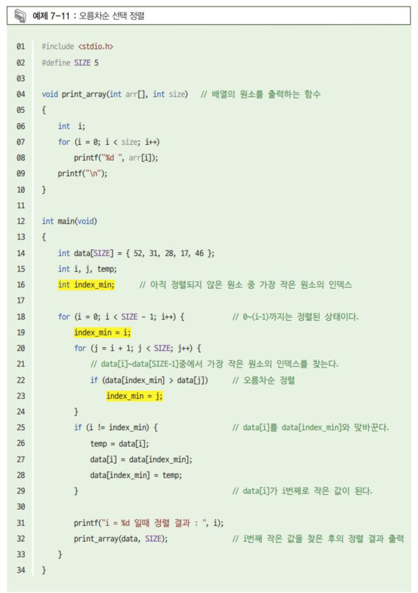

# 7장 연습 문제 — 배열

[레포지토리 안내](../../README.ko.md) | [English](Exercises.md) | [한국어](Exercises.ko.md)

> **최종 수정일:** 2026-10-19
>
> Warming-Up C Programming, 천정아, Ch 7

**문항 출처:** 임영희 교수, 컴퓨터언어Ⅰ (DCCS101-04)

**공통 요구사항:** 모든 문제에서 배열의 크기는 매크로 상수로 지정한다.

---

<br>

## 연습 문제 1: UPC 바코드의 검증 숫자 계산

**문제:** UPC 바코드는 총 12자리 숫자로 이루어지며, 마지막 12번째 숫자는 이전 11자리의 숫자를 바탕으로 생성된 오류 검증용 숫자(check digit)이다. 예를 들어 바코드 0 36000 29145 2에서 마지막 숫자 2는 앞 11자리 03600029145로 계산한 검증 숫자이다. 아래에 12번째 숫자를 생성하는 프로그램의 예시 코드가 주어질 때, 이를 배열을 이용하도록 변환하여 작성하라.

**예시 코드:**

```c
#include <stdio.h>
int main() {
    int dig1, dig2, dig3, dig4, dig5, dig6, dig7, dig8, dig9, dig10, dig11, dig12, sum;

    printf("Please enter the first eleven UPC digits, separated by white space: \n");

    scanf("%d%d%d%d%d%d%d%d%d%d%d", &dig1, &dig2, &dig3, &dig4, &dig5, &dig6, &dig7, &dig8, &dig9, &dig10, &dig11);

    printf("입력된 숫자: %d%d%d%d%d%d%d%d%d%d%d\n", dig1, dig2, dig3, dig4, dig5, dig6, dig7, dig8, dig9, dig10, dig11);

    sum = 3 * (dig1 + dig3 + dig5 + dig7 + dig9 + dig11);
    sum = sum + (dig2 + dig4 + dig6 + dig8 + dig10);
    dig12 = (10 - sum % 10) % 10;

    printf("The check digit is %d \n", dig12);

    return 0;
}
```

**변환할 프로그램의 뼈대:**

```c
#include <stdio.h>
#define SIZE 12
int main()
{
    int dig[SIZE];
    int sum, i;
    // ...
    return 0;
}
```

**프로그램 요구사항:**

1. 예시 코드를 배열을 이용하도록 바꾸어 작성한다.
2. 배열의 크기는 매크로 상수로 지정한다.

**실행 예시:**

```text
Please enter the first eleven UPC digits, separated by white space:
0 3 6 0 0 0 2 9 1 4 5
입력된 숫자: 03600029145
The check digit is 2

Program ended with exit code: 0
```

**[풀이](Solutions.ko.md#연습-문제-1-upc-바코드의-검증-숫자-계산)**

---

<br>

## 연습 문제 2: 선택 정렬 변형

**교재 문항:** 7장 예제 7-11 (오름차순 선택 정렬)의 변형

**문제:** 교재 262쪽 예제 7-11의 선택 정렬은 아직 정렬되지 않은 원소 중 최솟값을 골라 앞에서부터 자리를 채운다. 이를 오름차순 정렬은 그대로 유지하되, 최댓값을 선택하여 뒤에서부터 제자리를 찾는 방식으로 바꾸어 작성하라.



*그림 1. 교재 예제 7-11의 오름차순 선택 정렬 코드*

**예제 7-11 코드:**

```c
#include <stdio.h>
#define SIZE 5

void print_array(int arr[], int size)   // 배열의 원소를 출력하는 함수
{
    int i;
    for (i = 0; i < size; i++)
        printf("%d ", arr[i]);
    printf("\n");
}

int main(void)
{
    int data[SIZE] = { 52, 31, 28, 17, 46 };
    int i, j, temp;
    int index_min;      // 아직 정렬되지 않은 원소 중 가장 작은 원소의 인덱스

    for (i = 0; i < SIZE - 1; i++) {            // 0~(i-1)까지는 정렬된 상태이다.
        index_min = i;
        for (j = i + 1; j < SIZE; j++) {
            // data[i]~data[SIZE-1] 중에서 가장 작은 원소의 인덱스를 찾는다.
            if (data[index_min] > data[j])      // 오름차순 정렬
                index_min = j;
        }
        if (i != index_min) {                   // data[i]를 data[index_min]과 맞바꾼다.
            temp = data[i];
            data[i] = data[index_min];
            data[index_min] = temp;
        }                                       // data[i]가 i번째로 작은 값이 된다.

        printf("i = %d 일 때 정렬 결과 : ", i);
        print_array(data, SIZE);                // i번째 작은 값을 찾은 후의 정렬 결과 출력
    }
}
```

**예제 7-11의 실행 결과:**

```text
i = 0 일 때 정렬 결과 : 17 31 28 52 46 
i = 1 일 때 정렬 결과 : 17 28 31 52 46 
i = 2 일 때 정렬 결과 : 17 28 31 52 46 
i = 3 일 때 정렬 결과 : 17 28 31 46 52 
```

**[풀이](Solutions.ko.md#연습-문제-2-선택-정렬-변형)**

---

<br>

## 연습 문제 3: 빈도와 상대 빈도 계산

**문제:** 원소의 개수가 40개인 1차원 정수 배열을 150~199 사이의 임의의 값으로 채우고, 구간별 빈도수(frequency)와 상대 빈도수(relative frequency)를 계산하여 출력하는 프로그램을 작성하라.

- 입력: 없음
- 출력: 구간별 빈도수와 상대 빈도수(실행 예시 참고)

**프로그램 요구사항:**

1. 각 구간의 빈도수와 상대 빈도수를 저장할 배열을 다음과 같이 선언한다.

   ```c
   int frequency[5] = { 0 };
   double relative_freq[5];
   ```

2. `rand()` 함수를 이용하여 배열의 원소에 150~199 사이의 값을 대입한다.
3. `srand()` 함수를 호출하여 `rand()` 함수의 시드(seed) 값을 바꾼다.

   ```c
   srand((unsigned)time(NULL));
   ```

4. 빈도수를 계산할 때 `switch`문을 사용한다.

**실행 예시:**

```text
배열 내용:
165  183  186  171  165  190  174  151  152  198
193  172  196  165  199  181  181  167  155  160
191  191  175  184  187  197  160  164  198  155
155  152  157  165  170  169  153  196  151  169

------------------------------
값의 범위        도수      상대도수
------------------------------
150 - 159       9       0.225
160 - 169      10       0.250
170 - 179       5       0.125
180 - 189       6       0.150
190 - 199      10       0.250

Program ended with exit code: 0
```

**[풀이](Solutions.ko.md#연습-문제-3-빈도와-상대-빈도-계산)**
