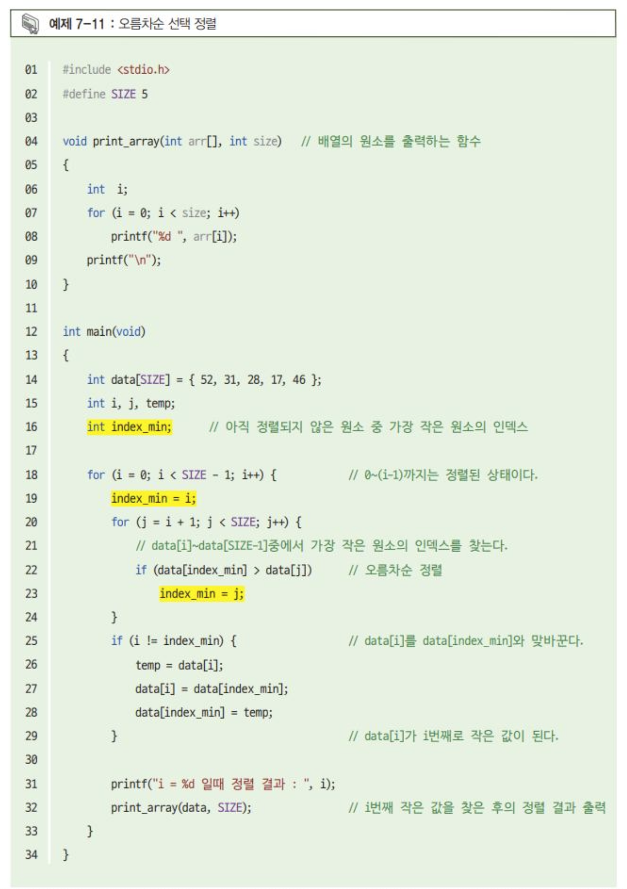

# Chapter 7 Exercises — Arrays

[Repository Guide](../../README.md) | [English](Exercises.md) | [한국어](Exercises.ko.md)

> **Last Updated:** 2026-11-27
>
> Warming-Up C Programming, 천정아, Ch 7

**Problem Source:** Exercises 1-3 are from Prof. Younghee Im, Computer Language Ⅰ (DCCS101-04)

**Common Requirement:** In every problem, specify the array size with a macro constant.

---

<br>

## Table of Contents

- [Exercise 1: Computing the Check Digit of a UPC Barcode](#exercise-1-computing-the-check-digit-of-a-upc-barcode)
- [Exercise 2: Selection Sort Variant](#exercise-2-selection-sort-variant)
- [Exercise 3: Computing Frequency and Relative Frequency](#exercise-3-computing-frequency-and-relative-frequency)
- [Exercise 4: Judging Array Declarations](#exercise-4-judging-array-declarations)
- [Exercise 5: Output of Accumulating a 2D Array](#exercise-5-output-of-accumulating-a-2d-array)
- [Exercise 6: Statements About Array Parameters](#exercise-6-statements-about-array-parameters)
- [Exercise 7: Functions That Fill and Sum a Real Array](#exercise-7-functions-that-fill-and-sum-a-real-array)
- [Exercise 8: Seat Reservation](#exercise-8-seat-reservation)
- [Exercise 9: Rotating an Array to the Left](#exercise-9-rotating-an-array-to-the-left)

---

<br>

## Exercise 1: Computing the Check Digit of a UPC Barcode

**Problem:** A UPC barcode consists of 12 digits in total, and the last, 12th digit is an error-checking digit (check digit) generated from the previous 11 digits. For example, in the barcode 0 36000 29145 2, the last digit 2 is the check digit computed from the first 11 digits 03600029145. Given the example code below, which generates the 12th digit, rewrite it to use an array.

**Example Code:**

```c wide-ok
#include <stdio.h>
int main() {
    int dig1, dig2, dig3, dig4, dig5, dig6, dig7, dig8, dig9, dig10, dig11, dig12, sum;

    printf("Please enter the first eleven UPC digits, separated by white space: \n");

    scanf("%d%d%d%d%d%d%d%d%d%d%d", &dig1, &dig2, &dig3, &dig4, &dig5, &dig6, &dig7, &dig8, &dig9, &dig10, &dig11);

    printf("입력된 숫자: %d%d%d%d%d%d%d%d%d%d%d\n", dig1, dig2, dig3, dig4, dig5, dig6, dig7, dig8, dig9, dig10, dig11);

    sum = 3 * (dig1 + dig3 + dig5 + dig7 + dig9 + dig11);
    sum = sum + (dig2 + dig4 + dig6 + dig8 + dig10);
    dig12 = (10 - sum % 10) % 10;

    printf("The check digit is %d \n", dig12);

    return 0;
}
```

**Skeleton of the Program to Write:**

```c
#include <stdio.h>
#define SIZE 12
int main()
{
    int dig[SIZE];
    int sum, i;
    // ...
    return 0;
}
```

**Program Requirements:**

1. Rewrite the example code to use an array.
2. Specify the array size with a macro constant.

**Sample Run:**

```text wide-ok
Please enter the first eleven UPC digits, separated by white space:
0 3 6 0 0 0 2 9 1 4 5
입력된 숫자: 03600029145
The check digit is 2

Program ended with exit code: 0
```

**[Solution](Solutions.md#exercise-1-computing-the-check-digit-of-a-upc-barcode)**

---

<br>

## Exercise 2: Selection Sort Variant

**Textbook Problem:** A variant of Chapter 7, Example 7-11 (ascending selection sort)

**Problem:** The selection sort of Example 7-11 on page 262 of the textbook picks the minimum among the elements not yet sorted and fills the positions from the front. Rewrite it so that it still sorts in ascending order but selects the maximum and finds its final position from the back.



*Figure 1. Ascending selection sort code of textbook Example 7-11*

**Code of Example 7-11:**

```c wide-ok
#include <stdio.h>
#define SIZE 5

void print_array(int arr[], int size)   // function that prints the elements of the array
{
    int i;
    for (i = 0; i < size; i++)
        printf("%d ", arr[i]);
    printf("\n");
}

int main(void)
{
    int data[SIZE] = { 52, 31, 28, 17, 46 };
    int i, j, temp;
    int index_min;      // index of the smallest element among those not yet sorted

    for (i = 0; i < SIZE - 1; i++) {            // Elements 0 to (i-1) are already sorted.
        index_min = i;
        for (j = i + 1; j < SIZE; j++) {
            // Find the index of the smallest element among data[i] to data[SIZE-1].
            if (data[index_min] > data[j])      // ascending order sort
                index_min = j;
        }
        if (i != index_min) {                   // Swap data[i] with data[index_min].
            temp = data[i];
            data[i] = data[index_min];
            data[index_min] = temp;
        }                                       // data[i] becomes the i-th smallest value.

        printf("i = %d 일 때 정렬 결과 : ", i);
        print_array(data, SIZE);                // print the result after finding the i-th smallest value
    }
}
```

**Output of Example 7-11:**

```text wide-ok
i = 0 일 때 정렬 결과 : 17 31 28 52 46 
i = 1 일 때 정렬 결과 : 17 28 31 52 46 
i = 2 일 때 정렬 결과 : 17 28 31 52 46 
i = 3 일 때 정렬 결과 : 17 28 31 46 52 
```

**[Solution](Solutions.md#exercise-2-selection-sort-variant)**

---

<br>

## Exercise 3: Computing Frequency and Relative Frequency

**Problem:** Fill a one-dimensional integer array of 40 elements with random values between 150 and 199, and write a program that computes and prints the frequency and relative frequency of each interval.

- Input: none
- Output: the frequency and relative frequency of each interval (see the sample run)

**Program Requirements:**

1. Declare the arrays that store the frequency and relative frequency of each interval as follows.

   ```c
   int frequency[5] = { 0 };
   double relative_freq[5];
   ```

2. Assign values between 150 and 199 to the array elements using the `rand()` function.
3. Call the `srand()` function to change the seed value of the `rand()` function.

   ```c
   srand((unsigned)time(NULL));
   ```

4. Use a `switch` statement when computing the frequencies.

**Sample Run:**

```text wide-ok
배열 내용:
165  183  186  171  165  190  174  151  152  198
193  172  196  165  199  181  181  167  155  160
191  191  175  184  187  197  160  164  198  155
155  152  157  165  170  169  153  196  151  169

------------------------------
값의 범위        도수      상대도수
------------------------------
150 - 159       9       0.225
160 - 169      10       0.250
170 - 179       5       0.125
180 - 189       6       0.150
190 - 199      10       0.250

Program ended with exit code: 0
```

**[Solution](Solutions.md#exercise-3-computing-frequency-and-relative-frequency)**

---

<br>

## Exercise 4: Judging Array Declarations

**Textbook Problem:** Chapter 7 exercise 2

**Problem:** Assuming all six of the following declarations are inside a function, select every declaration that is wrong on a compiler that follows ANSI C (for example, Visual Studio). Also, if any declaration gives a different result on a compiler that supports C99 or later, explain why.

- ① `int arr[10];`
- ② `int arr[0];`
- ③ `double arr[];`
- ④ `int arr[MAX];` after `#define MAX 10`
- ⑤ `int arr[max];` after `const int max = 10;`
- ⑥ `int arr[size];` after `int size = 10;`

**[Solution](Solutions.md#exercise-4-judging-array-declarations)**

---

<br>

## Exercise 5: Output of Accumulating a 2D Array

**Textbook Problem:** A variation of Chapter 7 exercise 12

**Problem:** Write the output of the following program.

```c
#include <stdio.h>

int main(void)
{
    int x[4][3] = { { 2, 4, 6 }, { 1, 3 }, { 5 } };
    int i, j;

    for (i = 0; i < 3; i++)
        for (j = 0; j < 3; j++)
            x[3][j] += x[i][j];
    for (i = 0; i < 4; i++) {
        for (j = 0; j < 3; j++)
            printf("%2d", x[i][j]);
        printf("\n");
    }
    return 0;
}
```

**[Solution](Solutions.md#exercise-5-output-of-accumulating-a-2d-array)**

---

<br>

## Exercise 6: Statements About Array Parameters

**Textbook Problem:** Chapter 7 exercise 6

**Problem:** Select every wrong statement among the following about passing arrays as function arguments.

- ① When a one-dimensional array is declared as a function parameter, its size must be specified.
- ② To call a function with an array parameter, pass the name of the array as the argument.
- ③ To call a function with an array parameter, pass the value of the first element of the array as the argument.
- ④ If the function needs the number of elements, receive it as a separate parameter.
- ⑤ Inside the function, elements of the array can be accessed with indices.
- ⑥ The element type of the array passed as an argument must equal the element type of the parameter.
- ⑦ Inside the function, applying `sizeof` to the parameter gives the number of elements.

**[Solution](Solutions.md#exercise-6-statements-about-array-parameters)**

---

<br>

## Exercise 7: Functions That Fill and Sum a Real Array

**Textbook Problem:** Chapter 7 programming assignments 6 and 7

**Problem:** Define the following two functions and write a program that tests them with a `double` array of 5 elements.

- `void fill_array(double arr[], int size, double value)`: fills every element of the array with `value`.
- `double sum_array(const double arr[], int size)`: returns the sum of the elements.

The program first fills the array with 1.5 and prints the sum, then reads 5 real numbers into the same array and prints the sum.

**Sample Run:**

```text
sum after fill = 7.50
five real numbers? 12.3 4.34 54.45 0.125 0.0002
sum = 71.215200
```

**[Solution](Solutions.md#exercise-7-functions-that-fill-and-sum-a-real-array)**

---

<br>

## Exercise 8: Seat Reservation

**Textbook Problem:** Chapter 7 programming assignment 10

**Problem:** Write a reservation program for a train with 10 seats. Store the state of the seats as 0 (free) and 1 (reserved) in an integer array of 10 elements, and print free seats as `O` and reserved seats as `X`.

- Each time the number of seats to reserve is entered, assign free seats starting from the lowest number and print the assigned seat numbers (starting from 1).
- If more seats are requested than remain, report the number of remaining seats and read the input again.
- When all seats are reserved, print the final state and end. Entering a number of 0 or less also ends the program.

**Sample Run:**

```text
seats: [OOOOOOOOOO]
how many? 3
reserved: 1 2 3
seats: [XXXOOOOOOO]
how many? 4
reserved: 4 5 6 7
seats: [XXXXXXXOOO]
how many? 5
only 3 seats left
seats: [XXXXXXXOOO]
how many? 3
reserved: 8 9 10
seats: [XXXXXXXXXX]
```

**[Solution](Solutions.md#exercise-8-seat-reservation)**

---

<br>

## Exercise 9: Rotating an Array to the Left

**Problem:** Write a function `void rotate_left(int arr[], int size, int k)` that rotates the elements of an integer array k places to the left. Rotating one place to the left moves every element to the position whose index is one smaller, and the first element goes to the end. The function must work correctly even when k is at least the number of elements. Print the result of rotating `{1, 2, 3, 4, 5, 6, 7}` by 3 places, and then the result of rotating that result by 11 places.

**Sample Run:**

```text
4 5 6 7 1 2 3
1 2 3 4 5 6 7
```

**[Solution](Solutions.md#exercise-9-rotating-an-array-to-the-left)**
