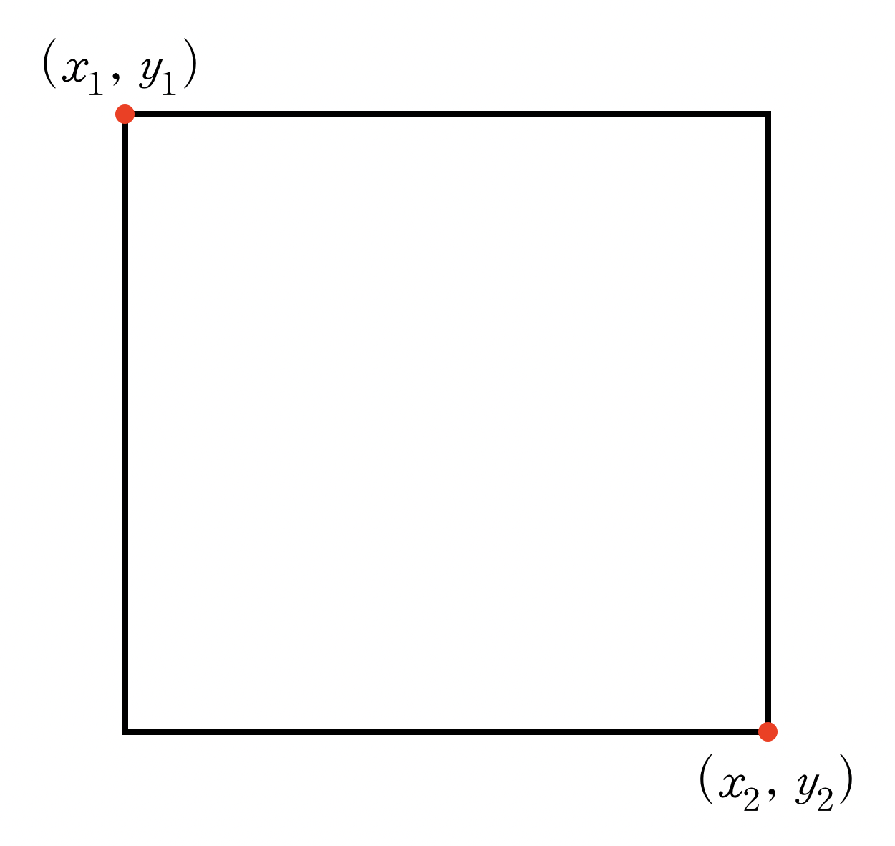

# 10장 연습 문제 — 구조체

[레포지토리 안내](../../README.ko.md) | [English](Exercises.md) | [한국어](Exercises.ko.md)

> **최종 수정일:** 2026-11-19
>
> Warming-Up C Programming, 천정아, Ch 10

**문항 출처:** 연습 문제 1, 2는 임영희 교수, 컴퓨터언어Ⅰ (DCCS101-04)

---

<br>

## 목차

- [연습 문제 1: Student 구조체](#연습-문제-1-student-구조체)
- [연습 문제 2: Rectangle 구조체](#연습-문제-2-rectangle-구조체)
- [연습 문제 3: 구조체 정의의 오류 수정](#연습-문제-3-구조체-정의의-오류-수정)
- [연습 문제 4: 구조체 변수를 사용하는 코드의 오류](#연습-문제-4-구조체-변수를-사용하는-코드의-오류)
- [연습 문제 5: 비트 필드, 공용체, 열거체에 대한 설명](#연습-문제-5-비트-필드-공용체-열거체에-대한-설명)
- [연습 문제 6: 로그인 정보 구조체](#연습-문제-6-로그인-정보-구조체)
- [연습 문제 7: 공휴일 검사](#연습-문제-7-공휴일-검사)
- [연습 문제 8: 평균 이상인 학생 출력](#연습-문제-8-평균-이상인-학생-출력)

---

<br>

## 연습 문제 1: Student 구조체

**문제:** 구조체를 다루는 다양한 함수를 정의하여 예시 코드를 완성하라.

**프로그램 요구사항:**

1. 아래 제시된 함수의 원형을 변경할 수 없다.

2. `void input_student(struct student *p);`
   `student` 구조체 변수의 주소를 전달받아 이름, 국어, 영어, 수학 점수를 키보드로부터 입력받고, 평균을 계산하는 함수이다.
   단, 이름에는 공백이 입력되지 않는다고 가정하며, `rank`는 계산하지 않는다.

3. `void display_student_arr(const struct student p[], int size);`
   `student` 구조체 배열과 배열의 크기를 전달받아, 구조체 배열 전체를 출력하는 함수이다(실행 예시 참고).

4. `void swap_student(struct student *p1, struct student *p2);`
   `student` 구조체 변수 두 개의 내용을 서로 교환하는 함수이다.
   이 함수는 `sort_student_arr()` 함수에서 활용된다.

5. `void sort_student_arr(struct student p[], int size);`
   `student` 구조체 배열과 배열의 크기를 전달받아 평균을 기준으로 내림차순 정렬을 수행한다.
   정렬할 때 `rank` 값도 함께 계산한다.

**예시 코드:**

```c
#include <stdio.h>
#define MAX_STD 20

struct student {
   char name[20];
   int kor, eng, math;
   double avg;
   int rank;
};

void input_student(struct student *p);
void display_student_arr(const struct student p[], int size);
void swap_student(struct student *p1, struct student *p2);
void sort_student_arr(struct student p[], int size);

int main()
{
   struct student classA[MAX_STD];
   int size;

   printf("A클래스의 실제 학생수 입력: ");
   scanf_s("%d", &size);

   for (int i = 0; i < size; i++) {
      input_student(classA + i);
   }

   sort_student_arr(classA, size);
   display_student_arr(classA, size);

   return 0;
}
```

**실행 예시:**

```text
A클래스의 실제 학생 수 입력: 5

이름 입력: 김ㅇㅇ
국어: 53
영어: 41
수학: 37

이름 입력: 이ㅇㅇ
국어: 97
영어: 84
수학: 87

이름 입력: 박ㅇㅇ
국어: 64
영어: 88
수학: 71

이름 입력: 최ㅇㅇ
국어: 37
영어: 98
수학: 100

이름 입력: 정ㅇㅇ
국어: 67
영어: 89
수학: 76

------------------------------------------------
    이름    국어    영어    수학     평균     등수
------------------------------------------------
   이ㅇㅇ    97     84     87    89.33     1
   최ㅇㅇ    37     98    100    78.33     2
   정ㅇㅇ    67     89     76    77.33     3
   박ㅇㅇ    64     88     71    74.33     4
   김ㅇㅇ    53     41     37    43.67     5

Program ended with exit code: 0
```

**[풀이](Solutions.ko.md#연습-문제-1-student-구조체)**

---

<br>

## 연습 문제 2: Rectangle 구조체

**문제:** 사각형에 대한 구조체 `Rect`(`struct rectangle`)는 다음과 같이 사각형의 대각 끝점 두 개로 정의된다. 프로그램 요구사항을 충족하도록 프로그램을 작성하라. 단, 제시된 함수의 원형은 변경할 수 없다.



*그림 1. 좌상단 (x1, y1)과 우하단 (x2, y2)로 정의한 사각형*

```c
typedef struct point {
    int x, y;
} Point;

typedef struct rectangle {
    Point leftUp;
    Point rightDown;
} Rect;
```

**프로그램 요구사항:**

1. `main()` 함수
   - `rectangle` 구조체 변수를 선언한다.
   - 사용자로부터 사각형의 두 점 좌표를 입력받는다.
   - `isRectangle()` 함수를 호출하여 사용자가 입력한 두 점 좌표에 대해 사각형이 성립하는지 검증하고, 성립하지 않는다면 성립할 때까지 다시 입력받는다.
   - `computeArea()` 함수를 호출하여 사각형의 면적을 계산하고 출력한다.

2. `int isRectangle(Rect r);`
   - 사각형 구조체를 하나 전달받아 사각형이 성립하는지 검증하는 함수이다.
   - 사각형이 성립하면 1을, 성립하지 않으면 0을 반환한다.
   - 단, `computeArea()`를 호출하여 면적이 0인지 여부로 검사해서는 안 된다.

3. `int computeArea(const Rect *p);`
   - 사각형 구조체 변수를 매개변수로 전달받아, 사각형의 면적을 계산하고 반환하는 함수이다.

**실행 예시:**

```text
사각형의 좌표를 입력하세요.
좌상단 좌표: 1 3
우하단 좌표: 7 10
사각형의 면적 = 42

Program ended with exit code: 0
```

```text
사각형의 좌표를 입력하세요.
좌상단 좌표: -2 5
우하단 좌표: 7 5
입력 오류! 입력한 좌표로는 사각형을 만들 수 없습니다.

좌상단 좌표: 1 10
우하단 좌표: 1 -4
입력 오류! 입력한 좌표로는 사각형을 만들 수 없습니다.

좌상단 좌표: -2 5
우하단 좌표: 4 -1
사각형의 면적 = 36

Program ended with exit code: 0
```

**[풀이](Solutions.ko.md#연습-문제-2-rectangle-구조체)**

---

<br>

## 연습 문제 3: 구조체 정의의 오류 수정

**교재 문항:** 10장 연습 문제 2번

**문제:** 다음 구조체 정의에서 컴파일 오류가 나는 부분을 모두 찾아 고쳐라. `gender`는 `'M'`이나 `'F'` 같은 문자 하나를 저장하는 멤버이다.

```c
struct employee {
    char name[20];
    gender;
    int salary;
    char department[20];
}
```

**[풀이](Solutions.ko.md#연습-문제-3-구조체-정의의-오류-수정)**

---

<br>

## 연습 문제 4: 구조체 변수를 사용하는 코드의 오류

**교재 문항:** 10장 연습 문제 5번

**문제:** 다음과 같이 정의한 `contact` 구조체와 변수 `c1`, `c2`에 대하여, ①\~⑥ 가운데 컴파일 오류가 나는 문장을 모두 고르고 이유를 쓰라.

```c
struct contact {
    char name[20];
    char number[20];
    int ringtone;
};

struct contact c1 = { "Park", "010-1234-5678", 1 };
struct contact c2;
```

- ① `c2 = c1;`
- ② `c2.name = "Lee";`
- ③ `c2.ringtone = 3;`
- ④ `c2 = { "Lee", "010-1111-2222" };`
- ⑤ `if (c1 == c2) printf("same contact");`
- ⑥ `if (strcmp(c1.name, c2.name) == 0) printf("same contact");`

**[풀이](Solutions.ko.md#연습-문제-4-구조체-변수를-사용하는-코드의-오류)**

---

<br>

## 연습 문제 5: 비트 필드, 공용체, 열거체에 대한 설명

**교재 문항:** 10장 연습 문제 6번, 8번

**문제:** 다음 설명 가운데 잘못된 것을 모두 고르라.

- ① 공용체의 멤버들은 모두 같은 주소에서 시작한다.
- ② 비트 필드는 구조체의 멤버를 비트 단위로 할당한다.
- ③ 공용체의 크기는 모든 멤버의 크기를 더한 값보다 크거나 같다.
- ④ 비트 필드를 쓰면 같은 멤버를 일반 정수형으로 둘 때보다 메모리가 더 많이 든다.
- ⑤ 공용체의 한 멤버에 값을 저장하면 같은 메모리를 쓰는 다른 멤버의 값도 달라진다.
- ⑥ 열거체는 정수형으로 처리되며, 열거 상수는 `switch`의 `case`에 쓸 수 있다.
- ⑦ 열거 상수로 실수형 상수를 정의할 수 있다.
- ⑧ 열거 상수의 값을 지정하지 않으면 0부터 1씩 커지는 값이 차례로 붙는다.

**[풀이](Solutions.ko.md#연습-문제-5-비트-필드-공용체-열거체에-대한-설명)**

---

<br>

## 연습 문제 6: 로그인 정보 구조체

**교재 문항:** 10장 프로그래밍 과제 1번, 2번

**문제:** 아이디와 패스워드를 각각 최대 20글자까지 저장하는 `login_info` 구조체를 정의하라. 아이디와 패스워드를 빈칸 없는 한 단어로 입력받아 저장한 뒤, 구조체 포인터를 받아 두 멤버를 모두 소문자로 바꾸는 함수 `normalize`와, 아이디는 그대로, 패스워드는 글자 수만큼 `*`로 출력하는 함수 `print_login`을 작성하라. 마지막 줄에는 소문자로 바뀌어 저장된 두 값을 확인용으로 출력한다.

**실행 예시:**

```text
ID? Anonymous
Password? IDontKnow
ID: anonymous
PW: *********
stored: anonymous / idontknow
```

**[풀이](Solutions.ko.md#연습-문제-6-로그인-정보-구조체)**

---

<br>

## 연습 문제 7: 공휴일 검사

**교재 문항:** 10장 프로그래밍 과제 4번

**문제:** 연, 월, 일을 멤버로 갖는 `date` 구조체와, 두 `date`가 같은 날짜이면 1, 아니면 0을 반환하는 함수 `same_date`를 정의하라. 2024년의 양력 고정 공휴일 8개(1월 1일, 3월 1일, 5월 5일, 6월 6일, 8월 15일, 10월 3일, 10월 9일, 12월 25일)로 `date` 배열을 초기화하고, 입력한 날짜가 그 가운데 있는지 검사하여 출력하라. `0 0 0`을 입력하면 끝낸다.

**실행 예시:**

```text
date? 2024 8 15
2024/8/15 is a holiday
date? 2024 5 2
2024/5/2 is not a holiday
date? 0 0 0
```

**[풀이](Solutions.ko.md#연습-문제-7-공휴일-검사)**

---

<br>

## 연습 문제 8: 평균 이상인 학생 출력

**문제:** 이름과 점수를 멤버로 갖는 `student` 구조체의 배열에 다음 다섯 학생을 초기화하고, 점수의 평균을 소수점 이하 첫째 자리까지 출력한 뒤 평균 이상인 학생의 이름과 점수를 배열의 순서대로 출력하라.

| 이름 | 점수 |
|:-----|-----:|
| Kim | 82 |
| Lee | 67 |
| Park | 91 |
| Choi | 74 |
| Jung | 88 |

*표 1. 연습 문제 8의 학생 데이터*

**실행 예시:**

```text
average = 80.4
Kim 82
Park 91
Jung 88
```

**[풀이](Solutions.ko.md#연습-문제-8-평균-이상인-학생-출력)**
