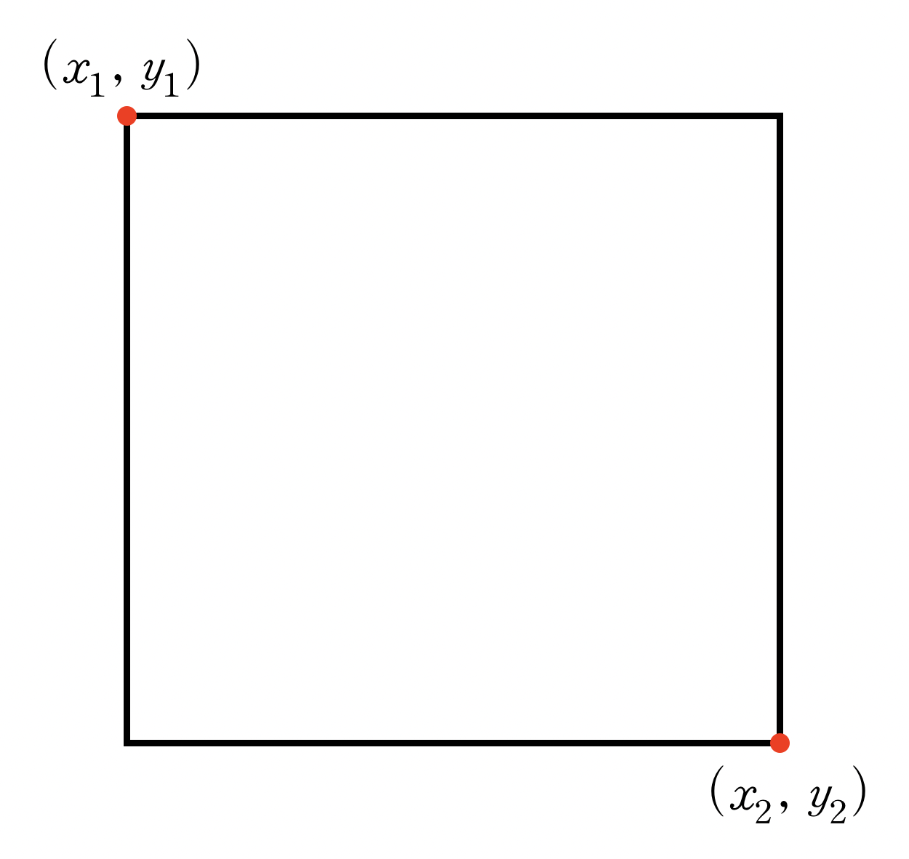

# 10장 연습 문제 — 구조체

[레포지토리 안내](../../README.ko.md) | [English](Exercises.md) | [한국어](Exercises.ko.md)

> **최종 수정일:** 2026-10-19

**문항 출처:** 임영희 교수, 컴퓨터언어Ⅰ (DCCS101-04)

---

<br>

## 연습 문제 1: Student 구조체

**문제:** 구조체를 다루는 다양한 함수를 정의하여 예시 코드를 완성하라.

**프로그램 요구사항:**

1. 아래 제시된 함수의 원형을 변경할 수 없다.

2. `void input_student(struct student *p);`
   `student` 구조체 변수의 주소를 전달받아 이름, 국어, 영어, 수학 점수를 키보드로부터 입력받고, 평균을 계산하는 함수이다.
   단, 이름에는 공백이 입력되지 않는다고 가정하며, `rank`는 계산하지 않는다.

3. `void display_student_arr(const struct student p[], int size);`
   `student` 구조체 배열과 배열의 크기를 전달받아, 구조체 배열 전체를 출력하는 함수이다(실행 예시 참고).

4. `void swap_student(struct student *p1, struct student *p2);`
   `student` 구조체 변수 두 개의 내용을 서로 교환하는 함수이다.
   이 함수는 `sort_student_arr()` 함수에서 활용된다.

5. `void sort_student_arr(struct student p[], int size);`
   `student` 구조체 배열과 배열의 크기를 전달받아 평균을 기준으로 내림차순 정렬을 수행한다.
   정렬할 때 `rank` 값도 함께 계산한다.

**예시 코드:**

```c
#include <stdio.h>
#define MAX_STD 20

struct student {
   char name[20];
   int kor, eng, math;
   double avg;
   int rank;
};

void input_student(struct student *p);
void display_student_arr(const struct student p[], int size);
void swap_student(struct student *p1, struct student *p2);
void sort_student_arr(struct student p[], int size);

int main()
{
   struct student classA[MAX_STD];
   int size;

   printf("A클래스의 실제 학생수 입력: ");
   scanf_s("%d", &size);

   for (int i = 0; i < size; i++) {
      input_student(classA + i);
   }

   sort_student_arr(classA, size);
   display_student_arr(classA, size);

   return 0;
}
```

**실행 예시:**

```text
A클래스의 실제 학생 수 입력: 5

이름 입력: 김ㅇㅇ
국어: 53
영어: 41
수학: 37

이름 입력: 이ㅇㅇ
국어: 97
영어: 84
수학: 87

이름 입력: 박ㅇㅇ
국어: 64
영어: 88
수학: 71

이름 입력: 최ㅇㅇ
국어: 37
영어: 98
수학: 100

이름 입력: 정ㅇㅇ
국어: 67
영어: 89
수학: 76

------------------------------------------------
    이름    국어    영어    수학     평균     등수
------------------------------------------------
   이ㅇㅇ    97     84     87    89.33     1
   최ㅇㅇ    37     98    100    78.33     2
   정ㅇㅇ    67     89     76    77.33     3
   박ㅇㅇ    64     88     71    74.33     4
   김ㅇㅇ    53     41     37    43.67     5

Program ended with exit code: 0
```

**[풀이](Solutions.ko.md#연습-문제-1-student-구조체)**

---

<br>

## 연습 문제 2: Rectangle 구조체

**문제:** 사각형에 대한 구조체 `Rect`(`struct rectangle`)는 다음과 같이 사각형의 대각 끝점 두 개로 정의된다. 프로그램 요구사항을 충족하도록 프로그램을 작성하라. 단, 제시된 함수의 원형은 변경할 수 없다.



*그림 1. 좌상단 (x1, y1)과 우하단 (x2, y2)로 정의한 사각형*

```c
typedef struct point {
    int x, y;
} Point;

typedef struct rectangle {
    Point leftUp;
    Point rightDown;
} Rect;
```

**프로그램 요구사항:**

1. `main()` 함수
   - `rectangle` 구조체 변수를 선언한다.
   - 사용자로부터 사각형의 두 점 좌표를 입력받는다.
   - `isRectangle()` 함수를 호출하여 사용자가 입력한 두 점 좌표에 대해 사각형이 성립하는지 검증하고, 성립하지 않는다면 성립할 때까지 다시 입력받는다.
   - `computeArea()` 함수를 호출하여 사각형의 면적을 계산하고 출력한다.

2. `int isRectangle(Rect r);`
   - 사각형 구조체를 하나 전달받아 사각형이 성립하는지 검증하는 함수이다.
   - 사각형이 성립하면 1을, 성립하지 않으면 0을 반환한다.
   - 단, `computeArea()`를 호출하여 면적이 0인지 여부로 검사해서는 안 된다.

3. `int computeArea(const Rect *p);`
   - 사각형 구조체 변수를 매개변수로 전달받아, 사각형의 면적을 계산하고 반환하는 함수이다.

**실행 예시:**

```text
사각형의 좌표를 입력하세요.
좌상단 좌표: 1 3
우하단 좌표: 7 10
사각형의 면적 = 42

Program ended with exit code: 0
```

```text
사각형의 좌표를 입력하세요.
좌상단 좌표: -2 5
우하단 좌표: 7 5
입력 오류! 입력한 좌표로는 사각형을 만들 수 없습니다.

좌상단 좌표: 1 10
우하단 좌표: 1 -4
입력 오류! 입력한 좌표로는 사각형을 만들 수 없습니다.

좌상단 좌표: -2 5
우하단 좌표: 4 -1
사각형의 면적 = 36

Program ended with exit code: 0
```

**[풀이](Solutions.ko.md#연습-문제-2-rectangle-구조체)**
