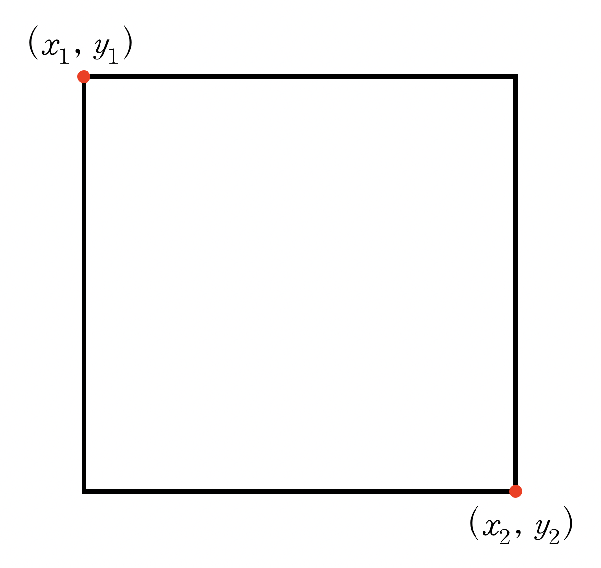

# Chapter 10 Exercises — Structures

[Repository Guide](../../README.md) | [English](Exercises.md) | [한국어](Exercises.ko.md)

> **Last Updated:** 2026-11-19
>
> Warming-Up C Programming, 천정아, Ch 10

**Problem Source:** Exercises 1 and 2 are from Prof. Younghee Im, Computer Language Ⅰ (DCCS101-04)

---

<br>

## Table of Contents

- [Exercise 1: Student Structure](#exercise-1-student-structure)
- [Exercise 2: Rectangle Structure](#exercise-2-rectangle-structure)
- [Exercise 3: Correcting a Structure Definition](#exercise-3-correcting-a-structure-definition)
- [Exercise 4: Errors in Code That Uses Structure Variables](#exercise-4-errors-in-code-that-uses-structure-variables)
- [Exercise 5: Statements About Bit Fields, Unions, and Enumerations](#exercise-5-statements-about-bit-fields-unions-and-enumerations)
- [Exercise 6: A Login Information Structure](#exercise-6-a-login-information-structure)
- [Exercise 7: Checking Holidays](#exercise-7-checking-holidays)
- [Exercise 8: Printing Students at or Above the Average](#exercise-8-printing-students-at-or-above-the-average)

---

<br>

## Exercise 1: Student Structure

**Problem:** Define various functions that handle structures and complete the example code.

**Program Requirements:**

1. The function prototypes given below cannot be changed.

2. `void input_student(struct student *p);`
   A function that receives the address of a `student` structure variable, reads the name and the Korean, English, and math scores from the keyboard, and computes the average.
   Assume that no spaces are entered in the name, and do not compute `rank`.

3. `void display_student_arr(const struct student p[], int size);`
   A function that receives a `student` structure array and its size and prints the whole structure array (see the sample run).

4. `void swap_student(struct student *p1, struct student *p2);`
   A function that exchanges the contents of two `student` structure variables.
   This function is used in the `sort_student_arr()` function.

5. `void sort_student_arr(struct student p[], int size);`
   It receives a `student` structure array and its size and sorts it in descending order of the average.
   It also computes the `rank` values while sorting.

**Example Code:**

```c
#include <stdio.h>
#define MAX_STD 20

struct student {
   char name[20];
   int kor, eng, math;
   double avg;
   int rank;
};

void input_student(struct student *p);
void display_student_arr(const struct student p[], int size);
void swap_student(struct student *p1, struct student *p2);
void sort_student_arr(struct student p[], int size);

int main()
{
   struct student classA[MAX_STD];
   int size;

   printf("A클래스의 실제 학생수 입력: ");
   scanf_s("%d", &size);

   for (int i = 0; i < size; i++) {
      input_student(classA + i);
   }

   sort_student_arr(classA, size);
   display_student_arr(classA, size);

   return 0;
}
```

**Sample Run:**

```text
A클래스의 실제 학생 수 입력: 5

이름 입력: 김ㅇㅇ
국어: 53
영어: 41
수학: 37

이름 입력: 이ㅇㅇ
국어: 97
영어: 84
수학: 87

이름 입력: 박ㅇㅇ
국어: 64
영어: 88
수학: 71

이름 입력: 최ㅇㅇ
국어: 37
영어: 98
수학: 100

이름 입력: 정ㅇㅇ
국어: 67
영어: 89
수학: 76

------------------------------------------------
    이름    국어    영어    수학     평균     등수
------------------------------------------------
   이ㅇㅇ    97     84     87    89.33     1
   최ㅇㅇ    37     98    100    78.33     2
   정ㅇㅇ    67     89     76    77.33     3
   박ㅇㅇ    64     88     71    74.33     4
   김ㅇㅇ    53     41     37    43.67     5

Program ended with exit code: 0
```

**[Solution](Solutions.md#exercise-1-student-structure)**

---

<br>

## Exercise 2: Rectangle Structure

**Problem:** The rectangle structure `Rect` (`struct rectangle`) is defined by two diagonal corner points of the rectangle as follows. Write a program that satisfies the program requirements. The given function prototypes cannot be changed.



*Figure 1. Rectangle defined by its upper-left corner (x1, y1) and lower-right corner (x2, y2)*

```c
typedef struct point {
    int x, y;
} Point;

typedef struct rectangle {
    Point leftUp;
    Point rightDown;
} Rect;
```

**Program Requirements:**

1. The `main()` function
   - Declare a `rectangle` structure variable.
   - Read the coordinates of the two points of the rectangle from the user.
   - Call `isRectangle()` to verify whether the two points entered by the user form a rectangle, and if not, read them again until they do.
   - Call `computeArea()` to compute the area of the rectangle and print it.

2. `int isRectangle(Rect r);`
   - A function that receives one rectangle structure and verifies whether it forms a rectangle.
   - It returns 1 if a rectangle is formed and 0 otherwise.
   - It must not check by calling `computeArea()` and testing whether the area is 0.

3. `int computeArea(const Rect *p);`
   - A function that receives a rectangle structure variable as a parameter and computes and returns the area of the rectangle.

**Sample Run:**

```text
사각형의 좌표를 입력하세요.
좌상단 좌표: 1 3
우하단 좌표: 7 10
사각형의 면적 = 42

Program ended with exit code: 0
```

```text
사각형의 좌표를 입력하세요.
좌상단 좌표: -2 5
우하단 좌표: 7 5
입력 오류! 입력한 좌표로는 사각형을 만들 수 없습니다.

좌상단 좌표: 1 10
우하단 좌표: 1 -4
입력 오류! 입력한 좌표로는 사각형을 만들 수 없습니다.

좌상단 좌표: -2 5
우하단 좌표: 4 -1
사각형의 면적 = 36

Program ended with exit code: 0
```

**[Solution](Solutions.md#exercise-2-rectangle-structure)**

---

<br>

## Exercise 3: Correcting a Structure Definition

**Textbook Problem:** Chapter 10 exercise 2

**Problem:** Find and correct every part of the following structure definition that causes a compile error. `gender` is a member that stores one character, such as `'M'` or `'F'`.

```c
struct employee {
    char name[20];
    gender;
    int salary;
    char department[20];
}
```

**[Solution](Solutions.md#exercise-3-correcting-a-structure-definition)**

---

<br>

## Exercise 4: Errors in Code That Uses Structure Variables

**Textbook Problem:** Chapter 10 exercise 5

**Problem:** For the `contact` structure and the variables `c1` and `c2` defined below, select every statement among ① through ⑥ that causes a compile error, and explain why.

```c
struct contact {
    char name[20];
    char number[20];
    int ringtone;
};

struct contact c1 = { "Park", "010-1234-5678", 1 };
struct contact c2;
```

- ① `c2 = c1;`
- ② `c2.name = "Lee";`
- ③ `c2.ringtone = 3;`
- ④ `c2 = { "Lee", "010-1111-2222" };`
- ⑤ `if (c1 == c2) printf("same contact");`
- ⑥ `if (strcmp(c1.name, c2.name) == 0) printf("same contact");`

**[Solution](Solutions.md#exercise-4-errors-in-code-that-uses-structure-variables)**

---

<br>

## Exercise 5: Statements About Bit Fields, Unions, and Enumerations

**Textbook Problem:** Chapter 10 exercises 6 and 8

**Problem:** Select every wrong statement below.

- ① All members of a union start at the same address.
- ② A bit field allocates structure members in units of bits.
- ③ The size of a union is greater than or equal to the sum of the sizes of all its members.
- ④ Using a bit field takes more memory than keeping the same members as ordinary integer types.
- ⑤ Storing a value in one member of a union changes the values of the other members that use the same memory.
- ⑥ An enumeration is treated as an integer type, and enumeration constants can be used in the `case` labels of a `switch`.
- ⑦ An enumeration constant can be defined as a floating-point constant.
- ⑧ If no values are specified for the enumeration constants, values increasing by 1 from 0 are attached in order.

**[Solution](Solutions.md#exercise-5-statements-about-bit-fields-unions-and-enumerations)**

---

<br>

## Exercise 6: A Login Information Structure

**Textbook Problem:** Chapter 10 programming assignments 1 and 2

**Problem:** Define a `login_info` structure that stores an ID and a password of up to 20 characters each. After reading the ID and password, each as one word without spaces, write a function `normalize` that takes a structure pointer and converts both members to lowercase, and a function `print_login` that prints the ID as it is and the password as `*` repeated as many times as its length. On the last line, print the two stored values, now in lowercase, for confirmation.

**Sample Run:**

```text
ID? Anonymous
Password? IDontKnow
ID: anonymous
PW: *********
stored: anonymous / idontknow
```

**[Solution](Solutions.md#exercise-6-a-login-information-structure)**

---

<br>

## Exercise 7: Checking Holidays

**Textbook Problem:** Chapter 10 programming assignment 4

**Problem:** Define a `date` structure with year, month, and day members, and a function `same_date` that returns 1 if two `date` values are the same date and 0 otherwise. Initialize a `date` array with the 8 fixed-date solar-calendar public holidays of 2024 in Korea (January 1, March 1, May 5, June 6, August 15, October 3, October 9, and December 25), then check whether an entered date is among them and print the result. Entering `0 0 0` ends the program.

**Sample Run:**

```text
date? 2024 8 15
2024/8/15 is a holiday
date? 2024 5 2
2024/5/2 is not a holiday
date? 0 0 0
```

**[Solution](Solutions.md#exercise-7-checking-holidays)**

---

<br>

## Exercise 8: Printing Students at or Above the Average

**Problem:** Initialize an array of `student` structures, whose members are a name and a score, with the following five students, print the average score to one decimal place, and then print the names and scores of the students at or above the average in array order.

| Name | Score |
|:-----|-----:|
| Kim | 82 |
| Lee | 67 |
| Park | 91 |
| Choi | 74 |
| Jung | 88 |

*Table 1. Student data for Exercise 8*

**Sample Run:**

```text
average = 80.4
Kim 82
Park 91
Jung 88
```

**[Solution](Solutions.md#exercise-8-printing-students-at-or-above-the-average)**
