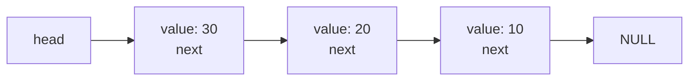
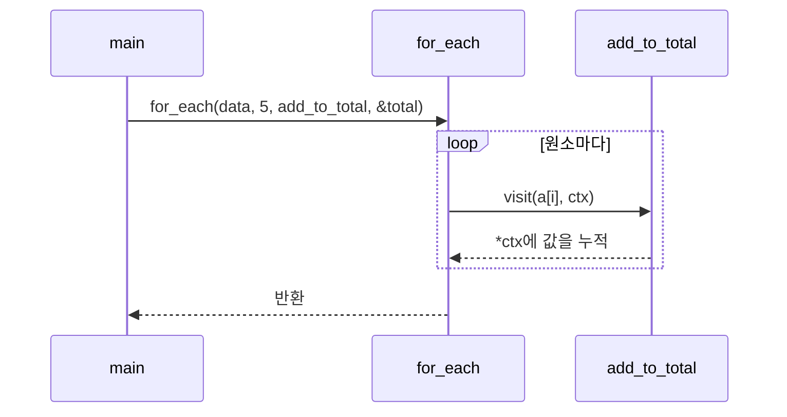

# 11장 — 동적 메모리와 포인터 심화

[레포지토리 안내](../../README.ko.md) | [English](Concepts_Lecture.md) | [한국어](Concepts_Lecture.ko.md)

> **최종 수정일:** 2026-11-09

> **학습 목표:**
> 1. 프로그램의 메모리 영역과 세 가지 저장 기간을 구분하고 지역 변수의 주소를 반환하면 안 되는 이유를 설명할 수 있다
> 2. `malloc`, `calloc`, `realloc`, `free`를 크기 계산과 실패 처리까지 포함하여 올바르게 사용할 수 있다
> 3. 메모리 누수, 댕글링 포인터, 이중 해제, 범위 초과를 구분하고 도구로 찾아낼 수 있다
> 4. 크기가 늘어나는 배열, 동적 문자열, 동적 2차원 배열, 연결 리스트를 구현할 수 있다
> 5. 이중 포인터, 배열 포인터, `void` 포인터, 함수 포인터를 구분하여 사용하고 복잡한 선언을 읽을 수 있다
> 6. 올바른 비교 함수를 작성하여 `qsort`와 `bsearch`를 사용할 수 있다

---

## 목차

- [1. 프로그램의 메모리 구조](#1-프로그램의-메모리-구조)
  - [1.1 코드, 데이터, 힙, 스택 영역](#11-코드-데이터-힙-스택-영역)
  - [1.2 세 가지 저장 기간](#12-세-가지-저장-기간)
  - [1.3 지역 변수의 주소를 반환하면 안 되는 이유](#13-지역-변수의-주소를-반환하면-안-되는-이유)
  - [1.4 동적 메모리가 필요한 경우](#14-동적-메모리가-필요한-경우)
- [2. 동적 메모리 할당](#2-동적-메모리-할당)
  - [2.1 `malloc`과 `free`](#21-malloc과-free)
  - [2.2 `calloc`](#22-calloc)
  - [2.3 `realloc`](#23-realloc)
  - [2.4 크기 계산과 실패 처리](#24-크기-계산과-실패-처리)
- [3. 동적 메모리의 오류](#3-동적-메모리의-오류)
  - [3.1 메모리 누수](#31-메모리-누수)
  - [3.2 댕글링 포인터와 이중 해제](#32-댕글링-포인터와-이중-해제)
  - [3.3 범위 초과와 초기화되지 않은 읽기](#33-범위-초과와-초기화되지-않은-읽기)
  - [3.4 오류를 찾는 도구](#34-오류를-찾는-도구)
- [4. 메모리 블록 함수](#4-메모리-블록-함수)
  - [4.1 `memcpy`와 `memmove`](#41-memcpy와-memmove)
  - [4.2 `memset`과 `memcmp`](#42-memset과-memcmp)
- [5. 동적 자료의 구현](#5-동적-자료의-구현)
  - [5.1 크기가 늘어나는 배열](#51-크기가-늘어나는-배열)
  - [5.2 동적 문자열과 `strdup`](#52-동적-문자열과-strdup)
  - [5.3 동적 2차원 배열](#53-동적-2차원-배열)
  - [5.4 자기 참조 구조체와 연결 리스트](#54-자기-참조-구조체와-연결-리스트)
- [6. 포인터 심화](#6-포인터-심화)
  - [6.1 이중 포인터](#61-이중-포인터)
  - [6.2 배열 포인터와 포인터 배열](#62-배열-포인터와-포인터-배열)
  - [6.3 `void` 포인터](#63-void-포인터)
  - [6.4 함수 포인터](#64-함수-포인터)
  - [6.5 콜백 함수](#65-콜백-함수)
  - [6.6 복잡한 선언 읽기](#66-복잡한-선언-읽기)
- [7. 정렬과 탐색 라이브러리](#7-정렬과-탐색-라이브러리)
  - [7.1 `qsort`](#71-qsort)
  - [7.2 `bsearch`](#72-bsearch)
  - [7.3 구조체 정렬과 비교 함수의 주의점](#73-구조체-정렬과-비교-함수의-주의점)
- [개념 적용](#개념-적용)
- [요약](#요약)
- [점검 문제](#점검-문제)
- [참고 문헌](#참고-문헌)

---

<br>

## 1. 프로그램의 메모리 구조

C 표준에는 1.1절에서 정의할 스택(stack)이나 힙(heap)이라는 개념이 없다. 표준은 값을 담는 메모리 영역을 **객체(object)** 라 부르고, 객체가 언제 존재하는지를 저장 기간으로만 규정한다[1, 6.2.4절]. 이 절의 메모리 배치는 표준의 내용이 아니라 대부분의 구현이 따르는 일반적인 모델이다. 이 장에서 이 환경이라고 쓴 결과는 macOS arm64의 Apple clang 21에서 관찰한 것이다.

### 1.1 코드, 데이터, 힙, 스택 영역

실행 중인 프로그램은 운영체제로부터 **주소 공간(address space)** 을 받으며, 일반적인 구현은 이 공간을 다음과 같이 용도별 영역으로 나눈다.

```text
높은 주소
┌──────────────────┐
│      stack       │ ← 지역 변수, 매개변수, 호출 정보 (보통 아래로 자란다)
│                  │
│       heap       │ ← malloc 등이 돌려주는 블록 (보통 위로 자란다)
├──────────────────┤
│       bss        │ ← 0으로 초기화되는 정적 저장 기간 객체
├──────────────────┤
│       data       │ ← 0이 아닌 값으로 초기화된 정적 저장 기간 객체
├──────────────────┤
│      rodata      │ ← 문자열 리터럴과 같은 읽기 전용 데이터
├──────────────────┤
│       text       │ ← 기계어 명령어 (코드 영역)
└──────────────────┘
낮은 주소
```

*그림 1. 일반적인 구현에서 프로세스 주소 공간의 배치*

코드 영역(text)에는 기계어 명령어가, 읽기 전용 데이터 영역(rodata)에는 문자열 리터럴이 놓인다. 문자열 리터럴의 수정은 [9장 6.1절](../Ch09_Strings/Concepts_Lecture.ko.md#61-char-문자열-포인터)에서 본 대로 정의되지 않은 동작이며, 일반적인 구현은 리터럴을 이 영역에 두어 쓰기를 막는다. 데이터 영역(data)과 BSS 영역에는 전역 변수와 `static` 지역 변수가 놓이는데, 0으로 시작하는 변수는 파일에 값을 저장할 필요가 없으므로 bss에 놓인다.

> **용어 정의:** **스택(stack)** 은 함수 호출과 함께 커지고 함수 반환과 함께 줄어드는 메모리 영역이다. 함수 한 번의 호출이 차지하는 부분을 스택 프레임(stack frame)이라 부른다.

> **용어 정의:** **힙(heap)** 은 프로그램이 실행 중에 크기를 정해 요청하고 해제할 때까지 유지되는 메모리 영역이다. 자료구조의 힙과 이름만 같고 관계가 없다.

다음은 각 영역에 놓이는 객체의 주소를 출력한 결과이다. 코드는 [Example_StorageDuration.c](Example_StorageDuration.c)이다. 출력의 주소는 예시이며, 이 환경에서는 실행할 때마다 값이 달라졌다.

```text
string literal : 0x1026b0700
global_init    : 0x1026b8000
global_zero    : 0x1026b8008
*heap          : 0x1026e52d0
local          : 0x16d74ea8c
```

이 실행에서는 낮은 주소부터 문자열 리터럴, 정적 변수, 힙, 스택 순서로 나타났지만, 영역의 순서와 간격은 운영체제에 따라 다르며 표준은 어떤 순서도 보장하지 않는다. 연속으로 할당된 블록의 순서와 연속성도 표준에서 미지정이다[1, 7.22.3절].

> **[운영체제]** 프로세스가 보는 주소는 물리 메모리 주소가 아니라 가상 주소이며, 운영체제와 하드웨어가 페이지 단위로 물리 메모리에 대응시킨다. 실행마다 주소가 달라지는 것은 공격을 어렵게 하기 위해 배치를 무작위로 바꾸는 주소 공간 배치 무작위화(ASLR) 때문이다.

### 1.2 세 가지 저장 기간

> **용어 정의:** **저장 기간(storage duration)** 은 객체가 메모리에 존재하는 기간을 정하는 성질이다. 객체가 존재하는 실행 구간을 수명(lifetime)이라 하며, 수명 동안 객체는 일정한 주소를 갖고 마지막에 저장된 값을 유지한다.

C11 표준의 저장 기간은 정적, 스레드, 자동, 할당의 네 가지이다[1, 6.2.4절]. 스레드 저장 기간은 `_Thread_local`로 선언한 객체에만 해당하므로 이 장에서는 나머지 세 가지를 다룬다.

| 저장 기간 | 대상 | 수명 | 초기값 | 일반적인 위치 |
|:----|:----|:----|:----|:----|
| 자동(automatic) | 블록 안에서 `static` 없이 정의한 변수, 매개변수 | 블록에 들어갈 때부터 벗어날 때까지 | 초기화식이 없으면 불확정 | 스택 |
| 정적(static) | 파일 범위의 변수, `static` 지역 변수 | 프로그램 전체 | 초기화식이 없으면 0 | data, bss |
| 할당(allocated) | `malloc`, `calloc`, `realloc`이 돌려준 블록 | 할당부터 해제까지 | `malloc`은 불확정, `calloc`은 모든 비트 0 | 힙 |

*표 1. 세 가지 저장 기간의 비교*

> **용어 정의:** **불확정 값(indeterminate value)** 은 표준이 특정 값을 정하지 않아, 그 타입의 임의의 값이거나 어떤 값도 나타내지 않는 표현(트랩 표현)일 수 있는 값이다[1, 3.19.2절]. 초기화하지 않은 자동 변수와 `malloc`이 돌려준 블록의 내용이 여기에 해당하며, 읽어서 사용해서는 안 된다.

**유효 범위**는 소스 코드에서 이름을 쓸 수 있는 구간이고([6장 3.3절](../Ch06_Functions/Concepts_Lecture.ko.md#33-유효-범위-규칙)), **수명**은 실행 중에 객체가 존재하는 구간이다. `static` 지역 변수는 유효 범위는 블록 안이지만 수명은 프로그램 전체이므로, [Example_StorageDuration.c](Example_StorageDuration.c)의 `next_ticket`은 호출할 때마다 이전 값을 이어받아 101, 102, 103을 반환한다. `static`의 자세한 규칙은 [12장 8.2절](../Ch12_File-IO-and-Program-Structure/Concepts_Lecture.ko.md#82-static-지역-변수)에서 다룬다.

### 1.3 지역 변수의 주소를 반환하면 안 되는 이유

자동 변수의 수명은 선언된 블록이 끝날 때 끝나므로 함수가 반환한 뒤에는 남아 있지 않고, 수명이 끝난 객체를 참조하는 것은 정의되지 않은 동작이다[1, 6.2.4절]. 다음은 이 규칙을 어기는 잘못된 코드이다.

```c
// 잘못된 코드: 수명이 끝난 변수의 주소를 반환한다
int *make_value(void) {
    int value = 42;
    return &value;
}
int fill_stack(void) {
    int other = 777;
    return other + 1;
}
int main(void) {
    int *p = make_value();
    fill_stack();
    printf("%d\n", *p);
    return 0;
}
```

컴파일러는 `warning: address of stack memory associated with local variable 'value' returned`로 경고한다. 무시하고 실행하면 결과를 예측할 수 없으며, 이 환경에서는 `-O0`로 컴파일하면 777이, `-O2`로 컴파일하면 143556992 같은 쓰레기 값이 출력되었다. 777이 나온 이유는 `fill_stack`의 프레임이 `make_value`의 프레임이 있던 자리를 다시 사용했기 때문이다.

```text
make_value 실행 중                 반환 뒤 fill_stack 실행 중
┌─────────────────────┐            ┌─────────────────────┐
│ main    p = ?       │            │ main    p = 0x...c8 ┼──┐
├─────────────────────┤            ├─────────────────────┤  │
│ value = 42          │ ← 0x...c8  │ other = 777         │ ◄┘ 같은 자리를 재사용
└─────────────────────┘            └─────────────────────┘
```

*그림 2. 함수 반환 후 같은 스택 자리를 재사용하는 다음 호출의 프레임*

| 방법 | 코드 형태 | 특징 |
|:----|:----|:----|
| 값을 반환한다 | `int make_value(void)` | 값이 작을 때 가장 간단하다. |
| 호출자가 공간을 준다 | `void make_value(int *out)` | 출력 매개변수를 쓴다([8장 3.3절](../Ch08_Pointers/Concepts_Lecture.ko.md#33-여러-값-반환)). |
| 동적으로 할당한다 | `int *make_value(void)` + `malloc` | 호출자가 `free`해야 한다. |
| `static` 변수를 쓴다 | `static int value;` | 호출마다 같은 변수를 공유하므로 다시 호출하면 이전 결과가 덮어써진다. |

*표 2. 함수 밖으로 값을 전달하는 방법*

> **핵심:** 함수가 만든 데이터를 함수 밖에서 쓰려면 그 데이터의 수명이 함수 호출보다 길어야 한다. 자동 변수는 이 조건을 만족하지 못한다.

### 1.4 동적 메모리가 필요한 경우

1. **크기를 실행 중에야 알 수 있는 경우:** 입력받는 데이터의 개수를 모르면 큰 배열을 미리 잡아 메모리를 낭비하거나 크기를 넘어 버퍼 오버플로를 일으키게 된다.
2. **만든 함수보다 오래 살아야 하는 경우:** 함수가 만든 데이터를 호출자가 계속 사용해야 하면 자동 변수는 쓸 수 없다(1.3절).
3. **데이터가 큰 경우:** 스택의 크기는 제한되어 있다. 이 환경의 기본 한도는 `ulimit -s`로 확인한 8176KB이고, Visual Studio의 기본 스택 크기는 1MB이다[2]. 지역 배열 `int big[10000000];`(40MB)을 사용한 프로그램은 이 환경에서 Segmentation fault(허용되지 않은 메모리에 접근하여 운영체제가 프로그램을 강제로 종료한 것)로 종료되었다. 스택 오버플로는 `malloc`처럼 실패를 값으로 돌려주지 않는다.
4. **크기가 변하는 경우:** 실행 중에 늘어나거나 줄어드는 자료는 고정 크기 배열로 표현할 수 없다(5.1절).

| 비교 | 크기를 정하는 시점 | 수명 | 실패 감지 | 크기 변경 |
|:----|:----|:----|:----|:----|
| 정적 배열 | 컴파일할 때 | 프로그램 전체 | 없음 | 불가 |
| 자동 배열 | 컴파일할 때 | 블록 | 없음 (스택 오버플로) | 불가 |
| 가변 길이 배열 | 실행 중, 선언 시점 | 블록 | 없음 (스택 오버플로) | 불가 |
| 동적 할당 | 실행 중 | 해제할 때까지 | `NULL` 반환 | `realloc`으로 가능 |

*표 3. 배열을 얻는 방법의 비교*

**가변 길이 배열(variable-length array)** 은 `int a[n];`처럼 실행 중의 값으로 크기를 정하는 배열이다. C99에 도입되었고 C11부터는 구현이 지원하지 않아도 되는 선택 사항이다[1, 6.10.8.3절]. 이식성이 필요한 코드에서는 동적 할당을 쓴다.

> **참고:** **Visual Studio.** MSVC의 C 컴파일러는 `/std:c11`과 `/std:c17`로 표준을 지정할 수 있지만, 가변 길이 배열은 지원하지 않으며 지원 계획도 없다[3].

---

<br>

## 2. 동적 메모리 할당

> **용어 정의:** **동적 메모리 할당(dynamic memory allocation)** 은 실행 중에 필요한 크기의 메모리를 요청하여 받고, 다 쓴 뒤 프로그램이 직접 반환하는 메모리 관리 방식이다.

이 절의 함수는 모두 `<stdlib.h>`에 선언되어 있다. 크기는 부호 없는 정수 타입 `size_t`로 전달하며, `size_t`는 [13장 2.3절](../Ch13_Standard-Library-and-Modern-C/Concepts_Lecture.ko.md#23-size_t-ptrdiff_t-offsetof)에서 다룬다.

### 2.1 `malloc`과 `free`

```c
void *malloc(size_t size);
void free(void *ptr);
```

`malloc`은 `size` 바이트의 블록을 할당하여 시작 주소를 돌려주고, 할당할 수 없으면 널 포인터를 돌려준다. 반환형 `void *`는 가리키는 데이터 타입이 정해지지 않은 포인터로(6.3절), C에서는 다른 객체 포인터 타입으로 암시적으로 변환되므로 형 변환 없이 대입한다.

```c
int n = 5;
int *arr = malloc(n * sizeof *arr);    // int 5개 크기의 블록 요청

if (arr == NULL) {                     // 실패 검사
    printf("allocation failed\n");
    return 1;
}
for (int i = 0; i < n; i++) {
    arr[i] = (i + 1) * 10;             // 포인터를 배열처럼 사용
}
printf("%d %d\n", arr[0], arr[4]);     // 10 50

free(arr);                             // 블록 반환
arr = NULL;                            // 해제된 주소를 지운다
```

`n * sizeof *arr`는 필요한 바이트 수이다. `sizeof *arr`는 `arr`이 가리키는 원소의 크기로, `sizeof`의 피연산자는 가변 길이 배열 타입이 아니면 평가되지 않으므로 초기화 전의 `arr`을 역참조하는 일이 없고, 나중에 `arr`의 타입이 바뀌어도 이 식은 고칠 필요가 없다. 포인터에 `arr[i]`를 쓸 수 있는 것은 [8장 2.2절](../Ch08_Pointers/Concepts_Lecture.ko.md#22-포인터를-배열처럼-사용)의 규칙이다.

```text
스택                            힙
┌───────────────┐              ┌────┬────┬────┬────┬────┐
│ arr = 0x...50 │ ───────────► │ 10 │ 20 │ 30 │ 40 │ 50 │  (20바이트 블록)
│ n   = 5       │              └────┴────┴────┴────┴────┘
└───────────────┘               0x...50
```

*그림 3. 스택의 포인터 변수 arr과 힙에 할당된 블록*

`malloc`과 `free`의 규칙은 다음과 같다[1, 7.22.3절].

- `malloc`이 돌려준 블록의 내용은 불확정이므로, 값을 쓰기 전에 읽으면 안 된다.
- `free(NULL)`은 아무 일도 하지 않으므로 널 검사 없이 호출해도 된다.
- `free`에는 할당 함수가 돌려준 주소를 그대로 전달하며, 블록 중간의 주소나 지역 변수의 주소를 전달하면 정의되지 않은 동작이다.
- `malloc(0)`의 동작은 구현 정의 동작이다. 널 포인터를 돌려주거나 역참조할 수 없는 포인터를 돌려주며, 어느 쪽이든 `free`에 넘겨도 된다. 이 환경에서는 널이 아닌 포인터를 돌려주었다.

`free(arr)`은 포인터의 값을 복사하여 받으므로 호출자의 변수를 바꾸지 못한다. 해제된 주소가 `arr`에 그대로 남으므로 `arr = NULL;`을 직접 쓴다.

> **용어 정의:** **소유권(ownership)** 은 할당된 블록을 해제할 책임이 어느 코드에 있는지를 나타내는 약속이다. C 언어에는 이를 표현하는 문법이 없으므로, 함수의 설명과 이름으로 누가 해제하는지를 분명히 한다.

> **[시스템프로그래밍]** `malloc`과 `free`는 할당기(allocator)라는 라이브러리 코드이다. 할당기는 운영체제에서 큰 메모리를 얻어 작은 블록으로 나누어 관리하며, 블록의 크기 같은 관리 정보를 보관하므로 `free`에 크기를 전달할 필요가 없다.

### 2.2 `calloc`

```c
void *calloc(size_t nmemb, size_t size);
```

`calloc`은 `size` 바이트짜리 원소 `nmemb`개를 위한 블록을 할당하고 **모든 비트를 0으로** 채운다. 두 크기를 따로 받으므로 곱셈의 오버플로를 함수 안에서 검사할 수 있다. C23 표준은 곱이 `size_t` 범위를 넘으면 널 포인터를 돌려준다고 명시하며[4, 7.24.3.2절], 이 환경에서 `calloc(SIZE_MAX, 2)`는 널 포인터를 돌려주었다. `SIZE_MAX`는 `<stdint.h>`에 정의된 `size_t`의 최댓값이다.

| 함수 | 인수 | 내용 | 대표 용도 |
|:----|:----|:----|:----|
| `malloc` | 바이트 수 | 불확정 | 곧바로 값을 채울 때 |
| `calloc` | 원소 수, 원소 크기 | 모든 비트 0 | 정수 배열을 0으로 시작할 때 |
| `realloc` | 기존 포인터, 새 바이트 수 | 앞부분 유지, 늘어난 부분은 불확정 | 크기를 바꿀 때 |

*표 4. 할당 함수의 비교*

> **주의:** 모든 비트가 0이라고 해서 모든 데이터 타입의 값이 0인 것은 아니다. 정수 타입은 모든 비트 0이 값 0임이 보장되지만[1, 6.2.6.2절], 0.0과 널 포인터의 표현이 모든 비트 0이라는 보장은 ISO C에 없다[1, 7.22.3.2절의 각주]. 일반적인 플랫폼에서는 모두 0으로 표현되지만, 이식성이 중요한 코드에서는 포인터 멤버에 `NULL`을 명시적으로 대입한다.

### 2.3 `realloc`

```c
void *realloc(void *ptr, size_t size);
```

`realloc`은 기존 블록을 해제하고 `size` 바이트의 새 블록을 돌려준다. 새 블록의 앞부분에는 기존 내용이 기존 크기와 새 크기 중 작은 쪽만큼 유지되고, 늘어난 부분은 불확정이다[1, 7.22.3.5절]. 구현은 블록을 제자리에서 늘려도 되고 다른 곳에 새 블록을 만들어 복사해도 된다[5].

```text
제자리에서 늘린 경우 (주소 유지)         다른 곳으로 옮긴 경우 (주소 변경)
ptr ─► ┌────┬────┬────┬────┐          ptr ─► ┌────┬────┐ (해제됨)
       │ 10 │ 20 │ ?  │ ?  │                 └────┴────┘
       └────┴────┴────┴────┘          new ─► ┌────┬────┬────┬────┐
                                              │ 10 │ 20 │ ?  │ ?  │
                                              └────┴────┴────┴────┘
```

*그림 4. `realloc`이 블록을 제자리에서 늘리는 경우와 옮기는 경우*

크기를 늘리면서 주소가 바뀌는지 출력하는 코드는 [Example_Realloc.c](Example_Realloc.c)이다. 이 환경에서 실행하면 원소 5개에서 6개, 8개로 늘릴 때는 같은 주소가 유지되었고 16개, 1000개로 늘릴 때는 블록이 옮겨졌다(`arr[4]`의 값은 항상 50으로 유지되었다). 어느 쪽이 될지는 구현에 달려 있으므로 프로그램이 가정해서는 안 된다.

`arr = realloc(arr, new_size);`는 흔히 보이는 잘못된 코드이다. 실패하면 널 포인터가 돌아오고 기존 블록은 그대로 남는데, 그 주소를 `NULL`로 덮어써 해제할 수 없게 된다. 항상 임시 포인터로 받는다.

```c
int *tmp = realloc(arr, new_count * sizeof *tmp);
if (tmp == NULL) {
    free(arr);              // 기존 블록은 아직 유효하다
    return 1;
}
arr = tmp;                  // 성공했을 때만 갱신
```

경계 사례는 다음과 같다. `realloc(NULL, size)`는 `malloc(size)`와 같다[1, 7.22.3.5절]. 성공하면 기존 포인터는 값이 같더라도 사용할 수 없다. `realloc(ptr, 0)`은 C17까지 구현 정의 동작이었고 널 포인터를 돌려주는지와 기존 블록을 해제하는지가 구현마다 달랐으며[6], C23에서는 정의되지 않은 동작이 되었다[4, 7.24.3.7절]. 크기가 0이 될 수 있으면 먼저 검사하여 `free`를 호출한다.

> **핵심:** `realloc`의 결과는 항상 임시 포인터로 받고, 성공한 뒤에는 이전 포인터를 사용하지 않는다.

### 2.4 크기 계산과 실패 처리

| 잘못된 계산 | 문제 | 올바른 형태 |
|:----|:----|:----|
| `malloc(n)` | 원소 수와 바이트 수를 혼동 | `malloc(n * sizeof *p)` |
| `malloc(sizeof p)` | 포인터의 크기만 할당 | `malloc(sizeof *p)` |
| `malloc(strlen(s))` | 널 문자 자리가 없음 | `malloc(strlen(s) + 1)` |
| `rows * cols * sizeof(int)` (`int rows, cols`) | `rows * cols`가 먼저 `int`로 계산되어 오버플로가 일어날 수 있음 | `sizeof(int) * rows * cols` |

*표 5. 흔한 크기 계산 오류와 올바른 형태*

곱셈은 왼쪽에서 오른쪽으로 결합하므로, 마지막 행에서 `rows * cols`가 `int`의 범위를 넘으면 정의되지 않은 동작이다. `sizeof(int)`를 앞에 두면 모든 계산이 `size_t`로 이루어진다. `size_t`로 계산해도 값이 너무 크면 범위를 돌아 작아진다. `size_t`가 8바이트이고 `int`가 4바이트인 이 환경에서 `n = SIZE_MAX / 2 + 2`이면 `n * sizeof(int)`는 4가 되어, `malloc`은 성공하지만 `n`개의 원소가 있다고 믿고 접근하면 범위를 벗어난다. 곱하기 전에 나눗셈으로 검사하면 오버플로 없이 판단할 수 있다.

```c
if (n > SIZE_MAX / sizeof *p) {     // n * sizeof *p의 오버플로 검사
    return NULL;
}
p = malloc(n * sizeof *p);
```

크기가 사용자 입력에서 오면 음수도 조심한다. `int n = -1;`을 8바이트 `size_t`로 변환하면 18446744073709551615가 되어 거대한 요청이 되고 `malloc`이 실패한다. 크기로 쓰기 전에 범위를 검사한다.

호출 실패는 `NULL`로 알 수 있으므로 호출할 때마다 검사한다. 할당을 여러 번 하는 함수는 중간에 실패했을 때 앞서 얻은 블록을 해제해야 한다. 이때 2.1절의 `free(NULL)` 규칙을 쓰면 정리 코드가 단순해지며, 자원 정리의 일반적인 패턴은 [12장 5.4절](../Ch12_File-IO-and-Program-Structure/Concepts_Lecture.ko.md#54-자원-정리-패턴)에서 다룬다.

> **[운영체제]** Linux는 기본 설정에서 낙관적 메모리 할당을 하므로, `malloc`이 널이 아닌 포인터를 돌려주었어도 실제로 메모리를 사용할 때 부족할 수 있다[7]. 그렇더라도 다른 시스템과 설정에서는 할당이 실패하면 `NULL`이 돌아오므로 검사는 필요하다.

---

<br>

## 3. 동적 메모리의 오류

동적 메모리의 오류는 대부분 컴파일할 때 드러나지 않고 정의되지 않은 동작으로 이어진다. 정의되지 않은 동작의 일반적인 논의는 [13장 6절](../Ch13_Standard-Library-and-Modern-C/Concepts_Lecture.ko.md#6-정의되지-않은-동작)에서 다룬다.

### 3.1 메모리 누수

> **용어 정의:** **메모리 누수(memory leak)** 는 프로그램이 더 이상 사용하지 않는 동적 블록을 해제하지 않아 그 메모리를 다시 쓸 수 없게 되는 오류이다.

일반적인 운영체제는 프로세스가 끝나면 메모리를 회수하므로 금방 끝나는 프로그램에서는 누수가 드러나지 않지만, 서버처럼 오래 실행되는 프로그램에서는 사용량이 계속 늘어난다. 누수는 주로 다음과 같이 일어난다.

```c
// 잘못된 코드: 두 가지 메모리 누수
void leak_examples(size_t n) {
    int *a = malloc(n);
    if (n > 100) {
        return;               // 1. 이른 반환에서 해제를 잊었다
    }
    int *b = malloc(n);
    b = malloc(n);            // 2. 유일한 포인터를 덮어써 첫 블록을 잃었다
    free(a);
    free(b);
}
```

그 밖에 `arr = realloc(arr, ...)`의 실패(2.3절)와, 구조체의 포인터 멤버가 가리키는 블록을 놓아둔 채 구조체만 해제하는 경우가 있다.

### 3.2 댕글링 포인터와 이중 해제

> **용어 정의:** **댕글링 포인터(dangling pointer)** 는 수명이 끝난 객체의 주소를 여전히 담고 있는 포인터이다.

> **용어 정의:** **해제 후 사용(use after free)** 은 해제된 블록을 포인터로 읽거나 쓰는 오류이다.

> **용어 정의:** **이중 해제(double free)** 는 이미 해제된 블록을 다시 해제하는 오류이다.

표준에 따르면 객체의 수명이 끝나면 그 객체를 가리키던 포인터의 값 자체가 불확정이 되므로, 역참조뿐 아니라 그 값을 비교에 쓰는 것도 안 된다[1, 6.2.4절, J.2절]. 해제된 블록은 곧 다른 `malloc`에 재사용될 수 있으므로 해제 후 사용은 다른 데이터를 읽거나 덮어쓰는 결과로 이어질 수 있다. `free(p); printf("%d\n", *p);`를 컴파일러의 메모리 오류 검사 기능인 `-fsanitize=address`(AddressSanitizer, ASan)로 컴파일하여 실행하면 다음과 같이 보고된다(일부 생략, 주소는 예시).

```text
ERROR: AddressSanitizer: heap-use-after-free on address 0x602000000930
READ of size 4 at 0x602000000930 thread T0
    #0 0x000104fac9a4 in main uaf.c:12
freed by thread T0 here:
    #1 0x000104fac918 in main uaf.c:11
previously allocated by thread T0 here:
    #1 0x000104fac854 in main uaf.c:6
```

보고는 오류가 난 줄, 해제한 줄, 할당한 줄을 모두 알려 준다. 포인터를 복사해 두면 문제는 더 어려워진다.

```text
int *q = p;           p ──┐
                          ├──► [ 블록 ]
                      q ──┘

free(p); p = NULL;    p = NULL
                      q ──────► [ 해제된 블록 ]   ← q는 여전히 댕글링 포인터
```

*그림 5. 같은 블록을 가리키던 두 번째 포인터가 해제 후 댕글링 포인터로 남은 상태*

`p = NULL;`로 지워도 복사본 `q`는 고쳐지지 않으므로, 같은 블록을 가리키는 포인터가 여럿이면 어느 포인터가 소유하는지(2.1절)를 정해 둔다. 이중 해제도 ASan이 `attempting double-free on 0x602000000930`으로 보고하며, 두 번의 `free` 위치를 함께 알려 준다. 해제 뒤 포인터에 `NULL`을 대입하면 같은 변수의 두 번째 `free`는 아무 일도 하지 않지만, 복사해 둔 값까지 지워 주지는 않는다.

> **핵심:** 성공한 할당 하나에 `free`는 정확히 한 번 실행되어야 하고, 그 뒤에는 그 블록을 가리키던 어떤 포인터도 사용하면 안 된다.

> **[소프트웨어보안]** 해제 후 사용은 대표적인 메모리 취약점 유형이다(CWE-416)[8]. 공격자가 해제된 자리에 자신의 데이터가 할당되게 하면, 프로그램이 그 데이터를 원래의 객체인 것처럼 사용하게 된다.

### 3.3 범위 초과와 초기화되지 않은 읽기

할당한 범위 밖을 접근하는 오류는 [7장 3.3절](../Ch07_Arrays/Concepts_Lecture.ko.md#33-인덱스-범위-초과)의 인덱스 범위 초과와 같은 문제인데, 포인터만으로는 블록의 크기를 알 수 없으므로 찾기가 더 어렵다. 다음 반복문은 `i == n`일 때 범위를 넘어 쓴다.

```c
// 잘못된 코드: 경계를 하나 넘어 쓴다
int n = 5;
int *a = malloc(n * sizeof *a);
for (int i = 0; i <= n; i++) {
    a[i] = i;
}
free(a);
```

```text
ERROR: AddressSanitizer: heap-buffer-overflow on address 0x603000000fb4
WRITE of size 4 at 0x603000000fb4 thread T0
0x603000000fb4 is located 0 bytes after 20-byte region [0x603000000fa0,0x603000000fb4)
```

힙의 범위 초과는 곧바로 멈추지 않고 할당기의 관리 정보나 이웃한 블록을 망가뜨려, 한참 뒤의 `malloc`이나 `free`에서 비정상 종료되는 경우가 많다. 증상이 나타난 위치가 원인이 아닐 수 있다.

초기화하지 않은 블록을 읽는 것도 오류이다. `malloc`한 `int` 4개의 합을 초기화 없이 계산한 프로그램은 일반 빌드에서 0을 출력했고, `-fsanitize=address,undefined`로 실행하면 ASan의 초기 채움 값(바이트 `0xBE`)을 합산하다가 UndefinedBehaviorSanitizer(UBSan)가 정수 오버플로를 보고했다. 같은 코드의 결과가 빌드에 따라 달라진 것은 불확정 값의 전형적인 증상이다. ASan과 UBSan은 이 오류 자체를 검출하지 않으며, 이를 검출하는 MemorySanitizer는 Linux, NetBSD, FreeBSD에서만 지원된다[9]. 이 환경의 clang은 `-fsanitize=memory`를 지원하지 않는다고 보고했다.

### 3.4 오류를 찾는 도구

> **용어 정의:** **새니타이저(sanitizer)** 는 컴파일러가 프로그램에 검사 코드를 삽입하여 실행 중에 오류를 찾아내는 도구이다.

| 도구 | 사용 방법 | 주로 찾는 오류 | 비고 |
|:----|:----|:----|:----|
| 컴파일러 경고 | `-Wall -Wextra` | 컴파일할 때 드러나는 일부 오류 | 실행 없이 확인할 수 있다. |
| AddressSanitizer (ASan) | `-fsanitize=address -g` | 범위 초과, 해제 후 사용, 이중 해제 | clang, gcc, MSVC가 지원한다[10][11][12]. |
| UndefinedBehaviorSanitizer (UBSan) | `-fsanitize=undefined -g` | 부호 있는 정수 오버플로, 정렬되지 않은 포인터 | clang과 gcc가 지원한다[12][13]. |
| Valgrind Memcheck | `valgrind --leak-check=full ./prog` | 잘못된 읽기와 쓰기, 초기화되지 않은 값, 누수[14] | 재컴파일 없이 실행 파일을 검사한다[15]. Apple Silicon의 macOS는 지원 플랫폼이 아니다[16]. |
| macOS `leaks` | `leaks --atExit -- ./prog` | 누수 | 프로그램 종료 시 메모리를 조사한다[17]. |
| CRT 디버그 힙 | `_CrtDumpMemoryLeaks()` | 누수 | Visual Studio의 디버그 빌드에서 쓴다[18]. |

*표 6. 메모리 오류를 찾는 도구*

다음은 이 환경(Apple clang, macOS arm64)에서 `malloc`한 블록을 해제하지 않는 함수 `use_buffer(n)`를 `n`을 10, 20, 30으로 하여 세 번 호출한 프로그램을 `leaks --atExit -- ./prog`로 검사한 결과이다(일부 생략).

```text
Process 160: 2 leaks for 144 total leaked bytes.
    2 (144 bytes) << TOTAL >>
      1 (96 bytes) ROOT LEAK: <malloc in use_buffer 0x7be8c0c000> [96]
      1 (48 bytes) ROOT LEAK: <malloc in use_buffer 0x7be8c08000> [48]
```

각각 40, 80, 120바이트의 블록이 누수되었지만 앞의 두 번만 보고되었다(크기는 할당 단위로 올림되어 48, 96으로 표시). `leaks`는 메모리에서 포인터처럼 보이는 값을 찾아 도달할 수 있는 블록을 사용 중으로 판단하므로[17], 지역 변수의 흔적이 남아 있으면 누수를 놓칠 수 있다.

- 이 환경에서 ASan의 누수 검사는 사용할 수 없었다. Clang 문서는 macOS에서 `ASAN_OPTIONS=detect_leaks=1`로 켤 수 있다고 설명하지만[10], 이 환경의 Apple clang에서는 `detect_leaks is not supported on this platform.`이 출력되었다. Linux에서는 ASan이 기본으로 누수도 검사한다[10].
- 1.3절의 스택 주소 반환은 이 환경에서 기본 설정의 ASan으로는 보고되지 않았고, `ASAN_OPTIONS=detect_stack_use_after_return=1`을 지정하면 `stack-use-after-return`으로 보고되었다. Linux에서는 이 검사가 기본으로 켜져 있다[10].
- `leaks`는 ASan으로 빌드한 프로그램에 대해 보고를 끝내지 못했으므로, 누수 검사는 새니타이저 없이 빌드하여 수행한다.

새니타이저와 `leaks`는 그 실행에서 지나간 경로의 오류만 찾으므로, 오류가 보고되지 않았다는 것이 오류가 없다는 증명은 아니다.

> **참고:** **Visual Studio.** `/fsanitize=address`로 AddressSanitizer를 켤 수 있으며, 프로젝트 속성의 **C/C++ > 일반 > AddressSanitizer 사용**에서도 설정한다. 디버그 구성에서는 호환되지 않는 `/ZI`, `/RTC1`, `/INCREMENTAL`을 꺼야 할 수 있다[11]. 누수는 `_CRTDBG_MAP_ALLOC`을 정의하고 `<stdlib.h>`, `<crtdbg.h>`를 이 순서로 포함한 뒤 `_CrtDumpMemoryLeaks()`를 호출하면 디버그 빌드의 출력 창에 보고된다[18].

---

<br>

## 4. 메모리 블록 함수

`<string.h>`의 `mem` 함수는 문자열이 아니라 **바이트 블록**을 다룬다. 널 문자에서 멈추지 않고 지정한 바이트 수만큼 처리하며, 어떤 데이터 타입의 객체에도 쓸 수 있도록 매개변수가 `void *`이다.

### 4.1 `memcpy`와 `memmove`

```c
void *memcpy(void *dest, const void *src, size_t n);
void *memmove(void *dest, const void *src, size_t n);
```

두 함수 모두 `src`의 `n`바이트를 `dest`로 복사하고 `dest`를 돌려준다. `memcpy`는 두 영역이 겹치면 정의되지 않은 동작이고, `memmove`는 겹쳐도 올바르게 복사한다[1, 7.24.2절].

```text
int a[6] = {1, 2, 3, 4, 5, 0};   목표: a[0..4]를 a[1..5]로 복사
처음                 [ 1 ][ 2 ][ 3 ][ 4 ][ 5 ][ 0 ]
memmove의 결과       [ 1 ][ 1 ][ 2 ][ 3 ][ 4 ][ 5 ]   ← 겹쳐도 원래 값을 복사
앞에서부터 복사하면  [ 1 ][ 1 ][ 1 ][ 1 ][ 1 ][ 1 ]   ← 이미 덮어쓴 값을 다시 읽는다
```

*그림 6. 겹치는 영역을 복사할 때 `memmove`의 결과와 앞에서부터 복사할 때의 문제*

`memcpy(&a[1], &a[0], 5 * sizeof a[0]);`처럼 겹치는 영역에 `memcpy`를 쓰는 것은 잘못된 코드이다. 이 환경에서 ASan은 `memcpy-param-overlap`으로 보고했고, 새니타이저 없이 실행하면 `-O0`에서는 `1 1 2 3 4 4`가, `-O2`에서는 `1 1 2 3 4 5`가 출력되었다. 우연히 맞는 결과는 믿을 수 없으므로 겹칠 가능성이 있으면 `memmove`를 쓴다. `memcpy`는 `strcpy`와 달리 널 문자를 찾지 않으므로 길이를 아는 문자열이나 구조체, 배열 같은 일반 객체도 복사할 수 있다.

### 4.2 `memset`과 `memcmp`

```c
void *memset(void *s, int c, size_t n);
int memcmp(const void *s1, const void *s2, size_t n);
```

`memset`은 앞 `n`바이트 각각에 `c`를 `unsigned char`로 변환한 값을 쓴다[1, 7.24.6.1절]. **단위가 바이트**이므로 `int` 배열을 1로 채우는 데는 쓸 수 없다.

```c
int a[3];
memset(a, 1, sizeof a);
printf("%d %d %d\n", a[0], a[1], a[2]);   // 16843009 16843009 16843009
memset(a, 0, sizeof a);
printf("%d %d %d\n", a[0], a[1], a[2]);   // 0 0 0
```

`int`가 4바이트이면 각 바이트가 `0x01`일 때 값은 `0x01010101`, 곧 16843009이다. 0으로 채우면 모든 비트가 0이 되어 정수 배열에서는 안전하며, 포인터와 부동소수점 수에는 2.2절의 주의가 적용된다.

`memcmp`는 앞 `n`바이트를 `unsigned char` 값으로 차례로 비교하여 부호로 결과를 알린다. 비교 대상이 **바이트 표현**임을 잊으면 틀린 결과를 얻는다.

```c
int x = 256, y = 1;
printf("%d\n", x > y);                                   // 1
printf("%d\n", memcmp(&x, &y, sizeof x) > 0 ? 1 : -1);   // -1 (리틀 엔디언)

double p = 0.0, q = -0.0;
printf("%d\n", p == q);                                  // 1
printf("%d\n", memcmp(&p, &q, sizeof p) == 0);           // 0
```

리틀 엔디언인 이 환경에서 `256`의 첫 바이트는 `0x00`이고 `1`의 첫 바이트는 `0x01`이므로 `memcmp`는 `x`가 작다고 판단한다. 엔디언은 [13장 5.2절](../Ch13_Standard-Library-and-Modern-C/Concepts_Lecture.ko.md#52-엔디언)에서 다룬다. `0.0`과 `-0.0`은 값으로는 같지만 비트 표현이 다르다. 구조체를 `memcmp`로 비교하면 패딩 바이트까지 비교하게 되어 믿을 수 없다([10장 1.7절](../Ch10_Structures/Concepts_Lecture.ko.md#17-구조체-비교)).

---

<br>

## 5. 동적 자료의 구현

### 5.1 크기가 늘어나는 배열

> **용어 정의:** **동적 배열(dynamic array)** 은 원소가 늘어나면 더 큰 블록으로 옮겨 가며 크기를 키우는, 연속된 메모리의 배열이다.

> **용어 정의:** **용량(capacity)** 은 현재 블록이 담을 수 있는 원소의 수이다. 실제로 저장된 원소의 수인 크기(size)보다 크거나 같다.

원소 수와 용량을 함께 관리하면 용량이 찰 때만 `realloc`을 호출하면 된다. 전체 코드는 [Example_DynamicArray.c](Example_DynamicArray.c)이다.

```c
typedef struct {
    int *data;          // 원소를 담는 블록
    size_t size;        // 사용 중인 원소 수
    size_t capacity;    // 블록이 담을 수 있는 원소 수
} IntArray;

int array_push(IntArray *v, int value) {
    if (v->size == v->capacity) {
        size_t new_capacity = (v->capacity == 0) ? 1 : v->capacity * 2;

        if (new_capacity > SIZE_MAX / sizeof *v->data) {
            return 0;                       // 크기 계산에서 오버플로가 일어난다
        }
        int *tmp = realloc(v->data, new_capacity * sizeof *tmp);
        if (tmp == NULL) {
            return 0;                       // v는 변하지 않았다
        }
        v->data = tmp;
        v->capacity = new_capacity;
    }
    v->data[v->size] = value;
    v->size++;
    return 1;
}
```

`v->data`가 `NULL`이어도 `realloc(NULL, ...)`이 `malloc`처럼 동작하므로(2.3절) 첫 삽입에 별도의 경우를 만들 필요가 없다. 실패하면 기존 블록과 `size`, `capacity`가 그대로 유지된다.

**두 배로 늘리는 이유.** 매번 한 칸씩 늘리면 재할당 때마다 기존 원소를 복사하므로 원소 `n`개를 넣는 데 약 `n²/2`번의 복사가 필요하다. 용량을 두 배로 늘리면 복사는 용량이 찰 때만 일어나고 복사량은 1, 2, 4, ...이므로 합이 `2n`보다 작다. 예제를 실행한 결과(일부 생략)도 이 계산과 일치한다.

```text
size    1  capacity    1  copies so far    0
size    2  capacity    2  copies so far    1
size    3  capacity    4  copies so far    3
size    5  capacity    8  copies so far    7
...
size  513  capacity 1024  copies so far 1023
1000 pushes copied 1023 elements
```

> **용어 정의:** **분할 상환 비용(amortized cost)** 은 일련의 연산 전체 비용을 연산 횟수로 나눈 연산당 평균 비용이다. 확률적 평균이 아니라 최악의 입력에서도 성립하는 합계에 대한 평균이다.

동적 배열의 삽입은 **분할 상환** O(1)이다. O(1)은 원소 수와 무관한 일정한 시간, O(n)은 원소 수에 비례하는 시간을 뜻한다. 재할당이 일어나는 한 번의 삽입은 O(n)이 걸리므로 모든 삽입이 O(1)이라고 말하면 틀린다. 이 분석은 재할당마다 전체를 복사한다고 가정한 상한이다.

> **핵심:** 크기와 용량을 따로 관리하고 가득 찰 때 용량을 두 배로 늘리면, 원소 `n`개를 넣는 동안 복사되는 원소 수의 합은 `2n`보다 작다.

### 5.2 동적 문자열과 `strdup`

문자열을 복사할 때는 널 문자 몫으로 1바이트를 더 할당한다. 전체 코드는 [Example_DynamicString.c](Example_DynamicString.c)이며, 두 문자열을 이어 붙이는 `string_concat`도 같은 방식으로 `strlen(a) + strlen(b) + 1`바이트를 할당한다.

```c
char *string_duplicate(const char *s) {
    size_t bytes = strlen(s) + 1;       // 널 문자 몫으로 +1
    char *copy = malloc(bytes);

    if (copy != NULL) {
        memcpy(copy, s, bytes);
    }
    return copy;
}
```

호출자는 돌려받은 문자열을 `free`해야 한다. 길이를 미리 알 수 없는 줄은 `fgets`([9장 4.2절](../Ch09_Strings/Concepts_Lecture.ko.md#42-fgets--gets_s))로 조금씩 읽으면서 블록을 키운다. 예제의 `read_line`은 블록이 가득 차면 `realloc`으로 두 배로 늘린다.

같은 일을 하는 함수로 `strdup`이 있다. `strdup(s)`는 `s`의 복사본을 `malloc`한 것처럼 만들어 돌려주고, 돌려받은 포인터는 `free`로 해제한다. `strdup`은 오랫동안 POSIX 함수였고[19], ISO C 표준에는 C23에서 추가되었다[4, 7.26.2.6절][20].

> **주의:** glibc에서 `-std=c17`처럼 엄격한 표준 모드로 컴파일하면 POSIX 함수의 선언이 기본으로 노출되지 않으므로, 소스 맨 앞에 `#define _POSIX_C_SOURCE 200809L`이 필요할 수 있다[21]. 이 환경(macOS)에서는 `-std=c17 -pedantic`에서도 추가 정의 없이 컴파일되었다.

> **참고:** **Visual Studio.** MSVC의 CRT는 POSIX 이름 `strdup`에 C4996 경고를 내며 권장 이름은 `_strdup`이다[22]. `_strdup`도 `malloc`으로 할당하므로 `free`로 해제한다[23]. 이식성이 필요하면 위의 `string_duplicate`를 직접 쓰거나 `_CRT_NONSTDC_NO_WARNINGS`를 정의한다[24].

### 5.3 동적 2차원 배열

[7장 4절](../Ch07_Arrays/Concepts_Lecture.ko.md#4-다차원-배열)의 2차원 배열은 행과 열의 수를 컴파일할 때 정한다. 행이나 열의 수를 실행 중에 정하려면 다음 세 가지 방법이 있으며, 전체 코드는 [Example_DynamicMatrix.c](Example_DynamicMatrix.c)이다.

**방법 1: 행 포인터 배열.** 행마다 따로 할당하며, 행의 길이가 달라도 된다. 실패하면 이미 할당한 행만 해제한다.

```c
int **matrix_alloc(size_t rows, size_t cols) {
    int **m = malloc(rows * sizeof *m);

    if (m == NULL) {
        return NULL;
    }
    for (size_t r = 0; r < rows; r++) {
        m[r] = malloc(cols * sizeof *m[r]);
        if (m[r] == NULL) {
            matrix_free(m, r);      // 이미 할당한 r개의 행만 해제
            return NULL;
        }
    }
    return m;
}
```

```text
int **a      행 포인터 배열        각 행 (따로 할당)
┌────┐       ┌──────┐             ┌───┬───┬───┐
│  ──┼──────►│  ────┼────────────►│   │   │   │
└────┘       ├──────┤             └───┴───┴───┘
             │  ────┼──┐          ┌───┬───┬───┐
             └──────┘  └─────────►│   │   │   │
                                  └───┴───┴───┘
```

*그림 7. 행 포인터 배열로 구성한 동적 2차원 배열*

**방법 2: 단일 블록.** `rows × cols`개를 한 블록에 두고 인덱스를 계산한다. **방법 3: 배열 포인터.** 열의 수가 컴파일할 때 정해지면 `int (*c)[COLS]`를 쓴다(6.2절). 행의 수만 실행 중에 정하며 `c[r][j]` 표기를 그대로 쓴다. 다음 코드의 `rows`, `cols`는 `size_t`이다.

```c
int *b = malloc(rows * cols * sizeof *b);    // 방법 2
if (b != NULL) {
    b[r * cols + j] = 12;                    // r행 j열
    free(b);
}

int (*c)[3] = malloc(rows * sizeof *c);      // 방법 3 (COLS가 3인 경우)
if (c != NULL) {
    c[1][2] = 12;                            // sizeof *c는 12
    free(c);
}
```

열의 수까지 실행 중에 정하려면 C99의 가변 길이 배열 타입을 쓸 수 있지만(`int (*c)[cols]`), Visual Studio에서는 사용할 수 없으므로(1.4절) 방법 1이나 2를 쓴다.

| 방법 | 표기 | 메모리 | `free` 횟수 | 행 길이 다르게 | 열 수 결정 시점 |
|:----|:----|:----|:----|:----|:----|
| 행 포인터 배열 | `a[r][j]` | 행마다 따로 | `rows + 1`번 | 가능 | 실행 중 |
| 단일 블록 | `b[r * cols + j]` | 연속 | 1번 | 불가 | 실행 중 |
| 배열 포인터 | `c[r][j]` | 연속 | 1번 | 불가 | 컴파일할 때 |

*표 7. 동적 2차원 배열을 만드는 세 가지 방법의 비교*

### 5.4 자기 참조 구조체와 연결 리스트

> **용어 정의:** **자기 참조 구조체(self-referential structure)** 는 자기와 같은 구조체 타입을 가리키는 포인터를 멤버로 갖는 구조체이다.

> **용어 정의:** **연결 리스트(linked list)** 는 각 원소가 다음 원소의 주소를 저장하여 포인터로 이어진 선형 자료구조이다.

> **용어 정의:** **노드(node)** 는 연결 리스트에서 데이터 하나와 다음 원소를 가리키는 포인터를 담은 구조체 한 개이다.

```c
typedef struct node {
    int value;
    struct node *next;   // 다음 노드의 주소
} Node;
```

구조체는 자신을 멤버로 가질 수 없지만(크기가 정해지지 않는다) 자신에 대한 포인터는 가질 수 있다[1, 6.7.2.1절]. `typedef` 이름 `Node`는 선언이 끝나야 쓸 수 있으므로 구조체 안에서는 `struct node *`로 쓴다.



*그림 8. 세 노드로 이루어진 단일 연결 리스트*

앞에 노드를 추가하는 함수와 해제하는 함수는 다음과 같다. `head`가 바뀌어야 하므로 새로운 첫 노드의 주소를 반환하며, 이 불편함은 6.1절의 이중 포인터로 해결한다. 순회는 `for (const Node *p = head; p != NULL; p = p->next)` 형태로 한다.

```c
Node *push_front(Node *head, int value) {
    Node *n = malloc(sizeof *n);

    if (n == NULL) {
        return head;           // 실패하면 리스트를 그대로 둔다
    }
    n->value = value;
    n->next = head;            // 새 노드가 기존 첫 노드를 가리킨다
    return n;                  // 새 노드가 첫 노드가 된다
}

void free_list(Node *head) {
    while (head != NULL) {
        Node *next = head->next;   // free 전에 다음 주소를 저장
        free(head);
        head = next;
    }
}
```

`free_list`에서 `free(head)` 뒤에 `head->next`를 읽으면 해제 후 사용이므로, 다음 노드의 주소를 먼저 저장한다. 빈 리스트에 `head = push_front(head, v)`로 10, 20, 30을 넣으면 `30 -> 20 -> 10 -> NULL`이 된다.

| 비교 | 동적 배열 | 연결 리스트 |
|:----|:----|:----|
| 임의 원소 접근 | O(1) | O(n), 앞에서부터 따라가야 한다 |
| 앞에 삽입, 삭제 | O(n), 뒤 원소를 민다 | O(1) |
| 끝에 삽입 | 분할 상환 O(1) | 끝 노드 포인터가 없으면 O(n) |
| 메모리 | 연속, 원소만 저장 | 노드마다 포인터 몫이 추가되고 흩어져 있다 |

*표 8. 동적 배열과 연결 리스트의 비교*

> **[자료구조]** 이중 연결 리스트, 원형 리스트, 스택과 큐의 연결 구현은 같은 노드 구조에서 출발한다.

---

<br>

## 6. 포인터 심화

### 6.1 이중 포인터

> **용어 정의:** **이중 포인터(double pointer)** 는 포인터를 가리키는 포인터이다.

`int a = 10; int *p = &a; int **pp = &p;`에서 `p`는 `int`를, `pp`는 `int *`를 가리킨다.

```text
pp                p                a
┌────────┐       ┌────────┐       ┌────┐
│ 0x...d0│ ────► │ 0x...e8│ ────► │ 10 │
└────────┘       └────────┘       └────┘
 0x...b0          0x...d0          0x...e8
```

*그림 9. 포인터 p와 p를 가리키는 이중 포인터 pp*

| 식 | 데이터 타입 | 값 |
|:----|:----|:----|
| `pp` | `int **` | `p`의 주소 |
| `*pp` | `int *` | `p`의 값, 곧 `a`의 주소 |
| `**pp` | `int` | `a`의 값 10 |

*표 9. 이중 포인터를 포함한 식의 데이터 타입과 값*

C의 인수 전달은 항상 값에 의한 전달이므로, 함수가 호출자의 포인터를 바꾸려면 포인터의 주소를 받아야 한다([8장 3.1절](../Ch08_Pointers/Concepts_Lecture.ko.md#31-값에-의한-전달-vs-주소에-의한-전달)과 같은 원리).

```c
// 잘못된 코드: 지역 복사본만 바뀌고 할당한 블록의 주소를 잃는다
void alloc_wrong(int *p, size_t n) {
    p = malloc(n * sizeof *p);
}

int alloc_right(int **out, size_t n) {
    int *p = malloc(n * sizeof *p);

    if (p == NULL) {
        return 0;
    }
    *out = p;                 // 호출자의 포인터를 바꾼다
    return 1;
}
```

`alloc_wrong(a, 3)`을 호출해도 `a`는 그대로이지만, `alloc_right(&b, 3)`은 `b`에 블록의 주소를 저장한다.

연결 리스트도 이중 포인터로 쓰면 함수가 첫 노드를 직접 바꿀 수 있어 반환값으로 새로운 첫 노드를 돌려줄 필요가 없다. 특히 삭제에서 유용하다. 포인터를 담은 칸을 가리키는 `link`로 리스트를 따라가면 첫 노드와 중간 노드를 구분할 필요가 없다. 전체 코드는 [Example_LinkedList.c](Example_LinkedList.c)이다.

```c
int remove_value(Node **head, int value) {
    Node **link = head;

    while (*link != NULL) {
        if ((*link)->value == value) {
            Node *victim = *link;
            *link = victim->next;   // 앞 칸이 다음 노드를 가리키게 한다
            free(victim);
            return 1;
        }
        link = &(*link)->next;
    }
    return 0;
}
```

```text
head ──► [40|•] ──► [30|•] ──► [20|•] ──► [10|•] ──► NULL
                        ▲
                        └─ 20을 지울 때 link는 이 노드의 next 칸을 가리킨다

*link = victim->next;  이후
head ──► [40|•] ──► [30|•] ──────────────► [10|•] ──► NULL
```

*그림 10. 다음 칸의 주소를 따라가는 link 포인터로 노드를 제거하는 과정*

이중 포인터의 또 다른 대표적인 쓰임은 문자열 배열을 전달하는 `char **`이며, `main`의 `argv`가 그 예이다([12장 1.2절](../Ch12_File-IO-and-Program-Structure/Concepts_Lecture.ko.md#12-argc와-argv의-구조)).

> **핵심:** 함수가 호출자의 `T` 타입 변수를 바꾸려면 `T *`를 받는다. 바꿀 변수가 `int *`이면 함수는 `int **`를 받는다.

### 6.2 배열 포인터와 포인터 배열

> **용어 정의:** **포인터 배열(array of pointers)** 은 원소가 포인터인 배열이다.

> **용어 정의:** **배열 포인터(pointer to an array)** 는 배열 전체를 가리키는 포인터이다.

`[]`의 우선순위가 `*`보다 높으므로 괄호의 유무로 뜻이 갈린다. 차이는 `sizeof`로 확인할 수 있다(`int` 4바이트, 포인터 8바이트 환경).

```c
int m[2][3] = {{1, 2, 3}, {4, 5, 6}};
int *a[3];       // 포인터 배열: int*가 3개인 배열
int (*p)[3] = m; // 배열 포인터: int 3개짜리 배열을 가리키는 포인터

printf("%zu %zu %zu\n", sizeof a, sizeof p, sizeof *p);   // 24 8 12
printf("%d\n", p[1][2]);                                  // 6
```

```text
포인터 배열 int *a[3]              배열 포인터 int (*p)[3]
a ┌──────┐                        p ┌──────┐     ┌────┬────┬────┐
  │  ────┼──► int                   │  ────┼────►│    │    │    │
  ├──────┤                          └──────┘     └────┴────┴────┘
  │  ────┼──► int                                 p + 1은 12바이트 뒤
  ├──────┤
  │  ────┼──► int
  └──────┘
```

*그림 11. 포인터 배열 a와 배열 포인터 p의 구조*

2차원 배열의 이름이 변환되는 타입이 배열 포인터이다. [8장 2.3절](../Ch08_Pointers/Concepts_Lecture.ko.md#23-배열을-포인터처럼-사용)의 규칙을 적용하면 `int m[2][3]`의 첫 번째 원소는 `int [3]`이므로 `m`은 `int (*)[3]`으로 변환된다. 그래서 `void f(int m[][3], int rows);`와 `void f(int (*m)[3], int rows);`는 같은 원형이다.

> **주의:** `int **`와 `int [][3]`는 다른 데이터 타입이다. `int **`로 받으려면 메모리에 실제로 포인터 배열이 있어야 하는데, `int m[2][3]`에는 정수만 연속으로 있고 포인터가 없다.

```c
// 잘못된 코드: 2차원 배열을 int **로 다룬다
int m[2][3] = {{1, 2, 3}, {4, 5, 6}};
int **q = (int **)m;
printf("%d\n", q[1][0]);
```

캐스트 없이 `int **q = m;`이라 쓰면 이 환경의 clang은 `incompatible pointer types` 경고를 낸다. 강제 변환하여 실행하면 이 환경에서 UBSan이 `load of misaligned address 0x000400000003 for type 'int'`를 보고한 뒤 BUS 오류(잘못된 주소에 접근하여 운영체제가 프로그램을 강제로 종료한 것)로 종료되었다. `q[1]`은 시작에서 8바이트 뒤의 포인터를 읽는데, 그 자리에는 정수 `m[0][2]`(3)와 `m[1][0]`(4)이 있어 리틀 엔디언 환경에서 주소 `0x0000000400000003`으로 읽혔다.

### 6.3 `void` 포인터

> **용어 정의:** **`void` 포인터(void pointer)** 는 가리키는 객체의 데이터 타입을 정하지 않은 포인터 타입 `void *`이다.

`void *`는 어떤 객체 포인터와도 형 변환 없이 서로 변환되며[1, 6.3.2.3절], `malloc`이 `void *`를 돌려주는 이유이다. 그러나 가리키는 타입을 모르므로 `*p`로 값을 얻을 수 없고(`int x = *p;`는 컴파일 오류), `p + 1`은 `sizeof(void)`가 정해져 있지 않아 ISO C에서 허용되지 않는다[1, 6.5.6절]. GCC와 clang은 확장 기능으로 1바이트 단위로 계산하지만[25], `-pedantic`을 켜면 경고를 내며, 이 환경의 clang은 `warning: arithmetic on a pointer to void is a GNU extension`으로 보고한다.

바이트 단위로 다루려면 `unsigned char *`로 변환한다. `void *`로 특정 타입에 묶이지 않는 범용 함수를 만들 수 있다. 전체 코드는 [Example_GenericPointers.c](Example_GenericPointers.c)이다.

```c
void swap_bytes(void *a, void *b, size_t size) {
    unsigned char *pa = a;
    unsigned char *pb = b;

    for (size_t i = 0; i < size; i++) {
        unsigned char tmp = pa[i];
        pa[i] = pb[i];
        pb[i] = tmp;
    }
}
```

`swap_bytes(&x, &y, sizeof x)`는 `int`에도 `double`에도 쓸 수 있지만, 크기가 다른 객체를 넘겨도 컴파일러가 잡아 주지 못한다.

> **주의:** `void *`와 함수 포인터 사이의 변환은 ISO C에 정의되어 있지 않다[1, 6.3.2.3절]. `void *`는 객체 포인터 전용이며, 일부 구현이 확장으로 허용할 뿐이다[1, J.5.7절].

### 6.4 함수 포인터

> **용어 정의:** **함수 포인터(function pointer)** 는 함수의 주소를 저장하는 포인터이다.

```c
int add(int x, int y) { return x + y; }
int sub(int x, int y) { return x - y; }
int mul(int x, int y) { return x * y; }

typedef int (*BinaryOp)(int, int);

int (*op)(int, int) = add;   // op는 (int, int)를 받아 int를 반환하는 함수의 포인터
printf("%d %d\n", op(3, 4), (*op)(3, 4));    // 7 7

BinaryOp table[] = {add, sub, mul};          // 디스패치 테이블
printf("%d\n", table[2](7, 3));              // 21
```

`int (*op)(int, int)`에서 `(*op)`의 괄호가 핵심이다. 괄호가 없는 `int *op(int, int)`는 `int *`를 반환하는 함수의 선언이다. 함수 이름은 수식에서 함수의 주소로 변환되므로 `op = add`와 `op = &add`는 같고, 호출도 `op(3, 4)`와 `(*op)(3, 4)`가 같다. 타입은 `typedef`로 간결하게 쓸 수 있고([10장 3.3절](../Ch10_Structures/Concepts_Lecture.ko.md#33-typedef)), 배열에 담으면 호출할 함수를 데이터로 선택하는 **디스패치 테이블(dispatch table)** 이 된다. 새 연산을 추가할 때 `switch` 문을 고치지 않고 표에 한 줄만 더하면 된다.

> **주의:** 함수 포인터의 타입이 호출하는 함수의 타입과 호환되지 않으면 정의되지 않은 동작이다. 초기화하지 않은 함수 포인터나 `NULL`도 호출하면 안 되며, `int (*fp)()`처럼 매개변수를 비워 두는 옛 형태 대신 타입을 모두 적는다.

### 6.5 콜백 함수

> **용어 정의:** **콜백 함수(callback function)** 는 다른 함수에 포인터로 전달되어, 그 함수가 필요한 시점에 호출하는 함수이다.

콜백을 이용하면 순회처럼 항상 같은 뼈대는 한 번만 작성하고, 원소마다 할 일만 호출자가 정할 수 있다.

```c
void for_each(const int *a, size_t n, void (*visit)(int, void *), void *ctx) {
    for (size_t i = 0; i < n; i++) {
        visit(a[i], ctx);
    }
}

void add_to_total(int value, void *ctx) {
    int *total = ctx;
    *total += value;
}

int data[] = {3, 1, 4, 1, 5};
int total = 0;
for_each(data, 5, add_to_total, &total);
printf("total = %d\n", total);             // total = 14
```

`void *ctx`는 콜백이 사용할 상태를 가리키는 **문맥 포인터**이다. `for_each`는 그 내용을 해석하지 않고 전달만 하고, 콜백이 원래 데이터 타입으로 되돌려 쓴다. 이렇게 하면 전역 변수 없이 상태를 전달할 수 있다.



*그림 12. `for_each`와 콜백 함수 사이의 호출 순서*

### 6.6 복잡한 선언 읽기

C의 선언은 변수를 사용하는 수식의 형태를 따른다[26]. 복잡한 선언은 **이름에서 출발하여 오른쪽을 먼저, 그다음 왼쪽을 읽되 괄호를 우선한다**는 규칙으로 읽는다. `[]`와 `()`가 `*`보다 먼저 적용되기 때문이다[26].

```text
int ( * ( * f ) ( void ) ) [3]
            ^                  시작: f는
          ^                    왼쪽: 포인터이다 (괄호 안을 먼저 읽는다)
                ^^^^^^^^       오른쪽: (void)를 받는 함수의
      ^                        왼쪽: 포인터를 반환한다
                           ^^^ 오른쪽: int 3개 배열을 가리키는
^^^                            왼쪽: int

결과: f는 (void)를 받아 int [3]을 가리키는 포인터를 반환하는 함수의 포인터이다
```

*그림 13. `int (*(*f)(void))[3]`을 읽는 순서*

| 선언 | 읽는 순서 | 뜻 |
|:----|:----|:----|
| `int *p[3]` | 배열, 포인터, int | `int *` 3개의 배열 |
| `int (*p)[3]` | 포인터, 배열, int | `int [3]`을 가리키는 포인터 |
| `int *f(int)` | 함수, 포인터 반환 | `int *`를 반환하는 함수 |
| `int (*f)(int)` | 포인터, 함수 | 함수의 포인터 |
| `int (*f[4])(int)` | 배열, 포인터, 함수 | 함수 포인터 4개의 배열 |
| `int *(*f)(int)` | 포인터, 함수, 포인터 반환 | `int *`를 반환하는 함수의 포인터 |
| `char **argv` | 포인터, 포인터, char | `char *`를 가리키는 포인터 |

*표 10. 대표적인 복잡한 선언과 뜻*

복잡해지면 `typedef`로 나눈다. `int (*pick(int which))(int);`(`int`를 받아 함수 포인터를 반환하는 함수)는 `typedef int (*IntFn)(int);` 뒤에 `IntFn pick(int which);`로 쓰면 읽기 쉽다. `const`의 위치는 [8장 1.6절](../Ch08_Pointers/Concepts_Lecture.ko.md#16-const-포인터)의 방식으로 읽는다.

---

<br>

## 7. 정렬과 탐색 라이브러리

### 7.1 `qsort`

```c
void qsort(void *base, size_t nmemb, size_t size,
           int (*compar)(const void *, const void *));
```

`qsort`는 `<stdlib.h>`의 범용 정렬 함수로, `void *`로 배열을 받고(6.3절) 비교는 콜백으로 넘겨받는다(6.5절). `nmemb`는 원소 수, `size`는 원소 하나의 바이트 크기이다. 비교 함수는 원소에 대한 포인터를 두 개 받아, 첫 번째가 앞이면 음수, 같으면 0, 뒤이면 양수를 반환한다.

```c
int compare_int(const void *a, const void *b) {
    int x = *(const int *)a;
    int y = *(const int *)b;

    return (x > y) - (x < y);
}

int values[] = {42, -7, 19, 0, 42, 3};
size_t count = sizeof values / sizeof values[0];
qsort(values, count, sizeof values[0], compare_int);     // -7 0 3 19 42 42
```

전체 코드는 [Example_QsortBsearch.c](Example_QsortBsearch.c)이다. 원소가 문자열 포인터이면 비교 함수의 인수는 `char **`에 해당한다. 이를 잊고 `strcmp(a, b)`로 쓰는 것이 흔한 오류이다.

```c
int compare_string(const void *a, const void *b) {
    const char *const *x = a;     // 원소가 char *이므로 받는 것은 char **
    const char *const *y = b;

    return strcmp(*x, *y);
}
```

이름과 달리 표준은 `qsort`가 퀵 정렬일 것을 요구하지 않으며, 수행 시간과 안정성(같다고 비교된 원소의 입력 순서를 유지하는 성질)도 보장하지 않는다[27]. 같다고 비교된 원소의 순서는 미지정이다[1, 7.22.5.2절]. 이 환경에서 점수만으로 정렬했더니 같은 점수 안에서 입력 순서가 유지되지 않았다.

```text
입력(점수+글자): 3a 1b 3c 2d 1e 3f 2g 1h 3i 2j
qsort 결과:      1h 1e 1b 2g 2d 2j 3f 3c 3a 3i
```

### 7.2 `bsearch`

```c
void *bsearch(const void *key, const void *base, size_t nmemb, size_t size,
              int (*compar)(const void *, const void *));
```

`bsearch`는 일치하는 원소를 찾아 그 포인터를 돌려주고, 없으면 널 포인터를 돌려준다. 이름은 이진 탐색(정렬된 배열의 가운데 원소와 키를 비교하여 탐색 범위를 절반씩 줄이는 방법)에서 왔지만 표준이 구현 방식을 정하지는 않는다. 표준이 요구하는 전제는 배열이 비교 함수를 기준으로 키보다 작은 원소, 같은 원소, 큰 원소의 순서로 나뉘어 있는 것이며[1, 7.22.5.1절], 실제로는 **같은 비교 함수로 정렬**해 두면 충족된다. 다른 기준으로 정렬한 배열에 쓰면 원소가 있어도 찾지 못할 수 있다.

```c
int key = 19;
int *hit = bsearch(&key, values, count, sizeof values[0], compare_int);
if (hit != NULL) {
    printf("found at index %td\n", hit - values);     // found at index 3
}
```

비교 함수의 첫 번째 인수는 항상 `key`, 두 번째 인수는 배열 원소이다[1, 7.22.5절]. 그래서 키는 원소와 다른 타입이어도 된다. 예를 들어 구조체 배열을 이름 문자열로 찾을 수 있으며, [Example_QsortBsearch.c](Example_QsortBsearch.c)의 `compare_name_key`가 이 방식이다. 같은 키를 가진 원소가 여럿이면 어느 원소를 찾을지는 미지정이다[1, 7.22.5.1절].

### 7.3 구조체 정렬과 비교 함수의 주의점

비교 함수에서 포인터를 구조체 포인터로 변환하면 어떤 멤버로도 정렬할 수 있다. 앞 기준이 같으면 다음 기준을 비교한다. 다음 코드의 `Student`는 이름 `name`과 점수 `score`를 멤버로 갖는 구조체이다.

```c
int compare_student(const void *a, const void *b) {
    const Student *x = a;
    const Student *y = b;

    if (x->score != y->score) {
        return (x->score < y->score) - (x->score > y->score);   // 점수 내림차순
    }
    return strcmp(x->name, y->name);                            // 이름 오름차순
}
```

마지막의 이름 비교 덕분에 같은 점수의 순서까지 정해지므로, 점수와 이름이 모두 같은 원소가 없다면 `qsort`의 안정성과 무관하게 결과가 항상 같다.

**뺄셈으로 비교하지 않는다.** 7.1절의 `compare_int`를 `return x - y;`로 쓰면 부호 있는 정수의 뺄셈에서 오버플로가 일어날 수 있고, 이는 정의되지 않은 동작이다. `2000000000`과 `-2000000000`을 포함한 배열을 이 방식으로 정렬하면 UBSan이 다음을 보고했고, 결과도 `2000000000 -2000000000 1`로 정렬되지 않았다.

```text
runtime error: signed integer overflow: 2000000000 - -2000000000 cannot be represented in type 'int'
```

실수를 `(int)(x - y)`로 비교하면 0.4처럼 절댓값이 1보다 작은 차이가 0이 되어 같은 값으로 처리된다. 7.1절의 `(x > y) - (x < y)` 형태를 쓰면 오버플로 없이 -1, 0, 1 중 하나를 얻는다.

**비교 함수의 규칙.** `qsort`의 비교 함수는 배열에 대해 **전순서(total ordering)** 를 정의해야 한다[1, 7.22.5절]. 같은 원소에 대한 결과가 일관되고, `a < b`이고 `b < c`이면 `a < c`이어야 한다. 비교 결과가 전역 변수나 난수에 따라 달라지거나, NaN이 포함되어 `<`, `>`, `==`가 모두 거짓이 되면 이를 어기게 되고, 비교 함수가 원소의 내용을 바꾸는 것도 금지된다. 또한 `qsort`는 원소를 통째로 교환하므로, 큰 구조체는 구조체를 가리키는 포인터의 배열을 정렬하여 비용을 줄일 수 있다.

---

<br>

## 개념 적용

**T/F 점검:**

| 문장 | 판단과 근거 |
|:-----|:------------|
| `free(p);` 뒤에 `p`는 자동으로 `NULL`이 된다. | **F.** `free`는 포인터를 값으로 받으므로 호출자의 `p`를 바꿀 수 없다. 해제된 주소가 남으며 그 값은 불확정이다. |
| `realloc`이 반환한 주소가 이전과 같으면 이전 포인터를 계속 써도 된다. | **F.** 성공하면 이전 블록은 해제된 것으로 취급하므로 항상 반환값으로 교체한다. |
| `int **`는 `int [][3]`을 받는 매개변수와 같은 타입이다. | **F.** `int [][3]`은 `int (*)[3]`이며, 메모리에 포인터가 존재하는 `int **`와 다르다. |
| `memcpy`로 겹치는 영역을 복사하면 정의되지 않은 동작이다. | **T.** 겹칠 가능성이 있으면 `memmove`를 쓴다. |
| `calloc`이 돌려준 블록의 `double` 원소는 ISO C에서 항상 0.0이 보장된다. | **F.** 모든 비트 0이 0.0의 표현이라는 보장이 없다. |
| `qsort`는 같은 키를 가진 원소의 입력 순서를 유지한다. | **F.** 표준은 안정성을 요구하지 않으며 이 환경에서도 유지되지 않았다. |
| `sizeof *p`를 `malloc`의 크기 계산에 쓰면 `p`의 타입이 바뀌어도 식을 고치지 않아도 된다. | **T.** `*p`가 가변 길이 배열 타입이 아니면 `sizeof`는 피연산자를 평가하지 않고 그 타입의 크기만 계산한다. |

---

<br>

## 요약

| 개념 | 핵심 요약 |
|:----|:---------|
| 메모리 영역 | 코드, 데이터, 힙, 스택 구분은 일반적인 구현 모델이며 C 표준의 용어가 아니다. |
| 저장 기간 | 자동, 정적, 할당의 세 가지이며 C11에는 스레드 저장 기간이 추가로 있다. |
| 지역 변수의 주소 | 함수가 끝나면 수명이 끝나므로 그 주소를 돌려주어 사용하면 정의되지 않은 동작이다. |
| `malloc` | 지정한 바이트 수의 블록을 할당하며 내용은 불확정이고, 실패하면 `NULL`을 돌려준다. |
| `free` | 할당 함수가 돌려준 포인터를 해제하며 `free(NULL)`은 아무 일도 하지 않는다. |
| `calloc` | 모든 비트를 0으로 채우지만 0.0이나 널 포인터까지 보장되는 것은 아니다. |
| `realloc` | 블록이 옮겨질 수 있으므로 임시 포인터로 받아 실패를 처리하고, 크기 0은 C23에서 정의되지 않은 동작이다. |
| 크기 계산 | `n * sizeof *p`에서 오버플로가 일어날 수 있으므로 필요하면 `n > SIZE_MAX / sizeof *p`로 먼저 검사한다. |
| 메모리 오류 | 누수, 댕글링 포인터, 해제 후 사용, 이중 해제, 범위 초과, 초기화되지 않은 읽기가 대표적이다. |
| 검사 도구 | ASan과 UBSan은 실행 경로의 오류를 보고하고, 누수는 `leaks`, Valgrind, CRT 디버그 힙으로 찾는다. |
| `memcpy` / `memmove` | 바이트 단위로 복사하며 영역이 겹치면 `memmove`를 쓴다. |
| `memset` / `memcmp` | 바이트 단위로 쓰고 비교하므로 `int` 값 채우기나 구조체 비교에는 그대로 쓸 수 없다. |
| 동적 배열 | 크기와 용량을 관리하고 가득 차면 두 배로 늘려 삽입을 분할 상환 O(1)로 만든다. |
| 동적 문자열 | 길이에 널 문자 몫 1을 더해 할당하며 `strdup`은 POSIX 함수이고 C23에서 ISO C에 포함되었다. |
| 동적 2차원 배열 | 행 포인터 배열, 단일 블록, 배열 포인터의 세 방법이 있으며 메모리 구조와 해제 횟수가 다르다. |
| 연결 리스트 | 자기 참조 구조체로 노드를 잇는 자료구조이며 해제할 때 다음 주소를 먼저 저장한다. |
| 이중 포인터 | 포인터를 가리키는 포인터로, 함수가 호출자의 포인터를 바꿀 때 쓴다. |
| 배열 포인터와 포인터 배열 | `int (*p)[3]`은 배열 하나를, `int *a[3]`은 포인터 세 개의 배열이며 `int **`는 2차원 배열과 다르다. |
| `void` 포인터 | 객체 포인터와 서로 변환되지만 역참조와 연산이 불가능하며 함수 포인터와의 변환은 ISO C에 없다. |
| 함수 포인터와 콜백 | `int (*f)(int)`로 함수의 주소를 저장하고 다른 함수에 넘겨 호출하게 하며, 상태는 `void *`로 전달한다. |
| 복잡한 선언 | 이름에서 출발하여 오른쪽, 왼쪽 순으로 괄호를 우선해 읽고 복잡하면 `typedef`로 나눈다. |
| `qsort` / `bsearch` | 비교 함수로 동작하며 `qsort`는 안정성을 보장하지 않고 `bsearch`는 같은 기준으로 정렬된 배열을 요구한다. |
| 비교 함수 | `(x > y) - (x < y)` 형태로 쓰고 뺄셈으로 비교하지 않으며 전순서를 만족해야 한다. |

---

<br>

## 점검 문제

1. **크기 계산:** `double *p = malloc(10);`의 문제점을 쓰고, `double` 10개를 담을 수 있도록 고쳐라.

   <details>
   <summary>정답</summary>

   `malloc`의 인수는 바이트 수이므로 10바이트만 할당된다. `double`이 8바이트이면 `p[1]`부터 범위를 벗어난다. `double *p = malloc(10 * sizeof *p);`로 고치고 `p`가 `NULL`인지 검사한다.

   </details>

2. **`realloc`:** `a = realloc(a, 8 * sizeof *a);`의 문제점을 쓰고 고쳐라.

   <details>
   <summary>정답</summary>

   `realloc`이 실패하면 `a`에 `NULL`이 대입되어 기존 블록의 주소를 잃는다. `int *tmp = realloc(a, 8 * sizeof *tmp);`로 받아 `tmp`가 `NULL`이면 `free(a)` 등을 처리하고, 성공했을 때만 `a = tmp;`로 대입한다.

   </details>

3. **코드 추적:** 다음 코드의 출력을 쓰라(`int`는 4바이트).

   ```c
   int a[4] = {1, 2, 3, 4};
   memmove(&a[1], &a[0], 3 * sizeof a[0]);
   memset(&a[0], 0, sizeof a[0]);
   printf("%d %d %d %d\n", a[0], a[1], a[2], a[3]);
   ```

   <details>
   <summary>정답</summary>

   `memmove`가 `a[0..2]`를 `a[1..3]`로 복사하여 `{1, 1, 2, 3}`이 되고, `memset`이 `a[0]`을 0으로 만들어 `0 1 2 3`이 출력된다.

   </details>

4. **오류 찾기:** 다음 함수의 오류를 모두 쓰라.

   ```c
   char *copy_string(const char *s) {
       char *d = malloc(strlen(s));
       strcpy(d, s);
       return d;
   }
   ```

   <details>
   <summary>정답</summary>

   널 문자 몫이 없으므로 `strlen(s) + 1`을 할당해야 하며, 현재 코드는 `strcpy`가 1바이트를 범위 밖에 쓴다. 또한 `malloc`의 실패를 검사하지 않아 `d`가 `NULL`일 때 널 포인터를 역참조한다.

   </details>

5. **이중 포인터:** `void set_null(int *p) { p = NULL; }`를 호출해도 호출자의 포인터가 `NULL`이 되지 않는 이유와 올바른 함수를 쓰라.

   <details>
   <summary>정답</summary>

   `p`는 호출자의 포인터 값을 복사한 지역 변수이므로 대입이 호출자에게 영향을 주지 못한다. `void set_null(int **pp) { *pp = NULL; }`로 작성하고 `set_null(&ptr);`로 호출한다.

   </details>

6. **선언 읽기:** `char *(*f[2])(int)`의 뜻을 말로 쓰라.

   <details>
   <summary>정답</summary>

   `f`는 크기 2의 배열이고, 각 원소는 `int`를 받아 `char *`를 반환하는 함수를 가리키는 포인터이다.

   </details>

7. **비교 함수 오류 찾기:** `const char *names[]`를 정렬하는 다음 비교 함수의 오류를 쓰고 고쳐라.

   ```c
   int cmp(const void *a, const void *b) {
       return strcmp(a, b);
   }
   ```

   <details>
   <summary>정답</summary>

   원소가 `char *`이므로 `a`와 `b`는 `char **`에 해당하는 주소이다. 이 코드는 포인터가 저장된 메모리를 문자열로 비교한다. `return strcmp(*(const char *const *)a, *(const char *const *)b);`로 고친다.

   </details>

8. **동적 배열의 비용:** 처음 용량이 0이고 첫 재할당의 용량이 1이며 두 배로 늘리는 동적 배열에 원소 8개를 차례로 넣는다. 재할당 때 복사되는 원소 수의 합은 얼마인가?

   <details>
   <summary>정답</summary>

   용량은 1, 2, 4, 8로 늘어나며 재할당은 크기 0, 1, 2, 4에서 일어난다. 복사되는 원소 수는 0 + 1 + 2 + 4 = 7이다.

   </details>

---

<br>

## 참고 문헌

1. ISO/IEC JTC 1/SC 22/WG 14, "Programming languages: C," Committee Draft N1570, Apr. 2011. https://www.open-std.org/jtc1/sc22/wg14/www/docs/n1570.pdf
2. Microsoft, "/STACK (Stack allocations)," *Microsoft Learn*. https://learn.microsoft.com/en-us/cpp/build/reference/stack-stack-allocations
3. Microsoft, "/std (Specify Language Standard Version)," *Microsoft Learn*. https://learn.microsoft.com/en-us/cpp/build/reference/std-specify-language-standard-version
4. ISO/IEC JTC 1/SC 22/WG 14, "Programming languages: C," Working Draft N3220 (first working draft after C23), Feb. 2024. https://www.open-std.org/jtc1/sc22/wg14/www/docs/n3220.pdf
5. cppreference.com, "realloc." https://en.cppreference.com/w/c/memory/realloc
6. R. C. Seacord, "Zero-size Reallocations are Undefined Behavior," WG14 N2464, Oct. 2019. https://www.open-std.org/jtc1/sc22/wg14/www/docs/n2464.pdf
7. Linux man-pages project, "malloc(3)." https://man7.org/linux/man-pages/man3/malloc.3.html
8. MITRE, "CWE-416: Use After Free," *Common Weakness Enumeration*. https://cwe.mitre.org/data/definitions/416.html
9. LLVM Project, "MemorySanitizer," *Clang Documentation*. https://clang.llvm.org/docs/MemorySanitizer.html
10. LLVM Project, "AddressSanitizer," *Clang Documentation*. https://clang.llvm.org/docs/AddressSanitizer.html
11. Microsoft, "AddressSanitizer," *Microsoft Learn*. https://learn.microsoft.com/en-us/cpp/sanitizers/asan
12. GNU Project, "Instrumentation Options," *Using the GNU Compiler Collection (GCC)*. https://gcc.gnu.org/onlinedocs/gcc/Instrumentation-Options.html
13. LLVM Project, "UndefinedBehaviorSanitizer," *Clang Documentation*. https://clang.llvm.org/docs/UndefinedBehaviorSanitizer.html
14. Valgrind Developers, "Memcheck: a memory error detector," *Valgrind User Manual*. https://valgrind.org/docs/manual/mc-manual.html
15. Valgrind Developers, "Using and understanding the Valgrind core," *Valgrind User Manual*. https://valgrind.org/docs/manual/manual-core.html
16. Valgrind Developers, "Supported Platforms," *Valgrind*. https://valgrind.org/info/platforms.html
17. Apple Inc., "leaks(1)," macOS manual page.
18. Microsoft, "Find memory leaks with the CRT library," *Microsoft Learn*. https://learn.microsoft.com/en-us/cpp/c-runtime-library/find-memory-leaks-using-the-crt-library
19. The Open Group, "strdup," *The Open Group Base Specifications Issue 8, IEEE Std 1003.1-2024*. https://pubs.opengroup.org/onlinepubs/9799919799/functions/strdup.html
20. cppreference.com, "strdup." https://en.cppreference.com/w/c/string/byte/strdup
21. Linux man-pages project, "feature_test_macros(7)." https://man7.org/linux/man-pages/man7/feature_test_macros.7.html
22. Microsoft, "strdup, wcsdup," *Microsoft Learn*. https://learn.microsoft.com/en-us/cpp/c-runtime-library/reference/strdup-wcsdup
23. Microsoft, "_strdup, _wcsdup, _mbsdup," *Microsoft Learn*. https://learn.microsoft.com/en-us/cpp/c-runtime-library/reference/strdup-wcsdup-mbsdup
24. Microsoft, "Compiler Warning (level 3) C4996," *Microsoft Learn*. https://learn.microsoft.com/en-us/cpp/error-messages/compiler-warnings/compiler-warning-level-3-c4996
25. GNU Project, "Arithmetic on void- and Function-Pointers," *Using the GNU Compiler Collection (GCC)*. https://gcc.gnu.org/onlinedocs/gcc/Pointer-Arith.html
26. B. W. Kernighan and D. M. Ritchie, *The C Programming Language*, 2nd ed. Englewood Cliffs, NJ, USA: Prentice Hall, 1988, Sec. 5.12.
27. cppreference.com, "qsort, qsort_s." https://en.cppreference.com/w/c/algorithm/qsort
