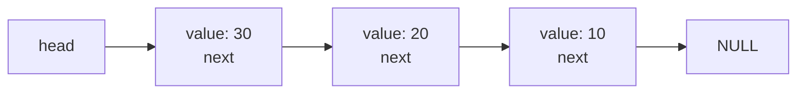
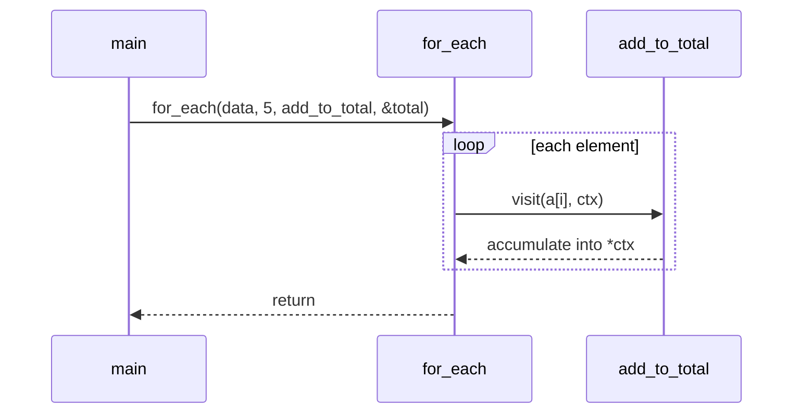

# Chapter 11 — Dynamic Memory and Advanced Pointers

[Repository Guide](../../README.md) | [English](Concepts_Lecture.md) | [한국어](Concepts_Lecture.ko.md)

> **Last Updated:** 2026-11-09

> **Learning Objectives:**
> 1. Distinguish the memory segments of a program and the three storage durations, and explain why the address of a local variable must not be returned
> 2. Use `malloc`, `calloc`, `realloc`, and `free` correctly, including size calculation and failure handling
> 3. Distinguish memory leaks, dangling pointers, double frees, and out-of-bounds access, and find them with tools
> 4. Implement a growable array, a dynamic string, a dynamic two-dimensional array, and a linked list
> 5. Distinguish and use double pointers, pointers to arrays, `void` pointers, and function pointers, and read complex declarations
> 6. Use `qsort` and `bsearch` with correct comparison functions

---

## Table of Contents

- [1. Memory Layout of a Program](#1-memory-layout-of-a-program)
  - [1.1 Code, Data, Heap, and Stack Segments](#11-code-data-heap-and-stack-segments)
  - [1.2 Three Storage Durations](#12-three-storage-durations)
  - [1.3 Why the Address of a Local Variable Must Not Be Returned](#13-why-the-address-of-a-local-variable-must-not-be-returned)
  - [1.4 When Dynamic Memory Is Needed](#14-when-dynamic-memory-is-needed)
- [2. Dynamic Memory Allocation](#2-dynamic-memory-allocation)
  - [2.1 `malloc` and `free`](#21-malloc-and-free)
  - [2.2 `calloc`](#22-calloc)
  - [2.3 `realloc`](#23-realloc)
  - [2.4 Size Calculation and Failure Handling](#24-size-calculation-and-failure-handling)
- [3. Dynamic Memory Errors](#3-dynamic-memory-errors)
  - [3.1 Memory Leaks](#31-memory-leaks)
  - [3.2 Dangling Pointers and Double Free](#32-dangling-pointers-and-double-free)
  - [3.3 Out-of-Bounds Access and Uninitialized Reads](#33-out-of-bounds-access-and-uninitialized-reads)
  - [3.4 Tools for Finding Errors](#34-tools-for-finding-errors)
- [4. Memory Block Functions](#4-memory-block-functions)
  - [4.1 `memcpy` and `memmove`](#41-memcpy-and-memmove)
  - [4.2 `memset` and `memcmp`](#42-memset-and-memcmp)
- [5. Implementing Dynamic Data](#5-implementing-dynamic-data)
  - [5.1 A Growable Array](#51-a-growable-array)
  - [5.2 Dynamic Strings and `strdup`](#52-dynamic-strings-and-strdup)
  - [5.3 Dynamic Two-Dimensional Arrays](#53-dynamic-two-dimensional-arrays)
  - [5.4 Self-Referential Structures and Linked Lists](#54-self-referential-structures-and-linked-lists)
- [6. Advanced Pointers](#6-advanced-pointers)
  - [6.1 Double Pointers](#61-double-pointers)
  - [6.2 Pointers to Arrays and Arrays of Pointers](#62-pointers-to-arrays-and-arrays-of-pointers)
  - [6.3 `void` Pointers](#63-void-pointers)
  - [6.4 Function Pointers](#64-function-pointers)
  - [6.5 Callback Functions](#65-callback-functions)
  - [6.6 Reading Complex Declarations](#66-reading-complex-declarations)
- [7. Sorting and Searching Library](#7-sorting-and-searching-library)
  - [7.1 `qsort`](#71-qsort)
  - [7.2 `bsearch`](#72-bsearch)
  - [7.3 Sorting Structures and Pitfalls of Comparison Functions](#73-sorting-structures-and-pitfalls-of-comparison-functions)
- [Concept Applications](#concept-applications)
- [Summary](#summary)
- [Self-Check Questions](#self-check-questions)
- [References](#references)

---

<br>

## 1. Memory Layout of a Program

The C standard has no concept of a stack or a heap, which Section 1.1 defines. The standard calls a region of memory that holds a value an **object** and specifies only, through storage duration, when an object exists [1, Section 6.2.4]. The memory layout in this section is not part of the standard; it is a common model that most implementations follow. Results described as observed on this machine come from Apple clang 21 on macOS arm64.

### 1.1 Code, Data, Heap, and Stack Segments

A running program receives an **address space** from the operating system, and a typical implementation divides this space into segments by purpose as follows.

```text
high addresses
┌──────────────────┐
│      stack       │ ← local variables, parameters, call information (usually grows down)
│                  │
│       heap       │ ← blocks returned by malloc and related functions (usually grows up)
├──────────────────┤
│       bss        │ ← static-duration objects initialized to 0
├──────────────────┤
│       data       │ ← static-duration objects initialized to a nonzero value
├──────────────────┤
│      rodata      │ ← read-only data such as string literals
├──────────────────┤
│       text       │ ← machine instructions (code segment)
└──────────────────┘
low addresses
```

*Figure 1. Layout of a process address space in a typical implementation*

The code segment (text) holds machine instructions, and the read-only data segment (rodata) holds string literals. Modifying a string literal is undefined behavior, as [Chapter 9, Section 6.1](../Ch09_Strings/Concepts_Lecture.md#61-char-string-pointer) showed, and a typical implementation places literals in this segment so that writes are blocked. The data segment and the BSS segment hold global variables and `static` local variables; a variable that starts at 0 needs no stored value in the file, so it goes in bss.

> **Definition:** The **stack** is a memory area that grows with function calls and shrinks with function returns. The part occupied by one function call is called a stack frame.

> **Definition:** The **heap** is a memory area from which a program requests blocks of a chosen size at run time, and which keeps them until they are freed. It shares only its name with the heap data structure.

The following output shows the addresses of objects placed in each segment. The code is [Example_StorageDuration.c](Example_StorageDuration.c). The addresses are examples; on this machine they changed on every run.

```text
string literal : 0x1026b0700
global_init    : 0x1026b8000
global_zero    : 0x1026b8008
*heap          : 0x1026e52d0
local          : 0x16d74ea8c
```

In this run the order from low addresses was the string literal, the static variables, the heap, and the stack, but the order and spacing of the segments differ between operating systems, and the standard guarantees no order. The order and contiguity of blocks allocated in succession is also unspecified by the standard [1, Section 7.22.3].

> **[Operating Systems]** The addresses a process sees are not physical memory addresses but virtual addresses, which the operating system and hardware map to physical memory in units of pages. Addresses change between runs because of address space layout randomization (ASLR), which randomizes the layout to make attacks harder.

### 1.2 Three Storage Durations

> **Definition:** **Storage duration** is the property that determines how long an object exists in memory. The period of execution in which an object exists is its lifetime, and throughout its lifetime an object has a constant address and retains its last stored value.

The C11 standard has four storage durations: static, thread, automatic, and allocated [1, Section 6.2.4]. Thread storage duration applies only to objects declared `_Thread_local`, so this chapter covers the other three.

| Storage Duration | Applies To | Lifetime | Initial Value | Typical Location |
|:----|:----|:----|:----|:----|
| Automatic | Variables defined in a block without `static`, parameters | From entering the block until leaving it | Indeterminate without an initializer | Stack |
| Static | File-scope variables, `static` local variables | Entire program | 0 without an initializer | data, bss |
| Allocated | Blocks returned by `malloc`, `calloc`, `realloc` | From allocation until deallocation | `malloc`: indeterminate; `calloc`: all bits zero | Heap |

*Table 1. Comparison of the three storage durations*

> **Definition:** An **indeterminate value** is a value for which the standard fixes nothing: it is either an unspecified valid value of the type or a representation that denotes no value (a trap representation) [1, Section 3.19.2]. Uninitialized automatic variables and the contents of a block returned by `malloc` are indeterminate and must not be read and used.

**Scope** is the part of the source code in which a name can be used ([Chapter 6, Section 3.3](../Ch06_Functions/Concepts_Lecture.md#33-scope-rules)), and **lifetime** is the part of execution during which an object exists. A `static` local variable has block scope but a program-long lifetime, so `next_ticket` in [Example_StorageDuration.c](Example_StorageDuration.c) continues from the previous value on every call and returns 101, 102, and 103. The detailed rules of `static` are in [Chapter 12, Section 8.2](../Ch12_File-IO-and-Program-Structure/Concepts_Lecture.md#82-static-local-variables).

### 1.3 Why the Address of a Local Variable Must Not Be Returned

The lifetime of an automatic variable ends when its block ends, so it no longer exists after the function returns, and referring to an object after its lifetime is undefined behavior [1, Section 6.2.4]. The following is incorrect code that breaks this rule.

```c
// Incorrect code: returns the address of a variable whose lifetime has ended
int *make_value(void) {
    int value = 42;
    return &value;
}
int fill_stack(void) {
    int other = 777;
    return other + 1;
}
int main(void) {
    int *p = make_value();
    fill_stack();
    printf("%d\n", *p);
    return 0;
}
```

The compiler warns with `warning: address of stack memory associated with local variable 'value' returned`. If the warning is ignored, the result cannot be predicted: on this machine, compiling with `-O0` printed 777, and compiling with `-O2` printed a garbage value such as 143556992. The 777 appeared because the frame of `fill_stack` reused the location where the frame of `make_value` had been.

```text
while make_value runs              after return, while fill_stack runs
┌─────────────────────┐            ┌─────────────────────┐
│ main    p = ?       │            │ main    p = 0x...c8 ┼──┐
├─────────────────────┤            ├─────────────────────┤  │
│ value = 42          │ ← 0x...c8  │ other = 777         │ ◄┘ same location reused
└─────────────────────┘            └─────────────────────┘
```

*Figure 2. The frame of the next call reusing the same stack location after a function returns*

| Method | Form of the Code | Characteristics |
|:----|:----|:----|
| Return the value | `int make_value(void)` | Simplest when the value is small. |
| The caller provides space | `void make_value(int *out)` | Uses an output parameter ([Chapter 8, Section 3.3](../Ch08_Pointers/Concepts_Lecture.md#33-returning-multiple-values)). |
| Allocate dynamically | `int *make_value(void)` + `malloc` | The caller must call `free`. |
| Use a `static` variable | `static int value;` | Every call shares the same variable, so calling it again overwrites the previous result. |

*Table 2. Ways of passing a value out of a function*

> **Key Point:** Data used outside the function that created it must have a lifetime longer than the call. An automatic variable does not meet this condition.

### 1.4 When Dynamic Memory Is Needed

1. **When the size is known only at run time:** If the number of input items is unknown, the program must either reserve a large array in advance and waste memory or exceed the array and cause a buffer overflow.
2. **When data must outlive the function that created it:** If the caller must keep using data created by a function, automatic variables cannot be used (Section 1.3).
3. **When the data is large:** The stack has a limited size. The default limit on this machine, checked with `ulimit -s`, is 8176 KB, and the default stack size in Visual Studio is 1 MB [2]. A program that used a local array `int big[10000000];` (40 MB) ended with a segmentation fault (the operating system terminating a program that accessed memory it may not access) on this machine. A stack overflow does not report failure through a value the way `malloc` does.
4. **When the size changes:** Data that grows or shrinks during execution cannot be represented with a fixed-size array (Section 5.1).

| Comparison | When the Size Is Decided | Lifetime | Failure Detection | Resizing |
|:----|:----|:----|:----|:----|
| Static array | At compile time | Entire program | None | Not possible |
| Automatic array | At compile time | Block | None (stack overflow) | Not possible |
| Variable-length array | At run time, at the declaration | Block | None (stack overflow) | Not possible |
| Dynamic allocation | At run time | Until freed | Returns `NULL` | Possible with `realloc` |

*Table 3. Comparison of the ways of obtaining an array*

A **variable-length array** is an array whose size is set by a run-time value, as in `int a[n];`. It was introduced in C99 and has been an optional feature since C11 [1, Section 6.10.8.3]. Portable code uses dynamic allocation instead.

> **Note:** **Visual Studio.** The MSVC C compiler accepts `/std:c11` and `/std:c17` to select a standard, but it does not support variable-length arrays and has no plan to [3].

---

<br>

## 2. Dynamic Memory Allocation

> **Definition:** **Dynamic memory allocation** is a memory management scheme in which a program requests memory of the needed size at run time and returns it itself when finished.

All the functions in this section are declared in `<stdlib.h>`. Sizes are passed as the unsigned integer type `size_t`, which is covered in [Chapter 13, Section 2.3](../Ch13_Standard-Library-and-Modern-C/Concepts_Lecture.md#23-size_t-ptrdiff_t-offsetof).

### 2.1 `malloc` and `free`

```c
void *malloc(size_t size);
void free(void *ptr);
```

`malloc` allocates a block of `size` bytes and returns its starting address, or returns a null pointer if the block cannot be allocated. The return type `void *` is a pointer to no specified data type (Section 6.3); in C it converts implicitly to other object pointer types, so it is assigned without a cast.

```c
int n = 5;
int *arr = malloc(n * sizeof *arr);    // request a block for 5 ints

if (arr == NULL) {                     // check for failure
    printf("allocation failed\n");
    return 1;
}
for (int i = 0; i < n; i++) {
    arr[i] = (i + 1) * 10;             // use the pointer like an array
}
printf("%d %d\n", arr[0], arr[4]);     // 10 50

free(arr);                             // return the block
arr = NULL;                            // erase the freed address
```

`n * sizeof *arr` is the number of bytes needed. `sizeof *arr` is the size of the element `arr` points to; the operand of `sizeof` is not evaluated unless it has a variable-length array type, so the uninitialized `arr` is not dereferenced, and the expression needs no change if the type of `arr` changes later. Subscripting the pointer as `arr[i]` follows the rule in [Chapter 8, Section 2.2](../Ch08_Pointers/Concepts_Lecture.md#22-pointer-as-array).

```text
stack                           heap
┌───────────────┐              ┌────┬────┬────┬────┬────┐
│ arr = 0x...50 │ ───────────► │ 10 │ 20 │ 30 │ 40 │ 50 │  (20-byte block)
│ n   = 5       │              └────┴────┴────┴────┴────┘
└───────────────┘               0x...50
```

*Figure 3. The pointer variable arr on the stack and the block allocated on the heap*

The rules of `malloc` and `free` are as follows [1, Section 7.22.3].

- The contents of a block returned by `malloc` are indeterminate, so they must not be read before being written.
- `free(NULL)` does nothing, so `free` can be called without a null check.
- `free` must be given exactly the address returned by an allocation function; passing an address inside a block or the address of a local variable is undefined behavior.
- The behavior of `malloc(0)` is implementation-defined: it returns either a null pointer or a pointer that must not be dereferenced, and either may be passed to `free`. On this machine it returned a non-null pointer.

`free(arr)` receives a copy of the pointer value, so it cannot change the caller's variable. The freed address stays in `arr`, so `arr = NULL;` must be written explicitly.

> **Definition:** **Ownership** is the convention that says which code is responsible for freeing an allocated block. C has no syntax for it, so function documentation and names make clear who frees the block.

> **[Systems Programming]** `malloc` and `free` are library code called an allocator. An allocator obtains large regions from the operating system, divides them into small blocks, and keeps bookkeeping such as each block's size, so `free` does not need a size argument.

### 2.2 `calloc`

```c
void *calloc(size_t nmemb, size_t size);
```

`calloc` allocates a block for `nmemb` elements of `size` bytes each and fills it with **all bits zero**. Because it takes the two sizes separately, it can check for multiplication overflow internally. The C23 standard states that it returns a null pointer if the product wraps around `size_t` [4, Section 7.24.3.2], and on this machine `calloc(SIZE_MAX, 2)` returned a null pointer. `SIZE_MAX`, defined in `<stdint.h>`, is the largest value of `size_t`.

| Function | Arguments | Contents | Typical Use |
|:----|:----|:----|:----|
| `malloc` | Number of bytes | Indeterminate | When the values are filled in right away |
| `calloc` | Number of elements, element size | All bits zero | When an integer array should start at 0 |
| `realloc` | Existing pointer, new number of bytes | Leading part kept, added part indeterminate | When the size changes |

*Table 4. Comparison of the allocation functions*

> **Caution:** All bits zero does not mean the value zero for every data type. All bits zero is guaranteed to be the value 0 for integer types [1, Section 6.2.6.2], but ISO C does not guarantee that the representation of 0.0 or of a null pointer is all bits zero [1, footnote to Section 7.22.3.2]. Common platforms represent both as zero, but where portability matters, pointer members should be assigned `NULL` explicitly.

### 2.3 `realloc`

```c
void *realloc(void *ptr, size_t size);
```

`realloc` deallocates the old block and returns a new block of `size` bytes. The leading part of the new block keeps the old contents up to the smaller of the old and new sizes, and any added part is indeterminate [1, Section 7.22.3.5]. An implementation may extend the block in place or create a new block elsewhere and copy into it [5].

```text
extended in place (address kept)         moved elsewhere (address changed)
ptr ─► ┌────┬────┬────┬────┐          ptr ─► ┌────┬────┐ (freed)
       │ 10 │ 20 │ ?  │ ?  │                 └────┴────┘
       └────┴────┴────┴────┘          new ─► ┌────┬────┬────┬────┐
                                              │ 10 │ 20 │ ?  │ ?  │
                                              └────┴────┴────┴────┘
```

*Figure 4. `realloc` extending a block in place and moving it*

The code that prints whether the address changes as the size grows is [Example_Realloc.c](Example_Realloc.c). On this machine, growing from 5 elements to 6 and 8 kept the same address, and growing to 16 and 1000 moved the block (`arr[4]` stayed 50 throughout). Which case occurs depends on the implementation, so a program must not assume either.

`arr = realloc(arr, new_size);` is common incorrect code. On failure a null pointer comes back and the old block remains, but its address has been overwritten by `NULL`, so it can no longer be freed. Always receive the result through a temporary pointer.

```c
int *tmp = realloc(arr, new_count * sizeof *tmp);
if (tmp == NULL) {
    free(arr);              // the old block is still valid
    return 1;
}
arr = tmp;                  // update only on success
```

The edge cases are as follows. `realloc(NULL, size)` is the same as `malloc(size)` [1, Section 7.22.3.5]. After a successful call the old pointer must not be used, even if its value is the same. `realloc(ptr, 0)` was implementation-defined through C17, with implementations differing on whether they returned a null pointer and freed the old block [6], and it became undefined behavior in C23 [4, Section 7.24.3.7]. When the size can be zero, check first and call `free`.

> **Key Point:** Always receive the result of `realloc` in a temporary pointer, and never use the old pointer after it succeeds.

### 2.4 Size Calculation and Failure Handling

| Incorrect Calculation | Problem | Correct Form |
|:----|:----|:----|
| `malloc(n)` | Confuses element count and byte count | `malloc(n * sizeof *p)` |
| `malloc(sizeof p)` | Allocates only the size of a pointer | `malloc(sizeof *p)` |
| `malloc(strlen(s))` | No room for the null character | `malloc(strlen(s) + 1)` |
| `rows * cols * sizeof(int)` (with `int rows, cols`) | `rows * cols` is computed in `int` first and can overflow | `sizeof(int) * rows * cols` |

*Table 5. Common size calculation errors and the correct forms*

Multiplication associates left to right, so in the last row an `int` overflow in `rows * cols` is undefined behavior. Placing `sizeof(int)` first makes the whole calculation in `size_t`. Even in `size_t`, a value that is too large wraps around to a small one. On this machine, with an 8-byte `size_t` and a 4-byte `int`, `n = SIZE_MAX / 2 + 2` makes `n * sizeof(int)` equal to 4; `malloc` succeeds, but accessing what is assumed to be `n` elements goes out of bounds. Checking by division before multiplying avoids the overflow.

```c
if (n > SIZE_MAX / sizeof *p) {     // does n * sizeof *p overflow?
    return NULL;
}
p = malloc(n * sizeof *p);
```

Negative values also need care when sizes come from user input. Converting `int n = -1;` to an 8-byte `size_t` gives 18446744073709551615, a huge request that makes `malloc` fail. Check the range before using a value as a size.

A failed call shows up as `NULL`, so check every call. A function that allocates several times must free the earlier blocks when a later allocation fails. The `free(NULL)` rule of Section 2.1 makes this cleanup code simple, and the general cleanup pattern is covered in [Chapter 12, Section 5.4](../Ch12_File-IO-and-Program-Structure/Concepts_Lecture.md#54-resource-cleanup-patterns).

> **[Operating Systems]** Linux by default allocates memory optimistically, so even when `malloc` returns a non-null pointer, memory may be short when it is actually used [7]. The check is still necessary because allocation failure returns `NULL` on other systems and configurations.

---

<br>

## 3. Dynamic Memory Errors

Most dynamic memory errors are not visible at compile time and lead to undefined behavior. Undefined behavior in general is covered in [Chapter 13, Section 6](../Ch13_Standard-Library-and-Modern-C/Concepts_Lecture.md#6-undefined-behavior).

### 3.1 Memory Leaks

> **Definition:** A **memory leak** is the error of not freeing a dynamic block that a program no longer uses, so that the memory cannot be used again.

Common operating systems reclaim memory when a process ends, so a leak does not show in a short-lived program, but in a long-running program such as a server, usage keeps growing. Leaks typically occur as follows.

```c
// Incorrect code: two memory leaks
void leak_examples(size_t n) {
    int *a = malloc(n);
    if (n > 100) {
        return;               // 1. early return forgets to free
    }
    int *b = malloc(n);
    b = malloc(n);            // 2. overwriting the only pointer loses the first block
    free(a);
    free(b);
}
```

Other causes are a failed `arr = realloc(arr, ...)` (Section 2.3) and freeing a structure while the blocks pointed to by its pointer members remain.

### 3.2 Dangling Pointers and Double Free

> **Definition:** A **dangling pointer** is a pointer that still holds the address of an object whose lifetime has ended.

> **Definition:** **Use after free** is the error of reading or writing a freed block through a pointer.

> **Definition:** A **double free** is the error of freeing a block that has already been freed.

According to the standard, when an object's lifetime ends, the value of a pointer to it itself becomes indeterminate, so not only dereferencing it but also using the value in a comparison is forbidden [1, Sections 6.2.4 and J.2]. A freed block may soon be reused by another `malloc`, so a use after free can read or overwrite other data. Compiling `free(p); printf("%d\n", *p);` with the compiler's memory-error checking, `-fsanitize=address` (AddressSanitizer, ASan), reports the following when run (trimmed; addresses are examples).

```text
ERROR: AddressSanitizer: heap-use-after-free on address 0x602000000930
READ of size 4 at 0x602000000930 thread T0
    #0 0x000104fac9a4 in main uaf.c:12
freed by thread T0 here:
    #1 0x000104fac918 in main uaf.c:11
previously allocated by thread T0 here:
    #1 0x000104fac854 in main uaf.c:6
```

The report gives the line of the error, the line of the `free`, and the line of the allocation. Copying a pointer makes the problem harder.

```text
int *q = p;           p ──┐
                          ├──► [ block ]
                      q ──┘

free(p); p = NULL;    p = NULL
                      q ──────► [ freed block ]   ← q is still a dangling pointer
```

*Figure 5. A second pointer to the same block left dangling after the block is freed*

Setting `p = NULL;` does not fix the copy `q`, so when several pointers refer to the same block, decide which one owns it (Section 2.1). ASan also detects double free and reports `attempting double-free on 0x602000000930` together with both `free` locations. Assigning `NULL` to a pointer after freeing makes a second `free` of the same variable do nothing, but it does not erase copies of the value.

> **Key Point:** Each successful allocation must be matched by exactly one `free`, and after that call no pointer to the block may be used.

> **[Software Security]** Use after free is a representative memory vulnerability class (CWE-416) [8]. If an attacker can make their own data be allocated into the freed location, the program uses that data as if it were the original object.

### 3.3 Out-of-Bounds Access and Uninitialized Reads

Accessing outside the allocated range is the same problem as the index out-of-bounds of [Chapter 7, Section 3.3](../Ch07_Arrays/Concepts_Lecture.md#33-index-out-of-bounds), but it is harder to find because a pointer does not carry the size of its block. The following loop writes out of bounds when `i == n`.

```c
// Incorrect code: writes one past the boundary
int n = 5;
int *a = malloc(n * sizeof *a);
for (int i = 0; i <= n; i++) {
    a[i] = i;
}
free(a);
```

```text
ERROR: AddressSanitizer: heap-buffer-overflow on address 0x603000000fb4
WRITE of size 4 at 0x603000000fb4 thread T0
0x603000000fb4 is located 0 bytes after 20-byte region [0x603000000fa0,0x603000000fb4)
```

An out-of-bounds write on the heap does not stop immediately; it corrupts the allocator's bookkeeping or a neighboring block, and the program often aborts much later in some `malloc` or `free`. The location of the symptom may not be the cause.

Reading an uninitialized block is also an error. A program that summed four `malloc`ed `int` values without initializing them printed 0 in an ordinary build, and under `-fsanitize=address,undefined` UndefinedBehaviorSanitizer (UBSan) reported an integer overflow while summing ASan's fill value (the byte `0xBE`). A result that differs between builds of the same code is a typical symptom of indeterminate values. ASan and UBSan do not detect this error itself, and MemorySanitizer, which does, is supported only on Linux, NetBSD, and FreeBSD [9]. The clang on this machine reported that `-fsanitize=memory` is not supported.

### 3.4 Tools for Finding Errors

> **Definition:** A **sanitizer** is a tool in which the compiler inserts checks into a program so that errors are found at run time.

| Tool | How to Use | Errors Mainly Found | Remarks |
|:----|:----|:----|:----|
| Compiler warnings | `-Wall -Wextra` | Some errors visible at compile time | Requires no execution. |
| AddressSanitizer (ASan) | `-fsanitize=address -g` | Out-of-bounds access, use after free, double free | Supported by clang, gcc, and MSVC [10][11][12]. |
| UndefinedBehaviorSanitizer (UBSan) | `-fsanitize=undefined -g` | Signed integer overflow, misaligned pointers | Supported by clang and gcc [12][13]. |
| Valgrind Memcheck | `valgrind --leak-check=full ./prog` | Invalid reads and writes, uninitialized values, leaks [14] | Checks an executable without recompiling [15]. macOS on Apple Silicon is not a supported platform [16]. |
| macOS `leaks` | `leaks --atExit -- ./prog` | Leaks | Examines memory when the program ends [17]. |
| CRT debug heap | `_CrtDumpMemoryLeaks()` | Leaks | Used in Visual Studio debug builds [18]. |

*Table 6. Tools for finding memory errors*

The following is the result on this machine (Apple clang, macOS arm64) of checking, with `leaks --atExit -- ./prog`, a program that calls a function `use_buffer(n)` that never frees its `malloc`ed block three times with `n` set to 10, 20, and 30 (trimmed).

```text
Process 160: 2 leaks for 144 total leaked bytes.
    2 (144 bytes) << TOTAL >>
      1 (96 bytes) ROOT LEAK: <malloc in use_buffer 0x7be8c0c000> [96]
      1 (48 bytes) ROOT LEAK: <malloc in use_buffer 0x7be8c08000> [48]
```

Blocks of 40, 80, and 120 bytes were leaked, but only the first two were reported (sizes are rounded up to the allocation unit and shown as 48 and 96). `leaks` searches memory for values that look like pointers and treats reachable blocks as in use [17], so a leftover value of a local variable can hide a leak.

- ASan's leak checking could not be used on this machine. The Clang documentation says it can be enabled on macOS with `ASAN_OPTIONS=detect_leaks=1` [10], but Apple clang on this machine printed `detect_leaks is not supported on this platform.` On Linux, ASan checks leaks by default [10].
- On this machine the returned stack address of Section 1.3 was not reported by ASan in its default configuration, and with `ASAN_OPTIONS=detect_stack_use_after_return=1` it was reported as `stack-use-after-return`. On Linux this check is enabled by default [10].
- `leaks` could not finish its report for a program built with ASan, so leak checking is done on a build without sanitizers.

Sanitizers and `leaks` find only errors on paths taken in that run, so the absence of a report does not prove the absence of errors.

> **Note:** **Visual Studio.** AddressSanitizer can be enabled with `/fsanitize=address` or in the project properties under **C/C++ > General > Enable AddressSanitizer**. A Debug configuration may need the incompatible `/ZI`, `/RTC1`, and `/INCREMENTAL` turned off [11]. Leaks are reported in the Output window of a debug build by defining `_CRTDBG_MAP_ALLOC`, including `<stdlib.h>` and then `<crtdbg.h>`, and calling `_CrtDumpMemoryLeaks()` [18].

---

<br>

## 4. Memory Block Functions

The `mem` functions of `<string.h>` operate on **blocks of bytes** rather than strings. They do not stop at a null character, they process a specified number of bytes, and their parameters are `void *` so they can be used with objects of any data type.

### 4.1 `memcpy` and `memmove`

```c
void *memcpy(void *dest, const void *src, size_t n);
void *memmove(void *dest, const void *src, size_t n);
```

Both functions copy `n` bytes from `src` to `dest` and return `dest`. `memcpy` has undefined behavior if the two regions overlap, while `memmove` copies correctly even when they overlap [1, Section 7.24.2].

```text
int a[6] = {1, 2, 3, 4, 5, 0};   goal: copy a[0..4] into a[1..5]
initial              [ 1 ][ 2 ][ 3 ][ 4 ][ 5 ][ 0 ]
result of memmove    [ 1 ][ 1 ][ 2 ][ 3 ][ 4 ][ 5 ]   ← original values copied despite overlap
copying front first  [ 1 ][ 1 ][ 1 ][ 1 ][ 1 ][ 1 ]   ← rereads values already overwritten
```

*Figure 6. The result of `memmove` on overlapping regions and the problem with copying from the front*

Calling `memcpy` on overlapping regions, as in `memcpy(&a[1], &a[0], 5 * sizeof a[0]);`, is incorrect code. On this machine ASan reported `memcpy-param-overlap`, and without sanitizers the program printed `1 1 2 3 4 4` at `-O0` and `1 1 2 3 4 5` at `-O2`. A result that happens to be right cannot be trusted, so use `memmove` when the regions may overlap. Unlike `strcpy`, `memcpy` does not look for a null character, so it can also copy strings of known length and ordinary objects such as structures and arrays.

### 4.2 `memset` and `memcmp`

```c
void *memset(void *s, int c, size_t n);
int memcmp(const void *s1, const void *s2, size_t n);
```

`memset` writes the value of `c`, converted to `unsigned char`, into each of the first `n` bytes [1, Section 7.24.6.1]. **The unit is the byte**, so it cannot be used to fill an `int` array with 1.

```c
int a[3];
memset(a, 1, sizeof a);
printf("%d %d %d\n", a[0], a[1], a[2]);   // 16843009 16843009 16843009
memset(a, 0, sizeof a);
printf("%d %d %d\n", a[0], a[1], a[2]);   // 0 0 0
```

With a 4-byte `int`, every byte being `0x01` gives the value `0x01010101`, or 16843009. Filling with 0 makes all bits zero, which is safe for integer arrays; the caution of Section 2.2 applies to pointers and floating-point numbers.

`memcmp` compares the first `n` bytes in order as `unsigned char` values and reports the result by sign. Forgetting that it compares **byte representations** gives wrong results.

```c
int x = 256, y = 1;
printf("%d\n", x > y);                                   // 1
printf("%d\n", memcmp(&x, &y, sizeof x) > 0 ? 1 : -1);   // -1 (little-endian)

double p = 0.0, q = -0.0;
printf("%d\n", p == q);                                  // 1
printf("%d\n", memcmp(&p, &q, sizeof p) == 0);           // 0
```

On this little-endian machine the first byte of `256` is `0x00` and the first byte of `1` is `0x01`, so `memcmp` judges `x` to be smaller. Endianness is covered in [Chapter 13, Section 5.2](../Ch13_Standard-Library-and-Modern-C/Concepts_Lecture.md#52-endianness). `0.0` and `-0.0` are equal as values but differ in their bits. Comparing structures with `memcmp` also compares padding bytes and cannot be trusted ([Chapter 10, Section 1.7](../Ch10_Structures/Concepts_Lecture.md#17-structure-comparison)).

---

<br>

## 5. Implementing Dynamic Data

### 5.1 A Growable Array

> **Definition:** A **dynamic array** is an array of contiguous memory that grows by moving to larger blocks as elements are added.

> **Definition:** **Capacity** is the number of elements the current block can hold. It is greater than or equal to the size, which is the number of elements actually stored.

Keeping both the element count and the capacity means `realloc` is called only when the capacity runs out. The complete code is [Example_DynamicArray.c](Example_DynamicArray.c).

```c
typedef struct {
    int *data;          // block holding the elements
    size_t size;        // number of elements in use
    size_t capacity;    // number of elements the block can hold
} IntArray;

int array_push(IntArray *v, int value) {
    if (v->size == v->capacity) {
        size_t new_capacity = (v->capacity == 0) ? 1 : v->capacity * 2;

        if (new_capacity > SIZE_MAX / sizeof *v->data) {
            return 0;                       // size calculation would overflow
        }
        int *tmp = realloc(v->data, new_capacity * sizeof *tmp);
        if (tmp == NULL) {
            return 0;                       // v is unchanged
        }
        v->data = tmp;
        v->capacity = new_capacity;
    }
    v->data[v->size] = value;
    v->size++;
    return 1;
}
```

Even when `v->data` is `NULL`, `realloc(NULL, ...)` behaves like `malloc` (Section 2.3), so the first insertion needs no special case. On failure the old block, `size`, and `capacity` are all unchanged.

**Why double the capacity.** Growing by one slot each time copies the existing elements on every reallocation, needing about `n²/2` copies for `n` elements. Doubling the capacity means copies happen only when the capacity runs out, and the copied amounts 1, 2, 4, ... sum to less than `2n`. The output of the example (trimmed) agrees with this calculation.

```text
size    1  capacity    1  copies so far    0
size    2  capacity    2  copies so far    1
size    3  capacity    4  copies so far    3
size    5  capacity    8  copies so far    7
...
size  513  capacity 1024  copies so far 1023
1000 pushes copied 1023 elements
```

> **Definition:** **Amortized cost** is the average cost per operation obtained by dividing the total cost of a sequence of operations by the number of operations. It is not a probabilistic average; it holds for the total on the worst-case input.

Insertion into a dynamic array is **amortized** O(1). O(1) means a constant time independent of the number of elements, and O(n) a time proportional to it. A single insertion that triggers reallocation takes O(n), so saying every insertion is O(1) is wrong. This analysis is an upper bound that assumes every reallocation copies everything.

> **Key Point:** If size and capacity are tracked separately and the capacity doubles when full, the total number of elements copied while inserting `n` elements is less than `2n`.

### 5.2 Dynamic Strings and `strdup`

Copying a string requires one extra byte for the null character. The complete code is [Example_DynamicString.c](Example_DynamicString.c), and `string_concat`, which joins two strings, allocates `strlen(a) + strlen(b) + 1` bytes the same way.

```c
char *string_duplicate(const char *s) {
    size_t bytes = strlen(s) + 1;       // +1 for the null character
    char *copy = malloc(bytes);

    if (copy != NULL) {
        memcpy(copy, s, bytes);
    }
    return copy;
}
```

The caller must `free` the returned string. A line of unknown length is read a part at a time with `fgets` ([Chapter 9, Section 4.2](../Ch09_Strings/Concepts_Lecture.md#42-fgets--gets_s)) while the block grows; `read_line` in the example doubles the block with `realloc` when it fills up.

A function that does the same thing is `strdup`. `strdup(s)` returns a copy of `s` made as if by `malloc`, and the returned pointer is released with `free`. `strdup` was a POSIX function for a long time [19], and it joined the ISO C standard in C23 [4, Section 7.26.2.6][20].

> **Caution:** With glibc, compiling in a strict standard mode such as `-std=c17` does not expose POSIX declarations by default, so `#define _POSIX_C_SOURCE 200809L` may be needed at the top of the source [21]. On this machine (macOS), the code compiled under `-std=c17 -pedantic` with no extra definition.

> **Note:** **Visual Studio.** The MSVC CRT emits warning C4996 for the POSIX name `strdup` and recommends the name `_strdup` [22]. `_strdup` also allocates with `malloc`, so release it with `free` [23]. For portability, write `string_duplicate` above yourself or define `_CRT_NONSTDC_NO_WARNINGS` [24].

### 5.3 Dynamic Two-Dimensional Arrays

The two-dimensional arrays of [Chapter 7, Section 4](../Ch07_Arrays/Concepts_Lecture.md#4-multidimensional-arrays) fix the row and column counts at compile time. Deciding the rows or columns at run time has the following three methods, and the complete code is [Example_DynamicMatrix.c](Example_DynamicMatrix.c).

**Method 1: an array of row pointers.** Each row is allocated separately, and rows may differ in length. On failure, only the rows already allocated are freed.

```c
int **matrix_alloc(size_t rows, size_t cols) {
    int **m = malloc(rows * sizeof *m);

    if (m == NULL) {
        return NULL;
    }
    for (size_t r = 0; r < rows; r++) {
        m[r] = malloc(cols * sizeof *m[r]);
        if (m[r] == NULL) {
            matrix_free(m, r);      // free only the r rows already allocated
            return NULL;
        }
    }
    return m;
}
```

```text
int **a      row pointer array     each row (allocated separately)
┌────┐       ┌──────┐             ┌───┬───┬───┐
│  ──┼──────►│  ────┼────────────►│   │   │   │
└────┘       ├──────┤             └───┴───┴───┘
             │  ────┼──┐          ┌───┬───┬───┐
             └──────┘  └─────────►│   │   │   │
                                  └───┴───┴───┘
```

*Figure 7. A dynamic two-dimensional array built from an array of row pointers*

**Method 2: a single block.** Put `rows × cols` elements in one block and compute indices. **Method 3: a pointer to an array.** If the column count is known at compile time, use `int (*c)[COLS]` (Section 6.2). Only the number of rows is decided at run time, and the `c[r][j]` notation still works. In the following code, `rows` and `cols` are `size_t`.

```c
int *b = malloc(rows * cols * sizeof *b);    // method 2
if (b != NULL) {
    b[r * cols + j] = 12;                    // row r, column j
    free(b);
}

int (*c)[3] = malloc(rows * sizeof *c);      // method 3 (with COLS equal to 3)
if (c != NULL) {
    c[1][2] = 12;                            // sizeof *c is 12
    free(c);
}
```

To decide the column count at run time too, the C99 variable-length array type could be used (`int (*c)[cols]`), but Visual Studio does not support it (Section 1.4), so use method 1 or 2.

| Method | Notation | Memory | `free` Calls | Rows of Different Lengths | When Column Count Is Decided |
|:----|:----|:----|:----|:----|:----|
| Array of row pointers | `a[r][j]` | Separate per row | `rows + 1` | Possible | At run time |
| Single block | `b[r * cols + j]` | Contiguous | 1 | Not possible | At run time |
| Pointer to an array | `c[r][j]` | Contiguous | 1 | Not possible | At compile time |

*Table 7. Comparison of the three methods of creating a dynamic two-dimensional array*

### 5.4 Self-Referential Structures and Linked Lists

> **Definition:** A **self-referential structure** is a structure with a member that points to a structure of its own type.

> **Definition:** A **linked list** is a linear data structure in which each element stores the address of the next element, so the elements are joined by pointers.

> **Definition:** A **node** is one structure in a linked list that holds one piece of data and a pointer to the next element.

```c
typedef struct node {
    int value;
    struct node *next;   // address of the next node
} Node;
```

A structure cannot have itself as a member (its size could not be determined), but it can have a pointer to itself [1, Section 6.7.2.1]. The `typedef` name `Node` is usable only after the declaration ends, so `struct node *` is used inside the structure.



*Figure 8. A singly linked list of three nodes*

The functions that add a node at the front and free the list are as follows. Because `head` must change, the new head is returned; Section 6.1 removes this inconvenience with a double pointer. Traversal has the form `for (const Node *p = head; p != NULL; p = p->next)`.

```c
Node *push_front(Node *head, int value) {
    Node *n = malloc(sizeof *n);

    if (n == NULL) {
        return head;           // on failure, leave the list unchanged
    }
    n->value = value;
    n->next = head;            // the new node points to the old first node
    return n;                  // the new node becomes the first node
}

void free_list(Node *head) {
    while (head != NULL) {
        Node *next = head->next;   // save the next address before free
        free(head);
        head = next;
    }
}
```

In `free_list`, reading `head->next` after `free(head)` would be use after free, so the next address is saved first. Inserting 10, 20, and 30 into an empty list with `head = push_front(head, v)` gives `30 -> 20 -> 10 -> NULL`.

| Comparison | Dynamic Array | Linked List |
|:----|:----|:----|
| Random access | O(1) | O(n), must follow from the front |
| Insertion or removal at the front | O(n), shifts the following elements | O(1) |
| Insertion at the end | Amortized O(1) | O(n) without a tail pointer |
| Memory | Contiguous, stores only the elements | Each node adds a pointer and nodes are scattered |

*Table 8. Comparison of dynamic arrays and linked lists*

> **[Data Structures]** Doubly linked lists, circular lists, and linked implementations of stacks and queues all start from the same node structure.

---

<br>

## 6. Advanced Pointers

### 6.1 Double Pointers

> **Definition:** A **double pointer** is a pointer that points to a pointer.

With `int a = 10; int *p = &a; int **pp = &p;`, `p` points to an `int` and `pp` points to an `int *`.

```text
pp                p                a
┌────────┐       ┌────────┐       ┌────┐
│ 0x...d0│ ────► │ 0x...e8│ ────► │ 10 │
└────────┘       └────────┘       └────┘
 0x...b0          0x...d0          0x...e8
```

*Figure 9. The pointer p and the double pointer pp that points to p*

| Expression | Data Type | Value |
|:----|:----|:----|
| `pp` | `int **` | Address of `p` |
| `*pp` | `int *` | Value of `p`, the address of `a` |
| `**pp` | `int` | Value of `a`, 10 |

*Table 9. Data types and values of expressions involving a double pointer*

C always passes arguments by value, so a function that changes the caller's pointer must receive the address of the pointer (the same principle as [Chapter 8, Section 3.1](../Ch08_Pointers/Concepts_Lecture.md#31-pass-by-value-vs-pass-by-reference)).

```c
// Incorrect code: changes only a local copy and loses the address of the block
void alloc_wrong(int *p, size_t n) {
    p = malloc(n * sizeof *p);
}

int alloc_right(int **out, size_t n) {
    int *p = malloc(n * sizeof *p);

    if (p == NULL) {
        return 0;
    }
    *out = p;                 // change the caller's pointer
    return 1;
}
```

Calling `alloc_wrong(a, 3)` leaves `a` unchanged, while `alloc_right(&b, 3)` stores the address of the block in `b`.

Using a double pointer also lets linked-list functions change the first node directly, so they need not return a new head. This is especially useful for removal: following the list with `link`, which points to the slot holding a pointer, removes the need to treat the first node and middle nodes differently. The complete code is [Example_LinkedList.c](Example_LinkedList.c).

```c
int remove_value(Node **head, int value) {
    Node **link = head;

    while (*link != NULL) {
        if ((*link)->value == value) {
            Node *victim = *link;
            *link = victim->next;   // make the previous slot point to the next node
            free(victim);
            return 1;
        }
        link = &(*link)->next;
    }
    return 0;
}
```

```text
head ──► [40|•] ──► [30|•] ──► [20|•] ──► [10|•] ──► NULL
                        ▲
                        └─ when removing 20, link points to this node's next slot

after *link = victim->next;
head ──► [40|•] ──► [30|•] ──────────────► [10|•] ──► NULL
```

*Figure 10. Removing a node by following the link pointer through the next slots*

Another representative use of a double pointer is `char **` for passing an array of strings, and `argv` in `main` is the example ([Chapter 12, Section 1.2](../Ch12_File-IO-and-Program-Structure/Concepts_Lecture.md#12-the-structure-of-argc-and-argv)).

> **Key Point:** To change a caller's variable of type `T`, a function takes a `T *`. When that variable is an `int *`, the function takes an `int **`.

### 6.2 Pointers to Arrays and Arrays of Pointers

> **Definition:** An **array of pointers** is an array whose elements are pointers.

> **Definition:** A **pointer to an array** is a pointer that points to an entire array.

`[]` has higher precedence than `*`, so parentheses decide the meaning. The difference shows with `sizeof` (with a 4-byte `int` and 8-byte pointers).

```c
int m[2][3] = {{1, 2, 3}, {4, 5, 6}};
int *a[3];       // array of pointers: an array of 3 int*
int (*p)[3] = m; // pointer to an array: pointer to an array of 3 ints

printf("%zu %zu %zu\n", sizeof a, sizeof p, sizeof *p);   // 24 8 12
printf("%d\n", p[1][2]);                                  // 6
```

```text
array of pointers int *a[3]        pointer to an array int (*p)[3]
a ┌──────┐                        p ┌──────┐     ┌────┬────┬────┐
  │  ────┼──► int                   │  ────┼────►│    │    │    │
  ├──────┤                          └──────┘     └────┴────┴────┘
  │  ────┼──► int                                 p + 1 is 12 bytes later
  ├──────┤
  │  ────┼──► int
  └──────┘
```

*Figure 11. The structures of the array of pointers a and the pointer to an array p*

A pointer to an array is the type that the name of a two-dimensional array converts to. Applying the rule of [Chapter 8, Section 2.3](../Ch08_Pointers/Concepts_Lecture.md#23-array-as-pointer), the first element of `int m[2][3]` is an `int [3]`, so `m` converts to `int (*)[3]`. Therefore `void f(int m[][3], int rows);` and `void f(int (*m)[3], int rows);` are the same prototype.

> **Caution:** `int **` and `int [][3]` are different data types. To be received as `int **`, memory must actually contain an array of pointers, but `int m[2][3]` contains only consecutive integers and no pointers.

```c
// Incorrect code: treats a two-dimensional array as int **
int m[2][3] = {{1, 2, 3}, {4, 5, 6}};
int **q = (int **)m;
printf("%d\n", q[1][0]);
```

Writing `int **q = m;` without the cast makes clang on this machine emit an `incompatible pointer types` warning. Running it with the forced cast made UBSan report `load of misaligned address 0x000400000003 for type 'int'` on this machine, and the program ended with a bus error (the operating system terminating a program that accessed an invalid address). `q[1]` reads the pointer 8 bytes from the start, but that location holds the integers `m[0][2]` (3) and `m[1][0]` (4), read on this little-endian machine as the address `0x0000000400000003`.

### 6.3 `void` Pointers

> **Definition:** A **`void` pointer** is the pointer type `void *`, which does not specify the data type of the object it points to.

`void *` converts to and from any object pointer without a cast [1, Section 6.3.2.3], which is why `malloc` returns `void *`. Because the pointed-to type is unknown, however, a value cannot be obtained through `*p` (`int x = *p;` is a compile error), and `p + 1` is not allowed in ISO C because `sizeof(void)` is not defined [1, Section 6.5.6]. GCC and clang compute it in units of one byte as an extension [25], but with `-pedantic` they warn; clang on this machine reports `warning: arithmetic on a pointer to void is a GNU extension`.

To work in bytes, convert to `unsigned char *`. `void *` makes generic functions that are not tied to a specific type possible. The complete code is [Example_GenericPointers.c](Example_GenericPointers.c).

```c
void swap_bytes(void *a, void *b, size_t size) {
    unsigned char *pa = a;
    unsigned char *pb = b;

    for (size_t i = 0; i < size; i++) {
        unsigned char tmp = pa[i];
        pa[i] = pb[i];
        pb[i] = tmp;
    }
}
```

`swap_bytes(&x, &y, sizeof x)` works for `int` and for `double`, but the compiler cannot catch objects of different sizes being passed.

> **Caution:** Conversion between `void *` and function pointers is not defined in ISO C [1, Section 6.3.2.3]. `void *` is for object pointers, and some implementations merely allow the conversion as an extension [1, Section J.5.7].

### 6.4 Function Pointers

> **Definition:** A **function pointer** is a pointer that stores the address of a function.

```c
int add(int x, int y) { return x + y; }
int sub(int x, int y) { return x - y; }
int mul(int x, int y) { return x * y; }

typedef int (*BinaryOp)(int, int);

int (*op)(int, int) = add;   // op points to a function taking (int, int) and returning int
printf("%d %d\n", op(3, 4), (*op)(3, 4));    // 7 7

BinaryOp table[] = {add, sub, mul};          // dispatch table
printf("%d\n", table[2](7, 3));              // 21
```

The parentheses around `(*op)` in `int (*op)(int, int)` are the key: without them, `int *op(int, int)` declares a function returning `int *`. A function name converts to the address of the function in expressions, so `op = add` and `op = &add` are the same, and `op(3, 4)` and `(*op)(3, 4)` are the same call. The type can be shortened with `typedef` ([Chapter 10, Section 3.3](../Ch10_Structures/Concepts_Lecture.md#33-typedef)), and placed in an array it forms a **dispatch table**, in which data selects the function to call. A new operation needs only a new table row, not a change to a `switch` statement.

> **Caution:** Calling a function through a pointer whose type is not compatible with the function's type is undefined behavior. An uninitialized function pointer and `NULL` must also not be called, and instead of the old form that leaves parameters empty, as in `int (*fp)()`, the types should be written out.

### 6.5 Callback Functions

> **Definition:** A **callback function** is a function passed to another function as a pointer, which that function calls when needed.

A callback lets the fixed skeleton, such as traversal, be written once while the caller decides what to do with each element.

```c
void for_each(const int *a, size_t n, void (*visit)(int, void *), void *ctx) {
    for (size_t i = 0; i < n; i++) {
        visit(a[i], ctx);
    }
}

void add_to_total(int value, void *ctx) {
    int *total = ctx;
    *total += value;
}

int data[] = {3, 1, 4, 1, 5};
int total = 0;
for_each(data, 5, add_to_total, &total);
printf("total = %d\n", total);             // total = 14
```

`void *ctx` is a **context pointer** to state the callback uses. `for_each` passes it along without interpreting it, and the callback converts it back to the original data type. This passes state without global variables.



*Figure 12. The call order between `for_each` and the callback function*

### 6.6 Reading Complex Declarations

C declarations follow the form of the expressions that use the variable [26]. A complex declaration is read by the rule **start at the name, read right first and then left, and give priority to parentheses**, because `[]` and `()` apply before `*` [26].

```text
int ( * ( * f ) ( void ) ) [3]
            ^                  start: f is
          ^                    left: a pointer (read inside parentheses first)
                ^^^^^^^^       right: to a function taking (void)
      ^                        left: returning a pointer
                           ^^^ right: to an array of 3
^^^                            left: int

result: f is a pointer to a function taking (void) and returning a pointer to int [3]
```

*Figure 13. The order of reading `int (*(*f)(void))[3]`*

| Declaration | Reading Order | Meaning |
|:----|:----|:----|
| `int *p[3]` | array, pointer, int | array of 3 `int *` |
| `int (*p)[3]` | pointer, array, int | pointer to `int [3]` |
| `int *f(int)` | function, returns pointer | function returning `int *` |
| `int (*f)(int)` | pointer, function | pointer to a function |
| `int (*f[4])(int)` | array, pointer, function | array of 4 function pointers |
| `int *(*f)(int)` | pointer, function, returns pointer | pointer to a function returning `int *` |
| `char **argv` | pointer, pointer, char | pointer to `char *` |

*Table 10. Representative complex declarations and their meanings*

When a declaration gets complicated, split it with `typedef`. `int (*pick(int which))(int);`, a function taking `int` and returning a function pointer, reads more easily as `typedef int (*IntFn)(int);` followed by `IntFn pick(int which);`. The position of `const` is read as in [Chapter 8, Section 1.6](../Ch08_Pointers/Concepts_Lecture.md#16-const-pointer).

---

<br>

## 7. Sorting and Searching Library

### 7.1 `qsort`

```c
void qsort(void *base, size_t nmemb, size_t size,
           int (*compar)(const void *, const void *));
```

`qsort` is the generic sorting function of `<stdlib.h>`: it takes the array as `void *` (Section 6.3) and the comparison as a callback (Section 6.5). `nmemb` is the number of elements and `size` the size of one element in bytes. The comparison function receives two pointers to elements and returns a negative value if the first comes before the second, 0 if they are equal, and a positive value otherwise.

```c
int compare_int(const void *a, const void *b) {
    int x = *(const int *)a;
    int y = *(const int *)b;

    return (x > y) - (x < y);
}

int values[] = {42, -7, 19, 0, 42, 3};
size_t count = sizeof values / sizeof values[0];
qsort(values, count, sizeof values[0], compare_int);     // -7 0 3 19 42 42
```

The complete code is [Example_QsortBsearch.c](Example_QsortBsearch.c). When the elements are string pointers, the arguments of the comparison function correspond to `char **`. Forgetting this and writing `strcmp(a, b)` is a common error.

```c
int compare_string(const void *a, const void *b) {
    const char *const *x = a;     // the elements are char *, so char ** is received
    const char *const *y = b;

    return strcmp(*x, *y);
}
```

Despite its name, the standard does not require `qsort` to be a quicksort, and it guarantees neither running time nor stability (keeping the input order of elements that compare equal) [27]. The order of elements that compare equal is unspecified [1, Section 7.22.5.2]. On this machine, sorting by score only did not keep the input order among equal scores.

```text
input (score+letter): 3a 1b 3c 2d 1e 3f 2g 1h 3i 2j
qsort result:         1h 1e 1b 2g 2d 2j 3f 3c 3a 3i
```

### 7.2 `bsearch`

```c
void *bsearch(const void *key, const void *base, size_t nmemb, size_t size,
              int (*compar)(const void *, const void *));
```

`bsearch` finds a matching element and returns a pointer to it, or a null pointer if there is none. Its name comes from binary search (comparing the key with the middle element of a sorted array and halving the range), but the standard does not prescribe the method. The standard's requirement is that the array be partitioned by the comparison function into elements less than the key, equal to the key, and greater than the key, in that order [1, Section 7.22.5.1], and in practice this is met by **sorting with the same comparison function**. With an array sorted by a different criterion, an element that is present may not be found.

```c
int key = 19;
int *hit = bsearch(&key, values, count, sizeof values[0], compare_int);
if (hit != NULL) {
    printf("found at index %td\n", hit - values);     // found at index 3
}
```

The first argument of the comparison function is always `key` and the second is an array element [1, Section 7.22.5]. The key may therefore have a different type from the elements; for example, an array of structures can be searched by a name string, as `compare_name_key` in [Example_QsortBsearch.c](Example_QsortBsearch.c) does. If several elements have the same key, which one is found is unspecified [1, Section 7.22.5.1].

### 7.3 Sorting Structures and Pitfalls of Comparison Functions

Converting the arguments to structure pointers in the comparison function allows sorting by any member. When an earlier criterion ties, compare the next one. `Student` below is a structure with the members `name` and `score`.

```c
int compare_student(const void *a, const void *b) {
    const Student *x = a;
    const Student *y = b;

    if (x->score != y->score) {
        return (x->score < y->score) - (x->score > y->score);   // score, descending
    }
    return strcmp(x->name, y->name);                            // name, ascending
}
```

Because the final comparison by name also fixes the order of equal scores, the result is always the same regardless of the stability of `qsort`, provided no two elements share both score and name.

**Do not compare by subtraction.** Writing `compare_int` of Section 7.1 as `return x - y;` can overflow signed subtraction, which is undefined behavior. Sorting an array containing `2000000000` and `-2000000000` this way made UBSan report the following, and the result `2000000000 -2000000000 1` was not sorted.

```text
runtime error: signed integer overflow: 2000000000 - -2000000000 cannot be represented in type 'int'
```

Comparing floating-point numbers with `(int)(x - y)` turns a difference of less than 1 in magnitude, such as 0.4, into 0, so the values are treated as equal. The form `(x > y) - (x < y)` of Section 7.1 gives one of -1, 0, and 1 with no overflow.

**The rules of comparison functions.** The comparison function of `qsort` must define a **total ordering** on the array [1, Section 7.22.5]. Results for the same elements must be consistent, and `a < b` and `b < c` must imply `a < c`. Comparisons that depend on global variables or random numbers break this, as does a NaN, which makes `<`, `>`, and `==` all false, and the comparison function must not change the elements. Since `qsort` also exchanges whole elements, sorting an array of pointers to large structures can reduce the cost.

---

<br>

## Concept Applications

**True/False Check:**

| Statement | Judgment and Reason |
|:-----|:------------|
| After `free(p);`, `p` automatically becomes `NULL`. | **F.** `free` receives the pointer by value and cannot change the caller's `p`. The freed address remains and its value is indeterminate. |
| If `realloc` returns the same address as before, the old pointer may still be used. | **F.** After success the old block is treated as freed, so the pointer is always replaced with the return value. |
| `int **` is the same type as a parameter receiving `int [][3]`. | **F.** `int [][3]` is `int (*)[3]`, which differs from `int **`, for which pointers exist in memory. |
| Copying overlapping regions with `memcpy` is undefined behavior. | **T.** Use `memmove` when the regions may overlap. |
| The `double` elements of a block returned by `calloc` are always guaranteed to be 0.0 in ISO C. | **F.** All bits zero is not guaranteed to represent 0.0. |
| `qsort` keeps the input order of elements with equal keys. | **F.** The standard does not require stability, and the order was not kept on this machine. |
| Using `sizeof *p` in the `malloc` size calculation means the expression need not change if the type of `p` changes. | **T.** Unless `*p` has a variable-length array type, `sizeof` does not evaluate its operand; it computes only the size of its type. |

---

<br>

## Summary

| Concept | Key Summary |
|:----|:---------|
| Memory segments | The division into code, data, heap, and stack is a common implementation model, not C standard terminology. |
| Storage duration | There are three: automatic, static, and allocated; C11 also has thread storage duration. |
| Address of a local variable | The lifetime ends when the function ends, so using that address after returning it is undefined behavior. |
| `malloc` | Allocates a block of the given number of bytes with indeterminate contents, and returns `NULL` on failure. |
| `free` | Frees a pointer returned by an allocation function, and `free(NULL)` does nothing. |
| `calloc` | Fills the block with all bits zero, which does not guarantee 0.0 or a null pointer. |
| `realloc` | The block can move, so receive the result in a temporary pointer and handle failure; size 0 is undefined behavior in C23. |
| Size calculation | `n * sizeof *p` can overflow, so check `n > SIZE_MAX / sizeof *p` first when needed. |
| Memory errors | Leaks, dangling pointers, use after free, double free, out-of-bounds access, and uninitialized reads are the main kinds. |
| Checking tools | ASan and UBSan report errors on executed paths, and leaks are found with `leaks`, Valgrind, or the CRT debug heap. |
| `memcpy` / `memmove` | Copy bytes; use `memmove` when the regions overlap. |
| `memset` / `memcmp` | Write and compare bytes, so they cannot be used directly to fill `int` values or compare structures. |
| Dynamic array | Tracks size and capacity and doubles when full, making insertion amortized O(1). |
| Dynamic string | Allocates the length plus 1 for the null character; `strdup` is a POSIX function that joined ISO C in C23. |
| Dynamic 2D array | Row pointer arrays, a single block, and pointers to arrays differ in memory structure and number of frees. |
| Linked list | A data structure of nodes joined by self-referential structures; save the next address before freeing a node. |
| Double pointer | A pointer to a pointer, used when a function changes the caller's pointer. |
| Pointers to arrays and arrays of pointers | `int (*p)[3]` points to one array, `int *a[3]` is an array of three pointers, and `int **` differs from a two-dimensional array. |
| `void` pointer | Converts to and from object pointers but cannot be dereferenced or used in arithmetic; conversion to function pointers is not in ISO C. |
| Function pointers and callbacks | `int (*f)(int)` stores a function's address that other functions can call, and state is passed through `void *`. |
| Complex declarations | Start at the name, read right then left with parentheses first, and split with `typedef` when complicated. |
| `qsort` / `bsearch` | Work through a comparison function; `qsort` does not guarantee stability, and `bsearch` requires an array sorted by the same criterion. |
| Comparison function | Use the form `(x > y) - (x < y)`, do not compare by subtraction, and satisfy a total ordering. |

---

<br>

## Self-Check Questions

1. **Size calculation:** State the problem with `double *p = malloc(10);` and fix it so the block can hold 10 `double` values.

   <details>
   <summary>Answer</summary>

   The argument of `malloc` is a byte count, so only 10 bytes are allocated. With an 8-byte `double`, `p[1]` onward is out of bounds. Write `double *p = malloc(10 * sizeof *p);` and check whether `p` is `NULL`.

   </details>

2. **`realloc`:** State the problem with `a = realloc(a, 8 * sizeof *a);` and fix it.

   <details>
   <summary>Answer</summary>

   If `realloc` fails, `NULL` is assigned to `a` and the address of the old block is lost. Receive the result with `int *tmp = realloc(a, 8 * sizeof *tmp);`, handle a `NULL` `tmp` (for example with `free(a)`), and assign `a = tmp;` only on success.

   </details>

3. **Code tracing:** Write the output of the following code (`int` is 4 bytes).

   ```c
   int a[4] = {1, 2, 3, 4};
   memmove(&a[1], &a[0], 3 * sizeof a[0]);
   memset(&a[0], 0, sizeof a[0]);
   printf("%d %d %d %d\n", a[0], a[1], a[2], a[3]);
   ```

   <details>
   <summary>Answer</summary>

   `memmove` copies `a[0..2]` into `a[1..3]`, giving `{1, 1, 2, 3}`, and `memset` sets `a[0]` to 0, so `0 1 2 3` is printed.

   </details>

4. **Find the bugs:** State all the bugs in the following function.

   ```c
   char *copy_string(const char *s) {
       char *d = malloc(strlen(s));
       strcpy(d, s);
       return d;
   }
   ```

   <details>
   <summary>Answer</summary>

   There is no room for the null character, so `strlen(s) + 1` must be allocated; as written, `strcpy` writes 1 byte out of bounds. The failure of `malloc` is also unchecked, so a null `d` would be dereferenced.

   </details>

5. **Double pointer:** Explain why calling `void set_null(int *p) { p = NULL; }` does not make the caller's pointer `NULL`, and write a correct function.

   <details>
   <summary>Answer</summary>

   `p` is a local variable holding a copy of the caller's pointer value, so assigning to it does not affect the caller. Write `void set_null(int **pp) { *pp = NULL; }` and call it as `set_null(&ptr);`.

   </details>

6. **Reading declarations:** State the meaning of `char *(*f[2])(int)` in words.

   <details>
   <summary>Answer</summary>

   `f` is an array of size 2 whose elements are pointers to functions taking `int` and returning `char *`.

   </details>

7. **Find the comparator bug:** State the bug in the following comparison function for sorting `const char *names[]`, and fix it.

   ```c
   int cmp(const void *a, const void *b) {
       return strcmp(a, b);
   }
   ```

   <details>
   <summary>Answer</summary>

   The elements are `char *`, so `a` and `b` correspond to `char **` addresses, and this code compares the memory where the pointers are stored as if it were strings. Fix it with `return strcmp(*(const char *const *)a, *(const char *const *)b);`.

   </details>

8. **Dynamic array cost:** Elements 1 through 8 are inserted into a doubling dynamic array whose initial capacity is 0 and first reallocation has capacity 1. What is the total number of elements copied during reallocations?

   <details>
   <summary>Answer</summary>

   The capacity grows to 1, 2, 4, and 8, and reallocations happen at sizes 0, 1, 2, and 4. The number of elements copied is 0 + 1 + 2 + 4 = 7.

   </details>

---

<br>

## References

1. ISO/IEC JTC 1/SC 22/WG 14, "Programming languages: C," Committee Draft N1570, Apr. 2011. https://www.open-std.org/jtc1/sc22/wg14/www/docs/n1570.pdf
2. Microsoft, "/STACK (Stack allocations)," *Microsoft Learn*. https://learn.microsoft.com/en-us/cpp/build/reference/stack-stack-allocations
3. Microsoft, "/std (Specify Language Standard Version)," *Microsoft Learn*. https://learn.microsoft.com/en-us/cpp/build/reference/std-specify-language-standard-version
4. ISO/IEC JTC 1/SC 22/WG 14, "Programming languages: C," Working Draft N3220 (first working draft after C23), Feb. 2024. https://www.open-std.org/jtc1/sc22/wg14/www/docs/n3220.pdf
5. cppreference.com, "realloc." https://en.cppreference.com/w/c/memory/realloc
6. R. C. Seacord, "Zero-size Reallocations are Undefined Behavior," WG14 N2464, Oct. 2019. https://www.open-std.org/jtc1/sc22/wg14/www/docs/n2464.pdf
7. Linux man-pages project, "malloc(3)." https://man7.org/linux/man-pages/man3/malloc.3.html
8. MITRE, "CWE-416: Use After Free," *Common Weakness Enumeration*. https://cwe.mitre.org/data/definitions/416.html
9. LLVM Project, "MemorySanitizer," *Clang Documentation*. https://clang.llvm.org/docs/MemorySanitizer.html
10. LLVM Project, "AddressSanitizer," *Clang Documentation*. https://clang.llvm.org/docs/AddressSanitizer.html
11. Microsoft, "AddressSanitizer," *Microsoft Learn*. https://learn.microsoft.com/en-us/cpp/sanitizers/asan
12. GNU Project, "Instrumentation Options," *Using the GNU Compiler Collection (GCC)*. https://gcc.gnu.org/onlinedocs/gcc/Instrumentation-Options.html
13. LLVM Project, "UndefinedBehaviorSanitizer," *Clang Documentation*. https://clang.llvm.org/docs/UndefinedBehaviorSanitizer.html
14. Valgrind Developers, "Memcheck: a memory error detector," *Valgrind User Manual*. https://valgrind.org/docs/manual/mc-manual.html
15. Valgrind Developers, "Using and understanding the Valgrind core," *Valgrind User Manual*. https://valgrind.org/docs/manual/manual-core.html
16. Valgrind Developers, "Supported Platforms," *Valgrind*. https://valgrind.org/info/platforms.html
17. Apple Inc., "leaks(1)," macOS manual page.
18. Microsoft, "Find memory leaks with the CRT library," *Microsoft Learn*. https://learn.microsoft.com/en-us/cpp/c-runtime-library/find-memory-leaks-using-the-crt-library
19. The Open Group, "strdup," *The Open Group Base Specifications Issue 8, IEEE Std 1003.1-2024*. https://pubs.opengroup.org/onlinepubs/9799919799/functions/strdup.html
20. cppreference.com, "strdup." https://en.cppreference.com/w/c/string/byte/strdup
21. Linux man-pages project, "feature_test_macros(7)." https://man7.org/linux/man-pages/man7/feature_test_macros.7.html
22. Microsoft, "strdup, wcsdup," *Microsoft Learn*. https://learn.microsoft.com/en-us/cpp/c-runtime-library/reference/strdup-wcsdup
23. Microsoft, "_strdup, _wcsdup, _mbsdup," *Microsoft Learn*. https://learn.microsoft.com/en-us/cpp/c-runtime-library/reference/strdup-wcsdup-mbsdup
24. Microsoft, "Compiler Warning (level 3) C4996," *Microsoft Learn*. https://learn.microsoft.com/en-us/cpp/error-messages/compiler-warnings/compiler-warning-level-3-c4996
25. GNU Project, "Arithmetic on void- and Function-Pointers," *Using the GNU Compiler Collection (GCC)*. https://gcc.gnu.org/onlinedocs/gcc/Pointer-Arith.html
26. B. W. Kernighan and D. M. Ritchie, *The C Programming Language*, 2nd ed. Englewood Cliffs, NJ, USA: Prentice Hall, 1988, Sec. 5.12.
27. cppreference.com, "qsort, qsort_s." https://en.cppreference.com/w/c/algorithm/qsort
