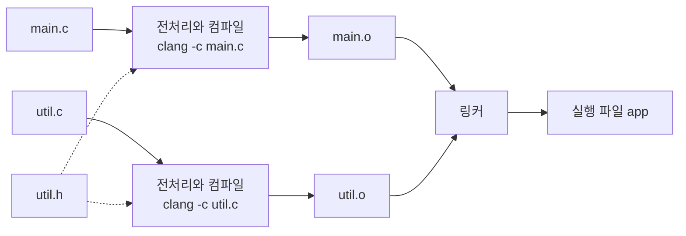

# 12장 — 파일 입출력과 프로그램 구성

[레포지토리 안내](../../README.ko.md) | [English](Concepts_Lecture.md) | [한국어](Concepts_Lecture.ko.md)

> **최종 수정일:** 2026-11-09

> **학습 목표:**
> 1. `int main(int argc, char *argv[])`로 명령행 인수를 받아 검사하고 변환하며, 종료 상태로 결과를 알리는 프로그램을 작성할 수 있다
> 2. 스트림과 버퍼링의 동작을 설명하고 텍스트 파일과 이진 파일을 읽고 쓸 수 있다
> 3. 입출력 함수의 반환값과 `errno`, `feof`, `ferror`로 실패의 원인을 구분하고 자원을 빠짐없이 정리할 수 있다
> 4. 함수형 매크로와 조건부 컴파일을 안전하게 사용할 수 있다
> 5. 프로그램을 헤더 파일과 여러 소스 파일로 나누고 링크 오류의 원인을 찾을 수 있다
> 6. 저장 부류 지정자로 유효 범위, 수명, 연결을 제어하고 Makefile로 빌드를 자동화할 수 있다

---

## 목차

- [1. 명령행 인수](#1-명령행-인수)
  - [1.1 `main`의 두 번째 형태](#11-main의-두-번째-형태)
  - [1.2 `argc`와 `argv`의 구조](#12-argc와-argv의-구조)
  - [1.3 인수를 주어 프로그램을 실행하는 방법](#13-인수를-주어-프로그램을-실행하는-방법)
  - [1.4 문자열 인수를 숫자로 변환](#14-문자열-인수를-숫자로-변환)
  - [1.5 인수 검사와 사용법 메시지](#15-인수-검사와-사용법-메시지)
  - [1.6 옵션 처리](#16-옵션-처리)
  - [1.7 종료 상태](#17-종료-상태)
  - [1.8 완성 예제](#18-완성-예제)
- [2. 스트림과 파일 포인터](#2-스트림과-파일-포인터)
  - [2.1 스트림과 `FILE`](#21-스트림과-file)
  - [2.2 표준 스트림](#22-표준-스트림)
  - [2.3 버퍼링과 `fflush`](#23-버퍼링과-fflush)
- [3. 텍스트 파일 입출력](#3-텍스트-파일-입출력)
  - [3.1 `fopen`과 `fclose`](#31-fopen과-fclose)
  - [3.2 문자 단위 입출력](#32-문자-단위-입출력)
  - [3.3 줄 단위 입출력](#33-줄-단위-입출력)
  - [3.4 형식화 입출력](#34-형식화-입출력)
  - [3.5 파일 끝의 판단](#35-파일-끝의-판단)
- [4. 이진 파일 입출력](#4-이진-파일-입출력)
  - [4.1 텍스트 모드와 이진 모드](#41-텍스트-모드와-이진-모드)
  - [4.2 `fread`와 `fwrite`](#42-fread와-fwrite)
  - [4.3 `fseek`, `ftell`, `rewind`](#43-fseek-ftell-rewind)
  - [4.4 구조체를 파일에 저장할 때의 주의점](#44-구조체를-파일에-저장할-때의-주의점)
- [5. 오류 처리](#5-오류-처리)
  - [5.1 반환값으로 오류 알리기](#51-반환값으로-오류-알리기)
  - [5.2 `errno`, `perror`, `strerror`](#52-errno-perror-strerror)
  - [5.3 스트림 오류의 확인](#53-스트림-오류의-확인)
  - [5.4 자원 정리 패턴](#54-자원-정리-패턴)
- [6. 전처리기](#6-전처리기)
  - [6.1 `#include`의 두 형태](#61-include의-두-형태)
  - [6.2 함수형 매크로와 괄호](#62-함수형-매크로와-괄호)
  - [6.3 `#`과 `##` 연산자](#63-과--연산자)
  - [6.4 조건부 컴파일](#64-조건부-컴파일)
  - [6.5 미리 정의된 매크로](#65-미리-정의된-매크로)
- [7. 여러 파일로 나눈 프로그램](#7-여러-파일로-나눈-프로그램)
  - [7.1 선언과 정의, 번역 단위](#71-선언과-정의-번역-단위)
  - [7.2 헤더 파일 작성](#72-헤더-파일-작성)
  - [7.3 헤더 가드](#73-헤더-가드)
  - [7.4 분할 컴파일과 링크 오류](#74-분할-컴파일과-링크-오류)
- [8. 저장 부류와 연결](#8-저장-부류와-연결)
  - [8.1 유효 범위, 수명, 연결](#81-유효-범위-수명-연결)
  - [8.2 `static` 지역 변수](#82-static-지역-변수)
  - [8.3 `static` 전역 변수와 함수](#83-static-전역-변수와-함수)
  - [8.4 `extern`](#84-extern)
  - [8.5 그 밖의 저장 부류 지정자](#85-그-밖의-저장-부류-지정자)
- [9. 빌드 도구](#9-빌드-도구)
  - [9.1 컴파일 옵션](#91-컴파일-옵션)
  - [9.2 Makefile 기초](#92-makefile-기초)
- [개념 적용](#개념-적용)
- [요약](#요약)
- [점검 문제](#점검-문제)
- [참고 문헌](#참고-문헌)

---

<br>

## 1. 명령행 인수

### 1.1 `main`의 두 번째 형태

지금까지 작성한 프로그램은 `int main()`이나 `int main(void)`로 시작했다([2장 1.3절](../Ch02_C-Program-Basics/Concepts_Lecture.ko.md#13-main-함수)). 이 형태의 `main`은 실행될 때 외부에서 아무 정보도 받지 못하므로, 처리할 파일 이름이나 반복 횟수를 바꾸려면 실행 중에 `scanf`로 입력받거나 소스 코드를 고쳐 다시 컴파일해야 한다. 반면 `clang -o app main.c`나 `cp a.txt b.txt` 같은 명령은 프로그램 이름 뒤에 적은 정보에 따라 동작이 달라진다. C 프로그램이 이 방식으로 정보를 받으려면 `main`의 두 번째 형태를 사용한다.

> **용어 정의:** **명령행 인수(command-line argument).** 프로그램을 실행하는 명령에서 프로그램 이름 뒤에 적어 프로그램에 전달하는 문자열이다.

C 표준은 호스트 환경의 `main`을 매개변수 없이 정의하거나, `argc`와 `argv`라는 두 매개변수로 정의하거나, 그와 동등한 형태로 정의하도록 규정하며, 구현이 정하는 다른 형태도 허용한다[1].

```c
int main(void)                      // 명령행 인수를 사용하지 않는 형태
int main(int argc, char *argv[])    // 명령행 인수를 사용하는 형태
```

`argc`(argument count)는 `argv`에 담긴 문자열의 개수이고 프로그램 이름도 여기에 포함된다. `argv`(argument vector)는 각 문자열의 시작 주소를 담은 포인터 배열의 첫 원소를 가리킨다. 두 이름은 표준이 설명에 쓰는 이름일 뿐 다른 이름을 써도 되지만[1], 널리 쓰이는 관례이므로 바꾸지 않는 것이 좋다. 프로그램을 실행하면 셸과 운영체제, C 런타임의 **시작 코드(startup code)** 가 명령행을 문자열 배열로 정리한 뒤 `main`을 호출한다.

> **용어 정의:** **셸(shell).** 사용자가 입력한 명령행을 해석하여 프로그램을 실행하는 명령 해석 프로그램이다. bash와 zsh가 대표적이고, Windows에는 명령 프롬프트(cmd)와 PowerShell이 있다.


*그림 1. 명령행이 `main`의 매개변수로 전달되는 과정*

> **주의:** `char *argv[]`와 `char **argv`가 같은 뜻인 것은 **함수 매개변수일 때뿐이다**. 매개변수로 선언한 배열은 첫 원소를 가리키는 포인터로 바뀌기 때문이다([8장 3.4절](../Ch08_Pointers/Concepts_Lecture.ko.md#34-함수에-배열-전달)). 함수 안의 선언에서 `char *a[3]`은 포인터 3개로 이루어진 배열이고 `char **p`는 포인터 변수 하나이므로, `sizeof`의 값과 대입 가능 여부가 서로 다르다.

> **참고:** 이 장의 터미널 출력은 macOS(arm64)의 Apple clang 21과 bash, zsh에서 얻은 결과이고, 주소 값은 실행할 때마다 달라지는 예이다.

### 1.2 `argc`와 `argv`의 구조

다음 프로그램은 받은 인수를 출력한다. 코드는 [Example_ArgDump.c](Example_ArgDump.c)이다. `./args Alice 20`으로 실행하면 `argc`는 프로그램 이름을 포함하여 3이다. `argv[argc]`가 널 포인터이므로 `for (char **p = argv; *p != NULL; p++)`처럼 포인터로 순회할 수도 있다.

```c
int main(int argc, char *argv[])    // ./args Alice 20으로 실행한다
{
    printf("argc = %d\n", argc);    // argc = 3
    for (int i = 0; i < argc; i++)
        printf("argv[%d] = \"%s\"\n", i, argv[i]);
    return 0;                       // argv[0] = "./args", argv[1] = "Alice", argv[2] = "20"
}
```

`./greet Alice 20`을 실행했을 때의 메모리 구조는 그림 2와 같다. `argv`는 포인터 배열의 첫 원소를 가리키고, 각 원소는 문자열의 첫 문자를 가리킨다.

```text
argc = 3

argv: char **          포인터 배열 (원소마다 8바이트)         문자열 (널 문자로 끝남)
┌──────────────┐      ┌────────────────────────────┐
│ 0x16f81f1f8  │ ───► │ [0] 0x16f81f408            │ ───► "./greet\0"  8바이트
└──────────────┘      ├────────────────────────────┤
                      │ [1] 0x16f81f410            │ ───► "Alice\0"    6바이트
                      ├────────────────────────────┤
                      │ [2] 0x16f81f416            │ ───► "20\0"       3바이트
                      ├────────────────────────────┤
                      │ [3] NULL (argv[argc])      │
                      └────────────────────────────┘
                       주소: 0x16f81f1f8, 0x16f81f200, 0x16f81f208, 0x16f81f210
```

*그림 2. `./greet Alice 20` 실행 시 `argv`의 메모리 구조 (64비트 환경, 주소는 예)*

`argv[1]`은 `char *`로서 문자열 `"Alice"`의 시작 주소이고, `argv[1][0]`은 `char` 값 `'A'`이며, `argv[argc]`는 널 포인터이다.

C 표준이 `main`의 매개변수에 대해 보장하는 내용은 다음과 같다[1].

- `argc`는 음수가 아니다. 대부분 1 이상이지만 표준은 0도 허용한다.
- `argv[argc]`는 널 포인터이다.
- `argc`가 1 이상이면 `argv[0]`은 프로그램 이름을 나타내는 문자열을 가리키고, 환경에서 이름을 얻을 수 없으면 `argv[0][0]`이 널 문자이다.
- `argc`가 2 이상이면 `argv[1]`부터 `argv[argc - 1]`까지가 프로그램에 전달된 인수이다.
- 프로그램은 `argc`, `argv`와 `argv`가 가리키는 문자열을 수정할 수 있으며, 이 값들은 프로그램이 끝날 때까지 유지된다.

`argv[0]`은 실행 파일의 경로라고 보장되지 않는다. 같은 프로그램을 `./args`로 실행하면 `argv[0]`은 `"./args"`이고, 상위 디렉터리에서 `bin/args`로 실행하면 `"bin/args"`이며, bash의 `exec -a custom ./args`로 실행하면 `"custom"`이다. 따라서 `argv[0]`은 사용법 메시지의 표시용으로만 쓰고 실행 파일의 위치를 알아내는 근거로 삼지 않는다.

> **[시스템프로그래밍]** 프로그램을 실행하는 시스템 콜 `execve`는 호출하는 쪽이 만든 `argv` 배열을 그대로 새 프로그램에 전달한다. macOS에서 빈 배열을 넘기면 실행된 프로그램의 `argc`는 0이 되어 위 프로그램은 `argc = 0`만 출력한다. 이 결과는 운영체제마다 다를 수 있다.

> **핵심:** `argv`의 원소는 모두 **문자열**을 가리킨다. `20`을 입력해도 `argv[2]`는 정수 20이 아니라 문자 `'2'`, `'0'`, `'\0'`으로 이루어진 문자열이므로 계산에 쓰려면 변환해야 한다(1.4절).

### 1.3 인수를 주어 프로그램을 실행하는 방법

**터미널.** 터미널에서는 컴파일한 뒤 프로그램 이름 다음에 인수를 공백으로 구분하여 적는다.

```bash
clang -std=c17 -Wall -Wextra -o args Example_ArgDump.c      # macOS, Linux
./args Alice 20
cl /std:c17 /W4 Example_ArgDump.c /link /out:args.exe       # Windows Developer Command Prompt
args.exe Alice 20
```

`./`는 현재 디렉터리에 있는 실행 파일을 뜻한다. MSVC의 `cl`은 별도의 준비 없이는 일반 명령 프롬프트에서 쓸 수 없으며, 필요한 환경 변수가 설정된 Developer Command Prompt에서 실행한다[2].

**따옴표와 공백.** 셸은 명령행을 공백에서 잘라 단어 하나를 인수 하나로 만든다. 공백이 든 값을 하나의 인수로 넘기려면 따옴표로 묶거나 공백 앞에 `\`를 붙인다. 따옴표는 셸이 처리하고 사라지므로 프로그램에는 전달되지 않는다. 작은따옴표 안의 문자는 모두 글자 그대로 전달되고, 큰따옴표 안에서는 `$`, 백틱, `\`가 특별한 뜻을 유지하고, 기록 확장이 켜진 대화형 셸에서는 `!`도 그렇다[3].

| 입력 (bash, zsh) | `argc` | `argv[1]` 이후의 문자열 |
|:-----|:-----|:-----|
| `./args hello world` | 3 | `hello`, `world` |
| `./args "hello world"` | 2 | `hello world` |
| `./args hello\ world` | 2 | `hello world` |
| `NAME=Kim; ./args "$NAME" '$NAME'` | 3 | `Kim`, `$NAME` |
| `./args "say \"hi\""` | 2 | `say "hi"` |

*표 1. 따옴표와 공백에 따른 인수 분리*

Windows에서는 Microsoft C 시작 코드가 명령행 전체를 받아 인수로 나눈다. 공백과 탭이 구분자이고, 큰따옴표로 묶은 부분은 공백이 있어도 인수 하나로 해석하며, `\"`는 글자 그대로의 큰따옴표이다[4].

**와일드카드 확장.** `*`나 `?`가 든 단어를 파일 이름 패턴이라 한다. POSIX 셸은 프로그램을 실행하기 **전에** 패턴을 일치하는 파일 이름들로 바꾸므로, 프로그램은 패턴을 보지 못하고 이미 나열된 파일 이름만 받는다. 일치하는 파일이 없을 때의 동작은 셸마다 다르다. bash는 패턴을 그대로 전달하고[3], zsh는 기본 설정에서 오류를 내고 프로그램을 실행하지 않는다[5]. 다음 표는 현재 디렉터리에 `args`, `a.txt`, `b.txt`, `c.log`만 있을 때의 결과이다.

| 입력 | bash | zsh |
|:-----|:-----|:-----|
| `./args *.txt` | `a.txt`, `b.txt` | `a.txt`, `b.txt` |
| `./args *.none` | `*.none` | 실행되지 않음 (`no matches found: *.none`) |
| `./args '*.txt'` | `*.txt` | `*.txt` |
| `./args 3 * 4` | `3`, `a.txt`, `args`, `b.txt`, `c.log`, `4` | 같음 |

*표 2. 셸의 와일드카드 확장 결과*

> **주의:** 계산기 프로그램을 `./calc 3 * 4`로 실행하면 현재 디렉터리에 파일이 있을 때 `argv[2]`는 `*`가 아니라 첫 파일 이름이 되고 `argc`도 달라진다. 곱셈 기호를 인수로 넘기려면 `'*'`, `"*"`, `\*` 중 하나로 쓴다.

Windows의 C 런타임은 기본적으로 와일드카드를 확장하지 않으며, 확장이 필요하면 `cl example.c /link setargv.obj`처럼 `setargv.obj`를 링크한다[6]. 명령행의 `<`, `>`, `|`도 셸이 처리하므로 `argv`에 나타나지 않는다(2.2절).

**Visual Studio.** 프로젝트의 속성 페이지에서 `[구성 속성]` → `[디버깅]`의 **명령 인수(Command Arguments)** 칸에 인수를 적는다. 이 칸에는 `< file`이나 `> file` 같은 리다이렉션도 적을 수 있다. 프로그램의 작업 디렉터리는 같은 페이지의 **작업 디렉터리(Working Directory)** 항목으로 정하며, 비워 두면 프로젝트 디렉터리가 된다[7].

**Xcode.** 툴바의 스킴 이름을 클릭하여 스킴을 편집하고, Run 동작의 Arguments 탭에 인수를 추가한다. Xcode는 이 인수를 실행되는 프로세스에 그대로 전달한다[8]. 실행 환경은 같은 동작의 Options 탭에서 구성한다[8]. 프로그램이 상대 경로로 파일을 연다면 이 탭의 **Use custom working directory** 항목으로 작업 디렉터리를 지정한다.

> **주의:** 프로그램에 전달되는 상대 경로의 기준은 소스 파일의 위치가 아니라 **작업 디렉터리**이다. 터미널에서는 현재 디렉터리이고, IDE에서는 위의 설정이다. IDE에서 파일을 찾지 못할 때 가장 먼저 확인할 항목이다.

### 1.4 문자열 인수를 숫자로 변환

`atoi`는 [9장 5.1절](../Ch09_Strings/Concepts_Lecture.ko.md#51-문자열을-숫자로-변환)에서 본 대로 간단하지만, 프로그램 밖에서 들어오는 문자열을 변환하기에는 부족하다. `"abc"`와 `"0"`을 모두 0으로 돌려주므로 실패를 구별할 수 없고, 결과가 `int`로 표현되지 않으면 동작이 정의되지 않는다[1]. 실패를 검사할 수 있는 함수는 `<stdlib.h>`의 `strtol`이다.

`strtol`의 원형은 `long strtol(const char *s, char **endptr, int base);`이다. `s`는 변환할 문자열이며 앞쪽의 공백을 건너뛰고 부호를 허용한다. `base`는 2부터 36까지의 진법이거나, 접두사로 판단하게 하는 0이다(`0x`는 16진수, `0`은 8진수, 그 밖은 10진수이고, C23에서는 `0b`가 2진수이다[9]). `endptr`에는 변환이 끝난 위치를 받을 `char *` 변수의 주소를 주며, 데이터 타입이 `char **`인 이유는 함수가 호출한 쪽의 변수를 바꿔야 하기 때문이다([8장 3.2절](../Ch08_Pointers/Concepts_Lecture.ko.md#32-포인터를-통한-변수-수정), [11장 6.1절](../Ch11_Dynamic-Memory-and-Advanced-Pointers/Concepts_Lecture.ko.md#61-이중-포인터)). `"42abc"`를 변환하면 `strtol`은 숫자 42를 돌려주고 `end`를 `'a'`의 위치로 설정한다.

```text
s   ──►  [ '4' ][ '2' ][ 'a' ][ 'b' ][ 'c' ][ '\0' ]
                        ▲
end ────────────────────┘
```

*그림 3. `strtol("42abc", &end, 10)` 호출 후 `end`가 가리키는 위치*

`errno`는 라이브러리 함수가 오류 번호를 기록하는 `<errno.h>`의 변수이고(5.2절), `ERANGE`는 범위 초과를 뜻하는 오류 번호의 이름이다. 변환이 완전히 성공했는지 판단하려면 다음 다섯 단계를 거치며, 이 판단을 함수로 묶은 것이 1.8절의 `parse_int`이다.

1. 호출하기 전에 `errno = 0;`을 실행한다. 표준 라이브러리 함수는 성공해도 `errno`를 0으로 되돌리지 않으므로, 이전 값을 지워야 판단할 수 있다[1].
2. `end == s`이면 숫자를 하나도 읽지 못한 것이다.
3. `*end != '\0'`이면 숫자 뒤에 다른 문자가 남은 것이다.
4. `errno == ERANGE`이면 `long` 범위를 벗어난 것이며, 이때 반환값은 `LONG_MAX` 또는 `LONG_MIN`이다[1].
5. `int`에 저장하려면 값이 `INT_MIN`과 `INT_MAX` 사이인지 확인한다. `long`이 `int`보다 큰 환경에서만 의미가 있지만 항상 검사해도 해가 없다.

| 입력 `s` | 반환값 | `end`가 가리키는 문자열 | `errno` | `parse_int` |
|:-----|:-----|:-----|:-----|:-----|
| `"42"` | 42 | `""` | 0 | 성공 |
| `"12abc"` | 12 | `"abc"` | 0 | 실패 (숫자 뒤에 문자) |
| `"abc"` | 0 | `"abc"` (`end == s`) | 구현에 따름 | 실패 (숫자 없음) |
| `"99999999999999999999"` | `LONG_MAX` | `""` | `ERANGE` | 실패 (범위 초과) |
| `"3000000000"` | 3000000000 | `""` | 0 | 실패 (`int` 범위 초과) |

*표 3. `base`가 10일 때 `strtol`의 결과와 판정 (`long`이 64비트인 환경)*

표에서 숫자를 찾지 못한 행의 `errno`는 ISO C가 정하지 않았으며 macOS에서는 `EINVAL`이었다. 진법의 효과는 `strtol("0x1F", &end, 16)`이 31, `strtol("077", &end, 0)`이 63, `strtol("077", &end, 10)`이 77인 것으로 확인된다[1]. 비슷한 함수로 `long long`에는 `strtoll`, `double`에는 `strtod`가 있다. `strtoul`은 `unsigned long`으로 변환하지만 `"-1"`도 오류 없이 받아들여 `ULONG_MAX`(macOS에서 18446744073709551615)를 돌려주므로, 음수를 받지 않으려면 입력을 따로 검사해야 한다.

### 1.5 인수 검사와 사용법 메시지

인수를 쓰기 전에 `argc`부터 확인한다. `argc`가 1이면 `argv[1]`은 널 포인터이고, 이를 `printf("%s", ...)`나 `atoi`에 넘기면 동작이 정의되지 않는다[1]. 실제로 인수 없이 `printf("Hello, %s\n", argv[1]);`을 실행하면 macOS에서는 `Hello, (null)`이 출력되었고, `atoi(argv[1])`은 세그멘테이션 오류(허용되지 않은 메모리 접근 때문에 운영체제가 프로그램을 강제로 끝내는 것)로 종료되었다. 어느 쪽도 표준이 보장하는 결과가 아니므로 개수를 먼저 검사하여 사용법을 알리고 끝낸다.

```c
if (argc != 3) {
    fprintf(stderr, "Usage: %s <source> <destination>\n", argc > 0 ? argv[0] : "safecopy");
    return 2;
}
```

사용법 메시지의 표기는 POSIX의 유틸리티 규약에 맞춘다. `[ ]`는 생략할 수 있는 인수, `...`는 반복될 수 있는 인수, `<name>`처럼 꺾쇠로 묶은 이름은 실제 값으로 바뀌는 자리를 뜻한다[10]. 메시지는 프로그램의 결과와 섞이지 않도록 표준 오류에 출력하고(2.2절), 프로그램은 0이 아닌 종료 상태로 끝낸다. `fprintf`는 출력 대상을 첫 번째 인수로 받는 `printf`이다(3.4절). 위 코드의 `argc > 0` 검사는 `argc`가 0인 경우(1.2절)를 막는다.

### 1.6 옵션 처리

명령행 인수는 역할에 따라 세 가지로 나뉜다. `-u`처럼 `-`로 시작하여 동작을 바꾸는 인수가 **옵션(option)**, `-n 2`의 `2`처럼 옵션에 딸린 값이 **옵션 인수(option-argument)**, 처리 대상을 지정하는 나머지 인수가 **피연산자(operand)** 이다. POSIX의 규약에 따르면 옵션 이름은 영숫자 한 글자이고, 첫 번째 `--`는 옵션의 끝을 뜻하여 그 뒤의 인수는 `-`로 시작해도 피연산자이며, 단독 `-`는 표준 입력이나 표준 출력을 뜻하는 피연산자로 쓴다[10].

옵션을 직접 처리할 때는 인덱스 `i`를 옵션 인수의 유무에 따라 전진시키는 반복문을 쓴다. 반복문은 1.8절에 있으며, `./repeat -n 2 -u hi there`를 처리하는 과정은 다음과 같다.

| `i` | `argv[i]` | 판단 | 동작 | 다음 `i` |
|:-----|:-----|:-----|:-----|:-----|
| 1 | `-n` | `-n`과 일치하고 `argv[2]`가 있다 | `parse_int`로 `count = 2` | 3 |
| 3 | `-u` | `-u`와 일치한다 | `upper = 1` | 4 |
| 4 | `hi` | `-`로 시작하지 않는다 | 옵션 반복 종료 | 4 |

*표 4. `./repeat -n 2 -u hi there`의 옵션 처리 추적*

반복 조건의 `argv[i][1] != '\0'`은 단독 `-`를 옵션으로 해석하지 않기 위한 것이고, `i + 1 >= argc` 검사는 `-n`이 마지막 인수여서 값이 없는 경우를 막는다.

POSIX 환경에서는 `<unistd.h>`의 `getopt`가 이 처리를 대신한다[11]. 옵션 문자열 `"un:"`에서 뒤에 `:`가 붙은 `n`은 옵션 인수가 필요하다는 뜻이다. `getopt`는 옵션을 하나씩 반환하다가 끝나면 -1을 반환하고, 옵션 인수는 `optarg`로, 첫 피연산자의 위치는 `optind`로 알려 주며, `-n3`처럼 붙여 쓴 값과 `-un 3`처럼 묶어 쓴 옵션도 처리한다.

```c
while ((opt = getopt(argc, argv, "un:")) != -1) {
    if (opt == 'u') upper = 1;
    else if (opt == 'n') { if (!parse_int(optarg, &count)) return 2; }
    else return 2;                       // 알 수 없는 옵션이면 '?'를 반환한다
}
```

`getopt`는 POSIX 함수이고 ISO C 표준 라이브러리에는 없으므로 표준 C만 가정하는 코드에서는 직접 쓴 반복문을 사용한다. `-std=c17`처럼 엄격한 모드에서는 환경에 따라 선언이 숨겨지므로, 그런 환경에서는 `#include` 앞에 `#define _POSIX_C_SOURCE 200809L`을 둔다.

### 1.7 종료 상태

`main`의 `return`이 돌려주는 종료 코드([2장 1.4절](../Ch02_C-Program-Basics/Concepts_Lecture.ko.md#14-종료-코드))는 프로그램을 실행한 쪽에 결과를 알리는 값이며, 이 장에서는 POSIX와 셸의 용어를 따라 종료 상태라 부른다.

> **용어 정의:** **종료 상태(exit status).** 프로그램이 끝날 때 그 프로그램을 실행한 쪽(셸이나 다른 프로그램)에 전달되는 정수 값이다.

- 처음 호출된 `main`에서 `return n;`을 실행하는 것은 `exit(n)`을 호출하는 것과 같다[1].
- C99부터 `main`의 닫는 `}`에 도달하면 0을 반환한다[1]. `main`에만 적용되는 규칙이고, `-std=c89 -pedantic`으로 컴파일하면 clang은 이 코드를 경고한다.
- 0과 `EXIT_SUCCESS`는 성공, `EXIT_FAILURE`는 실패를 뜻한다. 그 밖의 값의 의미는 구현이 정한다[1].

POSIX에서 부모 프로세스가 `wait`나 `waitpid`로 볼 수 있는 값은 상태의 **하위 8비트**뿐이다[12]. 따라서 값은 256으로 나눈 나머지로 보인다. bash의 `$?`로 확인한 결과는 `exit(3)`이 3, `exit(255)`가 255, `exit(256)`이 0, `exit(257)`이 1, `exit(1000)`이 232, `exit(-1)`이 255이다.

> **주의:** `exit(256)`은 실패를 알리려는 의도와 달리 셸에서 **성공**으로 보인다. 종료 상태는 0, 1, 그리고 2처럼 작은 값으로 한정하는 것이 안전하다. 많은 도구는 사용법 오류에 2를 쓰며, Bash 내장 명령도 잘못된 사용에 2를 반환한다[3].

`exit`는 `atexit`로 등록한 함수를 등록의 역순으로 호출한 뒤, 쓰지 않은 버퍼를 비우고 열린 스트림을 닫고 `tmpfile`로 만든 파일을 지운 다음 환경으로 종료 상태를 돌려준다[1]. `first`, `second`의 순서로 `atexit`에 등록하고 `printf("printed before exit\n");` 다음에 `exit`를 호출하면 `printed before exit`, `second registered`, `first registered`의 순서로 출력된다. `_Exit`는 `atexit` 함수를 호출하지 않으며, 스트림을 비우는지는 구현이 정한다[1]. `abort`도 스트림 처리가 구현 정의이다[1]. macOS에서 같은 코드를 시험하면 `_Exit` 전에 쓴 버퍼는 파일에 남지 않았고 `abort` 전에 쓴 버퍼는 남았지만, 이식성 있는 코드는 이 결과에 의존하면 안 된다.

셸은 종료 상태로 다음 동작을 결정하며 0을 성공으로 본다[3]. `./repeat ok && echo next`는 성공일 때만, `./repeat -z || echo failed`는 실패일 때만 `echo`를 실행하고, 직전 명령의 상태는 `echo $?`로 확인한다. Windows의 명령 프롬프트에서는 `%ERRORLEVEL%`[13], PowerShell에서는 `$LASTEXITCODE`[14]가 같은 값을 보여 준다. 신호(signal, 운영체제가 프로세스에 사건을 알리는 통지)로 강제 종료된 프로그램의 상태는 bash가 128 + 신호 번호로 보고한다[3]. `abort`로 끝난 프로그램은 134(SIGABRT는 6번), 널 포인터를 역참조하여 끝난 프로그램은 139(SIGSEGV는 11번)로 관찰되었다.

### 1.8 완성 예제

앞의 절을 모두 묶은 프로그램이다. `-n count`와 `-u` 옵션을 처리하고, 숫자를 검사하고, 사용법을 표준 오류로 알리고, 결과에 맞는 종료 상태를 돌려준다. 코드는 [Example_RepeatWords.c](Example_RepeatWords.c)이다. 아래 코드는 변환 함수와 옵션 처리를 보이며, `#include` 줄, 상수 `STATUS_USAGE`(값 2), 사용법을 출력하고 그 값을 반환하는 `usage` 함수, 단어를 출력하는 마지막 반복문은 생략했다.

```c
// s 전체를 int로 변환한다. 성공하면 1, 실패하면 0을 반환한다.
static int parse_int(const char *s, int *out)
{
    char *end;
    errno = 0;                                      // strtol은 errno를 지우지 않는다
    long value = strtol(s, &end, 10);
    if (end == s || *end != '\0' || errno == ERANGE) // 숫자 없음, 뒤의 문자, 범위 초과
        return 0;
    if (value < INT_MIN || value > INT_MAX)         // long에는 맞지만 int로 표현할 수 없다
        return 0;

    *out = (int)value;
    return 1;
}

int main(int argc, char *argv[])
{
    const char *prog = (argc > 0 && argv[0][0] != '\0') ? argv[0] : "repeat";
    int count = 1, upper = 0, i = 1;
    // 옵션 반복: 옵션이 아닌 첫 인수에서 멈춘다
    while (i < argc && argv[i][0] == '-' && argv[i][1] != '\0') {
        if (strcmp(argv[i], "--") == 0) {           // 옵션의 끝
            i++;
            break;
        } else if (strcmp(argv[i], "-u") == 0) {
            upper = 1;
            i++;
        } else if (strcmp(argv[i], "-n") == 0) {
            if (i + 1 >= argc || !parse_int(argv[i + 1], &count) || count < 0) {
                fprintf(stderr, "%s: -n needs a non-negative count\n", prog);
                return STATUS_USAGE;
            }
            i += 2;                                 // -n과 그 값을 건너뛴다
        } else {
            fprintf(stderr, "%s: unknown option: %s\n", prog, argv[i]);
            return usage(prog);
        }
    }
    if (i >= argc)                                  // 단어가 적어도 하나 필요하다
        return usage(prog);

    /* 남은 단어를 count번씩 출력한다. -u이면 대문자로 바꾼다. */
    return EXIT_SUCCESS;
}
```

```text
$ ./repeat -n 2 -u hi
HI
HI
$ ./repeat -n 3x word; echo "status: $?"
./repeat: -n needs a non-negative count
status: 2
```

> **핵심:** 명령행 인수를 다루는 프로그램은 `argc`로 개수를 검사하고, 문자열은 `strtol`로 변환하며, 오류는 표준 오류에 출력하고, 성공과 실패를 종료 상태로 구별한다.

---

<br>

## 2. 스트림과 파일 포인터

### 2.1 스트림과 `FILE`

C 프로그램은 키보드, 화면, 디스크의 파일을 같은 방식으로 다룬다. 입출력 대상이 무엇이든 프로그램은 일정한 성질을 가진 **스트림**을 읽고 쓰며, 실제 장치나 파일과의 차이는 라이브러리와 운영체제가 처리한다[1].

> **용어 정의:** **스트림(stream).** 프로그램과 입출력 장치 또는 파일 사이를 순서대로 흐르는 문자의 논리적인 통로이다.

`<stdio.h>`의 `FILE`은 스트림 제어에 필요한 정보, 즉 파일 위치 표시자(읽고 쓸 다음 위치), 버퍼의 위치, 오류 표시자, 파일 끝 표시자를 기록하는 데이터 타입이다[1]. 프로그램은 `FILE` 객체를 직접 만들거나 멤버에 접근하지 않고, 라이브러리가 돌려주는 포인터만 사용한다.

> **용어 정의:** **파일 포인터(file pointer).** 열린 스트림을 제어하는 `FILE` 객체를 가리키는 `FILE *` 데이터 타입의 포인터이다.

### 2.2 표준 스트림

프로그램이 시작될 때 표준 스트림 세 개가 이미 열려 있다[1]. `stdin`은 기본적으로 키보드에, `stdout`과 `stderr`는 화면에 연결된다. 운영체제가 열린 파일을 구별하는 번호를 파일 디스크립터(file descriptor)라 하며, 세 스트림의 번호 0, 1, 2는 POSIX가 정한다[15]. `printf(...)`는 `fprintf(stdout, ...)`와 같고, `getchar()`는 `getc(stdin)`과 같다.

> **용어 정의:** **표준 스트림(standard stream).** 프로그램이 시작될 때 이미 열려 있는 세 스트림 `stdin`(표준 입력), `stdout`(표준 출력), `stderr`(표준 오류)이다.

표준 스트림의 연결은 실행할 때 셸이 바꿀 수 있다.

> **용어 정의:** **리다이렉션(redirection).** 프로그램의 표준 스트림을 키보드나 화면 대신 파일에 연결하는 셸의 기능이다.

> **용어 정의:** **파이프(pipe).** 한 프로그램의 출력을 다른 프로그램의 입력으로 전달하는 운영체제의 통로이며, 셸에서는 `|`로 앞 프로그램의 표준 출력을 뒤 프로그램의 표준 입력에 연결한다.

| 명령 | 뜻 |
|:-----|:-----|
| `./p < in.txt` | 표준 입력을 `in.txt`에서 읽는다 |
| `./p > out.txt` | 표준 출력을 `out.txt`에 쓴다 (기존 내용을 지운다) |
| `./p >> out.txt` | 표준 출력을 `out.txt` 끝에 덧붙인다 |
| `./p 2> err.txt` | 표준 오류를 `err.txt`에 쓴다 |
| `./p > all.txt 2>&1` | 표준 출력과 표준 오류를 함께 `all.txt`에 쓴다 |
| `./p1 \| ./p2` | `p1`의 표준 출력을 `p2`의 표준 입력에 연결한다 |

*표 5. 리다이렉션과 파이프*

`while ((c = getchar()) != EOF) putchar(toupper(c));`는 표준 입력을 끝까지 읽어 대문자로 출력한다(`c`는 `int`이다). 입력이 키보드이든 파일이든 파이프이든 코드는 같으며, `echo 'hello' | ./up`의 출력은 `HELLO`이다. 키보드 입력의 끝은 줄의 처음에서 macOS와 Linux는 `Ctrl+D`로, Windows는 `Ctrl+Z`와 Enter로 알린다. 오류 메시지를 `stderr`에 쓰면 출력을 파일로 보내도 메시지는 화면에 남는다. `./p > out.txt`를 실행했을 때 `out.txt`에는 결과만 들어가고 경고는 터미널에 나타나므로, 결과 파일이 오류 메시지로 오염되지 않는다.

### 2.3 버퍼링과 `fflush`

> **용어 정의:** **버퍼링(buffering).** 입출력을 한 문자씩 처리하지 않고 메모리의 버퍼에 모았다가 한꺼번에 전달하는 방식이다.

| 방식 | `setvbuf` 상수 | 전달 시점 |
|:-----|:-----|:-----|
| 완전 버퍼링 | `_IOFBF` | 버퍼가 가득 찼을 때 |
| 줄 버퍼링 | `_IOLBF` | 개행 문자를 만났을 때 (또는 버퍼가 찼을 때) |
| 무버퍼링 | `_IONBF` | 가능한 한 즉시 |

*표 6. 스트림의 세 가지 버퍼링 방식*

표준은 대화형 장치에 연결되지 않은 것이 확실할 때에만 `stdin`과 `stdout`을 완전 버퍼링하고, `stderr`는 완전 버퍼링하지 않도록 규정한다[1]. 일반적인 구현에서 `stdout`은 터미널에 연결되면 줄 버퍼링이고, 파일이나 파이프에 연결되면 완전 버퍼링이다. 이 때문에 `printf("A\n"); fprintf(stderr, "B\n"); printf("C\n");`의 출력 순서는 연결 대상에 따라 달라진다.

```text
$ ./order                터미널에 직접 출력: A, B, C
$ ./order 2>&1 | cat     stdout이 파이프에 연결됨: B, A, C
```

파이프로 연결되면 `A`와 `C`가 버퍼에 쌓였다가 프로그램이 끝날 때 한꺼번에 전달되므로 `B`가 먼저 보인다. `fflush(fp)`는 출력 스트림의 버퍼 내용을 환경에 즉시 전달하며, 오류가 나면 `EOF`를 반환한다[1]. `fflush(NULL)`은 모든 출력 스트림을 비운다. 개행이 없는 프롬프트는 입력을 받기 전에 `printf("Enter a number: "); fflush(stdout);`처럼 비워서 화면에 보낸다.

버퍼의 내용은 프로그램이 정상적으로 끝나거나 비워질 때 전달되므로, 강제로 종료되면 사라진다. `printf("written with printf\n");` 다음에 `raise(SIGKILL);`을 실행한 프로그램의 출력을 파일로 보내면 파일 크기가 0바이트였고, 그 사이에 `fflush(stdout);`을 넣으면 20바이트가 저장되었다. 버퍼링 방식을 바꾸려면 스트림을 연 직후 다른 연산을 하기 전에 `setvbuf(stdout, NULL, _IONBF, 0);`처럼 `setvbuf`를 호출한다[1].

> **주의:** `fflush(stdin)`은 ISO C에서 **정의되지 않은 동작**이다. `fflush`는 출력 스트림이나 마지막 연산이 입력이 아닌 갱신 스트림에만 정의되어 있기 때문이다[1]. POSIX는 탐색 가능한 입력 스트림에 대해 별도의 의미를 정하고[16], Microsoft 문서는 읽기 모드로 연 스트림에 대해 아무 효과가 없다고 설명하므로[17], 입력 버퍼를 비우는 목적으로 쓸 수 없다. 남은 입력을 버리려면 `while ((c = getchar()) != '\n' && c != EOF) { }`처럼 직접 읽어서 버린다.

---

<br>

## 3. 텍스트 파일 입출력

### 3.1 `fopen`과 `fclose`

`fopen`은 파일을 열어 스트림과 연결하고 파일 포인터를 반환하며, 실패하면 널 포인터를 반환한다[1]. 원형은 `FILE *fopen(const char *filename, const char *mode);`와 `int fclose(FILE *stream);`이다.

```c
FILE *fp = fopen("data.txt", "r");
if (fp == NULL) {               // 파일이 없거나 권한이 없으면 NULL이다
    perror("data.txt");         // 원인을 표준 오류로 출력한다 (5.2절)
    return 1;
}
/* fp로 파일을 읽는다 */
fclose(fp);
```

| 모드 | 뜻 | 파일이 없을 때 | 파일이 있을 때 |
|:-----|:-----|:-----|:-----|
| `"r"` | 읽기 | 실패 | 처음부터 읽기 |
| `"w"` | 쓰기 | 새로 만듦 | 내용을 지우고 쓰기 |
| `"a"` | 끝에 추가 | 새로 만듦 | 끝에 쓰기 |
| `"r+"` | 읽기와 쓰기 | 실패 | 내용 유지, 처음부터 |
| `"w+"` | 읽기와 쓰기 | 새로 만듦 | 내용을 지움 |
| `"a+"` | 읽기와 끝에 추가 | 새로 만듦 | 끝에 쓰기 |
| `"wx"`, `"w+x"` (C11) | 배타적 쓰기 | 새로 만듦 | **실패** |

*표 7. `fopen`의 모드 문자열*

이진 모드는 `b`를 추가하여 `"rb"`, `"r+b"`, `"wbx"`처럼 쓴다(4.1절). `"w"`로 잘못 열면 기존 파일의 내용이 곧바로 지워진다. 기존 파일을 보호하려면 C11에서 추가된 `x`를 사용한다. `x`는 파일이 이미 있으면 여는 데 실패한다[1]. `"a"` 모드의 쓰기는 `fseek`로 위치를 옮겨도 항상 파일 끝에 기록되고, `+`가 붙은 갱신 모드에서는 출력 다음에 입력을 하려면 `fflush`나 파일 위치 함수를, 입력 다음에 출력을 하려면 입력이 파일 끝에 도달한 경우가 아닌 한 파일 위치 함수를 먼저 호출해야 한다[1].

`fclose`는 버퍼에 남은 데이터를 파일로 보내고 스트림을 닫으며, 성공하면 0, 오류가 있으면 `EOF`를 반환한다. 닫은 뒤의 파일 포인터 값은 불확정하므로 다시 사용하면 안 된다[1]. 파일을 닫지 않고 스트림을 계속 열면 언젠가 `fopen`이 `Too many open files`로 실패한다. 표준이 보장하는 동시에 열 수 있는 파일 수는 최소 `FOPEN_MAX`개이다[1].

경로에 상대 경로를 쓰면 작업 디렉터리(1.3절)를 기준으로 찾는다. Windows에서는 `/`와 `\` 모두 경로 구분자로 쓸 수 있지만[18], 문자열 안의 `\`는 `"C:\\data\\a.txt"`처럼 두 번 써야 한다.

> **참고:** **Visual Studio와 `fopen`.** Visual Studio는 `fopen`에 경고 C4996을 내고, SDL 검사가 켜져 있으면 빌드가 실패한다([3장 실습 5.1절](../Ch03_Data-Types-and-Variables/Concepts_Lab.ko.md#51-c4996-경고)). `#define _CRT_SECURE_NO_WARNINGS`를 `#include`보다 앞에 쓰거나, Microsoft의 대체 함수 `errno_t fopen_s(FILE **pFile, const char *filename, const char *mode);`를 사용한다. `fopen_s`는 성공하면 0, 실패하면 오류 코드를 반환하고 파일 포인터는 첫 번째 인수로 돌려준다[19]. 이 장의 예제는 `fopen_s` 대신 `fopen`을 쓰고 `_CRT_SECURE_NO_WARNINGS`를 정의하여 Visual Studio와 다른 컴파일러에서 모두 그대로 컴파일되게 한다.

### 3.2 문자 단위 입출력

`fgetc(fp)`와 `getc(fp)`는 한 문자를 읽어 `unsigned char` 값을 `int`로 반환하고 끝이나 오류에서 `EOF`를 반환하며, `fputc(c, fp)`와 `putc(c, fp)`는 한 문자를 쓰고 실패하면 `EOF`를 반환한다. `ungetc(c, fp)`는 읽은 문자를 스트림에 되돌린다.

`getc`와 `putc`는 매크로로 구현될 수 있어 스트림 인수를 여러 번 평가할 수 있으므로[1], 인수에 부작용이 있는 식을 쓰면 안 된다.

> **주의:** `fgetc`의 반환값은 `int`로 받아야 한다. `fgetc`는 `unsigned char` 값 전체와 그 범위 밖의 음수인 `EOF`를 구별하기 위해 `int`를 반환하는데, `char`에 저장하면 그 구별이 사라진다.

바이트 `41 42 FF 43 44`가 든 파일을 읽으면 `int` 변수로 받은 경우 5바이트를 모두 읽지만, `char c;`로 선언하고 `while ((c = fgetc(fp)) != EOF)`로 읽으면 2바이트만 읽고 멈춘다. `char`가 부호 있고 `EOF`가 -1인 환경에서는 `0xFF`가 `-1`이 되어 `EOF`와 같아지기 때문이다. `char`가 부호 없는 환경에서는 반대 문제가 생긴다. `c`가 음수인 `EOF`와 같아지는 일이 없어 반복이 끝나지 않는다. 같은 코드를 `-funsigned-char`로 컴파일하면 clang은 `result of comparison of constant -1 with expression of type 'char' is always true` 경고를 내고, 프로그램은 끝나지 않았다.

### 3.3 줄 단위 입출력

`fgets(buf, n, fp)`는 표준 입력에 쓰던 방식([9장 4.2절](../Ch09_Strings/Concepts_Lecture.ko.md#42-fgets--gets_s))과 같이 최대 `n - 1`문자를 읽고 개행 문자까지 포함하여 저장하며, 끝이나 오류에서 `NULL`을 반환한다. `fputs(s, fp)`는 문자열을 쓰지만 `puts`와 달리 개행을 덧붙이지 않는다.

한 줄이 버퍼보다 길면 `fgets` 한 번에 줄 전체가 들어오지 않는다. 다음은 `hello world\nhi\n`이 든 파일을 `char buf[8]`로 읽은 결과이다.

| 호출 | `buf`의 내용 | `strlen` | 끝에 `'\n'` |
|:-----|:-----|:-----|:-----|
| 1 | `hello w` | 7 | 없음 (줄이 계속된다) |
| 2 | `orld\n` | 5 | 있음 |
| 3 | `hi\n` | 3 | 있음 |
| 4 | `NULL` 반환 | | |

*표 8. `char buf[8]`로 `fgets`를 호출한 결과*

따라서 줄의 끝은 저장된 문자열이 개행으로 끝나는지(`len > 0 && buf[len - 1] == '\n'`, `len`은 `strlen(buf)`)로 판단한다. [Example_LineStats.c](Example_LineStats.c)는 16바이트 버퍼로 줄 수, 문자 수, 가장 긴 줄의 길이를 구하며, 마지막 줄에 개행이 없는 경우도 처리한다.

### 3.4 형식화 입출력

`fprintf`와 `fscanf`는 `printf`, `scanf`와 사용법이 같고 첫 번째 인수로 파일 포인터를 받는다. `fscanf`는 성공적으로 변환하여 저장한 항목 수를 반환하고, 첫 변환 전에 입력이 끝나면 `EOF`를 반환한다.

```c
fprintf(fp, "%s %d %.1f\n", "Alice", 90, 3.8);      // "w"로 연 파일에 쓴다
while (fscanf(fp, "%19s %d %lf", name, &score, &gpa) == 3) {  // 항목 수로 판단한다
    printf("name=%s score=%d gpa=%.1f\n", name, score, gpa);  // name=Alice score=90 gpa=3.8
}
```

`%s`에는 버퍼 오버플로를 막기 위해 폭을 지정한다. `fscanf`는 형식에 맞지 않는 입력을 만나면 그 위치에 멈추어 잘못된 입력을 건너뛰지 못한다. 줄 구조가 있는 파일은 `fgets`로 한 줄을 읽고 `sscanf`로 분석하면([9장 5.2절](../Ch09_Strings/Concepts_Lecture.ko.md#52-sscanf--sprintf)) 잘못된 줄만 건너뛸 수 있다. 예를 들어 `Alice 90`, `oops`, `Bob 85`가 든 파일을 이렇게 읽으면 `line 2: malformed: oops`를 보고하고 나머지 두 줄을 정상으로 처리한다.

### 3.5 파일 끝의 판단

`EOF`는 `<stdio.h>`에 정의된 음수 값의 `int` 상수이다. 파일 끝을 판단할 때 가장 흔한 실수는 `feof`의 뜻을 오해하는 것이다. `feof(fp)`는 **이전의 읽기 연산이 파일 끝에 도달하여** 파일 끝 표시자가 설정되었을 때 참이 되며, 파일 위치가 끝에 있는지를 미리 알려 주는 함수가 아니다[1]. 빈 파일을 연 직후에도 `feof`는 거짓이고, `fgetc`가 `EOF`를 반환한 뒤에야 참이 된다.

다음은 이 오해로 생기는 잘못된 코드와 그 결과이다. 파일이 `10 20 30\n`처럼 마지막 숫자 뒤의 개행으로 끝나면, 세 번째 읽기가 성공해도 아직 끝에 도달한 것이 아니므로 반복이 한 번 더 실행되고, 네 번째 `fscanf`는 실패하여 `value`에 이전 값 30이 남는다. 파일이 `30`에서 바로 끝나면 세 번째 `fscanf`가 숫자의 끝을 확인하다가 파일 끝에 도달하므로 반복은 세 번으로 끝나고 `sum`은 60이다.

```c
int value = 0, sum = 0;
while (!feof(fp)) {             // 잘못된 코드
    fscanf(fp, "%d", &value);
    printf("read %d\n", value);  // read 10, read 20, read 30, read 30
    sum += value;
}                               // 결과: sum = 90
```

읽기 함수의 반환값으로 반복을 제어하고, `feof`와 `ferror`는 반복이 끝난 뒤 **원인을 구분**하는 데 쓴다.

```c
while (fscanf(fp, "%d", &value) == 1) {
    sum += value;
}
if (ferror(fp)) {
    perror("read");             // 읽기 오류
} else if (!feof(fp)) {
    fprintf(stderr, "malformed input\n");   // 끝이 아니므로 형식 오류
}
```

> **핵심:** 파일의 끝은 읽기 함수의 반환값으로 판단하고, `feof`와 `ferror`는 반복이 끝난 뒤 원인을 구분하는 데에만 쓴다.

---

<br>

## 4. 이진 파일 입출력

### 4.1 텍스트 모드와 이진 모드

> **용어 정의:** **텍스트 모드(text mode).** 파일을 줄의 나열로 다루며, 환경의 줄바꿈 관례에 맞게 문자를 변환할 수 있는 스트림 모드이다.

> **용어 정의:** **이진 모드(binary mode).** 파일의 바이트를 변환 없이 그대로 읽고 쓰는 스트림 모드이다.

C 표준의 텍스트 스트림에서는 문자를 추가, 변경, 삭제하여 환경의 관례에 맞출 수 있으므로 파일과 스트림의 바이트가 일대일로 대응하지 않을 수 있고, 이진 스트림에서는 읽은 데이터가 쓴 데이터와 같다[1]. POSIX에서는 두 모드의 차이가 없고 `b`는 아무 효과가 없다[20]. Windows의 텍스트 모드에서는 쓸 때 `\n`이 `\r\n`으로, 읽을 때 `\r\n`이 `\n`으로 변환되고, `Ctrl+Z`를 읽으면 파일 끝으로 처리한다[18].

표현 형식도 다르다. 정수 1234를 `fprintf(fp, "%d", value)`로 쓰면 문자 네 개가 저장되고, `fwrite(&value, sizeof value, 1, fp)`로 쓰면 메모리의 바이트가 그대로 저장된다. `int`가 4바이트인 환경에서 두 파일의 크기가 같은 것은 우연이며, 12345678이면 텍스트는 8바이트, 이진은 여전히 4바이트이다.

```text
$ xxd num.txt
00000000: 3132 3334                                1234
$ xxd num.bin
00000000: d204 0000                                ....
```

`0x000004D2`가 `D2 04 00 00`으로 저장된 것은 리틀 엔디언 환경이기 때문이다([13장 5.2절](../Ch13_Standard-Library-and-Modern-C/Concepts_Lecture.ko.md#52-엔디언)).

### 4.2 `fread`와 `fwrite`

`fread(ptr, size, nmemb, stream)`와 `fwrite(ptr, size, nmemb, stream)`에서 `size`는 원소 하나의 바이트 수, `nmemb`는 원소 개수이다. 두 함수 모두 실제로 처리한 **원소의 개수**를 반환하며, `fread`의 결과가 요청보다 적으면 파일 끝이거나 오류이다. 일부만 읽힌 원소의 값은 불확정하다[1].

```c
int out[3] = {10, 20, 30}, in[5];
size_t written = fwrite(out, sizeof out[0], 3, fp);   // "wb"로 연 파일: written은 3
size_t got = fread(in, sizeof in[0], 5, fp);          // "rb"로 다시 열어 5개를 요청: got은 3
```

파일에는 `0a00 0000 1400 0000 1e00 0000`의 12바이트가 저장되고, 5개를 요청한 `fread`는 3을 반환한 뒤 `feof`가 참이 된다.

### 4.3 `fseek`, `ftell`, `rewind`

파일 위치 표시자는 다음 입출력이 시작될 위치이다. `fseek(stream, offset, whence)`는 위치를 옮기고 성공하면 0을 반환하며, `ftell(stream)`은 현재 위치를 반환하고 실패하면 `-1L`을 반환한다. `rewind(stream)`은 처음으로 이동하면서 오류 표시자를 지운다. `whence`는 기준 위치이며 `SEEK_SET`은 파일 처음, `SEEK_CUR`은 현재 위치, `SEEK_END`는 파일 끝이다. 다음은 `"w+b"`로 연 파일에 쓴 뒤 각 호출의 결과이다.

```c
fputs("ABCDEFGHIJ", fp);        // ftell은 10
fseek(fp, 2L, SEEK_SET);        // 다음 fgetc는 C, 그 뒤 ftell은 3
fseek(fp, 3L, SEEK_CUR);        // 다음 fgetc는 G, 그 뒤 ftell은 7
fseek(fp, -1L, SEEK_END);       // 다음 fgetc는 J, 그 뒤 ftell은 10
rewind(fp);                     // 다음 fgetc는 A, 그 뒤 ftell은 1
```

`fseek`가 성공하면 파일 끝 표시자는 지워진다[1]. 크기가 같은 레코드를 이진 파일에 저장하면 `i`번째 레코드의 위치가 `i * sizeof(struct record)`이므로 앞의 레코드를 읽지 않고 바로 접근할 수 있다. [Example_BinaryRecords.c](Example_BinaryRecords.c)는 16바이트 레코드 3개를 저장한 뒤(파일 크기 48바이트) 두 번째 레코드의 점수만 81.00에서 88.75로 고친다.

> **주의:** `fseek`의 제약은 스트림 종류에 따라 다르다[1]. 텍스트 스트림에서는 `offset`이 0이거나, 같은 파일의 이전 `ftell` 값을 `SEEK_SET`과 함께 써야 한다. 이진 스트림에서는 `SEEK_END`를 의미 있게 지원하지 않아도 된다. 따라서 `fseek(fp, 0L, SEEK_END)`와 `ftell`로 파일 크기를 구하는 방법은 널리 쓰이지만 이식성이 완전하지 않다. 또한 `long`이 32비트인 환경에서는 2GB를 넘는 위치를 나타낼 수 없으므로, POSIX의 `fseeko`[21]나 Windows의 `_fseeki64`[22]를 사용한다.

### 4.4 구조체를 파일에 저장할 때의 주의점

`fwrite(&s, sizeof s, 1, fp)`는 구조체의 메모리 바이트를 그대로 저장한다. 같은 프로그램이 같은 환경에서 다시 읽는다면 편리하지만, 다음 이유로 다른 컴파일러나 다른 기계에서 읽을 수 있다고 보장되지 않는다.

- **패딩:** 멤버 사이의 패딩([10장 1.2절](../Ch10_Structures/Concepts_Lecture.ko.md#12-구조체-정의))도 함께 저장되며 그 값은 정해져 있지 않다. 패딩의 크기는 컴파일러마다 다를 수 있다.
- **데이터 타입의 크기:** `int`나 `long`의 크기는 구현에 따라 다르다. 파일 형식이 필요하면 고정 폭 정수([13장 2.1절](../Ch13_Standard-Library-and-Modern-C/Concepts_Lecture.ko.md#21-고정-폭-정수))를 쓴다.
- **엔디언:** 여러 바이트로 된 값의 바이트 순서는 기계마다 다르다([13장 5.2절](../Ch13_Standard-Library-and-Modern-C/Concepts_Lecture.ko.md#52-엔디언)).
- **포인터 멤버:** 포인터가 가리키는 내용이 아니라 주소 값만 저장되며, 다른 실행에서는 의미가 없다.

`struct pad { char c; int n; } s;`의 모든 바이트를 `memset(&s, 0xAB, sizeof s);`로 채운 뒤 `s.c = 'A'; s.n = 1;`을 저장하고 `fwrite(&s, sizeof s, 1, fp);`로 쓰면 `xxd`의 출력은 `41ab abab 0100 0000`이다. `41` 다음의 `ab ab ab` 세 바이트가 패딩이다. `memset`을 쓰지 않으면 그 자리에 메모리에 남아 있던 값이 들어갈 수 있다. 패딩을 파일에 넣지 않으려면 `fwrite(&r.id, sizeof r.id, 1, fp);`처럼 멤버를 하나씩 쓴다. 이렇게 쓰면 `Example_BinaryRecords.c`의 레코드는 16바이트가 아니라 13바이트가 된다. 다만 데이터 타입의 크기와 엔디언의 차이는 남으므로, 다른 기계에서도 읽어야 하는 파일은 고정 폭 정수를 정해진 바이트 순서로 쓴다.

> **[소프트웨어보안]** 패딩에 남아 있던 메모리 내용이 파일이나 네트워크로 나가면 비밀 정보가 유출될 수 있다. 이런 경로를 막으려면 구조체 전체를 복사하지 않고 필요한 멤버만 내보낸다.

---

<br>

## 5. 오류 처리

### 5.1 반환값으로 오류 알리기

C에는 예외가 없으므로 함수는 반환값으로 실패를 알린다. 호출하는 쪽이 검사하지 않으면 오류는 조용히 지나간다.

| 함수 | 실패의 표시 |
|:-----|:-----|
| `fopen` | `NULL` |
| `fclose`, `fflush`, `fputs`, `fputc` | `EOF` |
| `fgetc` | `EOF` (파일 끝과 오류를 구분하려면 `ferror`) |
| `fprintf`, `printf` | 음수 |
| `fscanf`, `sscanf` | 변환한 항목 수, 첫 변환 전이면 `EOF` |
| `fread`, `fwrite` | 요청보다 작은 개수 |

*표 9. 표준 입출력 함수의 실패 표시*

직접 작성하는 함수도 같은 규약을 따른다. 포인터를 돌려주는 함수는 `NULL`로, 값을 돌려주는 함수는 약속된 값으로 실패를 알린다. 1.8절의 `parse_int`처럼 결과는 출력 매개변수로 돌려주고 반환값을 성공 여부로 쓰면, 어떤 값도 오류 표시와 겹치지 않는다.

### 5.2 `errno`, `perror`, `strerror`

`<errno.h>`의 `errno`는 오류 번호를 담는 수정 가능한 `int` lvalue로 C11부터 스레드마다 따로 존재한다. 프로그램 시작 시 0이고, 라이브러리 함수는 이를 0으로 되돌리지 않는다[1]. `perror(s)`는 `s`와 콜론, 공백, 오류 메시지를 표준 오류에 출력하고, `strerror(n)`은 번호에 해당하는 메시지 문자열을 돌려준다[1].

```c
FILE *fp = fopen("missing.txt", "r");
if (fp == NULL) {
    int saved = errno;                                  // 다른 호출로 바뀌기 전에 저장한다
    fprintf(stderr, "%d: %s\n", saved, strerror(saved)); // 2: No such file or directory
    errno = saved;
    perror("missing.txt");                              // missing.txt: No such file or directory
}
```

오류 번호의 값은 환경마다 다르므로 숫자 대신 이름으로 비교한다. macOS에서 없는 파일을 `"r"`로 열면 `ENOENT`(2, `No such file or directory`), 쓰기 권한이 없는 파일을 `"w"`로 열면 `EACCES`(13, `Permission denied`), 디렉터리를 `"w"`로 열면 `EISDIR`(21, `Is a directory`)가 설정되었다.

> **주의:** `errno`는 함수가 실패했다고 **보고한 직후에만** 의미가 있다. 성공한 함수도 `errno`를 바꿀 수 있고[1], `printf` 같은 다른 호출을 끼우면 값이 덮일 수 있으므로 먼저 지역 변수에 저장한다. 또한 ISO C는 `fopen`이 `errno`를 설정한다고 규정하지 않는다. POSIX는 설정한다고 규정하고[20] Microsoft 문서도 같게 설명하므로[18] 일반적인 환경에서는 `perror`를 쓸 수 있지만, 이것은 ISO C의 보장이 아니다.

### 5.3 스트림 오류의 확인

스트림은 파일 끝 표시자와 오류 표시자를 가진다. `feof`와 `ferror`는 이 표시자를 읽고, `clearerr`는 두 표시자를 지운다. 예를 들어 macOS에서 쓰기 전용으로 연 스트림을 `fgetc`로 읽으면 `EOF`를 반환하고 `feof`는 0, `ferror`는 참이 되었다. 표시자는 지울 때까지 유지되므로 반복문이 끝난 뒤 한 번만 검사해도 도중의 오류를 발견할 수 있다.

쓰기 오류는 버퍼 때문에 나중에 나타날 수 있다. 표준 출력을 닫아 둔 채(`./closed >&-`) `printf("hello\n");` 다음에 `fflush(stdout);`을 호출하면 `printf`는 버퍼에 쌓기만 하므로 6을 반환하고, 실패는 `fflush`가 -1을 반환하면서 드러난다. 그러므로 파일을 쓰는 프로그램은 `fclose`의 반환값까지 검사해야 쓰기가 끝까지 성공했음을 알 수 있다.

### 5.4 자원 정리 패턴

파일을 여러 개 여는 함수에서 실패 지점마다 `return`을 쓰면 이미 연 파일을 닫는 코드가 반복되고, 빠뜨리면 자원이 누수된다. 함수의 끝에 정리 코드를 한 곳만 두고 실패하면 그 위치로 이동하는 `goto` 패턴은 C에서 흔히 쓰이는 관용구이다([5장 4.3절](../Ch05_Control-Statements/Concepts_Lecture.ko.md#43-goto)). [Example_SafeCopy.c](Example_SafeCopy.c)의 핵심은 다음과 같다.

```c
static int copy_file(const char *src_path, const char *dst_path)
{
    int result = -1;
    FILE *src = NULL, *dst = NULL;

    src = fopen(src_path, "rb");
    if (src == NULL) { perror(src_path); goto cleanup; }
    dst = fopen(dst_path, "wb");
    if (dst == NULL) { perror(dst_path); goto cleanup; }
    /* fread와 fwrite로 복사하고, 실패하면 perror 후 goto cleanup; 끝나면 ferror도 검사한다 */
    result = 0;

cleanup:
    if (src != NULL) { fclose(src); }
    if (dst != NULL && fclose(dst) == EOF && result == 0) {
        perror(dst_path);               // 버퍼의 쓰기 실패가 여기서 드러날 수 있다
        result = -1;
    }
    return result;
}
```

포인터를 `NULL`로 초기화해 두었기 때문에 어느 단계에서 실패해도 정리 코드는 열린 자원만 닫는다. `free(NULL)`과 달리 `fclose(NULL)`은 표준이 동작을 정의하지 않으므로[1] `NULL` 검사가 필요하다.

---

<br>

## 6. 전처리기

> **용어 정의:** **전처리기(preprocessor).** 컴파일 전에 `#` 지시자를 처리하여 소스 코드를 변환하는 번역 단계([1장 3.2절](../Ch01_Programming-and-C-Language/Concepts_Lecture.ko.md#32-빌드-과정))이다.

> **용어 정의:** **지시자(directive).** `#`으로 시작하여 전처리기에게 명령을 내리는 한 줄이며, 세미콜론으로 끝나지 않는다.

전처리기는 C의 문법이나 데이터 타입을 고려하지 않고 **토큰**(이름, 숫자, 연산자처럼 소스 코드를 이루는 최소 단위)을 치환하므로, 뒤에서 보는 매크로의 실수는 대부분 이 성질에서 나온다. `clang -E`로 전처리 결과를 확인할 수 있다. 매크로 상수의 기초는 [3장 4.2절](../Ch03_Data-Types-and-Variables/Concepts_Lecture.ko.md#42-매크로-상수-define)을 참고한다.

### 6.1 `#include`의 두 형태

`#include`는 해당 파일의 내용을 그 자리에 그대로 포함한다. `#include <file>`은 구현이 정한 위치들에서 헤더를 찾고, `#include "file"`은 먼저 구현이 정한 방식으로 찾은 뒤 실패하면 `<file>` 형태로 다시 처리한다[1]. 즉 검색 순서는 구현 정의이다. 보통 `<file>`은 표준 라이브러리와 시스템 헤더에, `"file"`은 프로젝트의 헤더에 쓴다. GCC는 `"file"`을 현재 파일의 디렉터리, `-iquote`, `-I`, `-isystem`, 표준 디렉터리의 순서로 찾고, `<file>`은 `-I`, `-isystem`, 표준 디렉터리의 순서로 찾는다[23]. MSVC의 큰따옴표 형태는 포함하는 파일의 디렉터리, 부모 포함 파일들의 디렉터리, `/I`, `INCLUDE` 환경 변수의 순서로 검색한다[24]. 다른 디렉터리의 헤더를 찾게 하려면 `-I` 옵션을 쓴다. `inc/my.h`를 `#include "my.h"`로 포함하면 `fatal error: 'my.h' file not found`가 나고, `clang -Iinc -c i.c`로 컴파일하면 성공한다.

### 6.2 함수형 매크로와 괄호

> **용어 정의:** **함수형 매크로(function-like macro).** 이름 뒤에 괄호로 매개변수를 받아 사용 위치의 인수로 치환되는 매크로이다.

`#define SQUARE(x) ((x) * (x))`처럼 정의하며, 전처리기는 인수를 계산하지 않고 그대로 끼워 넣는다. 인수와 전체 식을 괄호로 감싸지 않으면 다음과 같이 연산자 우선순위가 바뀐다.

| 정의 | 사용 | 전개 결과 | 값 |
|:-----|:-----|:-----|:-----|
| `#define BAD(x) x * x` | `BAD(3 + 1)` | `3 + 1 * 3 + 1` | 7 |
| `#define BAD2(x) (x) * (x)` | `100 / BAD2(5)` | `100 / (5) * (5)` | 100 |
| `#define SQUARE(x) ((x) * (x))` | `SQUARE(3 + 1)` | `((3 + 1) * (3 + 1))` | 16 |
| `#define SQUARE(x) ((x) * (x))` | `100 / SQUARE(5)` | `100 / ((5) * (5))` | 4 |

*표 10. 괄호의 유무에 따른 매크로 전개*

괄호로 해결되지 않는 함정도 있다. 인수를 두 번 평가하는 `SQUARE(i++)`는 `i`를 수정하는 부작용이 한 식에서 두 번 일어나 동작이 정의되지 않는다. clang은 `multiple unsequenced modifications to 'i'` 경고를 낸다([13장 6.3절](../Ch13_Standard-Library-and-Modern-C/Concepts_Lecture.ko.md#63-평가-순서와-순서점)). 또한 함수형 매크로는 이름과 `(` 사이에 공백이 없어야 한다. `#define SQUARE (x) ((x) * (x))`로 쓰면 인수 없는 매크로가 되어 `SQUARE(3)`이 `(x) ((x) * (x))(3)`으로 전개된다.

여러 문장으로 이루어진 매크로는 `do { ... } while (0)`로 감싼다. 중괄호만 쓰면 매크로 뒤에 붙인 세미콜론 때문에 `else`가 짝을 잃어 컴파일 오류(`expected expression`)가 난다.

```c
#define SWAP(a, b) do { int t_ = (a); (a) = (b); (b) = t_; } while (0)

if (flag)
    SWAP(x, y);         // 하나의 문장처럼 쓸 수 있다
else
    printf("no swap\n");
```

> **참고:** 타입 검사가 필요하고 인수를 한 번만 평가해야 하는 계산에는 매크로 대신 함수를 쓰는 것이 안전하다. 헤더 파일에 짧은 함수를 두려면 C99의 `static inline` 함수를 사용한다(`static`의 뜻은 8.3절).

### 6.3 `#`과 `##` 연산자

매크로 정의 안에서 `#`은 매크로 매개변수를 문자열로 바꾸고, `##`은 두 토큰을 이어 하나의 토큰으로 만든다[1]. 인접한 문자열 리터럴은 하나로 연결되므로 `#`과 함께 자주 쓰인다.

```c
#define PRINT_INT(x)    printf(#x " = %d\n", (x))
#define MAKE_NAME(a, b) a##b

#define STR(x)          #x              // 인수를 쓰인 그대로 문자열로 만든다
#define XSTR(x)         STR(x)          // 인수를 먼저 전개한 뒤 문자열로 만든다
#define VERSION         12

int value12 = 99;
PRINT_INT(a + b);                       // printf("a + b" " = %d\n", (a + b));
printf("%d\n", MAKE_NAME(value, 12));   // value12를 출력한다
printf("%s\n", STR(VERSION));           // VERSION
printf("%s\n", XSTR(VERSION));          // 12
```

`#`과 `##`의 피연산자는 먼저 전개되지 않으므로 `STR(VERSION)`은 `"VERSION"`이 된다. `XSTR`처럼 한 단계를 더 거치면 인수가 먼저 전개되어 `"12"`가 된다. 위 코드는 [Example_Macros.c](Example_Macros.c)에서 실행할 수 있으며 `a = 2, b = 3`일 때 `PRINT_INT(a + b);`의 출력은 `a + b = 5`이다.

### 6.4 조건부 컴파일

> **용어 정의:** **조건부 컴파일(conditional compilation).** 전처리 단계에서 조건에 따라 일부 코드를 번역 대상에서 제외하는 기능이다.

조건부 구역은 `#if`, `#ifdef`, `#ifndef` 중 하나로 시작하고, 그 사이에 `#elif`와 `#else`를 둘 수 있으며, `#endif`로 끝난다. 제외되지 않은 `#error`는 메시지를 내고 컴파일을 중단한다. `#if`의 조건식에서 `defined(NAME)`은 `NAME`의 정의 여부에 따라 1 또는 0이 되고, 정의되지 않은 식별자는 0으로 대체된다[1]. C23에는 `#elifdef`와 `#elifndef`가 추가되었다[9]. 대표적인 용도는 디버그 코드의 선택, 플랫폼별 분기(`#if defined(_WIN32)`, `__APPLE__`, `__linux__`), 표준 버전 검사이다.

```c
#ifdef DEBUG
#define TRACE(msg) fprintf(stderr, "[%s:%d] %s\n", __FILE__, __LINE__, (msg))
#else
#define TRACE(msg) do { } while (0)
#endif

#if __STDC_VERSION__ < 201112L
#error "This file needs C11 or later"
#endif
```

컴파일러 옵션 `-DDEBUG`는 `DEBUG`를 1로 정의하고, `-DSIZE=64`는 값을 지정한다[25]. 코드 일부를 잠시 제외하려면 주석 대신 `#if 0 ... #endif`로 묶는다. 주석은 중첩할 수 없지만 `#if 0`은 안에 주석이 있어도 안전하다.

### 6.5 미리 정의된 매크로

| 이름 | 뜻 | 실행 결과의 예 |
|:-----|:-----|:-----|
| `__FILE__` | 현재 소스 파일의 이름 (문자열) | `"p.c"` |
| `__LINE__` | 현재 줄 번호 (정수) | `5` |
| `__DATE__` | 번역 날짜 `"Mmm dd yyyy"` | `"Nov  9 2026"` |
| `__STDC__` | 표준을 따르는 구현이면 1 | `1` |
| `__STDC_VERSION__` | 지원하는 표준 버전 | `201710L` |

*표 11. C 표준이 정한 미리 정의된 매크로 (`-std=c17`, macOS)*

`__STDC_VERSION__`의 값은 C99가 `199901L`, C11이 `201112L`, C17이 `201710L`, C23이 `202311L`이다. MSVC에서 `__STDC__`는 `/Za`나 `/Zc:__STDC__`를 지정해야 정의되고, `__STDC_VERSION__`은 `/std:c11`이나 `/std:c17`을 지정해야 정의된다[26].

`__func__`는 매크로가 아니라 함수마다 `static const char __func__[] = "함수 이름";`처럼 암시적으로 선언되는 **미리 정의된 식별자**이다[1]. 전처리기는 함수를 알지 못하므로 `#ifdef __func__`는 거짓이고, 문자열 리터럴과 이어 붙일 수 없다(`printf("in " __func__ "\n");`는 컴파일 오류이다).

---

<br>

## 7. 여러 파일로 나눈 프로그램

### 7.1 선언과 정의, 번역 단위

> **용어 정의:** **선언(declaration).** 식별자의 이름과 데이터 타입을 컴파일러에 알리는 문장이다.

> **용어 정의:** **정의(definition).** 객체의 저장 공간을 확보하거나 함수의 본문을 제공하는 선언이다.

> **용어 정의:** **번역 단위(translation unit).** 소스 파일 하나에 포함된 헤더를 모두 합쳐 전처리까지 끝낸 결과로, 컴파일러가 한 번에 처리하는 단위이다.

| 예 | 구분 |
|:-----|:-----|
| `extern int total;` | 선언 (저장 공간을 확보하지 않음) |
| `int total = 0;` | 정의 |
| `int total;` (파일 범위) | 잠정적 정의 (8.4절) |
| `int add(int a, int b);` | 선언 (함수 원형) |
| `int add(int a, int b) { return a + b; }` | 정의 |

*표 12. 선언과 정의의 예*

외부 연결(8.1절)을 가진 식별자를 식에서 사용하면 프로그램 전체에 그 정의가 **정확히 하나** 있어야 한다[1]. 선언은 여러 번 나와도 되지만 정의는 한 번만 허용되며, 이 규칙이 헤더 파일에 넣을 내용을 결정한다.

### 7.2 헤더 파일 작성

헤더 파일에는 여러 소스 파일이 공유해야 하는 **선언**을 넣는다. 함수 원형, 구조체와 `enum`, `typedef`, 매크로, `extern` 변수 선언이 해당한다. 함수 정의나 전역 변수 정의를 넣으면 그 헤더를 포함한 소스 파일마다 정의가 생겨 7.4절의 링크 오류가 난다.

```c
// Example_Counter.h: 카운터 모듈의 인터페이스
#ifndef COUNTER_H
#define COUNTER_H

extern int counter_step;    // 선언만 한다: 정의는 Example_Counter.c에 있다

void counter_reset(void);
void counter_increment(void);
int counter_value(void);

#endif // COUNTER_H
```

구현 파일은 자신의 헤더를 먼저 포함한다. 그래야 컴파일러가 선언과 정의의 일치 여부를 검사할 수 있다. 전체 코드는 [Example_Counter.h](Example_Counter.h), [Example_Counter.c](Example_Counter.c), [Example_CounterMain.c](Example_CounterMain.c)이다. `Example_Counter.c`에는 `main`이 없으므로 `Example_CounterMain.c`와 함께 빌드한다. `clang -std=c17 -Wall -Wextra -o counter Example_Counter.c Example_CounterMain.c`로 빌드하여 실행하면 `after one increment: 1`과 `after two steps of 60: 100`이 출력된다.

### 7.3 헤더 가드

> **용어 정의:** **헤더 가드(header guard).** 조건부 컴파일로 같은 헤더의 내용이 번역 단위 안에 한 번만 포함되게 하는 관용구이다.

`line.h`가 `point.h`를 포함하고 소스 파일이 둘 다 포함하면 `point.h`의 `struct` 정의가 두 번 나타나 `redefinition of 'point'` 컴파일 오류가 난다. 헤더 가드는 첫 포함에서 이름을 정의하여 두 번째 포함의 내용을 건너뛴다. `Example_CounterMain.c`는 일부러 같은 헤더를 두 번 포함하지만 오류가 나지 않는다. 가드 이름은 헤더마다 달라야 하고, 밑줄과 대문자로 시작하는 이름이나 밑줄 두 개로 시작하는 이름은 예약되어 있으므로[1] `COUNTER_H`처럼 쓴다.

> **주의:** `#pragma once`도 같은 효과를 내며 널리 지원되지만[27] **C 표준에는 없는 확장**이다. 헤더 가드는 번역 단위 안에서만 중복을 막으므로, 헤더의 변수 정의가 여러 소스 파일에 생기는 링크 오류는 막지 못한다.

### 7.4 분할 컴파일과 링크 오류

> **용어 정의:** **분할 컴파일(separate compilation).** 소스 파일을 각각 번역 단위로 컴파일하고 그 결과를 나중에 결합하는 방식이다.

> **용어 정의:** **링커(linker).** 오브젝트 파일과 라이브러리를 결합하고 파일 사이의 이름 참조를 연결하여 실행 파일을 만드는 프로그램이다.



*그림 4. 여러 소스 파일의 분할 컴파일과 링크*

각 소스 파일을 `clang -c util.c main.c`로 컴파일하고 `clang main.o util.o -o app`으로 링크한다. 분할 컴파일을 하면 고친 소스 파일만 다시 컴파일하고 링크하면 된다(9.2절). 컴파일러는 한 번에 번역 단위 하나만 보므로, 함수를 호출할 때는 선언만 있으면 되고 정의의 존재 여부는 링커가 검사한다. 오류가 어느 단계에서 나는지를 보면 원인을 좁힐 수 있다.

| 오류 메시지 (clang, macOS) | 단계 | 원인 | MSVC의 대응 메시지 |
|:-----|:-----|:-----|:-----|
| `call to undeclared function 'add'` | 컴파일 | 선언이 없다 (헤더 미포함) | `C4013` 경고[28] |
| `Undefined symbols ... "_add"` | 링크 | 정의가 없다 (파일 누락, 이름 불일치) | `LNK2019`[29] |
| `duplicate symbol '_twice'` | 링크 | 정의가 두 번 이상 있다 (헤더의 정의) | `LNK2005`[30] |

*표 13. 컴파일 오류와 링크 오류의 구분*

메시지의 이름 앞에 붙은 `_`는 macOS의 심볼 이름 규칙이다. 헤더 파일에 함수 정의를 넣고 두 소스 파일에서 포함하면 `duplicate symbol` 오류가 난다. 해결 방법은 헤더에 선언만 두고 정의를 소스 파일 하나로 옮기는 것이다.

> **핵심:** 헤더에는 선언을 두고, 외부 연결을 가진 함수와 변수의 정의는 소스 파일 하나에만 둔다.

---

<br>

## 8. 저장 부류와 연결

### 8.1 유효 범위, 수명, 연결

식별자는 세 가지 성질을 독립적으로 가진다. **유효 범위**는 이름을 사용할 수 있는 코드의 범위이고([6장 3.3절](../Ch06_Functions/Concepts_Lecture.ko.md#33-유효-범위-규칙)), **수명**은 객체의 저장 공간이 유지되는 기간으로 저장 기간이 결정하며([11장 1.2절](../Ch11_Dynamic-Memory-and-Advanced-Pointers/Concepts_Lecture.ko.md#12-세-가지-저장-기간)), **연결**은 여러 선언이 같은 대상을 가리키는지를 정한다.

> **용어 정의:** **연결(linkage).** 서로 다른 선언이 같은 객체나 함수를 가리키게 하는 식별자의 성질이다. 외부 연결(external linkage)은 프로그램 전체에서, 내부 연결(internal linkage)은 한 번역 단위 안에서 같은 대상을 가리키며, 무연결(no linkage)은 각 선언이 서로 다른 대상이다[1].

| 선언 | 유효 범위 | 저장 기간 | 연결 |
|:-----|:-----|:-----|:-----|
| 함수 밖 `int g;` | 파일 | 정적 | 외부 |
| 함수 밖 `static int s;` | 파일 | 정적 | 내부 |
| 함수 밖 `extern int e;` | 파일 | 정적 | 외부 (앞에 내부 연결 선언이 없을 때) |
| 블록 안 `int a;` | 블록 | 자동 | 무연결 |
| 블록 안 `static int b;` | 블록 | 정적 | 무연결 |
| 블록 안 `extern int c;` | 블록 | 정적 | 외부 (앞에 내부 연결 선언이 없을 때) |
| 함수 매개변수 | 블록 | 자동 | 무연결 |
| `void f(void)` | 파일 | 해당 없음 | 외부 |
| `static void h(void)` | 파일 | 해당 없음 | 내부 |

*표 14. 선언 위치와 지정자에 따른 유효 범위, 저장 기간, 연결*

### 8.2 `static` 지역 변수

`static` 지역 변수는 유효 범위가 블록이지만 저장 기간이 정적이다. 프로그램이 시작되기 전에 **한 번만** 초기화되고[1], 함수가 끝나도 값이 유지된다. 코드는 [Example_StaticLocal.c](Example_StaticLocal.c)이다.

```c
static int next_id(void)
{
    int automatic = 0;          // 호출할 때마다 만들어지고 초기화된다
    static int persistent = 0;  // 프로그램 시작 전에 한 번만 초기화된다

    automatic++;
    persistent++;
    printf("automatic = %d, persistent = %d\n", automatic, persistent);
    return persistent;
}
// 세 번 호출하면 automatic은 매번 1이고 persistent는 1, 2, 3이 된다
```

초기값이 없으면 0으로 초기화된다. 초기값은 상수 식이어야 하며, `static int s = k;`처럼 변수를 쓰면 `initializer element is not a compile-time constant` 오류가 난다. 저장 기간이 정적이므로 함수가 그 주소를 반환해도 안전하다([11장 1.3절](../Ch11_Dynamic-Memory-and-Advanced-Pointers/Concepts_Lecture.ko.md#13-지역-변수의-주소를-반환하면-안-되는-이유)). 다만 모든 호출과 재귀 호출이 같은 변수를 공유하므로, 재귀 함수나 여러 스레드에서 호출되는 함수에 쓸 때는 주의해야 한다.

### 8.3 `static` 전역 변수와 함수

파일 범위의 `static`은 저장 기간을 바꾸지 않고(전역 변수는 원래 정적이다) 연결을 **내부**로 바꾼다. 같은 이름을 다른 파일에서 쓸 수 있고, 다른 파일에서는 그 이름을 참조할 수 없다. 파일 내부의 도우미 함수나 상태를 숨기는 데 쓴다. 다른 파일이 그 이름을 참조하면 `Undefined symbols` 링크 오류가 나고, 두 파일이 각자 `static int count`를 정의하면 충돌 없이 별개의 변수가 된다. 즉 블록 안의 `static`은 저장 기간을 정적으로 바꾸고, 파일 범위의 `static`은 연결을 내부로 바꾼다. `Example_Counter.c`의 `count`와 `clamp`가 이 방식으로 숨겨져 있어, 모듈 사용자는 헤더의 함수를 통해서만 카운터를 바꿀 수 있다.

### 8.4 `extern`

`extern`은 다른 곳에 정의가 있는 변수를 쓰겠다는 선언이다. 전역 변수를 공유하는 표준적인 방법은 헤더에 `extern` 선언을, 소스 파일 하나에 정의를 두는 것이다. 함수 선언은 `extern`을 쓰지 않아도 외부 연결을 가진다[1]. `extern int x = 1;`처럼 초기값을 붙이면 정의가 되며 clang은 `'extern' variable has an initializer` 경고를 낸다.

파일 범위에서 초기값 없이 `int total;`로 쓴 선언은 **잠정적 정의(tentative definition)** 이다. 번역 단위가 끝날 때까지 다른 정의가 없으면 초기값 0의 정의로 처리된다[1]. 그런데 두 파일 모두 `int total;`을 두면 프로그램에 정의가 둘이 되어 표준을 위반한다. 이것을 링크 오류로 잡을지는 컴파일러 옵션에 달려 있다[31].

| 설정 | 동작 | 기본값인 컴파일러 |
|:-----|:-----|:-----|
| `-fno-common` | 잠정적 정의를 일반 정의로 처리하여 중복이면 링크 오류 | GCC 10 이상[32], LLVM Clang 11 이상[33] |
| `-fcommon` | 링커가 같은 이름의 잠정적 정의를 하나로 합침 | GCC 9 이하, macOS의 Apple clang 21 |

*표 15. 잠정적 정의의 처리 방식*

실제로 macOS에서 두 파일에 `int total;`을 두면 기본 설정으로는 링크가 성공하고, `-fno-common`을 주면 `duplicate symbol '_total'` 오류가 난다. 어느 환경에서나 올바른 방법은 소스 파일 하나에만 초기값을 가진 정의를 두는 것이다.

### 8.5 그 밖의 저장 부류 지정자

> **용어 정의:** **저장 부류 지정자(storage-class specifier).** 선언에서 저장 기간이나 연결 등을 지정하는 `static`, `extern`, `auto`, `register`, `typedef` 등의 키워드이다.

| 지정자 | 뜻 |
|:-----|:-----|
| `auto` | C17까지 블록 안 변수의 자동 저장 기간을 나타낸다(생략해도 같다). C23에서는 초기값으로부터 데이터 타입을 추론한다. |
| `register` | 객체 접근을 빠르게 하라는 힌트이며 컴파일러는 무시할 수 있다. 주소를 구할 수 없다[1]. |
| `typedef` | 저장 부류를 지정하지 않지만 문법상 저장 부류 지정자로 분류된다[1]. |
| `_Thread_local` | C11. 객체를 스레드마다 따로 둔다 (C23의 철자는 `thread_local`). |
| `constexpr` | C23. 컴파일 시간에 값이 정해지는 객체를 선언한다[9]. |

*표 16. 그 밖의 저장 부류 지정자*

C23에서는 `auto x = 1;`의 `x`가 `int`로, `auto y = 2.5;`의 `y`가 `double`로 추론되어 `-std=c23`에서 `sizeof`는 각각 4와 8이었다. 같은 코드를 `-std=c17`로 컴파일하면 `type specifier missing, defaults to 'int'` 오류가 난다. `auto`는 C23에서 뜻이 바뀌었으므로 표준 버전을 확인하여 사용한다([13장 7.5절](../Ch13_Standard-Library-and-Modern-C/Concepts_Lecture.ko.md#75-c23의-주요-기능)). `register` 변수의 주소를 구하면 `address of register variable requested` 오류가 난다.

---

<br>

## 9. 빌드 도구

### 9.1 컴파일 옵션

| 옵션 (clang, GCC) | 뜻 | MSVC의 대응 |
|:-----|:-----|:-----|
| `-c` | 컴파일만 하고 링크하지 않는다 | `/c` |
| `-o file` | 출력 파일 이름 | `/Fe` (실행 파일), `/Fo` (오브젝트 파일) |
| `-g` | 디버그 정보 포함 | `/Zi` |
| `-O0`, `-O2` | 최적화 수준 | `/Od`, `/O2` |
| `-Wall -Wextra` | 흔한 경고 활성화 | `/W4` |
| `-Werror` | 경고를 오류로 처리 | `/WX` |
| `-std=c17` | 표준 버전 지정 | `/std:c17` |
| `-pedantic` | ISO C 위반에 대한 경고 | 직접 대응 없음 |
| `-Dname[=value]` | 매크로 정의 | `/D` |
| `-Idir` | 헤더 검색 경로 추가 | `/I` |

*표 17. 자주 쓰는 컴파일 옵션*

MSVC 옵션의 뜻은 Microsoft의 옵션 목록을 따른다[34]. `-Wall`은 모든 경고를 켜는 옵션이 아니며 `-Wextra`가 더 많은 경고를 추가한다[35]. 예를 들어 사용하지 않는 매개변수는 `-Wall`로는 경고되지 않고 `-Wextra`를 주어야 `unused parameter 'unused'` 경고가 나온다. `-pedantic`은 표준이 요구하는 진단을 모두 내게 한다[35]. MSVC는 `/std:c11`이나 `/std:c17`을 지정하지 않으면 C89에 Microsoft 확장을 더한 기본 모드로 동작하고, Visual Studio에서는 `[구성 속성]` → `[C/C++]` → `[언어]`의 **C 언어 표준** 항목에서 지정한다[36].

### 9.2 Makefile 기초

여러 파일로 나눈 프로그램을 빌드할 때 매번 전체를 컴파일하지 않으려면 **고친 파일과 그에 의존하는 파일만** 다시 만들어야 한다. `make`는 `Makefile`에 적힌 규칙을 읽어 이 일을 자동화한다. 규칙은 **목표(target)**, **의존 파일(prerequisite)**, **명령(recipe)** 으로 이루어진다.

```makefile
목표: 의존 파일들
	명령
```

명령 줄은 반드시 **탭 문자**로 시작해야 한다[37]. 공백 8칸으로 시작하면 `missing separator (did you mean TAB instead of 8 spaces?)` 오류가 난다. 목표가 없거나 의존 파일보다 오래되었을 때에만 명령을 실행하며[37], 판단 기준은 파일의 수정 시각이다.

```makefile
CC = clang
CFLAGS = -std=c17 -Wall -Wextra -pedantic -g
TARGET = app
OBJS = main.o counter.o

$(TARGET): $(OBJS)
	$(CC) $(CFLAGS) -o $@ $^

main.o: main.c counter.h
	$(CC) $(CFLAGS) -c main.c

counter.o: counter.c counter.h
	$(CC) $(CFLAGS) -c counter.c

.PHONY: clean
clean:
	rm -f $(TARGET) $(OBJS)
```

`$@`는 목표, `$^`는 의존 파일 전체, `$<`는 첫 번째 의존 파일을 뜻하는 자동 변수이다[37]. `.PHONY`는 `clean`처럼 파일이 아닌 작업 이름을 선언하여, 같은 이름의 파일이 있어도 명령이 실행되게 한다[37].

```text
$ make                       # main.o, counter.o, app을 차례로 만든다
$ make                       # make: `app' is up to date.
$ touch counter.c && make    # counter.o와 app만 다시 만든다
$ touch counter.h && make    # main.o, counter.o, app을 모두 다시 만든다
```

헤더의 의존 관계를 손으로 적으면 빠뜨리기 쉽다. 컴파일러의 `-MMD -MP` 옵션은 소스마다 의존 파일 목록(`.d`)을 만들어 주고[25], `make`는 이를 포함하여 헤더 변경까지 추적한다. 아래의 `%.o: %.c`는 모든 오브젝트 파일에 적용되는 패턴 규칙으로, 앞의 두 오브젝트 규칙을 대신한다.

```makefile
CFLAGS += -MMD -MP
DEPS = $(OBJS:.o=.d)

%.o: %.c
	$(CC) $(CFLAGS) -c $<

-include $(DEPS)
```

---

<br>

## 개념 적용

**T/F 점검:**

| 문장 | 판단과 근거 |
|:-----|:-----|
| `argv[argc]`는 항상 널 포인터이므로 `argv`를 널 포인터까지 순회할 수 있다. | **T.** C 표준이 `argv[argc]`를 널 포인터로 규정한다(1.2절). |
| `argv[0]`은 항상 실행 파일의 절대 경로이다. | **F.** 프로그램 이름을 나타내는 문자열일 뿐이며 호출한 쪽이 임의로 정할 수 있고, 없을 수도 있다(1.2절). |
| `./calc 3 * 4`를 실행하면 프로그램은 `argv[2]`로 문자열 `"*"`를 받는다. | **F.** 셸이 `*`를 파일 이름으로 먼저 확장한다. `'*'`처럼 인용해야 한다(1.3절). |
| POSIX 셸에서 `exit(256)`의 종료 상태는 0으로 보인다. | **T.** 하위 8비트만 전달되므로 256은 0이 된다(1.7절). |
| `while (!feof(fp))`는 마지막 데이터를 읽은 직후에 끝난다. | **F.** `feof`는 읽기가 파일 끝에 도달한 뒤에야 참이 되므로, 마지막 항목 뒤에 개행이 있으면 반복이 한 번 더 실행된다(3.5절). |
| `fopen`이 실패하면 ISO C는 `errno`에 원인이 저장된다고 보장한다. | **F.** ISO C는 규정하지 않고 POSIX가 규정한다(5.2절). |
| 전역 변수에 `static`을 붙이면 저장 기간이 바뀐다. | **F.** 저장 기간은 정적 그대로이고 연결이 내부로 바뀐다(8.3절). |

---

<br>

## 요약

| 개념 | 핵심 요약 |
|:-----|:-----|
| `main(int argc, char *argv[])` | `argc`는 문자열 개수, `argv`는 문자열 포인터 배열을 가리키고 `argv[argc]`는 널 포인터이다. |
| `argv[0]` | 프로그램 이름을 나타내지만 경로라는 보장이 없고, `argc`가 0일 수도 있다. |
| 인수 전달 | 터미널에서는 이름 뒤에 적고, Visual Studio는 디버깅 속성의 명령 인수, Xcode는 스킴의 Arguments 탭에 적는다. |
| 따옴표와 와일드카드 | 셸이 먼저 처리하므로 프로그램은 따옴표를 보지 못하고 확장된 파일 이름만 받는다. |
| `strtol` | `errno = 0`을 먼저 실행하고 `end`와 `ERANGE`를 검사해야 변환 성공을 판단할 수 있다. |
| 옵션 처리 | 인덱스를 전진시키는 반복문이나 POSIX `getopt`로 처리하며, `--`는 옵션의 끝이다. |
| 종료 상태 | `main`의 반환값이며 POSIX에서는 하위 8비트만 보이고, `exit`는 `atexit` 함수를 역순으로 호출하고 버퍼를 비운다. |
| 표준 스트림 | `stdin`, `stdout`, `stderr`는 시작 시 열려 있고 셸이 리다이렉션과 파이프로 연결을 바꾼다. |
| 버퍼링 | `stdout`은 보통 터미널에서 줄 버퍼링, 그 밖에서 완전 버퍼링이고 `fflush(stdin)`은 정의되지 않은 동작이다. |
| `fopen` | 실패하면 `NULL`을 반환하고, `"w"`는 기존 내용을 지우며 `"wx"`는 파일이 있으면 실패한다. |
| `fgetc` | 반환값을 `int`로 받아야 `EOF`와 바이트 값을 구별할 수 있다. |
| `feof` | 읽기가 끝에 도달한 뒤에야 참이므로 반복 조건이 아니라 반복 후 원인 구분에 쓴다. |
| `fread`, `fwrite` | 처리한 원소의 개수를 반환하며 요청보다 적으면 끝이나 오류이다. |
| `errno`, `perror` | 함수가 실패를 보고한 직후에만 의미가 있고, `fopen`의 `errno` 설정은 POSIX의 규정이다. |
| 함수형 매크로 | 인수와 전체 식에 괄호를 쓰고, 인수를 여러 번 평가하는 점에 주의하며, 여러 문장은 `do while (0)`로 감싼다. |
| 번역 단위와 정의 | 외부 연결 식별자는 정의가 프로그램 전체에 하나여야 하므로 헤더에는 선언만 둔다. |
| 헤더 가드 | 번역 단위 안의 중복 포함을 막으며, `#pragma once`는 비표준이다. |
| 링크 오류 | 정의가 없으면 `Undefined symbols`, 중복이면 `duplicate symbol` 오류가 난다. |
| `static` | 블록 안에서는 저장 기간을, 파일 범위에서는 연결을 바꾼다. |
| `extern`과 잠정적 정의 | 헤더의 `extern` 선언과 소스의 정의 하나로 공유하며, 중복 정의 처리는 `-fcommon` 설정에 달려 있다. |

---

<br>

## 점검 문제

1. **`argv` 추적:** bash에서 `./p -n 5 "a b" c`를 실행했다. `argc`, `argv[2]`, `argv[3][1]`, `argv[argc]`의 값을 쓰라.

   <details>
   <summary>정답</summary>

   `argc`는 5이다(`./p`, `-n`, `5`, `a b`, `c`). `argv[2]`는 문자열 `"5"`이고, `argv[3]`은 `"a b"`이므로 `argv[3][1]`은 공백 문자 `' '`이다. `argv[argc]`, 즉 `argv[5]`는 널 포인터이다.

   </details>

2. **셸의 확장:** 현재 디렉터리에 `a.c`, `b.c`만 있을 때 `./args *.c`, `./args "*.c"`, `./args *.h`의 `argc`를 bash 기준으로 구하고, zsh에서 달라지는 경우를 쓰라.

   <details>
   <summary>정답</summary>

   `./args *.c`는 `a.c`, `b.c`로 확장되어 `argc`는 3이다. `./args "*.c"`는 따옴표 때문에 확장되지 않아 2이다. `./args *.h`는 일치하는 파일이 없으므로 bash는 `*.h`를 그대로 넘겨 2이다. zsh는 기본 설정에서 `no matches found` 오류를 내고 프로그램을 실행하지 않는다.

   </details>

3. **변환 판정:** 1.8절의 `parse_int`에 `"123xyz"`, `"  42"`, `"  42  "`, `""`를 넣으면 각각 성공인가, 실패인가?

   <details>
   <summary>정답</summary>

   `"123xyz"`는 `*end`가 `'x'`이므로 실패이다. `"  42"`는 앞 공백을 건너뛰어 42로 성공한다. `"  42  "`는 숫자 뒤에 공백이 남아 `*end`가 공백이므로 실패이다. 뒤쪽 공백을 허용하려면 별도의 처리가 필요하다. `""`는 `end == s`이므로 실패이다.

   </details>

4. **버그 찾기:** 다음 코드가 일부 파일에서 일찍 멈추거나 무한 반복되는 이유와 수정 방법을 쓰라.

   ```c
   char c;
   while ((c = fgetc(fp)) != EOF)
       putchar(c);
   ```

   <details>
   <summary>정답</summary>

   `fgetc`는 바이트 값과 `EOF`를 구별하기 위해 `int`를 반환하는데, `char`에 저장하면 그 구별이 사라진다. `char`가 부호 있는 환경에서는 바이트 `0xFF`가 `-1`, 즉 `EOF`와 같아져 일찍 멈추고, `char`가 부호 없는 환경에서는 `c`가 `EOF`와 같아질 수 없어 무한 반복된다. `int c;`로 선언하면 해결된다.

   </details>

5. **`feof` 추적:** 파일에 `10\n20\n30\n`이 있을 때 3.5절의 잘못된 코드(`while (!feof(fp))`)의 출력과 `sum`을 쓰고, 올바른 반복 조건을 쓰라.

   <details>
   <summary>정답</summary>

   `read 10`, `read 20`, `read 30`, `read 30`이 출력되고 `sum`은 90이다. 세 번째 읽기 뒤에도 아직 끝에 도달하지 않아 `feof`가 거짓이므로 네 번째 반복이 실행되고, 실패한 `fscanf`는 `value`를 바꾸지 않아 30이 다시 더해진다. 올바른 조건은 `while (fscanf(fp, "%d", &value) == 1)`이다.

   </details>

6. **이진 파일 위치:** `sizeof(struct record)`가 16인 레코드 3개가 저장된 파일에서 세 번째 레코드(인덱스 2)를 읽으려면 어떻게 `fseek`를 호출하는가? `fread`로 한 레코드를 읽은 뒤 `ftell`의 값은 얼마인가?

   <details>
   <summary>정답</summary>

   `fseek(fp, 2L * (long)sizeof(struct record), SEEK_SET)`로 위치 32로 이동한다. `fread(&r, sizeof r, 1, fp)`로 한 레코드를 읽으면 위치가 16만큼 늘어 `ftell`은 48이다.

   </details>

7. **매크로 전개:** `#define SQUARE(x) x * x`일 때 `int a = 3;`에 대해 `SQUARE(a + 1)`의 값을 구하고, 올바른 정의와 그 값을 쓰라. 올바르게 고쳐도 `SQUARE(a++)`가 문제인 이유를 쓰라.

   <details>
   <summary>정답</summary>

   `a + 1 * a + 1`로 전개되어 3 + 3 + 1 = 7이다. `#define SQUARE(x) ((x) * (x))`로 고치면 `((a + 1) * (a + 1))`로 16이다. 그래도 `SQUARE(a++)`는 `a++`가 두 번 전개되어 순서점 없이 `a`를 두 번 수정하므로 동작이 정의되지 않는다.

   </details>

8. **링크 오류:** 헤더 `config.h`에 `int limit = 10;`을 두고 `a.c`, `b.c`가 모두 포함했더니 링크 오류가 났다. 헤더 가드를 추가해도 해결되지 않는 이유와 올바른 수정을 쓰라.

   <details>
   <summary>정답</summary>

   헤더 가드는 한 번역 단위 안의 중복 포함만 막는다. `a.c`와 `b.c`는 별개의 번역 단위이므로 각각 `limit`의 정의가 생겨 `duplicate symbol` 오류가 난다. 헤더에는 `extern int limit;` 선언만 두고, 소스 파일 하나에 `int limit = 10;` 정의를 둔다.

   </details>

---

<br>

## 참고 문헌

1. ISO/IEC JTC 1/SC 22/WG 14, "Programming languages: C," Committee Draft N1570, Apr. 2011. https://www.open-std.org/jtc1/sc22/wg14/www/docs/n1570.pdf
2. Microsoft, "Compile a C Program on the Command Line," *Microsoft Learn*. https://learn.microsoft.com/en-us/cpp/build/walkthrough-compile-a-c-program-on-the-command-line
3. Free Software Foundation, *Bash Reference Manual*, version 5.3, May 18, 2025. https://www.gnu.org/software/bash/manual/bash.html
4. Microsoft, "Parsing C command-line arguments," *Microsoft Learn*. https://learn.microsoft.com/en-us/cpp/c-language/parsing-c-command-line-arguments
5. The Zsh Development Group, "Options," in *The Z Shell Manual*, version 5.9.2. https://zsh.sourceforge.io/Doc/Release/Options.html
6. Microsoft, "Expanding wildcard arguments," *Microsoft Learn*. https://learn.microsoft.com/en-us/cpp/c-language/expanding-wildcard-arguments
7. Microsoft, "Project settings for a C++ debug config," *Microsoft Learn*. https://learn.microsoft.com/en-us/visualstudio/debugger/project-settings-for-a-cpp-debug-configuration
8. Apple, "Customizing the build schemes for a project," *Apple Developer Documentation*. https://developer.apple.com/documentation/xcode/customizing-the-build-schemes-for-a-project
9. ISO/IEC JTC 1/SC 22/WG 14, "Programming languages: C," Working Draft N3220 (first working draft after C23), Feb. 2024. https://www.open-std.org/jtc1/sc22/wg14/www/docs/n3220.pdf
10. IEEE and The Open Group, "Utility Conventions," in *The Open Group Base Specifications Issue 8*, IEEE Std 1003.1-2024. https://pubs.opengroup.org/onlinepubs/9799919799/basedefs/V1_chap12.html
11. IEEE and The Open Group, "getopt," in *The Open Group Base Specifications Issue 8*, IEEE Std 1003.1-2024. https://pubs.opengroup.org/onlinepubs/9799919799/functions/getopt.html
12. IEEE and The Open Group, "exit," in *The Open Group Base Specifications Issue 8*, IEEE Std 1003.1-2024. https://pubs.opengroup.org/onlinepubs/9799919799/functions/exit.html
13. Microsoft, "if," *Microsoft Learn*. https://learn.microsoft.com/en-us/windows-server/administration/windows-commands/if
14. Microsoft, "about_Automatic_Variables," *Microsoft Learn*. https://learn.microsoft.com/en-us/powershell/module/microsoft.powershell.core/about/about_automatic_variables
15. IEEE and The Open Group, "stderr, stdin, stdout," in *The Open Group Base Specifications Issue 8*, IEEE Std 1003.1-2024. https://pubs.opengroup.org/onlinepubs/9799919799/functions/stdin.html
16. IEEE and The Open Group, "fflush," in *The Open Group Base Specifications Issue 8*, IEEE Std 1003.1-2024. https://pubs.opengroup.org/onlinepubs/9799919799/functions/fflush.html
17. Microsoft, "fflush," *Microsoft Learn*. https://learn.microsoft.com/en-us/cpp/c-runtime-library/reference/fflush
18. Microsoft, "fopen, _wfopen," *Microsoft Learn*. https://learn.microsoft.com/en-us/cpp/c-runtime-library/reference/fopen-wfopen
19. Microsoft, "fopen_s, _wfopen_s," *Microsoft Learn*. https://learn.microsoft.com/en-us/cpp/c-runtime-library/reference/fopen-s-wfopen-s
20. IEEE and The Open Group, "fopen," in *The Open Group Base Specifications Issue 8*, IEEE Std 1003.1-2024. https://pubs.opengroup.org/onlinepubs/9799919799/functions/fopen.html
21. IEEE and The Open Group, "fseek, fseeko," in *The Open Group Base Specifications Issue 8*, IEEE Std 1003.1-2024. https://pubs.opengroup.org/onlinepubs/9799919799/functions/fseek.html
22. Microsoft, "fseek, _fseeki64," *Microsoft Learn*. https://learn.microsoft.com/en-us/cpp/c-runtime-library/reference/fseek-fseeki64
23. Free Software Foundation, "Options for Directory Search," in *Using the GNU Compiler Collection (GCC)*. https://gcc.gnu.org/onlinedocs/gcc/Directory-Options.html
24. Microsoft, "#include directive (C/C++)," *Microsoft Learn*. https://learn.microsoft.com/en-us/cpp/preprocessor/hash-include-directive-c-cpp
25. Free Software Foundation, "Options Controlling the Preprocessor," in *Using the GNU Compiler Collection (GCC)*. https://gcc.gnu.org/onlinedocs/gcc/Preprocessor-Options.html
26. Microsoft, "Predefined macros," *Microsoft Learn*. https://learn.microsoft.com/en-us/cpp/preprocessor/predefined-macros
27. Microsoft, "once pragma," *Microsoft Learn*. https://learn.microsoft.com/en-us/cpp/preprocessor/once
28. Microsoft, "Compiler Warning (level 3) C4013," *Microsoft Learn*. https://learn.microsoft.com/en-us/cpp/error-messages/compiler-warnings/compiler-warning-level-3-c4013
29. Microsoft, "Linker Tools Error LNK2019," *Microsoft Learn*. https://learn.microsoft.com/en-us/cpp/error-messages/tool-errors/linker-tools-error-lnk2019
30. Microsoft, "Linker Tools Error LNK2005," *Microsoft Learn*. https://learn.microsoft.com/en-us/cpp/error-messages/tool-errors/linker-tools-error-lnk2005
31. Free Software Foundation, "Options for Code Generation Conventions," in *Using the GNU Compiler Collection (GCC)*. https://gcc.gnu.org/onlinedocs/gcc/Code-Gen-Options.html
32. Free Software Foundation, "GCC 10 Release Series: Changes, New Features, and Fixes," accessed Nov. 9, 2026. https://gcc.gnu.org/gcc-10/changes.html
33. LLVM Project, "Clang 11.0.0 Release Notes," accessed Nov. 9, 2026. https://releases.llvm.org/11.0.0/tools/clang/docs/ReleaseNotes.html
34. Microsoft, "Compiler options listed alphabetically," *Microsoft Learn*. https://learn.microsoft.com/en-us/cpp/build/reference/compiler-options-listed-alphabetically
35. Free Software Foundation, "Options to Request or Suppress Warnings," in *Using the GNU Compiler Collection (GCC)*. https://gcc.gnu.org/onlinedocs/gcc/Warning-Options.html
36. Microsoft, "/std (Specify Language Standard Version)," *Microsoft Learn*. https://learn.microsoft.com/en-us/cpp/build/reference/std-specify-language-standard-version
37. R. M. Stallman, R. McGrath, and P. D. Smith, *GNU Make*, edition 0.77, for GNU make version 4.4.1, Free Software Foundation, Feb. 26, 2023. https://www.gnu.org/software/make/manual/make.html
