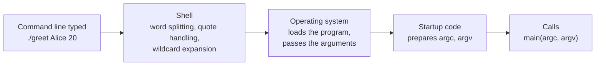
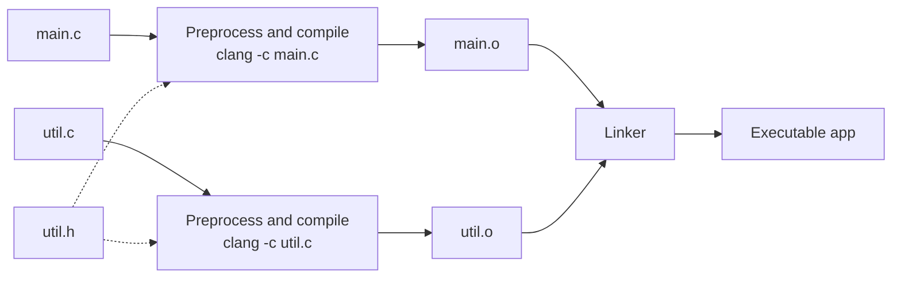

# Chapter 12 — File I/O and Program Structure

[Repository Guide](../../README.md) | [English](Concepts_Lecture.md) | [한국어](Concepts_Lecture.ko.md)

> **Last Updated:** 2026-11-09

> **Learning Objectives:**
> 1. Write a program with `int main(int argc, char *argv[])` that receives, checks, and converts command-line arguments and reports its result through the exit status
> 2. Explain how streams and buffering work and read and write text files and binary files
> 3. Distinguish the causes of failure using the return values of I/O functions together with `errno`, `feof`, and `ferror`, and release every resource
> 4. Use function-like macros and conditional compilation safely
> 5. Split a program into header files and multiple source files and find the causes of link errors
> 6. Control scope, lifetime, and linkage with storage-class specifiers and automate builds with a Makefile

---

## Table of Contents

- [1. Command-Line Arguments](#1-command-line-arguments)
  - [1.1 The Second Form of `main`](#11-the-second-form-of-main)
  - [1.2 The Structure of `argc` and `argv`](#12-the-structure-of-argc-and-argv)
  - [1.3 How to Run a Program with Arguments](#13-how-to-run-a-program-with-arguments)
  - [1.4 Converting String Arguments to Numbers](#14-converting-string-arguments-to-numbers)
  - [1.5 Argument Checks and Usage Messages](#15-argument-checks-and-usage-messages)
  - [1.6 Option Processing](#16-option-processing)
  - [1.7 Exit Status](#17-exit-status)
  - [1.8 A Complete Example](#18-a-complete-example)
- [2. Streams and File Pointers](#2-streams-and-file-pointers)
  - [2.1 Streams and `FILE`](#21-streams-and-file)
  - [2.2 Standard Streams](#22-standard-streams)
  - [2.3 Buffering and `fflush`](#23-buffering-and-fflush)
- [3. Text File I/O](#3-text-file-io)
  - [3.1 `fopen` and `fclose`](#31-fopen-and-fclose)
  - [3.2 Character I/O](#32-character-io)
  - [3.3 Line I/O](#33-line-io)
  - [3.4 Formatted I/O](#34-formatted-io)
  - [3.5 Detecting the End of a File](#35-detecting-the-end-of-a-file)
- [4. Binary File I/O](#4-binary-file-io)
  - [4.1 Text Mode and Binary Mode](#41-text-mode-and-binary-mode)
  - [4.2 `fread` and `fwrite`](#42-fread-and-fwrite)
  - [4.3 `fseek`, `ftell`, and `rewind`](#43-fseek-ftell-and-rewind)
  - [4.4 Cautions When Storing Structures in Files](#44-cautions-when-storing-structures-in-files)
- [5. Error Handling](#5-error-handling)
  - [5.1 Reporting Errors Through Return Values](#51-reporting-errors-through-return-values)
  - [5.2 `errno`, `perror`, and `strerror`](#52-errno-perror-and-strerror)
  - [5.3 Checking Stream Errors](#53-checking-stream-errors)
  - [5.4 Resource Cleanup Patterns](#54-resource-cleanup-patterns)
- [6. The Preprocessor](#6-the-preprocessor)
  - [6.1 The Two Forms of `#include`](#61-the-two-forms-of-include)
  - [6.2 Function-Like Macros and Parentheses](#62-function-like-macros-and-parentheses)
  - [6.3 The `#` and `##` Operators](#63-the--and--operators)
  - [6.4 Conditional Compilation](#64-conditional-compilation)
  - [6.5 Predefined Macros](#65-predefined-macros)
- [7. Programs Split into Multiple Files](#7-programs-split-into-multiple-files)
  - [7.1 Declarations, Definitions, and Translation Units](#71-declarations-definitions-and-translation-units)
  - [7.2 Writing Header Files](#72-writing-header-files)
  - [7.3 Header Guards](#73-header-guards)
  - [7.4 Separate Compilation and Link Errors](#74-separate-compilation-and-link-errors)
- [8. Storage Classes and Linkage](#8-storage-classes-and-linkage)
  - [8.1 Scope, Lifetime, and Linkage](#81-scope-lifetime-and-linkage)
  - [8.2 `static` Local Variables](#82-static-local-variables)
  - [8.3 `static` Global Variables and Functions](#83-static-global-variables-and-functions)
  - [8.4 `extern`](#84-extern)
  - [8.5 Other Storage-Class Specifiers](#85-other-storage-class-specifiers)
- [9. Build Tools](#9-build-tools)
  - [9.1 Compiler Options](#91-compiler-options)
  - [9.2 Makefile Basics](#92-makefile-basics)
- [Concept Applications](#concept-applications)
- [Summary](#summary)
- [Self-Check Questions](#self-check-questions)
- [References](#references)

---

<br>

## 1. Command-Line Arguments

### 1.1 The Second Form of `main`

The programs written so far begin with `int main()` or `int main(void)` ([Chapter 2, Section 1.3](../Ch02_C-Program-Basics/Concepts_Lecture.md#13-main-function)). A `main` of this form receives no information from outside when it runs, so changing a file name or a repeat count requires reading it at run time with `scanf` or editing and recompiling the source code. By contrast, commands such as `clang -o app main.c` and `cp a.txt b.txt` change their behavior according to the information written after the program name. For a C program to receive information this way, it uses the second form of `main`.

> **Definition:** **Command-line argument.** A string written after the program name in the command that runs a program and passed to that program.

The C standard requires `main` in a hosted environment to be defined with no parameters, with two parameters called `argc` and `argv`, or in an equivalent form, and it also allows other implementation-defined forms [1].

```c
int main(void)                      // the form that does not use command-line arguments
int main(int argc, char *argv[])    // the form that uses command-line arguments
```

`argc` (argument count) is the number of strings in `argv`, and the program name is included in that count. `argv` (argument vector) points to the first element of an array of pointers holding the start address of each string. These names are only the ones the standard uses in its description, and other names are allowed [1], but they are a widespread convention, so it is better not to change them. When a program runs, the shell, the operating system, and the **startup code** of the C run-time library turn the command line into an array of strings and then call `main`.

> **Definition:** **Shell.** A command interpreter that reads the command line typed by the user and runs programs. Representative shells are bash and zsh, and Windows has the Command Prompt (cmd) and PowerShell.



*Figure 1. How a command line becomes the parameters of `main`*

> **Caution:** `char *argv[]` and `char **argv` mean the same thing **only as function parameters**, because an array declared as a parameter is adjusted to a pointer to its first element ([Chapter 8, Section 3.4](../Ch08_Pointers/Concepts_Lecture.md#34-passing-arrays-to-functions)). In a declaration inside a function, `char *a[3]` is an array of three pointers while `char **p` is a single pointer variable, so their `sizeof` values and whether they can be assigned to differ.

> **Note:** The terminal output in this chapter comes from Apple clang 21, bash, and zsh on macOS (arm64), and address values are examples that change on every run.

### 1.2 The Structure of `argc` and `argv`

The following program prints the arguments it receives. The code is [Example_ArgDump.c](Example_ArgDump.c). Run as `./args Alice 20`, `argc` is 3 including the program name. Since `argv[argc]` is a null pointer, the array can also be traversed by pointer, as in `for (char **p = argv; *p != NULL; p++)`.

```c
int main(int argc, char *argv[])    // Run as ./args Alice 20
{
    printf("argc = %d\n", argc);    // argc = 3
    for (int i = 0; i < argc; i++)
        printf("argv[%d] = \"%s\"\n", i, argv[i]);
    return 0;                       // argv[0] = "./args", argv[1] = "Alice", argv[2] = "20"
}
```

Figure 2 shows the memory layout when running `./greet Alice 20`. `argv` points to the first element of the pointer array, and each element points to the first character of a string.

```text
argc = 3

argv: char **          array of pointers (8 bytes each)       strings (null-terminated)
┌──────────────┐      ┌────────────────────────────┐
│ 0x16f81f1f8  │ ───► │ [0] 0x16f81f408            │ ───► "./greet\0"  8 bytes
└──────────────┘      ├────────────────────────────┤
                      │ [1] 0x16f81f410            │ ───► "Alice\0"    6 bytes
                      ├────────────────────────────┤
                      │ [2] 0x16f81f416            │ ───► "20\0"       3 bytes
                      ├────────────────────────────┤
                      │ [3] NULL (argv[argc])      │
                      └────────────────────────────┘
                       addresses: 0x16f81f1f8, 0x16f81f200, 0x16f81f208, 0x16f81f210
```

*Figure 2. Memory layout of `argv` when running `./greet Alice 20` (64-bit environment, addresses are examples)*

`argv[1]` is a `char *` holding the start address of the string `"Alice"`, `argv[1][0]` is the `char` value `'A'`, and `argv[argc]` is a null pointer.

The C standard guarantees the following about the parameters of `main` [1].

- `argc` is not negative. It is usually at least 1, but the standard also allows 0.
- `argv[argc]` is a null pointer.
- If `argc` is at least 1, `argv[0]` points to a string that represents the program name, and if the name cannot be obtained from the environment, `argv[0][0]` is the null character.
- If `argc` is at least 2, `argv[1]` through `argv[argc - 1]` are the arguments passed to the program.
- The program may modify `argc`, `argv`, and the strings `argv` points to, and these values are retained until the program ends.

`argv[0]` is not guaranteed to be the path of the executable. Running the same program as `./args` makes `argv[0]` `"./args"`, running it as `bin/args` from the parent directory makes it `"bin/args"`, and running it with bash's `exec -a custom ./args` makes it `"custom"`. So `argv[0]` should be used only for display in usage messages, never as a basis for locating the executable.

> **[Systems Programming]** The `execve` system call, which runs a program, passes an `argv` array built by the caller directly to the new program. On macOS, passing an empty array makes `argc` 0 in the program that runs, so the program above prints only `argc = 0`. This result can differ between operating systems.

> **Key Point:** Every element of `argv` points to a **string**. Even if `20` is typed, `argv[2]` is not the integer 20 but a string made of the characters `'2'`, `'0'`, and `'\0'`, so it must be converted before arithmetic (Section 1.4).

### 1.3 How to Run a Program with Arguments

**Terminal.** In a terminal, compile the program and then write the arguments after the program name, separated by spaces.

```bash
clang -std=c17 -Wall -Wextra -o args Example_ArgDump.c      # macOS, Linux
./args Alice 20
cl /std:c17 /W4 Example_ArgDump.c /link /out:args.exe       # Windows Developer Command Prompt
args.exe Alice 20
```

`./` means the executable in the current directory. MSVC's `cl` cannot be used in a plain command prompt without preparation and runs in a Developer Command Prompt, where the required environment variables are set [2].

**Quoting and spaces.** The shell splits the command line at spaces and turns each word into one argument. To pass a value containing spaces as one argument, enclose it in quotes or put `\` before each space. The shell processes the quotes and removes them, so they are not passed to the program. Characters inside single quotes are passed literally, and inside double quotes `$`, the backtick, and `\` keep their special meanings, as does `!` in an interactive shell with history expansion on [3].

| Command (bash, zsh) | `argc` | Strings from `argv[1]` on |
|:-----|:-----|:-----|
| `./args hello world` | 3 | `hello`, `world` |
| `./args "hello world"` | 2 | `hello world` |
| `./args hello\ world` | 2 | `hello world` |
| `NAME=Kim; ./args "$NAME" '$NAME'` | 3 | `Kim`, `$NAME` |
| `./args "say \"hi\""` | 2 | `say "hi"` |

*Table 1. How quotes and spaces split arguments*

On Windows, the Microsoft C startup code receives the whole command line and splits it into arguments. Spaces and tabs are the separators, a part enclosed in double quotes is interpreted as one argument even if it contains spaces, and `\"` is a literal double quote [4].

**Wildcard expansion.** A word containing `*` or `?` is called a file name pattern. A POSIX shell replaces a pattern with the matching file names **before** running the program, so the program never sees the pattern and only receives the file names already listed. What happens when no file matches depends on the shell. bash passes the pattern unchanged [3], and zsh by default reports an error and does not run the program [5]. The table below shows the results when the current directory contains only `args`, `a.txt`, `b.txt`, and `c.log`.

| Command | bash | zsh |
|:-----|:-----|:-----|
| `./args *.txt` | `a.txt`, `b.txt` | `a.txt`, `b.txt` |
| `./args *.none` | `*.none` | Not run (`no matches found: *.none`) |
| `./args '*.txt'` | `*.txt` | `*.txt` |
| `./args 3 * 4` | `3`, `a.txt`, `args`, `b.txt`, `c.log`, `4` | Same |

*Table 2. Results of wildcard expansion by the shell*

> **Caution:** When a calculator program is run as `./calc 3 * 4` in a directory that contains files, `argv[2]` is not `*` but the first file name, and `argc` also changes. To pass the multiplication sign as an argument, write it as `'*'`, `"*"`, or `\*`.

The Windows C run-time library does not expand wildcards by default, and when expansion is needed, `setargv.obj` is linked as in `cl example.c /link setargv.obj` [6]. The `<`, `>`, and `|` on a command line are also processed by the shell, so they do not appear in `argv` (Section 2.2).

**Visual Studio.** On the project's Property Pages, write the arguments in the **Command Arguments** box under `[Configuration Properties]` → `[Debugging]`. Redirections such as `< file` or `> file` can also be written in this box. The program's working directory is set by the **Working Directory** entry on the same page, and if it is left blank, the working directory is the project directory [7].

**Xcode.** Click the scheme name in the toolbar to edit the scheme, and add the arguments on the Arguments tab of the Run action. Xcode passes these arguments directly to the launched process [8]. The runtime environment is configured on the Options tab of the same action [8]. If the program opens files by relative path, specify the working directory there with **Use custom working directory**.

> **Caution:** A relative path passed to a program is resolved against the **working directory**, not the location of the source file. In a terminal this is the current directory, and in an IDE it is the setting above. This is the first item to check when a program run from an IDE cannot find a file.

### 1.4 Converting String Arguments to Numbers

`atoi` is simple, as shown in [Chapter 9, Section 5.1](../Ch09_Strings/Concepts_Lecture.md#51-string-to-number), but it is not adequate for strings coming from outside the program. It returns 0 for both `"abc"` and `"0"`, so failure cannot be detected, and if the result cannot be represented in an `int`, the behavior is undefined [1]. The function that allows failure to be checked is `strtol` from `<stdlib.h>`.

The prototype of `strtol` is `long strtol(const char *s, char **endptr, int base);`. `s` is the string to convert; leading white space is skipped and a sign is accepted. `base` is a base from 2 to 36, or 0 to determine the base from the prefix (`0x` for hexadecimal, `0` for octal, otherwise decimal; C23 adds `0b` for binary [9]). `endptr` receives the address of a `char *` variable that will hold where the conversion ended, and it has type `char **` because the function must change the caller's variable ([Chapter 8, Section 3.2](../Ch08_Pointers/Concepts_Lecture.md#32-modifying-a-variable-through-a-pointer), [Chapter 11, Section 6.1](../Ch11_Dynamic-Memory-and-Advanced-Pointers/Concepts_Lecture.md#61-double-pointers)). Converting `"42abc"` makes `strtol` return the number 42 and set `end` to the position of `'a'`.

```text
s   ──►  [ '4' ][ '2' ][ 'a' ][ 'b' ][ 'c' ][ '\0' ]
                        ▲
end ────────────────────┘
```

*Figure 3. The position `end` points to after `strtol("42abc", &end, 10)`*

`errno` is a variable from `<errno.h>` in which library functions record an error number (Section 5.2), and `ERANGE` is the name of the error number that means out of range. Deciding whether a conversion fully succeeded takes the following five steps, and the function `parse_int` in Section 1.8 packages this check.

1. Execute `errno = 0;` before the call. Library functions do not reset `errno` to 0 even on success, so the previous value must be cleared for the check to mean anything [1].
2. If `end == s`, not a single digit was read.
3. If `*end != '\0'`, other characters remain after the number.
4. If `errno == ERANGE`, the value is outside the range of `long`, and the return value is `LONG_MAX` or `LONG_MIN` [1].
5. To store the value in an `int`, check that it is between `INT_MIN` and `INT_MAX`. This matters only where `long` is wider than `int`, but always checking does no harm.

| Input `s` | Return Value | String `end` points to | `errno` | `parse_int` |
|:-----|:-----|:-----|:-----|:-----|
| `"42"` | 42 | `""` | 0 | Success |
| `"12abc"` | 12 | `"abc"` | 0 | Failure (text after the number) |
| `"abc"` | 0 | `"abc"` (`end == s`) | Implementation-dependent | Failure (no digits) |
| `"99999999999999999999"` | `LONG_MAX` | `""` | `ERANGE` | Failure (out of range) |
| `"3000000000"` | 3000000000 | `""` | 0 | Failure (out of `int` range) |

*Table 3. Results of `strtol` with `base` 10 and the verdict (where `long` is 64 bits)*

In the row where no digits are found, ISO C does not specify `errno`, and on macOS it was `EINVAL`. The effect of the base can be seen in that `strtol("0x1F", &end, 16)` is 31, `strtol("077", &end, 0)` is 63, and `strtol("077", &end, 10)` is 77 [1]. Similar functions are `strtoll` for `long long` and `strtod` for `double`. `strtoul` converts to `unsigned long`, but it also accepts `"-1"` without error and returns `ULONG_MAX` (18446744073709551615 on macOS), so rejecting negative values requires checking the input separately.

### 1.5 Argument Checks and Usage Messages

Check `argc` before using the arguments. If `argc` is 1, `argv[1]` is a null pointer, and passing it to `printf("%s", ...)` or `atoi` is undefined behavior [1]. In practice, running `printf("Hello, %s\n", argv[1]);` without arguments printed `Hello, (null)` on macOS, and `atoi(argv[1])` terminated with a segmentation fault (the operating system forcibly ending a program for an invalid memory access). Neither result is guaranteed by the standard, so check the count first, report the usage, and exit.

```c
if (argc != 3) {
    fprintf(stderr, "Usage: %s <source> <destination>\n", argc > 0 ? argv[0] : "safecopy");
    return 2;
}
```

The notation of a usage message follows the POSIX utility conventions. `[ ]` marks an argument that can be omitted, `...` marks an argument that can repeat, and a name in angle brackets such as `<name>` marks a place to be replaced by an actual value [10]. Write the message to standard error so that it is not mixed with the program's results (Section 2.2), and end the program with a nonzero exit status. `fprintf` is a `printf` that takes the output target as its first argument (Section 3.4). The `argc > 0` test in the code above guards against the case where `argc` is 0 (Section 1.2).

### 1.6 Option Processing

Command-line arguments fall into three kinds by role. An argument such as `-u` that begins with `-` and changes behavior is an **option**, a value attached to an option such as the `2` in `-n 2` is an **option-argument**, and the remaining arguments that specify what to process are **operands**. Under the POSIX conventions, an option name is a single alphanumeric character, the first `--` marks the end of the options so that the arguments after it are operands even if they begin with `-`, and a lone `-` is used as an operand meaning standard input or standard output [10].

To process options by hand, use a loop that advances the index `i` according to whether an option-argument is present. The loop is in Section 1.8, and the processing of `./repeat -n 2 -u hi there` is as follows.

| `i` | `argv[i]` | Decision | Action | Next `i` |
|:-----|:-----|:-----|:-----|:-----|
| 1 | `-n` | Matches `-n` and `argv[2]` exists | `count = 2` via `parse_int` | 3 |
| 3 | `-u` | Matches `-u` | `upper = 1` | 4 |
| 4 | `hi` | Does not begin with `-` | Option loop ends | 4 |

*Table 4. Tracing option processing for `./repeat -n 2 -u hi there`*

The test `argv[i][1] != '\0'` in the loop condition keeps a lone `-` from being treated as an option, and the test `i + 1 >= argc` guards against `-n` being the last argument with no value.

In a POSIX environment, `getopt` from `<unistd.h>` does this work [11]. In the option string `"un:"`, the `:` after `n` means that option requires an option-argument. `getopt` returns the options one at a time and then -1, delivers an option-argument through `optarg` and the position of the first operand through `optind`, and also handles attached values as in `-n3` and combined options as in `-un 3`.

```c
while ((opt = getopt(argc, argv, "un:")) != -1) {
    if (opt == 'u') upper = 1;
    else if (opt == 'n') { if (!parse_int(optarg, &count)) return 2; }
    else return 2;                       // An unknown option makes it return '?'
}
```

`getopt` is a POSIX function and is not part of the ISO C standard library, so code that assumes only standard C uses a hand-written loop. A strict mode such as `-std=c17` hides its declaration in some environments; there, put `#define _POSIX_C_SOURCE 200809L` before the `#include` lines.

### 1.7 Exit Status

The exit code returned by `return` in `main` ([Chapter 2, Section 1.4](../Ch02_C-Program-Basics/Concepts_Lecture.md#14-exit-code)) is the value that tells whoever ran the program what happened, and this chapter calls it the exit status, following the usage of POSIX and the shell.

> **Definition:** **Exit status.** The integer value delivered, when a program ends, to whoever ran that program (a shell or another program).

- Executing `return n;` in the initial call to `main` is equivalent to calling `exit(n)` [1].
- Since C99, reaching the closing `}` of `main` returns 0 [1]. This rule applies only to `main`, and clang warns about such code when compiled with `-std=c89 -pedantic`.
- 0 and `EXIT_SUCCESS` mean success, and `EXIT_FAILURE` means failure. The meaning of any other value is implementation-defined [1].

In POSIX, a parent process can see only the **low 8 bits** of the status with `wait` or `waitpid` [12]. So a value appears modulo 256. The results checked with bash's `$?` are 3 for `exit(3)`, 255 for `exit(255)`, 0 for `exit(256)`, 1 for `exit(257)`, 232 for `exit(1000)`, and 255 for `exit(-1)`.

> **Caution:** Contrary to the intent of reporting failure, `exit(256)` looks like **success** to the shell. It is safest to limit exit statuses to small values such as 0, 1, and 2. Many tools use 2 for usage errors, and Bash builtins also return 2 for incorrect usage [3].

`exit` calls the functions registered with `atexit` in the reverse order of their registration, then flushes unwritten buffers, closes all open streams, removes files created by `tmpfile`, and returns the exit status to the environment [1]. If `first` and then `second` are registered with `atexit` and `exit` is called after `printf("printed before exit\n");`, the output order is `printed before exit`, `second registered`, `first registered`. `_Exit` does not call the `atexit` functions, and whether it flushes streams is implementation-defined [1]. Stream handling by `abort` is also implementation-defined [1]. Testing the same code on macOS left the buffer written before `_Exit` out of the file and the buffer written before `abort` in the file, but portable code must not depend on these results.

The shell uses the exit status to decide what to do next, treating 0 as success [3]. `./repeat ok && echo next` runs `echo` only on success, `./repeat -z || echo failed` runs it only on failure, and `echo $?` shows the status of the last command. In the Windows Command Prompt `%ERRORLEVEL%` [13] and in PowerShell `$LASTEXITCODE` [14] show the same value. For a program killed by a signal (a notification the operating system sends a process about an event), bash reports 128 plus the signal number as the status [3]. A program ended by `abort` was observed with 134 (SIGABRT is signal 6), and one ended by dereferencing a null pointer with 139 (SIGSEGV is signal 11).

### 1.8 A Complete Example

This program combines all of the previous sections. It processes the `-n count` and `-u` options, checks the number, reports the usage on standard error, and returns an exit status that matches the result. The code is [Example_RepeatWords.c](Example_RepeatWords.c). The listing below shows the conversion function and the option handling, and omits the `#include` lines, the constant `STATUS_USAGE` (value 2), the `usage` function that prints the usage message and returns that value, and the final loop that prints the words.

```c
// Converts all of s to an int. Returns 1 on success and 0 on failure.
static int parse_int(const char *s, int *out)
{
    char *end;
    errno = 0;                                      // strtol never clears errno itself
    long value = strtol(s, &end, 10);
    if (end == s || *end != '\0' || errno == ERANGE) // No digits, trailing text, or out of range
        return 0;
    if (value < INT_MIN || value > INT_MAX)         // Fits in a long but not in an int
        return 0;

    *out = (int)value;
    return 1;
}

int main(int argc, char *argv[])
{
    const char *prog = (argc > 0 && argv[0][0] != '\0') ? argv[0] : "repeat";
    int count = 1, upper = 0, i = 1;
    // Option loop: stops at the first argument that is not an option
    while (i < argc && argv[i][0] == '-' && argv[i][1] != '\0') {
        if (strcmp(argv[i], "--") == 0) {           // End of the options
            i++;
            break;
        } else if (strcmp(argv[i], "-u") == 0) {
            upper = 1;
            i++;
        } else if (strcmp(argv[i], "-n") == 0) {
            if (i + 1 >= argc || !parse_int(argv[i + 1], &count) || count < 0) {
                fprintf(stderr, "%s: -n needs a non-negative count\n", prog);
                return STATUS_USAGE;
            }
            i += 2;                                 // Skip -n and its value
        } else {
            fprintf(stderr, "%s: unknown option: %s\n", prog, argv[i]);
            return usage(prog);
        }
    }
    if (i >= argc)                                  // At least one word is required
        return usage(prog);

    /* Print each remaining word count times, in upper case if -u was given. */
    return EXIT_SUCCESS;
}
```

```text
$ ./repeat -n 2 -u hi
HI
HI
$ ./repeat -n 3x word; echo "status: $?"
./repeat: -n needs a non-negative count
status: 2
```

> **Key Point:** A program that handles command-line arguments checks their count with `argc`, converts strings with `strtol`, prints errors on standard error, and distinguishes success from failure with the exit status.

---

<br>

## 2. Streams and File Pointers

### 2.1 Streams and `FILE`

A C program handles the keyboard, the screen, and files on disk in the same way. Whatever the I/O target is, the program reads and writes a **stream** with uniform properties, and the library and the operating system handle the differences from the actual device or file [1].

> **Definition:** **Stream.** A logical channel through which characters flow in order between a program and an I/O device or file.

`FILE` from `<stdio.h>` is a data type that records the information needed to control a stream: the file position indicator (the next position to read or write), the location of the buffer, the error indicator, and the end-of-file indicator [1]. A program does not create `FILE` objects itself or access their members, and uses only the pointer returned by the library.

> **Definition:** **File pointer.** A pointer of type `FILE *` that points to the `FILE` object controlling an open stream.

### 2.2 Standard Streams

When a program starts, three standard streams are already open [1]. By default `stdin` is connected to the keyboard and `stdout` and `stderr` to the screen. The number by which the operating system identifies an open file is called a file descriptor, and POSIX specifies the numbers 0, 1, and 2 for these three streams [15]. `printf(...)` is the same as `fprintf(stdout, ...)`, and `getchar()` is the same as `getc(stdin)`.

> **Definition:** **Standard stream.** One of the three streams already open when a program starts: `stdin` (standard input), `stdout` (standard output), and `stderr` (standard error).

The shell can change these connections when a program is run.

> **Definition:** **Redirection.** A shell feature that connects a program's standard streams to files instead of the keyboard or screen.

> **Definition:** **Pipe.** An operating-system channel that carries the output of one program to the input of another; in a shell, `|` connects the standard output of the first program to the standard input of the next.

| Command | Meaning |
|:-----|:-----|
| `./p < in.txt` | Reads standard input from `in.txt` |
| `./p > out.txt` | Writes standard output to `out.txt` (erasing its contents) |
| `./p >> out.txt` | Appends standard output to the end of `out.txt` |
| `./p 2> err.txt` | Writes standard error to `err.txt` |
| `./p > all.txt 2>&1` | Writes both standard output and standard error to `all.txt` |
| `./p1 \| ./p2` | Connects the standard output of `p1` to the standard input of `p2` |

*Table 5. Redirection and pipes*

`while ((c = getchar()) != EOF) putchar(toupper(c));` reads standard input to the end and prints it in upper case (`c` is an `int`). The code is the same whether the input is the keyboard, a file, or a pipe, and the output of `echo 'hello' | ./up` is `HELLO`. The end of keyboard input is signaled at the start of a line with `Ctrl+D` on macOS and Linux or with `Ctrl+Z` and Enter on Windows. Writing error messages to `stderr` keeps them on the screen even when output is sent to a file. With `./p > out.txt`, the file `out.txt` receives only the results and warnings appear in the terminal, so the result file is not polluted by error messages.

### 2.3 Buffering and `fflush`

> **Definition:** **Buffering.** A technique that collects input or output in a memory buffer and transfers it in blocks instead of one character at a time.

| Mode | `setvbuf` Constant | When Data Is Transferred |
|:-----|:-----|:-----|
| Fully buffered | `_IOFBF` | When the buffer is full |
| Line buffered | `_IOLBF` | When a newline character is written (or the buffer is full) |
| Unbuffered | `_IONBF` | As soon as possible |

*Table 6. The three buffering modes of a stream*

The standard requires `stdin` and `stdout` to be fully buffered only when they can be determined not to refer to an interactive device, and requires that `stderr` not be fully buffered [1]. In typical implementations `stdout` is line buffered when connected to a terminal and fully buffered when connected to a file or pipe. This is why the output order of `printf("A\n"); fprintf(stderr, "B\n"); printf("C\n");` depends on where it is connected.

```text
$ ./order                printed directly to the terminal: A, B, C
$ ./order 2>&1 | cat     stdout connected to a pipe: B, A, C
```

When connected to a pipe, `A` and `C` accumulate in the buffer and are delivered together when the program ends, so `B` appears first. `fflush(fp)` immediately delivers the contents of an output stream's buffer to the environment and returns `EOF` on error [1]. `fflush(NULL)` flushes all output streams. A prompt without a newline should be flushed to the screen before reading input, as in `printf("Enter a number: "); fflush(stdout);`.

The contents of a buffer are delivered when the program ends normally or the buffer is flushed, so they are lost if the program is killed. When the output of a program that runs `printf("written with printf\n");` followed by `raise(SIGKILL);` was sent to a file, the file was 0 bytes, and with `fflush(stdout);` inserted between them, 20 bytes were saved. To change the buffering mode, call `setvbuf` as in `setvbuf(stdout, NULL, _IONBF, 0);` right after the stream is opened and before any other operation on it [1].

> **Caution:** `fflush(stdin)` is **undefined behavior** in ISO C, because `fflush` is defined only for output streams and update streams whose last operation was not input [1]. POSIX gives it a separate meaning for seekable input streams [16], and Microsoft's documentation states that it has no effect on a stream opened in read mode [17], so it cannot be used to clear the input buffer. To discard remaining input, read and discard it directly as in `while ((c = getchar()) != '\n' && c != EOF) { }`.

---

<br>

## 3. Text File I/O

### 3.1 `fopen` and `fclose`

`fopen` opens a file, associates a stream with it, and returns a file pointer, or returns a null pointer on failure [1]. The prototypes are `FILE *fopen(const char *filename, const char *mode);` and `int fclose(FILE *stream);`.

```c
FILE *fp = fopen("data.txt", "r");
if (fp == NULL) {               // NULL if the file is missing or permission is denied
    perror("data.txt");         // Print the cause on standard error (Section 5.2)
    return 1;
}
/* read the file through fp */
fclose(fp);
```

| Mode | Meaning | If the File Is Missing | If the File Exists |
|:-----|:-----|:-----|:-----|
| `"r"` | Read | Fails | Reads from the beginning |
| `"w"` | Write | Creates it | Erases the contents, then writes |
| `"a"` | Append | Creates it | Writes at the end |
| `"r+"` | Read and write | Fails | Keeps the contents, starts at the beginning |
| `"w+"` | Read and write | Creates it | Erases the contents |
| `"a+"` | Read and append | Creates it | Writes at the end |
| `"wx"`, `"w+x"` (C11) | Exclusive write | Creates it | **Fails** |

*Table 7. Mode strings of `fopen`*

Binary modes add `b`, as in `"rb"`, `"r+b"`, and `"wbx"` (Section 4.1). Opening a file with `"w"` by mistake erases its contents at once. To protect an existing file, use `x`, added in C11, which makes the open fail if the file already exists [1]. Writes in `"a"` mode always go to the end of the file even if `fseek` moves the position, and in update modes with `+`, output followed by input requires `fflush` or a file positioning function in between, and input followed by output requires a file positioning function unless the input reached the end of the file [1].

`fclose` sends data remaining in the buffer to the file and closes the stream, returning 0 on success and `EOF` on error. The value of a file pointer after closing is indeterminate, so it must not be used again [1]. If a program keeps opening streams without closing them, `fopen` eventually fails with `Too many open files`. The number of files that the standard guarantees can be open at once is at least `FOPEN_MAX` [1].

A relative path is resolved against the working directory (Section 1.3). On Windows both `/` and `\` can be used as path separators [18], but a `\` in a string must be written twice, as in `"C:\\data\\a.txt"`.

> **Note:** **Visual Studio and `fopen`.** Visual Studio issues warning C4996 for `fopen`, and the build fails when the SDL checks are on ([Chapter 3 Lab, Section 5.1](../Ch03_Data-Types-and-Variables/Concepts_Lab.md#51-warning-c4996)). Either write `#define _CRT_SECURE_NO_WARNINGS` before the `#include` lines or use Microsoft's replacement function `errno_t fopen_s(FILE **pFile, const char *filename, const char *mode);`. `fopen_s` returns 0 on success and an error code on failure, and delivers the file pointer through its first argument [19]. The examples in this chapter use `fopen` rather than `fopen_s` and define `_CRT_SECURE_NO_WARNINGS` so that they compile unchanged in Visual Studio and with other compilers.

### 3.2 Character I/O

`fgetc(fp)` and `getc(fp)` read one character, returning it as an `unsigned char` converted to `int`, or `EOF` at the end or on error, and `fputc(c, fp)` and `putc(c, fp)` write one character, returning `EOF` on failure. `ungetc(c, fp)` pushes a character back onto the stream.

`getc` and `putc` may be implemented as macros that evaluate the stream argument more than once [1], so an expression with side effects must not be used as that argument.

> **Caution:** The return value of `fgetc` must be received in an `int`. `fgetc` returns `int` to distinguish all `unsigned char` values from the negative value `EOF`, which is outside that range, and storing the result in a `char` destroys that distinction.

Reading a file containing the bytes `41 42 FF 43 44` gets all 5 bytes when the result is received in an `int`, but with `char c;` and `while ((c = fgetc(fp)) != EOF)` it stops after 2 bytes, because where `char` is signed and `EOF` is -1, `0xFF` becomes `-1`, which equals `EOF`. Where `char` is unsigned, the opposite problem occurs. `c` can never equal the negative `EOF`, so the loop never ends. When the same code was compiled with `-funsigned-char`, clang warned `result of comparison of constant -1 with expression of type 'char' is always true`, and the program did not terminate.

### 3.3 Line I/O

`fgets(buf, n, fp)`, like its use on standard input ([Chapter 9, Section 4.2](../Ch09_Strings/Concepts_Lecture.md#42-fgets--gets_s)), reads at most `n - 1` characters, stores them including any newline character, and returns `NULL` at the end or on error. `fputs(s, fp)` writes a string but, unlike `puts`, does not append a newline.

If a line is longer than the buffer, one `fgets` call does not receive the whole line. The following are the results of reading a file containing `hello world\nhi\n` with `char buf[8]`.

| Call | Contents of `buf` | `strlen` | `'\n'` at the End |
|:-----|:-----|:-----|:-----|
| 1 | `hello w` | 7 | No (the line continues) |
| 2 | `orld\n` | 5 | Yes |
| 3 | `hi\n` | 3 | Yes |
| 4 | `NULL` returned | | |

*Table 8. Results of calling `fgets` with `char buf[8]`*

So the end of a line is determined by whether the stored string ends with a newline (`len > 0 && buf[len - 1] == '\n'`, where `len` is `strlen(buf)`). [Example_LineStats.c](Example_LineStats.c) computes the number of lines, the number of characters, and the length of the longest line with a 16-byte buffer, including the case where the last line has no newline.

### 3.4 Formatted I/O

`fprintf` and `fscanf` are used like `printf` and `scanf` and take a file pointer as their first argument. `fscanf` returns the number of items successfully converted and stored, and returns `EOF` if input ends before the first conversion.

```c
fprintf(fp, "%s %d %.1f\n", "Alice", 90, 3.8);      // Write to a file opened with "w"
while (fscanf(fp, "%19s %d %lf", name, &score, &gpa) == 3) {  // Judge by the item count
    printf("name=%s score=%d gpa=%.1f\n", name, score, gpa);  // name=Alice score=90 gpa=3.8
}
```

A width is specified for `%s` to prevent a buffer overflow. When `fscanf` meets input that does not match the format, it stops at that position and cannot skip the bad input. For a file with line structure, reading each line with `fgets` and analyzing it with `sscanf` ([Chapter 9, Section 5.2](../Ch09_Strings/Concepts_Lecture.md#52-sscanf--sprintf)) makes it possible to skip only the bad lines. For example, reading a file containing `Alice 90`, `oops`, and `Bob 85` this way reports `line 2: malformed: oops` and processes the other two lines normally.

### 3.5 Detecting the End of a File

`EOF` is a negative `int` constant defined in `<stdio.h>`. The most common mistake in detecting the end of a file is misunderstanding `feof`. `feof(fp)` becomes true when **a previous read reached the end of the file** and set the end-of-file indicator. It is not a function that tells in advance whether the file position is at the end [1]. Even right after opening an empty file, `feof` is false, and it becomes true only after `fgetc` returns `EOF`.

The following is wrong code caused by this misunderstanding, with its result. When the file ends with a newline after the last number, as in `10 20 30\n`, even after the third read succeeds the end has not yet been reached, so the loop runs once more, the fourth `fscanf` fails, and the previous value 30 remains in `value`. If the file ends right after `30`, the third `fscanf` reaches the end of the file while looking for the end of the number, so the loop stops after three passes and `sum` is 60.

```c
int value = 0, sum = 0;
while (!feof(fp)) {             // Deliberately wrong
    fscanf(fp, "%d", &value);
    printf("read %d\n", value);  // read 10, read 20, read 30, read 30
    sum += value;
}                               // Result: sum = 90
```

Control the loop with the return value of the reading function, and use `feof` and `ferror` after the loop to **distinguish the cause**.

```c
while (fscanf(fp, "%d", &value) == 1) {
    sum += value;
}
if (ferror(fp)) {
    perror("read");             // A read error
} else if (!feof(fp)) {
    fprintf(stderr, "malformed input\n");   // Not the end, so a format error
}
```

> **Key Point:** Detect the end of a file from the return value of the read function, and use `feof` and `ferror` only after the loop, to tell the causes apart.

---

<br>

## 4. Binary File I/O

### 4.1 Text Mode and Binary Mode

> **Definition:** **Text mode.** A stream mode that treats a file as a sequence of lines and may convert characters to fit the line-ending conventions of the environment.

> **Definition:** **Binary mode.** A stream mode that reads and writes the bytes of a file unchanged.

In a C text stream, characters may be added, altered, or deleted to fit the conventions of the environment, so the bytes of the file and of the stream need not correspond one to one, while in a binary stream the data read equals the data written [1]. In POSIX there is no difference between the two modes and `b` has no effect [20]. In Windows text mode, `\n` is converted to `\r\n` on output and `\r\n` to `\n` on input, and `Ctrl+Z` is treated as the end of the file on input [18].

The representations also differ. Writing the integer 1234 with `fprintf(fp, "%d", value)` stores four characters, and writing it with `fwrite(&value, sizeof value, 1, fp)` stores the bytes in memory unchanged. Where `int` is 4 bytes, the two files having the same size is a coincidence: for 12345678 the text form would be 8 bytes while the binary form remains 4 bytes.

```text
$ xxd num.txt
00000000: 3132 3334                                1234
$ xxd num.bin
00000000: d204 0000                                ....
```

`0x000004D2` is stored as `D2 04 00 00` because the environment is little-endian ([Chapter 13, Section 5.2](../Ch13_Standard-Library-and-Modern-C/Concepts_Lecture.md#52-endianness)).

### 4.2 `fread` and `fwrite`

In `fread(ptr, size, nmemb, stream)` and `fwrite(ptr, size, nmemb, stream)`, `size` is the size of one element in bytes and `nmemb` is the number of elements. Both functions return the number of **elements** actually processed, and if the result of `fread` is less than requested, the end of the file or an error occurred. The value of a partially read element is indeterminate [1].

```c
int out[3] = {10, 20, 30}, in[5];
size_t written = fwrite(out, sizeof out[0], 3, fp);   // A file opened with "wb": written is 3
size_t got = fread(in, sizeof in[0], 5, fp);          // Reopened with "rb" and 5 requested: got is 3
```

The file holds the 12 bytes `0a00 0000 1400 0000 1e00 0000`, and after `fread` requesting 5 elements returns 3, `feof` is true.

### 4.3 `fseek`, `ftell`, and `rewind`

The file position indicator is the position where the next input or output begins. `fseek(stream, offset, whence)` moves the position and returns 0 on success, `ftell(stream)` returns the current position or `-1L` on failure, and `rewind(stream)` moves to the start and clears the error indicator. `whence` is the origin: `SEEK_SET` is the start of the file, `SEEK_CUR` the current position, and `SEEK_END` the end of the file. The results of each call after writing to a file opened with `"w+b"` are as follows.

```c
fputs("ABCDEFGHIJ", fp);        // ftell is 10
fseek(fp, 2L, SEEK_SET);        // next fgetc gives C, then ftell is 3
fseek(fp, 3L, SEEK_CUR);        // next fgetc gives G, then ftell is 7
fseek(fp, -1L, SEEK_END);       // next fgetc gives J, then ftell is 10
rewind(fp);                     // next fgetc gives A, then ftell is 1
```

A successful `fseek` clears the end-of-file indicator [1]. When records of equal size are stored in a binary file, the `i`-th record is at position `i * sizeof(struct record)`, so it can be accessed directly without reading the records before it. [Example_BinaryRecords.c](Example_BinaryRecords.c) stores three 16-byte records (a 48-byte file) and then changes only the score of the second record from 81.00 to 88.75.

> **Caution:** The restrictions on `fseek` depend on the kind of stream [1]. On a text stream, `offset` must be 0 or a value returned by an earlier `ftell` on the same file used with `SEEK_SET`. A binary stream need not meaningfully support `SEEK_END`. So finding a file's size with `fseek(fp, 0L, SEEK_END)` and `ftell` is widely used but not fully portable. Where `long` is 32 bits, positions beyond 2 GB cannot be represented, so use `fseeko` in POSIX [21] or `_fseeki64` on Windows [22].

### 4.4 Cautions When Storing Structures in Files

`fwrite(&s, sizeof s, 1, fp)` stores the memory bytes of a structure unchanged. This is convenient if the same program reads the data back in the same environment, but for the following reasons it is not guaranteed to be readable by another compiler or another machine.

- **Padding:** Padding between members ([Chapter 10, Section 1.2](../Ch10_Structures/Concepts_Lecture.md#12-structure-definition)) is stored too, and its value is unspecified. The amount of padding can differ between compilers.
- **Sizes of data types:** The sizes of `int` and `long` depend on the implementation. When a file format is needed, use fixed-width integers ([Chapter 13, Section 2.1](../Ch13_Standard-Library-and-Modern-C/Concepts_Lecture.md#21-fixed-width-integers)).
- **Endianness:** The byte order of multi-byte values differs between machines ([Chapter 13, Section 5.2](../Ch13_Standard-Library-and-Modern-C/Concepts_Lecture.md#52-endianness)).
- **Pointer members:** Only the address value is stored, not what the pointer points to, and it means nothing in another run.

With `struct pad { char c; int n; } s;`, filling all of its bytes with `memset(&s, 0xAB, sizeof s);`, storing `s.c = 'A'; s.n = 1;`, and writing it with `fwrite(&s, sizeof s, 1, fp);` gives the `xxd` output `41ab abab 0100 0000`. The three bytes `ab ab ab` after `41` are the padding. Without `memset`, those positions may hold whatever was left in memory. To keep padding out of the file, write the members one at a time, as in `fwrite(&r.id, sizeof r.id, 1, fp);`. Written this way, a record of `Example_BinaryRecords.c` becomes 13 bytes rather than 16. Differences in type sizes and endianness remain, so a file that other machines must read uses fixed-width integers written in a defined byte order.

> **[Software Security]** If memory contents left in padding go out to a file or a network, secret information can leak. To close this path, write out only the members that are needed instead of copying the whole structure.

---

<br>

## 5. Error Handling

### 5.1 Reporting Errors Through Return Values

C has no exceptions, so functions report failure through their return values. If the caller does not check, the error passes silently.

| Function | Indication of Failure |
|:-----|:-----|
| `fopen` | `NULL` |
| `fclose`, `fflush`, `fputs`, `fputc` | `EOF` |
| `fgetc` | `EOF` (use `ferror` to tell the end from an error) |
| `fprintf`, `printf` | A negative value |
| `fscanf`, `sscanf` | The number of items converted, or `EOF` before the first conversion |
| `fread`, `fwrite` | Fewer elements than requested |

*Table 9. How standard I/O functions indicate failure*

Functions you write yourself follow the same conventions. A function that returns a pointer reports failure with `NULL`, and a function that returns a value reports it with an agreed value. If the result is returned through an output parameter and the return value indicates success, as with `parse_int` in Section 1.8, no value can collide with the error indication.

### 5.2 `errno`, `perror`, and `strerror`

`errno` in `<errno.h>` is a modifiable `int` lvalue that holds an error number, with a separate one for each thread since C11. It is 0 at program startup, and library functions never reset it to 0 [1]. `perror(s)` prints `s`, a colon, a space, and the error message on standard error, and `strerror(n)` returns the message string for number `n` [1].

```c
FILE *fp = fopen("missing.txt", "r");
if (fp == NULL) {
    int saved = errno;                                  // Save it before anything else can change it
    fprintf(stderr, "%d: %s\n", saved, strerror(saved)); // 2: No such file or directory
    errno = saved;
    perror("missing.txt");                              // missing.txt: No such file or directory
}
```

The values of error numbers differ between environments, so compare by name rather than by number. On macOS, opening a missing file with `"r"` set `ENOENT` (2, `No such file or directory`), opening a file without write permission with `"w"` set `EACCES` (13, `Permission denied`), and opening a directory with `"w"` set `EISDIR` (21, `Is a directory`).

> **Caution:** `errno` is meaningful **only right after a function reports failure**. A successful function may also change `errno` [1], and another call such as `printf` in between can overwrite the value, so save it in a local variable first. In addition, ISO C does not require `fopen` to set `errno`. POSIX requires it [20] and Microsoft's documentation describes the same behavior [18], so `perror` can be used in common environments, but this is not a guarantee of ISO C.

### 5.3 Checking Stream Errors

A stream has an end-of-file indicator and an error indicator. `feof` and `ferror` read these indicators, and `clearerr` clears both. For example, on macOS, reading a stream opened only for writing with `fgetc` returned `EOF`, left `feof` 0, and made `ferror` true. An indicator stays set until cleared, so checking once after a loop ends is enough to detect an error that occurred along the way.

A write error can appear later because of buffering. With standard output closed (`./closed >&-`), calling `printf("hello\n");` and then `fflush(stdout);` makes `printf` return 6 because it only accumulates data in the buffer, and the failure shows up when `fflush` returns -1. So a program that writes a file must also check the return value of `fclose` to know that the write succeeded all the way through.

### 5.4 Resource Cleanup Patterns

In a function that opens several files, writing `return` at each failure point repeats the code that closes the files already open, and forgetting it leaks resources. Placing the cleanup code in one spot at the end of the function and jumping there on failure with `goto` is a common idiom in C ([Chapter 5, Section 4.3](../Ch05_Control-Statements/Concepts_Lecture.md#43-goto)). The core of [Example_SafeCopy.c](Example_SafeCopy.c) is as follows.

```c
static int copy_file(const char *src_path, const char *dst_path)
{
    int result = -1;
    FILE *src = NULL, *dst = NULL;

    src = fopen(src_path, "rb");
    if (src == NULL) { perror(src_path); goto cleanup; }
    dst = fopen(dst_path, "wb");
    if (dst == NULL) { perror(dst_path); goto cleanup; }
    /* copy with fread and fwrite; on failure perror and goto cleanup; finally check ferror */
    result = 0;

cleanup:
    if (src != NULL) { fclose(src); }
    if (dst != NULL && fclose(dst) == EOF && result == 0) {
        perror(dst_path);               // Buffered data may fail to reach the file here
        result = -1;
    }
    return result;
}
```

Because the pointers were initialized to `NULL`, the cleanup code closes only the resources that are open, whichever step failed. Unlike `free(NULL)`, `fclose(NULL)` is not defined by the standard [1], so the `NULL` checks are required.

---

<br>

## 6. The Preprocessor

> **Definition:** **Preprocessor.** The translation phase ([Chapter 1, Section 3.2](../Ch01_Programming-and-C-Language/Concepts_Lecture.md#32-build-process)) that processes `#` directives and transforms source code before compilation.

> **Definition:** **Directive.** A line beginning with `#` that gives a command to the preprocessor and does not end with a semicolon.

The preprocessor replaces **tokens** (the smallest units of source code, such as names, numbers, and operators) without regard to C grammar or data types, and most macro mistakes shown below come from this property. `clang -E` shows the result of preprocessing. For the basics of macro constants, see [Chapter 3, Section 4.2](../Ch03_Data-Types-and-Variables/Concepts_Lecture.md#42-define-macro-constants).

### 6.1 The Two Forms of `#include`

`#include` inserts the contents of the named file at that point. `#include <file>` searches implementation-defined places for the header, and `#include "file"` first searches in an implementation-defined way and, if that fails, reprocesses the directive as the `<file>` form [1]. So the search order is implementation-defined. By convention `<file>` is used for standard library and system headers and `"file"` for project headers. GCC searches for `"file"` in the directory of the current file, then `-iquote`, `-I`, `-isystem`, and the standard directories, and for `<file>` in `-I`, `-isystem`, and the standard directories [23]. MSVC's quoted form searches the directory of the including file, the directories of parent include files, `/I`, and the `INCLUDE` environment variable, in that order [24]. To find headers in another directory, use the `-I` option. Including `inc/my.h` with `#include "my.h"` gives `fatal error: 'my.h' file not found`, and compiling with `clang -Iinc -c i.c` succeeds.

### 6.2 Function-Like Macros and Parentheses

> **Definition:** **Function-like macro.** A macro whose name is followed by parameters in parentheses and that is replaced using the arguments at the place of use.

A function-like macro is defined as in `#define SQUARE(x) ((x) * (x))`, and the preprocessor does not compute arguments; it inserts them as they are. If the arguments and the whole expression are not enclosed in parentheses, operator precedence changes as follows.

| Definition | Use | Expansion | Value |
|:-----|:-----|:-----|:-----|
| `#define BAD(x) x * x` | `BAD(3 + 1)` | `3 + 1 * 3 + 1` | 7 |
| `#define BAD2(x) (x) * (x)` | `100 / BAD2(5)` | `100 / (5) * (5)` | 100 |
| `#define SQUARE(x) ((x) * (x))` | `SQUARE(3 + 1)` | `((3 + 1) * (3 + 1))` | 16 |
| `#define SQUARE(x) ((x) * (x))` | `100 / SQUARE(5)` | `100 / ((5) * (5))` | 4 |

*Table 10. Macro expansion with and without parentheses*

Some traps are not solved by parentheses. `SQUARE(i++)`, which evaluates its argument twice, makes the side effect of modifying `i` occur twice in one expression, so the behavior is undefined. clang warns `multiple unsequenced modifications to 'i'` ([Chapter 13, Section 6.3](../Ch13_Standard-Library-and-Modern-C/Concepts_Lecture.md#63-evaluation-order-and-sequence-points)). Also, a function-like macro must have no space between the name and `(`. Written as `#define SQUARE (x) ((x) * (x))`, it becomes a macro with no parameters and `SQUARE(3)` expands to `(x) ((x) * (x))(3)`.

Wrap a macro made of several statements in `do { ... } while (0)`. With braces alone, the semicolon written after the macro leaves `else` without its `if`, giving a compile error (`expected expression`).

```c
#define SWAP(a, b) do { int t_ = (a); (a) = (b); (b) = t_; } while (0)

if (flag)
    SWAP(x, y);         // Can be used like a single statement
else
    printf("no swap\n");
```

> **Note:** For computations that need type checking or must evaluate their arguments once, a function is safer than a macro. To put a short function in a header file, use a C99 `static inline` function (see Section 8.3 for `static`).

### 6.3 The `#` and `##` Operators

In a macro definition, `#` turns a macro parameter into a string and `##` joins two tokens into one [1]. Adjacent string literals are concatenated, so they are often used together with `#`.

```c
#define PRINT_INT(x)    printf(#x " = %d\n", (x))
#define MAKE_NAME(a, b) a##b

#define STR(x)          #x              // Stringizes the argument as written
#define XSTR(x)         STR(x)          // Expands the argument first, then stringizes it
#define VERSION         12

int value12 = 99;
PRINT_INT(a + b);                       // printf("a + b" " = %d\n", (a + b));
printf("%d\n", MAKE_NAME(value, 12));   // prints value12
printf("%s\n", STR(VERSION));           // VERSION
printf("%s\n", XSTR(VERSION));          // 12
```

The operands of `#` and `##` are not expanded first, so `STR(VERSION)` becomes `"VERSION"`. Going through one more level as `XSTR` does makes the argument expand first, giving `"12"`. This code can be run in [Example_Macros.c](Example_Macros.c), and with `a = 2, b = 3` the output of `PRINT_INT(a + b);` is `a + b = 5`.

### 6.4 Conditional Compilation

> **Definition:** **Conditional compilation.** A preprocessing feature that excludes parts of the code from translation depending on a condition.

A conditional section begins with `#if`, `#ifdef`, or `#ifndef`, may contain `#elif` and `#else`, and ends with `#endif`. A `#error` in code that is not excluded stops compilation with a message. In a `#if` condition, `defined(NAME)` evaluates to 1 or 0 by whether `NAME` is defined, and an undefined identifier is replaced by 0 [1]. C23 added `#elifdef` and `#elifndef` [9]. Typical uses are selecting debug code, branching by platform (`#if defined(_WIN32)`, `__APPLE__`, `__linux__`), and checking the standard version.

```c
#ifdef DEBUG
#define TRACE(msg) fprintf(stderr, "[%s:%d] %s\n", __FILE__, __LINE__, (msg))
#else
#define TRACE(msg) do { } while (0)
#endif

#if __STDC_VERSION__ < 201112L
#error "This file needs C11 or later"
#endif
```

The compiler option `-DDEBUG` defines `DEBUG` as 1, and `-DSIZE=64` specifies a value [25]. To exclude part of the code temporarily, enclose it in `#if 0 ... #endif` rather than comments. Comments cannot be nested, but `#if 0` is safe even if the code contains comments.

### 6.5 Predefined Macros

| Name | Meaning | Example of a Result |
|:-----|:-----|:-----|
| `__FILE__` | Name of the current source file (string) | `"p.c"` |
| `__LINE__` | Current line number (integer) | `5` |
| `__DATE__` | Translation date `"Mmm dd yyyy"` | `"Nov  9 2026"` |
| `__STDC__` | 1 for a conforming implementation | `1` |
| `__STDC_VERSION__` | Version of the standard supported | `201710L` |

*Table 11. Predefined macros specified by the C standard (`-std=c17`, macOS)*

The values of `__STDC_VERSION__` are `199901L` for C99, `201112L` for C11, `201710L` for C17, and `202311L` for C23. In MSVC, `__STDC__` is defined only with `/Za` or `/Zc:__STDC__`, and `__STDC_VERSION__` is defined only with `/std:c11` or `/std:c17` [26].

`__func__` is not a macro but a **predefined identifier** implicitly declared in each function as if by `static const char __func__[] = "function-name";` [1]. The preprocessor knows nothing about functions, so `#ifdef __func__` is false and `__func__` cannot be concatenated with string literals (`printf("in " __func__ "\n");` is a compile error).

---

<br>

## 7. Programs Split into Multiple Files

### 7.1 Declarations, Definitions, and Translation Units

> **Definition:** **Declaration.** A statement that tells the compiler the name and data type of an identifier.

> **Definition:** **Definition.** A declaration that reserves storage for an object or provides the body of a function.

> **Definition:** **Translation unit.** The result of preprocessing one source file together with all its included headers, which is the unit the compiler processes at one time.

| Example | Category |
|:-----|:-----|
| `extern int total;` | Declaration (reserves no storage) |
| `int total = 0;` | Definition |
| `int total;` (at file scope) | Tentative definition (Section 8.4) |
| `int add(int a, int b);` | Declaration (function prototype) |
| `int add(int a, int b) { return a + b; }` | Definition |

*Table 12. Examples of declarations and definitions*

When an identifier with external linkage is used in an expression, the whole program must contain **exactly one** definition of it [1]. Declarations may appear many times, but a definition is allowed only once, and this rule determines what goes into a header file.

### 7.2 Writing Header Files

A header file holds the **declarations** that several source files must share: function prototypes, structures and `enum`s, `typedef`s, macros, and `extern` variable declarations. If a function definition or a global variable definition is placed there, each source file that includes the header gets its own definition, causing the link errors of Section 7.4.

```c
// Example_Counter.h: interface of the counter module
#ifndef COUNTER_H
#define COUNTER_H

extern int counter_step;    // Declaration only: the definition is in Example_Counter.c

void counter_reset(void);
void counter_increment(void);
int counter_value(void);

#endif // COUNTER_H
```

An implementation file includes its own header first, which lets the compiler check that the declarations and definitions match. The full code is [Example_Counter.h](Example_Counter.h), [Example_Counter.c](Example_Counter.c), and [Example_CounterMain.c](Example_CounterMain.c). `Example_Counter.c` has no `main`, so it is built together with `Example_CounterMain.c`. Building with `clang -std=c17 -Wall -Wextra -o counter Example_Counter.c Example_CounterMain.c` and running prints `after one increment: 1` and `after two steps of 60: 100`.

### 7.3 Header Guards

> **Definition:** **Header guard.** An idiom that uses conditional compilation so that the contents of a header are included only once in a translation unit.

If `line.h` includes `point.h` and a source file includes both, the `struct` definition in `point.h` appears twice and the compile error `redefinition of 'point'` results. A header guard defines a name on first inclusion and skips the contents on the second. `Example_CounterMain.c` includes the same header twice on purpose, and no error occurs. Guard names must differ between headers, and names beginning with an underscore and an uppercase letter or with two underscores are reserved [1], so write a name like `COUNTER_H`.

> **Caution:** `#pragma once` has the same effect and is widely supported [27], but it is **an extension that is not in the C standard**. A header guard prevents duplication only within a translation unit, so it does not prevent link errors from a variable definition in a header appearing in several source files.

### 7.4 Separate Compilation and Link Errors

> **Definition:** **Separate compilation.** A way of building in which each source file is compiled separately as a translation unit and the results are combined later.

> **Definition:** **Linker.** A program that combines object files and libraries, resolving name references between files, to produce an executable.



*Figure 4. Separate compilation and linking of several source files*

Each source file is compiled with `clang -c util.c main.c` and linked with `clang main.o util.o -o app`. With separate compilation, only the changed source files need recompiling before linking (Section 9.2). The compiler sees one translation unit at a time, so calling a function requires only a declaration, and the linker checks whether a definition exists. Noting the stage at which an error occurs narrows down the cause.

| Error Message (clang, macOS) | Stage | Cause | MSVC Equivalent |
|:-----|:-----|:-----|:-----|
| `call to undeclared function 'add'` | Compile | No declaration (header not included) | Warning `C4013` [28] |
| `Undefined symbols ... "_add"` | Link | No definition (file missing, name mismatch) | `LNK2019` [29] |
| `duplicate symbol '_twice'` | Link | Two or more definitions (a definition in a header) | `LNK2005` [30] |

*Table 13. Distinguishing compile errors from link errors*

The `_` before the name in the message comes from the macOS symbol naming rule. Putting a function definition in a header file and including it from two source files gives a `duplicate symbol` error. The fix is to leave only the declaration in the header and move the definition into one source file.

> **Key Point:** Headers hold declarations, and each definition of a function or variable with external linkage goes in exactly one source file.

---

<br>

## 8. Storage Classes and Linkage

### 8.1 Scope, Lifetime, and Linkage

An identifier has three independent properties. **Scope** is the region of code where a name can be used ([Chapter 6, Section 3.3](../Ch06_Functions/Concepts_Lecture.md#33-scope-rules)), **lifetime** is the period during which an object's storage exists, determined by its storage duration ([Chapter 11, Section 1.2](../Ch11_Dynamic-Memory-and-Advanced-Pointers/Concepts_Lecture.md#12-three-storage-durations)), and **linkage** determines whether several declarations refer to the same entity.

> **Definition:** **Linkage.** The property of an identifier that lets different declarations refer to the same object or function. External linkage refers to the same entity across the whole program, internal linkage within one translation unit, and with no linkage each declaration is a distinct entity [1].

| Declaration | Scope | Storage Duration | Linkage |
|:-----|:-----|:-----|:-----|
| `int g;` outside functions | File | Static | External |
| `static int s;` outside functions | File | Static | Internal |
| `extern int e;` outside functions | File | Static | External (if no prior internal declaration) |
| `int a;` in a block | Block | Automatic | None |
| `static int b;` in a block | Block | Static | None |
| `extern int c;` in a block | Block | Static | External (if no prior internal declaration) |
| A function parameter | Block | Automatic | None |
| `void f(void)` | File | Not applicable | External |
| `static void h(void)` | File | Not applicable | Internal |

*Table 14. Scope, storage duration, and linkage by the place of a declaration and its specifier*

### 8.2 `static` Local Variables

A `static` local variable has block scope but static storage duration. It is initialized **only once**, before the program starts [1], and it keeps its value after the function ends. The code is [Example_StaticLocal.c](Example_StaticLocal.c).

```c
static int next_id(void)
{
    int automatic = 0;          // Created and initialized on every call
    static int persistent = 0;  // Initialized once, before the program starts

    automatic++;
    persistent++;
    printf("automatic = %d, persistent = %d\n", automatic, persistent);
    return persistent;
}
// Over three calls, automatic is 1 each time and persistent becomes 1, 2, 3
```

Without an initializer it is initialized to 0. The initializer must be a constant expression, and using a variable as in `static int s = k;` gives the error `initializer element is not a compile-time constant`. Since its storage duration is static, it is safe for a function to return its address ([Chapter 11, Section 1.3](../Ch11_Dynamic-Memory-and-Advanced-Pointers/Concepts_Lecture.md#13-why-the-address-of-a-local-variable-must-not-be-returned)). However, all calls including recursive ones share the same variable, so care is needed in recursive functions or functions called from several threads.

### 8.3 `static` Global Variables and Functions

At file scope, `static` does not change the storage duration (a global variable is already static) but makes the linkage **internal**. The same name can then be used in another file, and other files cannot refer to this one. It is used to hide helper functions and state private to a file. If another file refers to such a name, an `Undefined symbols` link error results, and if two files each define `static int count`, they become separate variables with no conflict. In short, `static` in a block changes the storage duration to static, and `static` at file scope changes the linkage to internal. `count` and `clamp` in `Example_Counter.c` are hidden this way, so users of the module can change the counter only through the functions in the header.

### 8.4 `extern`

`extern` is a declaration stating that a variable defined elsewhere will be used. The standard way to share a global variable is to put an `extern` declaration in a header and the definition in one source file. A function declaration has external linkage even without `extern` [1]. Adding an initializer as in `extern int x = 1;` makes it a definition, and clang warns `'extern' variable has an initializer`.

A declaration `int total;` at file scope without an initializer is a **tentative definition**. If no other definition appears by the end of the translation unit, it is treated as a definition with initializer 0 [1]. If two files both contain `int total;`, the program has two definitions, violating the standard. Whether this is caught as a link error depends on a compiler option [31].

| Setting | Behavior | Compilers Where It Is the Default |
|:-----|:-----|:-----|
| `-fno-common` | Treats tentative definitions as ordinary definitions, so duplicates are a link error | GCC 10 and later [32], LLVM Clang 11 and later [33] |
| `-fcommon` | The linker merges tentative definitions of the same name | GCC 9 and earlier, Apple clang 21 on macOS |

*Table 15. How tentative definitions are handled*

On macOS, with `int total;` in two files, linking succeeds with the default settings and gives the error `duplicate symbol '_total'` with `-fno-common`. The correct approach in every environment is to place a definition with an initializer in only one source file.

### 8.5 Other Storage-Class Specifiers

> **Definition:** **Storage-class specifier.** A keyword in a declaration, such as `static`, `extern`, `auto`, `register`, or `typedef`, that specifies storage duration, linkage, and the like.

| Specifier | Meaning |
|:-----|:-----|
| `auto` | Up to C17, indicates automatic storage duration for a block-scope variable (omitting it changes nothing). In C23, infers the data type from the initializer. |
| `register` | A hint to make access to the object fast, which the compiler may ignore. Its address cannot be taken [1]. |
| `typedef` | Specifies no storage class but is classified as a storage-class specifier syntactically [1]. |
| `_Thread_local` | C11. Gives each thread its own object (spelled `thread_local` in C23). |
| `constexpr` | C23. Declares an object whose value is fixed at compile time [9]. |

*Table 16. Other storage-class specifiers*

In C23, `x` in `auto x = 1;` is inferred as `int` and `y` in `auto y = 2.5;` as `double`, so with `-std=c23` their `sizeof` values were 4 and 8. Compiling the same code with `-std=c17` gives the error `type specifier missing, defaults to 'int'`. `auto` changed meaning in C23, so check the standard version when using it ([Chapter 13, Section 7.5](../Ch13_Standard-Library-and-Modern-C/Concepts_Lecture.md#75-major-features-of-c23)). Taking the address of a `register` variable gives the error `address of register variable requested`.

---

<br>

## 9. Build Tools

### 9.1 Compiler Options

| Option (clang, GCC) | Meaning | MSVC Equivalent |
|:-----|:-----|:-----|
| `-c` | Compiles without linking | `/c` |
| `-o file` | Output file name | `/Fe` (executable), `/Fo` (object file) |
| `-g` | Includes debug information | `/Zi` |
| `-O0`, `-O2` | Optimization level | `/Od`, `/O2` |
| `-Wall -Wextra` | Enables common warnings | `/W4` |
| `-Werror` | Treats warnings as errors | `/WX` |
| `-std=c17` | Specifies the standard version | `/std:c17` |
| `-pedantic` | Warnings for ISO C violations | No direct equivalent |
| `-Dname[=value]` | Defines a macro | `/D` |
| `-Idir` | Adds a header search path | `/I` |

*Table 17. Frequently used compiler options*

The meanings of the MSVC options follow Microsoft's option list [34]. `-Wall` does not turn on all warnings, and `-Wextra` adds more [35]. For example, an unused parameter is not reported with `-Wall`, and `-Wextra` gives the warning `unused parameter 'unused'`. `-pedantic` issues all the diagnostics the standard demands [35]. MSVC without `/std:c11` or `/std:c17` runs in a default mode that implements C89 plus Microsoft extensions, and in Visual Studio the standard is selected with the **C Language Standard** entry under `[Configuration Properties]` → `[C/C++]` → `[Language]` [36].

### 9.2 Makefile Basics

To avoid compiling everything each time a program split into several files is built, only **the changed files and those depending on them** should be rebuilt. `make` automates this by reading the rules in a `Makefile`. A rule consists of a **target**, its **prerequisites**, and a **recipe**.

```makefile
target: prerequisites
	recipe
```

A recipe line must begin with a **tab character** [37]. Beginning with eight spaces gives the error `missing separator (did you mean TAB instead of 8 spaces?)`. The recipe runs only if the target does not exist or is older than a prerequisite [37], judged by the modification times of the files.

```makefile
CC = clang
CFLAGS = -std=c17 -Wall -Wextra -pedantic -g
TARGET = app
OBJS = main.o counter.o

$(TARGET): $(OBJS)
	$(CC) $(CFLAGS) -o $@ $^

main.o: main.c counter.h
	$(CC) $(CFLAGS) -c main.c

counter.o: counter.c counter.h
	$(CC) $(CFLAGS) -c counter.c

.PHONY: clean
clean:
	rm -f $(TARGET) $(OBJS)
```

`$@` is the target, `$^` is the list of all prerequisites, and `$<` is the first prerequisite; these are automatic variables [37]. `.PHONY` declares a name that is an action rather than a file, such as `clean`, so its recipe runs even if a file of that name exists [37].

```text
$ make                       # builds main.o, counter.o, and app in turn
$ make                       # make: `app' is up to date.
$ touch counter.c && make    # rebuilds only counter.o and app
$ touch counter.h && make    # rebuilds main.o, counter.o, and app
```

Header dependencies written by hand are easy to miss. The compiler options `-MMD -MP` generate a dependency list (`.d`) for each source file [25], and `make` includes these lists to track header changes as well. The pattern rule `%.o: %.c` below applies to every object file and replaces the two object rules above.

```makefile
CFLAGS += -MMD -MP
DEPS = $(OBJS:.o=.d)

%.o: %.c
	$(CC) $(CFLAGS) -c $<

-include $(DEPS)
```

---

<br>

## Concept Applications

**True/False Check:**

| Statement | Verdict and Reason |
|:-----|:-----|
| Since `argv[argc]` is always a null pointer, `argv` can be traversed up to the null pointer. | **T.** The C standard specifies `argv[argc]` as a null pointer (Section 1.2). |
| `argv[0]` is always the absolute path of the executable. | **F.** It is only a string representing the program name, which the caller can set arbitrarily and which may be absent (Section 1.2). |
| When `./calc 3 * 4` is run, the program receives the string `"*"` in `argv[2]`. | **F.** The shell first expands `*` into file names. It must be quoted as in `'*'` (Section 1.3). |
| In a POSIX shell, the exit status of `exit(256)` appears as 0. | **T.** Only the low 8 bits are delivered, so 256 becomes 0 (Section 1.7). |
| `while (!feof(fp))` ends right after the last data is read. | **F.** `feof` becomes true only after a read reaches the end, so the loop runs one extra time when a newline follows the last item (Section 3.5). |
| When `fopen` fails, ISO C guarantees that `errno` holds the cause. | **F.** ISO C does not require this; POSIX does (Section 5.2). |
| Adding `static` to a global variable changes its storage duration. | **F.** The storage duration stays static and the linkage becomes internal (Section 8.3). |

---

<br>

## Summary

| Concept | Key Summary |
|:-----|:-----|
| `main(int argc, char *argv[])` | `argc` is the number of strings, `argv` points to an array of string pointers, and `argv[argc]` is a null pointer. |
| `argv[0]` | Represents the program name but is not guaranteed to be a path, and `argc` can be 0. |
| Passing arguments | In a terminal they follow the name; in Visual Studio they go in Command Arguments of the Debugging properties and in Xcode on the Arguments tab of the scheme. |
| Quotes and wildcards | The shell processes them first, so the program sees no quotes and receives only the expanded file names. |
| `strtol` | Run `errno = 0` first and check `end` and `ERANGE` to judge whether the conversion succeeded. |
| Option processing | Handled by a loop that advances an index or by POSIX `getopt`, and `--` marks the end of the options. |
| Exit status | The return value of `main`, of which POSIX shows only the low 8 bits, and `exit` calls `atexit` functions in reverse order and flushes buffers. |
| Standard streams | `stdin`, `stdout`, and `stderr` are open at startup, and the shell changes their connections with redirection and pipes. |
| Buffering | `stdout` is usually line buffered on a terminal and fully buffered otherwise, and `fflush(stdin)` is undefined behavior. |
| `fopen` | Returns `NULL` on failure; `"w"` erases existing contents and `"wx"` fails if the file exists. |
| `fgetc` | Its return value must be received in an `int` to distinguish `EOF` from byte values. |
| `feof` | True only after a read reaches the end, so it is used after a loop to distinguish the cause, not as the loop condition. |
| `fread`, `fwrite` | Return the number of elements processed, and fewer than requested means the end of the file or an error. |
| `errno`, `perror` | Meaningful only right after a function reports failure, and the setting of `errno` by `fopen` is a POSIX requirement. |
| Function-like macros | Parenthesize the arguments and the whole expression, beware of arguments evaluated more than once, and wrap several statements in `do while (0)`. |
| Translation units and definitions | An identifier with external linkage (Section 8.1) must have exactly one definition in the program, so headers hold only declarations. |
| Header guards | Prevent repeated inclusion within a translation unit, and `#pragma once` is non-standard. |
| Link errors | A missing definition gives `Undefined symbols`, and a duplicate gives `duplicate symbol`. |
| `static` | Changes the storage duration in a block and the linkage at file scope. |
| `extern` and tentative definitions | Share via an `extern` declaration in a header and one definition in a source file; handling of duplicate tentative definitions depends on the `-fcommon` setting. |

---

<br>

## Self-Check Questions

1. **Tracing `argv`:** In bash, `./p -n 5 "a b" c` is run. Write the values of `argc`, `argv[2]`, `argv[3][1]`, and `argv[argc]`.

   <details>
   <summary>Answer</summary>

   `argc` is 5 (`./p`, `-n`, `5`, `a b`, `c`). `argv[2]` is the string `"5"`, and since `argv[3]` is `"a b"`, `argv[3][1]` is the space character `' '`. `argv[argc]`, that is, `argv[5]`, is a null pointer.

   </details>

2. **Shell expansion:** With only `a.c` and `b.c` in the current directory, find `argc` in bash for `./args *.c`, `./args "*.c"`, and `./args *.h`, and state the case that differs in zsh.

   <details>
   <summary>Answer</summary>

   `./args *.c` expands to `a.c` and `b.c`, so `argc` is 3. `./args "*.c"` is not expanded because of the quotes, so it is 2. `./args *.h` has no matching file, so bash passes `*.h` unchanged and `argc` is 2. zsh by default reports `no matches found` and does not run the program.

   </details>

3. **Judging conversions:** For the `parse_int` of Section 1.8, do `"123xyz"`, `"  42"`, `"  42  "`, and `""` succeed or fail?

   <details>
   <summary>Answer</summary>

   `"123xyz"` fails because `*end` is `'x'`. `"  42"` skips the leading spaces and succeeds with 42. `"  42  "` fails because spaces remain after the number, so `*end` is a space. Accepting trailing spaces requires separate handling. `""` fails because `end == s`.

   </details>

4. **Find the bug:** Explain why the following code stops early or loops forever on some files, and how to fix it.

   ```c
   char c;
   while ((c = fgetc(fp)) != EOF)
       putchar(c);
   ```

   <details>
   <summary>Answer</summary>

   `fgetc` returns `int` to distinguish byte values from `EOF`, and storing the result in a `char` destroys that distinction. Where `char` is signed, the byte `0xFF` becomes `-1`, equal to `EOF`, so the loop stops early. Where `char` is unsigned, `c` can never equal `EOF`, so the loop never ends. Declaring `int c;` fixes it.

   </details>

5. **Tracing `feof`:** With a file containing `10\n20\n30\n`, write the output and `sum` of the wrong code of Section 3.5 (`while (!feof(fp))`), and write the correct loop condition.

   <details>
   <summary>Answer</summary>

   It prints `read 10`, `read 20`, `read 30`, and `read 30`, and `sum` is 90. After the third read, `feof` is still false because the end has not been reached, so a fourth iteration runs; the failed `fscanf` does not change `value`, so 30 is added again. The correct condition is `while (fscanf(fp, "%d", &value) == 1)`.

   </details>

6. **Position in a binary file:** In a file holding three records where `sizeof(struct record)` is 16, how do you call `fseek` to read the third record (index 2)? What is the value of `ftell` after reading one record with `fread`?

   <details>
   <summary>Answer</summary>

   `fseek(fp, 2L * (long)sizeof(struct record), SEEK_SET)` moves to position 32. Reading one record with `fread(&r, sizeof r, 1, fp)` advances the position by 16, so `ftell` gives 48.

   </details>

7. **Macro expansion:** With `#define SQUARE(x) x * x` and `int a = 3;`, find the value of `SQUARE(a + 1)`, and give a correct definition and its value. Explain why `SQUARE(a++)` is still a problem even after the fix.

   <details>
   <summary>Answer</summary>

   It expands to `a + 1 * a + 1`, which is 3 + 3 + 1 = 7. Fixing it as `#define SQUARE(x) ((x) * (x))` gives `((a + 1) * (a + 1))`, which is 16. Even so, `SQUARE(a++)` expands `a++` twice and modifies `a` twice with no sequence point between, so the behavior is undefined.

   </details>

8. **Link error:** A header `config.h` contains `int limit = 10;`, and both `a.c` and `b.c` include it, causing a link error. Explain why adding a header guard does not solve it, and give the correct fix.

   <details>
   <summary>Answer</summary>

   A header guard prevents repeated inclusion only within one translation unit. `a.c` and `b.c` are separate translation units, so each gets a definition of `limit`, and a `duplicate symbol` error occurs. Put only the declaration `extern int limit;` in the header and the definition `int limit = 10;` in one source file.

   </details>

---

<br>

## References

1. ISO/IEC JTC 1/SC 22/WG 14, "Programming languages: C," Committee Draft N1570, Apr. 2011. https://www.open-std.org/jtc1/sc22/wg14/www/docs/n1570.pdf
2. Microsoft, "Compile a C Program on the Command Line," *Microsoft Learn*. https://learn.microsoft.com/en-us/cpp/build/walkthrough-compile-a-c-program-on-the-command-line
3. Free Software Foundation, *Bash Reference Manual*, version 5.3, May 18, 2025. https://www.gnu.org/software/bash/manual/bash.html
4. Microsoft, "Parsing C command-line arguments," *Microsoft Learn*. https://learn.microsoft.com/en-us/cpp/c-language/parsing-c-command-line-arguments
5. The Zsh Development Group, "Options," in *The Z Shell Manual*, version 5.9.2. https://zsh.sourceforge.io/Doc/Release/Options.html
6. Microsoft, "Expanding wildcard arguments," *Microsoft Learn*. https://learn.microsoft.com/en-us/cpp/c-language/expanding-wildcard-arguments
7. Microsoft, "Project settings for a C++ debug config," *Microsoft Learn*. https://learn.microsoft.com/en-us/visualstudio/debugger/project-settings-for-a-cpp-debug-configuration
8. Apple, "Customizing the build schemes for a project," *Apple Developer Documentation*. https://developer.apple.com/documentation/xcode/customizing-the-build-schemes-for-a-project
9. ISO/IEC JTC 1/SC 22/WG 14, "Programming languages: C," Working Draft N3220 (first working draft after C23), Feb. 2024. https://www.open-std.org/jtc1/sc22/wg14/www/docs/n3220.pdf
10. IEEE and The Open Group, "Utility Conventions," in *The Open Group Base Specifications Issue 8*, IEEE Std 1003.1-2024. https://pubs.opengroup.org/onlinepubs/9799919799/basedefs/V1_chap12.html
11. IEEE and The Open Group, "getopt," in *The Open Group Base Specifications Issue 8*, IEEE Std 1003.1-2024. https://pubs.opengroup.org/onlinepubs/9799919799/functions/getopt.html
12. IEEE and The Open Group, "exit," in *The Open Group Base Specifications Issue 8*, IEEE Std 1003.1-2024. https://pubs.opengroup.org/onlinepubs/9799919799/functions/exit.html
13. Microsoft, "if," *Microsoft Learn*. https://learn.microsoft.com/en-us/windows-server/administration/windows-commands/if
14. Microsoft, "about_Automatic_Variables," *Microsoft Learn*. https://learn.microsoft.com/en-us/powershell/module/microsoft.powershell.core/about/about_automatic_variables
15. IEEE and The Open Group, "stderr, stdin, stdout," in *The Open Group Base Specifications Issue 8*, IEEE Std 1003.1-2024. https://pubs.opengroup.org/onlinepubs/9799919799/functions/stdin.html
16. IEEE and The Open Group, "fflush," in *The Open Group Base Specifications Issue 8*, IEEE Std 1003.1-2024. https://pubs.opengroup.org/onlinepubs/9799919799/functions/fflush.html
17. Microsoft, "fflush," *Microsoft Learn*. https://learn.microsoft.com/en-us/cpp/c-runtime-library/reference/fflush
18. Microsoft, "fopen, _wfopen," *Microsoft Learn*. https://learn.microsoft.com/en-us/cpp/c-runtime-library/reference/fopen-wfopen
19. Microsoft, "fopen_s, _wfopen_s," *Microsoft Learn*. https://learn.microsoft.com/en-us/cpp/c-runtime-library/reference/fopen-s-wfopen-s
20. IEEE and The Open Group, "fopen," in *The Open Group Base Specifications Issue 8*, IEEE Std 1003.1-2024. https://pubs.opengroup.org/onlinepubs/9799919799/functions/fopen.html
21. IEEE and The Open Group, "fseek, fseeko," in *The Open Group Base Specifications Issue 8*, IEEE Std 1003.1-2024. https://pubs.opengroup.org/onlinepubs/9799919799/functions/fseek.html
22. Microsoft, "fseek, _fseeki64," *Microsoft Learn*. https://learn.microsoft.com/en-us/cpp/c-runtime-library/reference/fseek-fseeki64
23. Free Software Foundation, "Options for Directory Search," in *Using the GNU Compiler Collection (GCC)*. https://gcc.gnu.org/onlinedocs/gcc/Directory-Options.html
24. Microsoft, "#include directive (C/C++)," *Microsoft Learn*. https://learn.microsoft.com/en-us/cpp/preprocessor/hash-include-directive-c-cpp
25. Free Software Foundation, "Options Controlling the Preprocessor," in *Using the GNU Compiler Collection (GCC)*. https://gcc.gnu.org/onlinedocs/gcc/Preprocessor-Options.html
26. Microsoft, "Predefined macros," *Microsoft Learn*. https://learn.microsoft.com/en-us/cpp/preprocessor/predefined-macros
27. Microsoft, "once pragma," *Microsoft Learn*. https://learn.microsoft.com/en-us/cpp/preprocessor/once
28. Microsoft, "Compiler Warning (level 3) C4013," *Microsoft Learn*. https://learn.microsoft.com/en-us/cpp/error-messages/compiler-warnings/compiler-warning-level-3-c4013
29. Microsoft, "Linker Tools Error LNK2019," *Microsoft Learn*. https://learn.microsoft.com/en-us/cpp/error-messages/tool-errors/linker-tools-error-lnk2019
30. Microsoft, "Linker Tools Error LNK2005," *Microsoft Learn*. https://learn.microsoft.com/en-us/cpp/error-messages/tool-errors/linker-tools-error-lnk2005
31. Free Software Foundation, "Options for Code Generation Conventions," in *Using the GNU Compiler Collection (GCC)*. https://gcc.gnu.org/onlinedocs/gcc/Code-Gen-Options.html
32. Free Software Foundation, "GCC 10 Release Series: Changes, New Features, and Fixes," accessed Nov. 9, 2026. https://gcc.gnu.org/gcc-10/changes.html
33. LLVM Project, "Clang 11.0.0 Release Notes," accessed Nov. 9, 2026. https://releases.llvm.org/11.0.0/tools/clang/docs/ReleaseNotes.html
34. Microsoft, "Compiler options listed alphabetically," *Microsoft Learn*. https://learn.microsoft.com/en-us/cpp/build/reference/compiler-options-listed-alphabetically
35. Free Software Foundation, "Options to Request or Suppress Warnings," in *Using the GNU Compiler Collection (GCC)*. https://gcc.gnu.org/onlinedocs/gcc/Warning-Options.html
36. Microsoft, "/std (Specify Language Standard Version)," *Microsoft Learn*. https://learn.microsoft.com/en-us/cpp/build/reference/std-specify-language-standard-version
37. R. M. Stallman, R. McGrath, and P. D. Smith, *GNU Make*, edition 0.77, for GNU make version 4.4.1, Free Software Foundation, Feb. 26, 2023. https://www.gnu.org/software/make/manual/make.html
