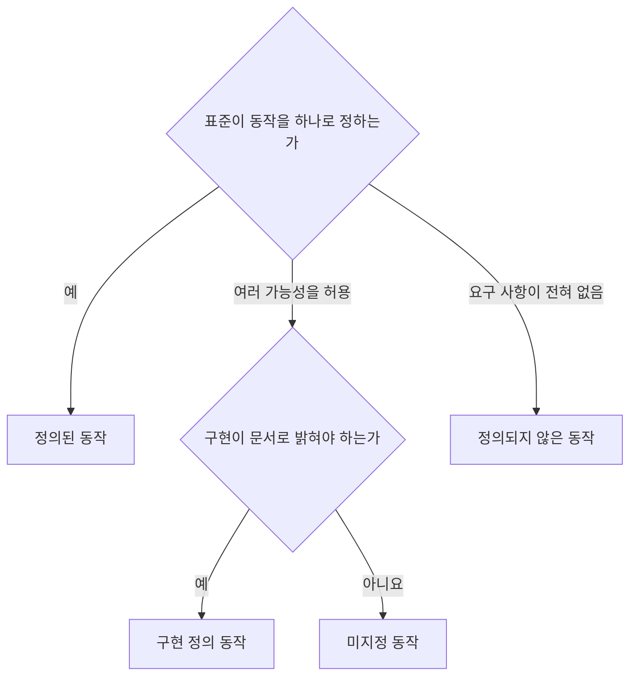
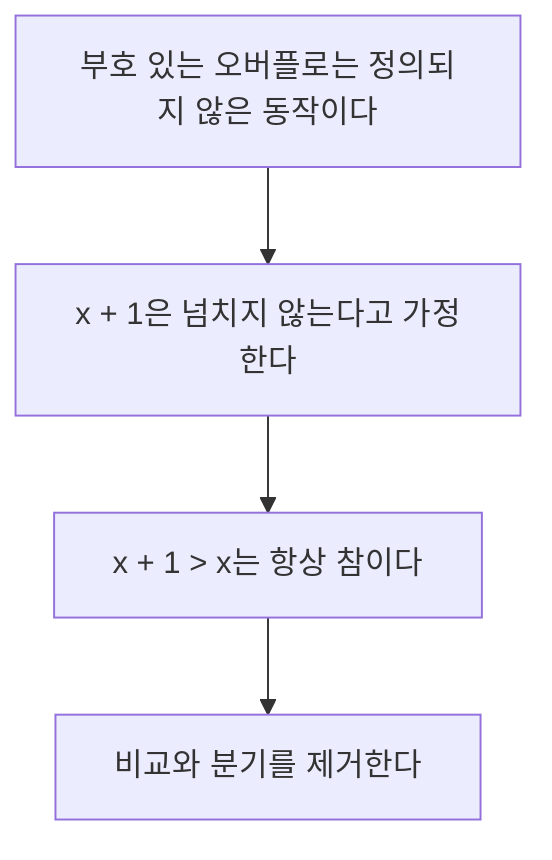
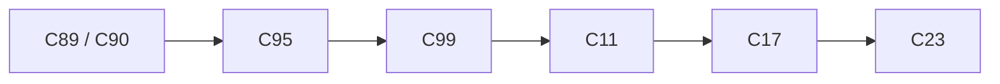

# 13장 — 표준 라이브러리와 모던 C

[레포지토리 안내](../../README.ko.md) | [English](Concepts_Lecture.md) | [한국어](Concepts_Lecture.ko.md)

> **최종 수정일:** 2026-11-09

> **학습 목표:**
> 1. 표준 헤더를 용도별로 구분하고 호스트 환경과 프리스탠딩 환경의 차이를 설명할 수 있다
> 2. 고정 폭 정수, `size_t`, `<limits.h>`를 사용하여 데이터 타입의 크기에 기대지 않는 코드를 작성할 수 있다
> 3. `snprintf`, `fgets`, `assert`, `static_assert`, 가변 인수 함수, 시간 측정 함수를 올바르게 사용할 수 있다
> 4. 비트 필드, 엔디언, `volatile`, 메모리 정렬이 보장하는 것과 보장하지 않는 것을 구별할 수 있다
> 5. 정의되지 않은 동작, 미지정 동작, 구현 정의 동작을 구별하고 코드에서 찾아 고칠 수 있다
> 6. C99, C11, C17, C23에서 추가된 기능을 코드로 사용하고 컴파일러 지원 현황에 맞게 표준을 선택할 수 있다

---

## 목차

- [1. 표준 라이브러리의 구성](#1-표준-라이브러리의-구성)
  - [1.1 표준 헤더 지도](#11-표준-헤더-지도)
  - [1.2 호스트 환경과 프리스탠딩 환경](#12-호스트-환경과-프리스탠딩-환경)
- [2. 타입과 크기](#2-타입과-크기)
  - [2.1 고정 폭 정수](#21-고정-폭-정수)
  - [2.2 고정 폭 정수의 입출력](#22-고정-폭-정수의-입출력)
  - [2.3 `size_t`, `ptrdiff_t`, `offsetof`](#23-size_t-ptrdiff_t-offsetof)
  - [2.4 `<limits.h>`와 `<float.h>`](#24-limitsh와-floath)
  - [2.5 `<stdbool.h>`](#25-stdboolh)
- [3. 안전한 문자열 처리](#3-안전한-문자열-처리)
  - [3.1 `snprintf`](#31-snprintf)
  - [3.2 `fgets`와 `sscanf`를 이용한 입력](#32-fgets와-sscanf를-이용한-입력)
  - [3.3 제거되었거나 피해야 할 함수](#33-제거되었거나-피해야-할-함수)
- [4. 진단, 가변 인수, 시간](#4-진단-가변-인수-시간)
  - [4.1 `assert`](#41-assert)
  - [4.2 `static_assert`](#42-static_assert)
  - [4.3 가변 인수 함수](#43-가변-인수-함수)
  - [4.4 시간 측정](#44-시간-측정)
- [5. 데이터의 저수준 표현](#5-데이터의-저수준-표현)
  - [5.1 비트 필드](#51-비트-필드)
  - [5.2 엔디언](#52-엔디언)
  - [5.3 `volatile`](#53-volatile)
  - [5.4 메모리 정렬](#54-메모리-정렬)
- [6. 정의되지 않은 동작](#6-정의되지-않은-동작)
  - [6.1 세 가지 비규정 동작](#61-세-가지-비규정-동작)
  - [6.2 대표적인 사례](#62-대표적인-사례)
  - [6.3 평가 순서와 순서점](#63-평가-순서와-순서점)
  - [6.4 엄격한 앨리어싱 규칙](#64-엄격한-앨리어싱-규칙)
  - [6.5 컴파일러 최적화와 방어 습관](#65-컴파일러-최적화와-방어-습관)
- [7. C 표준의 변화](#7-c-표준의-변화)
  - [7.1 C89에서 C23까지](#71-c89에서-c23까지)
  - [7.2 C99의 주요 기능](#72-c99의-주요-기능)
  - [7.3 C11의 주요 기능](#73-c11의-주요-기능)
  - [7.4 C17](#74-c17)
  - [7.5 C23의 주요 기능](#75-c23의-주요-기능)
  - [7.6 컴파일러 지원 현황과 표준 선택](#76-컴파일러-지원-현황과-표준-선택)
- [개념 적용](#개념-적용)
- [요약](#요약)
- [점검 문제](#점검-문제)
- [참고 문헌](#참고-문헌)

---

<br>

## 1. 표준 라이브러리의 구성

C 프로그램이 쓰는 기능은 언어 자체와 **표준 라이브러리(standard library)** 로 나뉜다. `if`, `for` 같은 문법은 언어에 속하고, `printf`, `strlen`, `qsort` 같은 함수는 표준 라이브러리에 속한다.

### 1.1 표준 헤더 지도

> **용어 정의:** **표준 헤더(standard header).** C 표준이 이름과 내용을 정한 헤더이다. 함수 선언, 타입, 매크로를 제공하며, 표준은 헤더가 실제 소스 파일일 것을 요구하지 않는다[1, 7.1.2절].

헤더에는 주로 선언과 매크로가 들어 있고 함수의 본체는 대개 미리 컴파일된 라이브러리에 들어 있으며, 링커가 둘을 연결한다([1장 3.2절](../Ch01_Programming-and-C-Language/Concepts_Lecture.ko.md#32-빌드-과정)). 표준 헤더의 수는 C89의 15개에 C95가 3개, C99가 6개, C11이 5개, C23이 2개를 더하여 31개가 되었다[1], [2], [3].

| 분류 | 헤더 (괄호는 C89 이후 추가된 표준) | 주요 내용 |
|:-----|:-----|:-----|
| 입출력과 오류 | `<stdio.h>`, `<errno.h>` | 스트림, `printf`, 오류 번호 `errno` |
| 문자열과 문자 | `<string.h>`, `<ctype.h>`, `<wchar.h>`(C95), `<wctype.h>`(C95), `<uchar.h>`(C11) | 문자열 함수, 문자 분류, 와이드 문자와 유니코드 |
| 일반 유틸리티 | `<stdlib.h>` | 동적 메모리, 문자열 변환, 난수, 정렬, 종료 |
| 타입과 크기 | `<stddef.h>`, `<stdint.h>`(C99), `<inttypes.h>`(C99), `<limits.h>`, `<float.h>`, `<stdbool.h>`(C99) | `size_t`, 고정 폭 정수, 표현 범위, `bool` |
| 수학 | `<math.h>`, `<complex.h>`(C99), `<tgmath.h>`(C99), `<fenv.h>`(C99) | 수학 함수, 복소수, 부동소수점 환경 |
| 진단과 제어 | `<assert.h>`, `<signal.h>`, `<setjmp.h>`, `<stdarg.h>` | 단언, 시그널, 비지역 점프, 가변 인수 |
| 시간과 지역화 | `<time.h>`, `<locale.h>` | 시간과 날짜, 로캘 |
| 언어 보조 | `<iso646.h>`(C95), `<stdalign.h>`(C11), `<stdnoreturn.h>`(C11) | 연산자의 대체 철자, 정렬, 반환하지 않는 함수 |
| 동시성 | `<stdatomic.h>`(C11), `<threads.h>`(C11) | 원자적 연산, 스레드 |
| 비트와 안전한 산술 | `<stdbit.h>`(C23), `<stdckdint.h>`(C23) | 비트 유틸리티, 오버플로 검사 |

*표 1. 용도별로 분류한 표준 헤더 31개*

`<complex.h>`, `<stdatomic.h>`, `<threads.h>`는 구현이 제공하지 않아도 되는 조건부 기능이다[2, 7.1.2절]. 표준 헤더는 컴파일러와 C 라이브러리가 나누어 제공한다. 이 장의 코드를 실행한 Apple clang 21에서는 `<stdint.h>`, `<stdarg.h>`, `<stdatomic.h>`, `<stdckdint.h>` 등을 컴파일러가 제공하고 `<stdio.h>`, `<stdlib.h>` 등은 macOS SDK가 제공하며, `<threads.h>`, `<uchar.h>`, `<stdbit.h>`는 어느 쪽에도 없다.

### 1.2 호스트 환경과 프리스탠딩 환경

> **용어 정의:** **호스트 환경(hosted environment).** 대개 운영체제 위에서 프로그램을 실행하며 표준 라이브러리 전체를 제공하는 환경이다. 프로그램은 `main` 함수에서 시작한다.

> **용어 정의:** **프리스탠딩 환경(freestanding environment).** 운영체제 없이 실행될 수 있고 표준 라이브러리의 일부만 제공해도 되는 환경이다. 시작 함수의 이름과 형식은 구현이 정한다.

프리스탠딩 구현이 반드시 제공해야 하는 헤더는 타입과 매크로가 중심인 `<float.h>`, `<iso646.h>`, `<limits.h>`, `<stdalign.h>`, `<stdarg.h>`, `<stdbool.h>`, `<stddef.h>`, `<stdint.h>`, `<stdnoreturn.h>`이다[1, 4절]. C23은 여기에 `<stdbit.h>`와 `<string.h>`의 대부분의 함수를 추가하였다[2, 4절]. 구현이 어느 환경인지는 미리 정의된 매크로 `__STDC_HOSTED__`로 구분한다.

```text
$ clang -std=c17 hosted.c -o hosted && ./hosted     # __STDC_HOSTED__를 출력하는 프로그램
1
$ clang -std=c17 -ffreestanding hosted.c -o hosted && ./hosted
0
```

`-ffreestanding`은 프리스탠딩 모드로 컴파일하라는 옵션이다[4]. 위의 두 번째 실행은 macOS의 C 라이브러리가 그대로 링크되어 `printf`가 동작한 경우이고, 실제 프리스탠딩 대상에서는 `printf` 자체가 없을 수 있다.

> **[운영체제]** 운영체제 커널은 프리스탠딩 환경의 대표적인 예이다[4]. 커널이 시작되는 시점에는 파일 시스템도 `malloc`을 뒷받침할 할당기도 아직 없으므로, 커널은 표준 라이브러리에 기대지 않는 코드로 작성된다.

---

<br>

## 2. 타입과 크기

### 2.1 고정 폭 정수

[3장 1.1절](../Ch03_Data-Types-and-Variables/Concepts_Lecture.ko.md#11-정수형)에서 본 것처럼 정수형의 크기는 플랫폼마다 다르다. 표준은 최소 범위만 정하며(`int`는 16비트 이상, `long`은 32비트 이상, `long long`은 64비트 이상)[1, 5.2.4.2.1절], 실제 크기의 조합을 **데이터 모델(data model)** 이라 한다[5].

| 데이터 모델 | `int` | `long` | 포인터 | 대표적인 플랫폼 |
|:-----|:-----|:-----|:-----|:-----|
| ILP32 | 32비트 | 32비트 | 32비트 | 32비트 Windows, Linux |
| LP64 | 32비트 | 64비트 | 64비트 | 64비트 Linux, macOS |
| LLP64 | 32비트 | 32비트 | 64비트 | 64비트 Windows |

*표 2. 널리 쓰이는 데이터 모델*

같은 64비트 기계에서도 `long`의 크기가 다르므로, 파일 형식이나 통신 프로토콜처럼 크기가 정확해야 하는 곳에는 `int`와 `long`을 쓸 수 없다.

> **용어 정의:** **고정 폭 정수(fixed-width integer).** 비트 수가 이름에 드러나는 정수 타입이다. `<stdint.h>`가 정의하며 `int32_t`, `uint32_t`처럼 부호 있는 타입과 부호 없는 타입이 있다.

| 범주 | 타입 | 보장 | 표준의 요구 |
|:-----|:-----|:-----|:-----|
| 정확한 폭 | `int8_t`, `int16_t`, `int32_t`, `int64_t`, `uint8_t` 등 | 정확히 N비트, 패딩 비트 없음 | 선택 |
| 최소 폭 | `int_least8_t`, `int_least16_t`, `int_least32_t`, `int_least64_t` 등 | N비트 이상인 가장 작은 타입 | 필수 |
| 가장 빠른 타입 | `int_fast8_t`, `int_fast16_t`, `int_fast32_t`, `int_fast64_t` 등 | N비트 이상인 대개 가장 빠른 타입 | 필수 |
| 포인터 저장 | `intptr_t`, `uintptr_t` | `void *`를 넣었다가 되돌려도 같은 포인터 | 선택 |
| 최대 폭 | `intmax_t`, `uintmax_t` | 표준 정수형의 모든 값을 표현 | 필수 |

*표 3. `<stdint.h>`의 정수 타입 범주*

정확한 폭 타입은 8비트 바이트가 없는 DSP 같은 구현 때문에 선택 사항이다. 다만 구현에 패딩 비트 없는 2의 보수 8, 16, 32, 64비트 정수형이 있으면 해당 이름을 반드시 정의해야 하므로[1, 7.20.1.1절], 일반적인 PC와 서버에서는 언제나 쓸 수 있다. 일반 계산에는 `int`, 크기와 인덱스에는 `size_t`, 파일 형식과 프로토콜처럼 비트 수가 의미를 갖는 곳에는 정확한 폭 타입을 쓴다.

```c
#include <stdint.h>
#include <stdio.h>

int main(void) {
    printf("%zu %zu\n", sizeof(int32_t), sizeof(int_fast16_t));   // 4 2 (이 플랫폼)
    uint8_t small = 255;
    small = small + 1;                                            // 0으로 순환한다
    int64_t big = INT64_C(9000000000);                            // 64비트 상수를 보장한다
    printf("%d %lld\n", small, (long long)big);                   // 0 9000000000
    return 0;
}
```

`INT64_C`, `INT32_MAX` 같은 상수 매크로도 `<stdint.h>`가 제공한다. 코드는 [Example_FixedWidth.c](Example_FixedWidth.c)이다.

> **핵심:** 파일 형식이나 프로토콜처럼 비트 수가 의미를 갖는 곳에는 `int`나 `long` 대신 정확한 폭 타입을 쓴다.

### 2.2 고정 폭 정수의 입출력

`int64_t`의 실제 타입은 플랫폼에 따라 `long`이거나 `long long`이므로 `%ld`와 `%lld`는 어느 쪽도 이식성이 없다. `<inttypes.h>`는 플랫폼에 맞는 형식 문자열을 매크로로 제공한다[1, 7.8절]. 매크로 이름은 `PRI`(`printf`용) 또는 `SCN`(`scanf`용) + 변환 문자(`d`, `u`, `x` 등) + 폭(`8`, `16`, `32`, `64`, `LEAST32`, `FAST32`, `PTR`, `MAX` 등)으로 이루어진다.

```c
#include <inttypes.h>
#include <stdio.h>

int main(void) {
    int32_t  celsius = -40;
    uint64_t bytes   = UINT64_C(1099511627776);
    int32_t  n;

    printf("celsius = %" PRId32 ", bytes = %" PRIu64 "\n", celsius, bytes);
    printf("PRId32 is \"%s\", PRIu64 is \"%s\"\n", PRId32, PRIu64);   // "d", "llu" (이 플랫폼)
    if (sscanf("1234", "%" SCNd32, &n) == 1) {
        printf("n = %" PRId32 "\n", n);                                // n = 1234
    }
    return 0;
}
```

`"%" PRId32 ", bytes = %" PRIu64 "\n"`은 전처리 후 `"%" "d" ", bytes = %" "llu" "\n"`이 되고, 이어 붙은 문자열 리터럴이 합쳐져 `"%d, bytes = %llu\n"`이 된다.

### 2.3 `size_t`, `ptrdiff_t`, `offsetof`

> **용어 정의:** **`size_t`.** `sizeof`의 결과를 나타내는 부호 없는 정수 타입이다. 객체의 크기를 담을 수 있도록 구현이 정한다[1, 7.19절].

| 이름 | 의미 | 부호 | 형식 지정자 |
|:-----|:-----|:-----|:-----|
| `size_t` | 객체의 크기, 원소 개수 | 부호 없음 | `%zu` |
| `ptrdiff_t` | 포인터 뺄셈의 결과 | 부호 있음 | `%td` |
| `offsetof(type, member)` | 구조체 시작에서 멤버까지의 바이트 수 | 부호 없음 (`size_t`) | `%zu` |

*표 4. `<stddef.h>`의 크기 관련 타입과 매크로*

`size_t`는 부호가 없으므로 0에서 1을 빼면 최댓값 `SIZE_MAX`(`<stdint.h>`)로 순환한다. 다음 역방향 반복문은 `i`가 0이 된 뒤 `i--`가 `SIZE_MAX`가 되어 끝나지 않고 범위를 벗어난다.

```c
for (size_t i = n - 1; i >= 0; i--) { printf("%d ", a[i]); }     // 버그: i >= 0은 언제나 참이다
for (size_t i = n; i > 0; i--)      { printf("%d ", a[i - 1]); }  // 올바른 형태
```

부호 있는 수와 비교할 때도 문제가 생긴다. `int d = -1; if (d < sizeof(int))`에서 `d`는 `size_t`로 변환되어 매우 큰 값이 되므로 조건은 거짓이다. 컴파일러는 `-Wextra`에서 경고한다(`warning: comparison of integers of different signs: 'int' and 'unsigned long'`).

`ptrdiff_t`는 두 포인터의 차의 타입으로, `p - q`는 `p`가 `q`보다 앞의 원소를 가리키면 음수이다([8장 2.1절](../Ch08_Pointers/Concepts_Lecture.ko.md#21-포인터-연산)). `offsetof`는 구조체의 패딩([10장 1.2절](../Ch10_Structures/Concepts_Lecture.ko.md#12-구조체-정의))을 숫자로 보여 주며, `offsetof`의 대상이 비트 필드이면 동작이 정의되지 않는다[1, 7.19절].

```c
struct record { char tag; int count; double score; };

printf("%zu %zu %zu %zu\n", sizeof(struct record),          // 16
       offsetof(struct record, tag),                        // 0
       offsetof(struct record, count),                      // 4
       offsetof(struct record, score));                     // 8
```

```text
struct record (int 4바이트, double 8바이트 정렬인 플랫폼)

offset  0     1  2  3    4  5  6  7    8 .................. 15
      ┌─────┬──────────┬─────────────┬────────────────────────┐
      │ tag │ padding  │ count (4B)  │ score (8B)             │
      └─────┴──────────┴─────────────┴────────────────────────┘
```

*그림 1. `offsetof`로 확인한 `struct record`의 바이트 배치*

### 2.4 `<limits.h>`와 `<float.h>`

두 헤더는 정수형의 범위와 실수형의 특성을 매크로로 제공한다. 값을 외우지 않아도 되고, 플랫폼이 달라져도 코드가 맞다.

| 매크로 | 의미 | 표준의 최솟값 (C17까지) | 이 플랫폼의 값 |
|:-----|:-----|:-----|:-----|
| `CHAR_BIT` | 1바이트의 비트 수 | 8 | 8 |
| `INT_MIN`, `INT_MAX` | `int` 범위 | -32767, 32767 | -2147483648, 2147483647 |
| `UINT_MAX` | `unsigned int` 최댓값 | 65535 | 4294967295 |
| `LONG_MAX`, `LLONG_MAX` | `long`, `long long` 최댓값 | 2147483647, 9223372036854775807 | 9223372036854775807 (둘 다) |
| `DBL_MAX` | 가장 큰 유한 `double` | 1e37 이상 | 1.79769e+308 |
| `DBL_MIN` | 정규화된 가장 작은 양의 `double` | 1e-37 이하 | 2.22507e-308 |
| `DBL_EPSILON` | 1.0과 다음 표현 가능한 값의 차 | 1e-9 이하 | 2.22045e-16 |

*표 5. `<limits.h>`와 `<float.h>`의 주요 매크로 (Apple clang 21 arm64)*

C23은 부호 있는 정수를 2의 보수로 고정하여 `INT_MIN`이 `-INT_MAX - 1`이 되었다[2, 6.2.6.2절]. `DBL_MIN`은 가장 작은 음수가 아니라 가장 작은 정규화된 양수이며(그보다 작은 비정규화 수의 최솟값은 C11의 `DBL_TRUE_MIN`이다)[1, 5.2.4.2.2절], 가장 작은 값은 `-DBL_MAX`이다. `<float.h>`의 `DBL_EPSILON`으로 실수를 비교할 때는 값의 크기에 비례한 허용 오차를 쓴다. `fabs(a - b) <= DBL_EPSILON * fmax(fabs(a), fabs(b))`에서 `a = 0.1 + 0.2`, `b = 0.3`은 `a == b`가 거짓이어도 조건이 참이 된다([3장 1.2절](../Ch03_Data-Types-and-Variables/Concepts_Lecture.ko.md#12-실수형)).

### 2.5 `<stdbool.h>`

C99는 `_Bool` 키워드와 `<stdbool.h>`의 매크로 `bool`, `true`, `false`를 추가하였고, C23부터는 `bool`, `true`, `false`가 그 자체로 키워드이다[2, 6.4.1절]. `bool`의 특징은 변환 규칙이다. 스칼라 값을 `bool`로 변환하면 그 값이 0과 같을 때만 0이고 그 밖에는 1이다[1, 6.3.1.2절]. 그래서 `unsigned char`로 변환하면 0이 되는 256이 `bool`로는 1이 된다. 과거의 코드는 `int`로 참과 거짓을 나타냈으며([4장 5.4절](../Ch04_Operators/Concepts_Lecture.ko.md#54-c에서의-참과-거짓)), `int` 변수에 `if (flag == true)`를 쓰면 `flag`가 2일 때 거짓이 되므로 `if (flag)`로 쓴다.

```c
#include <stdbool.h>                      // C17까지 필요하다
#include <stdio.h>

int main(void) {
    int big = 256;
    bool as_bool = big;                   // 1 (0이 아닌 값)
    unsigned char as_char = (unsigned char)big;   // 0 (CHAR_BIT가 8일 때)
    printf("%d %d %d\n", as_bool, as_char, true);   // 1 0 1
    return 0;
}
```

---

<br>

## 3. 안전한 문자열 처리

C의 문자열 함수는 대상 배열의 크기를 알지 못한다([9장 2.2절](../Ch09_Strings/Concepts_Lecture.ko.md#22-strcpy--strncpy)). 이 절의 함수들은 크기를 인수로 받아 버퍼 오버플로를 막는다.

### 3.1 `snprintf`

`int snprintf(char *s, size_t n, const char *format, ...)`는 `sprintf`처럼 문자열을 만들되 `n`바이트를 넘기지 않는다[1, 7.21.6.5절]. `n`이 0보다 크면 결과는 항상 널 문자로 끝나고, 반환값은 쓰인 길이가 아니라 공간이 충분했다면 **쓰였을 길이**이다. 반환값이 음수이면 인코딩 오류이고, `n` 이상이면 잘린 것이다.

```c
char buf[8];
int n = snprintf(buf, sizeof buf, "Hello, %s!", "World");   // n = 13, buf = "Hello, "
```

```text
"Hello, World!"는 13문자이지만 buf는 8바이트이다.

       [0]  [1]  [2]  [3]  [4]  [5]  [6]  [7]
buf:   'H'  'e'  'l'  'l'  'o'  ','  ' '  '\0'     반환값 13 >= sizeof buf(8) 이므로 잘림
```

*그림 2. 공간이 부족할 때 `snprintf`가 쓴 내용과 반환값*

반환값을 쓰는 패턴은 두 가지이다. `n`을 0으로 호출하면 아무것도 쓰지 않고 길이만 돌려주므로(이때 `s`는 널 포인터여도 된다) 필요한 크기를 재서 할당할 수 있다([11장 2.1절](../Ch11_Dynamic-Memory-and-Advanced-Pointers/Concepts_Lecture.ko.md#21-malloc과-free)). 또 `snprintf(out + used, sizeof out - used, ...)`로 이어 쓰면서 남은 공간과 반환값을 비교하면 잘림을 감지할 수 있다. 잘림을 검사하는 코드는 [Example_SafeInput.c](Example_SafeInput.c)이고, 이어 쓰는 코드는 [Example_Variadic.c](Example_Variadic.c)의 `join` 함수이다.

```c
int len = snprintf(NULL, 0, "%d-%s", 2024, "spring");       // len = 11
char *s = malloc((size_t)len + 1);
if (s != NULL) { snprintf(s, (size_t)len + 1, "%d-%s", 2024, "spring"); }
```

> **참고:** **Visual Studio의 `_snprintf`.** Visual Studio 2015 이후의 UCRT에서 `snprintf`는 C99 표준을 따르지만, 이름이 비슷한 `_snprintf`는 잘릴 때 널 문자를 쓰지 않고 -1을 반환하므로 혼동하면 안 된다[6].

### 3.2 `fgets`와 `sscanf`를 이용한 입력

`scanf("%d", &n)`은 숫자가 아닌 입력에서 변환에 실패하고 그 문자를 입력 버퍼에 남겨 두므로, 반복문에서 쓰면 같은 문자에서 계속 실패한다. 줄 단위로 읽고([9장 4.2절](../Ch09_Strings/Concepts_Lecture.ko.md#42-fgets--gets_s)) 읽은 줄을 `sscanf`로 해석하면, 잘못된 줄은 이미 소비되었으므로 다음 줄을 읽기만 하면 된다.

```c
// 한 줄을 읽어 개행을 제거한다. 성공 1, 입력 끝 0, 줄이 너무 길면 -1을 반환한다.
static int read_line(char *buf, int size) {
    if (fgets(buf, size, stdin) == NULL) { return 0; }
    size_t len = strcspn(buf, "\n");               // 개행의 위치 (없으면 문자열 끝)
    if (buf[len] == '\n') { buf[len] = '\0'; return 1; }
    if (feof(stdin)) { return 1; }                 // 입력의 마지막 줄에는 개행이 없을 수 있다
    int c;
    while ((c = getchar()) != '\n' && c != EOF) { } // 줄의 나머지를 버린다
    return -1;
}
```

버퍼에 개행이 없고 입력도 끝나지 않았다면 줄이 버퍼보다 길다는 뜻이므로, 나머지를 버려야 다음 호출이 줄의 뒷부분을 읽지 않는다. 호출하는 쪽은 `sscanf(line, "%15s %d", name, &age) != 2`로 형식을 검사한다. 다음은 [Example_SafeInput.c](Example_SafeInput.c)의 실행 결과이다.

```text
$ printf 'Alice 25\nBob\nthis line is far too long to fit in the line buffer\nChristopher 20\n' | ./Example_SafeInput
Alice is 25 years old
bad format: "Bob"
too long: the line was discarded
Christopher is 20 years (truncated)
```

> **주의:** `sscanf("12abc", "%d", &v)`는 1을 반환하고 `v`를 12로 만들어 뒤의 문자를 알려 주지 않으며, `%d`로 읽은 값이 `int`의 범위를 넘으면 동작이 정의되지 않는다[1, 7.21.6.2절]. 정확한 수치 변환에는 `strtol`을 쓴다([12장 1.4절](../Ch12_File-IO-and-Program-Structure/Concepts_Lecture.ko.md#14-문자열-인수를-숫자로-변환)).

> **핵심:** 입력은 `fgets`로 줄 단위로 읽고, 해석은 `sscanf`나 `strtol`로 분리한다.

### 3.3 제거되었거나 피해야 할 함수

| 함수 | 문제 | 대안 |
|:-----|:-----|:-----|
| `gets` | 입력 길이를 제한할 수 없어 어떤 버퍼로도 오버플로를 막지 못한다. C11에서 제거되었다[1]. | `fgets` |
| `sprintf`, `strcpy`, `strcat` | 대상 배열의 크기를 모른다. | `snprintf`, 길이 검사 후 복사 |
| `strncpy` | 원본이 길면 널 문자로 끝나지 않고, 짧으면 나머지를 널로 채운다. | `snprintf` 또는 직접 널 종료 |
| `scanf("%s", s)` | 너비를 쓰지 않으면 경계가 없다. | `"%19s"`, `fgets`와 `sscanf` |
| `atoi`, `atol`, `atof` | 오류를 알릴 수 없고 범위를 넘으면 동작이 정의되지 않는다. | `strtol`, `strtod` |
| `strtok` | 호출 사이의 상태를 내부에 저장하여 재진입할 수 없다. | POSIX `strtok_r`, Annex K `strtok_s` |
| `asctime`, `ctime` | 정적 버퍼를 돌려주며 C23에서 폐기 예정으로 지정되었다[2, 7.29.3.1절]. | `strftime` |

*표 6. 제거되었거나 피해야 할 표준 함수와 대안*

이 환경의 macOS SDK는 `gets`를 호환성을 위해 남겨 두었지만 컴파일 경고와 실행 시 경고 `warning: this program uses gets(), which is unsafe.`를 낸다. `strcpy_s` 같은 C11의 부록 K(Annex K) 함수는 선택 사항이며, WG14 문서 N1967은 현장 경험을 근거로 제거를 권고했고[7] Visual Studio의 `_s` 함수도 일부 시그니처가 표준과 다르다[8]. 이식성이 필요한 코드에서는 `_s` 함수 대신 `snprintf`와 크기 검사를 쓴다.

> **참고:** **Visual Studio의 C4996.** Visual Studio는 `sprintf`, `strcpy`, `scanf` 등에 C4996 경고를 내고 `_s` 함수를 권한다. 소스의 맨 앞에 `#define _CRT_SECURE_NO_WARNINGS`를 쓰면 경고를 끌 수 있다([3장 실습 5.1절](../Ch03_Data-Types-and-Variables/Concepts_Lab.ko.md#51-c4996-경고)).

---

<br>

## 4. 진단, 가변 인수, 시간

### 4.1 `assert`

`<assert.h>`의 `assert(식)`은 프로그래머의 가정을 실행 중에 검사하는 매크로이다. 식이 거짓이면 표준 오류 스트림에 파일 이름, 줄 번호, 식을 출력하고 `abort`로 프로그램을 끝낸다[1, 7.2.1.1절].

```c
static double average(const int *a, int n) {
    assert(a != NULL);
    assert(n > 0);
    long sum = 0;
    for (int i = 0; i < n; i++) { sum += a[i]; }
    return (double)sum / n;
}
```

```text
Assertion failed: (n > 0), function average, file average.c, line 6.
```

위는 `average(data, 0)`을 호출한 실행의 출력이고, 이때 셸의 종료 코드는 134(128 + SIGABRT의 번호 6)이다. `NDEBUG` 매크로를 정의하고 `<assert.h>`를 포함하면 `assert`는 `((void)0)`이 되어 사라지므로[1, 7.2절], `-DNDEBUG`로 컴파일하면 같은 호출이 검사 없이 이 환경에서 `nan`을 출력한다.

> **주의:** `assert` 안의 식은 `NDEBUG`가 정의되면 평가되지 않는다. 따라서 `assert(fclose(fp) == 0);`처럼 부작용이 있는 호출을 넣으면 릴리스 빌드에서 호출 자체가 사라진다. `int r = fclose(fp); assert(r == 0);`로 나누어 쓴다. `assert`는 프로그래머의 실수를 찾는 도구이며, 사용자 입력이나 파일 오류처럼 정상 실행 중에 일어나는 상황은 `if`로 처리한다.

### 4.2 `static_assert`

**`static_assert`** 는 정수 상수 식의 조건을 컴파일 시점에 검사하여 거짓이면 컴파일 오류를 낸다. 실행 시간과 크기에는 영향을 주지 않는다. C11의 키워드는 `_Static_assert`이고 `<assert.h>`의 매크로가 `static_assert`이며, C23에서는 `static_assert`가 키워드가 되어 헤더가 필요 없고 메시지를 생략할 수 있다[2, 6.4.1절].

```c
#include <assert.h>
#include <stdint.h>

struct header { uint8_t kind; uint32_t length; };
static_assert(sizeof(struct header) == 5, "struct header has padding");
```

```text
header.c:5:15: error: static assertion failed due to requirement 'sizeof(struct header) == 5': struct header has padding
header.c:5:37: note: expression evaluates to '8 == 5'
```

`length`를 4의 배수 주소에 맞추기 위해 `kind` 뒤에 패딩이 들어가 크기는 8이다. `assert`는 실행해야 아는 조건에, `static_assert`는 `sizeof`처럼 컴파일 시점에 정해지는 조건에 쓴다.

### 4.3 가변 인수 함수

`printf`처럼 인수의 개수가 정해지지 않은 함수는 `<stdarg.h>`로 작성한다. 매개변수 목록 끝에 `...`을 쓰고, `va_list`로 인수를 차례로 꺼낸다[1, 7.16절].

```c
static int sum(int count, ...) {
    va_list ap;                     // 다음 인수의 위치를 기억하는 객체
    int total = 0;

    va_start(ap, count);            // 마지막 고정 매개변수를 기준으로 시작한다
    for (int i = 0; i < count; i++) {
        total += va_arg(ap, int);   // 다음 인수를 int로 꺼낸다
    }
    va_end(ap);                     // 정리한다
    return total;
}
```

```text
sum(3, 10, 20, 30)

count = 3, 가변 인수: [ 10 ][ 20 ][ 30 ]
va_start 직후       ap ┘
va_arg 1회: 10 반환, ap는 20으로 이동    total = 10
va_arg 2회: 20 반환, ap는 30으로 이동    total = 30
va_arg 3회: 30 반환                       total = 60
```

*그림 3. `va_start`와 `va_arg`로 가변 인수를 꺼내는 과정의 개념적 모형*

인수의 개수는 고정 매개변수로 받거나(`sum`), 서식 문자열로 알리거나(`printf`), 끝 표시 값을 두어(`NULL` 등) 함수가 알아내야 한다. `va_arg`에 쓴 타입이 승격된 뒤 실제 전달된 타입과 호환되지 않으면 동작이 정의되지 않는다(양쪽 모두에서 표현 가능한 값을 부호만 다른 정수 타입으로 읽는 경우와 `void *`와 문자 포인터 사이의 경우는 예외이다)[1, 7.16.1.1절]. `...`으로 전달되는 인수에는 **기본 인수 승격(default argument promotions)** 이 적용되어[1, 6.5.2.2절] `char`와 `short`는 `int`로, `float`는 `double`로 전달되므로 `va_arg(ap, float)`이나 `va_arg(ap, char)`는 잘못된 코드이다. clang은 다음과 같이 경고하며, 이런 프로그램은 이 환경에서 `1.5f + 2.5f`에 대해 `0.000000`을 출력하였다.

```text
warning: second argument to 'va_arg' is of promotable type 'float'; this va_arg has undefined behavior because arguments will be promoted to 'double' [-Wvarargs]
```

끝 표시로 `NULL`을 쓸 때는 `NULL`이 정수 0으로 정의된 구현이 있으므로 `(const char *)NULL`로 형 변환한다. 인수를 다른 함수로 넘기려면 `va_list`를 받는 `vprintf`, `vsnprintf`를 호출한다. `printf`와 달리 직접 만든 가변 인수 함수는 GCC와 clang의 `format` 속성을 붙이지 않는 한 `-Wformat`의 검사를 받지 않으므로, 형식 문자열과 인수를 호출하는 쪽에서 맞춰야 한다. C23은 `void f(...)`와 `va_start(ap)`도 허용한다[2, 7.16.1.4절]. 코드는 [Example_Variadic.c](Example_Variadic.c)이다.

### 4.4 시간 측정

| 함수 | 측정 대상 | 단위 |
|:-----|:-----|:-----|
| `time` | 달력 시간 | `time_t` (POSIX에서 Epoch 이후의 초[9]) |
| `clock` | 프로그램이 사용한 프로세서 시간 | `CLOCKS_PER_SEC`분의 1초 |
| `timespec_get` (C11) | 달력 시간 | 초와 나노초 (`struct timespec`) |
| `clock_gettime` (POSIX) | 선택한 시계, `CLOCK_MONOTONIC` 등 | 초와 나노초[10] |

*표 7. 주요 시간 함수*

`time_t`의 단위는 ISO C가 정하지 않는다[1, 7.27.1절]. `clock`은 **CPU 시간(processor time)** 을 재며, 실제 경과 시간과 다르다[1, 7.27.2.1절]. 다음 프로그램은 약 0.5초의 계산과 POSIX의 `sleep(1)`을 측정한다. 전체 코드는 생략하였고 값은 실행 예이다.

```c
clock_t c0 = clock();
struct timespec w0, w1;
timespec_get(&w0, TIME_UTC);

busy();                              // 약 0.5초 계산하는 함수
sleep(1);                            // 1초 대기, CPU를 쓰지 않는다

clock_t c1 = clock();
timespec_get(&w1, TIME_UTC);
printf("CPU  = %.3f s\n", (double)(c1 - c0) / CLOCKS_PER_SEC);
printf("wall = %.3f s\n", (double)(w1.tv_sec - w0.tv_sec) + (w1.tv_nsec - w0.tv_nsec) / 1e9);
```

```text
CPU  = 0.546 s
wall = 1.556 s
```

`sleep`은 프로세서를 쓰지 않으므로 CPU 시간에는 거의 더해지지 않는다. 경과 시간을 재려면 `time`이나 `timespec_get`을 쓰되, 시스템 시계는 NTP 등으로 조정될 수 있으므로 정밀한 구간 측정에는 POSIX의 `clock_gettime(CLOCK_MONOTONIC, ...)`이 적합하다[10]. 달력 시간의 문자열 표현은 `strftime`으로 만든다([7장 5.8절](../Ch07_Arrays/Concepts_Lecture.ko.md#58-난수-생성-rand-srand-time)의 `time`도 참고한다).

> **참고:** **Visual Studio의 `clock`.** Microsoft의 `clock`은 CPU 시간이 아니라 프로세스 시작 후의 경과 시간을 돌려주며, 문서에서 ISO C를 엄밀히 따르지 않는다고 밝힌다[11]. CPU 시간에는 `GetProcessTimes`를 쓴다.

---

<br>

## 5. 데이터의 저수준 표현

### 5.1 비트 필드

> **용어 정의:** **비트 필드(bit-field).** 구조체의 멤버 중 비트 수를 지정하여 선언한 정수 멤버이다. `unsigned int level : 4;`는 4비트를 차지하며 0에서 15까지 저장한다.

```c
struct permission {
    unsigned int read    : 1;
    unsigned int write   : 1;
    unsigned int execute : 1;
    unsigned int level   : 4;
};
struct permission p = {1, 0, 1, 5};   // sizeof(p) = 4, 첫 바이트 = 0x2d (이 플랫폼)
```

```text
bit        7   6   5   4   3   2   1   0
value      0   0   1   0   1   1   0   1      (first byte = 0x2d)
read                                   ^    = 1
write                              ^        = 0
execute                        ^            = 1
level          ^   ^   ^   ^                = 0101 (5)
```

*그림 4. `struct permission`의 첫 바이트에 배치된 비트 필드 (Apple clang 21 arm64)*

부호 없는 비트 필드에 비트 수를 넘는 값을 대입하면 상위 비트가 잘린다(`p.level = 16;`은 컴파일 경고와 함께 0을 저장). 비트 필드는 주소를 가질 수 없어 `&p.level`은 컴파일 오류이다[1, 6.5.3.2절]. 비트 필드에 쓸 수 있는 타입은 `_Bool`, `signed int`, `unsigned int`와 구현이 허용한 타입이다.

> **주의:** 할당 단위의 크기, 단위 안의 비트 방향, 단위를 넘는 필드의 처리, 일반 `int` 필드의 부호가 모두 구현 정의이다[1, 6.7.2절, 6.7.2.1절]. Kernighan과 Ritchie도 비트 필드의 거의 모든 면이 구현에 달려 있다고 설명한다[12]. 파일이나 네트워크의 비트 형식에는 고정 폭 정수와 시프트 연산을 쓰는 편이 이식성이 좋다([4장 6.2절](../Ch04_Operators/Concepts_Lecture.ko.md#62-시프트-연산자)).

### 5.2 엔디언

> **용어 정의:** **엔디언(endianness).** 여러 바이트로 된 값을 메모리에 놓는 바이트 순서이다. 낮은 자리의 바이트를 낮은 주소에 두면 리틀 엔디언(little-endian), 높은 자리의 바이트를 낮은 주소에 두면 빅 엔디언(big-endian)이다.

```text
uint32_t value = 0x12345678;

              address:  [+0]  [+1]  [+2]  [+3]
little-endian            78    56    34    12      (x86, arm64 macOS)
big-endian               12    34    56    78
```

*그림 5. 같은 값 `0x12345678`의 두 가지 바이트 순서*

객체의 바이트는 `unsigned char *`로 읽어 확인한다(문자 타입 접근은 6.4절에서 허용된다). 이 환경에서는 `78 56 34 12` 순서로 출력되었다. 파일이나 네트워크로 데이터를 주고받을 때 메모리를 그대로 쓰면 엔디언이 다른 시스템에서 값이 뒤바뀌므로([12장 4.4절](../Ch12_File-IO-and-Program-Structure/Concepts_Lecture.ko.md#44-구조체를-파일에-저장할-때의-주의점)), 값의 수학적 자리에 시프트를 적용해 바이트를 직접 정한다. 이 코드는 호스트의 엔디언과 무관하게 동작한다.

```c
static void store_be32(unsigned char out[4], uint32_t v) {
    out[0] = (unsigned char)(v >> 24);
    out[1] = (unsigned char)(v >> 16);
    out[2] = (unsigned char)(v >> 8);
    out[3] = (unsigned char)v;
}
```

`store_be32`의 결과는 어느 플랫폼에서든 `12 34 56 78`이다. 코드는 [Example_ByteOrder.c](Example_ByteOrder.c)이다. C23은 `<stdbit.h>`의 `__STDC_ENDIAN_NATIVE__`로 실행 환경의 엔디언을 나타낸다[2, 7.18.2절].

> **[컴퓨터네트워크]** 인터넷 프로토콜의 헤더는 빅 엔디언을 표준 순서로 쓰며 이를 네트워크 바이트 순서라 한다. POSIX의 `htonl`, `ntohl`은 호스트 순서와 네트워크 순서를 변환한다[13]. 이 환경의 리틀 엔디언 시스템에서 `htonl(0x12345678)`은 `0x78563412`이다.

### 5.3 `volatile`

`volatile`은 객체가 프로그램 외부의 요인으로 바뀔 수 있음을 알리는 타입 한정자이다. `volatile` 객체의 읽기와 쓰기는 부작용으로 간주되어, 컴파일러는 코드에 쓰인 횟수와 순서대로 수행해야 한다[1, 5.1.2.3절, 6.7.3절]. 다음은 `clang -O2`의 arm64 어셈블리이다(주석은 추가한 것이다).

```c
int plain(int *p)         { int a = *p; int b = *p; return a + b; }
int vol(volatile int *p)  { int a = *p; int b = *p; return a + b; }
```

```text
_plain:
    ldr  w8, [x0]         ; *p를 한 번만 읽는다
    lsl  w0, w8, #1       ; 그 값을 2배 한다
    ret
_vol:
    ldr  w8, [x0]         ; 첫 번째 읽기
    ldr  w9, [x0]         ; 두 번째 읽기
    add  w0, w9, w8
    ret
```

`while (*flag == 0) { }`도 `flag`가 일반 포인터이면 `clang -O2`에서 반복문 자체가 사라지고, `volatile int *flag`이면 매번 읽는 반복문이 남는다. `volatile`의 쓰임은 메모리 매핑 하드웨어 레지스터(`(*(volatile uint32_t *)0x40021000)`, 주소는 예시), 시그널 처리기의 플래그(`volatile sig_atomic_t`)[1, 7.14절], `longjmp` 뒤에 값을 유지할 지역 변수이다[1, 7.13.2.1절]. 메모리 매핑 레지스터는 특정 주소의 읽기와 쓰기가 곧 장치의 제어가 되는 하드웨어 레지스터이고, 시그널 처리기는 대개 운영체제가 보낸 시그널을 받아 실행 흐름을 끊고 호출되는 함수이며, `longjmp`는 `setjmp`로 저장한 지점으로 되돌아가는 비지역 점프이다.

> **주의:** `volatile`은 스레드 동기화 수단이 **아니다**. **스레드(thread)** 는 한 프로그램 안에서 독립적으로 실행되며 메모리를 공유하는 실행 흐름이다. 표준은 `volatile`에 원자성과 스레드 사이의 순서를 보장하지 않으며, 동기화 없이 두 스레드가 같은 변수에 접근하고 그중 하나가 쓰기이면 데이터 경합이라는 정의되지 않은 동작이 된다[1, 5.1.2.4절]. 스레드 간 공유에는 `_Atomic`이나 한 번에 한 스레드만 들어가게 하는 잠금인 **뮤텍스(mutex)** 를 쓴다(7.3절).

### 5.4 메모리 정렬

> **용어 정의:** **메모리 정렬(alignment).** 어떤 타입의 객체가 놓일 수 있는 주소의 배수 조건이다. 정렬이 4인 타입은 4의 배수 주소에만 놓인다.

정렬은 구조체 패딩의 원인이다([10장 1.2절](../Ch10_Structures/Concepts_Lecture.ko.md#12-구조체-정의)). C11의 `_Alignof`와 `_Alignas`(매크로 `alignof`, `alignas`는 `<stdalign.h>`)로 정렬을 조회하고 지정하며, C23에서는 `alignas`와 `alignof`가 키워드이다[2, 6.4.1절]. `malloc`이 돌려주는 주소는 `max_align_t`의 정렬을 만족하고[1, 7.22.3절], C11의 `aligned_alloc(정렬, 크기)`은 더 큰 정렬의 블록을 돌려준다. C11은 크기가 정렬의 배수일 것을 요구했으므로[1, 7.22.3.1절] 크기를 배수로 맞추어 호출한다. Visual Studio는 `aligned_alloc` 대신 `_aligned_malloc`을 제공한다[8].

```c
printf("%zu %zu %zu\n", alignof(int), alignof(double), alignof(max_align_t));   // 4 8 8 (이 플랫폼)
alignas(16) int aligned = 7;
printf("%zu\n", (size_t)&aligned % 16);                                          // 0
double *p = aligned_alloc(64, 64 * 4);                                           // 64바이트 경계
```

정렬되지 않은 객체를 접근하면 동작이 정의되지 않는다. 다음의 `*(int *)(buffer + 1)`은 4의 배수가 아닌 주소에서 `int`를 읽는다.

```text
address (example)  0x1000  0x1001  0x1002  0x1003  0x1004  0x1005
value              01      02      03      04      05      06
int read                   └─ *(int *)(buffer + 1) ──┘
```

*그림 6. 정렬되지 않은 `int` 읽기 (주소는 예시)*

```c
unsigned char buffer[8] = {1, 2, 3, 4, 5, 6, 7, 8};
int bad = *(int *)(buffer + 1);            // 정의되지 않은 동작
int good;
memcpy(&good, buffer + 1, sizeof good);    // 정의된 동작
```

```text
misaligned.c:7:15: runtime error: load of misaligned address 0x00016f28aa41 for type 'int', which requires 4 byte alignment
```

위는 UBSan의 보고이며 주소는 예시이다. arm64는 이 읽기를 실행하여 `0x05040302`를 얻지만 표준 위반이고, 일부 프로세서에서는 예외가 발생한다. `memcpy`는 바이트 단위 복사이므로 언제나 정의된 동작이다.

---

<br>

## 6. 정의되지 않은 동작

### 6.1 세 가지 비규정 동작

표준은 코드의 결과를 하나로 정하지 않는 동작을 구현 정의, 미지정, 정의되지 않음, 그리고 로캘에 따라 달라지는 로캘 특정 동작(locale-specific behavior)으로 구분한다[1, 3.4절]. 프로그램의 정확성에 직접 관련되는 것은 앞의 세 가지이다.

> **용어 정의:** **구현 정의 동작(implementation-defined behavior).** 표준이 가능한 동작들을 정하고, 어떤 동작을 택했는지를 구현이 문서로 밝혀야 하는 동작이다.

> **용어 정의:** **미지정 동작(unspecified behavior).** 표준이 둘 이상의 가능성을 허용하고, 어떤 것을 택할지 구현이 밝히지 않아도 되는 동작이다. 같은 프로그램 안에서도 경우마다 다를 수 있다.

> **용어 정의:** **정의되지 않은 동작(undefined behavior).** 표준이 어떤 요구도 하지 않는 동작이다. 프로그램 전체의 동작에 대해 아무 보장이 없어, 잘못된 결과를 내거나 충돌하거나 악용될 수 있다.

| 구분 | 표준이 정하는 것 | 문서화 | 의존해도 되는가 | 예 |
|:-----|:-----|:-----|:-----|:-----|
| 구현 정의 | 가능한 동작의 범위 | 필수 | 구현을 고정하면 가능 | `char`의 부호, `sizeof(int)`, 음수의 오른쪽 시프트 |
| 미지정 | 가능한 동작의 집합 | 불필요 | 불가 | 함수 인수의 평가 순서, 패딩 바이트의 값 |
| 정의되지 않음 | 아무것도 정하지 않음 | 불필요 | 절대 불가 | 부호 있는 오버플로, 범위 밖 접근, 널 포인터 역참조 |

*표 8. 세 가지 비규정 동작의 비교*



*그림 7. 세 가지 비규정 동작을 구분하는 기준*

표준은 정의되지 않은 동작에 아무 요구도 하지 않으므로, 컴파일러는 그런 코드가 실행되지 않는다고 가정하고 최적화할 수 있다(6.5절). 오늘 원하는 대로 동작한 프로그램도 컴파일러 버전이나 최적화 수준이 바뀌면 달라질 수 있다.

### 6.2 대표적인 사례

| 코드 예 | 문제 | 관련 |
|:-----|:-----|:-----|
| `int a = INT_MAX; a + 1` | 부호 있는 정수 오버플로 | 아래 예 |
| `x / 0`, `x % 0`, `INT_MIN / -1` | 0으로 나누기, 표현 불가능한 결과 | [1, 6.5.5절] |
| `1 << 40`, `-1 << 1` | 시프트 크기가 폭 이상, 음수의 왼쪽 시프트 | [4장 6.2절](../Ch04_Operators/Concepts_Lecture.ko.md#62-시프트-연산자), [1, 6.5.7절] |
| `a[5]` (원소 5개 배열) | 범위 밖 접근 | [7장 3.3절](../Ch07_Arrays/Concepts_Lecture.ko.md#33-인덱스-범위-초과) |
| `*p` (`p`가 널 포인터) | 널 포인터 역참조 | [8장 1.7절](../Ch08_Pointers/Concepts_Lecture.ko.md#17-포인터-사용-시-주의-사항) |
| 초기화하지 않은 지역 변수 읽기 | 불확정 값 사용 | [3장 3.1절](../Ch03_Data-Types-and-Variables/Concepts_Lecture.ko.md#31-선언과-초기화) |
| `char *s = "abc"; s[0] = 'x';` | 문자열 리터럴 수정 | [9장 6.1절](../Ch09_Strings/Concepts_Lecture.ko.md#61-char-문자열-포인터) |
| 값 없이 끝난 함수의 반환값 사용 | `return` 누락 | [1, 6.9.1절] |
| `printf("%d", x)` (`x`는 `long`) | 서식과 인수의 불일치 | 4.3절 |
| `memcpy(a + 1, a, n)` (영역 겹침) | 겹치는 복사 | [11장 4.1절](../Ch11_Dynamic-Memory-and-Advanced-Pointers/Concepts_Lecture.ko.md#41-memcpy와-memmove) |
| `(int)1e20` | 표현 범위를 넘는 실수의 변환 | [1, 6.3.1.4절] |

*표 9. 대표적인 정의되지 않은 동작*

부호 없는 산술은 모듈로 $`2^N`$으로 정의되어 넘치지 않지만[1, 6.2.5절], 부호 있는 산술이 범위를 넘으면 동작이 정의되지 않는다([3장 1.1절](../Ch03_Data-Types-and-Variables/Concepts_Lecture.ko.md#11-정수형)).

```c
int a = INT_MAX;
unsigned int b = UINT_MAX;

b = b + 1;     // 정의된 동작: 0으로 순환
a = a + 1;     // 정의되지 않은 동작: 부호 있는 오버플로
```

`-fsanitize=undefined`로 컴파일하면 UndefinedBehaviorSanitizer(UBSan)가 다음 메시지로 보고하고 기본 설정에서는 실행을 계속한다[14]. 도구는 [11장 3.4절](../Ch11_Dynamic-Memory-and-Advanced-Pointers/Concepts_Lecture.ko.md#34-오류를-찾는-도구)과 [12장 9.1절](../Ch12_File-IO-and-Program-Structure/Concepts_Lecture.ko.md#91-컴파일-옵션)을 참고한다.

```text
overflow.c:9:11: runtime error: signed integer overflow: 2147483647 + 1 cannot be represented in type 'int'
```

이 환경에서 `a`가 -2147483648이 된 것은 하드웨어의 덧셈 결과가 그대로 쓰였을 뿐 표준이 보장하는 결과가 아니다. 안전하게 계산하려면 연산하기 전에 범위를 검사한다. `a > INT_MAX - b`는 `b`가 양수일 때 넘치지 않는 비교이지만, `a + b > INT_MAX`는 덧셈 자체가 먼저 넘치므로 소용이 없다. 코드는 [Example_CheckedArithmetic.c](Example_CheckedArithmetic.c)이다.

### 6.3 평가 순서와 순서점

[4장 3.2절](../Ch04_Operators/Concepts_Lecture.ko.md#32-단독-사용-vs-수식-내-사용)의 `a = x++;`처럼 증감 연산의 결과를 식에서 한 번 쓰는 것은 문제가 없지만, 같은 변수를 여러 번 변경하거나 변경과 별도의 읽기를 섞으면 결과가 정해지지 않을 수 있다. 연산자 우선순위는 식의 구조(어떤 피연산자가 어떤 연산자에 묶이는가)만 정하고, 피연산자가 언제 평가되는지는 정하지 않기 때문이다.

> **용어 정의:** **순서점(sequence point).** 앞선 평가의 부작용이 모두 끝나고 다음 평가가 시작됨을 보장하는 지점이다. C11은 이를 평가 사이의 "sequenced before" 관계로 다시 정의하였다[1, 5.1.2.3절].

| 관계 (C11) | 뜻 | 같은 스칼라에 대한 충돌 시 |
|:-----|:-----|:-----|
| 먼저 실행됨 (sequenced before) | A가 끝난 뒤 B가 실행된다 | 정의됨 |
| 불확정 순서 (indeterminately sequenced) | 순서는 있으나 어느 쪽이 먼저인지 정하지 않는다 | 미지정 |
| 순서 없음 (unsequenced) | 순서가 없고 실행이 겹칠 수 있다 | **정의되지 않음** |

*표 10. 두 평가 사이의 세 가지 순서 관계*


*그림 8. `i = i++`에서 같은 변수에 대한 두 부작용의 순서가 없는 모습*

`i = i++`는 같은 스칼라 객체에 대한 두 부작용이 순서 없이 일어나므로 정의되지 않은 동작이다[1, 6.5절]. 반면 `f(a(), b())`에서 `a()`와 `b()`의 호출은 겹치지 않고 어느 쪽이든 먼저 실행되지만 그 순서는 정해지지 않은 불확정 순서이므로 미지정 동작이다[1, 6.5.2.2절]. 이 환경의 clang은 `a`를 먼저 호출했지만 다른 컴파일러는 `b`를 먼저 호출해도 표준에 맞다.

| 식 | 판단 | 이유 |
|:-----|:-----|:-----|
| `i = i + 1;`, `a[i] = i;` | 정의됨 | 대입의 부작용이 피연산자의 값 계산 뒤에 일어남 |
| `i = i++;`, `x = i++ + i++;` | 정의되지 않음 | 같은 변수의 두 부작용이 순서 없음 |
| `a[i] = i++;`, `f(i, i++);` | 정의되지 않음 | 값 사용과 부작용이 순서 없음 |
| `f(a(), b());` | 미지정 | 호출 순서만 정해지지 않음 |
| `(i++, i * 2)` | 정의됨 | 콤마 연산자는 순서점 |
| `p != NULL && *p > 0` | 정의됨 | `&&`는 순서점 |

*표 11. 평가 순서와 관련된 식의 판단*

순서점은 완전한 식의 끝(`;`), `&&`, `||`, `?:`, 콤마 연산자의 첫 번째 피연산자 뒤, 함수 호출에서 인수를 평가한 뒤 등에 있다[1, 부록 C]. clang의 `-Wall`은 `i = i++`를 `warning: multiple unsequenced modifications to 'i'`로 보고하지만 모두 잡아내지는 못하므로, 한 문장에서 같은 변수를 두 번 수정하지 않는다.

### 6.4 엄격한 앨리어싱 규칙

두 포인터가 같은 객체를 가리키면 그 객체의 **별명(alias)** 이 된다고 한다. 컴파일러는 별명을 고려하여 메모리 접근을 재배치하는데, 표준은 호환되지 않는 타입의 포인터는 같은 객체를 가리키지 않는다고 가정할 수 있게 한다.

> **용어 정의:** **엄격한 앨리어싱(strict aliasing).** 저장된 값은 호환되는 타입이나 표준이 허용한 몇 가지 타입을 통해서만 접근해야 한다는 규칙이다[1, 6.5절]. 어기면 정의되지 않은 동작이다.

객체의 **유효 타입(effective type)** 은 선언된 타입이 있으면 그 타입이고, `malloc`으로 얻은 메모리처럼 선언된 타입이 없으면 저장할 때 쓴 타입이다. 객체는 유효 타입과 호환되는 타입, 그 타입에 `const` 등을 붙인 타입, 부호만 다른 정수 타입, 이들을 멤버로 포함하는 구조체나 공용체, 문자 타입(`char`, `signed char`, `unsigned char`)으로만 접근할 수 있다[1, 6.5절].

```c
int set_both(int *a, float *b) {
    *a = 1;
    *b = 2.0f;
    return *a;
}
// set_both(&x, (float *)&x)는 정의되지 않은 동작이다
```

```text
$ clang -std=c17 -O0 aliasing.c -o a && ./a
1073741824
$ clang -std=c17 -O2 aliasing.c -o a && ./a
1
$ clang -std=c17 -O2 -fno-strict-aliasing aliasing.c -o a && ./a
1073741824
```

`-O2`에서는 `int *`와 `float *`가 같은 객체를 가리키지 않는다고 가정하여 `return *a;`를 1로 바꾼다. `-O0`의 값은 `2.0f`의 비트 패턴 `0x40000000`이다. GCC 문서에 따르면 이 가정은 `-O2`에서 켜지고 `-fno-strict-aliasing`으로 끌 수 있다[15]. 바이트를 다른 타입으로 해석하려면 `memcpy(&bits, &f, sizeof bits)`를 쓴다. 문자 타입 포인터로 바이트를 읽는 것도 언제나 허용되지만, 반대로 `char` 배열을 `int *`로 읽는 것은 이 예외에 해당하지 않는다. 공용체를 통한 재해석은 C에서 허용되며[1, 6.5.2.3절]([10장 3.2절](../Ch10_Structures/Concepts_Lecture.ko.md#32-union)), GCC 문서도 공용체로 직접 접근하는 형태를 허용한다[15].

### 6.5 컴파일러 최적화와 방어 습관

컴파일러는 정의되지 않은 동작이 일어나지 않는다고 가정하고 최적화한다[16].

```c
int always(int x) { return x + 1 > x; }

int check(int *p) {
    int value = *p;        // 이미 역참조했다
    if (p == NULL) { return -1; }     // 항상 거짓으로 간주된다
    return value;
}
```

```text
_always:                   ; clang -O2, arm64 (주석은 추가한 것이다)
    mov  w0, #1            ; 항상 1을 반환한다. 비교 코드가 없다
    ret
_check:
    ldr  w0, [x0]          ; *p를 읽고 반환한다. NULL 검사가 없다
    ret
```



*그림 9. 정의되지 않은 동작을 근거로 조건을 제거하는 최적화*

`-O0`에서 `always(INT_MAX)`는 0이고 `-O2`에서는 1이다. `-fwrapv`는 부호 있는 오버플로를 2의 보수 순환으로 정의하여 비교를 되살린다[17]. GCC에는 NULL 검사 제거를 끄는 `-fno-delete-null-pointer-checks`도 있다[15].

> **[소프트웨어보안]** 2009년 Linux 커널의 TUN 드라이버에서 `tun->sk`를 먼저 역참조한 뒤 `if (!tun)`을 검사하는 코드가 있었고, 컴파일러가 이 검사를 제거하여 공격자가 악용할 수 있었다[18].

| 습관 | 내용 |
|:-----|:-----|
| 경고를 켠다 | `-Wall -Wextra -pedantic`, Visual Studio의 `/W4` |
| 새니타이저로 시험한다 | `-fsanitize=address,undefined`로 테스트를 실행한다 |
| 최적화를 켜고 시험한다 | `-O0`과 `-O2`의 결과가 다르면 코드를 의심한다 |
| 연산 전에 범위를 검사한다 | 6.2절의 패턴, C23의 `ckd_add` |
| 변수를 초기화한다 | 선언과 동시에 초기화한다 |
| 타입 재해석에는 `memcpy`를 쓴다 | 6.4절 |

*표 12. 정의되지 않은 동작을 줄이는 습관*

> **핵심:** 정의되지 않은 동작은 특정 컴파일러에서 원하는 결과가 나와도 안전하지 않다. 컴파일러는 그런 동작이 일어나지 않는다고 가정하고 코드를 변환할 수 있다.

---

<br>

## 7. C 표준의 변화

### 7.1 C89에서 C23까지

C 언어는 1989년의 첫 표준 이후 여러 차례 개정되었다[19], [20]. 각 표준의 번호와 구분 매크로는 다음과 같다.

| 이름 | 공식 표준 | 발행 | `__STDC_VERSION__` | 주요 내용 |
|:-----|:-----|:-----|:-----|:-----|
| C89 / C90 | ANSI X3.159-1989, ISO/IEC 9899:1990 | 1989, 1990 | 정의되지 않음 | 최초의 표준 |
| C95 | ISO/IEC 9899:1990/Amd 1:1995 | 1995 | `199409L` | 와이드 문자 |
| C99 | ISO/IEC 9899:1999 | 1999 | `199901L` | 언어의 대폭 확장 |
| C11 | ISO/IEC 9899:2011 | 2011 | `201112L` | 멀티스레딩, `_Generic`, 조건부 기능 |
| C17 (C18) | ISO/IEC 9899:2018 | 2018 | `201710L` | C11의 결함 수정만 |
| C23 | ISO/IEC 9899:2024 | 2024 | `202311L` | 키워드 정비, `nullptr`, `constexpr` |

*표 13. C 표준의 역사*



*그림 10. C 표준의 개정 순서*

C17은 ISO에서 2018년에 발행되어 C18이라고도 부른다([1장 2.1절](../Ch01_Programming-and-C-Language/Concepts_Lecture.ko.md#21-역사)). 컴파일 시점의 표준은 `__STDC_VERSION__`으로 확인하며, Apple clang 21에서 `-std=c89`, `-std=c99`, `-std=c11`, `-std=c17`, `-std=c23`은 차례로 정의 없음, `199901`, `201112`, `201710`, `202311`을 보여 준다.

### 7.2 C99의 주요 기능

`long long`, `_Bool`, `<stdint.h>`, `snprintf`, `//` 주석, `for` 초기화 선언, `%zu`는 이미 다루었다. 나머지 기능의 전체 코드는 [Example_C99Features.c](Example_C99Features.c)이다.

> **용어 정의:** **지정 초기화자(designated initializer).** 초기화할 멤버나 원소의 위치를 이름이나 인덱스로 지정하는 초기화 문법이다.

> **용어 정의:** **복합 리터럴(compound literal).** `(타입){초기값}` 형태로 만드는 이름 없는 객체이다. 블록 안에서는 자동 저장 기간을 갖고 그 블록이 끝날 때까지 유효하다.

```c
#include <stdio.h>

struct student { char name[20]; int id; double gpa; };
struct point { int x, y; };
enum month { JAN, FEB, MAR, MONTH_COUNT };
static const char *const name[MONTH_COUNT] = { [MAR] = "March", [JAN] = "January", [FEB] = "February" };
static int squared(struct point p) { return p.x * p.x + p.y * p.y; }

int main(void) {
    struct student s = { .id = 2024001, .name = "Kim" };   // gpa는 0.0이 된다
    int arr[6] = { [0] = 1, [4] = 5, 6 };                  // {1, 0, 0, 0, 5, 6}
    int d = squared((struct point){3, 4});                 // 복합 리터럴을 인수로 전달한다 (d = 25)
    int *p = (int[]){10, 20, 30};                          // 이 블록 안에서 유효하다
    printf("%s %d %.1f %d %d %d %s\n", s.name, s.id, s.gpa, arr[5], d, p[2], name[MAR]);
    return 0;                                              // Kim 2024001 0.0 6 25 30 March
}
```

지정하지 않은 멤버와 원소는 0이 되고, 지정자 뒤의 값은 다음 위치로 이어진다(`6`은 `arr[5]`). 복합 리터럴의 주소를 함수에서 반환하면 지역 변수의 주소를 반환하는 것과 같은 오류이다([11장 1.3절](../Ch11_Dynamic-Memory-and-Advanced-Pointers/Concepts_Lecture.ko.md#13-지역-변수의-주소를-반환하면-안-되는-이유)).

> **용어 정의:** **유연 배열 멤버(flexible array member).** 구조체의 마지막 멤버로 선언된 크기 없는 배열이다. 구조체와 가변 길이 데이터를 한 번의 할당으로 저장하는 데 쓴다.

```c
struct message {
    size_t length;
    char   text[];              // sizeof(struct message)에 포함되지 않는다
};
struct message *m = malloc(sizeof *m + strlen("hello") + 1);
```

```text
m ──► ┌─────────────┬───────────────────────┐
      │ length = 5  │ 'h' 'e' 'l' 'l' 'o' \0│
      └─────────────┴───────────────────────┘
       sizeof(*m) = 8        text[] 공간
```

*그림 11. 유연 배열 멤버를 가진 구조체의 메모리 배치 (이 플랫폼)*

유연 배열 멤버를 두려면 이름 있는 멤버가 하나 이상 더 있어야 한다. 이런 구조체는 대입해도 배열 부분이 복사되지 않으며, 다른 구조체의 멤버나 배열의 원소가 될 수 없다[1, 6.7.2.1절].

> **용어 정의:** **가변 길이 배열(variable-length array).** 크기를 실행 중의 값으로 정하는 배열로, 줄여서 VLA라 한다. C99에서 추가되었다.

```c
size_t n = 4;
int vla[n];                      // sizeof vla는 16 (실행 시점에 계산된다)
long sum_grid(size_t rows, size_t cols, int grid[rows][cols]);   // 열 크기를 인수로 전달한다
```

지역 VLA는 일반적으로 스택에 놓이므로 큰 `n`은 스택 오버플로를 일으키고 실패를 감지할 방법이 없어, 크기가 입력에 달리면 동적 할당이 안전하다([11장 1.4절](../Ch11_Dynamic-Memory-and-Advanced-Pointers/Concepts_Lecture.ko.md#14-동적-메모리가-필요한-경우)). VLA는 C11에서 선택 사항이 되었고, C23은 가변 수정 타입(VLA를 가리키는 포인터처럼 타입의 크기가 실행 중에 정해지는 타입)을 필수로 정했지만 자동 저장 기간의 VLA는 여전히 선택 사항이다[2, 6.10.10.4절].

> **참고:** **Visual Studio와 VLA.** Visual Studio의 C 컴파일러는 VLA를 지원하지 않으며 지원 계획도 없다[21]. `/std:c11`과 `/std:c17`에서 `__STDC_NO_VLA__`가 1로 정의되므로[22] 이 매크로로 분기한다.

`inline`은 호출을 펼쳐 넣으라는 요청으로([6장 4절](../Ch06_Functions/Concepts_Lecture.ko.md#4-함수-호출-오버헤드)) 한 파일 안에서는 `static inline`이 단순하다. `restrict`는 이 포인터로 접근하는 객체가 수정된다면 그 객체를 다른 경로로 접근하지 않는다는 약속이며, `memcpy`의 매개변수에 붙어 있다. 약속을 어기면 동작이 정의되지 않는다[1, 6.7.3.1절].

```c
static inline int square(int n) { return n * n; }

static void add_arrays(size_t n, int *restrict dst, const int *restrict src) {
    for (size_t i = 0; i < n; i++) { dst[i] += src[i]; }   // 겹치지 않음을 전제로 최적화된다
}
```

그 밖에 가변 인수 매크로 `__VA_ARGS__`, `__func__`, 16진수 실수 리터럴, `<complex.h>`, `<tgmath.h>`, `<fenv.h>`가 추가되었다([12장 6.2절](../Ch12_File-IO-and-Program-Structure/Concepts_Lecture.ko.md#62-함수형-매크로와-괄호)). C99는 반환 타입을 생략하면 `int`로 보던 암시적 `int`와, 선언하지 않은 함수의 호출을 허용하던 암시적 함수 선언도 제거하였다[2, 부록 M].

### 7.3 C11의 주요 기능

`static_assert`는 4.2절, `alignas`와 `alignof`는 5.4절에서 다루었다. 전체 코드는 [Example_C11Features.c](Example_C11Features.c)이다.

> **용어 정의:** **제네릭 선택(generic selection).** `_Generic(식, 타입: 값, ...)` 형태로 제어 식의 타입에 맞는 항목을 컴파일 시점에 고르는 식이다. 제어 식은 평가되지 않는다[1, 6.5.1.1절].

```c
#define TYPE_NAME(x) _Generic((x), int: "int", double: "double", char *: "char *", default: "other")

char text[] = "abc";
printf("%s %s %s %s\n", TYPE_NAME(1), TYPE_NAME(1.0), TYPE_NAME(text), TYPE_NAME(1.0f));
// int double char * other
```

배열 `text`는 포인터로 변환되어 `char *`가 선택되고, `float`는 해당 항목이 없어 `default`가 선택된다.

`_Noreturn`(매크로 `noreturn`은 `<stdnoreturn.h>`)은 함수가 호출한 쪽으로 돌아오지 않음을 나타낸다. 구조체 안의 이름 없는 공용체나 구조체의 멤버는 바깥 구조체의 멤버처럼 바로 접근한다[1, 6.7.2.1절].

```c
noreturn static void fail(const char *why) { fprintf(stderr, "%s\n", why); exit(EXIT_FAILURE); }

struct value {
    int kind;                // 0 = 정수, 1 = 실수
    union { long integer; double real; };   // 이름 없는 공용체
};
struct value v = { .kind = 1, .real = 2.5 };   // v.real로 바로 접근한다
```

C11은 동시성을 언어에 도입하였다. `_Thread_local`은 스레드별 변수를 만든다. `_Atomic` 타입 지정자와 `<stdatomic.h>`는 **원자적(atomic)** 객체와 연산, 곧 다른 스레드가 중간 상태를 볼 수 없도록 한 번에 이루어지는 읽기와 쓰기를 제공한다. 다음 프로그램은 네 스레드가 일반 변수와 원자적 변수를 각각 100만 번씩 증가시킨다. macOS에는 C11의 `<threads.h>`가 없으므로, 스레드를 만드는 부분만 C 표준이 아닌 POSIX의 `pthread_create`와 `pthread_join`을 쓴다[23].

```c
static int plain_count = 0;              // 데이터 경합이 일어나는 변수
static atomic_int atomic_count = 0;      // 원자적 변수

static void *worker(void *arg) {
    (void)arg;
    for (int i = 0; i < 1000000; i++) {
        plain_count++;
        atomic_fetch_add(&atomic_count, 1);
    }
    return NULL;
}
// main은 pthread_create로 worker 네 개를 실행하고 pthread_join으로 기다린다
```

```text
plain  = 1785467       실행마다 달라지는 값 (한 실행의 예)
atomic = 4000000
```

`plain_count++`는 읽기, 증가, 쓰기로 나뉘어 값이 사라지며, 데이터 경합이므로 표준상 정의되지 않은 동작이다[1, 5.1.2.4절]. `-fsanitize=thread`로 실행하면 `WARNING: ThreadSanitizer: data race`가 보고된다. 표준 스레드 API는 `<threads.h>`의 `thrd_create`, `thrd_join`, `mtx_lock` 등이며 선택 사항이다. glibc는 2.28부터[24], Visual Studio는 2022 17.8부터 제공한다[8].

| 매크로 | 정의되어 있으면 | 이 환경 |
|:-----|:-----|:-----|
| `__STDC_NO_VLA__` | VLA를 지원하지 않음 | 정의 안 됨 |
| `__STDC_NO_ATOMICS__` | `_Atomic`, `<stdatomic.h>` 없음 | 정의 안 됨 |
| `__STDC_NO_THREADS__` | `<threads.h>` 없음 | 정의됨 |
| `__STDC_NO_COMPLEX__` | 복소수 지원 없음 | 정의 안 됨 |
| `__STDC_LIB_EXT1__` | Annex K를 제공 | 정의 안 됨 |

*표 14. C11 조건부 기능의 매크로와 Apple clang 21의 상태*

C11에는 이 밖에 유니코드 리터럴 `u"..."`, `U"..."`, `u8"..."`(이 환경에 없는 `<uchar.h>`의 `char16_t`는 `uint_least16_t`와 같은 타입이다), `gets` 제거, 파일의 `"x"` 모드([12장 3.1절](../Ch12_File-IO-and-Program-Structure/Concepts_Lecture.ko.md#31-fopen과-fclose)), `aligned_alloc`, `quick_exit`, `timespec_get`이 있다.

> **참고:** **Visual Studio의 C11 지원.** `/std:c11`, `/std:c17`은 Visual Studio 2019 16.8 이후의 옵션이고 `_Generic`, `_Static_assert`, `_Noreturn`, `restrict`를 지원한다[21]. 원자성은 VS 2022 17.5부터 `/experimental:c11atomics`로 일부 지원하며, VLA와 `aligned_alloc`은 지원하지 않는다[21], [8].

### 7.4 C17

C17(ISO/IEC 9899:2018)은 C11의 결함 보고를 반영한 표준으로 새로운 기능이 **없다**[2, 부록 M]. `__STDC_VERSION__`이 `201710L`로 바뀐 것이 프로그래머에게 보이는 거의 유일한 차이이며, GCC 8부터 14까지의 기본 언어 모드였다[24]. Microsoft 문서도 `/std:c11`과 `/std:c17`의 차이는 `__STDC_VERSION__` 값뿐이라고 설명한다[21].

### 7.5 C23의 주요 기능

C23(ISO/IEC 9899:2024)은 키워드 정비, 널 포인터 상수, 컴파일 시점 상수, 타입 추론 등 많은 기능을 추가하였다[2], [25]. 아래 코드는 Apple clang 21의 `-std=c23`으로 확인하였고, 전체 코드는 [Example_C23Features.c](Example_C23Features.c)이다.

```c
// 키워드: bool, true, false, static_assert, alignas, alignof, thread_local
// nullptr은 널 포인터 상수이고 타입은 nullptr_t이다 (가변 인수에도 안전하다)
int *p = nullptr;
bool ok = true;

auto n = 10;                         // 타입 추론: n은 int
typeof(n) m = 3;                     // n과 같은 타입
typeof_unqual(const int) w = 4;      // const를 뺀 int

constexpr int BUFFER_SIZE = 16;      // 컴파일 시점 상수 (배열 크기, case 라벨에 쓸 수 있다)
static_assert(BUFFER_SIZE == 16);    // 메시지를 생략할 수 있다
char buffer[BUFFER_SIZE] = {};       // {}는 모두 0으로 초기화한다

unsigned mask = 0b1010'1010u;        // 2진 리터럴과 자릿수 구분자
enum color : unsigned char { RED, GREEN, BLUE };   // sizeof(enum color) == 1
```

`nullptr`은 `NULL`의 약점을 보완한다. `NULL`은 구현에 따라 정수 0으로 정의될 수 있어 4.3절의 가변 인수에서 문제가 되지만, `nullptr`의 타입은 `nullptr_t`로 정해져 있다. `constexpr`은 `const`와 다르다. `const int n = 16;`의 `n`은 수정할 수 없는 변수일 뿐 정수 상수 식이 아니므로 `int a[n];`은 VLA가 되지만, `constexpr int n = 16;`의 `n`은 정수 상수 식이므로 같은 선언이 일반 배열이 되고 `case` 라벨에도 쓸 수 있다.

`auto`는 C23에서 초기값으로부터 타입을 추론한다([12장 8.5절](../Ch12_File-IO-and-Program-Structure/Concepts_Lecture.ko.md#85-그-밖의-저장-부류-지정자)). C23에서 `int f();`는 `int f(void);`와 같아 매개변수가 없는 함수를 선언하며, `int f(a, b) int a; int b; { ... }` 같은 K&R 함수 정의는 제거되었다([6장 2.4절](../Ch06_Functions/Concepts_Lecture.ko.md#24-매개변수와-인수)).

```c
[[nodiscard]] int compute(int x);                   // 반환값을 버리면 경고한다
[[deprecated("use compute instead")]] int old(int x);
[[noreturn]] void die(const char *message);

void example(int n, [[maybe_unused]] void *ctx) {
    switch (n) {
    case 1:
        puts("one");
        [[fallthrough]];                            // 의도적으로 다음 case로 이어진다
    default:
        puts("done");
    }
}
```

전처리기에는 `#embed`(파일의 바이트를 쉼표로 구분된 정수 목록으로 포함), `#elifdef`, `#elifndef`, `#warning`, `__has_include`, `__VA_OPT__`가 추가되었다.

```c
static const unsigned char self[] = {
#embed __FILE__ limit(3)
};                                      // 이 파일의 앞 3바이트

#include <stdckdint.h>
int sum;
if (ckd_add(&sum, 2147483647, 1)) {     // 오버플로를 bool로 알리고 순환된 값을 저장한다
    printf("overflow, wrapped = %d\n", sum);   // overflow, wrapped = -2147483648
}

unsigned _BitInt(4) nibble = 15uwb;     // N비트 정수 타입, 리터럴 접미사 uwb
nibble = nibble + 1uwb;                 // 0으로 순환한다
```

`<stdbit.h>`의 `stdc_count_ones`, 새로 표준에 들어온 함수와 매크로인 `strdup`, `strndup`, `memccpy`, `memset_explicit`, `timegm`, `unreachable`, 2의 보수 의무화, `realloc`의 크기 0 호출을 정의되지 않은 동작으로 바꾼 것([11장 2.3절](../Ch11_Dynamic-Memory-and-Advanced-Pointers/Concepts_Lecture.ko.md#23-realloc)), 매개변수 이름 생략, 선언 앞의 라벨, `printf`의 `%b` 등도 있다[2, 부록 M].

> **주의:** 컴파일러가 C23을 지원해도 라이브러리 기능은 C 라이브러리에 달려 있다. 이 환경의 macOS SDK에는 `memset_explicit`의 선언과 `<stdbit.h>`가 없고, C23의 `printf` 변환인 `%b`와 `int32_t`용 `%w32d`는 변환되지 않고 글자 `b`, `w32d`로 출력되었다.

### 7.6 컴파일러 지원 현황과 표준 선택

다음은 2026년 11월 9일 기준으로 각 프로젝트의 공식 문서에 실린 지원 시작 버전이다[24], [26], [8]. cppreference의 지원 표는 컴파일러별 정보를 한곳에 모아 보여 주지만 갱신이 늦을 수 있으며, `nullptr` 등 일부 항목의 버전이 프로젝트 문서와 다르다[27].

| 기능 | GCC | Clang | MSVC |
|:-----|:-----|:-----|:-----|
| 기본 언어 모드 | `gnu23` (15부터) | `gnu17` | C89 기반 + Microsoft 확장 |
| C23 모드 옵션 | `-std=c23` (14부터) | `-std=c23` (18부터) | `/std:clatest` |
| `nullptr` | 13 | 17 | 미지원 |
| `constexpr` 객체 | 13 | 19 | 미지원 |
| `auto` 타입 추론 | 13 | 18 | 미지원 |
| `typeof`, `typeof_unqual` | 13 | 16 | VS 2022 17.9 |
| 새 키워드 철자 (`bool` 등) | 13 | 17 | 일부 (`static_assert`, `thread_local`) |
| `[[...]]` 속성 | 10 | 9 (`noreturn`은 15) | VS 2022 17.7 |
| `#embed` | 15 | 19 | 미지원 |
| `{}` 빈 초기화 | 13 | 17 | VS 2022 17.9 |
| `_BitInt` | 14 (일부 아키텍처) | 15 | 미지원 |
| 고정 기반 타입 열거형 | 13 | 20 | 미지원 |
| 2진 리터럴, 자릿수 구분자 | 4.3, 12 | 9, 13 | VS 2015 |
| `#elifdef`, `#elifndef` | 12 | 13 | VS 2022 17.10 |
| `<stdckdint.h>` | 14 | 18 | Microsoft 표에 항목 없음 |

*표 15. C23 주요 기능의 컴파일러별 지원 시작 버전*

`<stdckdint.h>`의 MSVC 칸은 미지원을 뜻하지 않는다. Microsoft의 표는 C 표준 라이브러리 기능을 C11까지만 나열하므로 이 헤더의 지원 여부를 알려 주지 않는다[8]. Apple clang의 버전 번호는 LLVM Clang과 다르므로 직접 컴파일하여 확인하는 것이 확실하다. GCC와 clang의 `-std=gnu17`처럼 `gnu`가 붙은 모드는 표준에 GNU 확장을 더한 것이며, 표준 모드는 `-std=c17`처럼 지정한다[24], [28]. Visual Studio의 프로젝트 속성에서는 **구성 속성 > C/C++ > 언어 > C 언어 표준**에서 선택하고 명령행은 `/std:c11`, `/std:c17`, `/std:clatest`를 쓴다[21]. `/std:clatest`는 C23 전용 모드가 아니라 구현된 최신 기능을 모두 켜는 옵션이다[21]. Visual Studio는 `/std`를 지정하지 않으면 C89에 Microsoft 확장을 더한 모드로 컴파일한다[21].

표준의 선택은 코드를 빌드할 컴파일러의 범위에 달려 있다. 임베디드나 오래된 컴파일러까지 지원하면 C99 또는 C11로, Windows의 Visual Studio까지 함께 빌드하면 C11이나 C17로 맞추고 VLA를 쓰지 않는다. 최신 GCC(15 이상)와 Clang(20 이상)만 쓰는 새 프로젝트는 표 15의 C23 기능을 쓸 수 있다(GCC의 `_BitInt`는 일부 아키텍처로 제한된다). 코드 안에서 기능의 사용 여부를 판단할 때는 `__STDC_VERSION__`, `__STDC_NO_VLA__` 같은 매크로와 `__has_include` 연산자처럼 표준이 정한 수단을 쓴다. 다만 `__STDC_VERSION__`이 `202311L`이어도 C23의 모든 기능이 구현되었다는 보장은 없으므로, 구현이 끝나지 않은 기능은 문서와 시험 컴파일로 확인한다.

> **핵심:** 사용할 표준은 코드를 빌드할 컴파일러의 범위로 정하고, 기능의 지원 여부는 문서와 시험 컴파일로 확인한다.

---

<br>

## 개념 적용

**T/F 점검:**

| 문장 | 판단과 근거 |
|:-----|:-----|
| `int32_t`는 모든 C 구현이 제공해야 한다. | **F.** 정확한 폭 타입은 선택 사항이다(2.1절). 필수인 것은 `int_least32_t`와 `int_fast32_t`이다. |
| `snprintf`의 반환값이 버퍼 크기 이상이면 출력이 잘린 것이다. | **T.** 반환값은 공간이 충분했다면 쓰였을 길이이다(3.1절). |
| `NDEBUG`를 정의하면 `assert` 안의 함수 호출도 실행되지 않는다. | **T.** `assert`가 `((void)0)`으로 치환되어 식이 평가되지 않는다(4.1절). |
| `va_arg(ap, float)`로 `float` 인수를 꺼낼 수 있다. | **F.** `float`는 `double`로 승격되어 전달되므로 `va_arg(ap, double)`을 써야 한다(4.3절). |
| `volatile` 변수는 여러 스레드가 동기화 없이 안전하게 공유할 수 있다. | **F.** `volatile`은 원자성과 스레드 간 순서를 보장하지 않으므로 데이터 경합이 된다(5.3절). |
| `UINT_MAX + 1`은 정의되지 않은 동작이다. | **F.** 부호 없는 정수는 모듈로 산술로 순환하는 정의된 동작이다(6.2절). |
| `f(a(), b())`에서 `a()`가 `b()`보다 먼저 호출된다고 가정해도 된다. | **F.** 두 호출의 순서는 미지정이다(6.3절). |
| C23에서 `int f();`는 인수를 받지 않는 함수를 선언한다. | **T.** C23에서 빈 괄호는 `(void)`와 같다(7.5절). |

---

<br>

## 요약

| 개념 | 핵심 요약 |
|:-----|:-----|
| 표준 헤더 | C23 기준 31개이며, 헤더는 선언과 매크로를 제공하고 함수의 구현은 대개 C 라이브러리가 제공한다. |
| 호스트와 프리스탠딩 | 프리스탠딩 환경은 일부 헤더만 필수이며 `__STDC_HOSTED__`로 구분한다. |
| 고정 폭 정수 | 정확한 폭 타입은 선택이고 최소 폭과 가장 빠른 타입은 필수이며, `<inttypes.h>`의 `PRI` 매크로로 출력한다. |
| `size_t` | 부호 없는 크기 타입이므로 0에서 빼면 순환하고 음수와 비교하면 큰 값으로 변환된다. |
| `offsetof` | 구조체 시작에서 멤버까지의 바이트 수로 패딩을 확인한다. |
| `<limits.h>`, `<float.h>` | 범위와 실수 특성의 매크로이며, `DBL_MIN`은 가장 작은 정규화된 양수이다. |
| `bool` | C99의 `_Bool`이고 C23에서 키워드이며, 0이 아닌 스칼라를 변환하면 1이 된다. |
| `snprintf` | 쓰였을 길이를 반환하므로 반환값이 크기 이상이면 잘린 것이다. |
| `fgets`와 `sscanf` | 줄 단위로 읽고 해석을 분리하여 잘못된 입력이 입력 버퍼에 남지 않게 한다. |
| 피해야 할 함수 | `gets`는 C11에서 제거되었고, `sprintf`, `strcpy`, `atoi`는 크기와 오류를 검사하지 않는다. |
| `assert`, `static_assert` | `assert`는 실행 중에 검사하고 `NDEBUG`로 사라지며, `static_assert`는 컴파일 시점에 검사한다. |
| 가변 인수 함수 | `va_start`, `va_arg`, `va_end`로 인수를 꺼내며, 기본 인수 승격 때문에 `va_arg(ap, float)`는 쓸 수 없다. |
| 시간 측정 | `clock`은 CPU 시간을, `time`과 `timespec_get`은 달력 시간을 잰다. |
| 비트 필드 | 비트 수를 지정한 멤버이며 배치 대부분이 구현 정의이고 주소를 가질 수 없다. |
| 엔디언 | 바이트 저장 순서이며, 호스트와 무관하게 쓰려면 시프트로 바이트를 정한다. |
| `volatile` | 외부 요인으로 바뀌는 값의 접근을 보존하며 스레드 동기화 수단이 아니다. |
| 메모리 정렬 | 타입별 주소의 배수 조건이며 정렬되지 않은 접근은 정의되지 않은 동작이다. |
| 비규정 동작 | 구현 정의는 문서화되고, 미지정은 문서화되지 않으며, 정의되지 않은 동작은 요구 사항이 없다. |
| 순서점 | 한 식에서 같은 변수의 부작용과 값 사용이 순서 없이 겹치면 정의되지 않은 동작이다. |
| 엄격한 앨리어싱 | 호환되는 타입과 문자 타입으로만 접근하며, 재해석은 `memcpy`로 한다. |
| C99 | 지정 초기화자, 복합 리터럴, 유연 배열 멤버, VLA, `inline`, `restrict`를 추가하였다. |
| C11 | `_Generic`, `_Static_assert`, `_Atomic`, 스레드를 추가하고 VLA를 선택 사항으로 바꾸었다. |
| C17 | 새 기능 없이 C11의 결함만 수정하였다. |
| C23 | `nullptr`, `constexpr`, `auto` 추론, `typeof`, 속성, `#embed`, `_BitInt`, `<stdckdint.h>`를 추가하고 `()`를 매개변수 없음으로 바꾸었다. |
| 컴파일러 선택 | 지원 현황은 문서로 확인하고, Visual Studio는 VLA를 지원하지 않으며 C23을 일부만 지원한다. |

---

<br>

## 점검 문제

1. **고정 폭 타입:** `int32_t`, `int_least32_t`, `int_fast32_t`의 차이를 설명하고, 파일의 4바이트 필드를 읽을 때 어떤 타입을 쓰는지 쓰라.

   <details>
   <summary>정답</summary>

   `int32_t`는 정확히 32비트이고 선택 사항이다. `int_least32_t`는 32비트 이상인 가장 작은 타입이고, `int_fast32_t`는 32비트 이상인 대개 가장 빠른 타입이며 둘은 필수이다. 파일의 정해진 4바이트 필드에는 `int32_t`(또는 `uint32_t`)를 쓰고, 바이트 순서는 시프트로 처리한다.

   </details>

2. **`snprintf` 추적:** `char b[6]; int n = snprintf(b, sizeof b, "%d-%d", 12, 345);` 실행 후 `b`, `n`의 값과 잘림 여부를 쓰라.

   <details>
   <summary>정답</summary>

   전체 문자열 `12-345`는 6문자이고 버퍼는 6바이트이므로 앞 5문자와 널 문자가 저장되어 `b`는 `"12-34"`이다. `n`은 쓰였을 길이 6이고, `n >= sizeof b`이므로 잘렸다.

   </details>

3. **버그 찾기:** 다음 함수의 버그를 찾고 고치라.

   ```c
   void print_reverse(const char *s) {
       for (size_t i = strlen(s) - 1; i >= 0; i--) putchar(s[i]);
   }
   ```

   <details>
   <summary>정답</summary>

   `size_t`는 부호가 없어 `i >= 0`이 언제나 참이고, `i`가 0에서 감소하면 `SIZE_MAX`로 순환하여 범위 밖을 읽는다. 빈 문자열이면 시작값부터 순환한다. `for (size_t i = strlen(s); i > 0; i--) putchar(s[i - 1]);`로 고친다.

   </details>

4. **`assert`와 부작용:** `assert(fclose(fp) == 0);`의 문제와 고치는 방법을 쓰라.

   <details>
   <summary>정답</summary>

   `-DNDEBUG`로 컴파일하면 `assert`가 사라져 `fclose(fp)`가 호출되지 않는다. `int r = fclose(fp); assert(r == 0);`로 나누어 쓴다. 파일 닫기 실패는 정상 실행 중에 일어날 수 있으므로 `if`로 처리하는 편이 옳다.

   </details>

5. **비트 필드 추적:** `struct { unsigned a : 3; unsigned b : 5; } s = {0, 0}; s.a = 9;` 다음에 `s.a`의 값은 얼마이며, `&s.a`는 왜 쓸 수 없는가?

   <details>
   <summary>정답</summary>

   `a`는 3비트이므로 9(2진수 1001)의 하위 3비트만 남아 1이 된다. 비트 필드는 주소를 가질 수 없으므로 `&s.a`는 컴파일 오류이다.

   </details>

6. **동작의 분류:** 각 항목을 정의된 동작, 구현 정의 동작, 미지정 동작, 정의되지 않은 동작으로 분류하라. (a) `sizeof(long)`의 값, (b) `f(g(), h())`에서 먼저 호출되는 함수, (c) `int a = INT_MAX; a++;`, (d) `unsigned u = UINT_MAX; u++;`, (e) `-1 >> 1`의 결과, (f) `i = i++;`.

   <details>
   <summary>정답</summary>

   (a) 구현 정의, (b) 미지정, (c) 정의되지 않은 동작(부호 있는 오버플로), (d) 정의된 동작(0으로 순환), (e) 구현 정의(음수의 오른쪽 시프트), (f) 정의되지 않은 동작(같은 변수의 순서 없는 두 부작용)이다.

   </details>

7. **버그 찾기:** 다음 코드의 정의되지 않은 동작을 찾고 고치라.

   ```c
   int i = 0, a[3] = {0};
   a[i] = i++;
   printf("%d %d\n", i, i++);
   ```

   <details>
   <summary>정답</summary>

   `a[i] = i++;`는 `i`의 값 사용과 수정의 순서가 없고, `printf`의 두 인수도 순서가 없어 모두 정의되지 않은 동작이다. `a[i] = i; i++;`로 나누고, `printf("%d %d\n", i, i); i++;`처럼 증가를 별도 문장으로 옮긴다.

   </details>

8. **표준 선택:** Windows의 Visual Studio와 Linux의 GCC 13에서 함께 빌드하는 프로그램에서 `int data[n];`과 `nullptr`을 쓸 수 있는가? 기준 표준과 대안을 쓰라.

   <details>
   <summary>정답</summary>

   쓸 수 없다. Visual Studio는 VLA를 지원하지 않고, C 모드의 `nullptr`도 지원하지 않는다(표 15). C11이나 C17을 기준으로 VLA는 `malloc`으로, `nullptr`은 `NULL`로 대체한다.

   </details>

---

<br>

## 참고 문헌

1. ISO/IEC JTC 1/SC 22/WG 14, "Programming languages: C," Committee Draft N1570, Apr. 2011. https://www.open-std.org/jtc1/sc22/wg14/www/docs/n1570.pdf
2. ISO/IEC JTC 1/SC 22/WG 14, "Programming languages: C," Working Draft N3220 (first working draft after C23), Feb. 2024. https://www.open-std.org/jtc1/sc22/wg14/www/docs/n3220.pdf
3. cppreference.com, "C Standard Library headers." https://en.cppreference.com/w/c/header.html
4. GNU Project, "Options Controlling C Dialect," *Using the GNU Compiler Collection (GCC)*. https://gcc.gnu.org/onlinedocs/gcc/C-Dialect-Options.html
5. cppreference.com, "Arithmetic types." https://en.cppreference.com/w/c/language/arithmetic_types.html
6. Microsoft, "snprintf, _snprintf, _snprintf_l, _snwprintf, _snwprintf_l," *Microsoft Learn*. https://learn.microsoft.com/en-us/cpp/c-runtime-library/reference/snprintf-snprintf-snprintf-l-snwprintf-snwprintf-l
7. C. O'Donell and M. Sebor, "Field Experience With Annex K: Bounds Checking Interfaces," WG14 N1967, Sep. 2015. https://www.open-std.org/jtc1/sc22/wg14/www/docs/n1967.htm
8. Microsoft, "Microsoft C/C++ language conformance," *Microsoft Learn*, accessed Nov. 9, 2026. https://learn.microsoft.com/en-us/cpp/overview/visual-cpp-language-conformance
9. The Open Group, "time," *The Open Group Base Specifications Issue 8, IEEE Std 1003.1-2024*. https://pubs.opengroup.org/onlinepubs/9799919799/functions/time.html
10. The Open Group, "clock_getres, clock_gettime, clock_settime," *The Open Group Base Specifications Issue 8, IEEE Std 1003.1-2024*. https://pubs.opengroup.org/onlinepubs/9799919799/functions/clock_gettime.html
11. Microsoft, "clock," *Microsoft Learn*. https://learn.microsoft.com/en-us/cpp/c-runtime-library/reference/clock
12. B. W. Kernighan and D. M. Ritchie, *The C Programming Language*, 2nd ed. Englewood Cliffs, NJ, USA: Prentice Hall, 1988.
13. The Open Group, "htonl, htons, ntohl, ntohs," *The Open Group Base Specifications Issue 8, IEEE Std 1003.1-2024*. https://pubs.opengroup.org/onlinepubs/9799919799/functions/htonl.html
14. LLVM Project, "UndefinedBehaviorSanitizer," *Clang Documentation*. https://clang.llvm.org/docs/UndefinedBehaviorSanitizer.html
15. GNU Project, "Options That Control Optimization," *Using the GNU Compiler Collection (GCC)*. https://gcc.gnu.org/onlinedocs/gcc/Optimize-Options.html
16. C. Lattner, "What Every C Programmer Should Know About Undefined Behavior #1/3," *LLVM Project Blog*, May 2011. https://blog.llvm.org/2011/05/what-every-c-programmer-should-know.html
17. GNU Project, "Options for Code Generation Conventions," *Using the GNU Compiler Collection (GCC)*. https://gcc.gnu.org/onlinedocs/gcc/Code-Gen-Options.html
18. J. Corbet, "Fun with NULL pointers, part 1," *LWN.net*, Jul. 2009. https://lwn.net/Articles/342330/
19. cppreference.com, "History of C." https://en.cppreference.com/w/c/language/history.html
20. ISO/IEC JTC 1/SC 22/WG 14, "Project status and milestones." https://www.open-std.org/jtc1/sc22/wg14/www/projects
21. Microsoft, "/std (Specify Language Standard Version)," *Microsoft Learn*. https://learn.microsoft.com/en-us/cpp/build/reference/std-specify-language-standard-version
22. Microsoft, "Predefined macros," *Microsoft Learn*. https://learn.microsoft.com/en-us/cpp/preprocessor/predefined-macros
23. The Open Group, "pthread_create," *The Open Group Base Specifications Issue 8, IEEE Std 1003.1-2024*. https://pubs.opengroup.org/onlinepubs/9799919799/functions/pthread_create.html
24. GNU Project, "C Standards Support in GCC," accessed Nov. 9, 2026. https://gcc.gnu.org/projects/c-status.html
25. cppreference.com, "C23." https://en.cppreference.com/w/c/23.html
26. LLVM Project, "C Support in Clang," accessed Nov. 9, 2026. https://clang.llvm.org/c_status.html
27. cppreference.com, "C compiler support," accessed Nov. 9, 2026. https://en.cppreference.com/w/c/compiler_support.html
28. LLVM Project, "Clang Compiler User's Manual," *Clang Documentation*. https://clang.llvm.org/docs/UsersManual.html
