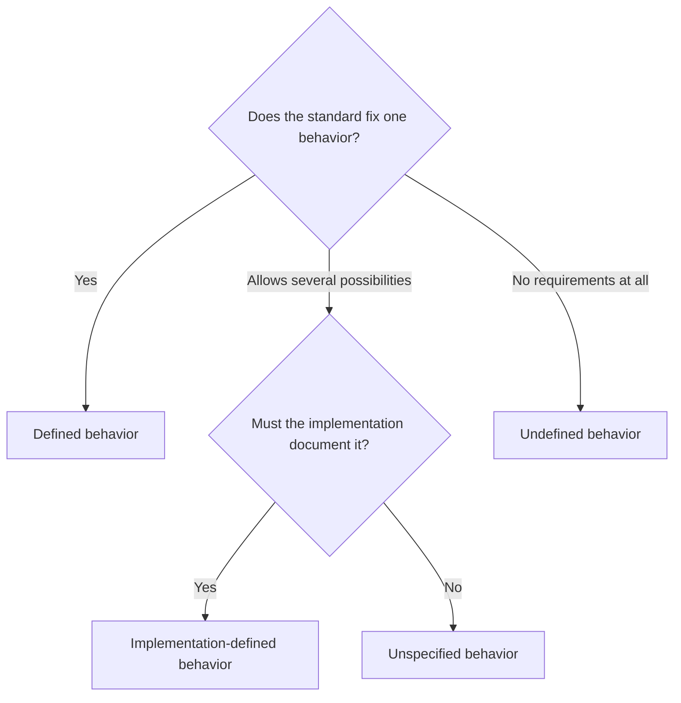
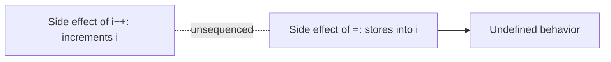
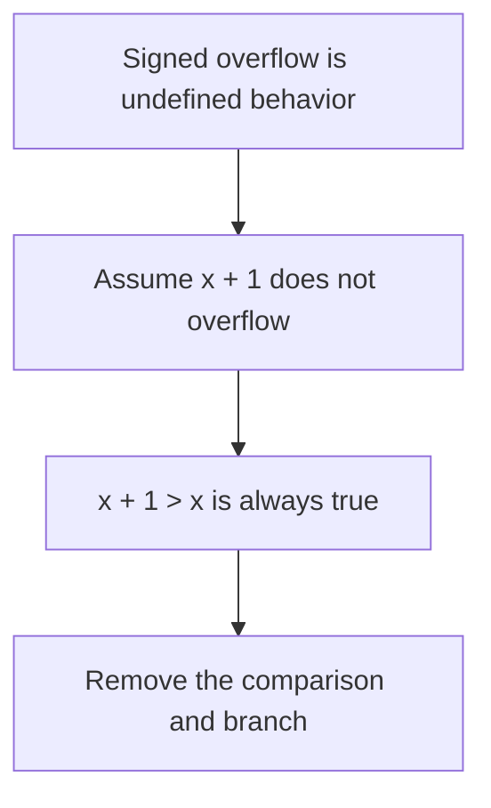
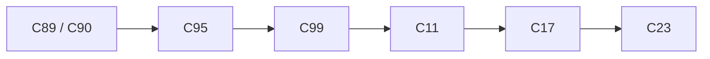

# Chapter 13 — Standard Library and Modern C

[Repository Guide](../../README.md) | [English](Concepts_Lecture.md) | [한국어](Concepts_Lecture.ko.md)

> **Last Updated:** 2026-11-09

> **Learning Objectives:**
> 1. Classify the standard headers by purpose and explain the difference between hosted and freestanding environments
> 2. Write code that does not depend on the sizes of data types by using fixed-width integers, `size_t`, and `<limits.h>`
> 3. Use `snprintf`, `fgets`, `assert`, `static_assert`, variadic functions, and time measurement functions correctly
> 4. Distinguish what bit-fields, endianness, `volatile`, and memory alignment guarantee and what they do not
> 5. Distinguish undefined, unspecified, and implementation-defined behavior, and find and fix each in code
> 6. Use the features added in C99, C11, C17, and C23 in code, and choose a standard according to compiler support

---

## Table of Contents

- [1. Organization of the Standard Library](#1-organization-of-the-standard-library)
  - [1.1 A Map of the Standard Headers](#11-a-map-of-the-standard-headers)
  - [1.2 Hosted and Freestanding Environments](#12-hosted-and-freestanding-environments)
- [2. Types and Sizes](#2-types-and-sizes)
  - [2.1 Fixed-Width Integers](#21-fixed-width-integers)
  - [2.2 Input and Output of Fixed-Width Integers](#22-input-and-output-of-fixed-width-integers)
  - [2.3 `size_t`, `ptrdiff_t`, `offsetof`](#23-size_t-ptrdiff_t-offsetof)
  - [2.4 `<limits.h>` and `<float.h>`](#24-limitsh-and-floath)
  - [2.5 `<stdbool.h>`](#25-stdboolh)
- [3. Safe String Handling](#3-safe-string-handling)
  - [3.1 `snprintf`](#31-snprintf)
  - [3.2 Input with `fgets` and `sscanf`](#32-input-with-fgets-and-sscanf)
  - [3.3 Removed and Discouraged Functions](#33-removed-and-discouraged-functions)
- [4. Diagnostics, Variadic Arguments, and Time](#4-diagnostics-variadic-arguments-and-time)
  - [4.1 `assert`](#41-assert)
  - [4.2 `static_assert`](#42-static_assert)
  - [4.3 Variadic Functions](#43-variadic-functions)
  - [4.4 Measuring Time](#44-measuring-time)
- [5. Low-Level Representation of Data](#5-low-level-representation-of-data)
  - [5.1 Bit-Fields](#51-bit-fields)
  - [5.2 Endianness](#52-endianness)
  - [5.3 `volatile`](#53-volatile)
  - [5.4 Memory Alignment](#54-memory-alignment)
- [6. Undefined Behavior](#6-undefined-behavior)
  - [6.1 Three Kinds of Non-Prescribed Behavior](#61-three-kinds-of-non-prescribed-behavior)
  - [6.2 Representative Cases](#62-representative-cases)
  - [6.3 Evaluation Order and Sequence Points](#63-evaluation-order-and-sequence-points)
  - [6.4 The Strict Aliasing Rule](#64-the-strict-aliasing-rule)
  - [6.5 Compiler Optimization and Defensive Habits](#65-compiler-optimization-and-defensive-habits)
- [7. Changes in the C Standard](#7-changes-in-the-c-standard)
  - [7.1 From C89 to C23](#71-from-c89-to-c23)
  - [7.2 Major Features of C99](#72-major-features-of-c99)
  - [7.3 Major Features of C11](#73-major-features-of-c11)
  - [7.4 C17](#74-c17)
  - [7.5 Major Features of C23](#75-major-features-of-c23)
  - [7.6 Compiler Support and Choosing a Standard](#76-compiler-support-and-choosing-a-standard)
- [Concept Applications](#concept-applications)
- [Summary](#summary)
- [Self-Check Questions](#self-check-questions)
- [References](#references)

---

<br>

## 1. Organization of the Standard Library

The facilities a C program uses divide into the language itself and the **standard library**. Syntax such as `if` and `for` belongs to the language, while functions such as `printf`, `strlen`, and `qsort` belong to the standard library.

### 1.1 A Map of the Standard Headers

> **Definition:** **Standard header.** A header whose name and contents are defined by the C standard. It provides function declarations, types, and macros, and the standard does not require a header to be an actual source file [1, Section 7.1.2].

A header mainly contains declarations and macros; the function bodies are usually in a precompiled library, and the linker connects the two ([Chapter 1, Section 3.2](../Ch01_Programming-and-C-Language/Concepts_Lecture.md#32-build-process)). The number of standard headers grew from 15 in C89 to 31, with C95 adding 3, C99 adding 6, C11 adding 5, and C23 adding 2 [1], [2], [3].

| Category | Headers (parentheses mark standards added after C89) | Main contents |
|:-----|:-----|:-----|
| Input/output and errors | `<stdio.h>`, `<errno.h>` | streams, `printf`, error number `errno` |
| Strings and characters | `<string.h>`, `<ctype.h>`, `<wchar.h>`(C95), `<wctype.h>`(C95), `<uchar.h>`(C11) | string functions, character classification, wide and Unicode characters |
| General utilities | `<stdlib.h>` | dynamic memory, string conversion, random numbers, sorting, termination |
| Types and sizes | `<stddef.h>`, `<stdint.h>`(C99), `<inttypes.h>`(C99), `<limits.h>`, `<float.h>`, `<stdbool.h>`(C99) | `size_t`, fixed-width integers, representable ranges, `bool` |
| Mathematics | `<math.h>`, `<complex.h>`(C99), `<tgmath.h>`(C99), `<fenv.h>`(C99) | math functions, complex numbers, floating-point environment |
| Diagnostics and control | `<assert.h>`, `<signal.h>`, `<setjmp.h>`, `<stdarg.h>` | assertions, signals, nonlocal jumps, variadic arguments |
| Time and localization | `<time.h>`, `<locale.h>` | time and date, locale |
| Language support | `<iso646.h>`(C95), `<stdalign.h>`(C11), `<stdnoreturn.h>`(C11) | alternative operator spellings, alignment, functions that do not return |
| Concurrency | `<stdatomic.h>`(C11), `<threads.h>`(C11) | atomic operations, threads |
| Bits and safe arithmetic | `<stdbit.h>`(C23), `<stdckdint.h>`(C23) | bit utilities, overflow checking |

*Table 1. The 31 standard headers classified by purpose*

`<complex.h>`, `<stdatomic.h>`, and `<threads.h>` are conditional features that an implementation need not provide [2, Section 7.1.2]. The standard headers are provided jointly by the compiler and the C library. With Apple clang 21, on which the code in this chapter was run, the compiler provides `<stdint.h>`, `<stdarg.h>`, `<stdatomic.h>`, `<stdckdint.h>`, and others, the macOS SDK provides `<stdio.h>`, `<stdlib.h>`, and others, and neither provides `<threads.h>`, `<uchar.h>`, or `<stdbit.h>`.

### 1.2 Hosted and Freestanding Environments

> **Definition:** **Hosted environment.** An environment that usually runs programs on top of an operating system and provides the entire standard library. Programs start at the `main` function.

> **Definition:** **Freestanding environment.** An environment that may run without an operating system and need provide only part of the standard library. The name and form of the startup function are defined by the implementation.

The headers a freestanding implementation must provide are `<float.h>`, `<iso646.h>`, `<limits.h>`, `<stdalign.h>`, `<stdarg.h>`, `<stdbool.h>`, `<stddef.h>`, `<stdint.h>`, and `<stdnoreturn.h>`, which consist mainly of types and macros [1, Section 4]. C23 added `<stdbit.h>` and most of the functions of `<string.h>` to this set [2, Section 4]. The predefined macro `__STDC_HOSTED__` tells which environment an implementation provides.

```text
$ clang -std=c17 hosted.c -o hosted && ./hosted     # a program that prints __STDC_HOSTED__
1
$ clang -std=c17 -ffreestanding hosted.c -o hosted && ./hosted
0
```

`-ffreestanding` is the option that requests freestanding compilation [4]. In the second run above, the macOS C library is still linked, so `printf` works; on a real freestanding target `printf` may not exist at all.

> **[Operating Systems]** An operating system kernel is the typical example of a freestanding environment [4]. When a kernel starts, there is neither a file system nor an allocator to back `malloc`, so kernels are written with code that does not depend on the standard library.

---

<br>

## 2. Types and Sizes

### 2.1 Fixed-Width Integers

As shown in [Chapter 3, Section 1.1](../Ch03_Data-Types-and-Variables/Concepts_Lecture.md#11-integer-types), the sizes of integer types differ across platforms. The standard specifies only minimum ranges (`int` is at least 16 bits, `long` at least 32 bits, and `long long` at least 64 bits) [1, Section 5.2.4.2.1], and a combination of actual sizes is called a **data model** [5].

| Data model | `int` | `long` | Pointer | Typical platforms |
|:-----|:-----|:-----|:-----|:-----|
| ILP32 | 32 bits | 32 bits | 32 bits | 32-bit Windows, Linux |
| LP64 | 32 bits | 64 bits | 64 bits | 64-bit Linux, macOS |
| LLP64 | 32 bits | 32 bits | 64 bits | 64-bit Windows |

*Table 2. Widely used data models*

Because the size of `long` differs even between 64-bit machines, `int` and `long` cannot be used where a size must be exact, such as in file formats and communication protocols.

> **Definition:** **Fixed-width integer.** An integer type whose name shows its number of bits. Defined by `<stdint.h>`, these types come in signed and unsigned forms such as `int32_t` and `uint32_t`.

| Category | Types | Guarantee | Requirement |
|:-----|:-----|:-----|:-----|
| Exact width | `int8_t`, `int16_t`, `int32_t`, `int64_t`, `uint8_t`, etc. | exactly N bits, no padding bits | optional |
| Minimum width | `int_least8_t`, `int_least16_t`, `int_least32_t`, `int_least64_t`, etc. | the smallest type of at least N bits | required |
| Fastest | `int_fast8_t`, `int_fast16_t`, `int_fast32_t`, `int_fast64_t`, etc. | usually the fastest type of at least N bits | required |
| Pointer-holding | `intptr_t`, `uintptr_t` | a `void *` converted to it and back compares equal | optional |
| Greatest width | `intmax_t`, `uintmax_t` | represents all values of the standard integer types | required |

*Table 3. Categories of integer types in `<stdint.h>`*

Exact-width types are optional because of implementations without 8-bit bytes, such as some DSPs. However, if an implementation has integer types of 8, 16, 32, or 64 bits with no padding bits and two's complement representation, it must define the corresponding names [1, Section 7.20.1.1], so they are always available on ordinary PCs and servers. Use `int` for general computation, `size_t` for sizes and indices, and exact-width types where the number of bits has meaning, as in file formats and protocols.

```c
#include <stdint.h>
#include <stdio.h>

int main(void) {
    printf("%zu %zu\n", sizeof(int32_t), sizeof(int_fast16_t));   // 4 2 (this platform)
    uint8_t small = 255;
    small = small + 1;                                            // wraps around to 0
    int64_t big = INT64_C(9000000000);                            // guarantees a 64-bit constant
    printf("%d %lld\n", small, (long long)big);                   // 0 9000000000
    return 0;
}
```

`<stdint.h>` also provides constant macros such as `INT64_C` and `INT32_MAX`. The code is [Example_FixedWidth.c](Example_FixedWidth.c).

> **Key Point:** Where the number of bits has meaning, as in file formats and protocols, use exact-width types instead of `int` or `long`.

### 2.2 Input and Output of Fixed-Width Integers

The actual type of `int64_t` is `long` or `long long` depending on the platform, so neither `%ld` nor `%lld` is portable. `<inttypes.h>` provides format strings as macros suited to each platform [1, Section 7.8]. A macro name consists of `PRI` (for `printf`) or `SCN` (for `scanf`), a conversion letter (`d`, `u`, `x`, and so on), and a width (`8`, `16`, `32`, `64`, `LEAST32`, `FAST32`, `PTR`, `MAX`, and so on).

```c
#include <inttypes.h>
#include <stdio.h>

int main(void) {
    int32_t  celsius = -40;
    uint64_t bytes   = UINT64_C(1099511627776);
    int32_t  n;

    printf("celsius = %" PRId32 ", bytes = %" PRIu64 "\n", celsius, bytes);
    printf("PRId32 is \"%s\", PRIu64 is \"%s\"\n", PRId32, PRIu64);   // "d", "llu" (this platform)
    if (sscanf("1234", "%" SCNd32, &n) == 1) {
        printf("n = %" PRId32 "\n", n);                                // n = 1234
    }
    return 0;
}
```

After preprocessing, `"%" PRId32 ", bytes = %" PRIu64 "\n"` becomes `"%" "d" ", bytes = %" "llu" "\n"`, and the adjacent string literals are concatenated into `"%d, bytes = %llu\n"`.

### 2.3 `size_t`, `ptrdiff_t`, `offsetof`

> **Definition:** **`size_t`.** The unsigned integer type of the result of `sizeof`. The implementation chooses it so that it can hold the size of any object [1, Section 7.19].

| Name | Meaning | Sign | Format specifier |
|:-----|:-----|:-----|:-----|
| `size_t` | size of an object, number of elements | unsigned | `%zu` |
| `ptrdiff_t` | result of pointer subtraction | signed | `%td` |
| `offsetof(type, member)` | bytes from the start of a structure to a member | unsigned (`size_t`) | `%zu` |

*Table 4. Size-related types and macros in `<stddef.h>`*

Because `size_t` is unsigned, subtracting 1 from 0 wraps around to its maximum value `SIZE_MAX` (from `<stdint.h>`). In the following countdown loop, once `i` reaches 0, `i--` makes it `SIZE_MAX`, so the loop does not stop and runs out of bounds.

```c
for (size_t i = n - 1; i >= 0; i--) { printf("%d ", a[i]); }     // bug: i >= 0 is always true
for (size_t i = n; i > 0; i--)      { printf("%d ", a[i - 1]); }  // correct form
```

Comparison with a signed value has the same problem. In `int d = -1; if (d < sizeof(int))`, `d` is converted to `size_t` and becomes a very large value, so the condition is false. The compiler warns under `-Wextra` (`warning: comparison of integers of different signs: 'int' and 'unsigned long'`).

`ptrdiff_t` is the type of the difference between two pointers; `p - q` is negative when `p` points to an element before `q` ([Chapter 8, Section 2.1](../Ch08_Pointers/Concepts_Lecture.md#21-pointer-arithmetic)). `offsetof` shows the padding of a structure ([Chapter 10, Section 1.2](../Ch10_Structures/Concepts_Lecture.md#12-structure-definition)) as numbers; if its target is a bit-field, the behavior is undefined [1, Section 7.19].

```c
struct record { char tag; int count; double score; };

printf("%zu %zu %zu %zu\n", sizeof(struct record),          // 16
       offsetof(struct record, tag),                        // 0
       offsetof(struct record, count),                      // 4
       offsetof(struct record, score));                     // 8
```

```text
struct record (a platform with 4-byte int and 8-byte double alignment)

offset  0     1  2  3    4  5  6  7    8 .................. 15
      ┌─────┬──────────┬─────────────┬────────────────────────┐
      │ tag │ padding  │ count (4B)  │ score (8B)             │
      └─────┴──────────┴─────────────┴────────────────────────┘
```

*Figure 1. Byte layout of `struct record` confirmed with `offsetof`*

### 2.4 `<limits.h>` and `<float.h>`

These two headers provide the ranges of the integer types and the characteristics of the floating-point types as macros. There is no need to memorize values, and the code stays correct on other platforms.

| Macro | Meaning | Standard minimum (through C17) | Value on this platform |
|:-----|:-----|:-----|:-----|
| `CHAR_BIT` | bits in a byte | 8 | 8 |
| `INT_MIN`, `INT_MAX` | range of `int` | -32767, 32767 | -2147483648, 2147483647 |
| `UINT_MAX` | maximum `unsigned int` | 65535 | 4294967295 |
| `LONG_MAX`, `LLONG_MAX` | maximum `long`, `long long` | 2147483647, 9223372036854775807 | 9223372036854775807 (both) |
| `DBL_MAX` | largest finite `double` | at least 1e37 | 1.79769e+308 |
| `DBL_MIN` | smallest normalized positive `double` | at most 1e-37 | 2.22507e-308 |
| `DBL_EPSILON` | difference between 1.0 and the next representable value | at most 1e-9 | 2.22045e-16 |

*Table 5. Main macros of `<limits.h>` and `<float.h>` (Apple clang 21 arm64)*

C23 fixes signed integers to two's complement, so `INT_MIN` became `-INT_MAX - 1` [2, Section 6.2.6.2]. `DBL_MIN` is not the most negative value but the smallest normalized positive value (the smallest subnormal value is C11's `DBL_TRUE_MIN`) [1, Section 5.2.4.2.2]; the most negative value is `-DBL_MAX`. To compare floating-point values with `DBL_EPSILON`, use a tolerance proportional to the magnitude of the values. With `a = 0.1 + 0.2` and `b = 0.3`, the condition `fabs(a - b) <= DBL_EPSILON * fmax(fabs(a), fabs(b))` is true even though `a == b` is false ([Chapter 3, Section 1.2](../Ch03_Data-Types-and-Variables/Concepts_Lecture.md#12-floating-point-types)).

### 2.5 `<stdbool.h>`

C99 added the keyword `_Bool` and the macros `bool`, `true`, and `false` in `<stdbool.h>`; from C23, `bool`, `true`, and `false` are keywords themselves [2, Section 6.4.1]. The feature of `bool` is its conversion rule: a scalar value converted to `bool` becomes 0 only if it compares equal to 0, and 1 otherwise [1, Section 6.3.1.2]. So 256, which becomes 0 when converted to `unsigned char`, becomes 1 when converted to `bool`. Older code used `int` for truth values ([Chapter 4, Section 5.4](../Ch04_Operators/Concepts_Lecture.md#54-truthiness-in-c)); with an `int` variable, `if (flag == true)` is false when `flag` is 2, so write `if (flag)`.

```c
#include <stdbool.h>                      // needed through C17
#include <stdio.h>

int main(void) {
    int big = 256;
    bool as_bool = big;                   // 1 (a nonzero value)
    unsigned char as_char = (unsigned char)big;   // 0 (when CHAR_BIT is 8)
    printf("%d %d %d\n", as_bool, as_char, true);   // 1 0 1
    return 0;
}
```

---

<br>

## 3. Safe String Handling

C string functions do not know the size of the destination array ([Chapter 9, Section 2.2](../Ch09_Strings/Concepts_Lecture.md#22-strcpy--strncpy)). The functions in this section take the size as an argument to prevent buffer overflow.

### 3.1 `snprintf`

`int snprintf(char *s, size_t n, const char *format, ...)` builds a string like `sprintf` but never writes more than `n` bytes [1, Section 7.21.6.5]. If `n` is greater than 0, the result always ends with a null character, and the return value is not the length written but the length that **would have been written** had there been enough space. A negative return value means an encoding error, and a value of `n` or more means the output was truncated.

```c
char buf[8];
int n = snprintf(buf, sizeof buf, "Hello, %s!", "World");   // n = 13, buf = "Hello, "
```

```text
"Hello, World!" has 13 characters, but buf is 8 bytes.

       [0]  [1]  [2]  [3]  [4]  [5]  [6]  [7]
buf:   'H'  'e'  'l'  'l'  'o'  ','  ' '  '\0'     return value 13 >= sizeof buf (8): truncated
```

*Figure 2. Contents written by `snprintf` and its return value when space is insufficient*

Two patterns use the return value. Calling with `n` equal to 0 writes nothing and returns the length (`s` may then be a null pointer), so the required size can be measured before allocating ([Chapter 11, Section 2.1](../Ch11_Dynamic-Memory-and-Advanced-Pointers/Concepts_Lecture.md#21-malloc-and-free)). Also, appending with `snprintf(out + used, sizeof out - used, ...)` and comparing the return value with the remaining space detects truncation. The code that checks for truncation is [Example_SafeInput.c](Example_SafeInput.c), and the code that appends is the `join` function in [Example_Variadic.c](Example_Variadic.c).

```c
int len = snprintf(NULL, 0, "%d-%s", 2024, "spring");       // len = 11
char *s = malloc((size_t)len + 1);
if (s != NULL) { snprintf(s, (size_t)len + 1, "%d-%s", 2024, "spring"); }
```

> **Note:** **`_snprintf` in Visual Studio.** In the UCRT of Visual Studio 2015 and later, `snprintf` conforms to C99, but the similarly named `_snprintf` does not write a null character and returns -1 on truncation, so the two must not be confused [6].

### 3.2 Input with `fgets` and `sscanf`

`scanf("%d", &n)` fails on non-numeric input and leaves the offending character in the input buffer, so it keeps failing on the same character when used in a loop. If input is read line by line ([Chapter 9, Section 4.2](../Ch09_Strings/Concepts_Lecture.md#42-fgets--gets_s)) and the line is parsed with `sscanf`, a bad line has already been consumed, and the program can simply read the next one.

```c
// Reads one line and removes the newline. Returns 1 on success, 0 at end of input, -1 if the line was too long.
static int read_line(char *buf, int size) {
    if (fgets(buf, size, stdin) == NULL) { return 0; }
    size_t len = strcspn(buf, "\n");               // position of the newline (or end of string)
    if (buf[len] == '\n') { buf[len] = '\0'; return 1; }
    if (feof(stdin)) { return 1; }                 // the last line of input may have no newline
    int c;
    while ((c = getchar()) != '\n' && c != EOF) { } // discards the rest of the line
    return -1;
}
```

If the buffer has no newline and input has not ended, the line was longer than the buffer, so the remainder must be discarded to keep the next call from reading the rest of the line. The caller checks the format with `sscanf(line, "%15s %d", name, &age) != 2`. The following is the output of [Example_SafeInput.c](Example_SafeInput.c).

```text
$ printf 'Alice 25\nBob\nthis line is far too long to fit in the line buffer\nChristopher 20\n' | ./Example_SafeInput
Alice is 25 years old
bad format: "Bob"
too long: the line was discarded
Christopher is 20 years (truncated)
```

> **Caution:** `sscanf("12abc", "%d", &v)` returns 1 and sets `v` to 12 without reporting the trailing characters, and if a value read with `%d` exceeds the range of `int`, the behavior is undefined [1, Section 7.21.6.2]. Use `strtol` for exact numeric conversion ([Chapter 12, Section 1.4](../Ch12_File-IO-and-Program-Structure/Concepts_Lecture.md#14-converting-string-arguments-to-numbers)).

> **Key Point:** Read input line by line with `fgets`, and do the parsing separately with `sscanf` or `strtol`.

### 3.3 Removed and Discouraged Functions

| Function | Problem | Alternative |
|:-----|:-----|:-----|
| `gets` | Cannot limit input length, so no buffer can prevent overflow. Removed in C11 [1]. | `fgets` |
| `sprintf`, `strcpy`, `strcat` | Do not know the size of the destination array. | `snprintf`, copy after checking the length |
| `strncpy` | Does not null-terminate a long source; pads a short source with nulls. | `snprintf` or manual termination |
| `scanf("%s", s)` | No bound without a width. | `"%19s"`, `fgets` and `sscanf` |
| `atoi`, `atol`, `atof` | Cannot report errors; out-of-range input is undefined behavior. | `strtol`, `strtod` |
| `strtok` | Keeps state internally between calls and is not reentrant. | POSIX `strtok_r`, Annex K `strtok_s` |
| `asctime`, `ctime` | Return a static buffer and are deprecated in C23 [2, Section 7.29.3.1]. | `strftime` |

*Table 6. Removed and discouraged standard functions and their alternatives*

The macOS SDK here keeps `gets` for compatibility, but it produces a compiler warning and the run-time warning `warning: this program uses gets(), which is unsafe.`. The Annex K functions of C11, such as `strcpy_s`, are optional; WG14 document N1967 recommended their removal based on field experience [7], and some signatures of the `_s` functions in Visual Studio differ from the standard [8]. Code that must be portable should use `snprintf` and size checks instead of the `_s` functions.

> **Note:** **C4996 in Visual Studio.** Visual Studio issues warning C4996 for `sprintf`, `strcpy`, `scanf`, and similar functions and recommends the `_s` functions. Writing `#define _CRT_SECURE_NO_WARNINGS` at the beginning of the source disables the warning ([Chapter 3 Lab, Section 5.1](../Ch03_Data-Types-and-Variables/Concepts_Lab.md#51-warning-c4996)).

---

<br>

## 4. Diagnostics, Variadic Arguments, and Time

### 4.1 `assert`

`assert(expression)` from `<assert.h>` is a macro that checks a programmer's assumption at run time. If the expression is false, it writes the file name, line number, and expression to the standard error stream and terminates the program with `abort` [1, Section 7.2.1.1].

```c
static double average(const int *a, int n) {
    assert(a != NULL);
    assert(n > 0);
    long sum = 0;
    for (int i = 0; i < n; i++) { sum += a[i]; }
    return (double)sum / n;
}
```

```text
Assertion failed: (n > 0), function average, file average.c, line 6.
```

The above is the output of a run that calls `average(data, 0)`; the shell's exit code is then 134 (128 + signal 6, SIGABRT). If the macro `NDEBUG` is defined when `<assert.h>` is included, `assert` becomes `((void)0)` and disappears [1, Section 7.2], so compiling with `-DNDEBUG` makes the same call print `nan` here without any check.

> **Caution:** The expression inside `assert` is not evaluated when `NDEBUG` is defined. Therefore a call with side effects, as in `assert(fclose(fp) == 0);`, disappears entirely in a release build. Write `int r = fclose(fp); assert(r == 0);` instead. `assert` is a tool for finding programmer errors; situations that occur in normal execution, such as bad user input or file errors, must be handled with `if`.

### 4.2 `static_assert`

**`static_assert`** checks an integer constant expression at compile time and produces a compile error if it is false. It has no effect on run time or size. The C11 keyword is `_Static_assert` and `static_assert` is a macro in `<assert.h>`; in C23, `static_assert` is a keyword, so no header is needed and the message may be omitted [2, Section 6.4.1].

```c
#include <assert.h>
#include <stdint.h>

struct header { uint8_t kind; uint32_t length; };
static_assert(sizeof(struct header) == 5, "struct header has padding");
```

```text
header.c:5:15: error: static assertion failed due to requirement 'sizeof(struct header) == 5': struct header has padding
header.c:5:37: note: expression evaluates to '8 == 5'
```

Padding is inserted after `kind` to place `length` at a multiple of 4, so the size is 8. Use `assert` for conditions known only at run time and `static_assert` for conditions fixed at compile time, such as those involving `sizeof`.

### 4.3 Variadic Functions

A function with an unspecified number of arguments, such as `printf`, is written with `<stdarg.h>`. The parameter list ends with `...`, and the arguments are extracted in order through a `va_list` [1, Section 7.16].

```c
static int sum(int count, ...) {
    va_list ap;                     // holds the position of the next argument
    int total = 0;

    va_start(ap, count);            // starts from the last fixed parameter
    for (int i = 0; i < count; i++) {
        total += va_arg(ap, int);   // extracts the next argument as int
    }
    va_end(ap);                     // cleans up
    return total;
}
```

```text
sum(3, 10, 20, 30)

count = 3, variadic arguments: [ 10 ][ 20 ][ 30 ]
just after va_start          ap ┘
va_arg 1st call: returns 10, ap moves to 20    total = 10
va_arg 2nd call: returns 20, ap moves to 30    total = 30
va_arg 3rd call: returns 30                    total = 60
```

*Figure 3. Conceptual model of extracting variadic arguments with `va_start` and `va_arg`*

The function must learn the number of arguments through a fixed parameter (`sum`), a format string (`printf`), or a terminating value (such as `NULL`). If the type given to `va_arg` is not compatible with the type actually passed after promotion, the behavior is undefined (except when reading a value representable in both as the integer type that differs only in sign, and between `void *` and a character pointer) [1, Section 7.16.1.1]. Arguments passed through `...` undergo the **default argument promotions** [1, Section 6.5.2.2]: `char` and `short` are passed as `int` and `float` as `double`, so `va_arg(ap, float)` and `va_arg(ap, char)` are incorrect. clang warns as follows, and such a program printed `0.000000` for `1.5f + 2.5f` in this environment.

```text
warning: second argument to 'va_arg' is of promotable type 'float'; this va_arg has undefined behavior because arguments will be promoted to 'double' [-Wvarargs]
```

When `NULL` terminates the arguments, cast it as `(const char *)NULL`, because some implementations define `NULL` as the integer 0. To forward arguments to another function, call the `vprintf` and `vsnprintf` family, which take a `va_list`. Unlike `printf`, a variadic function you write yourself is not checked by `-Wformat` unless it carries the `format` attribute of GCC and clang, so the caller must match the format string and arguments. C23 also allows `void f(...)` and `va_start(ap)` [2, Section 7.16.1.4]. The code is [Example_Variadic.c](Example_Variadic.c).

### 4.4 Measuring Time

| Function | What it measures | Unit |
|:-----|:-----|:-----|
| `time` | calendar time | `time_t` (seconds since the Epoch in POSIX [9]) |
| `clock` | processor time used by the program | 1/`CLOCKS_PER_SEC` of a second |
| `timespec_get` (C11) | calendar time | seconds and nanoseconds (`struct timespec`) |
| `clock_gettime` (POSIX) | a selected clock such as `CLOCK_MONOTONIC` | seconds and nanoseconds [10] |

*Table 7. Main time functions*

ISO C does not specify the unit of `time_t` [1, Section 7.27.1]. `clock` measures **CPU time (processor time)**, which differs from elapsed time [1, Section 7.27.2.1]. The following program measures about 0.5 seconds of computation and a POSIX `sleep(1)`. The full code is omitted, and the values are from one run.

```c
clock_t c0 = clock();
struct timespec w0, w1;
timespec_get(&w0, TIME_UTC);

busy();                              // about 0.5 seconds of computation
sleep(1);                            // waits 1 second, using no CPU

clock_t c1 = clock();
timespec_get(&w1, TIME_UTC);
printf("CPU  = %.3f s\n", (double)(c1 - c0) / CLOCKS_PER_SEC);
printf("wall = %.3f s\n", (double)(w1.tv_sec - w0.tv_sec) + (w1.tv_nsec - w0.tv_nsec) / 1e9);
```

```text
CPU  = 0.546 s
wall = 1.556 s
```

`sleep` uses no processor time, so it adds almost nothing to CPU time. To measure elapsed time use `time` or `timespec_get`, but because the system clock can be adjusted by NTP and similar services, POSIX's `clock_gettime(CLOCK_MONOTONIC, ...)` is suited to precise intervals [10]. `strftime` produces string representations of calendar time (see also `time` in [Chapter 7, Section 5.8](../Ch07_Arrays/Concepts_Lecture.md#58-random-numbers-rand-srand-time)).

> **Note:** **`clock` in Visual Studio.** Microsoft's `clock` returns not CPU time but the wall-clock time elapsed since process start, and its documentation states that this does not strictly conform to ISO C [11]. For CPU time, use `GetProcessTimes`.

---

<br>

## 5. Low-Level Representation of Data

### 5.1 Bit-Fields

> **Definition:** **Bit-field.** An integer structure member declared with a specified number of bits. `unsigned int level : 4;` occupies 4 bits and stores 0 through 15.

```c
struct permission {
    unsigned int read    : 1;
    unsigned int write   : 1;
    unsigned int execute : 1;
    unsigned int level   : 4;
};
struct permission p = {1, 0, 1, 5};   // sizeof(p) = 4, first byte = 0x2d (this platform)
```

```text
bit        7   6   5   4   3   2   1   0
value      0   0   1   0   1   1   0   1      (first byte = 0x2d)
read                                   ^    = 1
write                              ^        = 0
execute                        ^            = 1
level          ^   ^   ^   ^                = 0101 (5)
```

*Figure 4. Bit-fields placed in the first byte of `struct permission` (Apple clang 21 arm64)*

A value too large for an unsigned bit-field loses its high bits (`p.level = 16;` stores 0 with a compiler warning). A bit-field has no address, so `&p.level` is a compile error [1, Section 6.5.3.2]. The types allowed for a bit-field are `_Bool`, `signed int`, `unsigned int`, and implementation-defined types.

> **Caution:** The size of the allocation unit, the bit direction within a unit, the treatment of a field that straddles units, and the signedness of a plain `int` field are all implementation-defined [1, Section 6.7.2, Section 6.7.2.1]. Kernighan and Ritchie also describe almost everything about bit-fields as implementation-dependent [12]. For the bit formats of files or networks, fixed-width integers and shift operations are more portable ([Chapter 4, Section 6.2](../Ch04_Operators/Concepts_Lecture.md#62-shift-operators)).

### 5.2 Endianness

> **Definition:** **Endianness.** The order in which the bytes of a multi-byte value are placed in memory. Placing the least significant byte at the lowest address is little-endian, and placing the most significant byte at the lowest address is big-endian.

```text
uint32_t value = 0x12345678;

              address:  [+0]  [+1]  [+2]  [+3]
little-endian            78    56    34    12      (x86, arm64 macOS)
big-endian               12    34    56    78
```

*Figure 5. Two byte orders of the same value `0x12345678`*

The bytes of an object are examined by reading it through `unsigned char *` (character type access is permitted, as Section 6.4 explains). In this environment the bytes were printed in the order `78 56 34 12`. If a program writes memory as it is to a file or network, the value is reversed on a system of the other endianness ([Chapter 12, Section 4.4](../Ch12_File-IO-and-Program-Structure/Concepts_Lecture.md#44-cautions-when-storing-structures-in-files)), so bytes are determined directly by applying shifts to the numeric value. This code works independently of the host's endianness.

```c
static void store_be32(unsigned char out[4], uint32_t v) {
    out[0] = (unsigned char)(v >> 24);
    out[1] = (unsigned char)(v >> 16);
    out[2] = (unsigned char)(v >> 8);
    out[3] = (unsigned char)v;
}
```

The result of `store_be32` is `12 34 56 78` on every platform. The code is [Example_ByteOrder.c](Example_ByteOrder.c). C23 indicates the endianness of the execution environment with `__STDC_ENDIAN_NATIVE__` in `<stdbit.h>` [2, Section 7.18.2].

> **[Computer Networks]** Internet protocol headers use big-endian as the standard order, called network byte order. POSIX `htonl` and `ntohl` convert between host order and network order [13]. On the little-endian system here, `htonl(0x12345678)` is `0x78563412`.

### 5.3 `volatile`

`volatile` is a type qualifier telling the compiler that an object may change due to factors outside the program. Reads and writes of a `volatile` object are side effects, so the compiler must perform them the number of times and in the order written in the code [1, Section 5.1.2.3, Section 6.7.3]. The following is arm64 assembly from `clang -O2` (comments added).

```c
int plain(int *p)         { int a = *p; int b = *p; return a + b; }
int vol(volatile int *p)  { int a = *p; int b = *p; return a + b; }
```

```text
_plain:
    ldr  w8, [x0]         ; reads *p only once
    lsl  w0, w8, #1       ; doubles that value
    ret
_vol:
    ldr  w8, [x0]         ; first read
    ldr  w9, [x0]         ; second read
    add  w0, w9, w8
    ret
```

Similarly, for `while (*flag == 0) { }`, if `flag` is an ordinary pointer the whole loop disappears under `clang -O2`, and with `volatile int *flag` a loop that reads memory each time remains. The uses of `volatile` are memory-mapped hardware registers (`(*(volatile uint32_t *)0x40021000)`, an example address), signal handler flags (`volatile sig_atomic_t`) [1, Section 7.14], and local variables that must keep their values across `longjmp` [1, Section 7.13.2.1]. A memory-mapped register is a hardware register whose reads and writes at a particular address control a device, a signal handler is a function called, interrupting normal flow, usually when the operating system delivers a signal, and `longjmp` is a nonlocal jump back to a point saved with `setjmp`.

> **Caution:** `volatile` is **not** a thread synchronization mechanism. A **thread** is a flow of execution that runs independently within a program and shares its memory. The standard gives `volatile` no atomicity or inter-thread ordering, and if two threads access the same variable without synchronization and one of them writes, the result is a data race, which is undefined behavior [1, Section 5.1.2.4]. Use `_Atomic` or a **mutex**, a lock that lets only one thread enter at a time, for data shared between threads (Section 7.3).

### 5.4 Memory Alignment

> **Definition:** **Alignment.** The constraint that the address of an object of a given type be a multiple of some value. A type with alignment 4 can be placed only at addresses that are multiples of 4.

Alignment is the cause of structure padding ([Chapter 10, Section 1.2](../Ch10_Structures/Concepts_Lecture.md#12-structure-definition)). C11's `_Alignof` and `_Alignas` (macros `alignof` and `alignas` are in `<stdalign.h>`) query and specify alignment, and `alignas` and `alignof` are keywords in C23 [2, Section 6.4.1]. An address returned by `malloc` satisfies the alignment of `max_align_t` [1, Section 7.22.3], and C11's `aligned_alloc(alignment, size)` returns a block of larger alignment. Because C11 required the size to be a multiple of the alignment [1, Section 7.22.3.1], call it with such a size. Visual Studio provides `_aligned_malloc` instead of `aligned_alloc` [8].

```c
printf("%zu %zu %zu\n", alignof(int), alignof(double), alignof(max_align_t));   // 4 8 8 (this platform)
alignas(16) int aligned = 7;
printf("%zu\n", (size_t)&aligned % 16);                                          // 0
double *p = aligned_alloc(64, 64 * 4);                                           // 64-byte boundary
```

Accessing a misaligned object is undefined behavior. The following `*(int *)(buffer + 1)` reads an `int` at an address that is not a multiple of 4.

```text
address (example)  0x1000  0x1001  0x1002  0x1003  0x1004  0x1005
value              01      02      03      04      05      06
int read                   └─ *(int *)(buffer + 1) ──┘
```

*Figure 6. Reading a misaligned `int` (example addresses)*

```c
unsigned char buffer[8] = {1, 2, 3, 4, 5, 6, 7, 8};
int bad = *(int *)(buffer + 1);            // undefined behavior
int good;
memcpy(&good, buffer + 1, sizeof good);    // defined behavior
```

```text
misaligned.c:7:15: runtime error: load of misaligned address 0x00016f28aa41 for type 'int', which requires 4 byte alignment
```

The above is the UBSan report, and the address is an example. arm64 executes this read and yields `0x05040302`, but it violates the standard and traps on some processors. `memcpy` copies bytes, so it is always defined.

---

<br>

## 6. Undefined Behavior

### 6.1 Three Kinds of Non-Prescribed Behavior

The standard classifies behavior that it does not fix to a single outcome as implementation-defined, unspecified, undefined, and locale-specific behavior, which varies with the locale [1, Section 3.4]. The first three bear directly on program correctness.

> **Definition:** **Implementation-defined behavior.** Behavior for which the standard specifies the possibilities and the implementation must document which one it chose.

> **Definition:** **Unspecified behavior.** Behavior for which the standard allows two or more possibilities and the implementation need not say which one it chooses. It may differ from case to case even within one program.

> **Definition:** **Undefined behavior.** Behavior for which the standard imposes no requirements. There is no guarantee about the behavior of the whole program, which may produce wrong results, crash, or be exploited.

| Kind | What the standard fixes | Documentation | Can programs rely on it | Examples |
|:-----|:-----|:-----|:-----|:-----|
| Implementation-defined | the range of possible behaviors | required | yes, if the implementation is fixed | sign of `char`, `sizeof(int)`, right shift of a negative value |
| Unspecified | the set of possible behaviors | not required | no | evaluation order of function arguments, values of padding bytes |
| Undefined | nothing | not required | never | signed overflow, out-of-bounds access, null pointer dereference |

*Table 8. Comparison of the three kinds of non-prescribed behavior*



*Figure 7. Criteria distinguishing the three kinds of non-prescribed behavior*

Because the standard imposes no requirements on undefined behavior, the compiler may assume such code never runs and optimize accordingly (Section 6.5). A program that works today may behave differently when the compiler version or optimization level changes.

### 6.2 Representative Cases

| Code example | Problem | See |
|:-----|:-----|:-----|
| `int a = INT_MAX; a + 1` | signed integer overflow | example below |
| `x / 0`, `x % 0`, `INT_MIN / -1` | division by zero, unrepresentable result | [1, Section 6.5.5] |
| `1 << 40`, `-1 << 1` | shift count at least the width, left shift of a negative value | [Chapter 4, Section 6.2](../Ch04_Operators/Concepts_Lecture.md#62-shift-operators), [1, Section 6.5.7] |
| `a[5]` (array of 5 elements) | out-of-bounds access | [Chapter 7, Section 3.3](../Ch07_Arrays/Concepts_Lecture.md#33-index-out-of-bounds) |
| `*p` (`p` is a null pointer) | null pointer dereference | [Chapter 8, Section 1.7](../Ch08_Pointers/Concepts_Lecture.md#17-precautions-when-using-pointers) |
| reading an uninitialized local variable | use of an indeterminate value | [Chapter 3, Section 3.1](../Ch03_Data-Types-and-Variables/Concepts_Lecture.md#31-declaration-and-initialization) |
| `char *s = "abc"; s[0] = 'x';` | modifying a string literal | [Chapter 9, Section 6.1](../Ch09_Strings/Concepts_Lecture.md#61-char-string-pointer) |
| using the return value of a function that ended without one | missing `return` | [1, Section 6.9.1] |
| `printf("%d", x)` (`x` is `long`) | mismatch between format and argument | Section 4.3 |
| `memcpy(a + 1, a, n)` (overlapping regions) | overlapping copy | [Chapter 11, Section 4.1](../Ch11_Dynamic-Memory-and-Advanced-Pointers/Concepts_Lecture.md#41-memcpy-and-memmove) |
| `(int)1e20` | converting a floating value outside the representable range | [1, Section 6.3.1.4] |

*Table 9. Representative undefined behavior*

Unsigned arithmetic is defined modulo $2^N$ and does not overflow [1, Section 6.2.5], but if signed arithmetic exceeds the range, the behavior is undefined ([Chapter 3, Section 1.1](../Ch03_Data-Types-and-Variables/Concepts_Lecture.md#11-integer-types)).

```c
int a = INT_MAX;
unsigned int b = UINT_MAX;

b = b + 1;     // defined behavior: wraps around to 0
a = a + 1;     // undefined behavior: signed overflow
```

Compiling with `-fsanitize=undefined` makes UndefinedBehaviorSanitizer (UBSan) report the following message, and by default execution continues [14]. See [Chapter 11, Section 3.4](../Ch11_Dynamic-Memory-and-Advanced-Pointers/Concepts_Lecture.md#34-tools-for-finding-errors) and [Chapter 12, Section 9.1](../Ch12_File-IO-and-Program-Structure/Concepts_Lecture.md#91-compiler-options) for the tools.

```text
overflow.c:9:11: runtime error: signed integer overflow: 2147483647 + 1 cannot be represented in type 'int'
```

That `a` became -2147483648 here merely reflects the hardware's addition; the standard does not guarantee this result. To compute safely, check the range before the operation. `a > INT_MAX - b` is a comparison that does not overflow when `b` is positive, whereas `a + b > INT_MAX` is useless because the addition itself overflows first. The code is [Example_CheckedArithmetic.c](Example_CheckedArithmetic.c).

### 6.3 Evaluation Order and Sequence Points

Using the result of one increment in an expression, as in `a = x++;` from [Chapter 4, Section 3.2](../Ch04_Operators/Concepts_Lecture.md#32-standalone-vs-in-expressions), causes no problem, but modifying the same variable more than once, or mixing a modification with a separate read of it, can leave the result undetermined. This is because operator precedence fixes only the structure of an expression (which operands bind to which operators), not when operands are evaluated.

> **Definition:** **Sequence point.** A point guaranteeing that all side effects of earlier evaluations have completed and that the next evaluation begins. C11 redefined this with the "sequenced before" relation between evaluations [1, Section 5.1.2.3].

| Relation (C11) | Meaning | When conflicting on the same scalar |
|:-----|:-----|:-----|
| sequenced before | B runs after A has completed | defined |
| indeterminately sequenced | there is an order, but which comes first is not specified | unspecified |
| unsequenced | no order; executions may interleave | **undefined** |

*Table 10. The three sequencing relations between two evaluations*



*Figure 8. Two side effects on the same variable with no order in `i = i++`*

`i = i++` has undefined behavior because two side effects on the same scalar object are unsequenced [1, Section 6.5]. In contrast, in `f(a(), b())`, the calls to `a()` and `b()` do not interleave and one of them runs first, but which one is not specified; they are indeterminately sequenced, so this is unspecified behavior [1, Section 6.5.2.2]. clang here called `a` first, but another compiler may call `b` first and still conform.

| Expression | Judgment | Reason |
|:-----|:-----|:-----|
| `i = i + 1;`, `a[i] = i;` | defined | the side effect of the assignment follows the value computations of its operands |
| `i = i++;`, `x = i++ + i++;` | undefined | two side effects on the same variable are unsequenced |
| `a[i] = i++;`, `f(i, i++);` | undefined | a value use and a side effect are unsequenced |
| `f(a(), b());` | unspecified | only the order of the calls is unspecified |
| `(i++, i * 2)` | defined | the comma operator is a sequence point |
| `p != NULL && *p > 0` | defined | `&&` is a sequence point |

*Table 11. Judgments of expressions involving evaluation order*

Sequence points occur at the end of a full expression (`;`), after the first operand of `&&`, `||`, `?:`, and the comma operator, after the arguments are evaluated in a function call, and in a few other places [1, Annex C]. clang's `-Wall` reports `i = i++` as `warning: multiple unsequenced modifications to 'i'`, but it does not catch every case, so do not modify the same variable twice in one statement.

### 6.4 The Strict Aliasing Rule

Two pointers that designate the same object are said to be **aliases** of it. Compilers take aliases into account when rearranging memory accesses, and the standard lets them assume that pointers of incompatible types do not point to the same object.

> **Definition:** **Strict aliasing.** The rule that a stored value may be accessed only through a compatible type or a few other types the standard permits [1, Section 6.5]. Violating it is undefined behavior.

The **effective type** of an object is its declared type if it has one; otherwise, as with memory obtained from `malloc`, it is the type used to store into it. An object may be accessed only through a type compatible with its effective type, such a type with qualifiers such as `const`, a corresponding signed or unsigned integer type, a structure or union containing one of these as a member, or a character type (`char`, `signed char`, `unsigned char`) [1, Section 6.5].

```c
int set_both(int *a, float *b) {
    *a = 1;
    *b = 2.0f;
    return *a;
}
// set_both(&x, (float *)&x) is undefined behavior
```

```text
$ clang -std=c17 -O0 aliasing.c -o a && ./a
1073741824
$ clang -std=c17 -O2 aliasing.c -o a && ./a
1
$ clang -std=c17 -O2 -fno-strict-aliasing aliasing.c -o a && ./a
1073741824
```

At `-O2`, the compiler assumes that `int *` and `float *` do not point to the same object and replaces `return *a;` with 1. The `-O0` value is the bit pattern `0x40000000` of `2.0f`. According to the GCC documentation, this assumption is enabled at `-O2` and can be disabled with `-fno-strict-aliasing` [15]. To reinterpret bytes as another type, use `memcpy(&bits, &f, sizeof bits)`. Reading bytes through a character type pointer is always allowed, but reading a `char` array through `int *` does not fall under this exception. Reinterpretation through a union is allowed in C [1, Section 6.5.2.3] ([Chapter 10, Section 3.2](../Ch10_Structures/Concepts_Lecture.md#32-union)), and the GCC documentation permits access directly through the union type [15].

### 6.5 Compiler Optimization and Defensive Habits

Compilers optimize on the assumption that undefined behavior does not occur [16].

```c
int always(int x) { return x + 1 > x; }

int check(int *p) {
    int value = *p;        // already dereferenced
    if (p == NULL) { return -1; }     // treated as always false
    return value;
}
```

```text
_always:                   ; clang -O2, arm64 (comments added)
    mov  w0, #1            ; always returns 1, with no comparison code
    ret
_check:
    ldr  w0, [x0]          ; reads *p and returns, with no NULL check
    ret
```



*Figure 9. Optimization that removes a condition on the basis of undefined behavior*

`always(INT_MAX)` is 0 at `-O0` and 1 at `-O2`. `-fwrapv` defines signed overflow as two's complement wraparound and restores the comparison [17]. GCC also has `-fno-delete-null-pointer-checks` to disable removal of NULL checks [15].

> **[Software Security]** In 2009, the Linux kernel's TUN driver had code that dereferenced `tun->sk` before checking `if (!tun)`, and the compiler removed the check, so an attacker could exploit it [18].

| Habit | Details |
|:-----|:-----|
| Enable warnings | `-Wall -Wextra -pedantic`, `/W4` in Visual Studio |
| Test with sanitizers | run tests with `-fsanitize=address,undefined` |
| Test with optimization on | suspect the code if `-O0` and `-O2` differ |
| Check ranges before operations | patterns in Section 6.2, C23's `ckd_add` |
| Initialize variables | initialize at the point of declaration |
| Use `memcpy` for reinterpretation | Section 6.4 |

*Table 12. Habits that reduce undefined behavior*

> **Key Point:** Undefined behavior is not safe even when one compiler produces the desired result. A compiler may transform the code on the assumption that such behavior never occurs.

---

<br>

## 7. Changes in the C Standard

### 7.1 From C89 to C23

The C language has been revised several times since its first standard in 1989 [19], [20]. The numbers of the standards and their identifying macros are as follows.

| Name | Formal standard | Published | `__STDC_VERSION__` | Main content |
|:-----|:-----|:-----|:-----|:-----|
| C89 / C90 | ANSI X3.159-1989, ISO/IEC 9899:1990 | 1989, 1990 | not defined | first standard |
| C95 | ISO/IEC 9899:1990/Amd 1:1995 | 1995 | `199409L` | wide characters |
| C99 | ISO/IEC 9899:1999 | 1999 | `199901L` | major expansion of the language |
| C11 | ISO/IEC 9899:2011 | 2011 | `201112L` | multithreading, `_Generic`, conditional features |
| C17 (C18) | ISO/IEC 9899:2018 | 2018 | `201710L` | only defect fixes of C11 |
| C23 | ISO/IEC 9899:2024 | 2024 | `202311L` | keyword cleanup, `nullptr`, `constexpr` |

*Table 13. History of the C standard*



*Figure 10. The order of revisions of the C standard*

C17 is also called C18 because ISO published it in 2018 ([Chapter 1, Section 2.1](../Ch01_Programming-and-C-Language/Concepts_Lecture.md#21-history)). The standard in effect at compile time is checked with `__STDC_VERSION__`; on Apple clang 21, `-std=c89`, `-std=c99`, `-std=c11`, `-std=c17`, and `-std=c23` show no definition, `199901`, `201112`, `201710`, and `202311`, respectively.

### 7.2 Major Features of C99

`long long`, `_Bool`, `<stdint.h>`, `snprintf`, `//` comments, `for` initialization declarations, and `%zu` have already been covered. The full code for the remaining features is [Example_C99Features.c](Example_C99Features.c).

> **Definition:** **Designated initializer.** An initialization syntax that names the member or element to initialize by name or index.

> **Definition:** **Compound literal.** An unnamed object created in the form `(type){initializers}`. Inside a block it has automatic storage duration and remains valid until the block ends.

```c
#include <stdio.h>

struct student { char name[20]; int id; double gpa; };
struct point { int x, y; };
enum month { JAN, FEB, MAR, MONTH_COUNT };
static const char *const name[MONTH_COUNT] = { [MAR] = "March", [JAN] = "January", [FEB] = "February" };
static int squared(struct point p) { return p.x * p.x + p.y * p.y; }

int main(void) {
    struct student s = { .id = 2024001, .name = "Kim" };   // gpa becomes 0.0
    int arr[6] = { [0] = 1, [4] = 5, 6 };                  // {1, 0, 0, 0, 5, 6}
    int d = squared((struct point){3, 4});                 // passes a compound literal as an argument (d = 25)
    int *p = (int[]){10, 20, 30};                          // valid within this block
    printf("%s %d %.1f %d %d %d %s\n", s.name, s.id, s.gpa, arr[5], d, p[2], name[MAR]);
    return 0;                                              // Kim 2024001 0.0 6 25 30 March
}
```

Members and elements not named become 0, and a value after a designator continues at the next position (`6` goes to `arr[5]`). Returning the address of a compound literal from a function is the same error as returning the address of a local variable ([Chapter 11, Section 1.3](../Ch11_Dynamic-Memory-and-Advanced-Pointers/Concepts_Lecture.md#13-why-the-address-of-a-local-variable-must-not-be-returned)).

> **Definition:** **Flexible array member.** An array of unspecified size declared as the last member of a structure. It is used to store a structure and variable-length data in one allocation.

```c
struct message {
    size_t length;
    char   text[];              // not included in sizeof(struct message)
};
struct message *m = malloc(sizeof *m + strlen("hello") + 1);
```

```text
m ──► ┌─────────────┬───────────────────────┐
      │ length = 5  │ 'h' 'e' 'l' 'l' 'o' \0│
      └─────────────┴───────────────────────┘
       sizeof(*m) = 8        space for text[]
```

*Figure 11. Memory layout of a structure with a flexible array member (this platform)*

A structure needs at least one other named member to have a flexible array member. Assigning such a structure does not copy the array part, and such a structure cannot be a member of another structure or an element of an array [1, Section 6.7.2.1].

> **Definition:** **Variable-length array.** An array whose size is determined by a run-time value, abbreviated VLA. It was added in C99.

```c
size_t n = 4;
int vla[n];                      // sizeof vla is 16 (computed at run time)
long sum_grid(size_t rows, size_t cols, int grid[rows][cols]);   // passes the column count as an argument
```

A local VLA is typically placed on the stack, so a large `n` causes a stack overflow with no way to detect failure; when the size depends on input, dynamic allocation is safer ([Chapter 11, Section 1.4](../Ch11_Dynamic-Memory-and-Advanced-Pointers/Concepts_Lecture.md#14-when-dynamic-memory-is-needed)). VLAs became optional in C11, and C23 made variably modified types (types whose size is determined at run time, such as a pointer to a VLA) mandatory while VLAs of automatic storage duration remain optional [2, Section 6.10.10.4].

> **Note:** **Visual Studio and VLAs.** The Visual Studio C compiler does not support VLAs and has no plan to [21]. Under `/std:c11` and `/std:c17`, `__STDC_NO_VLA__` is defined as 1 [22], so branch on this macro.

`inline` is a request to expand a call in place ([Chapter 6, Section 4](../Ch06_Functions/Concepts_Lecture.md#4-function-call-overhead)); within one file, `static inline` is simplest. `restrict` is a promise that if an object accessed through the pointer is modified, that object is not accessed through any other path, and it appears on the parameters of `memcpy`. Breaking the promise is undefined behavior [1, Section 6.7.3.1].

```c
static inline int square(int n) { return n * n; }

static void add_arrays(size_t n, int *restrict dst, const int *restrict src) {
    for (size_t i = 0; i < n; i++) { dst[i] += src[i]; }   // optimized assuming no overlap
}
```

C99 also added the variadic macro `__VA_ARGS__`, `__func__`, hexadecimal floating literals, `<complex.h>`, `<tgmath.h>`, and `<fenv.h>` ([Chapter 12, Section 6.2](../Ch12_File-IO-and-Program-Structure/Concepts_Lecture.md#62-function-like-macros-and-parentheses)). C99 also removed implicit `int`, which treated an omitted return type as `int`, and implicit function declarations, which allowed calls to undeclared functions [2, Annex M].

### 7.3 Major Features of C11

`static_assert` was covered in Section 4.2, and `alignas` and `alignof` in Section 5.4. The full code is [Example_C11Features.c](Example_C11Features.c).

> **Definition:** **Generic selection.** An expression of the form `_Generic(expression, type: value, ...)` that selects at compile time the association matching the type of the controlling expression, which is not evaluated [1, Section 6.5.1.1].

```c
#define TYPE_NAME(x) _Generic((x), int: "int", double: "double", char *: "char *", default: "other")

char text[] = "abc";
printf("%s %s %s %s\n", TYPE_NAME(1), TYPE_NAME(1.0), TYPE_NAME(text), TYPE_NAME(1.0f));
// int double char * other
```

The array `text` converts to a pointer and selects `char *`, and `float` has no matching entry, so `default` is selected.

`_Noreturn` (the macro `noreturn` is in `<stdnoreturn.h>`) indicates that a function does not return to its caller. Members of an unnamed union or structure inside a structure are accessed as if they were members of the enclosing structure [1, Section 6.7.2.1].

```c
noreturn static void fail(const char *why) { fprintf(stderr, "%s\n", why); exit(EXIT_FAILURE); }

struct value {
    int kind;                // 0 = integer, 1 = real
    union { long integer; double real; };   // anonymous union
};
struct value v = { .kind = 1, .real = 2.5 };   // accessed directly as v.real
```

C11 introduced concurrency into the language. `_Thread_local` creates per-thread variables. The `_Atomic` type specifier and `<stdatomic.h>` provide **atomic** objects and operations, that is, reads and writes that occur as one indivisible step so that other threads cannot observe an intermediate state. In the following program, four threads each increment a plain variable and an atomic variable one million times. Because macOS has no C11 `<threads.h>`, only the part that creates threads uses `pthread_create` and `pthread_join`, which come from POSIX and are not standard C [23].

```c
static int plain_count = 0;              // variable with a data race
static atomic_int atomic_count = 0;      // atomic variable

static void *worker(void *arg) {
    (void)arg;
    for (int i = 0; i < 1000000; i++) {
        plain_count++;
        atomic_fetch_add(&atomic_count, 1);
    }
    return NULL;
}
// main starts four workers with pthread_create and waits with pthread_join
```

```text
plain  = 1785467       a value that varies per run (example from one run)
atomic = 4000000
```

`plain_count++` splits into a read, an increment, and a write, so increments are lost, and as a data race it is undefined behavior [1, Section 5.1.2.4]. Running with `-fsanitize=thread` reports `WARNING: ThreadSanitizer: data race`. The standard thread API is `thrd_create`, `thrd_join`, `mtx_lock`, and so on in `<threads.h>`, which is optional; glibc provides it from version 2.28 [24], and Visual Studio from 2022 17.8 [8].

| Macro | If defined | Here |
|:-----|:-----|:-----|
| `__STDC_NO_VLA__` | VLAs not supported | not defined |
| `__STDC_NO_ATOMICS__` | no `_Atomic` or `<stdatomic.h>` | not defined |
| `__STDC_NO_THREADS__` | no `<threads.h>` | defined |
| `__STDC_NO_COMPLEX__` | no complex numbers | not defined |
| `__STDC_LIB_EXT1__` | Annex K is provided | not defined |

*Table 14. C11 conditional feature macros and their state on Apple clang 21*

C11 also includes the Unicode literals `u"..."`, `U"..."`, and `u8"..."` (`char16_t` from `<uchar.h>`, absent here, is the same type as `uint_least16_t`), the removal of `gets`, the file `"x"` mode ([Chapter 12, Section 3.1](../Ch12_File-IO-and-Program-Structure/Concepts_Lecture.md#31-fopen-and-fclose)), `aligned_alloc`, `quick_exit`, and `timespec_get`.

> **Note:** **C11 support in Visual Studio.** `/std:c11` and `/std:c17` are available from Visual Studio 2019 16.8 and support `_Generic`, `_Static_assert`, `_Noreturn`, and `restrict` [21]. Atomics are partially supported with `/experimental:c11atomics` from VS 2022 17.5, while VLAs and `aligned_alloc` are not supported [21], [8].

### 7.4 C17

C17 (ISO/IEC 9899:2018) incorporates defect reports against C11 and adds **no** new features [2, Annex M]. The change of `__STDC_VERSION__` to `201710L` is almost the only difference visible to programmers, and it was the default language mode of GCC 8 through 14 [24]. Microsoft's documentation likewise states that `/std:c11` and `/std:c17` differ only in the value of `__STDC_VERSION__` [21].

### 7.5 Major Features of C23

C23 (ISO/IEC 9899:2024) added many features, including keyword cleanup, a null pointer constant, compile-time constants, and type inference [2], [25]. The code below was confirmed with Apple clang 21 in `-std=c23` mode, and the full code is [Example_C23Features.c](Example_C23Features.c).

```c
// keywords: bool, true, false, static_assert, alignas, alignof, thread_local
// nullptr is the null pointer constant and has type nullptr_t (also safe in variadic calls)
int *p = nullptr;
bool ok = true;

auto n = 10;                         // type inference: n is int
typeof(n) m = 3;                     // same type as n
typeof_unqual(const int) w = 4;      // int without const

constexpr int BUFFER_SIZE = 16;      // compile-time constant (usable for array sizes and case labels)
static_assert(BUFFER_SIZE == 16);    // the message may be omitted
char buffer[BUFFER_SIZE] = {};       // {} initializes everything to 0

unsigned mask = 0b1010'1010u;        // binary literal and digit separator
enum color : unsigned char { RED, GREEN, BLUE };   // sizeof(enum color) == 1
```

`nullptr` remedies a weakness of `NULL`. `NULL` may be defined as the integer 0 on some implementations, which causes the problem seen with variadic arguments in Section 4.3, whereas `nullptr` has the fixed type `nullptr_t`. `constexpr` differs from `const`. The `n` of `const int n = 16;` is only an unmodifiable variable and not an integer constant expression, so `int a[n];` declares a VLA, whereas the `n` of `constexpr int n = 16;` is an integer constant expression, so the same declaration is an ordinary array and `n` can also be used as a `case` label.

In C23, `auto` infers the type from the initializer ([Chapter 12, Section 8.5](../Ch12_File-IO-and-Program-Structure/Concepts_Lecture.md#85-other-storage-class-specifiers)). In C23, `int f();` is the same as `int f(void);` and declares a function with no parameters, and K&R function definitions such as `int f(a, b) int a; int b; { ... }` were removed ([Chapter 6, Section 2.4](../Ch06_Functions/Concepts_Lecture.md#24-parameters-and-arguments)).

```c
[[nodiscard]] int compute(int x);                   // warns if the return value is discarded
[[deprecated("use compute instead")]] int old(int x);
[[noreturn]] void die(const char *message);

void example(int n, [[maybe_unused]] void *ctx) {
    switch (n) {
    case 1:
        puts("one");
        [[fallthrough]];                            // intentional fallthrough to the next case
    default:
        puts("done");
    }
}
```

The preprocessor gained `#embed` (includes the bytes of a file as a comma-separated list of integers), `#elifdef`, `#elifndef`, `#warning`, `__has_include`, and `__VA_OPT__`.

```c
static const unsigned char self[] = {
#embed __FILE__ limit(3)
};                                      // the first 3 bytes of this file

#include <stdckdint.h>
int sum;
if (ckd_add(&sum, 2147483647, 1)) {     // reports overflow as a bool and stores the wrapped value
    printf("overflow, wrapped = %d\n", sum);   // overflow, wrapped = -2147483648
}

unsigned _BitInt(4) nibble = 15uwb;     // an N-bit integer type, literal suffix uwb
nibble = nibble + 1uwb;                 // wraps around to 0
```

C23 also includes `stdc_count_ones` in `<stdbit.h>`; the newly standardized functions and macro `strdup`, `strndup`, `memccpy`, `memset_explicit`, `timegm`, and `unreachable`; mandatory two's complement; making a size-zero `realloc` undefined ([Chapter 11, Section 2.3](../Ch11_Dynamic-Memory-and-Advanced-Pointers/Concepts_Lecture.md#23-realloc)); unnamed parameters; labels before declarations; and `%b` in `printf` [2, Annex M].

> **Caution:** Even when a compiler supports C23, library features depend on the C library. The macOS SDK here has no declaration of `memset_explicit` and no `<stdbit.h>`, and the C23 `printf` conversions `%b` and `%w32d` (for `int32_t`) were not converted and printed the letters `b` and `w32d`.

### 7.6 Compiler Support and Choosing a Standard

The following are the first versions listed in each project's official documentation as of November 9, 2026 [24], [26], [8]. The support table on cppreference gathers per-compiler information in one place but may lag, and for some items such as `nullptr` its versions differ from the project documentation [27].

| Feature | GCC | Clang | MSVC |
|:-----|:-----|:-----|:-----|
| Default language mode | `gnu23` (from 15) | `gnu17` | C89-based + Microsoft extensions |
| C23 mode option | `-std=c23` (from 14) | `-std=c23` (from 18) | `/std:clatest` |
| `nullptr` | 13 | 17 | not supported |
| `constexpr` objects | 13 | 19 | not supported |
| `auto` type inference | 13 | 18 | not supported |
| `typeof`, `typeof_unqual` | 13 | 16 | VS 2022 17.9 |
| New keyword spellings (`bool`, etc.) | 13 | 17 | partial (`static_assert`, `thread_local`) |
| `[[...]]` attributes | 10 | 9 (`noreturn` from 15) | VS 2022 17.7 |
| `#embed` | 15 | 19 | not supported |
| `{}` empty initialization | 13 | 17 | VS 2022 17.9 |
| `_BitInt` | 14 (some architectures) | 15 | not supported |
| Enumerations with fixed underlying type | 13 | 20 | not supported |
| Binary literals, digit separators | 4.3, 12 | 9, 13 | VS 2015 |
| `#elifdef`, `#elifndef` | 12 | 13 | VS 2022 17.10 |
| `<stdckdint.h>` | 14 | 18 | no entry in Microsoft's table |

*Table 15. First compiler versions supporting major C23 features*

The MSVC cell for `<stdckdint.h>` does not mean the header is unsupported; Microsoft's table lists C standard library features only through C11, so it says nothing about this header [8]. Apple clang's version numbers differ from LLVM Clang's, so compiling directly is the reliable check. In GCC and clang, modes with `gnu`, such as `-std=gnu17`, add GNU extensions to the standard, and a standard mode is requested with `-std=c17` and similar options [24], [28]. In Visual Studio, select it under **Configuration Properties > C/C++ > Language > C Language Standard** in the project properties, and the command-line options are `/std:c11`, `/std:c17`, and `/std:clatest` [21]. `/std:clatest` is not a C23-only mode but enables all currently implemented newest features [21]. Without `/std`, Visual Studio compiles in a mode of C89 with Microsoft extensions [21].

The choice of standard depends on the range of compilers that must build the code. To support embedded or old compilers, fix C99 or C11; if Visual Studio on Windows is also a target, use C11 or C17 and avoid VLAs. A new project using only recent GCC (15 or later) and Clang (20 or later) can use the C23 features in Table 15 (GCC's `_BitInt` is limited to some architectures). When deciding in code whether a feature is available, use the means the standard defines, such as the macros `__STDC_VERSION__` and `__STDC_NO_VLA__` and the operator `__has_include`. However, even when `__STDC_VERSION__` is `202311L`, there is no guarantee that every C23 feature is implemented, so a feature whose implementation is unfinished must be confirmed from documentation and by test compilation.

> **Key Point:** Choose the standard from the range of compilers that must build the code, and confirm feature support with documentation and a test compile.

---

<br>

## Concept Applications

**True/False Check:**

| Statement | Judgment and Reason |
|:-----|:-----|
| Every C implementation must provide `int32_t`. | **F.** Exact-width types are optional (Section 2.1). `int_least32_t` and `int_fast32_t` are the required ones. |
| If the return value of `snprintf` is at least the buffer size, the output was truncated. | **T.** The return value is the length that would have been written with enough space (Section 3.1). |
| Defining `NDEBUG` also stops function calls inside `assert` from executing. | **T.** `assert` is replaced by `((void)0)`, and its expression is not evaluated (Section 4.1). |
| A `float` argument can be extracted with `va_arg(ap, float)`. | **F.** A `float` is promoted to `double` when passed, so `va_arg(ap, double)` must be used (Section 4.3). |
| Multiple threads can safely share a `volatile` variable without synchronization. | **F.** `volatile` guarantees neither atomicity nor inter-thread ordering, so this is a data race (Section 5.3). |
| `UINT_MAX + 1` is undefined behavior. | **F.** Unsigned integers wrap around by modular arithmetic, which is defined behavior (Section 6.2). |
| In `f(a(), b())`, it may be assumed that `a()` is called before `b()`. | **F.** The order of the two calls is unspecified (Section 6.3). |
| In C23, `int f();` declares a function that takes no arguments. | **T.** In C23, empty parentheses are the same as `(void)` (Section 7.5). |

---

<br>

## Summary

| Concept | Key Summary |
|:-----|:-----|
| Standard headers | There are 31 as of C23; headers provide declarations and macros, and the C library usually provides the function implementations. |
| Hosted and freestanding | A freestanding environment requires only some headers and is distinguished by `__STDC_HOSTED__`. |
| Fixed-width integers | Exact-width types are optional, minimum-width and fastest types are required, and `PRI` macros from `<inttypes.h>` print them. |
| `size_t` | An unsigned size type, so subtracting from 0 wraps around and comparison with a negative value converts it to a large value. |
| `offsetof` | Gives the bytes from the start of a structure to a member and shows padding. |
| `<limits.h>`, `<float.h>` | Macros for ranges and floating-point characteristics; `DBL_MIN` is the smallest normalized positive value. |
| `bool` | C99's `_Bool`, a keyword in C23; converting a nonzero scalar gives 1. |
| `snprintf` | Returns the length that would have been written, so a return value of at least the size means truncation. |
| `fgets` and `sscanf` | Reading by line and parsing separately keeps bad input out of the input buffer. |
| Discouraged functions | `gets` was removed in C11; `sprintf`, `strcpy`, and `atoi` do not check sizes or errors. |
| `assert`, `static_assert` | `assert` checks at run time and disappears under `NDEBUG`; `static_assert` checks at compile time. |
| Variadic functions | `va_start`, `va_arg`, and `va_end` extract arguments, and the default argument promotions forbid `va_arg(ap, float)`. |
| Time measurement | `clock` measures CPU time; `time` and `timespec_get` measure calendar time. |
| Bit-fields | Members with specified bit counts whose layout is mostly implementation-defined and which have no address. |
| Endianness | The byte storage order; to write independently of the host, determine bytes with shifts. |
| `volatile` | Preserves accesses to values changed by external factors and is not a thread synchronization mechanism. |
| Memory alignment | The address multiple constraint of each type; misaligned access is undefined behavior. |
| Non-prescribed behavior | Implementation-defined is documented, unspecified is not, and undefined behavior has no requirements. |
| Sequence points | If a side effect and another use of the same variable in one expression are unsequenced, the behavior is undefined. |
| Strict aliasing | Access only through compatible types and character types; reinterpret with `memcpy`. |
| C99 | Added designated initializers, compound literals, flexible array members, VLAs, `inline`, and `restrict`. |
| C11 | Added `_Generic`, `_Static_assert`, `_Atomic`, and threads, and made VLAs optional. |
| C17 | Fixed defects of C11 only, with no new features. |
| C23 | Added `nullptr`, `constexpr`, `auto` inference, `typeof`, attributes, `#embed`, `_BitInt`, and `<stdckdint.h>`, and made `()` mean no parameters. |
| Choosing a compiler | Confirm support in documentation; Visual Studio does not support VLAs and supports only part of C23. |

---

<br>

## Self-Check Questions

1. **Fixed-width types:** Explain the difference between `int32_t`, `int_least32_t`, and `int_fast32_t`, and state which type to use for a 4-byte field in a file.

   <details>
   <summary>Answer</summary>

   `int32_t` is exactly 32 bits and optional. `int_least32_t` is the smallest type of at least 32 bits, `int_fast32_t` is usually the fastest type of at least 32 bits, and both are required. For a fixed 4-byte field in a file, use `int32_t` (or `uint32_t`) and handle byte order with shifts.

   </details>

2. **`snprintf` trace:** After `char b[6]; int n = snprintf(b, sizeof b, "%d-%d", 12, 345);`, state the values of `b` and `n` and whether truncation occurred.

   <details>
   <summary>Answer</summary>

   The whole string `12-345` has 6 characters and the buffer is 6 bytes, so the first 5 characters and a null character are stored and `b` is `"12-34"`. `n` is the length that would have been written, 6, and since `n >= sizeof b`, the output was truncated.

   </details>

3. **Find the bug:** Find and fix the bug in the following function.

   ```c
   void print_reverse(const char *s) {
       for (size_t i = strlen(s) - 1; i >= 0; i--) putchar(s[i]);
   }
   ```

   <details>
   <summary>Answer</summary>

   Because `size_t` is unsigned, `i >= 0` is always true, and when `i` decreases from 0 it wraps to `SIZE_MAX` and reads out of bounds. With an empty string, the starting value already wraps. Fix: `for (size_t i = strlen(s); i > 0; i--) putchar(s[i - 1]);`.

   </details>

4. **`assert` and side effects:** State the problem with `assert(fclose(fp) == 0);` and how to fix it.

   <details>
   <summary>Answer</summary>

   Compiling with `-DNDEBUG` removes `assert`, so `fclose(fp)` is not called. Split it into `int r = fclose(fp); assert(r == 0);`. A failure to close a file can occur in normal execution, so it is better handled with `if`.

   </details>

5. **Bit-field trace:** After `struct { unsigned a : 3; unsigned b : 5; } s = {0, 0}; s.a = 9;`, what is the value of `s.a`, and why can `&s.a` not be written?

   <details>
   <summary>Answer</summary>

   `a` has 3 bits, so only the low 3 bits of 9 (binary 1001) remain, giving 1. A bit-field has no address, so `&s.a` is a compile error.

   </details>

6. **Classifying behavior:** Classify each item as defined, implementation-defined, unspecified, or undefined behavior. (a) the value of `sizeof(long)`, (b) which function is called first in `f(g(), h())`, (c) `int a = INT_MAX; a++;`, (d) `unsigned u = UINT_MAX; u++;`, (e) the result of `-1 >> 1`, (f) `i = i++;`.

   <details>
   <summary>Answer</summary>

   (a) implementation-defined, (b) unspecified, (c) undefined (signed overflow), (d) defined (wraps to 0), (e) implementation-defined (right shift of a negative value), (f) undefined (two unsequenced side effects on the same variable).

   </details>

7. **Find the bug:** Find and fix the undefined behavior in the following code.

   ```c
   int i = 0, a[3] = {0};
   a[i] = i++;
   printf("%d %d\n", i, i++);
   ```

   <details>
   <summary>Answer</summary>

   In `a[i] = i++;`, the value use and the modification of `i` are unsequenced, and the two arguments of `printf` are also unsequenced, so both are undefined behavior. Split into `a[i] = i; i++;` and move the increment to a separate statement, as in `printf("%d %d\n", i, i); i++;`.

   </details>

8. **Choosing a standard:** Can a program built with both Visual Studio on Windows and GCC 13 on Linux use `int data[n];` and `nullptr`? State the standard to target and the alternatives.

   <details>
   <summary>Answer</summary>

   No. Visual Studio does not support VLAs, and it does not support `nullptr` in C mode (Table 15). Target C11 or C17, and replace VLAs with `malloc` and `nullptr` with `NULL`.

   </details>

---

<br>

## References

1. ISO/IEC JTC 1/SC 22/WG 14, "Programming languages: C," Committee Draft N1570, Apr. 2011. https://www.open-std.org/jtc1/sc22/wg14/www/docs/n1570.pdf
2. ISO/IEC JTC 1/SC 22/WG 14, "Programming languages: C," Working Draft N3220 (first working draft after C23), Feb. 2024. https://www.open-std.org/jtc1/sc22/wg14/www/docs/n3220.pdf
3. cppreference.com, "C Standard Library headers." https://en.cppreference.com/w/c/header.html
4. GNU Project, "Options Controlling C Dialect," *Using the GNU Compiler Collection (GCC)*. https://gcc.gnu.org/onlinedocs/gcc/C-Dialect-Options.html
5. cppreference.com, "Arithmetic types." https://en.cppreference.com/w/c/language/arithmetic_types.html
6. Microsoft, "snprintf, _snprintf, _snprintf_l, _snwprintf, _snwprintf_l," *Microsoft Learn*. https://learn.microsoft.com/en-us/cpp/c-runtime-library/reference/snprintf-snprintf-snprintf-l-snwprintf-snwprintf-l
7. C. O'Donell and M. Sebor, "Field Experience With Annex K: Bounds Checking Interfaces," WG14 N1967, Sep. 2015. https://www.open-std.org/jtc1/sc22/wg14/www/docs/n1967.htm
8. Microsoft, "Microsoft C/C++ language conformance," *Microsoft Learn*, accessed Nov. 9, 2026. https://learn.microsoft.com/en-us/cpp/overview/visual-cpp-language-conformance
9. The Open Group, "time," *The Open Group Base Specifications Issue 8, IEEE Std 1003.1-2024*. https://pubs.opengroup.org/onlinepubs/9799919799/functions/time.html
10. The Open Group, "clock_getres, clock_gettime, clock_settime," *The Open Group Base Specifications Issue 8, IEEE Std 1003.1-2024*. https://pubs.opengroup.org/onlinepubs/9799919799/functions/clock_gettime.html
11. Microsoft, "clock," *Microsoft Learn*. https://learn.microsoft.com/en-us/cpp/c-runtime-library/reference/clock
12. B. W. Kernighan and D. M. Ritchie, *The C Programming Language*, 2nd ed. Englewood Cliffs, NJ, USA: Prentice Hall, 1988.
13. The Open Group, "htonl, htons, ntohl, ntohs," *The Open Group Base Specifications Issue 8, IEEE Std 1003.1-2024*. https://pubs.opengroup.org/onlinepubs/9799919799/functions/htonl.html
14. LLVM Project, "UndefinedBehaviorSanitizer," *Clang Documentation*. https://clang.llvm.org/docs/UndefinedBehaviorSanitizer.html
15. GNU Project, "Options That Control Optimization," *Using the GNU Compiler Collection (GCC)*. https://gcc.gnu.org/onlinedocs/gcc/Optimize-Options.html
16. C. Lattner, "What Every C Programmer Should Know About Undefined Behavior #1/3," *LLVM Project Blog*, May 2011. https://blog.llvm.org/2011/05/what-every-c-programmer-should-know.html
17. GNU Project, "Options for Code Generation Conventions," *Using the GNU Compiler Collection (GCC)*. https://gcc.gnu.org/onlinedocs/gcc/Code-Gen-Options.html
18. J. Corbet, "Fun with NULL pointers, part 1," *LWN.net*, Jul. 2009. https://lwn.net/Articles/342330/
19. cppreference.com, "History of C." https://en.cppreference.com/w/c/language/history.html
20. ISO/IEC JTC 1/SC 22/WG 14, "Project status and milestones." https://www.open-std.org/jtc1/sc22/wg14/www/projects
21. Microsoft, "/std (Specify Language Standard Version)," *Microsoft Learn*. https://learn.microsoft.com/en-us/cpp/build/reference/std-specify-language-standard-version
22. Microsoft, "Predefined macros," *Microsoft Learn*. https://learn.microsoft.com/en-us/cpp/preprocessor/predefined-macros
23. The Open Group, "pthread_create," *The Open Group Base Specifications Issue 8, IEEE Std 1003.1-2024*. https://pubs.opengroup.org/onlinepubs/9799919799/functions/pthread_create.html
24. GNU Project, "C Standards Support in GCC," accessed Nov. 9, 2026. https://gcc.gnu.org/projects/c-status.html
25. cppreference.com, "C23." https://en.cppreference.com/w/c/23.html
26. LLVM Project, "C Support in Clang," accessed Nov. 9, 2026. https://clang.llvm.org/c_status.html
27. cppreference.com, "C compiler support," accessed Nov. 9, 2026. https://en.cppreference.com/w/c/compiler_support.html
28. LLVM Project, "Clang Compiler User's Manual," *Clang Documentation*. https://clang.llvm.org/docs/UsersManual.html
